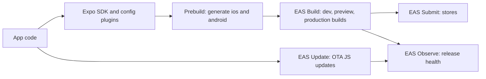
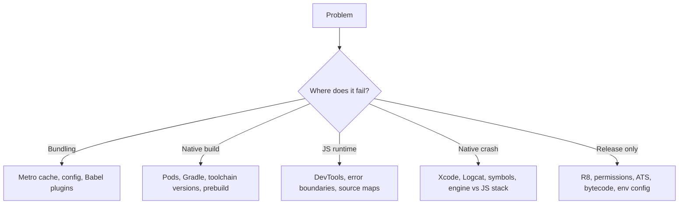

# Expo, EAS, Tooling and Debugging for React Native

> Verification note: Toolchain facts were verified against the **Expo SDK 58 changelog (Oct 2026)**, the **Expo changelog (May–Nov 2026)** and the **reactnative.dev release posts (0.82–0.88)**: Expo SDK **58 = React Native 0.88**, **SDK 57 (Jul 2026)**, **SDK 56 (May 2026, RN 0.85)**, **SDK 55 (RN 0.83)**, and **SDK 54 = RN 0.81, the last SDK allowing the Legacy Architecture**; **Expo Go** now requires login (SDK 57) and Expo's own guidance is that it is **not a development environment for production apps** — use **development builds**; SDK 58 adds the experimental **`@expo/agent-cli`**, `expo command:ps`/`command:events`, **`expo-device-hub`** (Xcode 27 Device Hub dashboard), a new default **tunnel** (`@expo/ws-tunnel`, requires `expo login`; `--tunnel ngrok` legacy), reserved **`__expo_*` launch-URL parameters**, an experimental **Rust (oxc) Metro transformer**, the **`balanced` fingerprint** default, **prebuilt `expo-modules-core`** and **Expo Modules 2.0 (beta)**, **R8 by default**, `NODE_ENV` set by command; **EAS Observe** is GA (Aug 2026); **EAS Workflows** gained `concurrency` groups and hooks (Nov 2026); the **React Native DevTools** gained multiple simultaneous CDP connections (0.85; clients such as DevTools, VS Code and AI agents), improvements in 0.86, and in 0.88 experimental performance screenshots and **WebSocket inspection** in the Network panel; **Android `debugOptimized`** (0.82); Jest preset moved to `@react-native/jest-preset` (0.85); Metro TLS (0.85); RN 0.87 needs **Node 22+, AGP 9, Kotlin 2.0+**; React Native support policy: latest and the previous two minor lines. New project command: `npx @react-native-community/cli@latest init MyProject` (RN blog); Expo: `npx create-expo-app` (SDK 58 template via `--template default@sdk-58` until stores ship the new Expo Go). **Continuous Native Generation internals, config-plugin APIs, EAS CLI commands and pricing/limits, Reactotron/Flipper status, Sentry/Datadog capabilities, Hermes profiler workflows and Xcode/Android Studio debugging steps are established practice not re-fetched in this session — marked *(hedged)* where specific.** Related: [04 Native modules](04-native-modules-components-and-platform-code.md), [13 Releases](13-ota-updates-and-store-releases.md), [14 CI/CD](14-ci-cd-with-github-actions.md).

## Table of Contents

1. [Quick Summary (TL;DR)](#1-quick-summary-tldr)
2. [Choosing a Project Foundation: Expo, Bare CLI and Frameworks](#2-choosing-a-project-foundation-expo-bare-cli-and-frameworks)
3. [Expo Building Blocks](#3-expo-building-blocks)
4. [EAS: Build, Submit, Update, Workflows, Observe](#4-eas-build-submit-update-workflows-observe)
5. [Debugging Toolbox](#5-debugging-toolbox)
6. [A Systematic Troubleshooting Playbook](#6-a-systematic-troubleshooting-playbook)
7. [Upgrading React Native and Expo](#7-upgrading-react-native-and-expo)
8. [Developer Experience, Monorepos and Quality Tooling](#8-developer-experience-monorepos-and-quality-tooling)
9. [Observability and Monitoring in Production](#9-observability-and-monitoring-in-production)
10. [Pitfalls](#10-pitfalls)
11. [Interview Questions — Fundamentals](#11-interview-questions--fundamentals)
12. [Interview Questions — Senior Scenarios](#12-interview-questions--senior-scenarios)
13. [Cheat Sheet](#13-cheat-sheet)
14. [Key Terms Glossary](#14-key-terms-glossary)
15. [Further Reading](#15-further-reading)

---

## 1. Quick Summary (TL;DR)

- **Most teams build with Expo** (an RN framework + tooling) even for native-heavy apps: **development builds**, **Continuous Native Generation (prebuild)**, **config plugins**, **EAS** (Build, Submit, Update, Workflows, Observe). **Expo Go is for learning/prototyping**, not for production apps. A bare React Native CLI project is still valid when you need full native control from day one.
- **SDK ↔ RN pairing:** SDK 58 = RN 0.88; SDK 54 = last Legacy Architecture; upgrade with `npx expo install expo@^58 --fix` + `npx expo-doctor` + the RN **Upgrade Helper**; RN supports latest + two previous minors.
- **Debug with React Native DevTools** (Chrome DevTools frontend: Console, Sources/breakpoints, Network incl. WebSockets in 0.88, React Components/Profiler, Performance), plus **native tools** (Xcode, Android Studio, Instruments, Perfetto) for native issues. Flipper-era workflows are obsolete *(hedged)*.
- **Troubleshoot systematically:** identify the layer (JS, Metro, native build, runtime/native crash, release-only), reproduce in **Release**, read logs, clear caches/rebuild, bisect dependencies/versions.
- **Production observability:** crash reporting with source maps/dSYMs/mapping files, release tagging, **Expo Observe** (startup/navigation, JS errors, native crashes), RUM and structured logs with PII scrubbing.
- **Tooling baselines:** TypeScript (Strict API default in 0.87), ESLint, Jest with `@react-native/jest-preset`, RNTL, Maestro/Detox E2E, Node 22+.

---

## 2. Choosing a Project Foundation: Expo, Bare CLI and Frameworks

| Option | What it is | Choose when | Watch out |
|---|---|---|---|
| **Expo (managed + CNG)** | Framework with SDK modules, Expo Router, prebuild, config plugins, EAS | Default for most apps and teams; fastest upgrades, great DX, OTA, CI integration | Learn config plugins and prebuild; native customization via plugins/Expo Modules |
| **Expo with development builds** | Your own native client with chosen native modules | Any app using custom native modules/SDKs | Rebuild when native inputs change (fingerprint tells you) |
| **Bare React Native CLI** | `npx @react-native-community/cli@latest init` — you own `ios/` and `android/` | Deep native customization, existing native apps (brownfield), strict control | You own native upgrades (Upgrade Helper), more CI/native maintenance |
| **Brownfield integration** | RN embedded in an existing native app | Incremental adoption in large native apps | Threading, navigation, build-system, and release-coordination complexity ([15](15-senior-scenarios-and-system-design.md)) |

- **Expo Go vs development build:** Expo Go is a fixed sandbox client with a fixed native module set (login required since SDK 57; it only supports the **current SDK** once the new Expo Go ships). Production apps use **development builds** (`expo-dev-client`) containing exactly your native modules ([12 §3](#3-expo-building-blocks)).
- **Expo can be adopted in bare apps** (install `expo`, use modules/Router/`expo-updates`) — "adopting prebuild" later is possible.
- **Other targets:** web (Expo Router/`react-native-web`), TV, Meta Quest, macOS/Windows via out-of-tree platforms (SDK 58 doesn't support macOS yet).

---

## 3. Expo Building Blocks

- **Expo SDK modules** (`expo-camera`, `expo-secure-store`, `expo-notifications`, `expo-sqlite`, `expo-file-system`, `expo-image`, …) implemented with the **Expo Modules API** (Swift/Kotlin; 2.0 beta with annotated classes) and autolinking ([04](04-native-modules-components-and-platform-code.md)).
- **Continuous Native Generation (CNG) / prebuild:** the `ios/` and `android/` projects are **generated** from `app.json`/`app.config.ts` plus **config plugins**, so upgrades regenerate native projects (delete and re-run prebuild: `npx expo prebuild`). Treat native folders as build artifacts unless you deliberately adopt them *(hedged)*.
- **Config plugins:** functions that modify native config (Info.plist, AndroidManifest, Gradle, entitlements) at prebuild; used by libraries so you don't edit native files by hand.
- **Fingerprint:** hashes native inputs to decide whether a new **native build** is needed vs an OTA update ([13 §3](13-ota-updates-and-store-releases.md#3-ota-compatibility-versioning-and-channels)); SDK 58's `balanced` preset ignores noise like `version` bumps.
- **Expo Router:** file-based routing built on React Navigation concepts ([10 §4](10-app-architecture-state-and-navigation.md#4-navigation)).
- **Expo CLI** (`npx expo start`, `expo run:ios|android`, `expo export`, `expo-doctor`): SDK 58 forces `NODE_ENV` by command, adds `expo command:ps`/`command:events` for machine-readable process info, a faster tunnel (`@expo/ws-tunnel`, needs `expo login`), and the **launch URL** contract (`__expo_url`, `__expo_disable_onboarding`, `__expo_disable_fab`, `__expo_disable_auto_launch`; `EXPO_NO_DEV_MENU=1` for CI/E2E).
- **Dev tooling:** `expo-dev-client` (dev menu, launcher), `expo-device-hub` (SDK 58; browser dashboard to stream simulators/emulators, boot/shutdown, CPU/memory/network graphs, appearance and accessibility toggles with Xcode 27 Device Hub), `@expo/agent-cli` (experimental CLI designed for coding agents), Expo MCP server *(hedged)*.
- **Metro in Expo:** `expo/metro-config` defaults; experimental **Rust (oxc) transformer** for ~2× faster cold bundling when you have no custom Babel/transform worker (skips Reanimated/Worklets-transformed files) ([06](06-startup-bundle-animations-and-gestures.md#4-metro-bundler-and-dev-server)).
- **Environment variables:** `.env` files and `EXPO_PUBLIC_*` (inlined into the bundle — public); secrets via EAS secrets; `NODE_ENV` set by the command ([11 §11](11-mobile-security.md#11-secrets-management)).

---

## 4. EAS: Build, Submit, Update, Workflows, Observe

| Service | Purpose | Notes |
|---|---|---|
| **EAS Build** | Cloud builds for iOS/Android (dev, preview/internal, production profiles); manages credentials | Profiles in `eas.json`; caches; custom build steps; compare with GitHub Actions in [14](14-ci-cd-with-github-actions.md) |
| **EAS Submit** | Upload to App Store Connect / Google Play | Uses API keys/service accounts as secrets |
| **EAS Update** | OTA JS updates over `expo-updates`; channels/branches; runtime versions; rollouts | `updates.maxUpdatesToKeep` (SDK 58); republish/rollback; ([13](13-ota-updates-and-store-releases.md)) |
| **EAS Workflows** | YAML pipelines (build, test, submit, update) | **`concurrency` groups with expressions/queueing and hooks** (Nov 2026); iOS internal-distribution device registration automation (Jun 2026) |
| **EAS Observe** | Production monitoring | GA Aug 2026: startup/navigation performance, JS errors, **native crashes** (update `expo-observe`/SDK 57.0.21+), release-to-release comparison; `Observe.clientId` for joining other tools; `AppMetrics` deprecated |
| **Integrations** | PostHog (`eas integrations:posthog:connect`), Supabase one-command setup *(Nov 2026)* | Events tagged with `eas/update_id`, `eas/build_id`, `eas/channel`, `eas/runtime_version` |
| **Maestro on EAS** | E2E runs with insights dashboard (flaky tests, regressions) *(Jun 2026)* | See [testing/08 §6](../testing/08-testing-in-practice-tdd-architecture-mobile-and-ai.md#6-testing-react-native-apps) |

- **Build profiles:** `development` (dev client, internal), `preview` (internal testing, ad-hoc/APK), `production` (store). Keep profile-specific env and channel settings in `eas.json`.
- **Credentials:** EAS can manage iOS certificates/profiles and Android keystores, or you supply your own; protect them like production secrets ([14 §4](14-ci-cd-with-github-actions.md#4-signing-secrets-and-environment-configuration)).
- **When to use EAS vs your own CI:** EAS reduces native-build maintenance (macOS runners, signing); your own CI wins for org policy, runner/registry control (e.g. Artifactory, `bby-ubuntu`), custom audit. Hybrid is common.

---

## 5. Debugging Toolbox

**React Native DevTools** (Chrome DevTools frontend; opens from the dev menu/terminal)
- **Console/Sources:** logs, breakpoints, step through JS on Hermes; **Network panel** (request payload previews restored on Android in 0.85; **WebSocket inspection** in 0.88); **React Components + Profiler** (why/when components render — [05](05-performance-rendering-lists-images-and-memory.md#3-the-systematic-debugging-flow-and-tools)); **Performance** panel with Web Performance API data (stable since 0.83) and experimental performance screenshots (0.88).
- **Multiple CDP connections (0.85):** DevTools, VS Code and AI agents can connect simultaneously without ending each other's sessions.
- **Remote JS debugging (Chrome) and Flipper-era plugins** are legacy *(hedged)*; use DevTools, Reactotron *(hedged)*, or Expo/Sentry tooling.

**Layer-specific tools**

| Layer | Tools |
|---|---|
| JS logic/rendering | DevTools Sources/Profiler, `why-did-you-render` *(hedged)*, error boundaries, logging with levels |
| Layout | Element Inspector (dev menu), DevTools component tree, DOM-like node APIs on refs (0.82) for `getBoundingClientRect` |
| Network | DevTools Network; proxies (Charles/Proxyman, mitmproxy) for TLS traffic — **pinned apps need a debug bypass** ([11 §5](11-mobile-security.md#5-certificate-pinning)) |
| Native crashes/ANRs | Xcode (breakpoints, Instruments: Time Profiler, Allocations, Animation Hitches), Android Studio (Logcat, Profiler, Layout Inspector), `adb logcat`, Perfetto |
| Native + JS interop | Xcode/Android Studio native debuggers with Hermes; Android `debugOptimized` for smoother debug-style runs (no C++ debugger) |
| Release-only bugs | Release builds on devices, symbolicated crash reports (source maps, dSYMs, R8 mapping), `expo-doctor`, `--no-dev --minify` Metro runs *(hedged)* |
| Startup/perf | Hermes sampling profiler, Perf Monitor, `adb shell am start -W`, Observe ([06](06-startup-bundle-animations-and-gestures.md#2-startup-performance)) |
| Dependencies/build | `npx expo-doctor`, `npx react-native doctor` *(hedged)*, Gradle `--stacktrace`, `pod install --repo-update` |

**Source maps and symbols:** upload source maps (JS), **dSYMs** (iOS), **R8 mapping files** (Android; essential now that R8 is default in SDK 58) to crash reporters in CI ([14](14-ci-cd-with-github-actions.md)).

---

## 6. A Systematic Troubleshooting Playbook

1. **Classify the failure:** Metro/bundling, JS runtime error, native build, startup crash, release-only issue, performance, or environment (Node/JDK/Xcode versions).
2. **Reproduce minimally** in the right build type (Release for performance/minification issues; dev client vs Expo Go differences).
3. **Read the right log:** Metro terminal, DevTools console, Xcode build log / Gradle `--stacktrace`, Logcat / device console, crash-report stack (JS vs native).
4. **Clear the usual suspects:** Metro cache (`--reset-cache` / `expo start -c`), watchman, `node_modules` and lockfile consistency, CocoaPods (`pod install`), Gradle caches/`./gradlew clean`, derived data, regenerate native projects with prebuild in CNG apps.
5. **Check version compatibility:** RN ↔ Expo SDK ↔ libraries (React Native Directory/library docs for **New Architecture** support), Reanimated/Worklets versions, Hermes V1, Node/JDK/AGP/Kotlin/Xcode requirements (0.87: Node 22+, AGP 9, Kotlin 2.0+).
6. **Bisect:** disable recently added libraries/config plugins, binary-search commits, compare against a fresh template app.
7. **Isolate JS vs native:** does the same JS run elsewhere? Does a native crash have a Hermes/C++ stack (engine fault) vs a JS stack ([08 §6](08-app-lifecycle-background-work-push-and-deep-links.md#6-fault-semantics-what-crashes-what))?
8. **Capture evidence for escalation:** version matrix, repro repo, logs, device/OS; check release notes/changelogs for breaking changes.
9. **Prevent regressions:** add a test or CI check, document the fix, add monitoring.

**Common release-only causes:** R8/minification stripping reflective code (add keep rules), missing permissions/`Info.plist` strings, stricter ATS/cleartext rules, different bundle (Hermes bytecode vs Metro dev), `__DEV__` branches, native-module registration differences, feature flags/environment config.

---

## 7. Upgrading React Native and Expo

- **Cadence and policy:** RN supports the latest + two previous minor lines (e.g. 0.82 became unsupported after 0.85); Expo SDKs ship roughly quarterly and pin an RN version; skipping versions multiplies risk.
- **Expo workflow:** `npx expo install expo@^58.0.0 --fix` → `npx expo-doctor@latest` → read **Deprecations** and **Notable breaking changes** in the SDK post → delete and regenerate `android/ios` if using CNG (otherwise `npx pod-install` and the **Native project upgrade helper**) → rebuild development builds → test.
- **Bare RN workflow:** **React Native Upgrade Helper** diffs between versions; update native templates, Gradle/AGP/Kotlin, Podfile/Xcode, Metro/Babel presets, Jest preset (`@react-native/jest-preset`, 0.85), TypeScript config for the **Strict API (0.87)**.
- **Breaking-change themes (recent):** New Architecture only (0.82), uncaught promise rejections reported (0.82), legacy components removed (0.84), Node ≥ 20.19.4 / 22 (0.85/0.87), `StyleSheet.absoluteFillObject` removed (0.85), Strict TypeScript API + AGP 9 + Kotlin 2.0 + removal of `InteractionManager`, `Touchable` export, `Modal animated`, `StatusBar` props (0.87), iOS scene lifecycle and `expo-router` navigation-core changes (SDK 58). Three RN releases (0.83, 0.86, 0.88) had **no user-facing breaking changes** — upgrades are getting more predictable.
- **Migration to the New Architecture:** upgrade to 0.81 / SDK 54, enable and verify, then continue ([02 §12](02-architecture-bridge-to-new-architecture.md#12-migration-interop-and-the-timeline)).
- **Strict TypeScript API (0.87):** fix deep imports (`react-native/Libraries/*`) and ref types (`ViewInstance`, `TextInputInstance`); temporary opt-out via `customConditions` (`react-native-legacy-deep-imports`) is **removed after 0.89** — migrate during the SDK 58 cycle.
- **Upgrade safety net:** feature branch, device matrix smoke tests (E2E), staged rollout with Observe/crash comparisons, and a rollback plan ([13](13-ota-updates-and-store-releases.md)).
- **Dependency policy:** prefer libraries with active New Architecture support; patch with `patch-package` only temporarily and upstream fixes; pin versions in lockfiles.

---

## 8. Developer Experience, Monorepos and Quality Tooling

- **TypeScript** (Strict API), **ESLint** (React Native/Expo config; hooks rules), **Prettier**, import-boundary lint rules ([10 §2](10-app-architecture-state-and-navigation.md#2-app-architecture)).
- **Testing:** Jest with `@react-native/jest-preset`, RNTL, MSW for network, Maestro/Detox for E2E ([testing/](../testing/README.md)).
- **Monorepos** *(hedged)*: workspaces (npm/yarn/pnpm), Metro resolver for symlinks and shared packages, Nx/Turborepo affected builds, a single RN/Expo version policy, shared design-system and API-client packages.
- **Git hooks and CI parity:** pre-commit lint/types; CI re-runs the same scripts ([14](14-ci-cd-with-github-actions.md)).
- **Editor/AI tooling:** multiple CDP connections allow AI agents and IDEs to attach alongside DevTools (0.85); `@expo/agent-cli` and Expo MCP exist for agent workflows — review agent-generated changes like any other code ([testing/08 §8](../testing/08-testing-in-practice-tdd-architecture-mobile-and-ai.md#8-ai-assisted-testing)).
- **Local environment hygiene:** Node 22+ (odd-numbered Node releases unsupported by Expo tooling), correct JDK, Xcode/command line tools, CocoaPods or experimental SwiftPM (`npx react-native spm`, 0.88), Android SDK; document with a one-command setup script and a `doctor` check.

---

## 9. Observability and Monitoring in Production

- **Crash/error reporting:** JS exceptions with source maps, native crashes with dSYMs/R8 mappings, breadcrumbs scrubbed of PII ([11 §8](11-mobile-security.md#8-sensitive-data-in-logs-and-screens)); tag every event with **app version, build, OTA update ID, runtime version, channel**.
- **Release health:** crash-free users/sessions, ANR rate, JS error rate, startup and navigation timing per release — **EAS Observe** (startup/navigation, JS errors, native crashes) or Sentry/Crashlytics/Datadog *(hedged)*; compare against the previous release before expanding rollouts ([13](13-ota-updates-and-store-releases.md#4-ota-rollout-rollback-and-safe-design)).
- **Performance in the field:** Web Performance APIs (stable since 0.83: Event Timing, Long Tasks, `performance.mark/measure`) feed custom telemetry ([05](05-performance-rendering-lists-images-and-memory.md)).
- **Product analytics/session replay:** consent, redaction and sensitive-screen exclusions; PostHog integration tags events with update/build/channel/runtime version.
- **Alerting and runbooks:** thresholds on crash-free rate, error spikes after OTA publish, store review ratings; on-call ownership and automated halt/rollback hooks.
- **Logging:** structured logs, levels, no tokens/PII, remote log level toggles via flags.

---

## 10. Pitfalls

1. Treating Expo Go as a production development environment (fixed native module set; login required; only current SDK).
2. Editing generated `ios/`/`android/` folders in a CNG app and losing changes on prebuild (use config plugins).
3. Mixing RN, Expo SDK and library versions without `expo install --fix`/`expo-doctor`.
4. Skipping versions on upgrades; ignoring breaking-change lists; keeping Strict TS opt-outs past 0.89.
5. Debugging performance in Debug builds; ignoring Release-only (R8, bytecode, permissions) differences.
6. Not uploading source maps/dSYMs/R8 mappings, making crash reports unreadable.
7. Pinned apps that can't be debugged through proxies in non-production builds.
8. Overlooking `NODE_ENV`/`.env` behavior changes (Expo SDK 58) when relying on custom environments.
9. Using unmaintained libraries without New Architecture support; stale `patch-package` patches.
10. Shipping agent-generated or auto-fixed changes without review/tests.
11. No device-matrix testing for iOS 27/Android 15+ edge-to-edge changes.
12. Ignoring toolchain requirements (Node 22+, AGP 9, Kotlin 2.0+) until CI breaks.

---

## 11. Interview Questions — Fundamentals

- **Expo vs bare React Native?** Expo is a framework/tooling layer (modules, Router, prebuild, EAS) usable for most apps, including native-heavy ones via development builds and config plugins; bare gives direct ownership of native projects.
- **Expo Go vs development build?** Expo Go is a prebuilt sandbox with fixed modules for learning/prototyping; development builds contain your native modules for real development.
- **What is CNG/prebuild and config plugins?** Generating native projects from config; plugins modify native config so you don't hand-edit native files.
- **What does EAS include?** Build, Submit, Update, Workflows, Observe (plus integrations).
- **What is a fingerprint?** Hash of native inputs deciding if a new native build is needed vs OTA.
- **How do you debug JS in RN today?** React Native DevTools (Console, Sources, Network, Components/Profiler, Performance); not remote Chrome debugging.
- **How do you debug a native crash?** Xcode/Android Studio, Logcat, symbolicated crash reports (dSYMs/R8 mappings), check Hermes/C++ stack vs JS stack.
- **What's `debugOptimized`?** Android build type giving much faster debug-style runs without the C++ debugger.
- **How do you upgrade Expo SDK?** `npx expo install expo@^N --fix`, `expo-doctor`, read breaking changes, regenerate native projects, rebuild dev builds.
- **How do you upgrade bare RN?** Upgrade Helper diffs, update native templates and toolchain, test thoroughly.
- **What support policy applies?** Latest and previous two minor lines.
- **What observability should production have?** Crash/error reporting with symbols, release tagging, performance telemetry, scrubbed logs, alerting.

---

## 12. Interview Questions — Senior Scenarios

### S1. "Choose between Expo and bare React Native for a new fintech app."
Expo with development builds, CNG and config plugins for velocity, OTA and consistent upgrades; justify bare only for hard native constraints (brownfield, unsupported SDKs, bespoke build systems). Ensure security needs (pinning, secure storage, attestation) are met via Expo Modules/config plugins; design the escape hatch (own the native folders) and compliance/audit via CI rather than EAS-only if required.

### S2. "Our app crashes only in Release after the SDK 58 upgrade."
Suspect R8 default minification (keep rules for reflective libs, mapping uploaded), iOS scene lifecycle migration for custom `AppDelegate`, env/`NODE_ENV` changes, and library versions. Reproduce on device with a Release build, deobfuscate the stack, compare with the previous SDK, disable R8 temporarily to confirm, and roll out the fix via staged release.

### S3. "A team of 20 engineers keeps breaking builds with native dependency changes."
Introduce fingerprint-based CI (native-changing PRs trigger builds), dependency PR templates (New Architecture support, permissions, size), `expo-doctor` checks, lockfile enforcement, ownership for native modules, preview builds per PR (EAS preview or GitHub Actions), and a weekly upgrade slot.

### S4. "Debugging a production-only network issue behind certificate pinning."
Reproduce in a non-production build with a controlled pinning bypass (debug-only config), use DevTools Network/proxy to inspect, validate cert chains/rotation, check TLS inspection by corporate proxies, compare with production logs and monitoring; never ship the bypass.

### S5. "Plan the upgrade from RN 0.78 to 0.88."
Check the support window, go step-by-step through breaking changes: first reach 0.81/SDK 54 and enable the New Architecture, then 0.82+ (rejection reporting, New-Arch-only), 0.84 (legacy removal, Hermes V1), 0.85 (Jest preset, Node), 0.87 (Strict TS, Node 22/AGP 9/Kotlin 2, removed APIs), 0.88 (event dispatching, iOS SceneDelegate); update CI toolchain; automate smoke tests; stage rollout with Observe; keep rollback paths.

### S6. "How should we use AI coding agents with the RN toolchain safely?"
Allow agents through documented CLIs (`@expo/agent-cli`, DevTools CDP connections, MCP) in sandboxed dev environments; no production credentials; require tests/linters in CI; review diffs; add repo skills/docs for project conventions; log tool access; treat generated native/config-plugin changes with extra scrutiny.

---

## 13. Cheat Sheet

| Task | Tool/command |
|---|---|
| New Expo app | `npx create-expo-app` (SDK 58: `--template default@sdk-58`) |
| New bare app | `npx @react-native-community/cli@latest init MyApp` |
| Run dev build | `npx expo run:ios` / `run:android`, `expo start` with dev client |
| Upgrade SDK | `npx expo install expo@^58 --fix` + `npx expo-doctor` |
| Debug JS | React Native DevTools |
| Debug native | Xcode / Android Studio, Logcat, Instruments |
| Clear caches | `expo start -c`, `pod install`, `./gradlew clean` |
| Cloud build / submit / OTA | EAS Build / Submit / Update |
| Prod monitoring | EAS Observe, Sentry/Crashlytics + symbols |
| Toolchain (RN 0.87) | Node 22+, AGP 9, Kotlin 2.0+ |

---

## 14. Key Terms Glossary

| Term | Meaning |
|---|---|
| **Expo SDK** | Versioned set of modules/tools pinned to an RN version |
| **Development build** | Custom dev client with your native modules |
| **CNG / prebuild** | Generating native projects from config |
| **Config plugin** | Code that modifies native config at prebuild |
| **Fingerprint** | Hash of native inputs |
| **EAS** | Expo Application Services (Build, Submit, Update, Workflows, Observe) |
| **React Native DevTools** | Chrome-DevTools-based debugger for RN |
| **CDP** | Chrome DevTools Protocol |
| **`debugOptimized`** | Faster Android debug-style build |
| **dSYM / R8 mapping** | iOS / Android symbol files for crash deobfuscation |

---

## 15. Further Reading

- [Expo documentation](https://docs.expo.dev/) · [Expo SDK 58 changelog](https://expo.dev/changelog/sdk-58) · [EAS](https://docs.expo.dev/eas/) · [React Native DevTools](https://reactnative.dev/docs/react-native-devtools) · [Debugging](https://reactnative.dev/docs/debugging) · [Upgrading](https://reactnative.dev/docs/upgrading) · [Upgrade Helper](https://react-native-community.github.io/upgrade-helper/) · [RN 0.85](https://reactnative.dev/blog/2026/04/07/react-native-0.85) · [RN 0.88](https://reactnative.dev/blog/2026/10/19/react-native-0.88) *(hedged: check URLs)*
- This repo: [04 Native modules](04-native-modules-components-and-platform-code.md) · [05 Performance](05-performance-rendering-lists-images-and-memory.md) · [13 Releases](13-ota-updates-and-store-releases.md) · [14 CI/CD](14-ci-cd-with-github-actions.md) · [testing/08 AI-assisted testing](../testing/08-testing-in-practice-tdd-architecture-mobile-and-ai.md#8-ai-assisted-testing)
