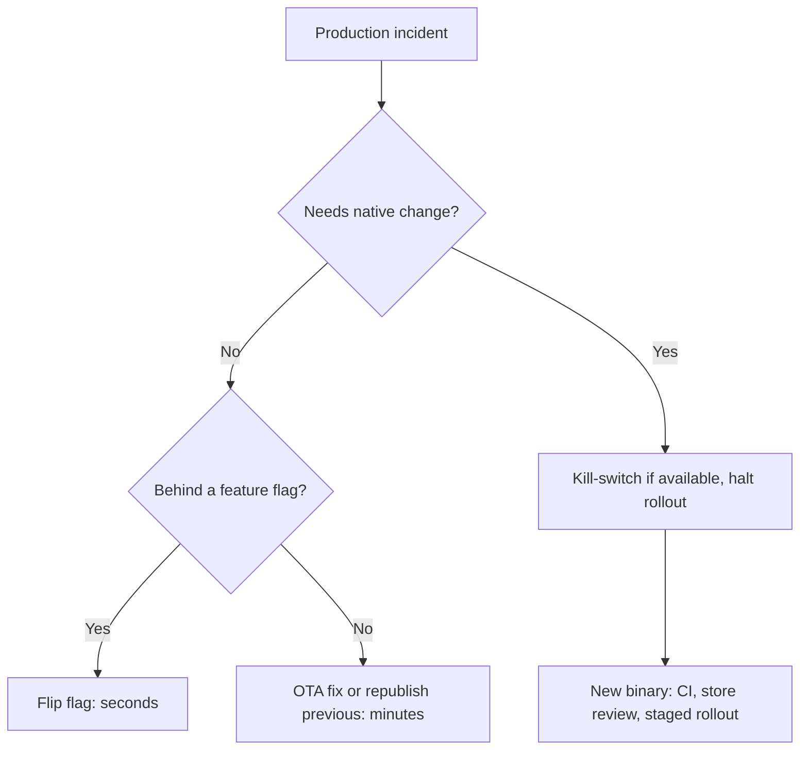
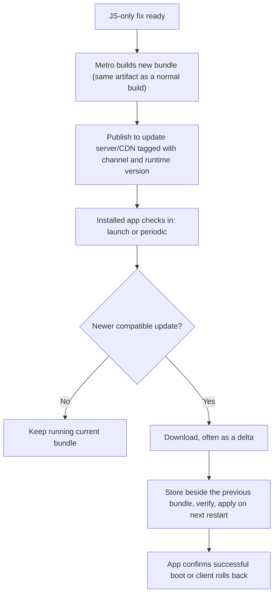
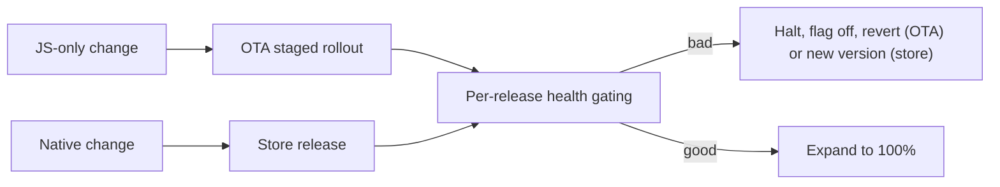

# OTA Updates and App Store / Play Store Releases

> Verification note: Release facts were checked against **Expo's changelog and SDK 58 notes (Oct–Nov 2026)** — the `balanced` **fingerprint** preset is the default (version bumps and `node_modules` file changes no longer alter the fingerprint; native modules are hashed by package name and version), **`updates.maxUpdatesToKeep`** was added to `expo-updates` (helps channel-surfing setups avoid re-downloading), **Expo Go is not a production environment** (use development builds), **EAS Workflows** gained concurrency groups and hooks (Nov 2026), **EAS Observe** reached general availability (Aug 2026) and records startup/navigation performance, JS errors and native crashes per release, the PostHog integration tags events with `eas/update_id`, `eas/build_id`, `eas/channel` and `eas/runtime_version`, iOS 27 builds require the scene-based lifecycle ([08](08-app-lifecycle-background-work-push-and-deep-links.md)), and **Android release builds use R8 by default** — plus the **React Native support policy** (latest plus the previous two minor lines are supported; e.g. 0.82 became unsupported when 0.85 shipped) and **0.81 / SDK 54 as the last Legacy-Architecture versions** ([02](02-architecture-bridge-to-new-architecture.md#12-migration-interop-and-the-timeline)). The policy quotes below (Apple App Store Review Guideline **3.3.2**; Google Play's exception for code that runs in a virtual machine with limited API access) come from the earlier verified material in this handbook. **Microsoft CodePush was retired on 31 March 2025 (repository archived 20 May 2025)** — referenced only as an illustrative mechanism. **Exact Expo/EAS CLI commands and config keys, EAS Update branch/channel/rollout features, Apple's phased-release schedule (flagged: Apple's page was not retrievable earlier), Play Console staged-rollout details beyond the cited behaviors, `targetSdkVersion` deadlines and expedited-review criteria are established practice not re-fetched in this session — marked *(hedged)*.** Pipeline automation: [14](14-ci-cd-with-github-actions.md); signing secrets hygiene: [11](11-mobile-security.md#11-secrets-management).

## Table of Contents

1. [Quick Summary (TL;DR)](#1-quick-summary-tldr)
2. [How OTA Updates Work and What They Can Change](#2-how-ota-updates-work-and-what-they-can-change)
3. [OTA Compatibility, Versioning and Channels](#3-ota-compatibility-versioning-and-channels)
4. [OTA Rollout, Rollback and Safe Design](#4-ota-rollout-rollback-and-safe-design)
5. [What Must Never Ship Over the Air](#5-what-must-never-ship-over-the-air)
6. [Store Releases: When a New Binary Is Required](#6-store-releases-when-a-new-binary-is-required)
7. [From CI to the Stores](#7-from-ci-to-the-stores)
8. [Code Signing](#8-code-signing)
9. [Store Rollouts and the Reality of Rollback](#9-store-rollouts-and-the-reality-of-rollback)
10. [Incident Playbooks and Release Operations](#10-incident-playbooks-and-release-operations)
11. [Pitfalls](#11-pitfalls)
12. [Interview Questions — Fundamentals](#12-interview-questions--fundamentals)
13. [Interview Questions — Senior Scenarios](#13-interview-questions--senior-scenarios)
14. [Cheat Sheet](#14-cheat-sheet)
15. [Key Terms Glossary](#15-key-terms-glossary)
16. [Further Reading](#16-further-reading)

---

## 1. Quick Summary (TL;DR)

- **OTA updates replace only the JS bundle and JS-bundled assets** for an already-installed binary — never native code, native dependencies, permissions or SDK bumps. They bypass store review, so they are fast (minutes) and constrained by **platform policy**.
- **Compatibility is the core design problem:** tag every binary with a **runtime version** (or a **fingerprint** of native inputs) and only serve updates whose runtime version matches; otherwise the bundle may reference native modules that don't exist.
- **Safe OTA = staged rollout + per-release telemetry + two rollback layers** (device-side "booted successfully" acknowledgement and server-side republish/halt) + atomic download/apply on next launch.
- **Store releases** are required for any native change, permission change, RN/Expo SDK upgrade or policy-driven target-SDK bump; they are slow (review) and **cannot be truly rolled back** — you ship a new, higher version.
- **Pipeline:** iOS = sign (certificate + provisioning profile) → `xcodebuild archive/export` → upload → TestFlight → review → phased release; Android = keystore → `bundleRelease` (AAB) → Play upload → track → staged rollout.
- **Levers for incidents, fastest first:** feature flag/kill-switch → OTA republish (JS-only) → halt staged/phased rollout → new binary (expedited review on iOS).
- **Version on three axes:** native binary version, runtime/compatibility version, OTA update ID.

---

## 2. How OTA Updates Work and What They Can Change

**General sequence (EAS Update, historically CodePush, or in-house):**

- For bare/CLI apps the usual route is integrating the open-source **`expo-updates`** library (no need to adopt the whole Expo managed workflow) and publishing via **EAS Update**.
- **What changes:** the **JS bundle** and assets bundled via `import`/`require` (images, fonts). **What does not:** native code (Java/Kotlin/Obj-C/Swift), native dependencies/SDKs, permissions (`Info.plist`/`AndroidManifest.xml`), entitlements, and RN/Expo SDK version bumps.
- **Appropriate OTA content:** JS bug/crash fixes, copy/styling/layout changes, business logic expressible in JS.
- **Why native can't ship OTA:** it is compiled code registered at **build time**; JS can only call native modules that already exist. Even a workaround would violate policy ([§5](#5-what-must-never-ship-over-the-air)).
- **Metro bundle vs OTA bundle:** same artifact; embedded at build time and store-reviewed vs delivered at runtime — OTA additionally must match installed native code ([06](06-startup-bundle-animations-and-gestures.md#4-metro-bundler-and-dev-server)).
- **Missing native module at runtime:** legacy architecture → `NativeModules.X` is `undefined` → `TypeError`; New Architecture → `TurboModuleRegistry.getEnforcing` **fails loudly** (invariant/native crash). Either way an unrecoverable crash for that session — hence version gating plus auto-rollback.

---

## 3. OTA Compatibility, Versioning and Channels

- **Runtime version policy:** EAS Update uses runtime versions so updates reach **only builds with compatible native code**; if native code changes you create a new runtime version. Each binary carries a runtime version string (manual, or derived — e.g. a **fingerprint** of native inputs; the SDK 58 `balanced` preset ignores noise such as `version` bumps and hashes native modules by name+version so fingerprints stay stable); each update targets one or more runtime versions; the server never serves a mismatched update, making the "missing native module" crash **structurally unreachable**. (CodePush achieved the same with semver ranges via `--target-binary-version`.)
- **Three version axes:**

| Axis | Tracks | Cadence | Example |
|---|---|---|---|
| **Native binary version** | The compiled app in a store | Low (each store release) | `versionName`/`CFBundleShortVersionString` + build number |
| **Runtime / compatibility version** | The native "shape" an OTA bundle may run against | Only when native code changes | EAS runtime version / fingerprint hash |
| **OTA update ID** | Each JS-only release | High | Update ID, content hash or timestamp |

  Keep an explicit, queryable mapping from update → runtime version so "which updates are valid for 4.2.0?" is answerable from the dashboard/API.
- **Channels and branches** *(hedged terminology)*: builds subscribe to a **channel** (production, staging, preview) mapped to a **branch** of updates, allowing staging/preview releases and promotion between them; `updates.maxUpdatesToKeep` (SDK 58) controls how many updates are kept on device.
- **Embedded update:** the binary ships with a bundled baseline; clients fall back to it if no valid downloaded update is usable.
- **Update check policy:** on launch (with or without blocking), on foreground, or manual; decide whether to apply on next launch (safer) or prompt for reload; avoid mid-session hot-swaps that mix old and new state.
- **Code signing of updates** *(hedged)*: enable update code signing so a compromised CDN/account can't push arbitrary bundles; scope credentials and protect publish access ([11 §12](11-mobile-security.md#12-build-dependency-and-release-security)).
- **Tagging telemetry:** include update ID, runtime version and channel in crash/analytics events (EAS Observe records per-release health; the PostHog integration adds `eas/update_id`, `eas/runtime_version` etc.).

---

## 4. OTA Rollout, Rollback and Safe Design

**Staged rollout / canary.** Publish to a **percentage** of the channel first, watch crash/error/business metrics for a bake-time window, then expand. Select cohorts with **consistent hashing of a stable device/user ID** so the same devices stay in the cohort between check-ins (as Google Play does). Example CodePush-style shape: promote to ~20%/5%, monitor, then patch to 100%. *(EAS Update offers rollout controls — confirm current features.)*

| Strategy | Idea | Rollback | Mobile OTA fit |
|---|---|---|---|
| **Canary** | Small monitored subset first | Pull before wide exposure | Strong — equals a staged percentage rollout |
| **Blue-green** | Two full parallel environments, atomic cutover | Instant switch back | Weak — no load balancer; nearest analogue is instantly changing the "current" update (republish) |
| **Rolling** | Gradual replacement, no parallel environment | Slower, increment by increment | Reasonable for timed ramps without health gating |
> All three come from backend deployment practice; only the **JS layer** can be canaried/rolled/staged — mobile can't run two native binaries side by side for one installed app.

**Rollback — two complementary layers**
1. **Device-side, crash-triggered:** the client keeps the previous known-good bundle; the app must acknowledge "I booted successfully" shortly after launching on a new bundle (CodePush used `notifyApplicationReady()`); no acknowledgement → the client concludes the update is bad and **reverts on next launch** automatically. Without this a single bad release could brick every device that downloaded it.
2. **Server-side revert:** stop serving the release or **republish** a previous validated bundle as current (EAS Update republish/rollback features *(hedged commands)*), protecting devices that haven't downloaded the bad update yet.

**Automatic rollback on crash-rate increase (design, not stock tooling):** (1) tag every crash with the OTA release/runtime version; (2) define threshold checks vs the previous release or an absolute ceiling during the bake window; (3) wire alerts/webhooks to a job that halts the rollout and/or republishes the last good bundle; (4) layer on top of device-side rollback — the first protects devices that crashed, the second protects everyone else.

**Failure modes**
- **Network loss mid-download:** download to a temp location, verify checksum, **atomically** swap; on failure keep running the current bundle and retry later (delta downloads reduce exposure).
- **Update downloads but crashes on startup:** missing acknowledgement → automatic revert to the previous bundle; no user/store action needed.

**Safe OTA design checklist:** Metro build tagged with runtime version → staged percentage with stable cohorting → verified atomic download → apply on next restart → boot acknowledgement + device-side rollback → per-release telemetry with bake-time gating and a one-action server-side halt/revert → respect the technical boundary (no native changes) and policy boundary ([§5](#5-what-must-never-ship-over-the-air)).

---

## 5. What Must Never Ship Over the Air

- **Technical:** any native code change — new/changed native modules, native dependencies/SDKs, permission/entitlement changes, RN/Expo SDK upgrades.
- **Apple policy — App Store Review Guideline 3.3.2:** *"Interpreted code may be downloaded to an Application but only so long as such code: (a) does not change the primary purpose of the Application by providing features or functionality that are inconsistent with the intended and advertised purpose of the Application as submitted to the App Store, (b) does not create a store or storefront for other code or applications, and (c) does not bypass signing, sandbox, or other security features of the OS."* A pure-JS change can still violate it.
- **Google Play policy:** the exception covering JS-only updates is scoped to code that *"runs in a virtual machine and has limited access to Android APIs (such as JavaScript in a webview or browser)"*.
- **Security hygiene:** newly introduced secrets or sensitive keys don't belong in a bundle (bundles are public and OTA bypasses store review); an OTA pipeline deserves **more** scrutiny and signing/integrity verification, not less ([11](11-mobile-security.md#11-secrets-management)).
- **Product/regulatory:** material changes to flows that compliance expects to be reviewed (disclosures, payments logic) should follow your internal approval process even if technically OTA-able.

---

## 6. Store Releases: When a New Binary Is Required

| | OTA | Store release |
|---|---|---|
| Can change | JS bundle + JS assets | Anything |
| Review | None | Apple: review process; Google: largely automated + policy checks |
| Time to users | Minutes | Hours–days plus rollout ramp |
| Needs new install | No | Yes |
| Native modules/permissions | Never | Only path |
| Rollback | Near-instant | Hard |

**New iOS binary needed for:** new/changed native modules or dependencies; permissions/entitlements (`Info.plist` keys, push, App Groups); RN or Expo SDK upgrades touching native; StoreKit/IAP configuration, icons/launch screens, metadata/compliance declarations; whenever the OTA runtime version must be bumped because native code changed; **iOS 27 SDK/scene-lifecycle requirements** ([08](08-app-lifecycle-background-work-push-and-deep-links.md)).

**New Android binary needed for:** any native (Java/Kotlin/C++) change; `AndroidManifest.xml` permissions/components; `targetSdkVersion`/`compileSdkVersion` bumps — **Google Play enforces minimum target SDK policies** so you may be forced to ship periodically; new native dependencies or Gradle/AGP changes (AGP 9, Kotlin 2.0+, Node 22 for RN 0.87); the same runtime-version trigger.

**Support policy:** RN supports the latest and previous two minor lines — plan upgrade cadence so security fixes remain available; Expo SDKs ship roughly every few months (SDK 58: Oct 2026, RN 0.88).

---

## 7. From CI to the Stores

**iOS `.ipa` → App Store Connect** (typically **Fastlane**)
1. Check out, install JS deps, `pod install` (CocoaPods remains the default; SwiftPM is experimental in 0.87/0.88).
2. Resolve signing — **Fastlane `match`** syncs certificates and profiles from an encrypted git repo.
3. `xcodebuild archive` (Fastlane `gym`/`build_app`) → `.xcarchive`.
4. `xcodebuild -exportArchive` with an export-options plist (`app-store`) → signed `.ipa`.
5. Upload (`pilot`/`deliver` or App Store Connect API) authenticated with an **App Store Connect API key** (not a personal Apple ID).
6. Apple processes/validates → **TestFlight** → promote for review and release (manual or automated).

**Android `.aab` → Google Play**
1. Check out, install JS deps.
2. Decode the **release keystore** from a CI secret.
3. `./gradlew bundleRelease` (signing config from `gradle.properties`) → `android/app/build/outputs/bundle/release/app-release.aab`.
4. Upload via the **Google Play Developer API** (Fastlane `supply` or a Play-upload action) using a **service account JSON** key with Release Manager permission.
5. The edit uploads the AAB to a track (internal/closed/open/production), optionally sets a rollout percentage and notes, then commits; Google runs automated checks before it goes live.

Expo/EAS alternative: **EAS Build** + **EAS Submit** manage credentials and uploads; **EAS Workflows** (concurrency groups, hooks) orchestrates pipelines ([12](12-expo-eas-tooling-and-debugging.md), [14](14-ci-cd-with-github-actions.md)).

---

## 8. Code Signing

- **iOS:** every build is signed with a **certificate** (identity; key pair whose public half Apple countersigns; Development vs Distribution) and carries a **provisioning profile** (binds certificate(s), the **App ID/bundle identifier**, entitlements and — for development/ad-hoc — registered device UDIDs; App Store profiles carry no device list). Both expire; **Fastlane `match`** centralizes them across the team and CI.
- **Android:** you hold an **upload key** (keystore; `keytool -genkeypair -v -storetype PKCS12 ...`) to sign the AAB; under **Play App Signing** Google **re-signs** the distributed artifact with a separate **app signing key** it holds, so a lost/compromised upload key can be reset — unlike the old single-key model where losing the key orphaned the listing.
- **APK vs AAB:** APK = directly installable final format; **AAB** = a publishing format that defers APK generation/signing to Google Play, which serves **optimized per-device APKs** (split by ABI, density, language). **AAB has been required for new apps on Google Play since August 2021.** Build APKs (`assembleRelease`) for side-loading/testing.
- **Secrets:** store signing assets in CI secret stores/encrypted repos with least privilege; audit who can release ([14](14-ci-cd-with-github-actions.md#4-signing-secrets-and-environment-configuration)).

---

## 9. Store Rollouts and the Reality of Rollback

- **Google Play staged rollout** (verified behaviors): percentage-based; new and existing users are selected at **random**; **halting then resuming affects the same users**; can be **scoped to countries**; users are **not notified**; Google recommends monitoring **crashes, ANRs and reviews**; applies only to **updates** of an already-published app (not the first release).
- **Apple phased release** *(flagged: Apple's page wasn't retrievable earlier; stable general knowledge)*: for apps with automatic updates enabled, rolls out over **7 days in 7 stages** (~1% → 2% → 5% → 10% → 20% → 50% → 100%); can **pause**, resume, or **release to everyone** at any time; users who manually tap Update get the latest immediately regardless of the phase.
- **You cannot truly un-release a binary.** Rollback at store level = limit further exposure and ship a fix:
  - **Halt/freeze** staged/phased rollouts (no effect on users who already updated).
  - **Google Play:** a new release can re-point at a previous known-good AAB (still a new release, not deletion; version codes must increase *(hedged)*).
  - **Apple:** no self-service revert; the path is a fixed build with a **new, higher version**, optionally via **expedited review** for critical issues.
  - **No store action needed:** feature flags (instant remote kill switch) and, for JS-only issues, **OTA rollback**.
- **Architectural implication:** keep native surface area small/stable and put volatile logic in OTA-updatable JS behind feature flags so "critical bug needing a new binary" stays rare.

---

## 10. Incident Playbooks and Release Operations

**Critical bug, no native change (the "good" branch):** confirm pure-JS → build/test the fix through the normal gates (lint, types, tests) → publish OTA to the affected runtime versions (staged or straight to 100% depending on severity/confidence) → users get it on next restart/foreground check → if the behavior already sits behind a flag, flipping it is faster still.

**Critical bug requiring native change (the hard branch):** acknowledge OTA can't fix it → reach for the **kill switch/flag** → fix natively and push through CI → request **expedited review** on iOS → release with staged/phased rollout where possible (go to 100% only when severity justifies) → post-incident: flag risky features, shrink native surface, rehearse the path.

**Release operations**
- **Release checklist:** release notes, migration notes, backend compatibility, flag defaults, store metadata/compliance, privacy manifests/data-safety forms *(hedged)*, screenshots, rollout plan, on-call owner.
- **Minimum supported version:** a server-driven **forced/soft update** mechanism so very old clients can be blocked/nudged when backend compatibility ends; **API versioning** so rolled-back or lagging clients keep working ([networking-and-apis/03](../networking-and-apis/03-rest-api-design-and-consumption.md#6-versioning-and-evolution)).
- **Release health:** crash-free users/sessions, ANR rate, startup time, error rate per update ID/build, support tickets; gate rollout expansion on these (EAS Observe, Sentry/Crashlytics *(hedged)*).
- **Environments:** dev/staging/prod variants with distinct bundle IDs and update channels; internal tracks (TestFlight internal, Play internal testing) and preview updates for QA; never test production-only behavior in Expo Go.
- **Governance:** protected release branches/environments, approval gates, audit logs, separation of duties for publishing OTA vs binaries ([14](14-ci-cd-with-github-actions.md)).

---

## 11. Pitfalls

1. Shipping OTA bundles that depend on native changes (no runtime-version discipline).
2. No boot acknowledgement/rollback path; applying updates mid-session.
3. OTA straight to 100% with no per-release telemetry.
4. Treating OTA as a channel for feature changes that should go through store review (policy risk).
5. Assuming you can roll back a store binary; no feature flags or kill switches.
6. Ignoring minimum `targetSdkVersion` deadlines and RN/Expo support windows.
7. Version drift between native build, runtime version and update IDs; unclear mapping.
8. Unprotected signing keys/API keys in CI; personal Apple IDs for automation.
9. Skipping staged/phased rollouts for risky releases; not watching ANRs/crashes.
10. Backend that can't serve old clients after a rollback.
11. Secrets or sensitive config in OTA bundles.
12. Testing only Debug builds; discovering R8/minification or permission issues after release.

---

## 12. Interview Questions — Fundamentals

- **How does OTA work?** Publish a Metro bundle to an update service tagged with channel/runtime version; installed apps check in, download, apply on restart, and confirm boot.
- **What gets updated?** JS bundle and bundled assets only.
- **Can native code be updated OTA? Why not?** No — compiled at build time; JS can only call existing modules; policy forbids bypass.
- **How do you guarantee compatibility?** Runtime version/fingerprint policies; server serves only matching updates.
- **What if a bundle needs a missing native module?** Crash (`TypeError` legacy; loud failure with TurboModules) — prevented by version gating.
- **How to roll back OTA?** Device-side boot-acknowledgement revert plus server-side republish/halt.
- **How to stage OTA to 5%?** Percentage rollout with consistent per-device hashing; monitor, expand or roll back.
- **Canary vs blue-green vs rolling?** Subset first / parallel environments with atomic cutover / gradual replacement; only JS can be canaried on mobile.
- **How to version binaries vs bundles?** Binary version, runtime version, update ID with explicit mapping.
- **Network loss while downloading?** Abort/retry later, atomic swap after checksum, keep current bundle.
- **Crash on startup after an update?** No boot acknowledgement → automatic revert.
- **What never ships OTA?** Native changes, permission changes, policy-violating changes, secrets.
- **OTA vs store release?** Speed/review/rollback differences; native changes need store.
- **When is a new iOS/Android binary required?** Native module/dependency/permission/SDK changes, target SDK bumps.
- **iOS CI to App Store?** `match` → archive → export → upload (API key) → TestFlight → review.
- **Android CI to Play?** Keystore → `bundleRelease` → upload via service account → track/rollout.
- **Certificates vs provisioning profiles?** Identity vs binding identity+App ID+devices+entitlements.
- **Play App Signing?** Upload key vs Google-held app signing key.
- **APK vs AAB?** Installable vs publishing format served as optimized APKs; AAB required since Aug 2021.
- **Staged rollout vs phased release?** Google random percentage with stable cohorts and country scoping; Apple 7-day phased schedule for auto-updates.
- **Can you roll back a store binary?** No — halt, re-point (Google), or ship a higher version (Apple, expedited review).

---

## 13. Interview Questions — Senior Scenarios

### S1. "Design the release strategy for a wealth-management app (weekly JS changes, monthly native changes)."
Binary cadence monthly with phased/staged rollout; OTA weekly to a staged percentage with runtime-version gating (fingerprint policy), per-release health gating and automatic halt; feature flags for risky features; update code signing; separation of duties and approvals for production publish; minimum-version enforcement; backend compatibility windows; audit logs; incident runbooks for JS-only vs native fixes.

### S2. "An OTA update crashes 12% of sessions at launch."
Halt the rollout and republish the previous bundle; confirm devices that already applied it revert via missing boot acknowledgement; identify affected runtime versions/channels; root-cause via update-tagged crashes; add a test for the failing path, tighten staging bake time and automatic thresholds, and post-incident review.

### S3. "We upgraded RN and OTA updates stopped reaching some users."
Runtime version/fingerprint changed (native inputs changed), so existing binaries are not eligible — by design. Verify mapping, publish updates to both runtime versions during the transition, drive binary adoption (forced update/min version), and watch adoption curves; ensure fingerprint noise (version bumps) isn't creating unnecessary runtime changes (SDK 58 `balanced` preset).

### S4. "Apple rejected an update for 'downloading executable code'."
Check whether the OTA path changed primary purpose, created a storefront, or bypassed security (3.3.2); keep OTA to fixes/content within the reviewed intent; document the update mechanism; split product-changing releases into store submissions; engage App Review with specifics if needed.

### S5. "A critical iOS bug needs a native fix; users are losing money."
Kill switch/flag immediately; halt phased rollout; prepare the fix and request **expedited review**; communicate in-app and via support; release to 100% only if severity justifies; keep OTA for any JS mitigations meanwhile; post-incident: flag risky native-dependent features and rehearse.

### S6. "Android release crashes only on some devices after enabling R8."
Reflection/obfuscation issues from default R8 (SDK 58): add keep rules for affected libraries, test the minified release build on a device matrix, upload mapping files for crash deobfuscation, and use staged rollout with ANR/crash monitoring; keep an opt-out (`android.enableMinifyInReleaseBuilds=false`) as a temporary mitigation.

---

## 14. Cheat Sheet

| Topic | Remember |
|---|---|
| OTA scope | JS bundle + JS assets only |
| Compatibility | Runtime version / fingerprint gating |
| Rollback | Device boot-ack revert + server republish/halt |
| Rollout | Staged % with stable cohorts and telemetry |
| Policy | Apple 3.3.2; Google VM-limited-API exception |
| New binary | Native, permissions, SDK upgrades, target SDK bumps |
| iOS pipeline | match → archive → export → upload → TestFlight → review → phased |
| Android pipeline | keystore → bundleRelease → Play track → staged rollout |
| Store rollback | Not possible: halt, re-point (Google), higher version (Apple) |
| Fast levers | Flag → OTA → halt → new binary (+ expedited review) |

---

## 15. Key Terms Glossary

| Term | Meaning |
|---|---|
| **OTA update** | JS bundle delivered to installed apps without store review |
| **Runtime version** | Tag ensuring updates only reach compatible native binaries |
| **Fingerprint** | Hash of native inputs used to derive a runtime version |
| **Channel / branch** | Subscription of builds to a stream of updates *(hedged)* |
| **Republish / rollback** | Make a previous update current again |
| **Boot acknowledgement** | Signal that a new bundle started successfully |
| **Staged rollout / phased release** | Google percentage rollout / Apple 7-day schedule |
| **Provisioning profile** | Apple bundle binding certificate, App ID, devices, entitlements |
| **Play App Signing** | Google-held app signing key re-signing uploads |
| **AAB / APK** | Android publishing format / installable package |
| **Expedited review** | Apple program for urgent fixes |
| **EAS Observe** | Expo's production monitoring (crashes, errors, startup) |

---

## 16. Further Reading

- [EAS Update introduction](https://docs.expo.dev/eas-update/introduction/) · [expo-updates](https://docs.expo.dev/versions/latest/sdk/updates/) · [Expo fingerprint](https://docs.expo.dev/versions/latest/sdk/fingerprint/) · [Signed APK (RN)](https://reactnative.dev/docs/signed-apk-android) · [Publishing to the App Store (RN)](https://reactnative.dev/docs/publishing-to-app-store) · [Android App Bundles](https://developer.android.com/guide/app-bundle) · [Google Play staged rollouts](https://support.google.com/googleplay/android-developer/answer/6346149) · [Expo SDK 58](https://expo.dev/changelog/sdk-58) · [CodePush (retired)](https://github.com/microsoft/react-native-code-push) *(hedged: check URLs)*
- This repo: [06 Metro and bundles](06-startup-bundle-animations-and-gestures.md) · [11 Security](11-mobile-security.md) · [14 CI/CD](14-ci-cd-with-github-actions.md) · [12 Expo and EAS](12-expo-eas-tooling-and-debugging.md) · [system-design/](../system-design/README.md)
