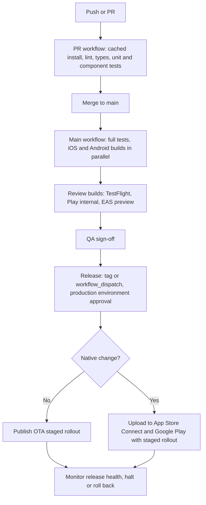
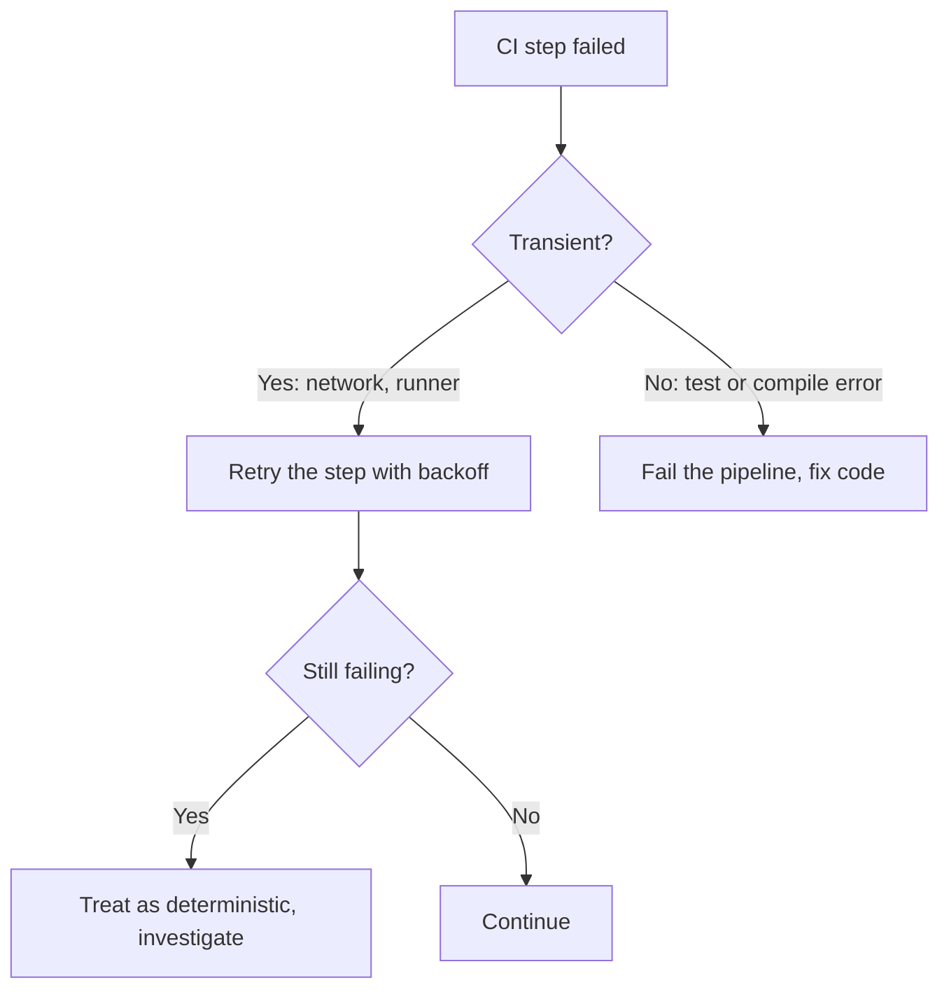

# CI/CD for React Native with GitHub Actions

> Verification note: GitHub Actions behavior (secrets, environments, `concurrency`, caching, OIDC, log masking) follows the **GitHub Actions documentation** as summarized earlier in this handbook; the environment-protection facts (**required reviewers** — up to six, **only one approval needed by default**, optional **prevent self-review**, **wait timer**, deployment branch/tag restrictions; environment secrets released only after protections pass), `concurrency` semantics (`cancel-in-progress: false` queues instead of cancelling) and caching built-ins (`actions/setup-node` and `actions/setup-java` caching; no built-in for CocoaPods) are carried over from that material. React Native/Expo facts were verified in the **reactnative.dev posts (0.85–0.88)** and the **Expo changelog (Oct–Nov 2026)**: RN 0.87 requires **Node 22+, Android Gradle Plugin 9 and Kotlin 2.0+**; Expo SDK 58 tooling requires Node 22.13+ / 24.3+ / 26+ (odd-numbered releases unsupported), forces `NODE_ENV` from the command (`development`/`production`), and enables **R8** by default; **iOS builds default to precompiled React Native binaries since 0.84** (SwiftPM is experimental in 0.87/0.88, CocoaPods remains the default); `expo-modules-core` ships prebuilt Android libraries (≈2× faster clean builds in Expo's test); **EAS Workflows** gained `concurrency` groups with expressions and queueing plus hooks (Nov 2026); `expo login` now defaults to browser-based login. **Organization defaults used below (`bby-ubuntu` runners, Artifactory registries, `bby-corp/tplat-gha-configure-github-credentials` for GIAM) are the workspace's configured recommendations; macOS runner labels, action versions/SHAs, Fastlane lane names, EAS CLI flags and Play/App Store API specifics are established practice not re-fetched in this session — marked *(hedged)*; verify before use.** Release mechanics: [13](13-ota-updates-and-store-releases.md); security hygiene: [11 §12](11-mobile-security.md#12-build-dependency-and-release-security), [web-security/07 §7](../web-security/07-supply-chain-and-third-party-script-security.md#7-cicd-and-github-actions-hardening); web-oriented pipeline design: [testing/07](../testing/07-flakiness-ci-and-non-functional-testing.md).

## Table of Contents

1. [Quick Summary (TL;DR)](#1-quick-summary-tldr)
2. [Pipeline Design: From git push to Production](#2-pipeline-design-from-git-push-to-production)
3. [Building iOS and Android in Parallel](#3-building-ios-and-android-in-parallel)
4. [Signing, Secrets and Environment Configuration](#4-signing-secrets-and-environment-configuration)
5. [Deployment Automation: OTA, App Store, Google Play, EAS](#5-deployment-automation-ota-app-store-google-play-eas)
6. [Production Safety: Approvals, Concurrency, Canary and Rollback](#6-production-safety-approvals-concurrency-canary-and-rollback)
7. [Efficiency: Caching, Retries and Build Time](#7-efficiency-caching-retries-and-build-time)
8. [Governance and Auditability](#8-governance-and-auditability)
9. [Reference Workflow Sketch](#9-reference-workflow-sketch)
10. [Pitfalls](#10-pitfalls)
11. [Interview Questions — Fundamentals](#11-interview-questions--fundamentals)
12. [Interview Questions — Senior Scenarios](#12-interview-questions--senior-scenarios)
13. [Cheat Sheet](#13-cheat-sheet)
14. [Key Terms Glossary](#14-key-terms-glossary)
15. [Further Reading](#15-further-reading)

---

## 1. Quick Summary (TL;DR)

- **Pipeline = gated stages:** lint → type-check → unit/component tests → build (iOS + Android in parallel) → security scan → review build (TestFlight / Play internal / EAS preview) → QA → release. Fail fast; cheap checks before expensive native builds.
- **Separate workflows per trigger:** a fast `pull_request` workflow, a heavier merge/main build, and a release workflow (tag or manual `workflow_dispatch`); express dependencies with `needs:`; run independent jobs in parallel.
- **iOS needs macOS runners; Linux jobs use `bby-ubuntu`** (org convention). iOS and Android are **separate jobs**, not a matrix axis.
- **Signing assets are secrets:** base64 certs/keystores into encrypted secrets (or Fastlane `match` with one passphrase), scoped to a protected **`production` environment**; prefer **OIDC/GIAM** over long-lived cloud keys.
- **Release safety:** environment **required reviewers**, **concurrency group with `cancel-in-progress: false`**, staged/canary percentages, and monitoring wired back to halt/rollback (fully automatable for OTA; for store builds you can halt rollout increases and alert, not un-release).
- **Speed:** cache Node/Gradle (built-in) and CocoaPods (manual `actions/cache`); skip native builds for JS-only changes; retry only transient failures; consider larger runners for iOS archives.
- **Auditability:** every release maps to a git SHA, an environment approval record and an OTA/store release ID.



---

## 2. Pipeline Design: From git push to Production

- **Workflows by trigger:** `pull_request` (lint, type-check, unit/component tests — minutes), `push` to main (full tests plus native builds, review-app distribution), `release`/tag or `workflow_dispatch` (production deploy with approvals). Reusable workflows and composite actions share setup (checkout, install) without YAML duplication.
- **Jobs and `needs:`** form the dependency graph: builds need lint/tests; deploy needs builds. Independent stages (lint and unit tests) have **no** `needs:` so they run in parallel.
- **Runners:** Linux jobs on **`bby-ubuntu`** (use a larger runner only for memory-heavy jobs and limit concurrency); iOS on a macOS runner (Xcode runs only on macOS) *(label hedged — use the org's approved macOS runner)*.
- **Environments** gate only the production deployment step, separate from mechanical build/test stages ([§6](#6-production-safety-approvals-concurrency-canary-and-rollback)).
- **Stage content:**

| Stage | Contents |
|---|---|
| Static | ESLint, TypeScript (Strict API in RN 0.87), formatting, dependency audit, secret scanning |
| Unit/component | Jest (preset `@react-native/jest-preset` since 0.85) + RNTL ([10 §8](10-app-architecture-state-and-navigation.md#8-testing-layers-for-a-react-native-app)) |
| Build | Android `bundleRelease` (Gradle), iOS archive; bundle/app size checks ([06](06-startup-bundle-animations-and-gestures.md#3-bundle-and-app-size)) |
| Security | Dependency vulnerability scans, SAST, secret scanning on the diff ([11 §12](11-mobile-security.md#12-build-dependency-and-release-security)) |
| Review build | TestFlight internal / Play internal testing / EAS preview or preview OTA update |
| E2E | Detox/Maestro on emulators/simulators or device farms for vital flows ([testing/08 §6](../testing/08-testing-in-practice-tdd-architecture-mobile-and-ai.md#6-testing-react-native-apps)) |
| Release | OTA publish or store upload with staged rollout |

**What decides the release path?** Whether the change touches native code — that branch determines the paced, reviewed binary path vs the minutes-fast OTA path ([13](13-ota-updates-and-store-releases.md#10-incident-playbooks-and-release-operations)).

---

## 3. Building iOS and Android in Parallel

**Two jobs, no `needs:` between them** → parallel automatically; `strategy.matrix` is for axes *within* a platform (e.g. `dev/staging/production` flavours).
```yaml
jobs:
  build-android:
    runs-on: bby-ubuntu
    steps: [ ... ]
  build-ios:
    runs-on: macos-14        # label hedged: use the org-approved macOS runner
    steps: [ ... ]
```
- Factor shared setup (checkout, Node install, JS dependencies) into a **composite action**.
- Pin Node to the supported range (RN 0.87+: Node 22+; Expo tooling: 22.13+/24.3+/26+), Java/Kotlin/AGP per the RN release (AGP 9, Kotlin 2.0+ in 0.87), Xcode per iOS SDK requirements (iOS 27 apps need the scene lifecycle — [08](08-app-lifecycle-background-work-push-and-deep-links.md)).
- **Registries:** resolve npm/yarn from the org Artifactory (`https://artifactory.tools.bestbuy.com/artifactory/api/npm/npm-virtual`), Gradle/Maven from `https://artifactory.tools.bestbuy.com/artifactory/java-virtual`, containers from `https://containers.artifactory.tools.bestbuy.com`; app-environment variant and package registry are independent concerns.
- **Android build speed:** prebuilt `expo-modules-core` libraries (SDK 58) and Gradle caches; **iOS:** precompiled RN binaries are the default since 0.84 (not compatible with Hermes V1 experiments in the 0.82 era; default configurations in 0.84+ handle this).

---

## 4. Signing, Secrets and Environment Configuration

### 4.1 iOS certificates and provisioning profiles
`.p12` and `.mobileprovision` are binary; secrets are text → **base64-encode, store as secrets, decode at runtime**:
1. `base64 -w 0 cert.p12 > cert.base64` → secret `IOS_CERTIFICATE_BASE64` (+ passphrase as a separate secret).
2. In the job: `echo "$IOS_CERTIFICATE_BASE64" | base64 --decode > cert.p12`, import into a **temporary keychain** created for the run and destroyed afterwards.
- **Preferred:** **Fastlane `match`** — encrypted certs/profiles in a private git repo; CI needs **one** secret (the repo passphrase) plus repo access. Never commit signing files; scope secrets to the protected production **environment**.

### 4.2 Android keystores
Base64 the keystore → `ANDROID_KEYSTORE_BASE64`; store **password, alias, key password as separate secrets**; at runtime decode to the path Gradle's `signingConfigs.release` expects and inject the others via environment variables read by `gradle.properties`. **Never commit the keystore** (a surprisingly common mistake). Upload keys vs Play-held app signing keys: [13 §8](13-ota-updates-and-store-releases.md#8-code-signing).

### 4.3 GitHub Actions secrets and OIDC
- Encrypted at **repository, environment or organization** level; referenced `${{ secrets.NAME }}`; managed via UI or `gh secret set`.
- Exact-value matches are **auto-redacted** in logs; secrets are **not passed to workflows from forked-repo pull requests** by default.
- **OIDC** gives short-lived cloud credentials instead of long-lived secrets; in this org use **`bby-corp/tplat-gha-configure-github-credentials`** for GIAM credentials.
- Secrets larger than 48 KB require the encrypt-the-file-and-store-the-passphrase workaround.

### 4.4 Preventing leaks into logs
Rely on masking but know it only catches **exact strings**; `::add-mask::VALUE` for derived values; avoid `set -x` near secrets; never "debug echo" a secret; pass secrets via `env:` not inlined in command strings; least-privilege scoping; caution with `pull_request_target`; use short-lived tokens; set minimal `permissions:` and **pin third-party actions by commit SHA** ([web-security/07 §7](../web-security/07-supply-chain-and-third-party-script-security.md#7-cicd-and-github-actions-hardening)).

### 4.5 Environment-specific builds and configuration
- **Non-secret config** (API base URLs, public client IDs, flag defaults) via `react-native-config`/`react-native-dotenv` or Expo app config with `EXPO_PUBLIC_*`/env files — **not** secrets management ([11 §11](11-mobile-security.md#11-secrets-management)). **Expo SDK 58** sets `NODE_ENV` to `development` or `production` from the command (custom Android/iOS build configurations such as `Staging` count as production) and loads `.env.development`/`.env.production` accordingly — use explicit variables like `APP_ENV` for dev/staging/prod distinctions.
- **Android product flavours** (`dev`, `staging`, `production`; distinct `applicationId` suffix, endpoints, icon) and **iOS schemes/configurations/`.xcconfig`** produce side-by-side installable variants.
- Pass the target environment as a `workflow_dispatch` input or derive it from the branch/tag.

| Tier | Config source | Secrets scope | Protection |
|---|---|---|---|
| Development | `.env.development` (committed) | Dev-only | Minimal |
| QA | `.env.qa` | QA-only | Light/branch restriction |
| Staging | `.env.staging` | Staging-only | Branch restriction |
| Production | `.env.production` | Production-only, tightly scoped | Required reviewers, wait timer, branch/tag restriction |

Keep non-secret config in version control (reviewable/diffable); move only genuine secrets into **environment-scoped** secrets so production credentials are unreachable from other environments' runs.

---

## 5. Deployment Automation: OTA, App Store, Google Play, EAS

**OTA (EAS Update / `expo-updates`)**
1. Prefer a manual `workflow_dispatch` for production OTA — a deliberate human action rather than auto-publishing every merge.
2. Checkout, cached install, tests/lint as a gate even for JS-only changes.
3. Authenticate with an access-token secret.
4. Publish (e.g. `eas update --branch production --message "<title>"` *(hedged flags)*): Metro build, tagged with runtime version/channel ([13 §3](13-ota-updates-and-store-releases.md#3-ota-compatibility-versioning-and-channels)).
5. Pass a **staged rollout percentage** instead of 100%.
6. A follow-up job watches telemetry in the bake window and calls the revert/republish API if thresholds breach ([§6](#6-production-safety-approvals-concurrency-canary-and-rollback)).

**App Store**
1. Trigger by release tag or `workflow_dispatch`; macOS runner.
2. Checkout, cached JS deps, cached CocoaPods; resolve signing ([§4.1](#41-ios-certificates-and-provisioning-profiles)).
3. Fastlane lane: `gym` (archive + export) → `pilot`/`deliver` to App Store Connect with an **App Store Connect API key** secret (not a personal Apple ID — avoids 2FA prompts).
4. Gate "submit for review/release" behind the `production` environment (it is nearly a one-way door).

**Google Play**
1. Same triggers; `runs-on: bby-ubuntu`.
2. Decode the keystore; `./gradlew bundleRelease`.
3. Fastlane `supply` (or a Play-upload action) with a **service account JSON** (Release Manager) secret.
4. Select the track and an **initial staged percentage**; gate the final production publish behind the environment.

**EAS alternative:** **EAS Build** + **EAS Submit** manage credentials and store uploads; **EAS Workflows** (YAML pipelines with `concurrency` groups/expressions/queueing and hooks, Nov 2026) can replace parts of GitHub Actions; combine with GitHub Actions for tests/policy gates ([12](12-expo-eas-tooling-and-debugging.md)). Choose by control, cost, runner-policy and audit requirements.

---

## 6. Production Safety: Approvals, Concurrency, Canary and Rollback

- **Approval gates:** a GitHub **environment** `production` with **required reviewers** (up to 6; by default only **one** needs to approve), optional **prevent self-review**, a **wait timer** (final cancellation window) and **deployment branch/tag restrictions**. A job with `environment: production` **pauses** until approved; **environment secrets** (signing credentials, store keys) are released only **after** protections pass.
- **No simultaneous production releases:**
```yaml
concurrency:
  group: production-release
  cancel-in-progress: false      # queue, don't cancel an in-flight production deploy
```
  (`cancel-in-progress: true` is right for redundant PR checks, wrong for production deploys.)
- **Canary pipeline:** release workflow takes a rollout-percentage input (default small, e.g. 5–10%); flows into EAS Update rollout, Play staged fraction or App Store phased release; a scheduled **bake-time job** queries crash telemetry for the canary cohort and either expands the percentage (healthy) or halts/alerts (not) — optionally gated by the same environment approvals.
- **Automatic rollback by release type:** **OTA** — fully automatable (monitor crash rate, call revert/republish API); **store** — you can't un-release; automate **halting further rollout increases** (both stores expose APIs) plus incident notification and a kill-switch flag flip ([13 §9](13-ota-updates-and-store-releases.md#9-store-rollouts-and-the-reality-of-rollback)). This needs two-way glue: tag releases at publish time and query/act on crash rates at monitor time.

---

## 7. Efficiency: Caching, Retries and Build Time

**Failures and retries**
- Re-run **failed jobs only** for transient failures; wrap known-flaky steps (registry timeouts) with retry-with-backoff, not the whole job.
- Distinguish **transient** (network blips, runner contention — retry) from **deterministic** (failing test, compile error — never auto-retry, it masks signal).
- Use `continue-on-error` only for genuinely non-blocking steps (coverage upload); never on build/test/deploy.
- Notify on failures (Slack/Teams) and rely on required status checks to block merges.

**Caching**

| Dependency | Mechanism |
|---|---|
| Node (npm/Yarn/pnpm) | `actions/setup-node` with `cache:` — built in |
| Gradle | `actions/setup-java` with `cache: 'gradle'` — built in |
| CocoaPods | manual `actions/cache` (no built-in) |
```yaml
- uses: actions/cache@<full-commit-sha>        # pin by SHA (placeholder)
  with:
    path: |
      ~/Library/Caches/CocoaPods
      ios/Pods
    key: pods-${{ hashFiles('ios/Podfile.lock') }}
    restore-keys: pods-
```
- **Cache trust:** low-trust contexts (e.g. forks) get read-only cache access to prevent **cache poisoning**; caches front, not replace, the Artifactory registries.

**Reducing build time:** dependency caching (highest leverage) · parallel jobs · `paths:` filters/change detection to skip native builds for JS-only PRs · Gradle build cache/daemon (`org.gradle.caching=true`) plus GHA caches (two different layers) · prebuilt `expo-modules-core` (SDK 58) and precompiled iOS binaries (0.84 default) · right-size runners (`bby-ubuntu`; larger macOS only where profiled) · verify caches actually hit · Hermes bytecode compilation is already part of a release build, nothing extra to tune.

---

## 8. Governance and Auditability

- Every release traceable to an exact **git SHA** (and PRs); avoid "mystery builds".
- GitHub run history gives timestamped logs of triggers/steps — but retention expires; **environment approvals** record who approved production and when.
- **Structured release metadata:** version, SHA, build number, environment, and for OTA the runtime version/channel/update ID ([13 §3](13-ota-updates-and-store-releases.md#3-ota-compatibility-versioning-and-channels)) in a release-notes artifact or releases log.
- Cross-reference App Store Connect/Play Console histories; preserve the OTA platform's publish log (OTA bypasses store review, so there is no external record-keeper).
- Ship **deploy markers** to the observability stack so error-rate changes correlate to releases (EAS Observe, Sentry/Crashlytics *(hedged)*).
- **Access control:** limit who can publish OTA/binaries, protected branches/tags, separation of duties, rotate secrets, review third-party actions, minimal token permissions.

---

## 9. Reference Workflow Sketch

```yaml
name: mobile-ci
on:
  pull_request:
  push: { branches: [main] }

permissions:
  contents: read

concurrency:
  group: ci-${{ github.ref }}
  cancel-in-progress: ${{ github.event_name == 'pull_request' }}   # PR checks: cancel stale runs

env:
  NPM_CONFIG_REGISTRY: https://artifactory.tools.bestbuy.com/artifactory/api/npm/npm-virtual

jobs:
  static-and-tests:
    runs-on: bby-ubuntu
    steps:
      - uses: actions/checkout@<full-commit-sha>
      - uses: actions/setup-node@<full-commit-sha>
        with: { node-version: 22, cache: npm }
      - run: npm ci --ignore-scripts
      - run: npm run lint && npm run typecheck && npm test -- --ci

  build-android:
    needs: static-and-tests
    if: github.ref == 'refs/heads/main'
    runs-on: bby-ubuntu
    steps:
      - uses: actions/checkout@<full-commit-sha>
      - uses: actions/setup-node@<full-commit-sha>
        with: { node-version: 22, cache: npm }
      - uses: actions/setup-java@<full-commit-sha>
        with: { distribution: temurin, java-version: 17, cache: gradle }   # confirm JDK required by AGP 9
      - run: npm ci --ignore-scripts
      - run: echo "$ANDROID_KEYSTORE_BASE64" | base64 --decode > android/app/release.keystore
        env: { ANDROID_KEYSTORE_BASE64: '${{ secrets.ANDROID_KEYSTORE_BASE64 }}' }
      - run: cd android && ./gradlew bundleRelease
        env:
          ANDROID_KEYSTORE_PASSWORD: ${{ secrets.ANDROID_KEYSTORE_PASSWORD }}
          ANDROID_KEY_ALIAS: ${{ secrets.ANDROID_KEY_ALIAS }}
          ANDROID_KEY_PASSWORD: ${{ secrets.ANDROID_KEY_PASSWORD }}

  build-ios:
    needs: static-and-tests
    if: github.ref == 'refs/heads/main'
    runs-on: macos-14              # org-approved macOS runner label (hedged)
    steps:
      - uses: actions/checkout@<full-commit-sha>
      - uses: actions/setup-node@<full-commit-sha>
        with: { node-version: 22, cache: npm }
      - run: npm ci --ignore-scripts
      - uses: actions/cache@<full-commit-sha>
        with:
          path: |
            ~/Library/Caches/CocoaPods
            ios/Pods
          key: pods-${{ hashFiles('ios/Podfile.lock') }}
      - run: cd ios && bundle exec pod install
      - run: bundle exec fastlane ios build          # lane name hedged; uses match + gym

  release-production:
    if: startsWith(github.ref, 'refs/tags/v')
    needs: [build-android, build-ios]
    runs-on: bby-ubuntu
    environment: production                          # required reviewers, wait timer, branch/tag restrictions
    concurrency: { group: production-release, cancel-in-progress: false }
    permissions: { contents: read, id-token: write } # only where OIDC/GIAM is needed
    steps:
      - uses: actions/checkout@<full-commit-sha>
      # configure credentials via bby-corp/tplat-gha-configure-github-credentials (inputs per org docs)
      - run: echo "publish OTA staged or upload binaries via Fastlane supply/pilot"
```
*(Placeholder SHAs, runner labels, lane names and JDK version must be confirmed against org policy and the current RN/AGP requirements.)*

---

## 10. Pitfalls

1. One monolithic workflow; native builds on every PR even for JS-only changes.
2. iOS and Android modelled as a matrix axis instead of separate jobs.
3. Signing certificates/keystores committed to the repo or shared across environments; personal Apple IDs in CI.
4. Secrets available to forked PRs/`pull_request_target`, or printed/derived without masking.
5. Long-lived cloud keys instead of OIDC/GIAM; unpinned third-party actions; broad `permissions`.
6. `cancel-in-progress: true` on production release workflows.
7. No environment approvals/branch restrictions for production; self-approval.
8. OTA auto-published on every merge with no staged rollout or monitoring.
9. Retrying deterministic failures; `continue-on-error` on build/test steps.
10. Unverified caches (never hit) or caches from low-trust contexts; ignoring CocoaPods caching.
11. Tool-version drift (Node/JDK/AGP/Xcode) breaking builds after RN/Expo upgrades.
12. No release metadata/audit trail linking SHA ↔ build ↔ OTA update ↔ approval.

---

## 11. Interview Questions — Fundamentals

- **How would you design an RN CI/CD pipeline?** Gated stages (lint, types, tests, build, security, review build, QA, release) mapped to separate workflows, `needs:` graphs, reusable setup, environment-gated production.
- **What happens from push to production?** PR checks → merge → full tests and parallel builds → review builds → QA → tag/dispatch → approval → OTA (JS-only) or store upload (native) → monitoring.
- **How do you build iOS and Android simultaneously?** Separate jobs with no `needs:`; matrix only within a platform.
- **How to store signing certificates/profiles?** Base64 into secrets and decode into a temporary keychain, or Fastlane `match` with one passphrase; environment-scoped.
- **Android keystores?** Base64 secret plus separate password/alias/key-password secrets; decode at runtime; never commit.
- **What are GitHub Actions secrets?** Encrypted repo/environment/org values, auto-redacted, withheld from fork PRs; OIDC avoids long-lived secrets.
- **How to prevent log leaks?** Masking limits, `::add-mask::`, no `set -x`, `env:` injection, least privilege.
- **Environment-specific builds?** Env files/config plus Android flavours and iOS schemes; target chosen by input/branch.
- **How to manage dev/QA/staging/prod configuration?** Committed non-secret `.env.*`, environment-scoped secrets, per-environment protections and app variants.
- **How to automate OTA?** Manual dispatch, gated tests, token auth, publish with staged percentage, monitoring job.
- **How to automate App Store/Play deployment?** Fastlane `match`/`gym`/`pilot` with API key; Gradle `bundleRelease` + `supply` with service account; gated final publish.
- **How do approval gates work?** `environment: production` with required reviewers (one approval by default), wait timer, branch restrictions; secrets released after approval.
- **Prevent two production releases at once?** `concurrency` group with `cancel-in-progress: false`.
- **How to cache dependencies?** `setup-node`/`setup-java` built-ins; manual `actions/cache` for CocoaPods.
- **How to reduce build time?** Caching, parallelism, path filters, Gradle build cache, prebuilt binaries, runner sizing.
- **How to make releases auditable?** SHA traceability, approvals, release metadata, store/OTA histories, deploy markers.

---

## 12. Interview Questions — Senior Scenarios

### S1. "Design CI/CD for a wealth-management RN app with strict change control."
Trunk-based with required checks; PR workflow (static, tests, size budget); main workflow builds both platforms and distributes review builds; production workflow behind a protected environment with two-person approval, prevent-self-review and wait timer; OIDC/GIAM for cloud access; OTA to staged percentages with runtime-version gating and automatic halt; store releases with phased/staged rollout; audit records, SBOM/dependency scanning, signed OTA, and separation of duties between publishers and approvers.

### S2. "iOS builds take 35 minutes and block releases."
Profile steps: cache CocoaPods and DerivedData *(hedged)*, use precompiled RN binaries (0.84+), skip native builds for JS-only changes, split archive from tests, use a larger macOS runner only for archive, reduce unnecessary pods/modules, and parallelize E2E; track duration trends and cost.

### S3. "A leaked Play service-account key was found in a workflow log."
Revoke/rotate immediately, audit Play Console activity, find the leak path (derived value or verbose logging), move to OIDC/short-lived credentials where possible, scope the key to the production environment, add masking and secret scanning, restrict who can run release workflows, and post-incident review.

### S4. "Two engineers triggered production releases concurrently; the second overwrote the first."
No concurrency control. Add the `production-release` group with `cancel-in-progress: false`, require approvals, make the release number derive from the tag, add idempotent publish steps and a pre-check that the release SHA matches the approved SHA.

### S5. "After upgrading to RN 0.87 CI fails with Gradle and Node errors."
Toolchain requirements changed: Node 22+, AGP 9, Kotlin 2.0+ (and Java as required); update runner images/`setup-*` versions, caches keyed by lockfiles/toolchain, Fastlane/Xcode versions, and read the release's breaking-change notes; add a "toolchain check" job to fail fast with clear messages.

### S6. "We want EAS Workflows instead of GitHub Actions."
Evaluate control (custom runners, org policies like `bby-ubuntu` and Artifactory), audit and approvals, secret handling, cost, native-build performance and integrations (Observe, Update, Submit); possibly keep GitHub Actions for tests and policy gates and use EAS Build/Submit/Workflows for native pipelines; pilot one platform and compare reliability and time.

---

## 13. Cheat Sheet

| Concern | Rule |
|---|---|
| Structure | Workflows by trigger; `needs:`; reusable steps |
| Platforms | Separate jobs; iOS on macOS; Linux on `bby-ubuntu` |
| Signing | Base64 secrets or `match`; environment-scoped |
| Cloud creds | OIDC / GIAM action, not long-lived keys |
| Approvals | `environment: production` reviewers, wait timer, branch rules |
| Concurrency | `cancel-in-progress: false` for production |
| Canary | Percentage input + bake-time job + halt/expand |
| Rollback | OTA automatable; store = halt + alert + flag |
| Caching | setup-node/java built-in; CocoaPods manual |
| Audit | SHA ↔ build ↔ update ID ↔ approval |



---

## 14. Key Terms Glossary

| Term | Meaning |
|---|---|
| **Environment (GitHub)** | Named deployment target with scoped secrets and protection rules |
| **`concurrency` group** | Limits simultaneous runs; `cancel-in-progress: false` queues |
| **OIDC** | Short-lived credentials for workflows instead of stored secrets |
| **GIAM** | Org identity mechanism configured via `bby-corp/tplat-gha-configure-github-credentials` |
| **Fastlane `match`** | Encrypted shared iOS signing assets with one CI secret |
| **Product flavour / scheme** | Android/iOS mechanisms for environment-specific variants |
| **Cache poisoning** | Tampered cache content restored by a trusted run |
| **EAS Build / Submit / Workflows** | Expo's build, store-upload and pipeline services |
| **Bake time** | Monitoring window before expanding a rollout |
| **Deploy marker** | Release event overlay on observability dashboards |

---

## 15. Further Reading

- [GitHub: using secrets](https://docs.github.com/en/actions/security-guides/using-secrets-in-github-actions) · [Environments for deployment](https://docs.github.com/en/actions/deployment/targeting-different-environments/using-environments-for-deployment) · [Caching dependencies](https://docs.github.com/en/actions/using-workflows/caching-dependencies-to-speed-up-workflows) · [Concurrency](https://docs.github.com/en/actions/using-jobs/using-concurrency) · [Expo: EAS Workflows concurrency and hooks](https://expo.dev/changelog/concurrency-groups-and-hooks-for-workflows) · [RN 0.87 (toolchain)](https://reactnative.dev/blog/2026/08/11/react-native-0.87) · [Expo SDK 58](https://expo.dev/changelog/sdk-58)
- This repo: [13 OTA and store releases](13-ota-updates-and-store-releases.md) · [11 Mobile security](11-mobile-security.md) · [testing/07 Flakiness and CI](../testing/07-flakiness-ci-and-non-functional-testing.md) · [web-security/07 Supply chain](../web-security/07-supply-chain-and-third-party-script-security.md)
