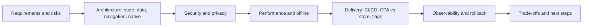

# React Native Senior Scenarios and Mobile System Design

> Verification note: This file **applies** the concepts from [01](01-javascript-runtime-hermes-and-event-loop.md)–[14](14-ci-cd-with-github-actions.md) to open-ended senior/staff interview prompts; it intentionally does not re-teach them. Version-sensitive claims reuse the facts verified in those files (React Native **0.88**, **Expo SDK 58** (Oct 2026), New Architecture only since **0.82**, **Hermes V1 default since 0.84**, Strict TypeScript API default in **0.87**, `InteractionManager` removed in **0.87**, iOS 27 scene lifecycle requirement, Android 15+ edge-to-edge, **EAS Observe** GA, Expo Modules 2.0 beta). Architectural recommendations, numeric targets, vendor choices and trade-off judgements here are **engineering opinion** for interview practice, not official guidance — marked *(hedged)* where they depend on specific tools or thresholds. For web system-design framing see [system-design/](../system-design/README.md).

## Table of Contents

1. [Quick Summary (TL;DR)](#1-quick-summary-tldr)
2. [An Answer Framework for Mobile Design Questions](#2-an-answer-framework-for-mobile-design-questions)
3. [System Design: Wealth-Management / Banking App](#3-system-design-wealth-management--banking-app)
4. [System Design: Offline-First Field App](#4-system-design-offline-first-field-app)
5. [System Design: Chat or Feed App](#5-system-design-chat-or-feed-app)
6. [System Design: Media, Camera and Heavy Processing](#6-system-design-media-camera-and-heavy-processing)
7. [Architecture Scenarios: Migration, Brownfield, Multi-Team](#7-architecture-scenarios-migration-brownfield-multi-team)
8. [Debugging and Incident Scenarios](#8-debugging-and-incident-scenarios)
9. [Leadership and Trade-Off Questions](#9-leadership-and-trade-off-questions)
10. [Pitfalls in Interviews](#10-pitfalls-in-interviews)
11. [Rapid Mock-Interview Prompts](#11-rapid-mock-interview-prompts)
12. [Cheat Sheet](#12-cheat-sheet)
13. [Further Reading](#13-further-reading)

---

## 1. Quick Summary (TL;DR)

- Senior mobile answers show **layered thinking**: requirements → constraints (device, network, OS policy, compliance) → architecture (state, networking, storage, native boundaries) → security → performance → delivery (CI/CD, OTA vs store) → observability → trade-offs and rollout.
- **Name the failure modes** unprompted: offline, backgrounding, token expiry, duplicate submits, OS-version differences, slow devices, store-review constraints, rollback limits.
- **Pick the right tool per kind of state/work**, and defend the choice with costs: complexity, bundle size, team skills, upgrade risk.
- **Money and data safety beat optimism:** pending states, idempotency, server-side authorisation, minimal client trust.
- **Rollout is part of the design:** feature flags, staged OTA, phased store releases, telemetry-gated expansion.

---

## 2. An Answer Framework for Mobile Design Questions

1. **Clarify** users, platforms/OS versions, offline needs, sensitivity of data, regulatory constraints, scale, release cadence, team size.
2. **Sketch the architecture:** feature slices, navigation, state split (local/global/server/persistent — [10](10-app-architecture-state-and-navigation.md)), API layer ([09](09-networking-storage-and-offline.md)), native modules only where needed ([04](04-native-modules-components-and-platform-code.md)).
3. **Walk critical flows end to end** (login, load home, perform a write, recover from failure).
4. **Address cross-cutting concerns:** security ([11](11-mobile-security.md)), performance budgets ([05](05-performance-rendering-lists-images-and-memory.md), [06](06-startup-bundle-animations-and-gestures.md)), accessibility/i18n ([07](07-ui-styling-layout-accessibility-and-localization.md)), lifecycle/background/push ([08](08-app-lifecycle-background-work-push-and-deep-links.md)).
5. **Delivery and operations:** CI/CD ([14](14-ci-cd-with-github-actions.md)), OTA vs store ([13](13-ota-updates-and-store-releases.md)), flags, monitoring ([12](12-expo-eas-tooling-and-debugging.md)).
6. **State trade-offs, risks and what you'd measure**; offer an incremental delivery plan (MVP → hardening).

---

## 3. System Design: Wealth-Management / Banking App

**Requirements:** sign-in with MFA/biometrics, portfolio and transaction views, document statements, transfers/trades (high stakes), notifications, support chat; regulated data; iOS + Android; weekly releases.

**Architecture**
- **Foundation:** Expo with development builds/CNG (or bare if constraints demand) — upgrade cadence aligned to SDK releases; TypeScript Strict; feature slices (`authentication`, `portfolio`, `transactions`, `profile`, `documents`) ([10](10-app-architecture-state-and-navigation.md)).
- **Navigation:** tabs of stacks; conditional auth screens; step-up screens for sensitive actions; deep links via Universal/App Links with strict validation ([08 §9](08-app-lifecycle-background-work-push-and-deep-links.md#9-deep-linking-from-the-os-to-react-native), [11 §6](11-mobile-security.md#6-deep-link-security)).
- **Data:** typed API client; TanStack Query (stale-while-revalidate, persisted non-sensitive cache for instant cold start); cursor pagination; runtime response validation; error normalisation with typed domain errors ([09 §5](09-networking-storage-and-offline.md#5-the-api-layer-in-a-production-app)).
- **Writes:** **no optimistic updates for money**: idempotency key per intent, pending → confirmed states, status polling/push to reconcile, server-side limits and risk checks.
- **Security:** OAuth2 code+PKCE in the system browser; rotated refresh tokens in Keychain/Keystore with biometric gating; idle/absolute timeouts; step-up for transfers with transaction-bound approval; pinning (with rotation plan); attestation signals; blur on background; Android `FLAG_SECURE` on sensitive screens; PII-free logs ([11](11-mobile-security.md)).
- **Offline/poor network:** show last-known data with freshness indicator; disable live-only actions; outbox only for low-risk edits ([09 §7](09-networking-storage-and-offline.md#7-offline-first-and-poor-networks)).
- **Performance budget** *(hedged targets)*: cold start < 2–3 s on a mid-range Android, 60 fps lists, memory ceiling per screen; lists virtualised/recycling; images right-sized.
- **Accessibility/i18n:** VoiceOver/TalkBack audits, dynamic type, RTL/locale-aware currency ([07](07-ui-styling-layout-accessibility-and-localization.md)).
- **Delivery:** weekly OTA with runtime-version gating and staged percentages; monthly binaries with phased/staged rollout; feature flags and kill switches; protected `production` environment with approvals ([13](13-ota-updates-and-store-releases.md), [14](14-ci-cd-with-github-actions.md)).
- **Observability:** crash/error reporting with symbols; Observe or equivalent per release; alerts tied to halt/rollback; audit logs for security events.

**Trade-offs to state:** Expo vs bare; pinning vs operational risk; offline depth vs compliance; OTA speed vs review/audit expectations; native biometrics vs passkeys roadmap.

---

## 4. System Design: Offline-First Field App

**Scenario:** inspectors capture forms/photos in areas without coverage and sync later.
- **Local store:** SQLite (encrypted if sensitive) as the source of truth; reactive queries; schema migrations versioned.
- **Outbox pattern:** mutations queued with client IDs, idempotency keys and ordering; retries with backoff; conflict policy per entity (last-write-wins, field merge, or user resolution); sync status UI.
- **Media:** capture to files, compress, upload in resumable chunks in the background (OS background-transfer APIs *(hedged)*), reference by URI; storage quotas and cleanup.
- **Sync engine:** pull by cursor/timestamps, push outbox, reconcile IDs, handle deletions/tombstones; schedule on connectivity, foreground and OS background tasks ([08 §7](08-app-lifecycle-background-work-push-and-deep-links.md#7-reliable-background-work)).
- **Auth offline:** cached session with limited lifetime, re-auth when online; biometric unlock for local access; remote wipe on revocation.
- **Testing:** simulate offline/flaky networks, kill during sync, clock skew, duplicate deliveries.
- **Trade-offs:** build vs adopt a sync framework *(hedged)*; conflict UX; data minimisation vs completeness.

---

## 5. System Design: Chat or Feed App

- **Transport:** WebSocket for live updates with reconnect/backoff, heartbeat, resume from last sequence/cursor, dedupe by message ID; push notifications for background; SSE alternative where one-way ([networking-and-apis/05](../networking-and-apis/05-real-time-communication-websockets-sse-webtransport.md), [system-design/04](../system-design/04-chat-and-real-time-messaging.md)).
- **State:** normalised message store; optimistic local send with client IDs and failure states (low-stakes, unlike money); pagination by cursor; unread counts via server state.
- **Lists:** inverted/recycling list, stable keys, memoised rows, image thumbnails, `maintainVisibleContentPosition`-style behaviours *(hedged)* ([05 §6](05-performance-rendering-lists-images-and-memory.md#6-large-lists-flatlist-flashlist-and-friends)).
- **Lifecycle:** close sockets on background, reconnect on active; handle app-kill via push taps and initial notification routing; notification grouping (`threadIdentifier`).
- **Security/privacy:** E2E encryption trade-offs *(hedged)*, attachment scanning, link previews via server proxy (SSRF concerns), screenshot policies.
- **Performance:** batched state updates from socket bursts, throttled typing indicators, worklet-driven gestures (swipe-to-reply), avoid per-message re-render storms.
- **Scale/ops:** server fan-out, rate limits, backpressure; client-side metrics (time-to-first-message, reconnect rate).

---

## 6. System Design: Media, Camera and Heavy Processing

- **Boundary choice:** frame-by-frame processing needs JSI/native (VisionCamera-style ~30 MB frames at ~2 GB/s would be impossible over the old Bridge) — use a native module/Expo module on a background thread; return results via Promises/events; pass **buffers/URIs by reference** ([04 §7–8](04-native-modules-components-and-platform-code.md#7-threads-blocking-and-cpu-heavy-work)).
- **UI:** native preview component (Fabric/Expo view) with JS overlay controls; worklets for per-frame visual overlays; permissions flow in context ([08 §10](08-app-lifecycle-background-work-push-and-deep-links.md#10-permissions)).
- **Memory:** downsample at decode, bounded caches, release native sessions on blur/background, test on low-RAM Android ([05 §8](05-performance-rendering-lists-images-and-memory.md#8-memory-leaks)).
- **Upload:** resumable chunked uploads, retry with idempotency, compress on device, backgrounding rules.
- **Failure handling:** thermal throttling, permission denial, interruptions (calls), orientation/resizable windows.
- **Trade-offs:** on-device vs server processing (privacy, latency, battery, cost); library vs custom native.

---

## 7. Architecture Scenarios: Migration, Brownfield, Multi-Team

### S1. "Migrate a large app from 0.7x (old architecture) to 0.88."
Inventory native modules and libraries; step to **0.81 / SDK 54**, enable the New Architecture and fix library gaps; then 0.82+ through 0.88 reading each release's breaking changes (promise-rejection reporting, legacy removals, Hermes V1, Jest preset, Node 22/AGP 9/Kotlin 2, Strict TS API, removed APIs, iOS scene lifecycle); update CI toolchain; E2E smoke on a device matrix; staged rollout and Observe/crash comparisons ([02 §12](02-architecture-bridge-to-new-architecture.md#12-migration-interop-and-the-timeline), [12 §7](12-expo-eas-tooling-and-debugging.md#7-upgrading-react-native-and-expo)).

### S2. "Embed React Native into an existing native banking app (brownfield)."
Define the module boundary (one feature screen or flow), shared auth/session bridging via native modules, navigation handoff, a single RN instance/host reuse strategy *(hedged)*, release coordination (RN bundle versions vs native app versions), OTA policy for the embedded bundle, design-system parity, and a rollback strategy per feature flag; measure startup cost of the RN runtime.

### S3. "Five teams ship in one app; releases keep colliding."
Feature-slice ownership with import boundaries, a platform team owning shell/design system/CI, contract tests between slices, per-team flags and OTA channels, trunk-based development with required checks, release trains for binaries and continuous OTA for JS, CODEOWNERS and dependency policies ([10 §7](10-app-architecture-state-and-navigation.md#7-configuration-feature-flags-and-scaling-the-codebase), [14](14-ci-cd-with-github-actions.md)).

### S4. "Decide: rewrite native vs stay on React Native."
Compare product needs (platform-specific UX, performance ceilings, SDK availability), team skills and hiring, shared code with web, release velocity (OTA), maintenance cost, upgrade burden, and risk; run a spike on the hardest screens; consider hybrid (native modules/Expo UI) before rewriting; define decision metrics (crash-free, TTI, velocity).

### S5. "Adopt a new library with native code."
Check New Architecture and Hermes V1 support, maintenance, size/permissions/privacy implications, security review, fallback plan, wrapper adapter, build impact (prebuild/fingerprint), license, and an exit strategy; add tests and monitoring before rollout.

---

## 8. Debugging and Incident Scenarios

| Scenario | First moves | Fix direction |
|---|---|---|
| Janky scroll on low-end Android only | Release profile; JS vs UI FPS ([05](05-performance-rendering-lists-images-and-memory.md)) | Memoised rows, `getItemLayout`/recycling, smaller images, fewer views/shadows |
| Memory grows per navigation | Heap comparison, leak catalogue ([05 §8](05-performance-rendering-lists-images-and-memory.md#8-memory-leaks)) | Cleanup on blur/unmount, bounded caches, release native resources |
| Crash after enabling R8 default | Deobfuscate with mapping, review reflective libs | Keep rules, test minified builds on devices |
| App stuck on white screen after OTA | Check runtime version/native-module mismatch, boot acknowledgement | Halt/republish, add gating and automatic rollback ([13](13-ota-updates-and-store-releases.md)) |
| Push taps open wrong screen when killed | Cold vs warm path | Read initial notification after boot/auth, unified link handler ([08](08-app-lifecycle-background-work-push-and-deep-links.md)) |
| Duplicate transfers | Missing idempotency | Idempotency keys, pending states, reconcile ([09](09-networking-storage-and-offline.md)) |
| Random logouts | Parallel refresh/rotation reuse | Single-flight refresh, grace windows ([09 §5](09-networking-storage-and-offline.md#5-the-api-layer-in-a-production-app)) |
| Timers wrong after background | JS suspended | Timestamp-based recompute ([08 §5](08-app-lifecycle-background-work-push-and-deep-links.md#5-timers-intervals-and-drift-in-background)) |
| Build broke after RN upgrade | Toolchain matrix | Node 22+, AGP 9, Kotlin 2, Xcode; `expo-doctor` ([12](12-expo-eas-tooling-and-debugging.md)) |
| iOS 27 launch crash | Scene lifecycle migration | Update AppDelegate customisations, prebuild templates ([08 §2](08-app-lifecycle-background-work-push-and-deep-links.md#2-startup-from-app-icon-to-first-react-component)) |

**Incident structure to narrate:** detect (alerts/Observe) → mitigate (kill switch, halt rollout, OTA revert) → diagnose (symbolicated crash, release tags) → fix (OTA or binary) → verify (staged rollout) → learn (tests, monitoring, runbook).

---

## 9. Leadership and Trade-Off Questions

- **"How do you decide state libraries for the team?"** Principles (right tool per state kind), team familiarity, ecosystem/maintenance, performance characteristics; document an ADR; avoid multiple overlapping solutions.
- **"How do you reduce upgrade pain?"** Track SDK cadence, upgrade every 1–2 releases, keep native customisation in config plugins/modules, automate smoke tests, maintain a compatibility matrix, subscribe to release notes, budget upgrade time.
- **"How do you balance speed and safety in releases?"** Feature flags, staged rollouts, telemetry gates, automated rollback for OTA, protected environments and approvals for production, clear on-call ownership.
- **"How do you grow a mobile team's quality bar?"** Test pyramid, performance budgets in CI, accessibility checks, code review checklists, design-system ownership, incident reviews feeding backlog.
- **"How do you communicate risk to leadership?"** Express in delivery terms (lead time, change failure rate, crash-free rate, time-to-mitigate) and customer/regulatory impact; offer options with costs.
- **"How do you onboard to an unfamiliar RN codebase?"** Run it on real devices, map architecture (navigation, state, data, native modules), read crash/telemetry dashboards, find hot paths, fix a small bug end to end, document learnings.

---

## 10. Pitfalls in Interviews

1. Jumping to libraries before clarifying requirements and constraints.
2. Ignoring offline/background/OS-policy realities and rollback limits.
3. Treating the New Architecture as a performance silver bullet.
4. Optimistic UI for money; trusting the client for authorisation.
5. No telemetry or rollout plan; "ship and hope".
6. Over-engineering (custom native everywhere) or under-engineering (no tests/flags).
7. Not stating trade-offs and alternatives; not quantifying budgets.
8. Using outdated facts (Bridge-era advice, `InteractionManager`, Flipper, remote debugging, CodePush as current).
9. Not tying answers to user impact and compliance.
10. Rambling without structure.

---

## 11. Rapid Mock-Interview Prompts

- Explain end to end what happens when a user taps a button and state changes (JS render → shadow tree → mount).
- Why did the old Bridge hurt, and what exactly changed with JSI/Fabric/TurboModules?
- You block the JS thread for 5 seconds: what keeps working, what doesn't, and what do users see?
- Design secure login and session handling for a financial app.
- A list janks only on low-end Android: walk through diagnosis and fixes.
- OTA vs store release: what can each change, and how do you roll back each?
- Design an offline-first approach and name what must *not* work offline.
- Your Reanimated animation crashes after an RN upgrade: what do you check?
- Plan a team-wide RN upgrade across five teams.
- How do you detect and halt a bad OTA automatically?

---

## 12. Cheat Sheet

| Theme | One-liner |
|---|---|
| Architecture | Feature slices; state by kind; thin native boundary |
| Data | Query for server state; cursor pagination; typed errors; idempotent writes |
| Security | PKCE, secure storage, step-up, pinning with rotation, no secrets in bundle |
| Performance | Measure JS vs UI FPS in release; virtualise; right-size images; cleanup |
| Offline | Cache + indicator + outbox; some actions disabled |
| Delivery | Flags → OTA (staged) → store (phased); telemetry-gated |
| Ops | Symbolicated crashes, per-release health, runbooks |
| Upgrades | Support window, step through breaking changes, toolchain matrix |

---

## 13. Further Reading

- This repo: [01](01-javascript-runtime-hermes-and-event-loop.md) · [02](02-architecture-bridge-to-new-architecture.md) · [05](05-performance-rendering-lists-images-and-memory.md) · [09](09-networking-storage-and-offline.md) · [10](10-app-architecture-state-and-navigation.md) · [11](11-mobile-security.md) · [13](13-ota-updates-and-store-releases.md) · [14](14-ci-cd-with-github-actions.md) · [system-design/](../system-design/README.md) · [testing/](../testing/README.md)
- External: [React Native architecture docs](https://reactnative.dev/architecture/overview) · [Expo docs](https://docs.expo.dev/) · [OWASP MASVS](https://mas.owasp.org/MASVS/)
