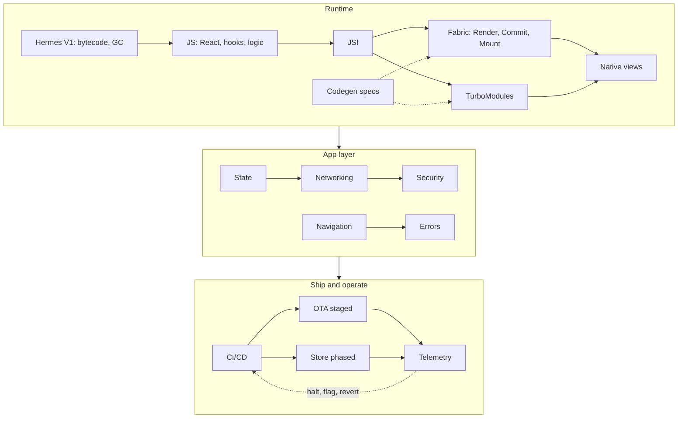
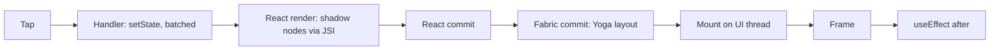
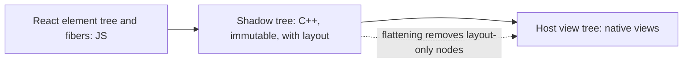
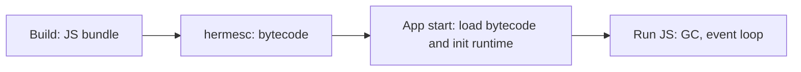
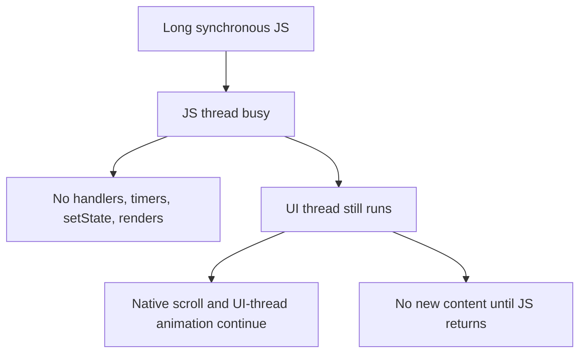
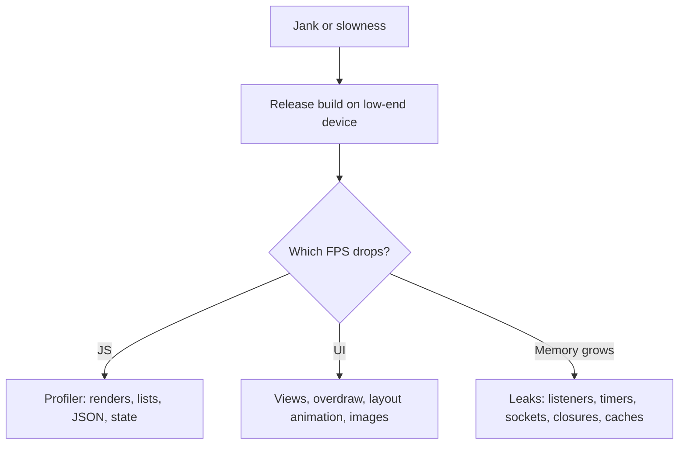
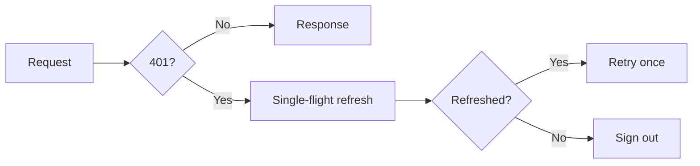
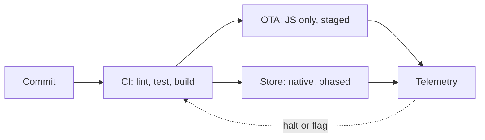

# React Native Recall Map (Last-Minute Review)

> Verification note: Release facts reflect **React Native 0.88 (Oct 2026)** and **Expo SDK 58 (Oct 2026)** as verified in [01](01-javascript-runtime-hermes-and-event-loop.md)–[14](14-ci-cd-with-github-actions.md): New Architecture only since **0.82**; **Hermes V1 default since 0.84**; legacy components removed from **0.84**; **Animation Backend (0.85)**; Strict TypeScript API default and `InteractionManager`/`Touchable*` removal in **0.87**; edge-to-edge Android 15+ (**0.86**); iOS 27 scene lifecycle (**0.88** / SDK 58). Items tagged *(hedged)* are established practice not re-verified this session. Full detail: [README](README.md).

## Table of Contents

1. [60-Second Mental Model](#1-60-second-mental-model)
2. [Maps](#2-maps)
3. [Decision Tables](#3-decision-tables)
4. [Numbers, Defaults and Version Facts](#4-numbers-defaults-and-version-facts)
5. [Mnemonics](#5-mnemonics)
6. [Rapid-Fire Q&A](#6-rapid-fire-qa)
7. [Say-This Scripts](#7-say-this-scripts)
8. [Red Flags vs Green Flags](#8-red-flags-vs-green-flags)
9. [Final 10-Minute Checklist](#9-final-10-minute-checklist)
10. [Visual Recall Diagrams and Triggers](#10-visual-recall-diagrams-and-triggers)
11. [Related Recall Maps](#11-related-recall-maps)

---

## 1. 60-Second Mental Model

1. **One JS thread + many native threads.** JS execution is single-threaded (Hermes); the app is multi-threaded (UI, JS, layout, module threads).
2. **Everything below React was swapped.** Bridge → **JSI**, UIManager → **Fabric**, NativeModules → **TurboModules**, plus **Codegen** contracts. React/Fiber is unchanged. New Architecture is **the only architecture** (0.82).
3. **Pipeline:** React render (shadow nodes created via JSI as host components are invoked) → React commit triggers → Fabric **Render → Commit (Yoga) → Mount (UI thread)**; exact phase alignment and Commit thread are not precisely specified in the docs *(hedged)*.
4. **`setTimeout`, `fetch`, `rAF` are host APIs**, not Hermes. Timers count natively; callbacks run on the JS thread; promises beat timers (microtasks first).
5. **Blocked JS thread** = no renders/handlers/timers; native-driven animation and scrolling continue; nothing crashes.
6. **Performance = two frame budgets** (JS and UI, ~16.7 ms). Profile in **Release**; fix the thread that is dropping frames.
7. **Memory:** cleanup everything subscribed; cancel async; bound caches; right-size images; release native resources.
8. **State by kind:** local / global client / **server (Query)** / persistent. Secrets in Keychain/Keystore, never AsyncStorage.
9. **Security:** PKCE in system browser, rotated refresh tokens, biometrics gate a secret, pin natively with a rotation plan, no secrets in the bundle, scrub logs.
10. **Ship in layers:** feature flag → **OTA (JS only, runtime-version gated, staged)** → **store (native, phased; can't un-release)**; telemetry gates every ramp.

---

## 2. Maps

**Document map**

| Topic | File |
|---|---|
| Engine, event loop, threads, GC | [01](01-javascript-runtime-hermes-and-event-loop.md) |
| Bridge → JSI/Fabric/TurboModules/Codegen, migration | [02](02-architecture-bridge-to-new-architecture.md) |
| React internals in RN | [03](03-react-internals-and-rendering-in-react-native.md) |
| Native modules/components, platform code | [04](04-native-modules-components-and-platform-code.md) |
| Performance, lists, images, leaks | [05](05-performance-rendering-lists-images-and-memory.md) |
| Startup, bundle, Metro, animations, gestures | [06](06-startup-bundle-animations-and-gestures.md) |
| Styling, layout, a11y, i18n | [07](07-ui-styling-layout-accessibility-and-localization.md) |
| Lifecycle, background, push, deep links, permissions | [08](08-app-lifecycle-background-work-push-and-deep-links.md) |
| Networking, storage, offline | [09](09-networking-storage-and-offline.md) |
| App architecture, state, navigation, errors | [10](10-app-architecture-state-and-navigation.md) |
| Security | [11](11-mobile-security.md) |
| Expo, EAS, tooling, debugging | [12](12-expo-eas-tooling-and-debugging.md) |
| OTA and store releases | [13](13-ota-updates-and-store-releases.md) |
| CI/CD | [14](14-ci-cd-with-github-actions.md) |
| Scenarios and system design | [15](15-senior-scenarios-and-system-design.md) |

---

## 3. Decision Tables

| Situation | Choose |
|---|---|
| Native capability without UI | TurboModule / Expo module (async) |
| Native view | Fabric component / Expo view |
| Small per-OS difference | `Platform.OS` / `select` (runtime) |
| Large per-OS difference | `.ios` / `.android` files (build time) |
| Per-frame/gesture animation | Reanimated worklets / native driver (`transform`, `opacity`) |
| Long list | `FlatList` tuned → recycling list |
| Server data | TanStack Query / RTK Query |
| Local UI state | `useState` |
| Tokens/secrets | Keychain/Keystore |
| Non-sensitive persistence | AsyncStorage / MMKV *(hedged)* / SQLite |
| JS-only fix | Flag → OTA (staged) |
| Native/permission/SDK change | Store release (phased) |
| Money-moving action | Pending state + idempotency, no optimism |
| Background work Android / iOS | Headless JS/WorkManager / Background Modes + `BGTaskScheduler` |
| Debug JS / native | React Native DevTools / Xcode, Android Studio, Logcat |
| Release-only crash | Deobfuscate (R8 mapping, dSYM), keep rules, test minified build |

| Release lever (fastest first) | Notes |
|---|---|
| Feature flag / kill switch | Seconds, no release |
| OTA republish | Minutes, JS only |
| Halt staged/phased rollout | Stops spread, doesn't undo |
| New binary | Hours–days; expedited review on iOS |

---

## 4. Numbers, Defaults and Version Facts

| Fact | Value |
|---|---|
| Latest RN / Expo SDK (verified Nov 2026) | **0.88** / **SDK 58** (RN 0.88, iOS 27) |
| New Architecture default / only | 0.76 / **0.82** (flags ignored); 0.81 + SDK 54 = last legacy |
| Hermes V1 | experimental 0.82 → **default 0.84**; no JIT |
| Support policy | Latest + previous two minors |
| RN 0.87 toolchain | Node 22+, AGP 9, Kotlin 2.0+; Strict TS API default |
| Removed in 0.87 | `InteractionManager`, `Touchable*` export, `Modal animated`, `StatusBar` bg props; `ImageBackground` deprecated |
| 0.85 | Animation Backend; Jest preset `@react-native/jest-preset`; `absoluteFillObject` removed; Metro TLS |
| 0.86 | Edge-to-edge Android 15+ |
| 0.81 | SafeAreaView deprecated; JSC community-maintained |
| 0.83 | Web Performance APIs stable; React 19.2 |
| Frame budget | 16.67 ms at 60 fps (JS and UI separately); 200 ms ≈ 12 dropped frames |
| FlatList defaults | `windowSize` 21, `initialNumToRender` 10, `maxToRenderPerBatch` 10, batching 50 ms |
| TanStack Query | `staleTime` 0, `gcTime` 5 min, retry 3 with backoff |
| ATS / cleartext | iOS ATS HTTPS by default; Android cleartext blocked API 28+ |
| Camera frame example | ~30 MB × ~2 GB/s (why JSI) |
| Android tooling | AAB required for new apps since Aug 2021; R8 default in Expo SDK 58 release |
| Apple 3.3.2 / Play exception | Interpreted code may not change primary purpose / store / bypass security; Play: VM with limited API access |
| CodePush | Retired 31 Mar 2025 |
| GitHub environments | Up to 6 reviewers, **1 approval** by default |
| iOS phased release *(hedged)* | 7 days, ~1→2→5→10→20→50→100% |

---

## 5. Mnemonics

- **JFTC:** **J**SI, **F**abric, **T**urboModules, **C**odegen — the four pillars.
- **RCM:** Fabric **R**ender → **C**ommit → **M**ount (JS thread, layout, UI thread).
- **TMM order:** call stack → **m**icrotasks (all) → one **m**acrotask.
- **J-U-L:** **J**S FPS, **U**I FPS, **L**eaks — the three performance questions.
- **SAFE cleanup:** **S**ubscriptions, **A**bort fetches, **F**ree native resources, **E**vent listeners/timers.
- **Q-S-A-P:** state kinds — **Q**uery (server), **S**tore (global), **A**tomic local, **P**ersist.
- **PKCE-BIO-PIN:** **PKCE** login, **BIO**metrics gate a secret, **PIN**ning with rotation.
- **FOSH:** release levers — **F**lag, **O**TA, **S**top rollout, **H**igher version (new binary).
- **BAKE:** canary loop — **B**ucket (percentage), **A**ttribute telemetry, **K**ill/halt, **E**xpand.
- **Three version axes:** binary / runtime / update ID.

---

## 6. Rapid-Fire Q&A

- **Is RN single-threaded?** JS execution yes; the app is multi-threaded.
- **Engine vs runtime?** ECMAScript implementation vs engine + host APIs.
- **Who implements `setTimeout`/`fetch`?** RN host polyfills over native; not Hermes.
- **Promise vs `setTimeout(0)`?** Promise first (microtasks before the next macrotask).
- **Blocked JS thread?** No JS runs; native-driven animation/scroll continue; no crash.
- **What did the Bridge do wrong?** Async-only, JSON-serialized, batched, eager modules, untyped, no concurrent rendering.
- **What is JSI?** C++ interface for direct JS↔native references; engine-agnostic; not a faster Bridge.
- **TurboModules vs legacy modules?** Lazy, typed (Codegen), JSI-backed; sync possible but blocks JS.
- **Fabric phases?** Render (shadow nodes, JS thread), Commit (Yoga layout + promotion; docs say background, threading page says JS), Mount (UI thread, diff + views).
- **React render/commit vs Fabric?** Different layers; shadow nodes are created while React invokes host components, Fabric commit follows React's commit; exact alignment inferred *(hedged)*.
- **What enables concurrent rendering in RN?** Immutable, thread-safe shadow trees.
- **Hermes V1?** Default since 0.84; precompiled bytecode; no JIT yet.
- **New Architecture status?** Only architecture since 0.82; migrate via 0.81/SDK 54 first.
- **View flattening?** Layout-only nodes merged into parents during diff.
- **Native module vs component?** Functionality vs UI.
- **`Platform.select` vs file extensions?** Runtime branch vs build-time resolution.
- **Move CPU work off JS?** Async native module on background thread; chunk; worklets; off-device.
- **Send large data?** Buffers/`ArrayBuffer`/URIs by reference — never JSON/base64.
- **JS FPS vs UI FPS?** Per-thread frame rates; fix whichever drops.
- **Why `memo` fails?** Unstable props (new object/function identities).
- **`windowSize` default?** 21; `getItemLayout` for fixed rows; `removeClippedSubviews` saves little memory.
- **Image memory?** Pixel dimensions drive decoded size; serve thumbnails, bound caches.
- **Leak sources?** Listeners, subscriptions, timers, sockets, closures, navigation refs, native resources, caches.
- **Animate what?** `transform`/`opacity` natively; layout props via Animation Backend (0.85, experimental).
- **What is a worklet?** UI-thread JS function in a second runtime.
- **`useEffect` vs `useLayoutEffect`?** After-visible passive vs before-visible synchronous.
- **TanStack Query defaults?** stale 0, gc 5 min, retry 3.
- **Why not everything in Redux?** Server state, local state, over-centralization, scoping, lifecycles.
- **Auth navigation pattern?** Conditional screens; splash while restoring.
- **Error categories?** UI / API / crash / business.
- **Error boundary limits?** Not event handlers/async; class only.
- **CORS in RN?** None (WebView has it).
- **`fetch` gotcha?** Doesn't reject on HTTP errors; no timeout.
- **Token refresh race?** Single-flight refresh + rotation with reuse detection.
- **Optimistic updates?** Low-stakes only; pending for money.
- **AsyncStorage vs Keychain?** Unencrypted vs OS-protected.
- **Why PKCE?** No URL-scheme registry on mobile.
- **Pinning?** Native; pin intermediates/backups; plan rotation.
- **Deep-link rule?** Universal/App Links, validate, no secrets.
- **Screenshots?** Android `FLAG_SECURE`; iOS detect + blur snapshot.
- **Secrets in bundle?** Public — use backend.
- **Cold vs warm link/notification?** `getInitial*` vs events.
- **Background work?** Headless JS/WorkManager; Background Modes/`BGTaskScheduler`; timers don't survive.
- **iOS 27?** Scene lifecycle required; resizable apps.
- **OTA scope?** JS + assets only; runtime-version gated.
- **OTA rollback?** Boot acknowledgement + server republish/halt.
- **Store rollback?** Impossible — halt, re-point (Google), higher version (Apple).
- **iOS pipeline?** match → archive → export → upload → TestFlight → review → phased.
- **Android pipeline?** keystore → bundleRelease → Play track → staged.
- **GitHub prod gating?** Environment reviewers, concurrency `cancel-in-progress: false`.
- **Debug JS?** React Native DevTools.
- **Upgrade steps?** Support window, `expo install --fix`/Upgrade Helper, breaking-change notes, rebuild, staged rollout.

---

## 7. Say-This Scripts

- **"Explain the New Architecture."** "The Bridge was an async, JSON, batched queue. JSI replaces it with direct C++ references; TurboModules are lazy typed native modules; Fabric is a shared C++ renderer with an immutable shadow tree running render, commit and mount; Codegen makes the JS spec the contract. It's an enabler — and since 0.82 it's the only architecture."
- **"The app is janky — what do you do?"** "Profile a release build on a low-end device, see which FPS drops — JS or UI — then fix that side: render counts and list config for JS; views, overdraw and layout animation for UI; and I check memory growth separately."
- **"How do you secure a banking app?"** "Server-side authorization first; PKCE in the system browser; rotated refresh tokens in Keychain/Keystore, biometrics gating the secret; step-up for risky actions; pinning with a rotation plan; no secrets or PII in bundle, logs or deep links; blur sensitive screens; attestation signals as one input."
- **"OTA or store?"** "If it's JS-only I use a flag or a staged OTA gated by runtime version; if it touches native code or permissions it's a store release with phased rollout. Either way telemetry gates the ramp, and I know store releases can't be un-released."
- **"How do you handle offline?"** "Cache-first rendering with a freshness indicator, retry on reconnect, an outbox with idempotency keys for low-risk writes, and explicit disabled states for actions that must be live."
- **"How do you upgrade RN?"** "Stay inside the support window, go step by step, migrate to the New Architecture on 0.81/SDK 54 first, read breaking changes, update the toolchain, run device smoke tests, and stage the rollout with release health comparisons."

---

## 8. Red Flags vs Green Flags

| Red flags | Green flags |
|---|---|
| "RN is single-threaded" | JS single-threaded, app multi-threaded |
| "JSI is a faster Bridge" | JSI = direct references, no wire format |
| "New Architecture makes everything faster" | Enabler; measure |
| `fetch` rejects on 404 | Checks `ok`, normalizes errors |
| Tokens in AsyncStorage | Keychain/Keystore, rotation, biometrics gate |
| Optimistic transfers | Pending states + idempotency |
| Debugging in dev mode | Release-build profiling on low-end devices |
| OTA for native changes | Runtime-version gating, policy awareness |
| "We can roll back the store release" | Flags, OTA, halting, higher version |
| Uses `InteractionManager`/Flipper/remote debugging | Current APIs/tools (`requestIdleCallback`, DevTools) |
| No cleanup in effects | SAFE cleanup, cancellation, blur handling |
| Ignores a11y/i18n | Roles/labels, dynamic type, RTL, locale formatting |

---

## 9. Final 10-Minute Checklist

- [ ] JS thread vs native threads; blocked JS behavior
- [ ] Event loop order; host APIs; timers in background
- [ ] Bridge problems → JSI/Fabric/TurboModules/Codegen; 0.82 timeline
- [ ] Fabric Render/Commit/Mount; React vs Fabric phases
- [ ] Module vs component; `Platform` vs file extensions
- [ ] JS FPS vs UI FPS; `memo` pitfalls; list props; image memory; leaks and cancellation
- [ ] Startup levers; Metro roles; worklets; native-driver rules
- [ ] State kinds; Query defaults; auth navigation; error categories
- [ ] Networking path; CORS; refresh race; idempotency; cursor pagination; offline worked answer
- [ ] Storage ladder; PKCE; biometrics; pinning; deep links; screenshots; secrets
- [ ] Lifecycle states; background mechanisms; push cold/warm; permissions; iOS 27
- [ ] OTA vs store; rollback layers; pipelines; signing; staged/phased
- [ ] CI/CD: jobs, secrets, environments, concurrency, caching
- [ ] Expo/EAS, DevTools, troubleshooting playbook, upgrade path
- [ ] One system-design walkthrough rehearsed ([15](15-senior-scenarios-and-system-design.md))

---

## 10. Visual Recall Diagrams and Triggers

**Three trees (never conflate):** React element tree and fibers (JS) → React shadow tree (C++, immutable, layout) → host view tree (native views). Fibers use **double buffering** (current vs work-in-progress); shadow trees use **structural sharing** (clone only the changed path).

**Hermes: init vs compile.** Compile time (build): Metro bundle → `hermesc` → bytecode. Run time: load bytecode, initialize runtime, execute; no parse/compile on device, which is why startup improves. No JIT (V1 included, at the time of verification).

**Event loop and blocked JS.** Stack empties, then all microtasks, then one macrotask. A blocked JS thread stalls handlers, timers and renders but not native scrolling or native-driven animation.

**Performance triage.**

**Native contract (Codegen).** JS or TS spec → Codegen generates native interfaces → native implements → JS calls through JSI. Decision: capability without UI = module; UI = component; per-OS difference = `Platform` (runtime) or file extensions (build time).

**State and auth.** Kinds: local, global client, server (Query), persistent. Auth flow: PKCE in system browser → tokens in Keychain/Keystore → 401 → single-flight refresh → retry once → on failure, sign out.

**Lifecycle, push, deep links.** AppState: `active`, `background`, `inactive` (iOS transitions). Cold start: `getInitialURL` / initial notification; warm: `url` event / notification-opened event. JS timers do not survive background; use OS-scheduled work. Prefer recursive `setTimeout` over `setInterval` and compute elapsed time from timestamps to avoid drift.

**Networking chain.** `fetch` → JS polyfill → native networking (OkHttp / `NSURLSession`) → OS/TLS → server. No CORS; no auto-reject on HTTP error; no default timeout; pinning lives natively.

**Bundle vs OTA vs store.** Metro bundle = JS + assets, built per release. OTA replaces the JS bundle if the **runtime version** matches the installed binary. Store release changes native code. Rollback: flag, OTA republish, halt rollout, higher version (store cannot un-release).

**Capstone walkthrough (say it end to end):** tap → handler → `setState` batched → React render creates shadow nodes via JSI → commit → Yoga layout → mount on the UI thread → frame; effects after; meanwhile network via native stack, state in Query, secrets in Keychain, shipped by staged OTA or phased store release.

**Effect timing (safe statement):** `useInsertionEffect` → host mutation → `useLayoutEffect` (sync, before the visible update) → paint/mount → `useEffect`. Do not assert order relative to Fabric layout or mount; the docs do not specify it.

---

## 11. Related Recall Maps

- [React](../react/README.md) · [TypeScript](../typescript/README.md) · [Next.js & Rendering](../nextjs-and-rendering/README.md) · [Web Performance](../web-performance/README.md) · [Browser Internals](../browser-internals/README.md) · [Web Security](../web-security/README.md) · [Networking & APIs](../networking-and-apis/README.md) · [Testing](../testing/README.md)
