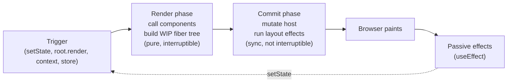
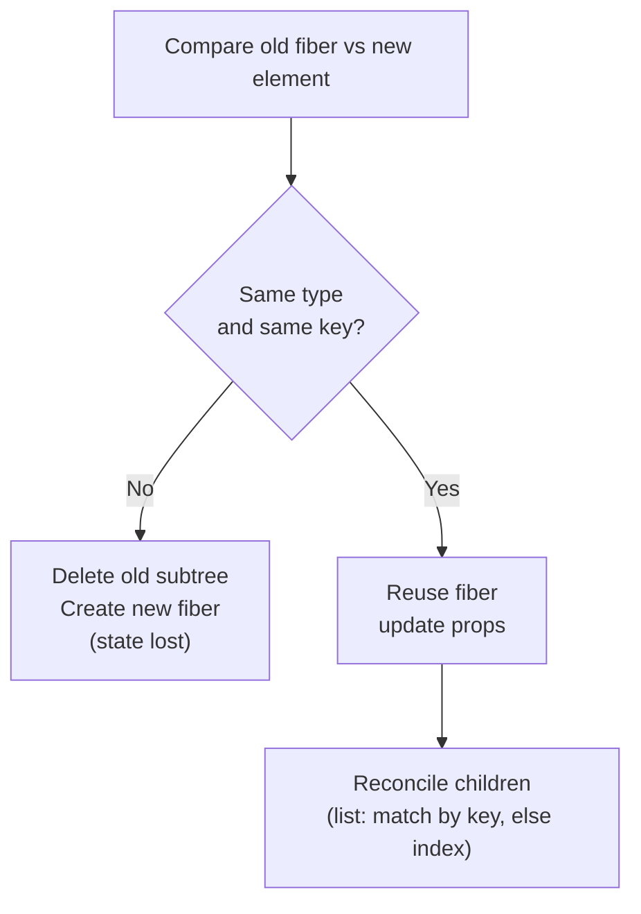
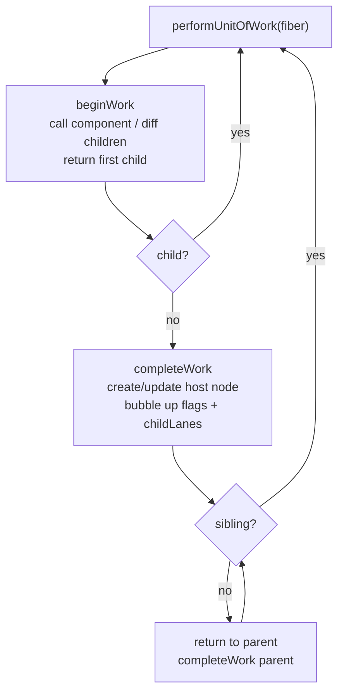
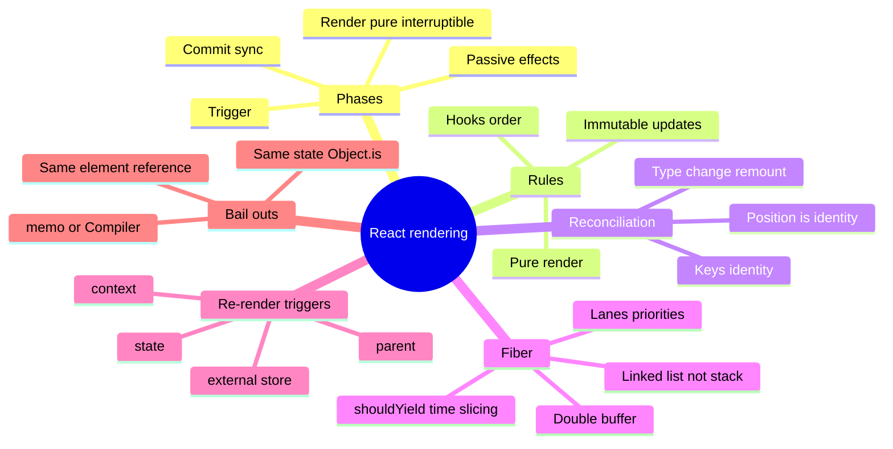

# React Rendering Model, Reconciliation & Fiber — Interview Guide

> Verified against react.dev (React 19.x, latest stable 19.3 at time of writing). Version-sensitive claims are marked **[19.x]**.
> Related: [React Native Tier 6 — React internals in RN](../react-native/10-tire6-react-internals-in-react-native.md) (same engine, different host).

## Table of Contents

1. [Quick Summary (TL;DR)](#1-quick-summary-tldr)
2. [The Mental Model: Trigger → Render → Commit → Effects](#2-the-mental-model-trigger--render--commit--effects)
3. [Elements, Components, Instances, Fibers](#3-elements-components-instances-fibers)
4. [Purity, Rules of React, Strict Mode](#4-purity-rules-of-react-strict-mode)
5. [State as a Snapshot, Queues, Batching](#5-state-as-a-snapshot-queues-batching)
6. [What Triggers a Re-render (and What Does Not)](#6-what-triggers-a-re-render-and-what-does-not)
7. [Reconciliation: The Diffing Rules](#7-reconciliation-the-diffing-rules)
8. [Keys in Depth](#8-keys-in-depth)
9. [Fiber Architecture Internals](#9-fiber-architecture-internals)
10. [The Commit Phase in Detail](#10-the-commit-phase-in-detail)
11. [Events: Delegation, Priorities, Synthetic Events](#11-events-delegation-priorities-synthetic-events)
12. [Controlled vs Uncontrolled, Refs, Portals](#12-controlled-vs-uncontrolled-refs-portals)
13. [Common Mistakes and Pitfalls](#13-common-mistakes-and-pitfalls)
14. [Performance Considerations](#14-performance-considerations)
15. [Trade-offs and Alternatives](#15-trade-offs-and-alternatives)
16. [Interview Questions — Fundamentals](#16-interview-questions--fundamentals)
17. [Interview Questions — Senior Scenarios](#17-interview-questions--senior-scenarios)
18. [Cheat Sheet](#18-cheat-sheet)
19. [Key Terms Glossary](#19-key-terms-glossary)
20. [Further Reading](#20-further-reading)

---

## 1. Quick Summary (TL;DR)

- React models UI as a **pure function of props, state and context**: `UI = f(props, state, context)`.
- Every update goes through **Trigger → Render → Commit**. Render is pure computation (can be paused, restarted or thrown away). Commit mutates the host (DOM / native views) and is always synchronous.
- **Render ≠ DOM update.** Rendering means *calling your component functions*. React only touches the DOM for the diff it finds.
- A re-render is triggered by **state change** (or `useReducer`, `useSyncExternalStore`, context change) — props changing is a *consequence* of a parent re-render, not an independent trigger.
- Re-rendering a component re-renders its **entire subtree** by default unless React can bail out (`memo`, same element reference, React Compiler).
- Reconciliation uses two heuristics: **different type ⇒ remount**, **keys identify stable children**. This is O(n) rather than O(n³).
- **Fiber** is the data structure + work loop that makes rendering interruptible and prioritised (lanes). It is the foundation for Suspense, Transitions and `Activity`.



---

## 2. The Mental Model: Trigger → Render → Commit → Effects

### Concept
React's official model (react.dev "Render and Commit") compares it to a restaurant: *trigger* = diner places an order, *render* = the kitchen prepares it, *commit* = the waiter serves it.

1. **Trigger** — initial `root.render(<App />)` or a state update scheduled by `setState` / dispatch.
2. **Render** — React calls your function components. On the initial render it creates the root; on re-renders it compares the returned element tree with the previous one.
3. **Commit** — React applies the minimal set of host mutations (`appendChild`, `setAttribute`, `textContent`, ...). Refs are attached and layout effects run synchronously after mutation.
4. **Paint** — the browser paints.
5. **Passive effects** — `useEffect` callbacks run after paint in the common case.

### Why it matters
Almost every interview question about hooks, `memo`, Suspense, transitions and concurrency is a question about *which phase something happens in*. If you can place any operation on the timeline above, you can reason about its behaviour.

### Internals: where each thing runs

| Thing | Phase | Can be interrupted? | Side effects allowed? |
|---|---|---|---|
| Component body, `useMemo`/`useState` initialisers, reducers | Render | Yes (concurrent) | No (must be pure) |
| DOM mutations, ref attach/detach | Commit (mutation) | No | Done by React |
| `useLayoutEffect`, `componentDidMount/Update` | Commit (layout) | No | Yes |
| `useEffect` | After paint (passive) | Scheduled separately | Yes |

> Nuance: if the render was caused by a **discrete event** (click, key press), React flushes passive effects synchronously at the end of the commit so that effects observe a consistent result before the next discrete event. Otherwise they run after paint.

### Example: tracing a click

```tsx
import { useState, useEffect, useLayoutEffect } from "react";

export function Counter() {
  const [count, setCount] = useState(0);
  console.log("render", count);                       // render phase

  useLayoutEffect(() => console.log("layout", count)); // commit, before paint
  useEffect(() => console.log("passive", count));      // after paint

  return <button onClick={() => setCount((c) => c + 1)}>{count}</button>;
}
// Click -> "render 1" -> (DOM text updated) -> "layout 1" -> paint -> "passive 1"
```

---

## 3. Elements, Components, Instances, Fibers

| Term | What it is | Lifetime |
|---|---|---|
| **Element** | A plain, immutable object `{ type, props, key, ref }` describing *what you want on screen*. Created by `jsx()` / `createElement`. | One render |
| **Component** | A function (or class) that takes props and returns elements | Code, not runtime |
| **Fiber** | React's internal mutable work unit: one per component instance / host node, holds state, hooks, effects, pointers | From mount to unmount |
| **Host instance** | A real DOM node (or native view in RN) | From mount to unmount |

```tsx
// JSX is compiled (new JSX transform, no `import React` needed) to:
import { jsx as _jsx } from "react/jsx-runtime";
const el = _jsx("button", { className: "btn", children: "Save" });
// el === { $$typeof: Symbol(react.transitional.element), type: "button", props: {...}, key: null, ... }
```

Key point: **elements are cheap, immutable descriptions**; creating them every render is not the expensive part. The expensive parts are calling component functions, diffing and committing.

### Why `$$typeof`?
It is a `Symbol` tag so that a JSON payload from an attacker cannot masquerade as a React element (Symbols cannot be serialised in JSON). This is a classic XSS-hardening detail interviewers like.

---

## 4. Purity, Rules of React, Strict Mode

### Concept
Components and hooks must be **pure** with respect to render: same inputs ⇒ same output, no mutation of anything that existed before the render started, and no side effects during render. The official "Rules of React" are:

1. Components and hooks must be pure.
2. React calls components and hooks (you never call a component as a function).
3. Rules of Hooks: call hooks at the top level, only from components or custom hooks.

### Why
Concurrent rendering **may call your component multiple times, pause, discard partial work, or render it at low priority**. Purity is the contract that makes this safe. It is also what lets the React Compiler automatically memoize.

### Strict Mode (development only)
`<StrictMode>` deliberately surfaces impurity:
- Double-invokes component bodies, `useState`/`useMemo`/`useReducer` initialisers and updater functions.
- Double-invokes effects on mount (mount → unmount → mount) to verify cleanup logic. **[19.3]** this also applies during hydration.
- **[19.x]** Ref callbacks are also double-invoked (attach → detach → attach), and with ref cleanup functions it verifies they are symmetrical.
- Reuses memoized results from the first render during the second pass (React 19) so `useMemo`/`useCallback` do not do double work in the second call.

```tsx
// Impure: mutates module state during render. Strict Mode exposes it by double-counting.
let renderCount = 0;
function Bad() {
  renderCount++;           // side effect in render
  return <p>{renderCount}</p>;
}

// Pure: derive from props/state only. Local mutation of values you *just created* is fine.
function Good({ items }: { items: string[] }) {
  const sorted = [...items].sort();   // local copy -> safe
  return <ul>{sorted.map((s) => <li key={s}>{s}</li>)}</ul>;
}
```

---

## 5. State as a Snapshot, Queues, Batching

### State is a snapshot
Each render sees a **fixed snapshot** of state, props and event handlers. Calling `setCount(count + 1)` three times in a handler uses the same `count` each time.

```tsx
function Bad() {
  const [n, setN] = useState(0);
  return (
    <button onClick={() => { setN(n + 1); setN(n + 1); setN(n + 1); }}>
      {n}  {/* goes 0 -> 1, not 3 */}
    </button>
  );
}

function Good() {
  const [n, setN] = useState(0);
  return <button onClick={() => { setN((c) => c + 1); setN((c) => c + 1); setN((c) => c + 1); }}>{n}</button>; // 0 -> 3
}
```

### The update queue (how it works internally)
Each hook has a **queue** of pending updates. During the next render React replays the queue from the *base state*: values are applied directly, functions receive the running result. Replaying from a base state (not the latest result) is what lets React **re-order and rebase** updates when a low-priority (transition) update is interrupted by an urgent one.

### Bail-out
If the new state is `Object.is`-equal to the current state, React skips re-rendering children and effects (it may still call the component once more before bailing out — this is why you can see one extra log). Mutating an object and calling `setState(sameRef)` therefore does **nothing**.

### Automatic batching
Since React 18 (`createRoot`) **all** updates are batched — in event handlers, promises, `setTimeout`, native handlers — and applied in one render. `flushSync` opts out for the rare case you must read the DOM synchronously after the update.

```tsx
import { flushSync } from "react-dom";

function onAdd() {
  flushSync(() => setTodos((t) => [...t, newTodo]));
  listRef.current?.lastElementChild?.scrollIntoView(); // DOM already updated
}
```

### Setting state during render
Allowed **only** for the component's own state and only as the "derive state from props" pattern; React discards the output and re-renders immediately. Prefer *deriving during render* or lifting/keying instead.

```tsx
function List({ items }: { items: string[] }) {
  const [prev, setPrev] = useState(items);
  const [selected, setSelected] = useState<string | null>(null);
  if (items !== prev) { setPrev(items); setSelected(null); } // legal, but prefer `key`
  // ...
}
// Better: <List key={listId} items={items} /> resets all state when listId changes.
```

---

## 6. What Triggers a Re-render (and What Does Not)

Re-render sources:
1. `setState` / `dispatch` with a **different** value.
2. **Parent re-render** (default: all children re-render unless bailed out).
3. **Context value change** for every consumer (`useContext` / `use(Context)`), regardless of which field they read.
4. `useSyncExternalStore` store change.
5. A resolved `use(promise)` / Suspense retry.
6. `forceUpdate`-like patterns (class `forceUpdate`, changing `key`).

Not triggers: mutating a `ref.current`, mutating a variable, mutating state in place, props changing *without* a parent render (impossible).

### The "children as props" bail-out (a favourite senior question)
React skips a child if the **element reference is identical** to last time. Elements passed through `children` are created by the *parent of the parent*, so they keep identity when the intermediate component re-renders.

```tsx
function MouseTracker({ children }: { children: React.ReactNode }) {
  const [pos, setPos] = useState({ x: 0, y: 0 });
  return <div onMouseMove={(e) => setPos({ x: e.clientX, y: e.clientY })}>
    <Cursor pos={pos} />
    {children}   {/* same element reference -> NOT re-rendered on every mouse move */}
  </div>;
}

function App() {
  return <MouseTracker><ExpensiveTree /></MouseTracker>;
}
```

This "move state down / lift content up" technique removes many `memo` calls with **zero** hooks.

---

## 7. Reconciliation: The Diffing Rules

### Concept
Reconciliation is the algorithm that compares the new element tree against the current fiber tree to decide what to create, update, move or delete. A generic tree diff is O(n³); React uses heuristics to get **O(n)**:

1. **Elements of different types produce different trees.** `<div>` → `<span>`, or `<A/>` → `<B/>`, tears down the entire old subtree (unmounting, destroying state) and builds a new one.
2. **Same type at the same position:** reuse the instance, update props, recurse into children.
3. **Keys** hint which children across renders are the same logical item.



### Position is identity
State lives in the **position of a component in the tree**, not in the JSX you wrote.

```tsx
function App({ isFancy }: { isFancy: boolean }) {
  return isFancy ? <Counter className="fancy" /> : <Counter />; // SAME position + type -> state preserved
}

function App2({ isFancy }: { isFancy: boolean }) {
  return isFancy ? <div><Counter /></div> : <section><Counter /></section>; // type changed -> state reset
}
```

### Defining components inside components = remount every render
```tsx
function Parent() {
  function Child() { return <input />; } // new function identity each render -> new type -> remount, loses focus/state
  return <Child />;
}
```
Always define components at module scope (or hoist). The React Compiler does not fix this.

### Multi-child diffing (simplified algorithm)
React walks old and new child lists:
1. Walk in order while keys match.
2. When a mismatch is hit, put the remaining old children in a `Map<key, fiber>`.
3. Iterate the rest of the new list, **reusing** by key, tracking `lastPlacedIndex` to decide whether a node needs to **move**; unmatched new items are created; leftover old fibers are deleted.

Consequence: moving an item **to the front** costs one move per other item *if keys are positional*; with stable keys it is one move.

---

## 8. Keys in Depth

### What keys do
Keys give list items a stable identity across renders so React can preserve state, DOM nodes, focus, and animations, and so it can do minimal moves.

### Rules
- Unique **among siblings** only.
- Stable between renders — **never** `Math.random()` / `crypto.randomUUID()` in render (remounts every time).
- Prefer a database ID. Index is acceptable only for static, never reordered/filtered/inserted lists.

### Index-as-key bug

```tsx
// List with inputs, delete the first row
{rows.map((row, i) => <Row key={i} defaultValue={row.text} />)}
// After deleting row 0, key 0 now receives row 1's props, but the existing <input> keeps its OLD uncontrolled value
// -> UI shows wrong text. With key={row.id} React removes the correct DOM node.
```

### Keys as a state-reset tool

```tsx
<Profile key={userId} userId={userId} /> // new key => unmount + mount => all internal state reset, no useEffect needed
```

This is the officially recommended alternative to "reset state in an effect when a prop changes".

### Fragments
Use `<Fragment key={id}>` (not `<>`) when a keyed list item renders multiple siblings.

---

## 9. Fiber Architecture Internals

### Why Fiber exists
Before React 16 the reconciler used recursive calls on the JS call stack — it could not be paused. Fiber reimplements the stack as a **linked list of heap objects** so React controls when to yield, can assign **priorities**, and can resume or discard work. This is the foundation for concurrent features.

### Anatomy of a fiber (simplified)

```ts
type Fiber = {
  tag: number;               // FunctionComponent, HostComponent, ...
  type: unknown;             // function / 'div'
  key: string | null;
  stateNode: unknown;        // DOM node or class instance
  return: Fiber | null;      // parent
  child: Fiber | null;       // first child
  sibling: Fiber | null;     // next sibling
  pendingProps: unknown;
  memoizedProps: unknown;
  memoizedState: unknown;    // for function components: head of the hooks linked list
  updateQueue: unknown;
  flags: number;             // Placement | Update | Deletion | Ref | Passive ...
  lanes: number;             // pending work priority bitmask
  childLanes: number;        // pending work in the subtree
  alternate: Fiber | null;   // the other buffered version
};
```

### Double buffering
React keeps two trees: **current** (what is on screen) and **work-in-progress** (being built). Each fiber links to its `alternate`. When the commit finishes, the root pointer flips: WIP becomes current. If render is abandoned, WIP is just dropped — the screen never saw it.

### The work loop

- **Concurrent mode:** after each unit React checks `shouldYield()` (the scheduler gives roughly 5 ms slices) and can hand control back to the browser.
- **Sync mode** (urgent updates, `flushSync`): runs to completion without yielding.

### Lanes (priorities)
Updates carry a **lane** (bitmask). Typical lanes (names are internal, shown for understanding):

| Lane | Source |
|---|---|
| SyncLane | discrete events: click, keydown, `flushSync` |
| InputContinuousLane | continuous events: mousemove, scroll |
| DefaultLane | network responses, timers |
| TransitionLanes | `startTransition`, `useDeferredValue` re-render |
| RetryLanes | Suspense retries |
| IdleLane / OffscreenLane | hidden `Activity`, prerender |

React renders the **highest priority lane first**. A lower-priority render in progress is **interrupted** and restarted if an urgent update arrives. Lanes in the same batch are rendered together (*entanglement*). **[19.3]** Transitions are now rendered independently rather than all entangled into one render, so a slow transition no longer holds up unrelated ones.

### Bailout optimisations (`bailoutOnAlreadyFinishedWork`)
If a fiber has no pending lanes **and** props identity is unchanged **and** no context change, React skips calling the component and uses `childLanes` to know whether it must still descend. That is how a state update deep in the tree does not re-run unrelated components: only the path to the updated fiber plus its subtree is visited.

### Hooks storage
`memoizedState` of a function component fiber points to a linked list of hook objects in **call order**. This is **why the Rules of Hooks exist**: React identifies "which hook is this?" purely by call order, so conditional hooks shift the list and mismatch state.

---

## 10. The Commit Phase in Detail

Commit is synchronous and runs in three sub-phases over the effect-flagged fibers:

1. **Before mutation** — `getSnapshotBeforeUpdate`, read DOM before change.
2. **Mutation** — insert / update / delete host nodes, detach refs, run `useLayoutEffect` **cleanups** and `useInsertionEffect`.
3. **Layout** — attach refs, run `useLayoutEffect` / `componentDidMount|Update` **setup**. The `current` pointer has flipped to the new tree by this point, so layout effects see the new DOM.

Then, scheduled separately: **passive effects** (`useEffect`): all cleanups of the batch first, then all setups.

Why `useLayoutEffect` exists: measuring DOM (`getBoundingClientRect`) and synchronously re-rendering **before paint** to avoid flicker (tooltips, popovers). The cost: it blocks paint. Use sparingly.

---

## 11. Events: Delegation, Priorities, Synthetic Events

- Since React 17, React attaches listeners at the **root container** (not `document`), which makes multiple React versions on a page and embedding in other apps safe.
- Handlers receive a **SyntheticEvent** wrapper normalising cross-browser behaviour. Since React 17 there is no **event pooling**, so `e.persist()` is a no-op.
- `onChange` on inputs maps to the native `input` event (fires on each keystroke) — unlike the native `change` event.
- The event type determines **lane priority**: discrete events (click, input) produce sync-priority updates; continuous events (mousemove, scroll) a lower priority.
- `e.stopPropagation()` stops React's synthetic propagation and calls native `stopPropagation` on the root-delegated event; native listeners attached *below* the root already ran.
- Passive listeners: React adds `touchstart`, `touchmove`, `wheel` as passive at the root, so you cannot `preventDefault()` there; attach a native non-passive listener via ref if needed.

```tsx
function Menu() {
  const ref = useRef<HTMLDivElement>(null);
  useEffect(() => {
    const el = ref.current!;
    const onWheel = (e: WheelEvent) => e.preventDefault();
    el.addEventListener("wheel", onWheel, { passive: false });
    return () => el.removeEventListener("wheel", onWheel);
  }, []);
  return <div ref={ref} />;
}
```

---

## 12. Controlled vs Uncontrolled, Refs, Portals

### Controlled vs uncontrolled inputs

| | Controlled | Uncontrolled |
|---|---|---|
| Source of truth | React state (`value` + `onChange`) | The DOM (`defaultValue`, read via `ref`/`FormData`) |
| Re-render per keystroke | Yes | No |
| Instant validation / formatting | Easy | Harder |
| Large forms perf | Can be costly | Excellent |
| Fits React 19 `<form action>` | Works | Natural (form resets automatically after an Action) |

Rule of thumb: **uncontrolled + `FormData` for simple/large forms, controlled for inputs whose value drives other UI**. Libraries (React Hook Form) use uncontrolled inputs plus refs for performance.

### Refs
A ref is a mutable box `{ current }` that survives renders **without triggering them**. Use for DOM access, timers, previous values, imperative handles. Never read/write `ref.current` during render (except lazy init) — it breaks purity and the compiler.
**[19.x]** `ref` is a regular prop on function components (`forwardRef` no longer needed); ref callbacks may return a cleanup function.

```tsx
function Input({ ref, ...props }: React.ComponentProps<"input">) {
  return <input ref={ref} {...props} />;  // React 19: ref as a prop
}
```

### Portals
`createPortal(children, domNode)` renders into a different DOM node while staying in the **React tree** — context works, and **synthetic events bubble through the React parent**, not the DOM parent. Use for modals, tooltips, toasts that must escape `overflow: hidden` or stacking contexts.

---

## 13. Common Mistakes and Pitfalls

| Mistake | Why it breaks | Fix |
|---|---|---|
| Mutating state (`arr.push(x); setArr(arr)`) | Same reference ⇒ bail-out; memoized children see no change | Copy: `setArr([...arr, x])` |
| Using stale state in async code | Closure holds an old snapshot | Functional update or `useRef`/`useEffectEvent` |
| `key={index}` on dynamic lists | State attaches to the wrong row | Stable ID |
| Component defined inside another | Remount each render | Hoist to module scope |
| Calling hooks conditionally / in loops | Hook list order shifts | Restructure, extract component |
| Side effects in render (fetch, subscribe, `Math.random`) | Double invocation / discarded renders | Effects or event handlers |
| Deriving state with `useEffect` + `setState` | Extra render pass, flicker, bugs | Compute during render, `useMemo`, or `key` |
| `useEffect` to sync two states | Cascading renders | Single source of truth |
| Reading `ref.current` in render | Impure, stale | Read in effects/handlers |
| Expecting `setState` to be synchronous | Snapshot semantics | Use the next value you computed, or `flushSync` rarely |
| Inline object/array/function props to memoized children | New identity each render defeats `memo` | Stabilise or rely on Compiler |

---

## 14. Performance Considerations

- **Render cost** = (number of components re-rendered) × (cost per render). Reduce both: move state down, lift expensive content up (`children` pattern), split contexts.
- **Commit cost** is proportional to the diff. Large lists with many changes are dominated by DOM work → virtualise.
- **Don't optimise blindly**: profile with React DevTools Profiler ("Why did this render?", flamegraph) and the Chrome Performance panel (React 19.2+ adds custom **Performance Tracks**: Scheduler and Components).
- `memo`, `useMemo`, `useCallback` skip work only when props/deps are referentially stable; the **React Compiler** (stable 1.0) automates this and should be preferred for new code. See [08-react-performance-optimization.md](08-react-performance-optimization.md).
- Avoid layout thrashing in layout effects (read, then write).
- Keys on large lists: stable keys make reorders O(n) moves instead of re-creating nodes.

---

## 15. Trade-offs and Alternatives

| Choice | Pros | Cons |
|---|---|---|
| Virtual-DOM-style diff (React) | Declarative; fine-grained control via concurrency | Re-render cascade needs manual or compiler optimisation |
| Signals / fine-grained reactivity (Solid, Vue, Preact Signals) | Updates only the exact DOM nodes; no component re-run | Different mental model, less ecosystem, harder with concurrent rendering semantics |
| Compile-time frameworks (Svelte) | Minimal runtime | Compiler-bound; less runtime flexibility |
| React Compiler | Auto-memoisation, fewer hooks | Requires following the Rules of React; opaque; build step |
| Controlled inputs everywhere | Simple mental model | Re-render per keystroke |

The "React re-renders too much" criticism is the exact problem the React Compiler addresses; interviewers expect you to know that React's strength is **predictability + concurrency**, not raw minimal-update speed.

---

## 16. Interview Questions — Fundamentals

### Q1. What happens, step by step, when you call `setState`?
1. React creates an **update object** and enqueues it on the hook's queue with a **lane** derived from the current event priority.
2. It marks the fiber and all its ancestors' `childLanes` so the next render can find it, then schedules a render on the root.
3. In the next **render phase**, React walks from the root, bails out of fibers with no pending work, calls your component for the updated fiber, replays the update queue from the base state, and reconciles the returned elements against the old children.
4. During the **commit phase**, flagged fibers are applied to the DOM; layout effects run synchronously.
5. After paint (or synchronously for discrete events), **passive effects** run.
Multiple `setState` calls in the same tick are **batched** into one render.

### Q2. What is the difference between rendering and updating the DOM?
Rendering = calling components and computing the new element tree. DOM updates happen only in the commit phase and only for differences. A component can render many times without touching the DOM (identical output). Conversely, React may render in the background and *throw the result away* (concurrent rendering), producing zero DOM updates.

### Q3. What is reconciliation and what are its heuristics?
It is React's diffing process. It assumes (1) different element types produce different subtrees (remount), and (2) keys identify the same child across renders. Those assumptions reduce complexity from O(n³) to O(n). They fail when you change a wrapper type unintentionally (loses state) or use unstable keys.

### Q4. Why do we need keys? What is wrong with `index` keys?
Keys give list items identity so React can reuse DOM and state. With index keys, inserting/removing/reordering shifts identity: row *i* receives row *i+1*'s props while keeping its own state/DOM (uncontrolled input values, focus, animations, child component state), causing wrong UI and wasted updates. Index keys are fine for static lists that never reorder or filter.

### Q5. Is React's re-render the same as a DOM re-paint?
No. Render is JS execution; commit mutates the DOM; paint is browser work. If the DOM diff is empty, there is no layout/paint at all.

### Q6. Why are state updates "asynchronous"?
They are not asynchronous in the promise sense; they are **deferred and batched**. The state variable in the current closure is a snapshot, so it does not change until the next render. Batching reduces renders and guarantees UI consistency (no half-updated states painted).

### Q7. What is the difference between `useEffect` and `useLayoutEffect` timing?
`useLayoutEffect` runs synchronously after DOM mutation and **before paint**, blocking the paint; `useEffect` runs after paint (or synchronously after a discrete event commit). Use layout effects only for measuring/adjusting layout to avoid flicker.

### Q8. Why does React require hooks to be called in the same order?
Hook state is stored as a linked list on the fiber, indexed by call order. A conditional hook changes the order and makes React attach state to the wrong hook.

### Q9. What does Strict Mode do, and why does it double render?
Development-only checks: double-invoke render, initialisers and updater functions, simulate unmount/remount of effects (and ref callbacks) to flush out impure code and missing cleanup. Production behaviour is unchanged.

### Q10. Class vs function components internally?
Class instance lives in `fiber.stateNode` and is mutable (`this.state`); function components have no instance, their state lives in the fiber's hook list. Function components capture props/state per render (closures), classes read `this.props` at call time, which caused "stale vs latest" bugs in async code.

### Q11. What is a Synthetic Event? Is there event pooling now?
A cross-browser wrapper over the native event. Pooling was removed in React 17, so you can access the event asynchronously without `persist()`.

### Q12. Controlled vs uncontrolled — which do you choose?
See [section 12](#12-controlled-vs-uncontrolled-refs-portals). Controlled when the value drives UI or needs live validation; uncontrolled/`FormData` for large forms or when React 19 form Actions handle submission.

### Q13. What is `flushSync` and when do you use it?
Forces a synchronous render and commit for updates inside the callback. Use when you must read layout immediately after the update (scroll-to-new-item, focus management, third-party widget integration). Overuse kills batching and performance.

### Q14. What is a Portal and how do events behave?
Renders children into another DOM node while keeping React tree semantics: context is inherited, events bubble to React ancestors.

### Q15. What does the React `key` on a non-list element do?
Changes identity: changing the key forces unmount + remount of that subtree. Use it to reset state intentionally.

---

## 17. Interview Questions — Senior Scenarios

### S1. "Typing in a search box makes a 2,000-row table janky. Walk me through the diagnosis and fix."
**Diagnosis:** Record a Profiler trace. Expect each keystroke (urgent, controlled input) to re-render the table because the query state lives in a parent. Confirm "why did this render?" = parent render. Check INP in DevTools / Web Vitals.
**Fixes in order of preference:**
1. **Move state down / lift content up** so the table is not a child of the re-rendering component (`children` trick).
2. **Defer the expensive consumer:** `const deferred = useDeferredValue(query)` and render the table from `deferred`, wrapped in `memo` (or rely on the Compiler) so it re-renders at lower priority and can be interrupted by the next keystroke.
3. **Virtualise** (TanStack Virtual / react-window) so only ~30 rows exist.
4. **Debounce network**, not rendering — transitions don't debounce requests.
**Reasoning:** the input must stay urgent (SyncLane); the heavy list is non-urgent and interruptible. Transition updates can't drive a controlled text input, so use deferred value of the same state rather than wrapping `setQuery`.

### S2. "A form field loses focus every time I type. What are the likely causes?"
(a) A component defined inside another component → new type each render → remount. (b) An unstable `key` (random or changing) on the input or its wrapper. (c) Conditionally wrapping the input in different parents (`div` ↔ `section`) so type/position changes. (d) A parent remounting due to a `key` change or Suspense fallback swap. Diagnose by logging mount/unmount in an effect, then fix identity.

### S3. "Explain why this effect runs twice in development and whether it is a bug."
It is Strict Mode intentionally mounting, unmounting and re-mounting to prove cleanup symmetry. If it causes duplicate network calls in dev, the correct fix is making the effect idempotent/cleanup correct (abort controller, ignore flag) or using a data library — not removing Strict Mode. In production it runs once per mount.

### S4. "How would you explain the React Compiler's relationship to the rendering model?"
The compiler adds fine-grained memoization at build time based on the Rules of React (purity, immutability), skipping re-renders and recomputation when inputs are unchanged. It does **not** change the render/commit model; it relies on it. Code that mutates props/state or reads refs in render can be skipped or mis-optimised, which is why compiler lint rules ship in `eslint-plugin-react-hooks`.

### S5. "Two sibling components need the same state. Where does it live and how do you avoid cascading renders?"
Lift to the **lowest common ancestor**. If that causes the ancestor's other children to re-render, split the ancestor into a state-holding wrapper that receives the static parts as `children`, or move the shared state to an external store (`useSyncExternalStore`, Zustand with selectors) so only subscribers re-render.

### S6. "Why can an interrupted render cause bugs in your code?"
Concurrent rendering may call render, discard it, and call again. Any side effect or mutation in render (incrementing counters, pushing to arrays outside, subscribing, logging for analytics) will run multiple times or for output that never committed. Make render pure; move effects to handlers/effects.

### S7. "Walk me through what happens during hydration mismatch and how to avoid it."
React compares server HTML to the first client render. On mismatch it logs a diff (improved in React 19) and falls back to client-rendering the affected Suspense boundary or root. Causes: `Date.now()`, `Math.random()`, `typeof window` branches, locale formatting, invalid HTML nesting, browser extensions. Fix: derive from props, render deterministic content, move browser-only values to effects, `suppressHydrationWarning` for known single-text diffs, or **[19.3]** `use(browser())` to opt a component out of SSR with a Suspense fallback.

### S8. "Design a keyed list of draggable cards where each card has local state (expanded/collapsed). What are the pitfalls?"
Key by stable ID so reordering preserves state. Don't key by index. If state should survive filtering/virtualisation (unmounting), lift it or persist in a store/Map keyed by ID. Use `Activity` (19.2+) to hide inactive panes while retaining state, instead of conditionally unmounting.

---

## 18. Cheat Sheet



| Question | One-line answer |
|---|---|
| Is render a DOM update? | No, render = call components; commit = DOM. |
| Why keys? | Stable identity for state/DOM reuse. |
| Why hook order? | Hooks are a linked list on the fiber. |
| Why double render? | Strict Mode purity check (dev only). |
| Batching? | All updates batched since 18 (createRoot). |
| Effect timing? | Layout: before paint. Passive: after paint (sync after discrete events). |
| How to reset state? | Change `key`. |
| How to avoid re-render cascade? | Move state down, lift content up, split context, `memo`/Compiler. |

---

## 19. Key Terms Glossary

| Term | Definition |
|---|---|
| Fiber | Internal unit of work and node in React's tree; one per component/host instance |
| Current / WIP tree | The committed tree vs the tree under construction (alternates) |
| Lane | Priority bitmask attached to updates |
| Render phase | Pure computation of the next tree; interruptible |
| Commit phase | Synchronous application of changes to the host |
| Bailout | Skipping work because inputs are unchanged |
| Reconciliation | Diffing old vs new element trees |
| Passive effect | `useEffect` callback run after paint |
| Layout effect | `useLayoutEffect` callback run after mutation before paint |
| Batching | Grouping multiple state updates into one render |
| Time slicing | Splitting render work into small chunks yielding to the browser |
| Strict Mode | Dev-only wrapper surfacing impure code |

---

## 20. Further Reading

- [Render and Commit](https://react.dev/learn/render-and-commit)
- [State as a Snapshot](https://react.dev/learn/state-as-a-snapshot) and [Queueing a Series of State Updates](https://react.dev/learn/queueing-a-series-of-state-updates)
- [Preserving and Resetting State](https://react.dev/learn/preserving-and-resetting-state)
- [Rules of React](https://react.dev/reference/rules) and [`StrictMode`](https://react.dev/reference/react/StrictMode)
- [React 19](https://react.dev/blog/2024/12/05/react-19), [19.2](https://react.dev/blog/2025/10/01/react-19-2), [19.3](https://react.dev/blog/2026/09/09/react-19-3)
- [acdlite/react-fiber-architecture](https://github.com/acdlite/react-fiber-architecture)
