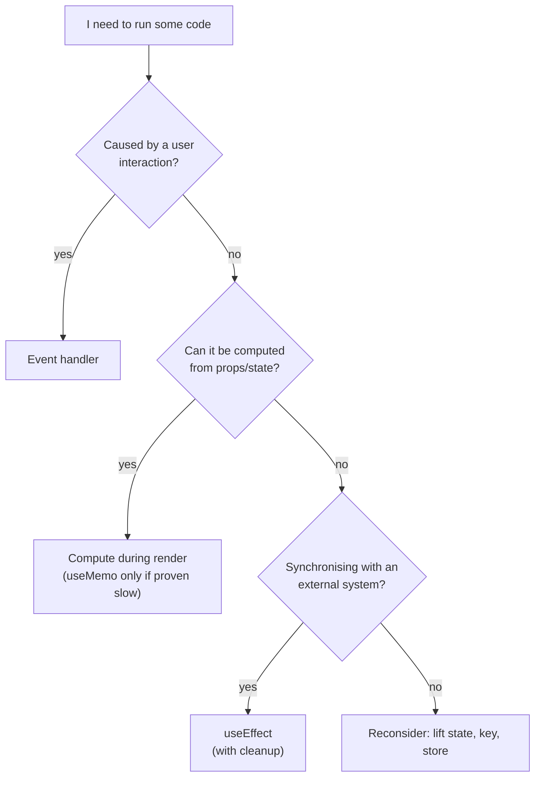
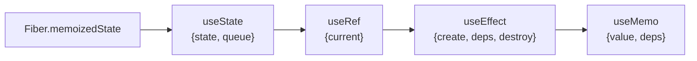
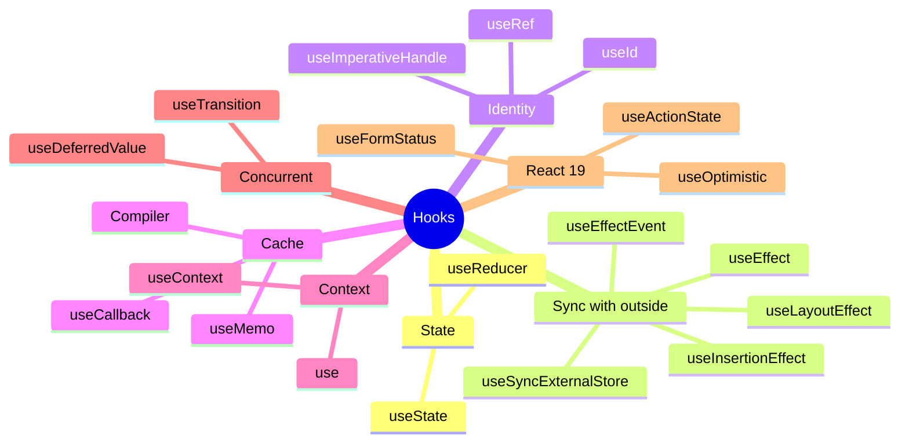

# React Hooks Deep Dive — Interview Guide

> Verified against react.dev (React 19.x, latest stable 19.3). Version-sensitive items are marked **[19.x]**.
> Prerequisite: [01-rendering-model-and-reconciliation.md](01-rendering-model-and-reconciliation.md).
> Hooks added by Actions/forms (`useActionState`, `useOptimistic`, `useFormStatus`, `use`) are covered in depth in [04-react-19-and-beyond.md](04-react-19-and-beyond.md); concurrent hooks in [03-concurrent-react-suspense-and-transitions.md](03-concurrent-react-suspense-and-transitions.md).

## Table of Contents

1. [Quick Summary (TL;DR)](#1-quick-summary-tldr)
2. [How Hooks Work Internally](#2-how-hooks-work-internally)
3. [State Hooks: `useState`, `useReducer`](#3-state-hooks-usestate-usereducer)
4. [Effects: `useEffect` and Friends](#4-effects-useeffect-and-friends)
5. [You Might Not Need an Effect](#5-you-might-not-need-an-effect)
6. [`useEffectEvent` (React 19.2)](#6-useeffectevent-react-192)
7. [Refs: `useRef`, `useImperativeHandle`](#7-refs-useref-useimperativehandle)
8. [Memoization Hooks: `useMemo`, `useCallback`](#8-memoization-hooks-usememo-usecallback)
9. [Context: `useContext` and `use`](#9-context-usecontext-and-use)
10. [`useSyncExternalStore`](#10-usesyncexternalstore)
11. [Utility Hooks: `useId`, `useDebugValue`](#11-utility-hooks-useid-usedebugvalue)
12. [Stale Closures: the #1 Hooks Bug](#12-stale-closures-the-1-hooks-bug)
13. [Custom Hooks: Patterns and Production Examples](#13-custom-hooks-patterns-and-production-examples)
14. [Common Mistakes and Pitfalls](#14-common-mistakes-and-pitfalls)
15. [Performance Considerations](#15-performance-considerations)
16. [Trade-offs and Alternatives](#16-trade-offs-and-alternatives)
17. [Interview Questions — Fundamentals](#17-interview-questions--fundamentals)
18. [Interview Questions — Senior Scenarios](#18-interview-questions--senior-scenarios)
19. [Coding Round: Implement These Hooks](#19-coding-round-implement-these-hooks)
20. [Cheat Sheet](#20-cheat-sheet)
21. [Key Terms Glossary](#21-key-terms-glossary)
22. [Further Reading](#22-further-reading)

---

## 1. Quick Summary (TL;DR)

- Hooks let function components hold **state, side effects, refs, context and more**. They are identified by **call order** on the fiber.
- **Effects synchronise a component with an external system** (network, DOM APIs, timers, subscriptions). They are *not* for transforming data or reacting to user events.
- Each render is a closure over **that render's** props/state. Stale closures happen when a long-lived callback (timer, listener, effect) captures an old render.
- `useMemo`/`useCallback` are **performance hints**, not semantic guarantees. The **React Compiler** (1.0, stable since Oct 2025) memoizes automatically; keep the hooks as an escape hatch (for example, a stable effect dependency).
- Prefer, in this order: **derive during render → event handler → key to reset → effect**.
- Use `useSyncExternalStore` for external mutable stores; `useId` for SSR-safe IDs; `useEffectEvent` **[19.2]** for non-reactive logic inside effects.



---

## 2. How Hooks Work Internally

### Concept
Each function component fiber has a `memoizedState` field pointing to a **singly linked list of hook objects**, one per hook call, in call order. React keeps a "current hook" cursor during render. On mount, each hook call creates a node; on update, it reads the next node from the *current* fiber's list and clones it to the work-in-progress.



### Why the Rules of Hooks exist
Because identification is positional: a conditional hook shifts every later node. React 19 also lets `use()` run conditionally precisely because it does not own a slot in that list.

### Mini implementation (interview favourite)

```ts
let hooks: unknown[] = [];
let cursor = 0;

function useState<T>(initial: T): [T, (v: T | ((p: T) => T)) => void] {
  const i = cursor++;                       // identity = call order
  if (hooks[i] === undefined) hooks[i] = initial;
  const set = (v: T | ((p: T) => T)) => {
    hooks[i] = typeof v === "function" ? (v as (p: T) => T)(hooks[i] as T) : v;
    rerender();                             // schedule a render
  };
  return [hooks[i] as T, set];
}

function render(Component: () => void) {
  cursor = 0;                               // reset before every render
  Component();
}
```

### Dispatcher pattern
The `useState` you import is a thin function that delegates to the **current dispatcher**: `HooksDispatcherOnMount`, `...OnUpdate`, or an invalid-call dispatcher (which throws the familiar "Invalid hook call" error when used outside render). This is also how React detects calling hooks from the wrong place and how DevTools instrument hooks.

---

## 3. State Hooks: `useState`, `useReducer`

### `useState`

```tsx
const [user, setUser] = useState<User | null>(null);

// Lazy initialiser: the function runs only on mount.
const [filters, setFilters] = useState(() => parseFiltersFromUrl(window.location.search));

// Functional update: always based on latest queued state.
setCount((c) => c + 1);
```

Internals and gotchas:
- `setState` identity is **stable** — safe to omit from deps.
- Equality check uses `Object.is`; mutating and re-setting the same reference is ignored.
- `useState(expensive())` still *calls* `expensive()` every render (only the first result is used). Pass the function: `useState(expensive)`.
- State holds *a value*, not a function: `setFn(() => myFn)` to store a function.

### `useReducer`
Use when: next state depends on **several fields**, transitions are **named events**, logic should be **testable outside React**, or you want a **stable `dispatch`** passed down (no stale closures).

```tsx
type State = { status: "idle" | "loading" | "success" | "error"; data?: Todo[]; error?: string };
type Action =
  | { type: "fetch" }
  | { type: "resolve"; data: Todo[] }
  | { type: "reject"; error: string };

function reducer(state: State, action: Action): State {
  switch (action.type) {
    case "fetch":   return { status: "loading" };
    case "resolve": return { status: "success", data: action.data };
    case "reject":  return { status: "error", error: action.error };
  }
}
const [state, dispatch] = useReducer(reducer, { status: "idle" });
```

`dispatch` is stable, so passing it through context avoids re-rendering consumers when state changes — the classic **split state/dispatch context** optimisation.

### `useState` vs `useReducer`

| | `useState` | `useReducer` |
|---|---|---|
| Boilerplate | Low | Higher |
| Complex/related state | Gets messy | Clean |
| Testing logic | Inline | Pure reducer unit tests |
| Stale closure risk | Higher (if using value) | Low (action based) |
| Debuggability | Fine | Easy to log actions |

---

## 4. Effects: `useEffect` and Friends

### Concept
An effect is a function React calls **after commit** to synchronise with something outside React. It may return a **cleanup** that runs before the next effect run and on unmount.

```tsx
useEffect(() => {
  const connection = createConnection(serverUrl, roomId); // setup
  connection.connect();
  return () => connection.disconnect();                   // cleanup
}, [serverUrl, roomId]);                                  // reactive dependencies
```

### Mental model: effects are *synchronisation*, not lifecycle
Think "**start/stop synchronising with X**", not "on mount / on update". Each render has its own effect; React runs the cleanup of the previous render's effect, then the setup of the new one — only if dependencies changed (compared with `Object.is`).

### Dependency array rules
| Form | Meaning |
|---|---|
| `useEffect(fn)` | Runs after every commit |
| `useEffect(fn, [])` | Runs on mount, cleanup on unmount (and Strict Mode re-mount) |
| `useEffect(fn, [a, b])` | Runs when `a` or `b` changed |

Dependencies are **not a choice**: every reactive value (props, state, anything derived in render, and functions/objects created in render) used inside must be listed. The linter (`eslint-plugin-react-hooks`, v6 with Compiler rules **[19.2]**) enforces it. To shrink dependencies: move values *inside* the effect, move constants *outside* the component, use an updater function, or use `useEffectEvent`.

### Execution order for one commit
1. Cleanups of **all** effects whose dependencies changed (or that are unmounting) run first.
2. Then setups run, **children before parents** (a parent's effect can rely on its children's effects having run).

### Data fetching in an effect: handle races
```tsx
useEffect(() => {
  const controller = new AbortController();
  (async () => {
    try {
      const res = await fetch(`/api/users/${id}`, { signal: controller.signal });
      setUser(await res.json());
    } catch (e) {
      if ((e as Error).name !== "AbortError") setError(e as Error);
    }
  })();
  return () => controller.abort();  // prevents out-of-order responses and updates after unmount
}, [id]);
```
In production prefer TanStack Query, SWR, Suspense + `use`, or framework loaders — they add caching, dedupe, retries and race handling.

### `useLayoutEffect`
Runs synchronously after DOM mutation, before paint. For measurement and corrective layout (tooltip positioning, scroll restoration). Blocks paint, so keep it cheap.

### `useInsertionEffect`
Fires before layout effects, **cannot read refs or schedule updates**. Reserved for CSS-in-JS libraries to inject `<style>` rules before layout reads them.

### `useEffect` vs `useLayoutEffect` vs `useInsertionEffect`

| Hook | Timing | Use |
|---|---|---|
| `useInsertionEffect` | Before DOM mutations are read (mutation phase) | Inject styles (library authors) |
| `useLayoutEffect` | After DOM mutation, before paint | Measure / synchronous layout fix |
| `useEffect` | After paint (sync after discrete event) | Sync with external systems |

### Strict Mode and effects
Dev-only mount → cleanup → mount. Effects must be **symmetrical and idempotent**. Typical failures: missing `unsubscribe`, non-aborted requests, analytics fired twice (put analytics in event handlers or accept dev duplicates).

---

## 5. You Might Not Need an Effect

The official guidance lists patterns that should **not** use effects:

| Anti-pattern | Replace with |
|---|---|
| `useEffect(() => setFullName(first + ' ' + last), [first, last])` | `const fullName = first + ' ' + last;` |
| Filtering/sorting a list into state | Compute during render (`useMemo` only if measured slow) |
| Resetting all state when a prop changes | `<Component key={id} />` |
| Adjusting part of state on prop change | Store the ID, derive the object during render |
| Sending a POST when the user clicks | In the event handler |
| Chains of effects triggering each other | Calculate in the event handler / single reducer |
| Notifying parent of state change in an effect | Call parent's callback in the same event handler (or lift state) |
| Subscribing to an external store | `useSyncExternalStore` |
| Initialising app once | Module scope or a guard, not an effect |

```tsx
// Bad: extra render, flicker, and stale intermediate state
const [visible, setVisible] = useState<Todo[]>([]);
useEffect(() => setVisible(todos.filter((t) => !t.done)), [todos]);

// Good
const visible = todos.filter((t) => !t.done);        // or useMemo if profiling shows cost
```

---

## 6. `useEffectEvent` (React 19.2)

### Concept
`useEffectEvent` extracts the **non-reactive** part of an effect — logic that conceptually is an *event fired from an effect* and should always see the **latest** props/state but must **not** cause the effect to re-run.

```tsx
import { useEffect, useEffectEvent } from "react";

function ChatRoom({ roomId, theme }: { roomId: string; theme: string }) {
  const onConnected = useEffectEvent(() => {
    showNotification("Connected!", theme);       // always reads latest theme
  });

  useEffect(() => {
    const connection = createConnection(serverUrl, roomId);
    connection.on("connected", () => onConnected());
    connection.connect();
    return () => connection.disconnect();
  }, [roomId]);                                  // theme change no longer reconnects
}
```

Rules (from the 19.2 release notes):
- **Do not** put Effect Events in dependency arrays (upgrade to `eslint-plugin-react-hooks@latest` so the linter understands this).
- Only call them from inside effects (or other effect events); declare them in the **same component/hook** as their effect.
- Not a way to silence the linter: use it only when the logic is truly an event happening to fire from an effect.

### Before 19.2
The workaround was a "latest ref" pattern:
```tsx
function useLatest<T>(value: T) {
  const ref = useRef(value);
  useLayoutEffect(() => { ref.current = value; });
  return ref;
}
```

---

## 7. Refs: `useRef`, `useImperativeHandle`

- `useRef(initial)` → stable `{ current }` object; mutation doesn't re-render.
- Uses: DOM nodes, timer IDs, "previous value", instance variables, latest-value box.
- **Do not read or write `ref.current` during render** (except lazy initialisation).
- **[19.x]** `ref` is a normal prop for function components; callback refs can return a cleanup; TypeScript now requires an argument: `useRef<HTMLDivElement>(null)`.

```tsx
function usePrevious<T>(value: T) {
  const ref = useRef<T | undefined>(undefined);
  useEffect(() => { ref.current = value; });
  return ref.current;                           // value from the previous commit
}
```

`useImperativeHandle` exposes a *limited* imperative API to a parent instead of the raw DOM node:

```tsx
function FancyInput({ ref }: { ref: React.Ref<{ focus(): void }> }) {
  const inner = useRef<HTMLInputElement>(null);
  useImperativeHandle(ref, () => ({ focus: () => inner.current?.focus() }), []);
  return <input ref={inner} />;
}
```
Prefer declarative props; reach for imperative handles for focus, scroll, play/pause.

---

## 8. Memoization Hooks: `useMemo`, `useCallback`

### Semantics
- `useMemo(fn, deps)` caches a **value** between renders.
- `useCallback(fn, deps)` ≡ `useMemo(() => fn, deps)` — caches a **function identity**.
- React **may discard the cache** (documented): treat it as a performance optimisation, never as a semantic guarantee.

### When they help
1. Skipping genuinely expensive calculation (profile first; ≥ ~1 ms is the rule of thumb in docs).
2. Preserving identity for props to a `memo`-wrapped child.
3. Preserving identity of an **effect dependency**.
4. Preserving identity of values passed through **context** (`value={useMemo(...)}`).

### When they hurt
Cheap calculations, deps that change every render, or wrapping everything "just in case" (cost: closure allocation + deps comparison + memory + readability).

```tsx
const List = memo(function List({ items, onSelect }: Props) { /* ... */ });

function Parent({ items }: { items: Item[] }) {
  const [selected, setSelected] = useState<string | null>(null);
  const onSelect = useCallback((id: string) => setSelected(id), []); // stable identity for memo(List)
  return <List items={items} onSelect={onSelect} />;
}
```

### With the React Compiler
The compiler memoizes components/hooks automatically (even conditionally, e.g. after an early return, which `useMemo` can't). Official guidance: **new code → rely on the compiler**, use `useMemo`/`useCallback` where you need precise control (for example effect deps); **existing code → leave existing memoization** (removing it can change compiled output) or test carefully. See [08-react-performance-optimization.md](08-react-performance-optimization.md).

---

## 9. Context: `useContext` and `use`

```tsx
const ThemeContext = createContext<"light" | "dark">("light");

function App() {
  return (
    <ThemeContext value="dark">       {/* [19.x] <Context> is the provider; <Context.Provider> still works */}
      <Page />
    </ThemeContext>
  );
}

function Title() {
  const theme = use(ThemeContext);    // [19.x] use() can be called conditionally; useContext(ThemeContext) also works
  return <h1 className={theme}>Hello</h1>;
}
```

### How context propagates
When a provider's `value` changes (`Object.is`), React marks **every consumer** in that subtree for re-render, **bypassing `memo`** and intermediate bail-outs. There is no selector.

### Context performance playbook
1. Memoize the provider value (or rely on the Compiler).
2. **Split contexts** by change frequency (`UserContext`, `ThemeContext`) and by state vs dispatch.
3. Keep context for *low-frequency* data (theme, locale, auth, feature flags, DI).
4. For high-frequency state use a store with selectors (Zustand, Jotai, Redux Toolkit) or `useSyncExternalStore`.

```tsx
const StateCtx = createContext<State | null>(null);
const DispatchCtx = createContext<React.Dispatch<Action> | null>(null);
// consumers that only dispatch never re-render on state change
```

---

## 10. `useSyncExternalStore`

### Why it exists
Concurrent rendering can render a component multiple times at different moments. If an external mutable store changes between those moments, different parts of the same tree may read different values — **tearing**. `useSyncExternalStore(subscribe, getSnapshot, getServerSnapshot?)` guarantees a consistent snapshot: store updates always trigger a **synchronous** re-render (they can't be a transition).

```tsx
function useOnlineStatus() {
  return useSyncExternalStore(
    (cb) => {
      window.addEventListener("online", cb);
      window.addEventListener("offline", cb);
      return () => { window.removeEventListener("online", cb); window.removeEventListener("offline", cb); };
    },
    () => navigator.onLine,     // client snapshot
    () => true                  // server snapshot (SSR + hydration)
  );
}
```

Rules: `getSnapshot` must return a **cached/immutable** value (same reference if unchanged), otherwise infinite loops; `subscribe` must be a stable function (define outside or `useCallback`).

Use cases: `matchMedia`, `localStorage` subscriptions, router location, Redux/Zustand internals, any non-React store.

---

## 11. Utility Hooks: `useId`, `useDebugValue`

- `useId()` returns a stable ID that is **consistent between server and client** (avoids hydration mismatch from random IDs). Use for `htmlFor`/`aria-*` relationships; **do not use as list keys**. **[19.2]** the generated prefix changed to `_r_` so IDs are valid for `view-transition-name`/XML names.
- `useDebugValue(value, formatter?)` labels custom hooks in DevTools.

```tsx
function Field({ label }: { label: string }) {
  const id = useId();
  return (<><label htmlFor={id}>{label}</label><input id={id} /></>);
}
```

---

## 12. Stale Closures: the #1 Hooks Bug

```tsx
function Timer() {
  const [count, setCount] = useState(0);
  useEffect(() => {
    const id = setInterval(() => setCount(count + 1), 1000); // captures count = 0 forever
    return () => clearInterval(id);
  }, []);                                                    // lint error: missing dep
  return <p>{count}</p>;                                     // stuck at 1
}
```

Fixes (choose by intent):
1. **Updater function**: `setCount((c) => c + 1)` — no dependency needed.
2. **Include the dependency** (effect restarts each tick — wasteful for intervals).
3. **`useEffectEvent`** **[19.2]** for reading latest values inside a long-lived callback.
4. **Ref to latest value** (pre-19.2 `useLatest`).
5. **`useReducer`** — the reducer always receives the latest state.

Why this happens: each render creates new functions that close over **that render's** variables; an effect or timer that isn't recreated keeps the old closure.

---

## 13. Custom Hooks: Patterns and Production Examples

### Concept
A custom hook is a function whose name starts with `use` and that calls other hooks. It shares **logic, not state** — each call gets its own state.

### Design guidelines
- Return the smallest useful API; prefer tuples for 2 values, objects for more.
- Accept primitives or stable values; document stability requirements for callbacks (`useEffectEvent` can hide them).
- Do not wrap lifecycle semantics (`useMount`) — wrap *synchronisation* (`useEventListener`, `useInterval`, `useOnlineStatus`).
- Keep side effects cleanup-safe and SSR-safe.

### Production examples

```tsx
// 1. useEventListener — stable subscription, latest handler
function useEventListener<K extends keyof WindowEventMap>(type: K, handler: (e: WindowEventMap[K]) => void) {
  const onEvent = useEffectEvent(handler);               // [19.2]; otherwise useLatest(handler)
  useEffect(() => {
    const listener = (e: WindowEventMap[K]) => onEvent(e);
    window.addEventListener(type, listener);
    return () => window.removeEventListener(type, listener);
  }, [type]);
}

// 2. useDebouncedValue
function useDebouncedValue<T>(value: T, delay = 300) {
  const [debounced, setDebounced] = useState(value);
  useEffect(() => {
    const id = setTimeout(() => setDebounced(value), delay);
    return () => clearTimeout(id);
  }, [value, delay]);
  return debounced;
}

// 3. useLocalStorage — via useSyncExternalStore (SSR safe, multi-tab sync)
function useLocalStorage<T>(key: string, initial: T) {
  const subscribe = useCallback((cb: () => void) => {
    window.addEventListener("storage", cb);
    return () => window.removeEventListener("storage", cb);
  }, []);
  const raw = useSyncExternalStore(subscribe, () => localStorage.getItem(key), () => null);
  const value: T = useMemo(() => (raw ? (JSON.parse(raw) as T) : initial), [raw]); // eslint-disable-line react-hooks/exhaustive-deps
  const set = useCallback((next: T) => {
    localStorage.setItem(key, JSON.stringify(next));
    window.dispatchEvent(new StorageEvent("storage", { key }));
  }, [key]);
  return [value, set] as const;
}

// 4. useInterval with latest callback
function useInterval(callback: () => void, delay: number | null) {
  const tick = useEffectEvent(callback);
  useEffect(() => {
    if (delay === null) return;
    const id = setInterval(() => tick(), delay);
    return () => clearInterval(id);
  }, [delay]);
}
```

### Testing custom hooks
Use `renderHook` from React Testing Library; wrap in providers; test behaviour through `act`. See the Testing category in this handbook.

---

## 14. Common Mistakes and Pitfalls

| Mistake | Consequence | Fix |
|---|---|---|
| Effect without cleanup for subscriptions/timers/fetches | Leaks, duplicate listeners, setState after unmount | Return cleanup; `AbortController` |
| Lying to the dependency array | Stale values, infinite or missing runs | Fix the code, not the linter |
| Object/array/function created in render as dependency | Effect runs every render | Move inside effect, `useMemo`/`useCallback`, or primitives |
| `setState` in effect that depends on that state | Infinite loop | Updater function / refactor |
| `async` effect callback | Returns a Promise instead of cleanup | Define and call an inner async function |
| Using effect for derived state | Extra render, flicker | Compute in render |
| `useMemo` as a semantic cache (e.g. for uniqueness) | React may drop the cache | Use `useRef`/external store |
| Provider value created inline (`value={{a,b}}`) | All consumers re-render | Memoize / Compiler |
| Reading `ref.current` in render | Stale/impure | Read in handlers/effects |
| Forgetting Strict Mode double-effect | Prod/dev divergences | Symmetric setup/cleanup |
| Using `useLayoutEffect` for data fetching | Blocks paint | `useEffect` |
| Conditional hooks / hooks in loops | Wrong state binding / error | Extract components |

---

## 15. Performance Considerations

- **Effects**: each effect adds per-commit work; keep deps minimal; avoid effect chains; batch DOM reads/writes.
- **`useMemo`/`useCallback`**: allocate closures and compare deps every render — only useful when they prevent a larger cost.
- **Context**: all consumers re-render on any value change; split and memoize.
- **`useSyncExternalStore`**: forces synchronous renders; use selectors in the store to limit consumers.
- **Layout effects**: block paint; avoid forced synchronous layout (read → write → read).
- **Large state objects**: normalise; update immutably with structural sharing (Immer) to keep reference equality for children.
- Profile with React DevTools Profiler and the **React Performance Tracks** (19.2+ in Chrome DevTools).

---

## 16. Trade-offs and Alternatives

| Need | Option A | Option B | Guidance |
|---|---|---|---|
| Server data | `useEffect` + state | TanStack Query / SWR / `use` + Suspense / framework loaders | Prefer B for cache, dedupe, retry, race safety |
| Complex local state | many `useState` | `useReducer` | Reducer when transitions are named/related |
| Global state | Context | Zustand/Redux Toolkit/Jotai | Context for low-frequency, store for high-frequency |
| Memoization | manual hooks | React Compiler | Compiler for new code; hooks for escape hatches |
| Form state | controlled `useState` | uncontrolled + `FormData` / React Hook Form / Actions | Uncontrolled for scale |
| Subscriptions | `useEffect` | `useSyncExternalStore` | Latter prevents tearing |
| Animations | state per frame | CSS/WAAPI/ref + `requestAnimationFrame`/`ViewTransition` | Avoid per-frame React state |

---

## 17. Interview Questions — Fundamentals

### Q1. Why can't hooks be called conditionally?
Hooks are stored in a linked list on the fiber and matched by **call order**. A conditional call changes the number/order of hooks between renders so state is read from the wrong node (React throws "Rendered more/fewer hooks than expected" or silently mismatches). Branch *inside* the hook (e.g. `if (!enabled) return`) or extract a component. Only `use()` is exempt because it doesn't reserve a slot.

### Q2. What is the difference between `useEffect(fn, [])` and a class `componentDidMount`?
`componentDidMount` runs once; the empty-deps effect also runs once per mount but its **cleanup symmetry** is verified by Strict Mode (mount, unmount, mount in dev). Semantically an effect is *synchronisation with no reactive values*, not "lifecycle". Also, effects run after paint, `componentDidMount` runs synchronously in the layout phase.

### Q3. What happens if you omit the dependency array vs pass `[]`?
Omitted: effect runs after **every** commit. `[]`: once on mount (and cleanup on unmount). With `[a]`: when `a` changed by `Object.is`.

### Q4. How does React compare dependencies?
Element-wise `Object.is`. Objects/arrays/functions created inline are new each render, so they always "change".

### Q5. `useMemo` vs `useCallback` vs `React.memo`?
`useMemo` caches a value; `useCallback` caches a function identity; `memo` caches a component's **render output** by comparing props shallowly. `useCallback` is useful only if the function is passed to a memoized child or used as a dep.

### Q6. When would you use `useReducer`?
Complex or related state transitions, named actions, testable pure logic, stable dispatch to avoid stale closures or re-renders through context.

### Q7. What's the difference between `useRef` and `useState`?
State triggers re-render and is snapshot-based; ref is a mutable box that persists without re-render. Use refs for values not needed to render (timer IDs, DOM, latest-value).

### Q8. Why does `setCount(count + 1)` three times add only 1?
All three use the same snapshot (`count` from that render). Use `setCount(c => c + 1)`.

### Q9. How do you fix stale closures in `setInterval`?
Updater function, `useReducer`, `useEffectEvent` (19.2), or latest-ref pattern; or recreate the interval with proper deps if acceptable.

### Q10. What is `useLayoutEffect` and when is it needed?
Runs after DOM mutation before paint. Needed for measuring layout and synchronously adjusting (tooltip placement) without a visible flicker. Blocks paint.

### Q11. What's the purpose of cleanup functions?
To undo setup (unsubscribe, clear timer, abort fetch) before the next run and on unmount, so there are no leaks or duplicate subscriptions and so Strict Mode can verify symmetry.

### Q12. Why shouldn't you pass an `async` function directly to `useEffect`?
It returns a Promise; React expects `undefined` or a cleanup function. Create an inner async function and invoke it.

### Q13. What does `useId` solve?
Stable, hydration-safe unique IDs, avoiding mismatch from `Math.random()`/counters, and valid for `aria-*`/`htmlFor` linking. Not for list keys.

### Q14. `useContext` vs `use(Context)` — differences?
`use(Context)` can be called conditionally and after early returns **[19.x]**; otherwise identical behaviour (still re-renders when value changes).

### Q15. What is `useSyncExternalStore` for?
Safe subscription to external mutable stores without tearing under concurrent rendering; requires a cached snapshot and optional server snapshot.

### Q16. What is the difference between `useEffect` and `useInsertionEffect`?
Insertion effect fires before layout reads, for CSS-in-JS style injection only; can't access refs or update state.

### Q17. What's the order of effects for parent/child?
Render: parent then children. Cleanups run before setups; setup of **children runs before parent** (layout and passive).

### Q18. How do custom hooks share state?
They don't — they share *logic*. Each call has independent state. To share state, use context or an external store.

### Q19. Can I use `useMemo` to guarantee a value is never recomputed?
No. React may discard memoised values (for example, during offscreen/Suspense handling); it is an optimisation.

### Q20. What are the Rules of Hooks and how are they enforced?
Call hooks only at the top level of components/custom hooks. Enforced by `eslint-plugin-react-hooks` (static) and runtime dispatcher checks (dynamic).

---

## 18. Interview Questions — Senior Scenarios

### S1. "A dashboard widget refetches data every render. Debug it."
**Approach:** open the Network tab and React DevTools Profiler. Check the effect's dependency array: usually an inline object (`{ page, filters }`) or function created in render is a dependency, so it "changes" every render. Also check whether the component is remounting (changing `key`, defined inside another component, Suspense fallback swapping). **Fix:** depend on primitives, move object construction inside the effect, memoize, or move fetching to TanStack Query with a stable `queryKey`. Verify with logs in effect cleanup/setup.

### S2. "Design a `useFetch` hook for production."
Requirements: abort on change/unmount; race safety; status (`idle|loading|success|error`) as a discriminated union; caching/deduping; retries with backoff; typed generics; SSR-safe. Honest answer: *don't hand-roll for production* — use TanStack Query or `use` with a cached promise in a Suspense-capable framework; if you must write one, show the AbortController + reducer implementation and explain what's missing (cache, dedupe, background refresh, invalidation, devtools).

### S3. "Why is my context consumer re-rendering when unrelated context fields change?"
Context has no selectors: any `Object.is` change to `value` re-renders all consumers. Fixes: split contexts, memoize the value, separate state and dispatch, store with selectors, or `useSyncExternalStore`-based libraries. A pattern for libraries: expose `useStoreSelector(selector)`.

### S4. "How do you prevent setState on an unmounted component?"
React 18+ removed the warning because it was mostly a false alarm. The real problems are leaks and wasted work, so abort/cleanup (`AbortController`, unsubscribe, clear timers) instead of an `isMounted` flag. Use an `ignore` flag only for non-abortable async operations to prevent out-of-order responses overriding newer ones.

### S5. "Explain a bug caused by a stale closure in an event listener and fix it three ways."
Example: `window.addEventListener('keydown', handler)` registered once reads old state. Fix 1: re-subscribe with deps (simple, resubscribes each change). Fix 2: `useEffectEvent`. Fix 3: store latest handler in a ref. Fix 4: use `useReducer` and dispatch actions. Discuss trade-offs: resubscribe cost vs complexity vs lint safety.

### S6. "When is `useLayoutEffect` appropriate in SSR apps?"
It only runs on the client, so server HTML can never depend on a layout measurement. Render a deterministic first pass (or a placeholder), then measure and adjust in the layout effect so the correction happens before paint. Don't use it for data fetching or anything that doesn't need pre-paint DOM access.

### S7. "Convert a class component with `componentDidUpdate(prevProps)` logic to hooks."
Map each lifecycle to *what it synchronises*: `componentDidMount/Update/WillUnmount` that talk to an external system → one `useEffect` with deps equal to the values previously compared in `prevProps`. For "compare with previous", prefer derive-in-render or `usePrevious`; for side effects that should happen only in response to an interaction, move them to the handler.

### S8. "How would you implement undo/redo?"
`useReducer` with `{ past: S[], present: S, future: S[] }` and actions `undo`/`redo`/`set`; keep reducer pure for unit tests; expose via custom hook `useHistory`. Discuss memory (cap `past`), structural sharing (Immer), and keyboard shortcuts via `useEventListener`.

### S9. "A teammate wraps every function in `useCallback`. Your response?"
Explain cost/benefit; only helps with `memo` children or effect deps; adds noise. Recommend adopting React Compiler (check Rules of React compliance via `eslint-plugin-react-hooks`) and removing blanket memoization gradually with tests — official guidance: leave existing memoization unless you've tested; for new code rely on the compiler.

---

## 19. Coding Round: Implement These Hooks

```tsx
// usePrevious
function usePrevious<T>(value: T) {
  const ref = useRef<T | undefined>(undefined); // React 19 types require an argument
  useEffect(() => { ref.current = value; });
  return ref.current;
}

// useToggle
function useToggle(initial = false) {
  const [on, setOn] = useState(initial);
  const toggle = useCallback(() => setOn((v) => !v), []);
  return [on, toggle] as const;
}

// useThrottle (value)
function useThrottledValue<T>(value: T, interval = 200) {
  const [throttled, setThrottled] = useState(value);
  const last = useRef(0);
  useEffect(() => {
    const now = Date.now();
    const remaining = interval - (now - last.current);
    if (remaining <= 0) { last.current = now; setThrottled(value); return; }
    const id = setTimeout(() => { last.current = Date.now(); setThrottled(value); }, remaining);
    return () => clearTimeout(id);
  }, [value, interval]);
  return throttled;
}

// useClickOutside
function useClickOutside<T extends HTMLElement>(onOutside: () => void) {
  const ref = useRef<T>(null);
  const handler = useEffectEvent(onOutside);
  useEffect(() => {
    const listener = (e: MouseEvent) => { if (ref.current && !ref.current.contains(e.target as Node)) handler(); };
    document.addEventListener("mousedown", listener);
    return () => document.removeEventListener("mousedown", listener);
  }, []);
  return ref;
}

// useAsync with race protection
function useAsync<T>(fn: (signal: AbortSignal) => Promise<T>, deps: unknown[]) {
  const [state, setState] = useState<{ status: "loading" | "success" | "error"; data?: T; error?: Error }>({ status: "loading" });
  useEffect(() => {
    const c = new AbortController();
    setState({ status: "loading" });
    fn(c.signal).then(
      (data) => !c.signal.aborted && setState({ status: "success", data }),
      (error) => !c.signal.aborted && setState({ status: "error", error })
    );
    return () => c.abort();
    // eslint-disable-next-line react-hooks/exhaustive-deps
  }, deps);
  return state;
}
```

---

## 20. Cheat Sheet



| Symptom | Likely cause | Fix |
|---|---|---|
| Effect runs every render | Unstable dependency | Stabilise or move inside |
| Value is stale in callback | Closure | Updater / useEffectEvent / reducer |
| Infinite render loop | setState in effect depending on it, or in render | Break the cycle |
| Input loses focus | Remounting | Hoist component, stable keys |
| Consumers re-render too much | Context value churn | Split/memoize/store |
| Dup requests in dev | Strict Mode | Cleanup + abort |

---

## 21. Key Terms Glossary

| Term | Definition |
|---|---|
| Hook | Function that lets components use React features, identified by call order |
| Dispatcher | Internal object React swaps to route hook calls for mount/update |
| Effect | Code synchronising with an external system after commit |
| Cleanup | Function returned by an effect to undo its setup |
| Reactive value | Prop, state or any value computed during render |
| Stale closure | Callback that captured values from an old render |
| Tearing | Different parts of UI show different versions of external data |
| Effect Event | `useEffectEvent` function that reads latest values without being reactive |
| Updater function | `setState(prev => next)` |

---

## 22. Further Reading

- [Built-in React Hooks](https://react.dev/reference/react/hooks)
- [Synchronizing with Effects](https://react.dev/learn/synchronizing-with-effects), [You Might Not Need an Effect](https://react.dev/learn/you-might-not-need-an-effect), [Lifecycle of Reactive Effects](https://react.dev/learn/lifecycle-of-reactive-effects)
- [Separating Events from Effects](https://react.dev/learn/separating-events-from-effects) and the [React 19.2 post](https://react.dev/blog/2025/10/01/react-19-2)
- [`useSyncExternalStore`](https://react.dev/reference/react/useSyncExternalStore)
- [React Compiler v1.0](https://react.dev/blog/2025/10/07/react-compiler-1)
