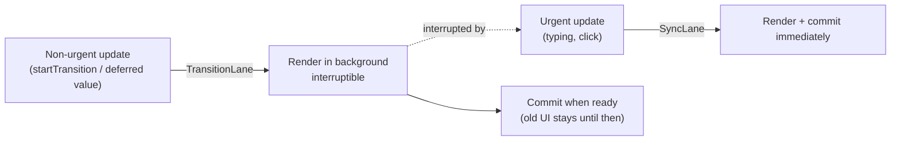
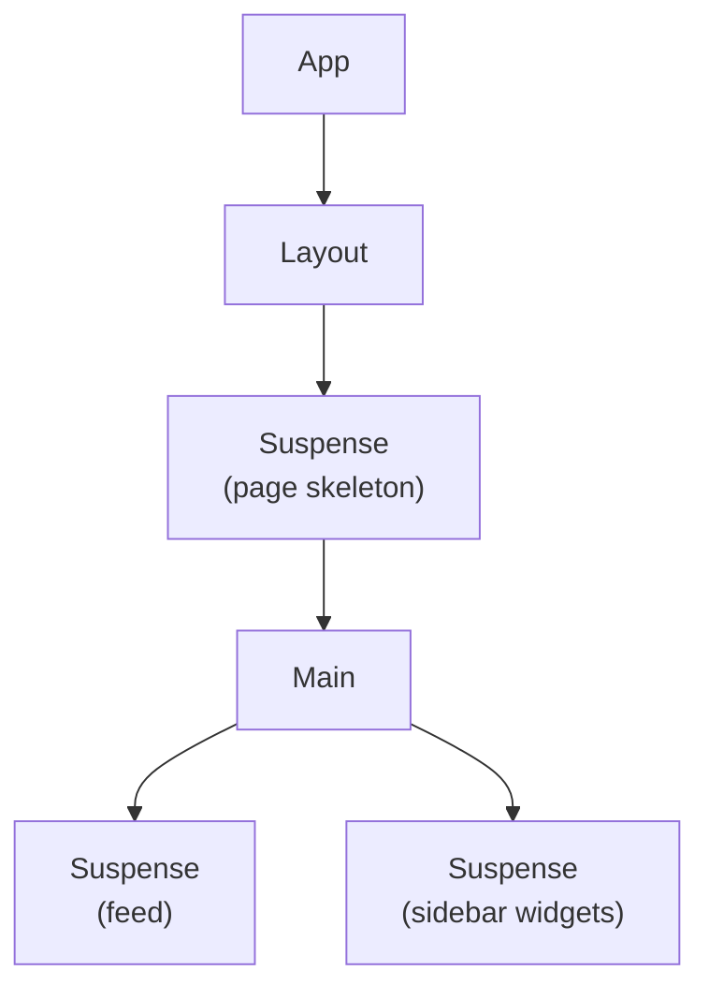
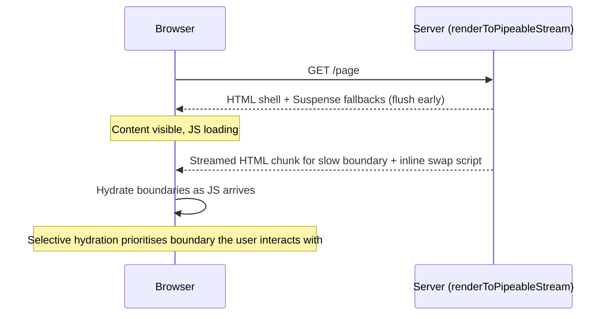
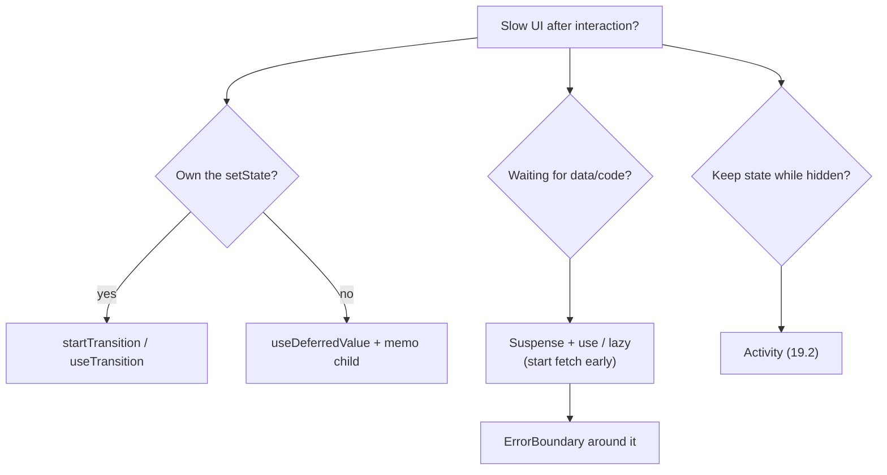

# Concurrent React, Suspense, Transitions & Error Boundaries — Interview Guide

> Verified against react.dev (React 19.x, latest stable 19.3). Items marked **[19.x]** are version-sensitive.
> Prerequisites: [01-rendering-model-and-reconciliation.md](01-rendering-model-and-reconciliation.md), [02-hooks-deep-dive.md](02-hooks-deep-dive.md).

## Table of Contents

1. [Quick Summary (TL;DR)](#1-quick-summary-tldr)
2. [What "Concurrent" Actually Means](#2-what-concurrent-actually-means)
3. [Transitions: `startTransition` and `useTransition`](#3-transitions-starttransition-and-usetransition)
4. [`useDeferredValue`](#4-usedeferredvalue)
5. [Suspense](#5-suspense)
6. [Data Loading Patterns with Suspense](#6-data-loading-patterns-with-suspense)
7. [Error Boundaries](#7-error-boundaries)
8. [Streaming SSR and Selective Hydration](#8-streaming-ssr-and-selective-hydration)
9. [`Activity` (19.2) and `ViewTransition` (19.3)](#9-activity-192-and-viewtransition-193)
10. [Putting It Together: A Production Navigation Pattern](#10-putting-it-together-a-production-navigation-pattern)
11. [Common Mistakes and Pitfalls](#11-common-mistakes-and-pitfalls)
12. [Performance Considerations](#12-performance-considerations)
13. [Trade-offs and Alternatives](#13-trade-offs-and-alternatives)
14. [Interview Questions — Fundamentals](#14-interview-questions--fundamentals)
15. [Interview Questions — Senior Scenarios](#15-interview-questions--senior-scenarios)
16. [Cheat Sheet](#16-cheat-sheet)
17. [Key Terms Glossary](#17-key-terms-glossary)
18. [Further Reading](#18-further-reading)

---

## 1. Quick Summary (TL;DR)

- **Concurrent rendering** = React can *prepare multiple versions of the UI*, pause, resume, or abandon render work, and prioritise **urgent** updates (typing, clicking) over **non-urgent** ones (rendering a big result list). It is **not** multithreading: it is cooperative scheduling on one thread.
- You opt in **per update**, not per app: `startTransition`, `useTransition`, `useDeferredValue`, `Suspense`.
- A **Transition** marks a state update as non-urgent: interruptible, never shows a Suspense fallback for already-revealed content, and keeps old UI visible with `isPending`.
- **`useDeferredValue(value)`** gives you a "lagging copy" of a value for when you don't own the `setState` (props, third-party state).
- **Suspense** declares a loading boundary. Components "suspend" via `use(promise)`, `lazy`, or Suspense-enabled frameworks/libraries — **not** by fetching in `useEffect`.
- **Error Boundaries** catch render errors (including rejected `use`/lazy promises) below them. Pair `ErrorBoundary` + `Suspense` for complete async UI states.
- **[19.2]** `<Activity>` hides UI while preserving state; **[19.3]** `<ViewTransition>` is stable.



---

## 2. What "Concurrent" Actually Means

### Concept
Before React 18, rendering was synchronous and uninterruptible: once React began, it finished. In concurrent rendering, the **render phase** can yield to the browser every few milliseconds, resume later, or restart if a higher-priority update arrives. The **commit phase** remains synchronous so the user never sees a half-updated UI.

### Why it matters
Responsiveness is measured by **INP (Interaction to Next Paint)**. A 300 ms render triggered by a keystroke blocks the main thread; concurrent features keep input responsive by letting the browser handle input between slices.

### How it works internally
1. Each update gets a **lane** derived from the event type or from a transition. See [Lanes](01-rendering-model-and-reconciliation.md#9-fiber-architecture-internals).
2. The work loop renders the highest-priority lane first. For transition lanes it calls `shouldYield()` between fibers (scheduler time slices ~5 ms).
3. If a higher-priority update arrives, React **throws away the in-progress work-in-progress tree** and starts again with the urgent update, then replays the transition on top. This is why render must be pure.
4. Commit is atomic and synchronous.

**[19.3]** Transitions are rendered independently instead of being entangled into one render, so a slow transition no longer holds up unrelated ones.

### What concurrent rendering does *not* do
- It doesn't make slow components faster; it makes the app responsive *while* they render.
- It doesn't run code on another thread; use Web Workers for CPU-heavy work.
- It isn't automatic for every update: updates in event handlers are urgent by default.

---

## 3. Transitions: `startTransition` and `useTransition`

### Concept
```tsx
import { useState, useTransition } from "react";

function Tabs() {
  const [tab, setTab] = useState("about");
  const [isPending, startTransition] = useTransition();

  function select(next: string) {
    startTransition(() => setTab(next));   // non-urgent
  }
  return (
    <>
      <TabButton onClick={() => select("posts")} pending={isPending}>Posts</TabButton>
      {tab === "posts" ? <SlowPosts /> : <About />}
    </>
  );
}
```

### What a Transition gives you
1. **Interruptible**: clicking another tab mid-render abandons the stale render.
2. **No unwanted loading indicators**: if the new UI suspends, React keeps the *old* UI visible instead of replacing already-revealed content with a Suspense fallback.
3. **`isPending`** for inline feedback.
4. **Waits for Actions**: async functions passed to `startTransition` keep `isPending` true until they finish (React 19 "Actions").

### Precise rules and caveats (from react.dev `useTransition`)
- The callback runs **immediately**; only state updates scheduled *during* the synchronous call are transitions.
- Updates inside `setTimeout` are **not** transitions.
- **After an `await`** inside an async transition, state updates must be wrapped in another `startTransition` (a known limitation until AsyncContext exists):

```tsx
startTransition(async () => {
  const saved = await updateQuantity(next);
  startTransition(() => setQuantity(saved));   // required after await
});
```

- **Cannot control a text input**: input updates must be synchronous. Use two state variables, or `useDeferredValue`.
- Transitions can be **interrupted by other updates**; the work restarts.
- Multiple concurrent transitions are batched today **[pre-19.3 behaviour; 19.3 renders independently]**.
- Async actions can complete **out of order**: React does not queue them for you. `useActionState` and `<form action>` queue requests sequentially; for custom flows implement your own cancellation/ordering.
- `startTransition` (standalone import) works outside components but gives no `isPending` and no Error Boundary integration.
- Errors thrown in a transition callback (or rejected promise) propagate to the nearest Error Boundary when using `useTransition`.

### Use cases
Tab/route navigation, filtering/sorting large data, switching charts, search-as-you-type result rendering, any update whose render is expensive but whose *input* must stay responsive.

### Transition vs debounce vs throttle

| | Delays work? | Cancels stale work? | Reduces network calls? | Main use |
|---|---|---|---|---|
| Transition / deferred value | No — starts immediately, can be interrupted | Yes (render work) | No | Expensive **rendering** |
| Debounce | Yes (waits for pause) | Yes | Yes | Expensive **side effects** (requests) |
| Throttle | Rate-limits | No | Partially | Continuous events |

Use them together: deferred value for rendering; debounce for network.

---

## 4. `useDeferredValue`

```tsx
function Search() {
  const [query, setQuery] = useState("");
  const deferredQuery = useDeferredValue(query);   // lags behind during urgent updates
  const stale = query !== deferredQuery;

  return (
    <>
      <input value={query} onChange={(e) => setQuery(e.target.value)} />
      <div style={{ opacity: stale ? 0.6 : 1 }}>
        <Results query={deferredQuery} />          {/* memoized or Compiler-optimised */}
      </div>
    </>
  );
}
```

### How it works
1. Urgent render: `deferredQuery` still holds the **old** value; the input updates immediately; `Results` receives unchanged props and (if memoized) skips.
2. React schedules a **background render** with the new value at transition priority. If you type again, that render is interrupted and restarted.
3. If `Results` suspends during the background render, React keeps the old UI (no fallback flash).

### Important details
- The background render only helps if the child **bails out in the urgent render**: wrap it in `memo` (or rely on the React Compiler), otherwise it re-renders in the urgent pass anyway.
- It does **not** debounce: there's no fixed delay; its latency depends on the device.
- **[19.x]** `useDeferredValue(value, initialValue)` — returns `initialValue` on the first render, then schedules a background re-render with `value`. Useful to show a lightweight skeleton first and avoid blocking the initial paint.
- Pass primitives or **stable** objects: a new object each render will defeat it (deferred value always "changes").

### `useTransition` vs `useDeferredValue`

| | `useTransition` | `useDeferredValue` |
|---|---|---|
| You wrap | The **setter call** | The **value** |
| Needs access to `setState` | Yes | No (works on props/third-party state) |
| Gives `isPending` | Yes | Compare `value !== deferred` |
| Typical | Navigation, tab switch, actions | Search results, charts fed by props |

---

## 5. Suspense

### Concept
`<Suspense fallback={...}>` displays a fallback until all children inside have finished loading. A component "suspends" when it needs something that isn't ready.

```tsx
<Suspense fallback={<ProfileSkeleton />}>
  <Profile userId={id} />
</Suspense>
```

### What activates Suspense (official list)
- Data from **Suspense-enabled** frameworks/libraries (Relay, Next.js, TanStack Query `useSuspenseQuery`, etc.).
- **`lazy(() => import(...))`** code splitting.
- Reading a cached promise with **`use(promise)`** (the promise must be created outside render or cached — **not** created in the render of a Client Component; React warns "A component was suspended by an uncached promise").
- **Not** Suspense: data fetched in `useEffect` or event handlers.

### Mechanics
1. A component reads a not-yet-resolved resource and React **interrupts rendering** of that component (internally by throwing a thenable).
2. React finds the **nearest Suspense boundary above**, discards the incomplete subtree and displays its `fallback`.
3. When the promise settles, React **retries** rendering the subtree.
4. **[19.0] Pre-warming:** when a component suspends, React immediately commits the nearest fallback without waiting for the whole sibling tree, then renders suspended siblings in the background to start their lazy requests early.
5. Suspense state is **preserved** for already-mounted content: when content *re-suspends* inside a Transition, old content stays. Without a Transition, an existing boundary's content is hidden and fallback shown again (React keeps DOM/state hidden with `display: none` semantics and layout effects are cleaned up/re-run).

### Granularity: where to put boundaries

- One boundary per **meaningful loading unit** (page, widget). Too coarse → big spinners; too fine → "popcorn" UI.
- Nested boundaries let outer content show while inner content streams.
- Match skeleton dimensions to final content to protect **CLS**.

### Suspense + Transition = no fallback flicker
```tsx
function navigate(url: string) {
  startTransition(() => setPage(url));   // already-visible page stays; new page prepares in background
}
```
Transitions only "wait" long enough to avoid hiding already-revealed content; nested boundaries that haven't revealed yet will show their own fallbacks normally.

### Resetting a boundary
Change its `key` to reset Suspense and everything inside (state included).

---

## 6. Data Loading Patterns with Suspense

### Fetch-on-render (waterfall) — avoid
```tsx
function Page() {
  const user = use(fetchUser());      // suspends
  return <Posts userId={user.id} />;  // Posts starts fetching only after user resolved
}
```

### Render-as-you-fetch (parallel) — preferred
Start requests **before/at** navigation (router loader, Server Component, event handler) and pass the promises down:

```tsx
// Created once per navigation (router loader / RSC), NOT during Client Component render
const userPromise = fetchUser(id);
const postsPromise = fetchPosts(id);

function Page() {
  return (
    <>
      <Suspense fallback={<UserSkeleton />}><User promise={userPromise} /></Suspense>
      <Suspense fallback={<PostsSkeleton />}><Posts promise={postsPromise} /></Suspense>
    </>
  );
}

function User({ promise }: { promise: Promise<User> }) {
  const user = use(promise);          // suspends until resolved; rejects -> nearest Error Boundary
  return <h1>{user.name}</h1>;
}
```

### Server Components passing promises to Client Components
```tsx
// Server Component (async) starts the fetch, doesn't await it
export default function Page() {
  const comments = getComments();               // Promise
  return <Suspense fallback={<Spinner />}><Comments commentsPromise={comments} /></Suspense>;
}
// Client Component
"use client";
function Comments({ commentsPromise }: { commentsPromise: Promise<Comment[]> }) {
  return use(commentsPromise).map((c) => <p key={c.id}>{c.text}</p>);
}
```
Promises crossing the server→client boundary are serialisable and resolved on the client with streaming. See [05-server-components-and-server-functions.md](05-server-components-and-server-functions.md).

### Caching
Suspense does not cache. Use framework caches, TanStack Query, Relay, or RSC `cache()` to dedupe per request.

---

## 7. Error Boundaries

### Concept
An Error Boundary catches errors thrown **during rendering**, in lifecycle methods, and in constructors of components *below it*, and renders a fallback. It still requires a **class component** (`static getDerivedStateFromError` + `componentDidCatch`) — or the `react-error-boundary` library, or a framework `error.tsx`.

```tsx
class ErrorBoundary extends React.Component<
  { fallback: (err: Error, reset: () => void) => React.ReactNode; children: React.ReactNode },
  { error: Error | null }
> {
  state = { error: null as Error | null };
  static getDerivedStateFromError(error: Error) { return { error }; }
  componentDidCatch(error: Error, info: React.ErrorInfo) { reportError(error, info.componentStack); }
  reset = () => this.setState({ error: null });
  render() { return this.state.error ? this.props.fallback(this.state.error, this.reset) : this.props.children; }
}
```

### What boundaries do NOT catch
- **Event handlers** (use try/catch; or `startTransition` + `useTransition` so errors propagate in actions).
- **Asynchronous code** like `setTimeout` or unawaited promises (unless surfaced via `use`/Suspense/Action state).
- **Server-side rendering errors** (handled by the SSR stream's `onError`).
- Errors thrown **in the boundary itself** (they bubble to the next boundary above).

### Combining Error Boundary + Suspense + retry
```tsx
<ErrorBoundary fallback={(err, reset) => <ErrorPanel error={err} onRetry={reset} />}>
  <Suspense fallback={<Skeleton />}>
    <Widget />
  </Suspense>
</ErrorBoundary>
```
Retry must reset both boundary state and invalidate the cached promise/query (for TanStack Query use `QueryErrorResetBoundary`).

### React 19 error reporting
Root options: `createRoot(el, { onCaughtError, onUncaughtError, onRecoverableError })`. A caught render error is now logged **once** with full information (previously duplicated). Use `onCaughtError` to send boundary-handled errors to Sentry/Datadog, `onUncaughtError` for uncaught ones, `onRecoverableError` for hydration recoveries.

### Boundary placement strategy
- **App-level** boundary: last resort full-page fallback.
- **Route-level**: page failure with navigation preserved.
- **Widget-level**: isolate flaky/third-party components (charts, ads, embeds).
- Use `key` on the boundary to reset when navigation changes.

---

## 8. Streaming SSR and Selective Hydration

### The problem before React 18
SSR was all-or-nothing: fetch **all** data → render **all** HTML → send → download **all** JS → hydrate **all**. One slow widget blocked everything.

### What Suspense enables

1. **Streaming HTML**: the shell is sent immediately with fallbacks; each boundary's real HTML is streamed in later and swapped in place — no client JS required for the swap.
2. **Selective hydration**: React hydrates Suspense boundaries independently as their code arrives, without blocking the rest of the page. A click on a not-yet-hydrated boundary **raises its priority** (events are replayed after hydration).
3. **[19.2] Batched reveals**: server-rendered Suspense reveals are batched for a short time so content appears together (aligned with client behaviour). React stops throttling near the 2.5 s LCP mark so batching never causes missing the metric.
4. **[19.2] Partial Pre-rendering**: `prerender` with an `AbortController` returns `{ prelude, postponed }`; serve `prelude` from a CDN, later call `resume`/`resumeAndPrerender` with the postponed state to fill dynamic parts. Frameworks (Next.js) wrap this API.

### APIs
| API | Environment | Notes |
|---|---|---|
| `renderToPipeableStream` | Node | Recommended on Node (faster, compression) |
| `renderToReadableStream` | Web Streams (edge, Deno, Bun; Node since 19.2) | Prefer Node streams on Node |
| `prerender` / `prerenderToNodeStream` | Static generation | Waits for all data |
| `resume*` | PPR | Resume from postponed state |
| `hydrateRoot` | Client | Options: `onRecoverableError`, etc. |

### Pitfalls
- A boundary that suspends **above** the shell root causes a blank/long TTFB — ensure the shell is cheap.
- `use(browser())` **[19.3]** opts a component out of SSR (suspends on the server only), showing the nearest fallback in HTML.
- Hydration mismatches inside a boundary make React discard its server HTML and client-render it: wasted work.

---

## 9. `Activity` (19.2) and `ViewTransition` (19.3)

### `<Activity>` **[19.2]**
Alternative to conditional rendering that **preserves state** and pre-renders.

```tsx
import { Activity } from "react";

<Activity mode={tab === "settings" ? "visible" : "hidden"}>
  <SettingsPanel />
</Activity>
```
- `hidden`: children are hidden, **effects are unmounted (cleaned up)**, updates are deferred until React is idle; state and DOM are retained.
- `visible`: normal.
- Use cases: preserve form input and scroll in inactive tabs, pre-render likely next routes (load data/CSS/images in the background), instant back-navigation.
- Gotchas: effects don't run while hidden, so subscriptions stop; fix by designing cleanup/re-setup symmetry. Memory cost of retained trees — cap the number of hidden activities.

### `<ViewTransition>` **[19.3 stable]**
Wraps the browser View Transition API; animates **enter, exit, update, share** for updates marked as Transitions (also Suspense reveals and `useDeferredValue` updates). Updates outside a transition don't animate.

```tsx
import { ViewTransition, startTransition, addTransitionType } from "react";

startTransition(() => { addTransitionType("next"); setSlide((s) => s + 1); });

<ViewTransition enter={{ next: "from-right", previous: "from-left" }} exit={{ next: "to-left", previous: "to-right" }}>
  <Slide />
</ViewTransition>
```
- DOM only today (not React Native yet).
- Animating Suspense: keep fallbacks un-animated, animate fallback → content (`update="auto" default="none"`).
- Respect `prefers-reduced-motion`.

---

## 10. Putting It Together: A Production Navigation Pattern

```tsx
function Router() {
  const [route, setRoute] = useState("/");
  const [isPending, startTransition] = useTransition();

  const navigate = (url: string) => startTransition(() => setRoute(url));

  return (
    <Layout isPending={isPending}>                  {/* top progress bar */}
      <ErrorBoundary key={route} fallback={<RouteError />}>
        <Suspense fallback={<PageSkeleton />}>      {/* only used for first load */}
          <Page route={route} navigate={navigate} />
        </Suspense>
      </ErrorBoundary>
    </Layout>
  );
}
```
Why this works: navigation is a transition → old page remains interactive; `isPending` drives the progress bar; Suspense shows a skeleton only when nothing has been revealed yet; Error Boundary resets per route. Suspense-enabled routers are expected to wrap navigations in transitions by default.

---

## 11. Common Mistakes and Pitfalls

| Mistake | Why it fails | Fix |
|---|---|---|
| Wrapping a controlled input's `setState` in `startTransition` | Inputs need synchronous updates; typing lags/reverts | Separate states, or `useDeferredValue` |
| Setting state after `await` without re-wrapping | Update is urgent, not a transition | Wrap in another `startTransition` |
| Passing unmemoized child to `useDeferredValue` result | Child re-renders in urgent pass, no gain | `memo` or Compiler |
| Creating the promise inside render for `use()` | New promise each render → infinite suspend | Create outside / cache / pass from server |
| Fetch in `useEffect` and expecting Suspense | Effects don't suspend | Use Suspense-enabled data layer |
| One giant Suspense boundary | Whole page spins for one slow widget | Granular boundaries |
| Error Boundary above Suspense but no retry | User stuck on error | `reset` + invalidate cache |
| Expecting boundaries to catch event-handler errors | They don't | try/catch, Actions + transitions |
| Treating Transitions as debounce | Doesn't reduce requests | Debounce the effect |
| Animating every Suspense reveal | Janky, repetitive | Animate only fallback→content |
| Hiding tabs with `display:none` + state resets via effects | Re-implementing Activity | `<Activity>` |

---

## 12. Performance Considerations

- Transitions improve **perceived/INP responsiveness**, not total CPU. Total work may even increase (restarts).
- A transition render restarted frequently means expensive work wasted: keep the slow subtree isolated and memoized.
- Suspense fallbacks: lightweight, dimension-stable; don't fetch inside fallbacks.
- Streaming: flush the shell fast; keep critical data above the fold in the shell; defer secondary widgets.
- Avoid waterfalls: hoist fetches to routers/Server Components; `Promise.all` where dependent data allows.
- `Activity`: hidden trees still consume memory; their updates run at low priority when idle.
- Use Chrome Performance panel with **React Performance Tracks** (19.2) — Scheduler track shows Blocking vs Transition priorities; Components track shows render and effect durations.

---

## 13. Trade-offs and Alternatives

| Problem | React concurrent solution | Alternative | Trade-off |
|---|---|---|---|
| Slow typing | `useDeferredValue` | Debounce, virtualisation, Web Worker | Deferred keeps responsiveness; virtualisation reduces work |
| Page transitions | Transition + Suspense | Spinner state manually | Manual state is boilerplate and flickers |
| Loading UI | Suspense | `isLoading` flags per component | Flags scatter loading logic; Suspense centralises |
| Hidden tabs | `Activity` | CSS `hidden` + state, unmount + persist | Activity pauses effects and defers updates |
| Animations | `ViewTransition` | Framer Motion, CSS, FLIP | ViewTransition is native, coarse; Framer is more flexible |
| Errors | Error boundaries | try/catch in each component | Boundaries centralise; handlers need own try/catch |

---

## 14. Interview Questions — Fundamentals

### Q1. What is concurrent rendering and is React multi-threaded?
React can pause, resume or abandon render work and prioritise updates. It's single-threaded cooperative scheduling: the scheduler slices work and yields to the browser; commit stays synchronous.

### Q2. Difference between urgent and non-urgent updates?
Urgent updates reflect direct interaction (typing, clicking) and must feel instant; non-urgent updates (transitions) are the resulting UI transitions that can lag. Event handlers produce urgent updates by default; `startTransition` demotes updates.

### Q3. What does `useTransition` return and what does `isPending` mean?
`[isPending, startTransition]`. `isPending` is true from the first `startTransition` until all transition work (including async actions) settles and the final UI is committed.

### Q4. When would you use `useDeferredValue` instead of `useTransition`?
When you don't control the setter (value arrives as prop or from a library), or you want a lagging copy of a value to feed expensive children.

### Q5. Why can't I wrap a controlled input's setter in `startTransition`?
Transitions are non-blocking and interruptible but input updates must be applied synchronously, otherwise typed characters would be dropped or reverted. Use a synchronous input state + deferred derived state.

### Q6. What is Suspense and what can suspend?
A boundary that renders a fallback while children aren't ready. `lazy`, `use(promise)`, and Suspense-enabled data libraries/frameworks suspend; effect-based fetching does not.

### Q7. What happens when a component suspends during a Transition?
React keeps showing the existing UI (no fallback replacing revealed content), `isPending` true, and commits once the new UI is ready.

### Q8. Error Boundary limitations?
Doesn't catch event handler, async, SSR, or its own errors. Class-only API (use `react-error-boundary`). Catches render-phase errors including rejected `use` promises.

### Q9. How does streaming SSR improve performance?
Sends the shell and fallbacks immediately (better TTFB/FCP), streams slower content as ready, and hydrates boundaries selectively, prioritising what the user interacts with.

### Q10. What is selective hydration?
Hydrating each Suspense boundary independently as its code and HTML arrive; user interaction on a pending boundary increases its priority and the event is replayed afterward.

### Q11. How does `lazy` work with Suspense?
`lazy` returns a component that throws the pending import promise on first render; the nearest Suspense boundary shows the fallback until the chunk loads.

### Q12. What is the difference between debouncing and `useDeferredValue`?
Debounce delays work by a fixed time (and reduces side effects); deferred value starts immediately and adapts to device speed but doesn't reduce network calls.

### Q13. How does React avoid showing partially updated UI?
Render can be abandoned; only the commit applies changes, synchronously. Plus `useSyncExternalStore` forces consistent snapshots for external stores.

### Q14. What is `<Activity>`?
React 19.2 component with `mode="visible" | "hidden"` that hides UI while preserving state, unmounts effects, defers updates, and allows pre-rendering.

### Q15. What is `ViewTransition` and which updates animate?
Stable in 19.3. Wraps the browser View Transition API; animates updates that occur in a Transition, Suspense reveal, or deferred value update (enter/exit/update/share).

---

## 15. Interview Questions — Senior Scenarios

### S1. "Search-as-you-type over 50k records is janky. Design the solution."
Layers: (1) keep input controlled with its own urgent state; (2) feed `useDeferredValue(query)` to a **memoized** results component; (3) **virtualise** the list; (4) move filtering off-thread (Web Worker) or to the server; (5) debounce network calls and cancel with `AbortController`; (6) show stale styling via `query !== deferred`; (7) measure INP before/after. Explain why (2) alone fails if the child isn't memoized.

### S2. "Navigation shows spinner flashes between pages. Fix it."
Wrap navigation in `startTransition`, so the existing page stays until the next is ready, with `isPending` driving a thin progress bar. Keep Suspense boundaries for nested parts and make sure data requests start in the router/loader to avoid waterfalls. Add `ViewTransition` **[19.3]** if animation is wanted.

### S3. "A user clicks a button while the page is still hydrating — what happens?"
With React 18+ selective hydration, the boundary containing the click target is hydrated with higher priority, and the click event is **replayed** after hydration. Without Suspense boundaries, the whole app must hydrate first, so interaction is dead until then.

### S4. "How do you handle errors for async data with Suspense?"
Rejected promises read via `use`/lazy are thrown at render and caught by the nearest Error Boundary. Place boundaries at route and widget levels; provide retry that resets boundary state and invalidates the data cache (TanStack Query's `QueryErrorResetBoundary`); report with `onCaughtError`; differentiate recoverable (network) from fatal errors.

### S5. "Why is my `useDeferredValue` not improving anything?"
Common reasons: child not memoized and re-renders in the urgent pass; deferred value is a new object each render; expensive work is not actually in the deferred subtree (e.g. done in parent); bottleneck is commit/DOM (too many nodes) not render; use Profiler and Performance Tracks, then virtualise.

### S6. "Explain a race condition with async transitions and how you'd fix it."
Two quick actions start two requests; the earlier (slower) response may resolve after the later, and both call `setState`; final UI is stale. React doesn't order async transition completion. Fix: `useActionState`/form actions (queued sequentially), or abort previous request with `AbortController`, or tag requests with a sequence id and ignore outdated ones, or rely on a data library with request cancellation.

### S7. "When would you choose `Activity` over unmounting?"
When users toggle between views frequently and expect state (scroll, form drafts) and fast return; when pre-rendering the likely next screen. Not when views are memory-heavy, many, or must keep subscriptions running (effects stop in hidden mode). Mitigate with LRU cap.

### S8. "Design loading states for a dashboard with 6 widgets on different SLAs."
Server-render the shell; one Suspense boundary per widget with fixed-size skeletons (CLS); critical widgets' data fetched in the shell; slow ones streamed; Error Boundary per widget; widgets with parallel fetches started at the route level; `ViewTransition` reveal only for fallback → content; avoid retriggering fallbacks on filter change by using transitions so existing widgets stay with `isPending` styling; measure LCP/INP/CLS.

---

## 16. Cheat Sheet



| Tool | One-liner |
|---|---|
| `startTransition` | Mark update non-urgent; interruptible; no fallback flash |
| `useDeferredValue` | Lagging copy of a value; needs memoized consumer |
| `Suspense` | Loading boundary for lazy/use/data libs |
| `Error Boundary` | Catches render errors below; class/library |
| `Activity` | Hide with state retained (effects off) |
| `ViewTransition` | Animate transition updates (19.3 stable) |
| Streaming SSR | Shell first, boundaries streamed, hydrated selectively |

---

## 17. Key Terms Glossary

| Term | Definition |
|---|---|
| Transition | Non-urgent, interruptible state update |
| Action | Function passed to `startTransition` (can be async) |
| Suspend | A component signals it's waiting for a resource |
| Fallback | UI shown by Suspense while waiting |
| Selective hydration | Independent, prioritised hydration of Suspense boundaries |
| Streaming SSR | Sending HTML in chunks as data resolves |
| Time slicing | Yielding to the browser between render work units |
| Tearing | Inconsistent reads of external data during concurrent render |
| Waterfall | Sequential dependent fetches that delay content |
| Pre-warming | Rendering suspended siblings early to start their fetches |

---

## 18. Further Reading

- [`useTransition`](https://react.dev/reference/react/useTransition), [`useDeferredValue`](https://react.dev/reference/react/useDeferredValue), [`Suspense`](https://react.dev/reference/react/Suspense)
- [`<Activity>`](https://react.dev/reference/react/Activity), [`<ViewTransition>`](https://react.dev/reference/react/ViewTransition)
- [React 19 upgrade guide — Suspense improvements](https://react.dev/blog/2024/04/25/react-19-upgrade-guide)
- [React 19.2](https://react.dev/blog/2025/10/01/react-19-2) and [React 19.3](https://react.dev/blog/2026/09/09/react-19-3)
- [`renderToPipeableStream`](https://react.dev/reference/react-dom/server/renderToPipeableStream), [`hydrateRoot`](https://react.dev/reference/react-dom/client/hydrateRoot)
