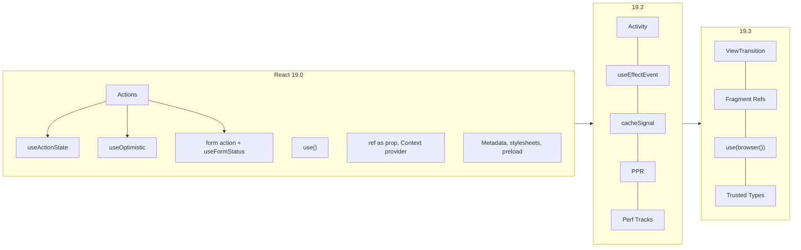
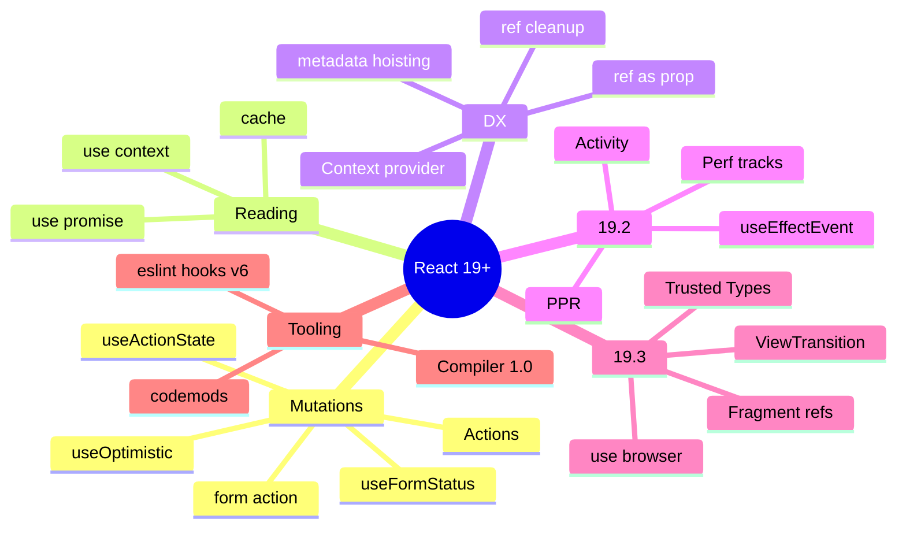

# React 19, 19.2 & 19.3 — What's New and How to Use It — Interview Guide

> Verified against react.dev on 2026-11-06: [React v19](https://react.dev/blog/2024/12/05/react-19), [19 Upgrade Guide](https://react.dev/blog/2024/04/25/react-19-upgrade-guide), [19.2](https://react.dev/blog/2025/10/01/react-19-2), [19.3](https://react.dev/blog/2026/09/09/react-19-3), [React Compiler v1.0](https://react.dev/blog/2025/10/07/react-compiler-1). Latest stable at verification time: **19.3** (September 9, 2026).
> Server Components/Server Functions have their own file: [05-server-components-and-server-functions.md](05-server-components-and-server-functions.md).

## Table of Contents

1. [Quick Summary (TL;DR)](#1-quick-summary-tldr)
2. [Release Timeline](#2-release-timeline)
3. [Actions and Async Transitions](#3-actions-and-async-transitions)
4. [Forms: `<form action>`, `useFormStatus`, `requestFormReset`](#4-forms-form-action-useformstatus-requestformreset)
5. [`useActionState`](#5-useactionstate)
6. [`useOptimistic`](#6-useoptimistic)
7. [The `use` API](#7-the-use-api)
8. [API Ergonomics: `ref` as Prop, `<Context>` Provider, Ref Cleanup](#8-api-ergonomics-ref-as-prop-context-provider-ref-cleanup)
9. [Document Metadata, Stylesheets, Scripts, Preloading](#9-document-metadata-stylesheets-scripts-preloading)
10. [Error Reporting and Hydration Improvements](#10-error-reporting-and-hydration-improvements)
11. [React 19.2 Features](#11-react-192-features)
12. [React 19.3 Features](#12-react-193-features)
13. [React Compiler 1.0](#13-react-compiler-10)
14. [Migrating from React 18 to 19](#14-migrating-from-react-18-to-19)
15. [Common Mistakes and Pitfalls](#15-common-mistakes-and-pitfalls)
16. [Performance Considerations](#16-performance-considerations)
17. [Trade-offs and Alternatives](#17-trade-offs-and-alternatives)
18. [Interview Questions — Fundamentals](#18-interview-questions--fundamentals)
19. [Interview Questions — Senior Scenarios](#19-interview-questions--senior-scenarios)
20. [Cheat Sheet](#20-cheat-sheet)
21. [Key Terms Glossary](#21-key-terms-glossary)
22. [Further Reading](#22-further-reading)

---

## 1. Quick Summary (TL;DR)

- **React 19 (Dec 2024)** turns *async mutations* into first-class citizens: **Actions** (async functions in transitions), `useActionState`, `useOptimistic`, `useFormStatus`, `<form action={fn}>`, plus the **`use`** API. It also stabilises **Server Components** and **Server Functions**.
- **Ergonomics:** `ref` as a prop (no `forwardRef`), `<Context>` as a provider, ref cleanup functions, `useDeferredValue` initial value, native document metadata/stylesheet/script support, resource-preload APIs, full custom-element support.
- **React 19.2 (Oct 2025):** `<Activity>`, `useEffectEvent`, `cacheSignal`, Chrome **Performance Tracks**, **Partial Pre-rendering**, batched SSR Suspense reveals, `eslint-plugin-react-hooks` v6.
- **React 19.3 (Sep 2026):** **`<ViewTransition>`** and **Fragment Refs** are stable, `use(browser())` for opting out of SSR, **Trusted Types** support, Server Components can render Context imported from a `'use client'` module, transitions render independently.
- **React Compiler 1.0 (Oct 2025)** is stable and automates memoization.
- Removed in 19: `propTypes`/`defaultProps` for function components, legacy context, string refs, `ReactDOM.render/hydrate/unmountComponentAtNode/findDOMNode`, `react-dom/test-utils` (except `act`, moved to `react`), UMD builds; new JSX transform required.



---

## 2. Release Timeline

| Version | Date | Headline items |
|---|---|---|
| 18.3 | Apr 2024 | Same as 18.2 + warnings for APIs removed in 19 (upgrade here first) |
| **19.0** | Dec 5, 2024 | Actions, `useActionState`, `useOptimistic`, `useFormStatus`, `use`, ref as prop, `<Context>` provider, ref cleanup, metadata/stylesheets/scripts, preload APIs, `prerender` static APIs, RSC/Server Functions stable, error handlers on roots, Suspense pre-warming |
| 19.1 | Mar 2025 | Intermediate release (the `useId` default prefix became `«r»` here; see the changelog for the full list) |
| **19.2** | Oct 1, 2025 | `<Activity>`, `useEffectEvent`, `cacheSignal`, Performance Tracks, PPR (`resume` APIs), batched SSR reveals, `useId` prefix `_r_`, Web Streams in Node |
| **19.3** | Sep 9, 2026 | Stable `<ViewTransition>` + `addTransitionType`, Fragment Refs, `use(browser())`, Trusted Types, Server-Component-rendered Context, independent transition rendering, Strict Mode effects on hydration |
| Security | Dec 2025–Jan 2026 | RSC advisories (see [file 05](05-server-components-and-server-functions.md)) — patched in 19.0.1, 19.1.2, 19.2.1 and later |

---

## 3. Actions and Async Transitions

### Concept
By convention, a function passed to `startTransition` (that may be **async**) is an **Action**. React 19 lets transitions run async functions and automatically manages:
- **Pending state** — `isPending` true from the start until the final state commit.
- **Optimistic updates** — via `useOptimistic`.
- **Error handling** — a thrown error/rejection goes to the nearest Error Boundary, and optimistic state reverts.
- **Forms** — `<form action={fn}>` runs fn as an Action and resets uncontrolled inputs after success.

### Before (React 18) vs after

```tsx
// Before: manual pending + error + sequencing
function UpdateName() {
  const [name, setName] = useState("");
  const [error, setError] = useState<string | null>(null);
  const [isPending, setIsPending] = useState(false);

  async function handleSubmit() {
    setIsPending(true);
    const err = await updateName(name);
    setIsPending(false);
    if (err) { setError(err); return; }
    redirect("/path");
  }
  // ...
}

// After: Action through useTransition
function UpdateName() {
  const [name, setName] = useState("");
  const [error, setError] = useState<string | null>(null);
  const [isPending, startTransition] = useTransition();

  const handleSubmit = () => startTransition(async () => {
    const err = await updateName(name);
    if (err) { setError(err); return; }   // NOTE: state updates after `await` should be wrapped again, see 03 file
    redirect("/path");
  });
}
```

Caveat (official): updates **after an `await`** need their own `startTransition`; async Actions are **not ordered** — for ordering use `useActionState` / `<form action>`.

---

## 4. Forms: `<form action>`, `useFormStatus`, `requestFormReset`

### `<form action={fn}>`
`action`/`formAction` props accept **functions**. React calls it with `FormData`, wraps it in a transition, and — if it succeeds — **resets uncontrolled fields** automatically. Call `requestFormReset(form)` from `react-dom` to reset manually (for example after a failed submission you want to keep, don't reset).

```tsx
async function createTodo(formData: FormData) {
  const title = String(formData.get("title") ?? "");
  await api.createTodo({ title });
}

<form action={createTodo}>
  <input name="title" required />
  <SubmitButton />
</form>
```

### `useFormStatus` (from `react-dom`)
Reads the status of the **parent `<form>`** as if it were context — ideal for design-system buttons that shouldn't need prop drilling.

```tsx
import { useFormStatus } from "react-dom";

function SubmitButton() {
  const { pending } = useFormStatus();       // must be rendered INSIDE the <form>
  return <button type="submit" disabled={pending}>{pending ? "Saving..." : "Save"}</button>;
}
```
Pitfall: calling it in the same component that renders `<form>` does nothing — it reads the **ancestor** form.

### Progressive enhancement
When `action` is a Server Function (or has a `permalink` via `useActionState`), the form works **before JS loads** and is hydrated afterwards.

---

## 5. `useActionState`

### Signature
```ts
const [state, formAction, isPending] = useActionState(
  async (previousState: State, formData: FormData) => nextState,
  initialState,
  permalink?  // optional URL for progressive enhancement
);
```
(Previously `ReactDOM.useFormState` in canary; renamed and `useFormState` deprecated.)

### What it does
- Wraps an **Action**; returns the **last returned value** as `state`.
- `formAction` is what you pass to `<form action>` or call inside a transition.
- **Queues** invocations so they run sequentially → no out-of-order results (unlike raw async transitions).
- `isPending` reflects the Action.

```tsx
type FormState = { ok: boolean; message?: string; fieldErrors?: Record<string, string> };

async function signup(prev: FormState, formData: FormData): Promise<FormState> {
  const email = String(formData.get("email") ?? "");
  const res = await fetch("/api/signup", { method: "POST", body: JSON.stringify({ email }), headers: { "content-type": "application/json" } });
  if (!res.ok) return { ok: false, fieldErrors: (await res.json()).errors };
  return { ok: true, message: "Welcome!" };
}

export function Signup() {
  const [state, formAction, isPending] = useActionState(signup, { ok: false });
  return (
    <form action={formAction}>
      <input name="email" type="email" aria-invalid={!!state.fieldErrors?.email} />
      {state.fieldErrors?.email && <p role="alert">{state.fieldErrors.email}</p>}
      <button disabled={isPending}>Sign up</button>
      {state.ok && <p role="status">{state.message}</p>}
    </form>
  );
}
```

### Notes
- When used with a **form** `action`, React resets uncontrolled fields after the action; return the previous values in state if you want to repopulate (`defaultValue={state.values?.email}`).
- Validate on the **server** — client validation is UX only.
- Return **serialisable** state for Server Function actions.

---

## 6. `useOptimistic`

### Concept
Shows an **optimistic** value while an async Action is in flight, then **automatically reverts** to the real state when the Action settles (success commits the real state; error shows the previous one).

```tsx
function Thread({ messages, sendMessageAction }: Props) {
  const [optimisticMessages, addOptimisticMessage] = useOptimistic(
    messages,
    (current, text: string) => [...current, { id: crypto.randomUUID(), text, sending: true }]
  );

  async function formAction(formData: FormData) {
    const text = String(formData.get("message"));
    addOptimisticMessage(text);               // must be called inside an Action/transition
    await sendMessageAction(text);            // when settled, `messages` prop is the source of truth
  }

  return (
    <>
      {optimisticMessages.map((m) => <p key={m.id} className={m.sending ? "pending" : ""}>{m.text}</p>)}
      <form action={formAction}><input name="message" /><button>Send</button></form>
    </>
  );
}
```

### Rules
- Call the setter **inside an Action** (transition/form action). Calling it outside warns.
- The optimistic value lives only while the Action is pending; the underlying state (props/parent state) must be updated by the Action's result.
- Pair with **Error Boundary** or returned error state to tell users the update failed (the UI silently reverts otherwise).
- Idempotency/ids: generate client IDs, reconcile with server IDs after commit.

### Use cases
Likes, comments, cart updates, reordering, todo toggles, chat messages.

---

## 7. The `use` API

### Concept
`use(resource)` reads a **Promise** or **Context** during render.

```tsx
import { use, Suspense } from "react";

function Comments({ commentsPromise }: { commentsPromise: Promise<Comment[]> }) {
  const comments = use(commentsPromise);   // suspends until resolved; rejection -> Error Boundary
  return comments.map((c) => <p key={c.id}>{c.text}</p>);
}

function Heading({ children }: { children?: React.ReactNode }) {
  if (children == null) return null;
  const theme = use(ThemeContext);          // allowed after an early return (useContext is not)
  return <h1 style={{ color: theme.color }}>{children}</h1>;
}
```

### Rules and differences from hooks
- Can be called **conditionally and in loops**, but **only in render** (components/hooks), not in try/catch for promises (use Error Boundaries or `.catch` upstream).
- The promise must be **stable across renders**: create it outside render, in a Server Component, router loader or cache. React warns: *"A component was suspended by an uncached promise"* if created during Client Component render.
- Server Components should prefer `async/await`; `use` works for client components consuming promises passed from the server.
- Reading context via `use(Context)` has identical re-render semantics as `useContext`.
- **[19.3]** A warning was added for incorrect conditional usage of `use`; also `use(browser())` (see §12).

---

## 8. API Ergonomics: `ref` as Prop, `<Context>` Provider, Ref Cleanup

```tsx
// ref is a plain prop for function components
function MyInput({ placeholder, ref }: { placeholder?: string; ref?: React.Ref<HTMLInputElement> }) {
  return <input placeholder={placeholder} ref={ref} />;
}

// <Context> as provider (Context.Provider will be deprecated later)
const ThemeContext = createContext("light");
<ThemeContext value="dark">{children}</ThemeContext>;

// Ref callback cleanup
<input ref={(node) => {
  const ro = new ResizeObserver(() => {});
  if (node) ro.observe(node);
  return () => ro.disconnect();     // called on unmount (React no longer calls the ref with null)
}} />;
```
- `forwardRef` still works but is slated for deprecation; a codemod exists.
- Class components do **not** receive `ref` as a prop (the ref points to the instance).
- TypeScript: a ref callback may not return anything other than a cleanup — avoid implicit returns: `ref={(n) => { instance = n; }}`.
- `element.ref` is deprecated; read `element.props.ref`.
- `useRef` requires an argument in types: `useRef<number | undefined>(undefined)`, `useRef<HTMLDivElement>(null)`.

---

## 9. Document Metadata, Stylesheets, Scripts, Preloading

### Metadata tags in any component
`<title>`, `<meta>`, `<link>` rendered anywhere are **hoisted to `<head>`** — works in client-only apps, streaming SSR, and Server Components. Libraries (react-helmet, framework metadata APIs) still offer route-based overriding.

```tsx
function BlogPost({ post }: { post: Post }) {
  return (
    <article>
      <title>{post.title}</title>
      <meta name="description" content={post.summary} />
      <link rel="canonical" href={post.url} />
      <h1>{post.title}</h1>
    </article>
  );
}
```

### Stylesheets with `precedence`
```tsx
<link rel="stylesheet" href="/a.css" precedence="default" />
```
React orders stylesheets by precedence, **dedupes** them, and (for external sheets) ensures they're loaded **before revealing** content that depends on them (SSR streaming and client transitions). This colocates CSS with components without FOUC.

### Async scripts
`<script async src="..."/>` can be rendered in any component; React dedupes and (in SSR) prioritises behind critical resources.

### Resource preloading APIs (`react-dom`)
`prefetchDNS`, `preconnect`, `preload`, `preinit` — hint the browser early (fonts, scripts, styles) from components, route-change handlers or hover.

### Custom elements
Full support (passes Custom Elements Everywhere). Client: props that match an element **property** are assigned as properties, else attributes. SSR: primitives render as attributes; objects/functions are omitted.

---

## 10. Error Reporting and Hydration Improvements

- **Errors are not re-thrown** anymore: uncaught errors → `window.reportError`; caught by a boundary → `console.error` once.
- New root options: `onCaughtError`, `onUncaughtError`, `onRecoverableError` for `createRoot` / `hydrateRoot`.

```tsx
createRoot(document.getElementById("root")!, {
  onCaughtError: (error, info) => telemetry.capture(error, { componentStack: info.componentStack, handled: true }),
  onUncaughtError: (error, info) => telemetry.capture(error, { componentStack: info.componentStack, handled: false }),
  onRecoverableError: (error) => telemetry.capture(error, { level: "warning" }),
}).render(<App />);
```
- **Hydration diffs:** a single message describing the mismatch with a diff.
- **Third-party scripts/extensions:** unexpected tags in `<head>`/`<body>` no longer cause mismatch errors; stylesheets inserted by extensions survive a full re-render.

---

## 11. React 19.2 Features

### `<Activity>` — hide UI, keep state
See [03 file §9](03-concurrent-react-suspense-and-transitions.md#9-activity-192-and-viewtransition-193). `mode="visible" | "hidden"`; hidden → effects unmounted, updates deferred, state kept.

### `useEffectEvent`
Separate event-like logic from reactive effects (see [02 file §6](02-hooks-deep-dive.md#6-useeffectevent-react-192)). Not in dependency arrays; same component/hook as its effect; don't use it just to silence the linter.

### `cacheSignal` (Server Components only)
Lets you abort work when the `cache()` lifetime ends (render completed, aborted or failed):

```tsx
import { cache, cacheSignal } from "react";
const dedupedFetch = cache(fetch);
async function Component() {
  await dedupedFetch(url, { signal: cacheSignal() });
}
```

### Performance Tracks
Custom tracks in Chrome DevTools Performance profiles: **Scheduler** (priorities: blocking vs transition, event → update → render → commit timeline) and **Components** (render/effect mount durations, "Blocked" segments).

### Partial Pre-rendering (PPR)
```ts
const { prelude, postponed } = await prerender(<App />, { signal: controller.signal });
await savePostponedState(postponed);          // serve `prelude` from CDN
// later
const stream = await resume(<App />, await getPostponedState(req));
// or generate static HTML: resumeAndPrerender(<App />, postponed)
```
APIs: `resume`, `resumeToPipeableStream` (`react-dom/server`), `resumeAndPrerender`, `resumeAndPrerenderToNodeStream` (`react-dom/static`).

### Batched SSR Suspense reveals
Streaming reveals are briefly batched to align with client behaviour and prepare for ViewTransition on SSR. Heuristics stop batching near the **2.5 s LCP** "good" threshold.

### Other
- `renderToReadableStream` / `prerender` now available on Node (but prefer Node Streams APIs on Node for speed and compression).
- `eslint-plugin-react-hooks@6`: flat config by default; `recommended-legacy` for old config; Compiler-powered rules (e.g., `set-state-in-render`, `set-state-in-effect`, `refs`).
- `useId` default prefix `_r_`.

---

## 12. React 19.3 Features

### `<ViewTransition>` (stable) + `addTransitionType`
Animate **enter / exit / update / share** for updates wrapped in a Transition, Suspense reveal or `useDeferredValue` update. DOM only (React Native support is in progress). Customise with View Transition Classes (CSS) or event props `onEnter/onExit/onShare/onUpdate` (Web Animations API).

```tsx
<ViewTransition name={`photo-${id}`}>   {/* shared element transition */}
  
</ViewTransition>
```
Guidelines for Suspense: fallbacks appear **without** animation; fallback → content **with** animation (`update="auto" default="none"`); respect reduced motion.

### Fragment Refs (stable)
`<Fragment ref={ref}>` gives a `FragmentInstance` with `addEventListener/removeEventListener/dispatchEvent`, `focus/focusLast/blur`, `observeUsing/unobserveUsing` (IntersectionObserver/ResizeObserver), `getClientRects`, `getRootNode`, `compareDocumentPosition`, `scrollIntoView` — operating on **first-level DOM children as a group**, no wrapper div needed.

### `use(browser())` (from `react-dom`)
Opts a component out of SSR: suspends on the **server only** (nearest fallback in HTML), never suspends on the client. Can be conditional.

```tsx
import { use } from "react";
import { browser } from "react-dom";

function TimeZone() {
  use(browser());
  return <p>{new Intl.DateTimeFormat().resolvedOptions().timeZone}</p>;
}
// <Suspense fallback="Loading..."><TimeZone /></Suspense>
```

### Trusted Types
React no longer coerces values with `'' + value` before DOM sinks, so `TrustedHTML`/`TrustedScript`/`TrustedScriptURL` objects pass through. Enforce with `Content-Security-Policy: require-trusted-types-for 'script'` to mitigate DOM XSS.

### Server Components and Context
Server Components can now **render** `<Context>` imported from a `'use client'` module (still can't create context) — no wrapper Provider component needed.

### Notable behaviour changes
- Transitions rendered independently (no longer entangled).
- Strict Mode double-invokes effects during **hydration**.
- Fixes: `useDeferredValue` stuck on old value, `useSyncExternalStore` missing mutations while `<Activity>` hidden, `useEffectEvent` stale in `forwardRef`/`memo`, hidden Activity errors escaping.

---

## 13. React Compiler 1.0

- Build-time tool (Babel plugin `babel-plugin-react-compiler`; swc support in Next.js ≥ 15.3.1; Vite/Metro/Rsbuild integrations; Expo SDK 54+ enabled by default).
- Automatically memoizes components and hooks, including **conditional memoization** after early returns; also compiles `use` and conditional code.
- Works with React 17+ via `target` config and `react-compiler-runtime`.
- Validates the **Rules of React**; diagnostics via `eslint-plugin-react-hooks`.
- Keep `useMemo`/`useCallback` where you need *precise* control (effect deps). Don't mass-remove memoization in existing code without testing.
- Pin an **exact version** unless you have strong e2e tests (memoization changes can change effect firing for code that breaks the rules).
- Opt in/out per function with directives (`"use memo"`, `"use no memo"`), gating strategies for incremental adoption.
- Reported results at Meta: up to ~12% faster initial loads/navigations and 2.5× faster some interactions (workload dependent).

Details: [08-react-performance-optimization.md](08-react-performance-optimization.md).

---

## 14. Migrating from React 18 to 19

### Recommended path
1. Upgrade to **18.3** first and fix new warnings.
2. Ensure the **new JSX transform** is enabled.
3. `npm i --save-exact react@^19 react-dom@^19 @types/react@^19 @types/react-dom@^19`.
4. Run codemods: `npx codemod@latest react/19/migration-recipe` and `npx types-react-codemod@latest preset-19 ./src`.
5. Update tests (`act` from `react`; stop using `react-dom/test-utils`; move off shallow renderer/`react-test-renderer`).
6. Audit third-party libraries (peer dep ranges; libraries touching React internals).

### Removed / changed (official)
| Area | Change |
|---|---|
| `propTypes`, function-component `defaultProps` | Removed → TypeScript + default params |
| Legacy context (`contextTypes`, `getChildContext`) | Removed → `createContext` / `contextType` |
| String refs | Removed → callback refs / `createRef` |
| Module-pattern factory components, `createFactory` | Removed |
| `ReactDOM.render/hydrate/unmountComponentAtNode/findDOMNode` | Removed → `createRoot`, `hydrateRoot`, `root.unmount()`, refs |
| `react-dom/test-utils` | Removed except `act` (now `import { act } from 'react'`) |
| `react-test-renderer` | Deprecated; shallow renderer removed from it |
| UMD builds | Removed (use ESM CDN) |
| Errors in render | Not re-thrown; use root error handlers |
| TypeScript | `useRef` needs an argument; refs mutable; `ReactElement` props default `unknown`; global `JSX` namespace → `React.JSX`; ref callbacks can't implicitly return; `useReducer` generics simplified |
| Strict Mode | Memoized results reused on 2nd render; ref callbacks double-invoked |
| Suspense | Fallback commits immediately; siblings pre-warmed |
| Other | `javascript:` URLs in `src/href` throw; transitions in `popstate` sync; layout-effect SSR warning removed |

### Typical gotchas
- Libraries using `element.ref` or internals (`SECRET_INTERNALS...`).
- Tests relying on errors being re-thrown or on shallow rendering.
- `useRef()` without arguments in TS.
- Code that depended on `defaultProps` for function components.
- Using `useFormState` (renamed `useActionState`).

---

## 15. Common Mistakes and Pitfalls

| Mistake | Why it's wrong | Fix |
|---|---|---|
| Calling `useFormStatus` in the component that renders the `<form>` | Reads ancestor form | Move to a child component |
| Calling `addOptimistic` outside an Action | No revert scope; warning | Call inside form action/transition |
| Creating the promise passed to `use()` during render | Re-created each render | Create outside / pass from server / cache |
| Assuming async transitions are ordered | They aren't | `useActionState`/form action or own queue |
| Mutating state returned by `useActionState` | Breaks identity assumptions | Return new objects |
| Expecting `useOptimistic` value to persist | Reverts when Action settles | Update real source of truth |
| Relying on `forwardRef` removal immediately | Still works in 19 | Migrate with codemod |
| Using `<title>` hoisting for route-based overriding without a library | No override semantics | Use framework metadata API |
| Not validating on server in Server Function forms | Client-only validation is bypassable | Validate and authorise server-side |
| Blindly deleting `useMemo`/`useCallback` after enabling the Compiler | Can change effect behaviour | Test; remove incrementally |
| Using `Activity` hidden with subscriptions that must stay live | Effects are cleaned up while hidden | Keep such subscriptions outside Activity |

---

## 16. Performance Considerations

- **Actions** reduce renders vs manual `isPending/error` state juggling (fewer `setState` calls) and keep UI interactive.
- **`useOptimistic`** improves *perceived* latency, not real latency; reconcile to avoid flicker (stable keys/ids).
- **Metadata/stylesheet/script hoisting** removes layout shift from late CSS and avoids duplicated scripts.
- **Preload APIs** can improve LCP by discovering fonts/images/scripts earlier.
- **PPR** serves a static shell from a CDN (fast TTFB/LCP) and streams dynamic holes.
- **Activity** trades memory for instant navigation.
- **ViewTransition** uses browser compositing — cheap, but large snapshot areas cost GPU memory.
- **Compiler** reduces re-render cost for updates (not initial render).

---

## 17. Trade-offs and Alternatives

| Concern | React 19 built-in | Alternative | Notes |
|---|---|---|---|
| Form state | `useActionState` + `<form action>` | React Hook Form, Formik, TanStack Form | Built-ins suit server-validated, progressive forms; RHF still excels at complex client validation, dynamic arrays |
| Mutation + cache invalidation | Actions + framework revalidation | TanStack Query mutations | TanStack gives cache, retries, devtools |
| Optimistic updates | `useOptimistic` | Query-cache optimistic updates | Local/short-lived vs cache-wide |
| Data reading | `use` + Suspense | `useEffect` + state, TanStack Query | `use` needs stable promises/frameworks |
| Head management | Native tags | react-helmet, Next Metadata API | Native hoisting lacks route merging |
| Animations | `ViewTransition` | Framer Motion, CSS | Native vs feature-rich |
| Memoization | Compiler | Manual hooks | Compiler requires Rules-of-React compliance |

---

## 18. Interview Questions — Fundamentals

### Q1. What are "Actions" in React 19?
Functions (often async) executed inside a transition. React manages pending state, errors, optimistic updates and sequencing for form actions, so you don't hand-roll `isLoading/error` state.

### Q2. How does `useActionState` differ from `useState` + `useTransition`?
It wraps an Action, returns its last result as state, provides `isPending`, and **queues** actions so results are in order; it integrates with `<form action>` and supports progressive enhancement via `permalink`.

### Q3. What does `useFormStatus` return and where must it be used?
`{ pending, data, method, action }` for the **parent** form; must be called from a component rendered *inside* the form.

### Q4. How does `useOptimistic` work?
Takes current state and an optional reducer; returns `[optimisticState, addOptimistic]`. While an Action is pending it shows the optimistic value; when the Action settles React shows the real state (success or failure).

### Q5. What can `use()` read and what's special about it?
Promises (suspends) and Context. It can be called conditionally/in loops, unlike hooks, but only during render. Promises must be stable (not created in render).

### Q6. What changed with refs in React 19?
`ref` is a normal prop for function components (no `forwardRef`), ref callbacks can return cleanups, `element.ref` deprecated, TS `useRef` requires an argument.

### Q7. How do you migrate off `defaultProps` / `propTypes`?
Use ES default parameters and TypeScript types; class components still support `defaultProps`.

### Q8. What does React 19 change in error handling?
Errors aren't re-thrown; uncaught → `window.reportError`, caught → `console.error`; roots accept `onCaughtError/onUncaughtError/onRecoverableError`.

### Q9. What is React Compiler?
A build-time optimiser that auto-memoizes components and hooks and validates the Rules of React; stable since v1.0 (Oct 2025).

### Q10. What is `useEffectEvent`?
Hook (19.2) for non-reactive logic invoked from effects that always sees latest props/state but isn't a dependency.

### Q11. What is `<Activity>`?
Component (19.2) with `visible`/`hidden` modes preserving state while pausing effects and deferring updates.

### Q12. What is `ViewTransition`?
Stable (19.3) wrapper around the browser View Transition API integrated with transitions/Suspense.

### Q13. How is document metadata handled?
`<title>`, `<meta>`, `<link>` in components are hoisted into `<head>`; stylesheets accept `precedence`; scripts dedupe.

### Q14. What is Partial Pre-rendering?
Pre-render a static shell (`prerender` → `prelude` + `postponed`) to a CDN and `resume` later to fill dynamic content.

### Q15. Is `forwardRef` removed?
No — still works in 19 but is superseded; future deprecation planned.

---

## 19. Interview Questions — Senior Scenarios

### S1. "Design a todo list with optimistic updates, server validation, and error recovery using only React 19 primitives."
- State of record in parent / server cache (`todos`).
- `useOptimistic(todos, (cur, newTodo) => [...cur, { ...newTodo, pending: true }])`.
- Form action: `addOptimistic(todo)` → `await createTodoOnServer(todo)` (Server Function); on error return `{ error }` via `useActionState`.
- Provide stable client IDs, reconcile with server IDs, render pending style.
- Error handling: show inline error, optimistic row disappears automatically; for critical failures throw to the Error Boundary.
- Accessibility: `aria-live="polite"` region for status; keep focus.
- Discuss limits: multi-tab consistency, offline queue → need a library (TanStack Query persist/offline) or service worker queue.

### S2. "How do you decide between `useActionState`, TanStack Query mutations, and React Hook Form?"
Server-validated progressive forms → `useActionState` + Server Functions. Cache-centric apps with complex invalidation/retry/devtools → TanStack Query. Large client-side forms with complex validation, dynamic fields, performance needs → RHF (uncontrolled), optionally calling an Action on submit. They compose: RHF `handleSubmit` can call an Action; Query mutation can be wrapped in `startTransition`.

### S3. "Your team upgrades to React 19 and tests fail with `act` and shallow rendering errors. What happened and how to fix?"
`react-dom/test-utils` was removed (except `act`, now `import { act } from 'react'`); `react-test-renderer/shallow` removed; `react-test-renderer` deprecated and uses concurrent rendering. Migrate to React Testing Library (`@testing-library/react`), use `act` from `react`, and avoid depending on internals.

### S4. "How would you adopt the React Compiler in a 5-year-old codebase?"
Upgrade ESLint plugin and fix Rules-of-React violations first; run compiler health checks; enable per-directory (annotation/gating mode) behind a flag; compare Profiler traces and e2e tests; keep existing `useMemo/useCallback`; pin exact version; roll out gradually; monitor INP, error rates; use `"use no memo"` for known-problematic components.

### S5. "A shared element transition between list and detail pages is required. How?"
Wrap thumbnail and hero in `<ViewTransition name={`img-${id}`}>` (unique per id at any moment), trigger navigation in `startTransition`, use `addTransitionType('navigate-forward')` to vary animations, keep Suspense fallbacks un-animated, test on browsers lacking View Transition API (graceful degradation), respect reduced-motion. Note: DOM only; React Native isn't supported yet.

### S6. "What are the security implications of Server Functions and Trusted Types?"
Server Functions are **public HTTP endpoints**: authenticate, authorise, validate every argument, rate-limit, CSRF-protect (framework-dependent), and keep React/framework patched (the Dec 2025 RSC advisory CVE-2025-55182 was a CVSS 10 RCE in payload decoding). Trusted Types (19.3 support) closes DOM-XSS sinks: define policies with a sanitiser (DOMPurify), enforce via CSP `require-trusted-types-for 'script'`.

### S7. "How do you keep tabs alive in a dashboard without memory blow-up?"
`<Activity mode={active ? 'visible' : 'hidden'}>` for the most recent N tabs; unmount older ones and persist state (store keyed by tab id); account for effects pausing (websockets), cap retained DOM, test with Performance Tracks and memory profiler.

---

## 20. Cheat Sheet



| Need | API |
|---|---|
| Submit with pending/error | `<form action>` + `useActionState` |
| Button knows form state | `useFormStatus` |
| Instant UI before server | `useOptimistic` |
| Read promise in render | `use(promise)` |
| Read context conditionally | `use(Context)` |
| Hide but keep state | `<Activity>` |
| Non-reactive logic in effect | `useEffectEvent` |
| Animate navigation | `<ViewTransition>` + `startTransition` |
| Group DOM ops without wrapper | Fragment ref |
| Skip SSR for a component | `use(browser())` |

---

## 21. Key Terms Glossary

| Term | Definition |
|---|---|
| Action | Async function run inside a transition |
| Server Function | Function marked `'use server'` callable from clients |
| Optimistic UI | Show expected result before server confirms |
| Progressive enhancement | Works without JS then enhanced after hydration |
| Pre-warming | Rendering suspended siblings early to start fetches |
| PPR | Partial Pre-rendering: static shell + resumable dynamic parts |
| Postponed state | Serialisable state used by `resume` to finish a prerender |
| Effect Event | Non-reactive function from `useEffectEvent` |
| Fragment Instance | Object from Fragment ref exposing group DOM operations |
| Trusted Types | Browser API requiring typed values for DOM injection sinks |

---

## 22. Further Reading

- [React v19](https://react.dev/blog/2024/12/05/react-19) · [Upgrade Guide](https://react.dev/blog/2024/04/25/react-19-upgrade-guide)
- [React 19.2](https://react.dev/blog/2025/10/01/react-19-2) · [React 19.3](https://react.dev/blog/2026/09/09/react-19-3)
- [`useActionState`](https://react.dev/reference/react/useActionState) · [`useOptimistic`](https://react.dev/reference/react/useOptimistic) · [`use`](https://react.dev/reference/react/use) · [`useFormStatus`](https://react.dev/reference/react-dom/hooks/useFormStatus)
- [React Compiler docs](https://react.dev/learn/react-compiler)
