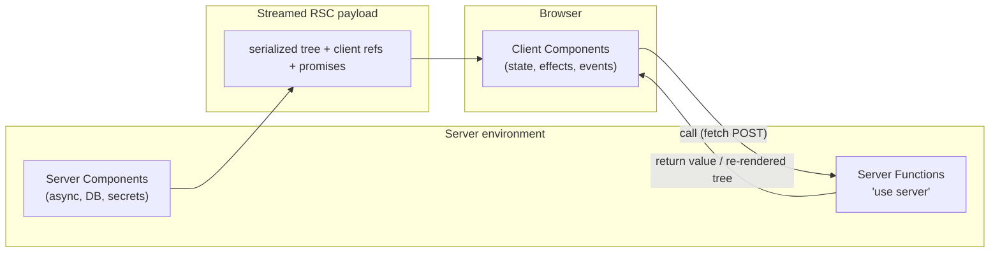
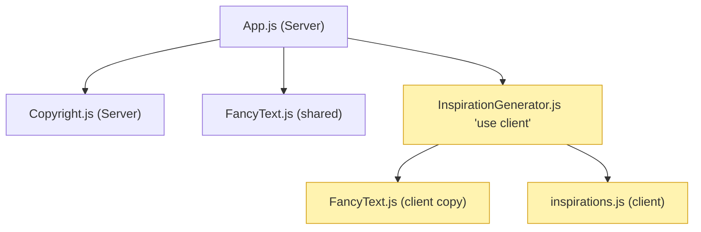
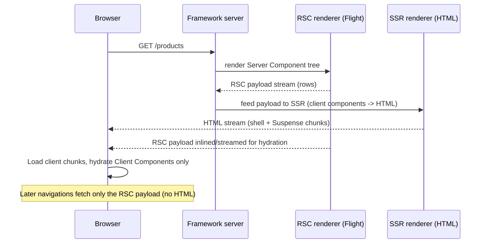
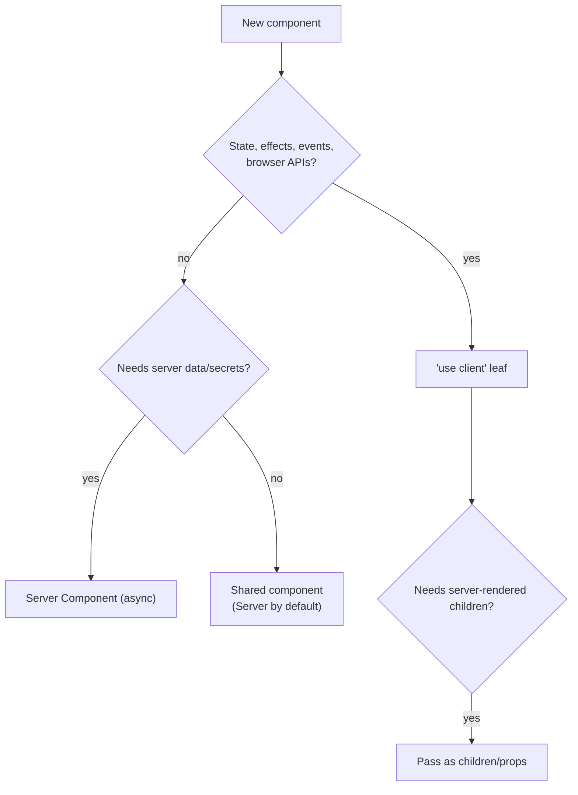

# React Server Components & Server Functions — Interview Guide

> Verified against react.dev: [Server Components](https://react.dev/reference/rsc/server-components), [`'use client'`](https://react.dev/reference/rsc/use-client), [`'use server'`](https://react.dev/reference/rsc/use-server), [React 19](https://react.dev/blog/2024/12/05/react-19), [19.2](https://react.dev/blog/2025/10/01/react-19-2), [19.3](https://react.dev/blog/2026/09/09/react-19-3) and the Dec 2025 security advisories. Terminology note: the docs now call **Server Actions → "Server Functions"**; "Server Action" survives as the name for a Server Function used as an Action (e.g., in `<form action>`).
> Framework-specific behaviour (routing, caching, `use cache`, Server Actions options) is in the **Next.js** category of this handbook.

## Table of Contents

1. [Quick Summary (TL;DR)](#1-quick-summary-tldr)
2. [The Problem RSC Solves](#2-the-problem-rsc-solves)
3. [Mental Model: Two Module Graphs, One Render Tree](#3-mental-model-two-module-graphs-one-render-tree)
4. [How RSC Works Internally (Flight, Payload, Hydration)](#4-how-rsc-works-internally-flight-payload-hydration)
5. [Server vs Client Components: What Each Can Do](#5-server-vs-client-components-what-each-can-do)
6. [Serialization Rules at the Boundary](#6-serialization-rules-at-the-boundary)
7. [Composition Patterns](#7-composition-patterns)
8. [Data Fetching in Server Components](#8-data-fetching-in-server-components)
9. [Server Functions (`'use server'`)](#9-server-functions-use-server)
10. [Security: What Interviewers Expect You to Know](#10-security-what-interviewers-expect-you-to-know)
11. [Caching, `cache()`, `cacheSignal`](#11-caching-cache-cachesignal)
12. [Common Mistakes and Pitfalls](#12-common-mistakes-and-pitfalls)
13. [Performance Considerations](#13-performance-considerations)
14. [Trade-offs and Alternatives](#14-trade-offs-and-alternatives)
15. [Interview Questions — Fundamentals](#15-interview-questions--fundamentals)
16. [Interview Questions — Senior Scenarios](#16-interview-questions--senior-scenarios)
17. [Cheat Sheet](#17-cheat-sheet)
18. [Key Terms Glossary](#18-key-terms-glossary)
19. [Further Reading](#19-further-reading)

---

## 1. Quick Summary (TL;DR)

- **Server Components (RSC)** render **ahead of time** in a separate environment (build time or per request) and send a *description of the UI* to the client — **zero client JS for the component itself**.
- **Every component is a Server Component by default** in an RSC-enabled framework; **`'use client'`** marks a **module boundary**: that module and its transitive imports are bundled for the browser. **There is no directive for Server Components.**
- Server Components can be **`async`**, read the DB/filesystem directly, keep secrets on the server, and cannot use state, effects, event handlers or browser APIs.
- Client Components are still **pre-rendered to HTML on the server (SSR)** and then **hydrated**. "Client" means "ships and runs on the client", not "client-only".
- **Server Functions** (`'use server'`) are async functions callable from the client; the call becomes a **network request**. They power `<form action>`, `useActionState` and mutations. They are **public endpoints** and must be authenticated, authorised and validated.
- Props crossing server → client must be **serialisable** (plain objects, primitives, Date, Map/Set, Promises, JSX, Server Functions; **not** functions/classes).
- RSC is stable in React 19, but the **bundler/framework integration APIs do not follow semver** — use a framework (Next.js, React Router RSC, Waku, etc.) and pin versions.
- **Security matters:** CVE-2025-55182 (CVSS 10 unauthenticated RCE in the RSC/Server Function payload decoding, Dec 2025) and follow-up DoS/source-exposure CVEs show you must keep React and the framework patched.



---

## 2. The Problem RSC Solves

| Pain in classic SPA/SSR | RSC answer |
|---|---|
| Large JS bundles (every component ships) | Server-only code never reaches the client (e.g. markdown renderer, date library, data shaping) |
| Client-side **waterfalls** (component renders → fetches → child renders → fetches) | Fetch **on the server next to the data**, parallelised in one request |
| API layer boilerplate (REST/GraphQL just to feed your own UI) | Components call the DB/service directly |
| Secrets & tokens leaking to the client | Secrets stay in the server module graph |
| Hydration cost for non-interactive UI | Server Components **don't hydrate** |
| Cache duplication (client cache + server cache) | Cache at the server; stream UI |

RSC is **not** a replacement for SSR: SSR makes HTML from client + server components for first paint; RSC changes *what code ships and where it runs*. They compose.

---

## 3. Mental Model: Two Module Graphs, One Render Tree

React's docs stress this: **`'use client'` defines the boundary on the module dependency tree, not the render tree.**



Consequences:
- A **component usage** is a Client Component if it's defined in a `'use client'` module **or is a transitive import** of one. Otherwise it is a Server Component.
- The same component *definition* (e.g. `FancyText`) can be both: server usage (output sent) and client usage (code shipped).
- A Client Component can render a Server Component **if the server passes it as `children`/props** (JSX). The Server Component runs fully on the server *before* the Client Component renders; the client only receives its output. This is the "donut / slot" pattern.
- `'use client'` must be at the **top of the file** (before imports), with single/double quotes. Inside a file already client-evaluated, it has no effect.

---

## 4. How RSC Works Internally (Flight, Payload, Hydration)

### Render pipeline for a request



### The RSC payload ("Flight" format)
A streamed, line-oriented serialisation of the React tree containing:
- Host elements and Server Component **output** (already evaluated),
- **Client references** (module id + export name + chunk URLs) in place of Client Components so the client loads and renders them,
- **Promises/holes** for `Suspense` boundaries still pending (streamed later),
- Serialised props, including Server Function **references** (IDs, not code).

### Client navigation
On soft navigation the client requests **only the new RSC payload**; React reconciles it into the existing tree, **preserving client state** in unchanged Client Components. This is why layouts keep state while pages swap.

### Hydration
Only Client Components hydrate. Server Component output is static markup (no handlers), so hydration work scales with *interactive* UI, not total UI.

### Bundlers
RSC requires bundler support (webpack/Turbopack/Parcel/Vite plugin): two (or three) module graphs (`react-server` export condition, SSR, client). Libraries ship a `react-server` condition. Bundler/framework APIs (`react-server-dom-*`) **do not follow semver within 19.x**; pin versions or use Canary through a framework.

---

## 5. Server vs Client Components: What Each Can Do

| Capability | Server Component | Client Component |
|---|---|---|
| `async/await` in component body | Yes | No (use `use()`/libraries) |
| Direct DB / filesystem / secrets | Yes | No |
| `useState`, `useReducer`, `useEffect`, `useLayoutEffect`, `useRef` | No | Yes |
| `useContext` / `createContext` | Can't **create** context; **[19.3]** can render a Context imported from a client module | Yes |
| Event handlers (`onClick`) | No | Yes |
| Browser APIs (`window`, `localStorage`) | No | Yes |
| `use(promise)`, `useId` | Yes (the only hooks/APIs from the hooks list that react.dev allows in server code) | Yes, plus `use(Context)` |
| Contribute to client bundle | No (only output) | Yes |
| Re-render on client state changes | No (re-render only on navigation/refresh/Server Function revalidation) | Yes |
| Import a Client Component | Yes | Yes |
| Import a Server Component | Yes | **No** (only receive as props/children) |

Third-party libraries that use `createContext`, hooks (except `use`, `useId`), `forwardRef`, `memo`, `startTransition` or DOM APIs must run on the client; libraries that haven't added `'use client'` need your own small client wrapper file.

---

## 6. Serialization Rules at the Boundary

**Allowed props (server → client)** per react.dev: primitives (string, number, bigint, boolean, undefined, null, `Symbol.for` symbols), iterables of serialisable values (String, Array, Map, Set, TypedArray/ArrayBuffer), Date, **plain objects** with serialisable properties, **Server Functions**, **Client or Server Component elements (JSX)**, **Promises**.

**Not allowed:** arbitrary functions (unless Server Functions or exported from client modules), class instances, objects with null prototype, non-registered Symbols. (Server Function arguments additionally allow `FormData`; they disallow JSX and events.)

```tsx
// Server Component
export default async function Page() {
  const user = await db.user.findFirst();           // class instance (ORM model)? Convert to plain object
  return <Profile user={{ id: user.id, name: user.name }} onShare={shareAction} />; // ok: plain object + Server Function
}
```

Pitfall: passing a whole ORM entity can leak sensitive fields (password hash). **Project to a DTO.** The experimental `taintObjectReference` / `taintUniqueValue` APIs exist to prevent accidental passing of secrets to client code.

---

## 7. Composition Patterns

### 7.1 Push `'use client'` down to the leaves
Keep pages/layouts as Server Components; extract the interactive piece (button, dropdown, form) into a small Client Component.

```tsx
// ProductPage.tsx (Server)
export default async function ProductPage({ id }: { id: string }) {
  const product = await getProduct(id);
  return (
    <article>
      <h1>{product.name}</h1>
      <ProductGallery images={product.images} />   {/* Server: static output */}
      <AddToCartButton productId={product.id} />    {/* Client: interactive leaf */}
    </article>
  );
}
```

### 7.2 Slot / children pattern (Server inside Client)
```tsx
// Modal.tsx
"use client";
export function Modal({ children }: { children: React.ReactNode }) {
  const [open, setOpen] = useState(false);
  return (
    <>
      <button onClick={() => setOpen(!open)}>Toggle</button>
      {open && <dialog open>{children}</dialog>}
    </>
  );
}

// page.tsx (Server)
<Modal><ServerRenderedTerms /></Modal>   // ServerRenderedTerms runs on the server; client only gets output
```

### 7.3 Provider pattern
Server Components can't create context. Create it in a `'use client'` module and render providers high in the tree. **[19.3]** A Server Component can render `<UserContext value={...}>` directly if the context object is imported from a client module (no wrapper component required).

```tsx
// user-context.tsx
"use client";
export const UserContext = createContext<User | null>(null);

// layout.tsx (Server) [19.3]
import { UserContext } from "./user-context";
export default async function Layout({ children }: { children: React.ReactNode }) {
  const user = await getCurrentUser();
  return <UserContext value={user}>{children}</UserContext>;
}
```

### 7.4 Passing promises for streaming with `use`
```tsx
// Server
export default function Page() {
  const comments = getComments();                       // not awaited
  return <Suspense fallback={<Skeleton />}><Comments commentsPromise={comments} /></Suspense>;
}
// Client
"use client";
export function Comments({ commentsPromise }: { commentsPromise: Promise<Comment[]> }) {
  return use(commentsPromise).map((c) => <p key={c.id}>{c.text}</p>);
}
```

### 7.5 `server-only` / `client-only` packages
`import "server-only"` at the top of a module makes the build fail if it's imported into the client graph — a cheap guard for secrets and DB code.

---

## 8. Data Fetching in Server Components

```tsx
export default async function Dashboard() {
  // Parallel, not sequential
  const [user, stats, feed] = await Promise.all([getUser(), getStats(), getFeed()]);
  return <DashboardView user={user} stats={stats} feed={feed} />;
}
```

### Avoid server waterfalls
```tsx
// Waterfall: child fetch starts only after parent finishes
async function Parent() { const a = await getA(); return <Child id={a.id} />; }
// Fix: start independent fetches early, pass promises, or use Suspense to stream slower parts.
```

### Streaming with Suspense
Wrap slow Server Components in `<Suspense>`; the shell streams immediately, boundaries fill in later. Combine with `loading` UIs in frameworks.

### What about client-side data?
For highly interactive, frequently-changing, user-specific, real-time or offline-capable data, keep **TanStack Query/SWR** in Client Components — often initialised with server-prefetched data (hydration/dehydration) or via `initialData`. See [06-state-management-and-data-fetching.md](06-state-management-and-data-fetching.md).

---

## 9. Server Functions (`'use server'`)

### Definition and rules (react.dev)
- Mark an **async function** with `'use server'` inside its body, or put `'use server'` at the **top of a file** to mark all exports.
- Client code calling a Server Function triggers a **network request** with serialised arguments; the return value is serialised back.
- `'use server'` can only be used on **async** functions in server-side files.
- To import a Server Function **from client code**, the directive must be **module-level**.
- **Server Functions are for mutations**, not data fetching: frameworks typically **process them one at a time** and can't cache return values.
- Call them in a **Transition** (forms do this automatically).

### In forms (progressive enhancement)
```tsx
// actions.ts
"use server";
import { z } from "zod";

const Schema = z.object({ title: z.string().min(1).max(120) });

export async function createPost(prev: { error?: string } | null, formData: FormData) {
  const session = await getSession();                       // authenticate
  if (!session) return { error: "Unauthorized" };
  const parsed = Schema.safeParse({ title: formData.get("title") });   // validate (client data is untrusted)
  if (!parsed.success) return { error: "Invalid title" };
  await db.post.create({ data: { ...parsed.data, authorId: session.userId } }); // authorise via ownership
  revalidatePath("/posts");                                 // framework API
  return null;
}

// PostForm.tsx
"use client";
import { useActionState } from "react";
import { createPost } from "./actions";

export function PostForm() {
  const [state, action, pending] = useActionState(createPost, null);
  return (
    <form action={action}>
      <input name="title" />
      <button disabled={pending}>Create</button>
      {state?.error && <p role="alert">{state.error}</p>}
    </form>
  );
}
```
Because `action` is a Server Function, the form can submit **before JS has loaded** (progressive enhancement).

### Outside forms
```tsx
const [isPending, startTransition] = useTransition();
startTransition(async () => {
  const count = await incrementLike();          // Server Function
  startTransition(() => setLikeCount(count));   // wrap state updates after await
});
```

### Server Function vs API route / Route Handler

| | Server Function | API route |
|---|---|---|
| Typed end-to-end | Yes (shared TS) | Needs OpenAPI/tRPC/codegen |
| Public contract for other clients | No (framework-internal URL/ID) | Yes |
| Caching (GET semantic) | No | Yes (HTTP caching) |
| Concurrency | Often serialised per client | Parallel |
| Fit | Form mutations, UI-driven writes | Webhooks, mobile apps, third-party integrations |

---

## 10. Security: What Interviewers Expect You to Know

### 10.1 Server Functions are public endpoints
React's docs: *arguments are fully client-controlled; treat as untrusted input; validate and escape; verify the logged-in user is allowed to perform the action.* "Hidden" functions can still be invoked by crafting a request. Always:
1. **Authenticate** (session/JWT) inside every function.
2. **Authorise** the specific resource (ownership/role) — not just "logged in".
3. **Validate** input with a schema (zod/valibot); never trust types, IDs or hidden form fields.
4. **Rate-limit** and monitor.
5. **CSRF:** Frameworks provide mitigations (POST only, origin checks); verify yours and don't use GET for mutations.
6. **Don't return sensitive objects**; map to DTOs; avoid leaking error internals.

### 10.2 Data exposure through props
Everything passed to a Client Component is **visible in the browser** (HTML/RSC payload). Never pass secrets, tokens, or whole DB rows. Use `server-only` imports and DTOs.

### 10.3 The December 2025 RSC advisories (verified on react.dev)
- **CVE-2025-55182 — critical (CVSS 10.0), unauthenticated remote code execution.** A flaw in how React **decodes payloads sent to Server Function endpoints** allowed a crafted HTTP request to execute code on the server. Affected `react-server-dom-webpack`, `react-server-dom-parcel`, `react-server-dom-turbopack` in **19.0, 19.1.0, 19.1.1, 19.2.0**; fixed in **19.0.1, 19.1.2, 19.2.1**. Apps were affected **even without defining Server Function endpoints** if they supported RSC. Frameworks/bundlers affected included Next.js, React Router (RSC APIs), Waku, `@parcel/rsc`, `@vitejs/plugin-rsc`, RedwoodSDK. Apps without a server or without RSC support were not affected.
- Follow-ups: **DoS** (CVE-2025-55184, CVE-2025-67779, CVSS 7.5; later CVE-2026-23864) and **source code exposure** (CVE-2025-55183, CVSS 5.3).
- **Interview takeaways:** (1) hosting-provider mitigations are *not* a substitute for upgrading; (2) subscribe to React/framework advisories and automate dependency updates (Renovate/Dependabot, SCA in CI); (3) deserialisation of untrusted input is a high-risk surface; (4) treat the RSC stack like any server framework — patch SLAs, WAF rules, least-privilege runtime, secrets isolation, egress controls.

### 10.4 Other protections
- CSP, **Trusted Types** (React 19.3 support) for DOM XSS.
- Sanitise any HTML rendered with `dangerouslySetInnerHTML` (DOMPurify).
- Keep secrets in server-only env; never `NEXT_PUBLIC_`/`VITE_` secrets.
- Use `experimental_taint*` APIs where available as defence in depth.

---

## 11. Caching, `cache()`, `cacheSignal`

- `cache(fn)` memoizes **per server request** (one render pass) so many components can call the same data function without duplicate work — **request-scoped deduplication**, not a cross-request cache.
- **[19.2]** `cacheSignal()` returns an `AbortSignal` that fires when the cache lifetime ends (render finished, aborted or failed) so you can cancel unused fetches.
- Cross-request caching is **framework territory** (Next.js `fetch` cache, `use cache`, ISR, CDN; React Router loaders).

```tsx
import { cache, cacheSignal } from "react";

export const getUser = cache(async (id: string) => {
  const res = await fetch(`https://api.example.com/users/${id}`, { signal: cacheSignal() ?? undefined });
  return res.json() as Promise<User>;
});
```

---

## 12. Common Mistakes and Pitfalls

| Mistake | Consequence | Fix |
|---|---|---|
| Putting `'use client'` at the root layout | Entire app becomes client bundle; RSC benefits lost | Push boundaries to leaves |
| Thinking `'use client'` means "client-only render" | Misunderstanding SSR/hydration | Remember Client Components SSR too |
| Importing a Server Component from a Client Component | Becomes a client module (and may break) | Pass it as `children` |
| Passing functions/class instances as props | Serialisation error | Server Functions, plain data |
| Trusting Server Function arguments | Authz/injection vulnerabilities | Authenticate, authorise, validate |
| Returning full DB records to clients | Data leaks | DTO mapping |
| Using Server Functions for reads/GETs | No caching, serialised | Use Server Components or API/queries |
| Sequential `await`s in a Server Component | Server waterfall | `Promise.all`, Suspense, early promises |
| Using browser-only libs in a Server Component | Build/runtime errors | Client wrapper |
| Using `useContext` in Server Components | Not supported | Pass props or read via client leaf |
| Ignoring version pinning for RSC bundler packages | Breakage across 19.x minors; security issues | Pin and patch promptly |
| Assuming module-level state is per request | Shared across requests/users | Avoid mutable module state on server |

---

## 13. Performance Considerations

- **Bundle size:** the primary win — server-only deps never ship. Audit with bundle analyzers after adopting RSC.
- **TTFB/LCP:** stream shell early; avoid blocking the shell on slow data; use Suspense boundaries.
- **Waterfalls:** parallelise fetches; hoist data; prefetch.
- **Payload size:** RSC payload includes serialised props — avoid passing huge objects/arrays to Client Components; paginate; project fields.
- **Client navigation:** payload-only fetch; prefetch links in viewport (framework).
- **Hydration:** fewer Client Components → less hydration CPU → better INP.
- **Server CPU/memory:** RSC moves work to your servers; budget capacity, cache aggressively, use CDN/PPR (**19.2**: static shell + `resume`).

---

## 14. Trade-offs and Alternatives

| Approach | Pros | Cons |
|---|---|---|
| **RSC + SSR (Next.js/RR/Waku)** | Smaller bundles, fewer waterfalls, colocated data | Framework lock-in; mental model; server cost; evolving APIs; security surface |
| **Classic SSR + client data fetching** | Simple, well understood | Waterfalls, full hydration, bigger bundles |
| **SPA (Vite) + API** | Simple hosting (static), clear API boundary, mobile reuse | Slow first load/SEO without SSR; bigger bundles |
| **Islands (Astro)** | Excellent for content sites | Different model; less app-like state sharing |
| **Remix/React Router loaders (no RSC)** | Server data loading + progressive enhancement, mature | No server-only component code elimination |
| **HTMX/server templates** | Minimal JS | Limited rich interactivity |

Guideline: choose RSC when you have **content/data-heavy pages with islands of interactivity** and a team comfortable operating a Node/edge runtime. For highly interactive dashboards behind login, the benefits are smaller; for offline-first or React Native apps, RSC isn't the primary tool.

---

## 15. Interview Questions — Fundamentals

### Q1. What is a React Server Component?
A component that renders on the server (build time or per request) in an environment separate from the client, producing a serialised UI description without shipping its own JS. It can be async and access server resources, but can't use state/effects/handlers.

### Q2. How do you mark a Server Component?
You don't — **there is no directive for Server Components**; they're the default. `'use client'` marks the client boundary and `'use server'` marks Server Functions (a common misunderstanding).

### Q3. If Client Components SSR, what's the difference from the old SSR?
Old SSR sends HTML and then hydrates **everything**, shipping all component code. With RSC, Server Components never hydrate or ship JS; only Client Components (and their imports) ship and hydrate. SSR still produces HTML for the first paint.

### Q4. Can a Client Component render a Server Component?
Not by importing it (that would make it a client module), but yes via `children`/props created by a Server Component parent. The server component runs on the server and only its output reaches the client.

### Q5. What can cross the server→client boundary?
Serialisable values (primitives, plain objects, arrays, Map/Set, Date, typed arrays, Promises, JSX, Server Functions). Not arbitrary functions or class instances.

### Q6. What are Server Functions and how do they differ from API routes?
Async functions with `'use server'` callable from the client via framework-generated references; arguments/returns are serialised over HTTP; ideal for mutations with progressive-enhancement forms. They aren't a public, cacheable contract and are typically executed one at a time.

### Q7. How is `useActionState` used with Server Functions?
Pass the Server Function as the action; `state` holds the last returned (serialisable) value; the form works pre-hydration when used with form `action` (and optionally a `permalink`).

### Q8. What is `cache()` in React?
Per-request memoization for Server Components so repeated calls to the same function share a result; not a cross-request cache.

### Q9. Why does `'use client'` affect child imports?
It marks the module **and its transitive dependencies** as client code; everything it imports is bundled for the browser.

### Q10. Can Server Components use `useContext`?
No — `createContext` and the state/effect/context hooks are client-only. They can use `use()` for promises, and **[19.3]** a Server Component can *render* a Context provider whose context object is imported from a `'use client'` module. To share request data with Client Components, pass props or provide it through such a provider.

### Q11. How are Server Function arguments secured?
They aren't — they're client-controlled. Validate, authenticate and authorise inside the function.

### Q12. What's the RSC payload?
A streamed serialised representation of the Server Component output with client references and pending promises, consumed by the client React runtime for rendering/hydration and navigations.

### Q13. What happens to client state on navigation?
Client Components that remain in the tree keep state; the new payload is reconciled in place. Changing keys/types remounts.

### Q14. Which hooks can Server Components use?
Only `use` and `useId` among those available (they can't use state/effect/context hooks). Async/await is the primary data tool.

### Q15. What's `server-only`?
A package whose import throws at build time if the module is pulled into a client bundle, protecting secrets/DB code.

---

## 16. Interview Questions — Senior Scenarios

### S1. "Convert a client-rendered product page (useEffect fetch) to RSC. Explain trade-offs and steps."
1. Identify interactive parts (add-to-cart, gallery zoom, reviews form) → keep as Client Components.
2. Move data fetching into the Server Component (`await getProduct(id)`), parallelise reviews/recommendations with Suspense so slow parts stream.
3. Pass only needed fields (DTO) to client leaves.
4. Replace API POSTs with Server Functions and `useActionState`/`useOptimistic`.
5. Add caching (request `cache()`, framework revalidation) and measure bundle size, LCP, TTFB, INP.
**Trade-offs:** server cost/latency, framework coupling, new mental model, testing changes (RTL for client parts; integration/e2e for server parts).

### S2. "Your Server Function allows any logged-in user to edit any post. What went wrong?"
Authentication ≠ authorisation (broken access control / IDOR). Server Functions are publicly callable; verify ownership/role for the specific resource ID on every call, derive the user from the session (not from client args), validate IDs, add tests for forbidden access, log denials.

### S3. "Explain the December 2025 React RCE and what an engineering org should do."
A CVSS 10 unauthenticated RCE (CVE-2025-55182) in the way React decoded RSC/Server Function payloads, patched in 19.0.1/19.1.2/19.2.1 for `react-server-dom-*`; follow-up DoS and source exposure issues. Org actions: inventory apps that use RSC (including through frameworks), upgrade React *and* the framework to patched releases, don't rely on WAF/host mitigation alone, add SCA/automated updates and SLAs, review logs for exploitation, rotate secrets if exposure is possible, and add runtime hardening (least privilege, network egress limits).

### S4. "How would you decide which components should be Client Components?"
Ask: needs state/effects/events/browser APIs? uses a client-only library? must update without a server round trip? If no → Server. Place the boundary at the **lowest** possible node, extract interactive leaves, pass Server Components via `children`, and verify with bundle analysis that large libs stay server-side.

### S5. "Design optimistic like button with RSC."
Client leaf `LikeButton({ postId, initialCount })`: `useOptimistic(count, (c, d: number) => c + d)`; inside `startTransition`, call `optimisticAdd(1)` then `await likeAction(postId)` (Server Function: auth, idempotency to avoid double likes, `revalidate`). On error, optimistic value reverts; show toast through Error Boundary or returned state. Consider rate-limiting and per-user uniqueness (DB constraint), plus accessibility (`aria-pressed`).

### S6. "Users report stale data after a mutation. Why in an RSC app?"
Server Component output (and cache layers) isn't re-rendered automatically after a Server Function mutation unless the framework **revalidates/refreshes** it (`revalidatePath/Tag`, router refresh, returning updated UI). Also possible: CDN/Data Cache serving stale content, client Router Cache, or optimistic UI not reconciled. Fix by revalidating specific tags/paths, setting appropriate cache policy, and verifying the cache layers in sequence.

### S7. "RSC vs React Native?"
RSC is a web-framework capability built on bundler/server integration; React Native apps are normally client-rendered, so use client rendering plus server-state libraries there. Check the current Expo documentation before claiming RSC support in RN. Also note that `react-server-dom-*` advisories can still touch RN monorepos that install those packages — the React team's guidance was to update only the impacted packages.

---

## 17. Cheat Sheet



| Rule | Reminder |
|---|---|
| Default | Server Component |
| Boundary | `'use client'` on a module = boundary on the module graph |
| Interop | Client can't import Server; can receive it as children |
| Props | Serialisable only |
| Mutations | Server Functions (`'use server'`) in Transitions/forms |
| Security | Auth + authz + validation in every Server Function |
| Patching | Keep React + framework updated (CVE-2025-55182 and follow-ups) |
| Caching | `cache()` = per-request dedupe; cross-request = framework |

---

## 18. Key Terms Glossary

| Term | Definition |
|---|---|
| RSC | React Server Components |
| Flight | Internal wire format/protocol for the RSC payload |
| Client reference | Placeholder in the payload pointing to a Client Component module/export |
| Server Function | Async function with `'use server'` callable from the client |
| Server Action | A Server Function used as an Action (e.g. form `action`) |
| Module boundary | `'use client'` split in the dependency tree |
| DTO | Data Transfer Object: minimal safe shape sent to the client |
| Progressive enhancement | Form works without JS, enhanced after hydration |
| PPR | Partial Pre-rendering |
| `server-only` | Package to enforce server-only imports |

---

## 19. Further Reading

- [Server Components](https://react.dev/reference/rsc/server-components) · [Server Functions](https://react.dev/reference/rsc/server-functions) · [`'use client'`](https://react.dev/reference/rsc/use-client) · [`'use server'`](https://react.dev/reference/rsc/use-server)
- [Critical Security Vulnerability in React Server Components](https://react.dev/blog/2025/12/03/critical-security-vulnerability-in-react-server-components) and [DoS & Source Code Exposure follow-up](https://react.dev/blog/2025/12/11/denial-of-service-and-source-code-exposure-in-react-server-components)
- [`cache`](https://react.dev/reference/react/cache), [`cacheSignal`](https://react.dev/reference/react/cacheSignal)
- Next.js App Router docs (see the Next.js category in this handbook)
