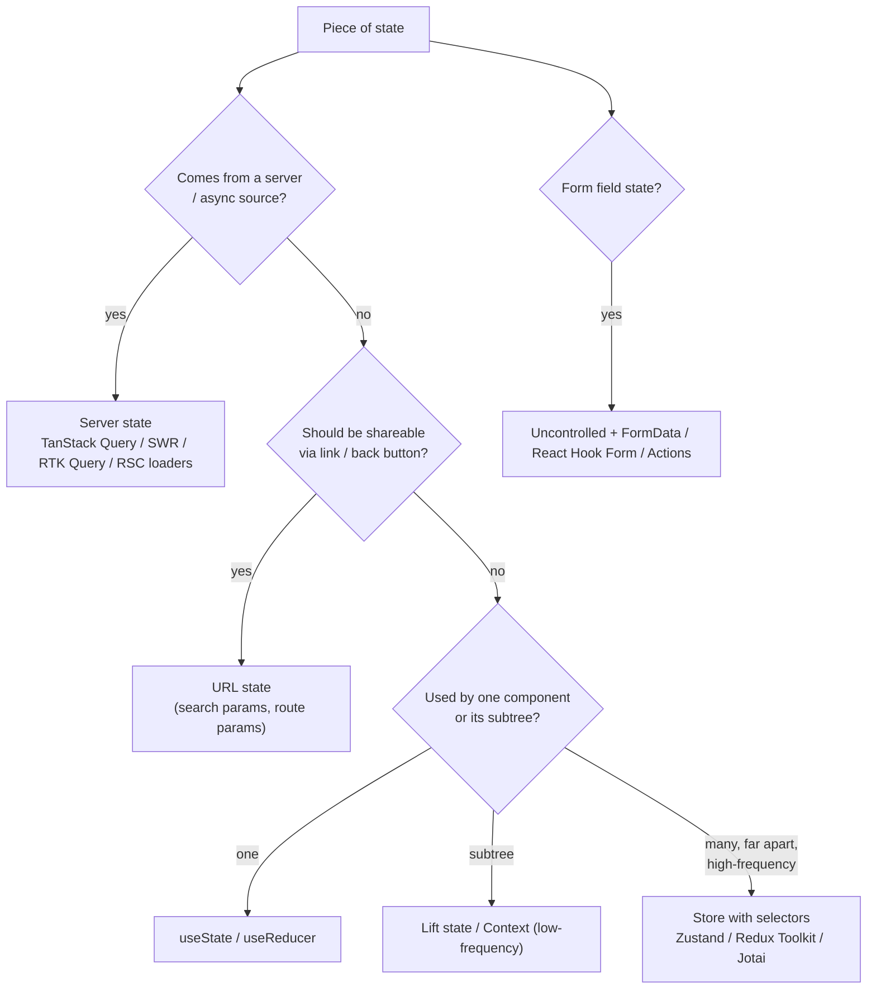
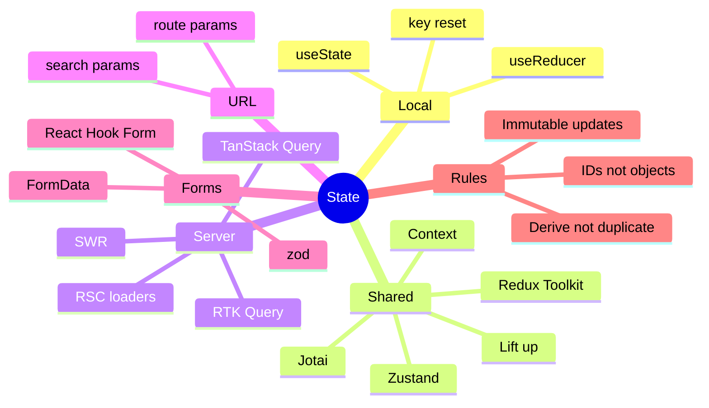

# State Management & Data Fetching in React — Interview Guide

> Verified against react.dev (React 19.x) and the TanStack Query v5 / Redux Toolkit / Zustand v5 documentation conventions. Library-version-sensitive facts are marked **[v5]** etc. Check the library docs before quoting defaults in an interview if your version differs.
> Related: [02-hooks-deep-dive.md](02-hooks-deep-dive.md) (context, `useReducer`, `useSyncExternalStore`), [04-react-19-and-beyond.md](04-react-19-and-beyond.md) (Actions, `useOptimistic`), [05-server-components-and-server-functions.md](05-server-components-and-server-functions.md). React Native specifics: [react-native/04-app-architecture-and-production-concerns.md](../react-native/04-app-architecture-and-production-concerns.md).

## Table of Contents

1. [Quick Summary (TL;DR)](#1-quick-summary-tldr)
2. [A Taxonomy of State](#2-a-taxonomy-of-state)
3. [Local State, Lifting, Colocation](#3-local-state-lifting-colocation)
4. [Context and `useReducer` as a State Solution](#4-context-and-usereducer-as-a-state-solution)
5. [Global Client State Libraries](#5-global-client-state-libraries)
6. [Server State: TanStack Query, SWR, RTK Query](#6-server-state-tanstack-query-swr-rtk-query)
7. [Data Fetching Patterns and Pitfalls](#7-data-fetching-patterns-and-pitfalls)
8. [Mutations, Optimistic Updates, Cache Invalidation](#8-mutations-optimistic-updates-cache-invalidation)
9. [Pagination, Infinite Scroll, Real-Time Updates](#9-pagination-infinite-scroll-real-time-updates)
10. [URL State and Form State](#10-url-state-and-form-state)
11. [Normalisation, Derived State, Immutability](#11-normalisation-derived-state-immutability)
12. [Persistence, Offline, Auth Token Refresh](#12-persistence-offline-auth-token-refresh)
13. [Choosing: A Decision Framework](#13-choosing-a-decision-framework)
14. [Common Mistakes and Pitfalls](#14-common-mistakes-and-pitfalls)
15. [Performance Considerations](#15-performance-considerations)
16. [Trade-offs and Alternatives](#16-trade-offs-and-alternatives)
17. [Interview Questions — Fundamentals](#17-interview-questions--fundamentals)
18. [Interview Questions — Senior Scenarios](#18-interview-questions--senior-scenarios)
19. [Cheat Sheet](#19-cheat-sheet)
20. [Key Terms Glossary](#20-key-terms-glossary)
21. [Further Reading](#21-further-reading)

---

## 1. Quick Summary (TL;DR)

- **Most "state management problems" are really server-cache problems.** Separate **server state** (async, shared, can go stale) from **client state** (synchronous, owned by the UI). Use a server-state library (TanStack Query, SWR, RTK Query, or framework loaders/RSC) for the former.
- **Colocate state** as close as possible to where it's used; lift only when siblings need it; reach for a global store last.
- **Context is dependency injection, not a state manager**: no selectors → all consumers re-render. Great for theme/locale/auth/feature flags.
- **Global client state** → Redux Toolkit (large teams, strict patterns, devtools, middleware), Zustand (minimal, hook-first, selectors), Jotai (atomic, derived), XState (complex workflows/state machines).
- **URL is state too**: filters, sorting, pagination, tabs belong in the URL for shareability and back button.
- **Derive, don't duplicate.** Never copy server data into `useState` just to render it.
- **Mutations** need pending/error handling, **invalidation** or cache updates, optional **optimistic** UI with rollback.



---

## 2. A Taxonomy of State

| Kind | Examples | Lives in | Characteristics |
|---|---|---|---|
| **UI/local state** | open/closed, hover, input draft, selected tab | `useState` | Synchronous, ephemeral |
| **Shared client state** | cart before checkout, wizard progress, theme, selection across panes | Context/store | Synchronous, cross-component |
| **Server state (cache)** | users, products, feed | TanStack Query/SWR/RSC | Async, shared, **stale**, needs invalidation/refetch, dedupe |
| **URL state** | `?q=shoes&page=2&sort=price` | Router | Shareable, bookmarkable |
| **Form state** | values, touched, errors | RHF/Actions/`FormData` | Validation, dirty tracking |
| **Derived state** | filtered list, totals | Computed during render/selectors | Never stored |
| **Persistent state** | auth token, preferences, drafts | localStorage/IndexedDB/secure storage | Survives reloads, SSR hazards |
| **Ephemeral real-time** | presence, live cursor | WebSocket → store/cache | High-frequency |

The most common anti-pattern is putting **server state into Redux/Context by hand**: you re-implement caching, loading flags, invalidation, dedupe, retries, race handling — badly.

---

## 3. Local State, Lifting, Colocation

### Principles (react.dev "Managing State")
1. **Group related state** into one object/reducer if it always changes together.
2. **Avoid contradictions**: use a status union (`'idle' | 'loading' | 'success' | 'error'`) instead of `isLoading` + `isError` + `isSuccess`.
3. **Avoid redundant state**: if it can be computed from props/state, compute it.
4. **Avoid duplication**: store an **ID** (`selectedId`) not the object (`selectedItem`) so it never goes stale.
5. **Avoid deeply nested state**: normalise.
6. **Lift state up** to the nearest common ancestor; **push state down** to reduce re-renders.
7. **Preserve/reset state** with position and `key`.

```tsx
// Stale-prone
const [selectedItem, setSelectedItem] = useState<Item | null>(null);
// Robust: store id, derive item
const [selectedId, setSelectedId] = useState<string | null>(null);
const selectedItem = items.find((i) => i.id === selectedId) ?? null;
```

### Discriminated union for async UI state
```tsx
type AsyncState<T> =
  | { status: "idle" }
  | { status: "loading" }
  | { status: "success"; data: T }
  | { status: "error"; error: Error };
```
TypeScript then **narrows** so `data` is only accessible when `status === "success"`: impossible states become unrepresentable.

---

## 4. Context and `useReducer` as a State Solution

```tsx
type Action = { type: "add"; item: Item } | { type: "remove"; id: string } | { type: "clear" };
type CartState = { items: Item[] };

function reducer(state: CartState, action: Action): CartState {
  switch (action.type) {
    case "add":    return { items: [...state.items, action.item] };
    case "remove": return { items: state.items.filter((i) => i.id !== action.id) };
    case "clear":  return { items: [] };
  }
}

const CartStateContext = createContext<CartState | null>(null);
const CartDispatchContext = createContext<React.Dispatch<Action> | null>(null);

export function CartProvider({ children }: { children: React.ReactNode }) {
  const [state, dispatch] = useReducer(reducer, { items: [] });
  return (
    <CartDispatchContext value={dispatch}>
      <CartStateContext value={state}>{children}</CartStateContext>
    </CartDispatchContext>
  );
}

export function useCart() {
  const s = use(CartStateContext);
  if (!s) throw new Error("useCart must be used within CartProvider");
  return s;
}
export const useCartDispatch = () => {
  const d = use(CartDispatchContext);
  if (!d) throw new Error("useCartDispatch must be used within CartProvider");
  return d;
};
```

**When it's enough:** low-frequency updates, small trees, no need for devtools/middleware.
**When it hurts:** high-frequency updates (typing, drag, real-time), large consumer sets, need for selectors or async orchestration → move to a store with selectors.

---

## 5. Global Client State Libraries

### 5.1 Redux Toolkit (RTK)

```ts
import { configureStore, createSlice, PayloadAction, createSelector } from "@reduxjs/toolkit";

const cartSlice = createSlice({
  name: "cart",
  initialState: { items: [] as CartItem[] },
  reducers: {
    added(state, a: PayloadAction<CartItem>) { state.items.push(a.payload); },     // Immer: "mutating" syntax, immutable result
    removed(state, a: PayloadAction<string>) { state.items = state.items.filter((i) => i.id !== a.payload); },
  },
});

export const store = configureStore({ reducer: { cart: cartSlice.reducer } });
export type RootState = ReturnType<typeof store.getState>;
export type AppDispatch = typeof store.dispatch;

export const selectTotal = createSelector([(s: RootState) => s.cart.items], (items) =>
  items.reduce((sum, i) => sum + i.price * i.qty, 0)
);
```
- **Strengths:** predictable unidirectional flow, time-travel devtools, middleware (listener middleware, thunks), normalised entities (`createEntityAdapter`), RTK Query for server state, great for big teams/enterprise with conventions.
- **Costs:** more boilerplate than Zustand, learning curve, tempting to over-centralise.
- **Internals:** `useSelector` subscribes via `useSyncExternalStore`; a component re-renders only if the selector's result changes by `===` (use memoized selectors for derived arrays/objects).
- **Rule:** keep the store **serialisable** and reducers **pure**; side effects go to thunks/listeners/RTK Query.

### 5.2 Zustand **[v5]**

```ts
import { create } from "zustand";
import { useShallow } from "zustand/react/shallow";

type Store = { count: number; user: User | null; inc: () => void; setUser: (u: User | null) => void };

export const useStore = create<Store>()((set) => ({
  count: 0,
  user: null,
  inc: () => set((s) => ({ count: s.count + 1 })),
  setUser: (user) => set({ user }),
}));

// Subscribe with a selector => component re-renders only when this slice changes
const count = useStore((s) => s.count);
// Selecting an object/array: use useShallow, otherwise a new reference each time (v5: can loop/rerender)
const { count: c, inc } = useStore(useShallow((s) => ({ count: s.count, inc: s.inc })));
```
- No provider needed, tiny API, works outside React (`useStore.getState()`), middleware (`persist`, `devtools`, `immer`).
- **Pitfalls:** selecting the whole store (`useStore()`) re-renders on any change; stores as module singletons leak between requests in SSR — create per-request stores for server rendering (provider pattern).

### 5.3 Jotai (atomic)
Bottom-up state: small `atom`s composed into derived atoms; components subscribe to exactly the atoms they read. Great for fine-grained updates and derived state graphs; can be harder to reason about globally than a central store.

### 5.4 XState (state machines)
Model **workflows with explicit states and transitions** (checkout, onboarding, media players, multi-step forms with guards) so impossible states cannot occur; great for complex async orchestration and testing via model-based tests.

### 5.5 Others
MobX (observable, mutable-style), Valtio (proxy), Redux (legacy `createStore` — prefer RTK), Recoil (check maintenance status before choosing).

### Comparison

| | Context+reducer | Redux Toolkit | Zustand | Jotai | XState |
|---|---|---|---|---|---|
| Boilerplate | Medium | Medium-high | Low | Low | Medium |
| Selectors / fine-grained re-render | No | Yes | Yes | Yes (per atom) | Yes (selectors) |
| DevTools | React DevTools | Excellent (time travel) | Redux DevTools middleware | Devtools | Inspector |
| Middleware / side effects | DIY | Thunks, listeners, RTK Query | Middleware | Async atoms | Built-in (actors) |
| Scales with team size | Poorly | Very well | Well with conventions | Well | Well for flows |
| SSR safety | Provider per request | Provider per request | Provider pattern needed | Provider per request | Per-instance |

---

## 6. Server State: TanStack Query, SWR, RTK Query

### Why a dedicated server-state tool
Server data is **owned elsewhere** and becomes **stale**. You need: caching by key, request **deduplication**, **background refetch** (focus/reconnect/interval), **retry** with backoff, **pagination/infinite**, **mutations + invalidation**, **optimistic updates**, **garbage collection**, **devtools**, **SSR hydration**.

### TanStack Query essentials **[v5]**

```tsx
import { useQuery, useMutation, useQueryClient, keepPreviousData } from "@tanstack/react-query";

const todosKeys = {
  all: ["todos"] as const,
  list: (filters: Filters) => [...todosKeys.all, "list", filters] as const,
  detail: (id: string) => [...todosKeys.all, "detail", id] as const,
};

function useTodos(filters: Filters) {
  return useQuery({
    queryKey: todosKeys.list(filters),                       // cache identity — include every variable the fetcher uses
    queryFn: ({ signal }) => api.getTodos(filters, { signal }), // signal -> automatic cancellation
    staleTime: 30_000,                                       // fresh for 30s: no refetch on mount/focus
    placeholderData: keepPreviousData,                       // v5 replacement for keepPreviousData option
  });
}
```

Key concepts:
- **`staleTime`** (default `0`): how long data is considered **fresh**. Fresh data is served without refetch.
- **`gcTime`** (default 5 min; **renamed from `cacheTime` in v5**): how long **unused** (no observers) data stays in cache before garbage collection.
- **Status vs fetchStatus**: `status` = `pending | error | success` (do we have data?), `fetchStatus` = `fetching | paused | idle`. In v5 `isPending` replaces the old "no data yet" `isLoading`; `isLoading` now means `isFetching && isPending`.
- **Query keys** are hashed deterministically; changing the key creates a new cache entry; arrays/objects are compared structurally.
- **Structural sharing**: unchanged parts of refetched data keep references so memoized children don't re-render.
- **Defaults:** `refetchOnWindowFocus`, `refetchOnReconnect`, `refetchOnMount` true (when stale); `retry: 3` with exponential backoff on the client.
- **`select`** to transform/derive and limit re-renders to when the selected output changes.
- **`enabled: false`** for dependent queries (e.g. wait for `userId`).
- **`useSuspenseQuery`** for Suspense-based loading (no `undefined` data), pairs with Error Boundaries + `QueryErrorResetBoundary`.
- v5 removed `onSuccess/onError/onSettled` from `useQuery`; use effects/`select`/mutation callbacks or the QueryCache global callbacks. `useErrorBoundary` → `throwOnError`.

### Server rendering / RSC integration
- **Prefetch** on the server (`queryClient.prefetchQuery`), **dehydrate**, and `HydrationBoundary` on the client so the first render has data and no refetch flash (set `staleTime > 0`).
- With RSC you can also pass a **promise** from a Server Component and `use()` it, or let the server render and keep TanStack Query for interactive client data.
- Create a **new `QueryClient` per request** on the server to avoid sharing data between users.

### SWR
Lighter API: `useSWR(key, fetcher)`, stale-while-revalidate semantic, focus revalidation, `mutate`. Fewer features than TanStack Query out of the box (infinite via `useSWRInfinite`, mutation via `useSWRMutation`).

### RTK Query
Part of Redux Toolkit: `createApi` with endpoints (queries/mutations), tag-based invalidation (`providesTags`/`invalidatesTags`), auto-generated hooks, cache lifecycle. Best choice if you already use Redux Toolkit.

### Framework alternatives
Next.js/RSC fetch + caching, React Router loaders/actions, Relay (GraphQL, normalised cache, fragments), Apollo Client / urql (GraphQL normalised caches).

---

## 7. Data Fetching Patterns and Pitfalls

### Fetch-on-render vs fetch-then-render vs render-as-you-fetch

| Pattern | How | Problem/benefit |
|---|---|---|
| Fetch on render (`useEffect`) | Component renders → effect fetches | **Waterfalls**; flicker; races |
| Fetch then render | Page waits for all data | Blank until slowest request |
| **Render as you fetch** | Start fetch at route/event, render with Suspense/`use` | Parallel, progressive |
| **Server fetch (RSC/loaders)** | Fetch next to data, stream | Fewer client waterfalls |

### Race conditions
```tsx
useEffect(() => {
  const controller = new AbortController();
  fetch(`/api/search?q=${q}`, { signal: controller.signal }).then(r => r.json()).then(setResults).catch(ignoreAbort);
  return () => controller.abort();       // stale request can't overwrite newer results
}, [q]);
```
TanStack Query handles this via query keys and `signal`.

### Avoiding waterfalls
- **Prefetch** (hover/intent, route loaders, `queryClient.prefetchQuery`).
- **Parallel** (`Promise.all`, `useQueries`, sibling Suspense boundaries).
- **Colocate data requirements but hoist the fetch** (route-level loaders, Relay fragments, RSC).
- **Backend-for-frontend** aggregator to cut chatty client→service calls.

### Error handling strategy
Classify: network/offline, 4xx (validation, auth, not found), 5xx. Retry only idempotent/transient errors; surface actionable UI; central error mapping; report to monitoring; Error Boundary for unrecoverable.

### Retries with backoff and jitter
```ts
async function withRetry<T>(fn: () => Promise<T>, tries = 3) {
  for (let i = 0; ; i++) {
    try { return await fn(); }
    catch (e) {
      if (i >= tries - 1 || !isRetryable(e)) throw e;
      await new Promise((r) => setTimeout(r, Math.min(1000 * 2 ** i, 8000) * (0.5 + Math.random() / 2)));
    }
  }
}
```

### Request deduplication & caching
Same key in-flight → one request (TanStack Query/SWR). HTTP caching (`Cache-Control`, `ETag`, `stale-while-revalidate`) complements app-level caching.

---

## 8. Mutations, Optimistic Updates, Cache Invalidation

### Mutation with invalidation
```tsx
const qc = useQueryClient();
const addTodo = useMutation({
  mutationFn: (t: NewTodo) => api.createTodo(t),
  onSuccess: () => qc.invalidateQueries({ queryKey: todosKeys.all }),   // refetch active queries
});
```

### Optimistic update with rollback (cache-based)
```tsx
const toggle = useMutation({
  mutationFn: (id: string) => api.toggleTodo(id),
  onMutate: async (id) => {
    await qc.cancelQueries({ queryKey: todosKeys.all });                 // avoid in-flight refetch overwriting
    const previous = qc.getQueryData<Todo[]>(todosKeys.list(filters));
    qc.setQueryData<Todo[]>(todosKeys.list(filters), (old) => old?.map((t) => t.id === id ? { ...t, done: !t.done } : t));
    return { previous };
  },
  onError: (_e, _id, ctx) => qc.setQueryData(todosKeys.list(filters), ctx?.previous),   // rollback
  onSettled: () => qc.invalidateQueries({ queryKey: todosKeys.all }),                    // reconcile with truth
});
```
**Alternatives:** React 19 `useOptimistic` (local, UI-only, auto-revert) vs cache-based (shared across components). TanStack Query v5 also supports "optimistic via variables" (render `mutation.variables` while pending).

### Invalidation strategies
- **Tag/key based** (TanStack/RTK): invalidate `['todos']` after any mutation touching todos.
- **Direct cache update** (`setQueryData`) when the mutation returns the updated entity: avoids a refetch.
- **Server push** (WebSocket/SSE) → `invalidateQueries`/`setQueryData`.
- **Time-based** (`staleTime`, polling) for low-stakes data.
- Beware **over-invalidation** (refetch storms) and **under-invalidation** (stale UI).

### Idempotency
Use client-generated idempotency keys for create operations so retries/double-submits don't duplicate.

---

## 9. Pagination, Infinite Scroll, Real-Time Updates

### Offset vs cursor pagination
| | Offset (`?page=3`) | Cursor (`?after=abc`) |
|---|---|---|
| Simplicity | High | Medium |
| Stability under inserts/deletes | Rows can shift/duplicate/skip | Stable |
| Performance on large tables | Degrades (`OFFSET N`) | Efficient (indexed) |
| Jump to page N | Yes | No |
| Best for | Admin tables | Feeds, infinite scroll |

### Infinite query **[v5]**
```tsx
const q = useInfiniteQuery({
  queryKey: ["feed"],
  queryFn: ({ pageParam, signal }) => api.getFeed({ cursor: pageParam }, { signal }),
  initialPageParam: null as string | null,                   // required in v5
  getNextPageParam: (last) => last.nextCursor ?? undefined,
});
const items = q.data?.pages.flatMap((p) => p.items) ?? [];
// Trigger fetchNextPage with IntersectionObserver; virtualise large lists; cap maxPages for memory.
```

### Real-time
- **Polling** (`refetchInterval`) — simplest, wasteful.
- **SSE** — one-way server push, auto-reconnect, works over HTTP/2.
- **WebSocket** — bi-directional, low latency; need heartbeat/reconnect/backoff, auth, fan-out.
- Integrate by **patching the cache** (`setQueryData`) or **invalidating**; throttle bursts; reconcile on reconnect (refetch since last event ID).

---

## 10. URL State and Form State

### URL as state
```tsx
const [params, setParams] = useSearchParams();   // react-router; or Next `useSearchParams`, nuqs for type-safe state
const q = params.get("q") ?? "";
const page = Number(params.get("page") ?? 1);
```
Benefits: shareable links, back/forward, SSR-friendly, refresh-safe. Pitfalls: **parse and validate** (users can type anything), debounce writes while typing, don't store sensitive/large data, keep keys stable for caching.

### Form state
| Option | Use |
|---|---|
| Uncontrolled + `FormData` / React 19 `<form action>` | Simple/medium forms; progressive enhancement |
| **React Hook Form** (uncontrolled, ref-based) | Large/complex forms, dynamic fields, performance |
| Controlled `useState` | Inputs driving other UI live |
| TanStack Form/Formik | Alternatives |
| Schema validation (zod/valibot/yup) | Single schema for client + server |

---

## 11. Normalisation, Derived State, Immutability

### Normalise nested/relational data
```ts
// Nested duplicates -> hard to update
{ posts: [{ id: 1, author: { id: 7, name: "A" } }, { id: 2, author: { id: 7, name: "A" } }] }
// Normalised
{ posts: { byId: { 1: { id: 1, authorId: 7 }, 2: { id: 2, authorId: 7 } }, ids: [1, 2] },
  users: { byId: { 7: { id: 7, name: "A" } } } }
```
Single source of truth per entity; O(1) updates; use `createEntityAdapter` (RTK) or Relay/Apollo normalised caches. For server state libraries with per-query caches, normalise only if cross-query consistency issues are real.

### Derived state & selectors
Compute with selectors/`useMemo`/Compiler; memoize with `createSelector`; avoid storing derived data. Selector returning a **new array each call** (`.filter()` inside `useSelector`) triggers re-render every dispatch — memoize or move out.

### Immutability
Spread/`structuredClone`/**Immer** (`produce`, RTK slices, Zustand `immer` middleware). Immutability enables cheap reference equality checks for memoization and change detection.

---

## 12. Persistence, Offline, Auth Token Refresh

- **Persisting**: Redux Persist, Zustand `persist`, TanStack Query `persistQueryClient` (IndexedDB/AsyncStorage). Version and migrate persisted schemas; never persist sensitive tokens in `localStorage` for web (XSS) — prefer **HttpOnly, Secure, SameSite cookies**; on React Native use Keychain/Keystore.
- **SSR hazard**: reading `localStorage` during render causes hydration mismatch — read in an effect or use `useSyncExternalStore` with `getServerSnapshot`.
- **Offline-first**: queue mutations (TanStack Query `networkMode`, `onlineManager`, resumable mutations), local DB (IndexedDB/SQLite/WatermelonDB), conflict resolution (last-write-wins, version vectors, CRDTs).
- **Token refresh** pattern: single-flight refresh to avoid stampedes.

```ts
let refreshing: Promise<string> | null = null;
async function authFetch(input: RequestInfo, init: RequestInit = {}): Promise<Response> {
  const res = await fetch(input, { ...init, headers: { ...init.headers, Authorization: `Bearer ${getToken()}` } });
  if (res.status !== 401) return res;
  refreshing ??= refreshToken().finally(() => { refreshing = null; });   // all concurrent 401s share one refresh
  const token = await refreshing;
  return fetch(input, { ...init, headers: { ...init.headers, Authorization: `Bearer ${token}` } });
}
```

---

## 13. Choosing: A Decision Framework

| Situation | Recommendation |
|---|---|
| Small app, few shared values | `useState` + lifting + Context |
| Data-heavy app calling REST/GraphQL | TanStack Query (or RTK Query/Apollo/Relay) |
| Large team, complex client logic, audit/devtools | Redux Toolkit (+ RTK Query) |
| Minimal global UI state, hook ergonomics | Zustand |
| Derived-state graphs, fine-grained | Jotai |
| Complex multi-step workflow | XState (or reducer with status unions) |
| SEO/content app with RSC | Server Components + minimal client state |
| Real-time collaboration | Server-authoritative + WebSocket + CRDT/OT library (Yjs/Automerge) |
| React Native | TanStack Query + Zustand/Redux Toolkit + MMKV/SQLite persistence |

---

## 14. Common Mistakes and Pitfalls

| Mistake | Consequence | Fix |
|---|---|---|
| Copying query data into `useState` | Stale/duplicate state | Use query data directly; derive |
| Putting everything in Redux/Context | Boilerplate, re-render storms | Taxonomy; use server-state tool |
| Query key missing a variable | Wrong cached data shown | Include all fetcher inputs in key |
| `staleTime: 0` everywhere | Refetch storms on mount/focus | Choose `staleTime` per data volatility |
| Mutating cache/store objects | Missed re-renders, corrupted cache | Immutable updates |
| Selecting whole store/new objects in selectors | Excess re-renders/loops | Narrow selectors, `useShallow`, memoize |
| Provider value recreated each render | All consumers re-render | Memoize / Compiler |
| Optimistic update without `cancelQueries` | In-flight refetch overwrites optimistic data | Cancel then set |
| Optimistic update with no rollback | UI lies after error | `onError` restore + invalidate |
| Global singleton store/QueryClient on the server | Data leaks between users | Per-request instances |
| Storing tokens in localStorage | XSS theft | HttpOnly cookies/secure storage |
| Not handling out-of-order responses | Stale UI | Abort/keys/sequence IDs |
| Deep-nested state with manual spread | Bugs/verbosity | Normalise/Immer |
| Reading `localStorage` in render (SSR) | Hydration mismatch | Effect or `useSyncExternalStore` w/ server snapshot |

---

## 15. Performance Considerations

- **Selector granularity** determines re-render scope; prefer primitive selections or `shallow` equality.
- **Context** re-renders all consumers; split or replace.
- **Server-state libraries** dedupe requests, share caches and use structural sharing, drastically reducing network and render churn.
- **`select`** option reduces re-renders to when the selected value changes.
- **Large lists in state**: normalise, virtualise, paginate; cap `maxPages` for infinite queries.
- **Batch updates**: React 18+ batches automatically; for stores use a single `set` for related changes.
- **Avoid serialising huge state** to storage on every change: throttle/debounce persistence.
- **Prefetch** on hover/viewport for perceived speed; avoid prefetch storms.
- **Memoize selectors** (`createSelector`, Reselect) for expensive derivations.
- Profile with React DevTools (why did it render), Redux DevTools (action frequency), and TanStack Query Devtools (refetch counts).

---

## 16. Trade-offs and Alternatives

| Decision | Option A | Option B | Notes |
|---|---|---|---|
| Server state | TanStack Query | RSC/loaders only | Combine: server-render first paint, Query for interactivity |
| Global store | Redux Toolkit | Zustand | RTK = structure, ecosystem; Zustand = brevity |
| Granularity | Central store | Atoms (Jotai) | Atoms fine-grained but dispersed |
| Mutations | Cache invalidation | Direct `setQueryData` | Invalidate = simple/safe; set = fewer requests |
| Form handling | Controlled | Uncontrolled/RHF | Uncontrolled scales |
| Normalised cache | Apollo/Relay | Per-query cache (TanStack) | Normalisation helps cross-entity consistency but adds complexity |
| Real-time | Polling | WebSocket/SSE | Simplicity vs latency/cost |

---

## 17. Interview Questions — Fundamentals

### Q1. What's the difference between server state and client state?
Server state is asynchronous, remote, shared and can become stale; it needs caching, invalidation, refetching and dedupe. Client state is synchronous and owned by the UI. Use different tools for each.

### Q2. When should you use Context vs a state library?
Context for low-frequency, widely needed values (theme, locale, auth user, feature flags). For high-frequency or large state with many consumers, context re-renders every consumer on any change, so use a store with selectors.

### Q3. Why not put everything into Redux?
Over-centralising produces boilerplate and couples unrelated modules; server data should live in a cache library; local UI state belongs near components; URL state belongs in the router.

### Q4. Explain `staleTime` vs `gcTime` in TanStack Query.
`staleTime`: how long fetched data is considered fresh (no refetch triggers). `gcTime`: how long inactive cached data is retained before removal (renamed from `cacheTime` in v5).

### Q5. What is a query key and why does it matter?
The cache identity of a query; it must include every variable the query function depends on. Changing the key fetches/caches separately; keys power invalidation and dedupe.

### Q6. `isLoading` vs `isFetching` vs `isPending` (v5)?
`isPending`: no data yet. `isFetching`: any fetch in progress (including background refetch). `isLoading` = `isFetching && isPending` (first load).

### Q7. How do you do optimistic updates safely?
Cancel in-flight queries, snapshot previous data, write optimistic data, rollback on error, invalidate on settle. Or use React 19 `useOptimistic` for local UI.

### Q8. What's normalised state and why use it?
Store entities by ID with references to avoid duplication and ease updates; essential for relational data in stores.

### Q9. Why is `useSelector(state => state.items.filter(...))` a problem?
It returns a new array each time, failing reference equality → re-render on every store update. Memoize the selector (`createSelector`) or filter in the component with `useMemo`.

### Q10. How do you avoid prop drilling?
Composition (pass components/children), Context, or a store; prefer composition first.

### Q11. How would you cancel an API call in React?
`AbortController` passed to `fetch`; TanStack Query passes `signal` to `queryFn` for automatic cancel on unmount/key change.

### Q12. Why store IDs rather than objects in state?
Avoid stale copies; derive the object from the source of truth on render.

### Q13. What's URL state and when should filters live there?
State encoded in the URL (search/path params). Filters, sort, pagination, selected tab — anything that should be shareable/bookmarkable and survive refresh.

### Q14. How do you handle global loading/error states?
Don't create global flags for each request; use per-query status, `useIsFetching` for a global indicator, Suspense/Error Boundaries for boundary-level UX, and central error reporting.

### Q15. What is single-flight token refresh?
Concurrent 401s share a single refresh request promise so the refresh token isn't used multiple times (which could trigger reuse detection/logouts).

---

## 18. Interview Questions — Senior Scenarios

### S1. "Design state management for a large e-commerce app."
- **Server state**: products, cart (server-authoritative), orders → TanStack Query (or RSC for catalog pages) with careful `staleTime` (catalog long, cart short), prefetch on hover, structured query keys.
- **Client state**: UI filters in the **URL**, ephemeral UI in `useState`, cross-cutting UI (modals/toasts/sidebar) in Zustand, auth in Context + httpOnly cookie session.
- **Cart**: optimistic add with rollback; server idempotency; local persisted guest cart merged on login.
- **Forms**: RHF + zod (shared schema with server), checkout wizard as XState/reducer.
- **Real-time**: stock updates via SSE → `setQueryData`/invalidate.
- **Observability**: Sentry, Web Vitals, Query devtools in dev.
Explain why not Redux for everything and where Redux Toolkit could be justified (large team standardisation).

### S2. "A list screen refetches every time the user navigates back. Diagnose."
Check `staleTime` (0 default), `gcTime` (cache evicted), `refetchOnMount`, query key instability (object recreated with different order? TanStack hashes deterministically, but e.g., including a changing timestamp breaks it), whether the component remounts the `QueryClientProvider` or creates a new `QueryClient` each render, and navigation caching (framework router). Fix: sensible `staleTime`, single `QueryClient` instance (`useState(() => new QueryClient())`), stable keys, route-level prefetch, scroll restoration.

### S3. "Two components show different values for the same user after an update."
Likely duplicated state (copied into local state) or separate caches/keys. Resolve by a single source of truth (same query key or normalised entity), invalidate or `setQueryData` on mutation success, derive displays from the cache, avoid copying into `useState` (or reset with `key`).

### S4. "Implement undo for deletions in a table with server persistence."
Optimistically remove (cache update) and show a toast with Undo for N seconds; delay the actual DELETE (or soft delete server-side with `deletedAt` and restore endpoint). On Undo: restore from snapshot/cancel timer. On timeout: send DELETE; on failure: rollback and notify. Handle navigation away (flush pending on `beforeunload`/unmount), idempotent delete, and permissions.

### S5. "How do you keep a WebSocket feed and a REST cache consistent?"
Treat the cache as the single source; apply events by ID with versioning (`updatedAt`/sequence). On connect and reconnect, **refetch since last event ID** to close gaps; coalesce bursts (throttle `setQueryData`); drop out-of-order events (older version); fall back to invalidation if event shape unknown; unsubscribe on unmount; backoff/jitter reconnect.

### S6. "Zustand store works in dev but users see each other's data in SSR. Why?"
A module-level store is a singleton in the Node process shared across requests. Create a **store per request** (factory + provider using `useRef`/`useState` initialiser) and pass initial state; same for `QueryClient`.

### S7. "Reduce re-renders caused by a global store used by 200 components."
Use narrow selectors; `useShallow` for object picks; split store into slices; move rarely-changing data to separate stores; avoid subscribing to whole store; memoize derived selectors; pass IDs to children and let each child select its own entity; batch updates; verify with Profiler; consider atoms for per-item state.

### S8. "How do you migrate a Redux app that manually stores API responses to TanStack Query?"
Inventory slices holding server data; for each, create query hooks and keys; replace `useSelector` + thunks with `useQuery`/`useMutation`; keep Redux for true client state; migrate feature by feature behind the same hook interface (`useProducts()`), add tests, remove dead slices. Benefits: less code, caching, dedupe, fewer bugs. Risks: parity of loading/error UX and cache invalidation rules — test them.

---

## 19. Cheat Sheet



| Symptom | Fix |
|---|---|
| Stale UI after mutation | `invalidateQueries` / `setQueryData` |
| Too many re-renders | Narrow selectors, split context, memo |
| Waterfalls | Prefetch, parallel, loaders/RSC |
| Race conditions | AbortController/query keys |
| Data leaks across users (SSR) | Per-request stores/clients |
| Refetch storms | Tune `staleTime`, `refetchOnWindowFocus` |

---

## 20. Key Terms Glossary

| Term | Definition |
|---|---|
| Server state | Remote, async, shareable data that can go stale |
| Stale-while-revalidate | Serve cached data immediately, refetch in background |
| Query key | Cache identity of a query |
| Invalidation | Marking cached data stale to trigger refetch |
| Optimistic update | Updating UI before the server confirms, with rollback |
| Normalisation | Storing entities by ID to avoid duplication |
| Selector | Function deriving data from state, enabling targeted subscriptions |
| Structural sharing | Reusing unchanged object references across updates |
| Hydration (query) | Seeding client cache from server-fetched data |
| Idempotency key | Token making repeated requests safe |

---

## 21. Further Reading

- [Managing State (react.dev)](https://react.dev/learn/managing-state) · [Scaling Up with Reducer and Context](https://react.dev/learn/scaling-up-with-reducer-and-context)
- [TanStack Query docs](https://tanstack.com/query/latest) (Important Defaults, Optimistic Updates, SSR/Hydration, v5 migration)
- [Redux Toolkit docs](https://redux-toolkit.js.org/) · [Zustand docs](https://zustand.docs.pmnd.rs/) · [Jotai docs](https://jotai.org/) · [XState docs](https://stately.ai/docs)
- [`useSyncExternalStore`](https://react.dev/reference/react/useSyncExternalStore)
