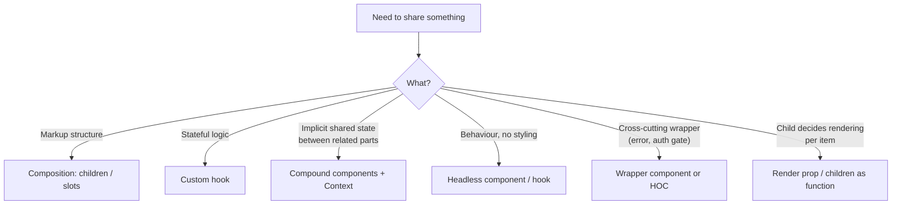
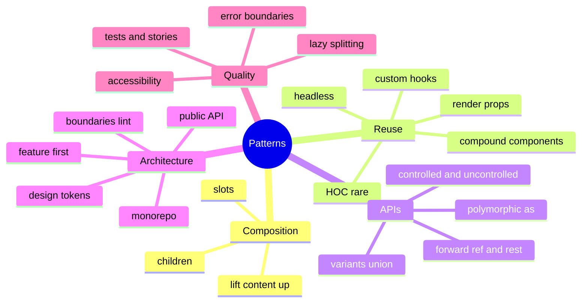

# React Component Patterns & Frontend Architecture — Interview Guide

> Verified against react.dev (React 19.x). Patterns are presented in modern React (function components, hooks, `ref` as a prop **[19.x]**, `<Context>` provider **[19.x]**).
> Related: [02-hooks-deep-dive.md](02-hooks-deep-dive.md), [06-state-management-and-data-fetching.md](06-state-management-and-data-fetching.md). The wider *Frontend Architecture* and *Accessibility* categories of this handbook go deeper on system-level concerns.

## Table of Contents

1. [Quick Summary (TL;DR)](#1-quick-summary-tldr)
2. [Composition Over Inheritance and Props Design](#2-composition-over-inheritance-and-props-design)
3. [Controlled vs Uncontrolled Component APIs](#3-controlled-vs-uncontrolled-component-apis)
4. [Compound Components](#4-compound-components)
5. [Headless Components and the State Reducer Pattern](#5-headless-components-and-the-state-reducer-pattern)
6. [Render Props, HOCs, Custom Hooks: Which When](#6-render-props-hocs-custom-hooks-which-when)
7. [Polymorphic Components and Typing Patterns](#7-polymorphic-components-and-typing-patterns)
8. [Portals, Modals, Focus, and Accessibility Basics](#8-portals-modals-focus-and-accessibility-basics)
9. [Code Splitting and Lazy Loading](#9-code-splitting-and-lazy-loading)
10. [Design System Architecture](#10-design-system-architecture)
11. [Project and Folder Architecture](#11-project-and-folder-architecture)
12. [Classic UI Coding-Round Components](#12-classic-ui-coding-round-components)
13. [Common Mistakes and Pitfalls](#13-common-mistakes-and-pitfalls)
14. [Performance Considerations](#14-performance-considerations)
15. [Trade-offs and Alternatives](#15-trade-offs-and-alternatives)
16. [Interview Questions — Fundamentals](#16-interview-questions--fundamentals)
17. [Interview Questions — Senior Scenarios](#17-interview-questions--senior-scenarios)
18. [Cheat Sheet](#18-cheat-sheet)
19. [Key Terms Glossary](#19-key-terms-glossary)
20. [Further Reading](#20-further-reading)

---

## 1. Quick Summary (TL;DR)

- **Compose, don't inherit.** Reuse via props/children/slots, custom hooks and context, never class inheritance.
- Design component APIs for **the caller**: small surface, sensible defaults, explicit variants (discriminated unions), no boolean-prop explosion.
- Support **both controlled and uncontrolled** usage for reusable inputs (`value`/`defaultValue`/`onChange`).
- **Compound components** (`<Tabs><Tabs.List/>…`) share implicit state through context and give flexible markup.
- **Headless** components/hooks separate **behaviour + accessibility** from **styling** (Radix, React Aria, Headless UI, TanStack Table).
- Prefer **custom hooks** over HOCs/render props for logic reuse; keep HOCs for cross-cutting wrappers (rare); render props when the child needs to render something per item.
- Architect by **feature** (colocation), enforce **dependency direction**, expose a **public API** per module, avoid barrel-file cycles.
- Accessibility is part of the component contract: roles, labels, keyboard, focus management.



---

## 2. Composition Over Inheritance and Props Design

### Concept
React components are composed with **props** (including `children`, and JSX passed as props "slots"). React docs: "At Facebook we use React in thousands of components and haven't found any use cases where we would recommend creating component inheritance hierarchies."

### Slots via props
```tsx
function Card({ header, footer, children }: { header?: React.ReactNode; footer?: React.ReactNode; children: React.ReactNode }) {
  return (
    <section className="card">
      {header && <header>{header}</header>}
      <div>{children}</div>
      {footer && <footer>{footer}</footer>}
    </section>
  );
}
<Card header={<h2>Title</h2>} footer={<Button>Save</Button>}>Body</Card>
```

### Prop design rules
1. **Prefer a few semantic props** over many booleans (`variant="danger"` over `isDanger isOutline isSmall`).
2. **Model impossible states out** with discriminated unions:

```tsx
type ButtonProps =
  | { as?: "button"; onClick: () => void; href?: never }
  | { as: "a"; href: string; onClick?: never };
```
3. **Spread-safe**: forward remaining props and `ref` to the root element (`...rest`, `ref`) so consumers can add `aria-*`, `data-*`, `className`.
4. **Don't mirror props into state** (stale copies). If an initial value is needed, name it `initialX`/`defaultX`.
5. **Callbacks named by intent**: `onSelect`, `onChange`, `onOpenChange` — with minimal payload.
6. **Stable defaults** (avoid `items = []` creating a new array each render if passed to memoized children — define outside).
7. **Children as function** only when you truly need to inject data back.
8. Avoid **prop drilling** through unrelated layers: composition first (pass elements), then context.

### Lifting content up to avoid drilling
```tsx
// Instead of passing `user` through 4 layers
<Layout sidebar={<UserMenu user={user} />}>
  <Content />
</Layout>
```

---

## 3. Controlled vs Uncontrolled Component APIs

A reusable component should work **both ways**, like native inputs.

```tsx
function useControllableState<T>({
  value, defaultValue, onChange,
}: { value?: T; defaultValue: T; onChange?: (v: T) => void }) {
  const [internal, setInternal] = useState(defaultValue);
  const isControlled = value !== undefined;
  const current = isControlled ? value : internal;

  const set = useCallback((next: T) => {
    if (!isControlled) setInternal(next);
    onChange?.(next);
  }, [isControlled, onChange]);

  return [current, set] as const;
}

function Toggle({ pressed, defaultPressed = false, onPressedChange }: {
  pressed?: boolean; defaultPressed?: boolean; onPressedChange?: (p: boolean) => void;
}) {
  const [on, setOn] = useControllableState({ value: pressed, defaultValue: defaultPressed, onChange: onPressedChange });
  return <button aria-pressed={on} onClick={() => setOn(!on)}>{on ? "On" : "Off"}</button>;
}
```

Rules: don't switch between controlled and uncontrolled for the same instance (React warns for inputs); document the contract; fire `onChange` in both modes.

---

## 4. Compound Components

### Concept
A set of components that **work together** and share implicit state (like `<select>` and `<option>`). The parent owns state; children read it through context. The consumer controls structure and order.

```tsx
const TabsContext = createContext<{ value: string; setValue: (v: string) => void } | null>(null);
function useTabs() {
  const ctx = use(TabsContext);
  if (!ctx) throw new Error("Tabs components must be used within <Tabs>");
  return ctx;
}

export function Tabs({ defaultValue, value, onValueChange, children }: {
  defaultValue?: string; value?: string; onValueChange?: (v: string) => void; children: React.ReactNode;
}) {
  const [current, setValue] = useControllableState({ value, defaultValue: defaultValue ?? "", onChange: onValueChange });
  const ctx = useMemo(() => ({ value: current, setValue }), [current, setValue]);
  return <TabsContext value={ctx}>{children}</TabsContext>;
}

Tabs.List = function List({ children }: { children: React.ReactNode }) {
  return <div role="tablist">{children}</div>;
};
Tabs.Trigger = function Trigger({ value, children }: { value: string; children: React.ReactNode }) {
  const { value: active, setValue } = useTabs();
  const selected = active === value;
  return (
    <button role="tab" aria-selected={selected} tabIndex={selected ? 0 : -1} onClick={() => setValue(value)}>
      {children}
    </button>
  );
};
Tabs.Panel = function Panel({ value, children }: { value: string; children: React.ReactNode }) {
  const { value: active } = useTabs();
  return active === value ? <div role="tabpanel">{children}</div> : null;
};

// Usage
<Tabs defaultValue="a">
  <Tabs.List><Tabs.Trigger value="a">A</Tabs.Trigger><Tabs.Trigger value="b">B</Tabs.Trigger></Tabs.List>
  <Tabs.Panel value="a">Panel A</Tabs.Panel>
  <Tabs.Panel value="b">Panel B</Tabs.Panel>
</Tabs>
```

**Pros:** flexible markup, no prop drilling, declarative API. **Cons:** implicit coupling (runtime error if misused), harder static typing, context re-renders all parts when state changes (acceptable for small sets).
**Production tip:** a full tabs component also needs arrow-key navigation (roving tabindex), `aria-controls`/`id` pairing (`useId`), Home/End keys. Prefer a battle-tested headless library in production.

---

## 5. Headless Components and the State Reducer Pattern

### Headless (behaviour without UI)
Provide logic, state and accessibility attributes through hooks or unstyled components; consumers supply markup/styles.

```tsx
function useDisclosure(initial = false) {
  const [open, setOpen] = useState(initial);
  const id = useId();
  return {
    open,
    toggle: () => setOpen((o) => !o),
    getTriggerProps: () => ({ "aria-expanded": open, "aria-controls": id, onClick: () => setOpen((o) => !o) }),
    getPanelProps: () => ({ id, hidden: !open }),
  };
}

function Faq({ q, a }: { q: string; a: string }) {
  const d = useDisclosure();
  return (<><button {...d.getTriggerProps()}>{q}</button><div {...d.getPanelProps()}>{a}</div></>);
}
```
This "prop getters" pattern is used by Downshift, React Aria, TanStack libraries. **Why:** design-system independence, accessibility baked in, testable.

### State reducer pattern
Let consumers **intercept state transitions**:

```tsx
type State = { open: boolean };
type Action = { type: "toggle" } | { type: "close" };
const defaultReducer = (s: State, a: Action): State => a.type === "toggle" ? { open: !s.open } : { open: false };

function useMenu(reducer: (s: State, a: Action, defaults: State) => State = (s, a) => defaultReducer(s, a)) {
  return useReducer((s: State, a: Action) => reducer(s, a, defaultReducer(s, a)), { open: false });
}
// Consumer: keep menu open on "close" if a modal is active
```
Gives **inversion of control** without exploding props.

---

## 6. Render Props, HOCs, Custom Hooks: Which When

| Pattern | Example | Pros | Cons | Today |
|---|---|---|---|---|
| **Custom hook** | `useMediaQuery()` | Simple, composable, typed, no extra nesting | Can't render UI | **Default choice** for logic reuse |
| **Render prop** | `<Virtualizer>{(item) => <Row/>}</Virtualizer>` | Child controls rendering with data from parent | Nesting, inline function churn | Libraries needing per-item rendering |
| **HOC** | `withAuth(Component)` | Wraps cross-cutting concerns, works for classes | Wrapper hell, prop collisions, lost refs/static types, hard to debug | Rare; `memo`/`lazy`/legacy |
| **Wrapper component / children** | `<RequireAuth><Page/></RequireAuth>` | Explicit, readable | One more component | Often better than HOC |
| **Context + hook** | `useTheme()` | Avoids drilling | Re-render breadth | Low-frequency shared data |

```tsx
// HOC (for comparison) — prefer wrapper component + hook today
function withLogger<P extends object>(Wrapped: React.ComponentType<P>) {
  function WithLogger(props: P) { useEffect(() => { console.log("mounted"); }, []); return <Wrapped {...props} />; }
  WithLogger.displayName = `withLogger(${Wrapped.displayName ?? Wrapped.name})`;
  return WithLogger;
}
```

---

## 7. Polymorphic Components and Typing Patterns

### Polymorphic `as` prop
```tsx
type PolymorphicProps<E extends React.ElementType, P = object> = P &
  Omit<React.ComponentPropsWithoutRef<E>, keyof P | "as"> & { as?: E };

function Text<E extends React.ElementType = "span">({ as, ...rest }: PolymorphicProps<E, { size?: "sm" | "md" }>) {
  const Component = as ?? "span";
  return <Component {...rest} />;
}
<Text as="a" href="/x">link</Text>   // href typed because E = "a"
```
Alternative: **`asChild` slot pattern** (Radix `Slot`) merges props into the single child, avoiding complex generics.

### Typing utilities
- `React.ComponentProps<typeof Button>` / `ComponentPropsWithoutRef<"button">` to inherit DOM props.
- `React.ReactNode` for children; `React.ReactElement` when you need an element.
- **Generic components:** `function List<T>({ items, render }: { items: T[]; render: (t: T) => React.ReactNode })`.
- **Discriminated unions** for variants; `never` for mutually exclusive props.
- `satisfies` for config objects: `const routes = {...} satisfies Record<string, RouteDef>` (keeps literal types).
- **[React 19 types]** `ref` is a prop: `React.ComponentProps<"input">` includes `ref`; `useRef<T>(null)` / `useRef<T | undefined>(undefined)`.
- Event types: `React.ChangeEvent<HTMLInputElement>`, `React.FormEvent<HTMLFormElement>`; prefer inline handlers for inference.

---

## 8. Portals, Modals, Focus, and Accessibility Basics

### Modal checklist
1. Render in a **portal** (`createPortal`) to escape stacking/overflow.
2. `role="dialog"` + `aria-modal="true"` + `aria-labelledby` (title).
3. **Focus management:** move focus into the dialog on open, **trap** Tab inside, **restore** focus to the trigger on close.
4. **Escape** closes; click on backdrop closes (if appropriate).
5. **Scroll lock** on `body`; make background **inert** (`inert` attribute / `aria-hidden`).
6. Prefer the native **`<dialog>` element** with `showModal()` — built-in focus trap, `Esc`, top layer, `::backdrop`.

```tsx
function Modal({ open, onClose, title, children }: { open: boolean; onClose: () => void; title: string; children: React.ReactNode }) {
  const ref = useRef<HTMLDialogElement>(null);
  const titleId = useId();

  useEffect(() => {
    const dialog = ref.current;
    if (!dialog) return;
    if (open && !dialog.open) dialog.showModal();      // focus trap + inert background + Esc handled natively
    if (!open && dialog.open) dialog.close();
  }, [open]);

  return createPortal(
    <dialog ref={ref} aria-labelledby={titleId} onClose={onClose}>
      <h2 id={titleId}>{title}</h2>
      {children}
      <button onClick={onClose}>Close</button>
    </dialog>,
    document.body
  );
}
```

### Other accessibility fundamentals for components
- Use **semantic HTML** first (`button`, `a`, `label`, `fieldset`, `nav`) before ARIA ("no ARIA is better than bad ARIA").
- Every interactive element reachable and operable by **keyboard**; visible **focus** styles.
- Inputs have **labels**; errors announced via `aria-describedby` and `role="alert"`/`aria-live`.
- Dynamic content updates: **live regions** (`aria-live="polite"`).
- Roving `tabindex` for composite widgets (tabs, menus, grids).
- Respect `prefers-reduced-motion`; contrast ≥ WCAG AA.

---

## 9. Code Splitting and Lazy Loading

```tsx
import { lazy, Suspense } from "react";
const Chart = lazy(() => import("./Chart"));            // default export required

function Dashboard() {
  return <Suspense fallback={<ChartSkeleton />}><Chart /></Suspense>;
}
```
- Split by **route** first (biggest win), then by **heavy widgets** (charts, editors, maps), then **on interaction** (open modal → import).
- **Prefetch** chunks on hover/idle/viewport: call `import()` early or framework `<Link prefetch>`.
- Always pair with an **Error Boundary** (chunk load failure after deploy) and a **retry/refresh** strategy.
- Don't lazy-load tiny components (waterfall + overhead); watch **chunk granularity**.
- With RSC/Next, `'use client'` boundaries and `next/dynamic` perform similar roles.

---

## 10. Design System Architecture

| Layer | Content | Notes |
|---|---|---|
| **Tokens** | color, spacing, typography, radius, motion (CSS variables / Style Dictionary) | Source of truth; theming via CSS variables |
| **Primitives** | Box, Stack, Text, Icon, VisuallyHidden | Polymorphic, token-aware |
| **Headless behaviours** | Dialog, Popover, Tabs, Combobox (Radix/React Aria/Headless UI) | A11y built-in |
| **Components** | Button, Input, Select, Modal | Variants (`cva`, `tailwind-variants`), forwarded refs |
| **Patterns** | FormField, DataTable, EmptyState | Composition of components |
| **Documentation & QA** | Storybook, visual regression (Chromatic/Playwright), a11y tests (axe) | Prevent regressions |

Key decisions:
- **Styling**: CSS Modules, Tailwind, vanilla-extract, Panda (zero/low runtime) vs runtime CSS-in-JS (emotion/styled-components) — runtime CSS-in-JS has costs with concurrent rendering and RSC (client-only, `useInsertionEffect`), so zero-runtime options are favoured for new RSC apps.
- **Distribution**: monorepo package with **tree-shakable ESM**, `sideEffects: false`, typed exports, semver + changesets, peer dependency on React.
- **Governance**: contribution guide, RFC process, deprecation policy, codemods for breaking changes.
- **Accessibility and theming** as first-class requirements; dark mode via CSS variables and `prefers-color-scheme`.

---

## 11. Project and Folder Architecture

### Feature-first structure
```
src/
  app/                 # routing, providers, app shell
  features/
    checkout/
      api/             # queries/mutations, DTO mappers
      components/
      hooks/
      model/           # types, zod schemas, selectors
      index.ts         # PUBLIC API of the feature
    catalog/
  shared/
    ui/                # design-system components
    lib/               # utils, http client, i18n
    config/
```

### Principles
- **Colocation**: keep files that change together close.
- **Dependency direction**: `app → features → shared` (never `shared → features`; features don't import each other's internals — only the public `index.ts`). Enforce with ESLint (`eslint-plugin-boundaries`, `import/no-restricted-paths`) or Nx/Sheriff module-boundary rules.
- **Public API per module**; avoid deep imports.
- **Barrel files (`index.ts`)**: good at module boundaries, harmful for huge "re-export everything" barrels (cycles, slower tooling, defeated tree-shaking in dev, accidental client bundle inclusion in RSC).
- **Type-first boundaries**: validate external data at the edge (zod) and use internal domain types.
- **Layering** for large apps: *UI → hooks/view-models → services/API → domain*; keep business rules out of components.
- **Monorepo** (Nx/Turborepo/pnpm workspaces) when multiple apps share design system/types; use affected-based CI.
- **Architecture Decision Records (ADRs)** to capture trade-offs.

### Micro-frontends (when and why)
Justified for **independent deploys across many teams** (Module Federation, single-spa, iframes/web components). Costs: runtime integration, shared dependency/version drift, performance, UX consistency, testing complexity. Prefer a **modular monolith + monorepo** until organisational scaling forces separation.

---

## 12. Classic UI Coding-Round Components

### 12.1 Debounced Autocomplete (accessible combobox skeleton)
```tsx
function Autocomplete({ fetchOptions }: { fetchOptions: (q: string, signal: AbortSignal) => Promise<string[]> }) {
  const [query, setQuery] = useState("");
  const debounced = useDebouncedValue(query, 250);
  const [options, setOptions] = useState<string[]>([]);
  const [active, setActive] = useState(-1);
  const listId = useId();

  useEffect(() => {
    if (!debounced) { setOptions([]); return; }
    const c = new AbortController();
    fetchOptions(debounced, c.signal).then(setOptions).catch((e) => e.name !== "AbortError" && console.error(e));
    return () => c.abort();                                   // cancel stale request
  }, [debounced, fetchOptions]);

  function onKeyDown(e: React.KeyboardEvent) {
    if (e.key === "ArrowDown") { e.preventDefault(); setActive((i) => Math.min(i + 1, options.length - 1)); }
    if (e.key === "ArrowUp")   { e.preventDefault(); setActive((i) => Math.max(i - 1, 0)); }
    if (e.key === "Enter" && active >= 0) { setQuery(options[active]); setOptions([]); }
    if (e.key === "Escape") setOptions([]);
  }

  return (
    <div>
      <input role="combobox" aria-expanded={options.length > 0} aria-controls={listId} aria-activedescendant={active >= 0 ? `${listId}-${active}` : undefined}
             value={query} onChange={(e) => { setQuery(e.target.value); setActive(-1); }} onKeyDown={onKeyDown} />
      <ul id={listId} role="listbox">
        {options.map((o, i) => (
          <li key={o} id={`${listId}-${i}`} role="option" aria-selected={i === active} onMouseDown={() => setQuery(o)}>{o}</li>
        ))}
      </ul>
    </div>
  );
}
```
Discuss: debounce vs throttle, abort/race, keyboard, ARIA combobox pattern, caching results, empty/loading/error states, highlighting matches (escape regex!), virtualisation for long lists.

### 12.2 Infinite scroll with IntersectionObserver
```tsx
function useInfiniteScroll(onLoadMore: () => void, enabled: boolean) {
  const sentinel = useRef<HTMLDivElement>(null);
  const load = useEffectEvent(onLoadMore);
  useEffect(() => {
    if (!enabled || !sentinel.current) return;
    const io = new IntersectionObserver(([e]) => { if (e.isIntersecting) load(); }, { rootMargin: "200px" });
    io.observe(sentinel.current);
    return () => io.disconnect();
  }, [enabled]);
  return sentinel;
}
```
Discuss: scroll restoration, duplicate fetch guard, cursor pagination, virtualisation, accessibility (provide "Load more" fallback).

### 12.3 Star Rating
```tsx
function StarRating({ value, onChange, max = 5 }: { value: number; onChange: (n: number) => void; max?: number }) {
  const [hover, setHover] = useState(0);
  return (
    <div role="radiogroup" aria-label="Rating">
      {Array.from({ length: max }, (_, i) => i + 1).map((n) => (
        <button key={n} role="radio" aria-checked={value === n} aria-label={`${n} star${n > 1 ? "s" : ""}`}
                onClick={() => onChange(n)} onMouseEnter={() => setHover(n)} onMouseLeave={() => setHover(0)}>
          {(hover || value) >= n ? "★" : "☆"}
        </button>
      ))}
    </div>
  );
}
```

### 12.4 Other frequently asked
Accordion (single vs multiple open), Modal (above), Tabs (above), Toast manager (queue + timers + `aria-live`), Pagination, Data table (sort/filter/paginate/virtualise), Todo with undo, Tic-tac-toe, Progress bar, OTP input (focus management), Drag-and-drop list (HTML DnD / dnd-kit), Typeahead with highlighting, File uploader with progress/abort, Kanban board.

---

## 13. Common Mistakes and Pitfalls

| Mistake | Why it hurts | Fix |
|---|---|---|
| "God component" with fetching, state, layout | Untestable, re-render heavy | Split: container hook + presentational pieces |
| Boolean prop explosion | Combinatorial states | Variant union props |
| Mirroring props into state | Stale/duplicated data | Derive; use `key` to reset |
| Passing new object/function props to memoized children each render | Breaks memoization | Stabilise/Compiler |
| HOC chains | Debugging nightmare, prop collisions | Hooks/wrappers |
| Context for rapidly changing values | Wide re-renders | Store with selectors |
| Index keys for dynamic lists | State bugs | Stable IDs |
| Forgetting `ref`/`...rest` forwarding | Unusable in compositions | Forward them |
| Breaking semantic HTML (div as button) | No keyboard/AT support | Use real elements |
| Deep imports across features | Spaghetti dependencies | Public APIs + lint rules |
| Giant barrel files | Cycles, slow builds | Narrow barrels |
| Lazy-loading everything | Waterfalls, flicker | Route + heavy widgets only |
| Defining components inside components | Remounts | Hoist |

---

## 14. Performance Considerations

- **Composition reduces re-renders**: lift content up (`children`) so state changes don't re-render static subtrees.
- **Compound components + context**: memoize context values; split state/dispatch for hot paths.
- **Headless/prop-getter** objects should be stable (`useMemo`/Compiler) if passed to memoized children.
- **Lists**: stable keys, virtualisation (TanStack Virtual/react-window) beyond ~100s of rows; avoid per-row heavy hooks.
- **Code splitting**: route-level + prefetch; analyse bundles (webpack-bundle-analyzer, `vite-bundle-visualizer`, Next bundle analyzer).
- **Design system**: tree-shakable exports, avoid importing entire icon sets (`import * as Icons`).
- **CSS**: prefer zero-runtime solutions; avoid layout thrash from measuring in render.

---

## 15. Trade-offs and Alternatives

| Choice | Pros | Cons |
|---|---|---|
| Build own components | Full control, no dependencies | A11y/edge-case cost is high |
| Headless library + own styles | A11y done, brand freedom | Integration effort, API learning |
| Full UI kit (MUI, Chakra, Ant) | Speed | Bundle size, theming constraints, look-alike apps |
| Tailwind utility styling | Fast, consistent, small CSS | Verbose markup, needs component abstraction |
| CSS Modules / vanilla-extract | Scoped, zero-runtime | More files/boilerplate |
| Runtime CSS-in-JS | Dynamic styles | Runtime cost, RSC friction |
| Monorepo | Shared code, atomic changes | Tooling complexity |
| Micro-frontends | Team autonomy, independent deploys | Runtime/UX complexity, duplication |

---

## 16. Interview Questions — Fundamentals

### Q1. Why does React favour composition over inheritance?
Components specialise through props and children, so behaviour/UI vary without class hierarchies; this avoids tight coupling and "fragile base class" problems. Reuse logic via hooks and context.

### Q2. What are compound components? When would you use them?
Related components sharing implicit state through context (Tabs, Accordion, Select) letting users compose structure freely. Use for flexible, declarative component families.

### Q3. Render props vs HOC vs hooks?
Hooks are the default for logic reuse (simple, typed, no nesting). Render props let the child control rendering with injected data. HOCs wrap components, causing wrapper hell and prop collisions; use rarely.

### Q4. What is a controlled component?
A form element whose value is driven by React state through `value` + `onChange`; contrast with uncontrolled using DOM state via refs/`defaultValue`/`FormData`.

### Q5. What are error boundaries and where do you place them?
Class components (or library) that catch render-time errors in descendants; place at app, route and widget levels; reset on navigation.

### Q6. What is lifting state up?
Moving shared state to the closest common ancestor so siblings can coordinate through props.

### Q7. What are portals used for?
Rendering outside the parent DOM hierarchy (modals/tooltips) while preserving React context/event bubbling.

### Q8. How do you avoid prop drilling?
Composition (pass elements), Context, or an external store; use the smallest tool that works.

### Q9. How do you make a component accessible?
Semantic elements, labels, keyboard operability, focus management, ARIA only to fill gaps, live regions for updates, contrast, reduced motion; test with axe and screen readers.

### Q10. How do you decide between `useState` and `useReducer` inside a component library?
Reducer for multi-field/transition logic and for exposing a state-reducer override; `useState` for simple toggles.

### Q11. What does `React.lazy` need and what happens on failure?
A dynamic import returning a module with a default export, rendered inside `Suspense`; chunk load failures throw at render → Error Boundary (retry/refresh).

### Q12. Why avoid index as key and why avoid defining components inside components?
(See rendering file) identity/state bugs and remounting.

### Q13. What is `forwardRef` and what replaced it?
It passed refs to function components; in React 19 `ref` is a normal prop for function components.

### Q14. What is a "headless" component?
Logic and accessibility without styling, exposed via hooks/prop getters/unstyled components.

### Q15. How do you type a polymorphic component in TypeScript?
Generic `E extends ElementType` with `ComponentPropsWithoutRef<E>` merged with own props and an `as` prop; or `asChild` slot pattern.

---

## 17. Interview Questions — Senior Scenarios

### S1. "Design a reusable `DataTable` for 10 product teams."
Requirements gathering: sorting, filtering, pagination (server vs client), selection, column resizing/reordering, virtualisation, sticky headers, accessibility (grid roles, keyboard), export, empty/loading/error states, i18n, theming.
Architecture: **headless core** (TanStack Table) + design-system skin; **controlled/uncontrolled** state for sorting/pagination (`state` + `onStateChange`); **server-side adapters** (`manualPagination`); column definitions typed with generics; virtualisation optional; slots for toolbar/empty state; stable APIs and semver; visual regression + a11y tests; docs with Storybook; performance budgets (10k rows). Trade-offs: bundle size, API surface, versioning, escape hatches.

### S2. "How do you structure a 300-component React app so 8 engineers don't step on each other?"
Feature-first folders with public APIs; lint-enforced boundaries; shared UI package; typed API client generated from OpenAPI/GraphQL schema; CODEOWNERS; consistent state strategy (server state vs client state); PR checks (types, lint, unit, e2e smoke, bundle size); ADRs; incremental adoption of new patterns with codemods.

### S3. "Your design system's Button re-renders 500 times on a page. How do you investigate?"
Profiler to see which parents re-render; check unstable props (inline objects/handlers), context value churn (theme object recreated), wrapper HOCs; fix with `memo` + stable props or Compiler, split contexts, move static content up, virtualise. Also check that the design-system components don't subscribe to global state unnecessarily.

### S4. "Implement an accessible modal and describe what can go wrong."
Use `<dialog>` + `showModal()` or a headless Dialog; labelled by title; focus into dialog, trap, restore; Esc/backdrop; `inert` background; scroll lock; portal; test on screen readers. Pitfalls: focus escapes, nested modals, iOS scroll lock, z-index wars, stale `aria-hidden`, double portal in SSR (render only on client after mount or use `<dialog>` inline).

### S5. "When would you introduce micro-frontends?"
When teams need independent release cadences, ownership boundaries are clear (checkout vs catalog), and the org is large enough that coordination costs exceed integration costs. Choose integration (build-time packages, runtime Module Federation, web components, iframes), share a design system and cross-app contracts (events/URL), unify auth/observability, and budget for duplicated dependencies and UX drift. Otherwise stay with a modular monolith.

### S6. "Refactor a 1,500-line component."
Characterise with tests; extract custom hooks (data, form, derived state); extract presentational subcomponents; replace boolean flags with a state machine/union; move constants and pure functions out; split by feature; keep behaviour identical; measure re-renders; review for a11y regressions.

### S7. "How do you ensure consistent behaviour across controlled/uncontrolled usage?"
`useControllableState`-style hook, tests for both modes, warn on mode switching in dev, document `defaultX` vs `x`, ensure `onChange` fires in both, keep `value`↔`onChange` pairs consistent.

---

## 18. Cheat Sheet



| Need | Pattern |
|---|---|
| Flexible markup, shared state | Compound components |
| Logic without UI | Custom hook / headless |
| Let consumers tweak transitions | State reducer |
| One component, many elements | Polymorphic / `asChild` |
| Avoid drilling | Composition → Context |
| Heavy widget | `lazy` + Suspense + Error Boundary |
| Overlay UI | Portal + `<dialog>` + focus management |

---

## 19. Key Terms Glossary

| Term | Definition |
|---|---|
| Composition | Building UIs by combining components via props/children |
| Compound component | Components sharing implicit state via context |
| Headless | Behaviour/accessibility without styling |
| Prop getters | Functions returning props to spread on elements |
| State reducer | Pattern letting consumers override state transitions |
| Polymorphic component | Component that can render different elements via `as` |
| Roving tabindex | Keyboard navigation pattern within composite widgets |
| Barrel file | `index.ts` re-exporting a module's members |
| ADR | Architecture Decision Record |
| Design token | Named design value (color, spacing) as source of truth |

---

## 20. Further Reading

- [Thinking in React](https://react.dev/learn/thinking-in-react) · [Passing Props to a Component](https://react.dev/learn/passing-props-to-a-component) · [Sharing State Between Components](https://react.dev/learn/sharing-state-between-components)
- [`createPortal`](https://react.dev/reference/react-dom/createPortal) · [`lazy`](https://react.dev/reference/react/lazy) · [`<Suspense>`](https://react.dev/reference/react/Suspense)
- [WAI-ARIA Authoring Practices Guide](https://www.w3.org/WAI/ARIA/apg/) · [MDN `<dialog>`](https://developer.mozilla.org/en-US/docs/Web/HTML/Element/dialog)
- [Radix Primitives](https://www.radix-ui.com/primitives) · [React Aria](https://react-spectrum.adobe.com/react-aria/) · [TanStack Table](https://tanstack.com/table)
