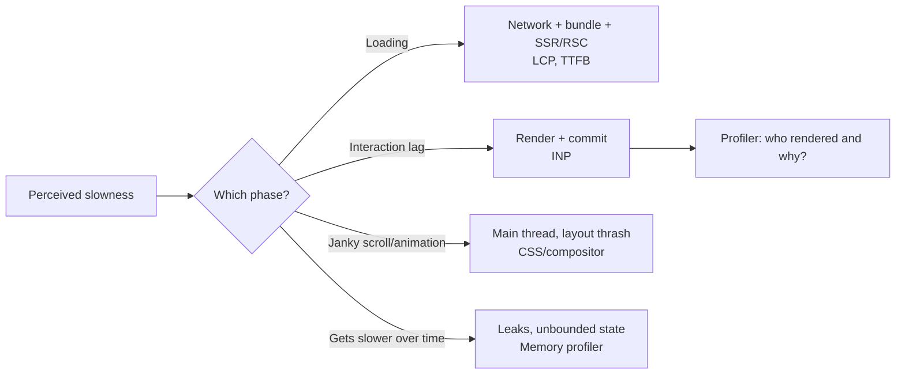
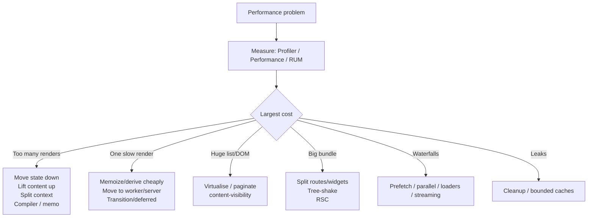

# React Performance Optimization — Interview Guide

> Verified against react.dev: [React Compiler v1.0](https://react.dev/blog/2025/10/07/react-compiler-1), [Compiler introduction](https://react.dev/learn/react-compiler/introduction), [React 19.2 Performance Tracks](https://react.dev/blog/2025/10/01/react-19-2), `useMemo`/`memo`/Suspense docs (React 19.x, latest stable 19.3).
> For browser/network-level performance (Core Web Vitals, caching, images, fonts, CDN) see the **Web Performance** category. For React Native-specific performance (JS thread/UI thread, FlatList) see [react-native/02-performance.md](../react-native/02-performance.md) and [Tier 4](../react-native/08-tire4-performance-internals.md).

## Table of Contents

1. [Quick Summary (TL;DR)](#1-quick-summary-tldr)
2. [Measure First: Tools and Method](#2-measure-first-tools-and-method)
3. [Where React Apps Get Slow](#3-where-react-apps-get-slow)
4. [Controlling Re-renders (Without Memo First)](#4-controlling-re-renders-without-memo-first)
5. [`memo`, `useMemo`, `useCallback`](#5-memo-usememo-usecallback)
6. [React Compiler 1.0](#6-react-compiler-10)
7. [Context and Store Performance](#7-context-and-store-performance)
8. [Lists, Tables and Virtualisation](#8-lists-tables-and-virtualisation)
9. [Concurrent Features for Responsiveness](#9-concurrent-features-for-responsiveness)
10. [Bundle Size, Code Splitting, Loading](#10-bundle-size-code-splitting-loading)
11. [Server-Side Techniques: SSR, Streaming, RSC, PPR](#11-server-side-techniques-ssr-streaming-rsc-ppr)
12. [Memory Leaks and Long-Session Health](#12-memory-leaks-and-long-session-health)
13. [Debugging INP Step by Step](#13-debugging-inp-step-by-step)
14. [Common Mistakes and Pitfalls](#14-common-mistakes-and-pitfalls)
15. [Trade-offs and Alternatives](#15-trade-offs-and-alternatives)
16. [Interview Questions — Fundamentals](#16-interview-questions--fundamentals)
17. [Interview Questions — Senior Scenarios](#17-interview-questions--senior-scenarios)
18. [Cheat Sheet](#18-cheat-sheet)
19. [Key Terms Glossary](#19-key-terms-glossary)
20. [Further Reading](#20-further-reading)

---

## 1. Quick Summary (TL;DR)

- **Measure, then fix.** Premature memoization adds complexity without gains. Use the **React DevTools Profiler**, Chrome **Performance** panel (with **React Performance Tracks**, 19.2+), Lighthouse/**web-vitals** (RUM).
- React cost = **render** (calling components) + **commit** (DOM work) + **JS loading/parse** + **network**. Identify which one dominates.
- Optimisation order that gives the highest ROI:
  1. **Fix architecture** (colocate/move state down, lift content up, avoid waterfalls).
  2. **Reduce work** (virtualise lists, paginate, split bundles, defer non-critical).
  3. **Prioritise work** (`useTransition`, `useDeferredValue`, Suspense, streaming).
  4. **Memoize** (React Compiler first; manual `memo`/`useMemo`/`useCallback` where needed).
- **React Compiler 1.0** (stable Oct 2025) automates memoization at build time; keep manual hooks as escape hatches (e.g. effect dependencies).
- Typical interview "gotchas": inline object/function props defeating `memo`, context value churn, index keys, expensive render-time work, giant lists, unneeded effects, and large bundles.



---

## 2. Measure First: Tools and Method

| Tool | What it answers |
|---|---|
| **React DevTools Profiler** | Which components rendered, how long, **why** (props/state/hooks/context/parent), commit count; "Highlight updates" |
| **Chrome DevTools Performance** | Long tasks, scripting vs rendering vs painting, INP interactions, flame chart. **[19.2]** React **Performance Tracks**: *Scheduler* (priorities: blocking/transition; event → update → render → commit) and *Components* (render/effect durations, "Blocked") |
| **Lighthouse / PageSpeed** | Lab metrics, opportunities (not representative of field) |
| **web-vitals + RUM** (Sentry, Datadog, SpeedCurve, GA4) | **Field** LCP/INP/CLS by device/network/page |
| **Bundle analysers** | `webpack-bundle-analyzer`, `source-map-explorer`, `rollup-plugin-visualizer`, Next bundle analyzer |
| **`why-did-you-render`** | Dev-time logging of avoidable re-renders |
| **Memory tab / heap snapshots** | Leaks, retained trees (detached DOM, closures) |
| **TanStack Query/Redux DevTools** | Refetch frequency, action storms |

### Method (state it in interviews)
1. Define a **metric & budget** (e.g. INP p75 < 200 ms; route JS < 170 KB gzip).
2. **Reproduce** with CPU throttling (4–6×) and slow network; production build (dev builds are slow due to Strict Mode, warnings).
3. **Profile**, find the largest contributor (Pareto).
4. **Fix** one thing; **re-measure**; keep a regression guard (CI budget, Lighthouse CI, perf tests).

> Always profile **production builds**; React dev builds double-render (Strict Mode) and add checks.

---

## 3. Where React Apps Get Slow

| Symptom | Likely cause | First check |
|---|---|---|
| Typing/click lag | Large re-render tree per interaction; expensive render work | Profiler "why rendered", flame graph |
| Slow page load | Large JS, waterfalls, slow server, hydration cost | Bundle analyser, Network waterfall, RSC/SSR |
| Janky scroll | Layout thrash, expensive scroll handlers, huge DOM | Performance panel, passive listeners, virtualise |
| Slows over time | Leaks (listeners, timers, caches), unbounded lists/state | Heap snapshots, effect cleanup audit |
| Flash of loading states | Waterfalls, missing prefetch, fallback churn | Transitions, prefetch, Suspense placement |
| Layout shift | Late-loading images/fonts/ads, async content | CLS attribution |

**Render cost formula:** `time ≈ (#components rendered) × (avg cost per render)` + commit cost proportional to DOM diff. Reduce **both** factors.

---

## 4. Controlling Re-renders (Without Memo First)

### 4.1 Colocate / push state down
```tsx
// Slow: typing re-renders the expensive Chart
function Page() {
  const [query, setQuery] = useState("");
  return <><input value={query} onChange={(e) => setQuery(e.target.value)} /><ExpensiveChart /></>;
}
// Fast: isolate state
function Page() {
  return <><SearchBox /><ExpensiveChart /></>;
}
```

### 4.2 Lift content up (`children` identity trick)
```tsx
function ScrollTracker({ children }: { children: React.ReactNode }) {
  const [y, setY] = useState(0);
  useEffect(() => { const f = () => setY(window.scrollY); window.addEventListener("scroll", f, { passive: true }); return () => window.removeEventListener("scroll", f); }, []);
  return <div data-y={y}>{children}</div>;   // children element identity unchanged -> skipped
}
```

### 4.3 Avoid unnecessary state
Compute during render; don't mirror props in state; avoid effects that `setState` to derive values (extra render pass).

### 4.4 Stable keys and identity
Stable keys, no components defined inside components, avoid recreating providers' values.

### 4.5 Batch & coalesce updates
Throttle/`requestAnimationFrame` for high-frequency events (scroll, mousemove, resize); update refs/CSS variables (not React state) for pure visual tracking:

```tsx
onPointerMove={(e) => { ref.current!.style.setProperty("--x", `${e.clientX}px`); }}  // zero React renders
```

---

## 5. `memo`, `useMemo`, `useCallback`

### `React.memo`
Skips re-rendering a component if its props are **shallowly equal**. Useless if you pass new object/array/function props each render.

```tsx
const Row = memo(function Row({ item, onSelect }: { item: Item; onSelect: (id: string) => void }) {
  return <li onClick={() => onSelect(item.id)}>{item.name}</li>;
});
```
- Custom comparator: `memo(Comp, areEqual)` — use sparingly; incorrect comparators cause stale UI.
- `memo` doesn't block re-renders caused by **its own state or context**.

### `useMemo`
Caches a computation result; only valuable for **expensive** calculations (react.dev suggests measuring: ~1 ms or more) or to stabilise a reference for memoized children/effects/context.

### `useCallback`
Caches a function identity; only valuable when passed to memoized children or used in dependency arrays.

### Pitfalls
- `useCallback` + inline arrow in JSX (`onClick={() => handle(item)}`) still breaks child memoization (the compiler handles this).
- Deps that change each render → no benefit.
- Memoizing everything costs memory, comparison time and readability.
- Memo cache can be dropped by React; never rely on it for correctness.

---

## 6. React Compiler 1.0

### What it is
A **build-time optimiser** (Babel plugin implementation; swc support in Next.js ≥ 15.3.1; Vite, Metro, Rsbuild integrations; Expo SDK 54+ enabled by default). It analyses components/hooks via a **High-level IR (HIR)** with control-flow and mutability analysis, and inserts **fine-grained memoization** (including after early returns and conditional logic, which `useMemo` can't do).

### Before / after
```tsx
// Before (manual)
const Item = memo(function Item({ data, onClick }: Props) {
  const processed = useMemo(() => expensive(data), [data]);
  const handle = useCallback((i: Item) => onClick(i.id), [onClick]);
  return <div>{processed.map((i) => <Child key={i.id} onClick={() => handle(i)} />)}</div>;   // arrow breaks memo
});

// After (compiler)
function Item({ data, onClick }: Props) {
  const processed = expensive(data);
  return <div>{processed.map((i) => <Child key={i.id} onClick={() => onClick(i.id)} />)}</div>;
}
```
Per React docs: the compiler memoizes such that `Child` re-renders only when relevant inputs change, even with the inline arrow that breaks the manual version.

### What kind of memoization?
Focuses on **update performance**:
1. **Skip cascading re-renders** of children when the parent re-renders.
2. **Skip expensive calculations** *inside components/hooks* (not arbitrary functions outside React; and not shared across components).

### Requirements and behaviour
- Code must follow the **Rules of React** (pure render, immutable props/state, hook rules). The compiler **bails out** on components it can't prove safe and surfaces diagnostics via `eslint-plugin-react-hooks` (v6+ with compiler rules, e.g. `set-state-in-render`, `set-state-in-effect`, `refs`).
- Works with React **17+** using a `target` setting and `react-compiler-runtime`.
- Reported production results (Meta Quest Store): initial loads and cross-page navigations up to ~12% faster; some interactions >2.5× faster; memory neutral — workload dependent.

### Adoption playbook
1. Upgrade `eslint-plugin-react-hooks` and fix violations.
2. Install `babel-plugin-react-compiler` (**pin exact version**; `--save-exact`).
3. Enable **incrementally**: annotation mode (`"use memo"`) or directory gating; compare Profiler traces; run e2e tests.
4. Keep existing `useMemo`/`useCallback` (removing can change compiled output); remove gradually with tests.
5. Use `"use no memo"` to opt a component out while you fix it.
6. React DevTools marks compiler-optimised components (the "Memo ✨" badge).

```js
// babel.config.js (illustrative; check current docs for your toolchain)
module.exports = {
  plugins: [["babel-plugin-react-compiler", { compilationMode: "annotation" }]],
};
```

### When manual memoization is still needed
- A memoized value used as an **effect dependency** where you need precise identity control.
- Expensive functions **outside** components/hooks or shared across components (own caching/memoization such as `Map` cache, `reselect`, `lru-cache`).
- Third-party libraries relying on referential stability in ways the compiler can't see.
- Code the compiler skips (rules violations, unsupported patterns).

### Upgrading the compiler
Memoization strategy may change between versions; code that relies on memoization for **correctness** (e.g. effects firing) may behave differently. Pin versions unless you have strong e2e coverage.

---

## 7. Context and Store Performance

- A context value change re-renders **all consumers**, bypassing `memo`. See [02 file §9](02-hooks-deep-dive.md#9-context-usecontext-and-use).
- **Split** contexts by update frequency and by state vs dispatch; **memoize** the value (or Compiler).
- For high-frequency shared state use selector-based stores (Zustand, Redux Toolkit `useSelector`, Jotai, `useSyncExternalStore`).
- **Selectors** must return stable references for unchanged data; use `createSelector`/`useShallow`.
- Keep per-item state **inside the item** or in per-item atoms when the list is large.

```tsx
// Subscribe narrowly
const count = useStore((s) => s.todos.length);          // re-renders only when length changes
```

---

## 8. Lists, Tables and Virtualisation

### Why lists are costly
Every row = component render + DOM nodes + event listeners + layout. 5,000 rows × (render + style + layout + paint) is expensive even if each row is cheap.

### Techniques
1. **Pagination / cursor-based loading** — reduce data.
2. **Virtualisation (windowing)** — render only visible rows (+ overscan): TanStack Virtual, react-window, react-virtuoso.
3. **Stable keys** and memoized rows; avoid per-row heavy hooks and context subscriptions.
4. **Avoid layout thrash** (fixed or measured row heights, `contain: content`, `content-visibility: auto` for off-screen sections).
5. **Lazy images** (`loading="lazy"`, `decoding="async"`, intrinsic sizes).
6. **Server-side** filtering/sorting for big datasets; Web Worker for client-side heavy transforms.

```tsx
import { useVirtualizer } from "@tanstack/react-virtual";

function VirtualList({ items }: { items: Item[] }) {
  const parent = useRef<HTMLDivElement>(null);
  const v = useVirtualizer({ count: items.length, getScrollElement: () => parent.current, estimateSize: () => 48, overscan: 8 });
  return (
    <div ref={parent} style={{ height: 600, overflow: "auto" }}>
      <div style={{ height: v.getTotalSize(), position: "relative" }}>
        {v.getVirtualItems().map((row) => (
          <div key={items[row.index].id} style={{ position: "absolute", top: 0, transform: `translateY(${row.start}px)`, height: row.size, width: "100%" }}>
            <Row item={items[row.index]} />
          </div>
        ))}
      </div>
    </div>
  );
}
```
**Trade-offs of virtualisation:** breaks Ctrl+F in-page search, accessibility (screen readers need `aria-rowcount`/`aria-setsize`), variable heights complexity, scroll restoration. Use when rows > ~hundreds and measured.

---

## 9. Concurrent Features for Responsiveness

- **`useDeferredValue`** / **`useTransition`** keep inputs responsive while heavy results render at lower priority. See [03 file](03-concurrent-react-suspense-and-transitions.md).
- **Suspense** + **streaming SSR** for progressive loading.
- **`<Activity>`** (19.2) keeps hidden UI state/pre-renders at low priority.
- **`<ViewTransition>`** (19.3) animates using browser compositing.
- Yield long tasks yourself: `scheduler.yield()` / `setTimeout` chunking / Web Workers for CPU-heavy work (React can't interrupt your own long synchronous function).

---

## 10. Bundle Size, Code Splitting, Loading

| Technique | Effect |
|---|---|
| Route-level `lazy`/dynamic import | Smaller initial JS |
| Component-level split for heavy widgets (editor, charts, maps) | Defer cost until needed |
| **Tree-shaking friendly imports** (`import { debounce } from "lodash-es"` instead of `lodash`) | Remove unused code |
| Replace heavy libs (moment → date-fns/Temporal, lodash → native) | Smaller |
| **Analyse** bundles regularly | Find regressions |
| Avoid importing whole icon/emoji sets | Smaller |
| `sideEffects: false` in libraries | Enables tree-shaking |
| Modern output (ES2020+), `browserslist` tuning | Less transpilation/polyfills |
| Preload critical chunks / `modulepreload` / `fetchpriority` | Faster LCP |
| Prefetch next-route chunks on hover/idle | Faster navigations |
| Compression (Brotli) + HTTP caching with hashed filenames | Smaller transfer, instant repeat visits |
| RSC / server-only libs | Remove libs from client bundle |

Performance budgets in CI (size-limit, Lighthouse CI, bundlewatch) prevent regressions.

---

## 11. Server-Side Techniques: SSR, Streaming, RSC, PPR

- **SSR/SSG** improves FCP/LCP by sending HTML; cost: server CPU, hydration.
- **Streaming SSR + Suspense**: shell first; boundaries stream; **selective hydration** prioritises interacted-with parts.
- **RSC**: Server Components don't ship/hydrate; fewer waterfalls.
- **PPR (19.2)**: static shell from CDN + resumable dynamic holes.
- **Hydration cost**: reduce Client Components, lazy hydrate (`lazy` + Suspense, Islands/partial hydration in frameworks), avoid hydration mismatches (discarded server HTML = wasted work).
- **Caching** at CDN/edge, data layer, and per-request `cache()`.
- **React 19.2 batched reveals** avoid choppy streaming; throttling stops near LCP threshold.

Details in the **Next.js & Rendering Strategies** category and [05 file](05-server-components-and-server-functions.md).

---

## 12. Memory Leaks and Long-Session Health

Common sources in React apps:
- **Effects without cleanup**: event listeners (`window`, `document`), timers, intervals, WebSocket/EventSource, `ResizeObserver`/`IntersectionObserver`, subscriptions.
- **Closures retaining large objects** (callbacks stored in global registries).
- **Unbounded caches/state**: ever-growing arrays/Maps, infinite query pages, logs.
- **Detached DOM nodes** held by refs/global variables.
- **Portals/modals** not unmounted; third-party widgets (maps/charts) without `destroy()`.
- **`Activity` hidden trees** retained in memory.

Diagnosis: Chrome Memory tab → take heap snapshots before/after repeated navigation; compare **retained size**; search for "Detached" nodes; use Performance monitor for JS heap & listener counts.
Fix: symmetric cleanup, `AbortController`, `WeakMap/WeakRef` for caches keyed by objects, LRU caps, `maxPages` for infinite queries, destroy third-party instances.

```tsx
useEffect(() => {
  const chart = new Chart(ref.current!, config);
  return () => chart.destroy();      // third-party cleanup
}, []);
```

---

## 13. Debugging INP Step by Step

**INP (Interaction to Next Paint)** measures the latency from user input until the next frame is painted (sum of **input delay + processing + presentation delay**); "good" ≤ 200 ms (p75).

1. **Field data** first (CrUX/RUM) to find the slow interaction & page; attribute with the `web-vitals` library `onINP` attribution build (target element, long animation frames).
2. **Reproduce** in Chrome DevTools Performance with 4× CPU throttle; record the interaction.
3. Identify the **phase**:
   - *Input delay*: main thread busy with another task → break up long tasks, defer analytics/third parties.
   - *Processing*: your handlers + React render + effects → reduce render scope, transitions, memoization, move work off-thread.
   - *Presentation*: layout/paint/style recalculation → reduce DOM size, avoid forced reflow, simplify CSS selectors, `content-visibility`.
4. In React: use the **Scheduler track** to see urgent vs transition work; **Components track** for slow renders/effects; Profiler for why.
5. Apply fix, deploy, verify with RUM.

Quick wins: yield between handler work and heavy updates (`startTransition`, `scheduler.yield()`), avoid synchronous heavy handlers, debounce/virtualise, avoid layout reads/writes interleaving, lazy-load heavy components used after interaction.

---

## 14. Common Mistakes and Pitfalls

| Mistake | Impact | Fix |
|---|---|---|
| Optimising without measuring | Wasted effort, extra complexity | Profile first |
| `memo` with unstable props | No effect | Stable props / Compiler |
| Memoizing everything | Overhead, hard-to-read code | Targeted use |
| Heavy work in render | Slow every render | Memoize / move to effect/worker/server |
| Context value inline object | All consumers re-render | Memoize/split |
| Index keys/unstable keys | Wasted DOM work, state bugs | Stable IDs |
| Rendering huge lists | Slow render + layout | Virtualise/paginate |
| Fetch waterfalls | Slow loads | Parallelise/prefetch/RSC |
| Over-fetching/refetching | Network+render churn | `staleTime`, selective invalidation |
| Large dependencies for small tasks | Bundle bloat | Native/lighter libs |
| `useEffect` chains | Extra renders | Event handlers, derive |
| Layout thrash in effects (read/write alternate) | Forced reflow | Batch reads, then writes |
| Disabling Strict Mode "to speed up" | Hides bugs; dev-only cost | Profile production |
| Relying on `useMemo` for correctness | Cache can be discarded | Make it an optimisation only |

---

## 15. Trade-offs and Alternatives

| Technique | Benefit | Cost |
|---|---|---|
| React Compiler | Automatic memoization, less code | Build step; Rules-of-React compliance; opaque; version pinning |
| Manual memoization | Explicit control | Verbose, error-prone |
| Virtualisation | Handles huge lists | Find-in-page, a11y, complexity |
| Transitions/deferred values | Responsive input | Possible stale UI; total work may rise |
| Code splitting | Smaller initial bundle | More requests, loading states, waterfalls if misused |
| SSR/RSC | Faster first paint, smaller JS | Server cost, complexity, hydration |
| Web Workers | Off-main-thread CPU | Serialisation costs, tooling complexity |
| Fine-grained signals (Solid/Preact Signals) | Minimal re-render | Different model; ecosystem/interop |
| Caching (HTTP/data) | Speed, cost | Staleness/invalidations |

---

## 16. Interview Questions — Fundamentals

### Q1. How do you find and fix a slow React component?
Profile a production build with the React DevTools Profiler/Performance panel, find components with high render time or high render frequency, check *why* they rendered, then apply the cheapest fix (move state down, lift content up, memoize/Compiler, virtualise, defer), and re-measure.

### Q2. When does a component re-render?
State/reducer change, parent re-render (default), context change, external store change. Not when a ref mutates.

### Q3. What do `memo`, `useMemo`, and `useCallback` do?
`memo` skips re-render when props are shallow-equal; `useMemo` caches a value; `useCallback` caches a function reference. They're optimisations and only help when inputs are stable and the saved work is significant.

### Q4. Why can `memo` fail to prevent re-renders?
New object/array/function props each render, changing context/state in the component, or children props (JSX) that are new each time.

### Q5. What is the React Compiler?
A build-time tool that automatically memoizes components and hooks following the Rules of React; stable at 1.0 (Oct 2025); reduces need for manual memoization.

### Q6. What is virtualisation?
Rendering only the visible portion of a long list (plus overscan) to keep DOM and render work small.

### Q7. How do you reduce bundle size?
Route-level code splitting, lazy load heavy widgets, tree-shaking, remove/replace large deps, analyse bundles, server-only libs with RSC, modern builds, compression, HTTP caching.

### Q8. What is a memory leak in React and how do you prevent it?
Unreleased references causing memory growth: uncleaned listeners/timers/subscriptions, retained closures, unbounded caches. Prevent via effect cleanup, AbortController, LRU/weak caches, destroying third-party instances.

### Q9. Why avoid inline functions in JSX props?
They create new function identities each render, breaking `memo` on children. Only matters when the child is memoized (or the Compiler isn't used).

### Q10. What's the cost of context?
Any value change re-renders all consumers; split or use selector stores.

### Q11. How do transitions help performance?
They keep urgent updates responsive by making heavy renders interruptible; they don't reduce total work.

### Q12. How does Suspense improve performance?
Enables code splitting and data loading boundaries with streaming/selective hydration, avoiding blocking the whole page.

### Q13. What is a long task and why is it harmful?
Main-thread task > 50 ms; delays input handling and paint, hurting INP. Break into chunks, yield, or move off-thread.

### Q14. LCP vs INP vs CLS?
Loading speed of the main content; responsiveness to interactions; visual stability.

### Q15. Why profile in production mode?
Dev mode includes Strict Mode double-render, extra warnings and unoptimised code, skewing results.

---

## 17. Interview Questions — Senior Scenarios

### S1. "Our dashboard feels sluggish after interactions. INP p75 is 480 ms. What's your plan?"
1. Field data → find the slowest interactions/pages and device classes.
2. Reproduce with throttling; record Performance panel with React Tracks.
3. Phase analysis (input delay / processing / presentation).
4. Likely fixes: move expensive derivations out of render, isolate state, `useDeferredValue` for heavy panels, virtualise tables, split context, lazy load heavy widgets not needed for first interaction, debounce chatty handlers, remove third-party scripts blocking main thread (consent managers, tag managers), `content-visibility` for off-screen panels.
5. Add guards: Lighthouse CI/INP budgets, RUM alerts, performance tests with Playwright traces.
6. Communicate trade-offs and expected gains; roll out behind feature flags; compare cohorts.

### S2. "Explain how you'd migrate a large codebase to the React Compiler with minimal risk."
Baseline metrics; upgrade `eslint-plugin-react-hooks` and fix violations; enable the compiler in annotation mode for a pilot feature; run Profiler/e2e; widen with directory gating; keep existing memoization; pin exact compiler version; monitor error rate and INP; use `"use no memo"` for exceptions; document patterns that violate the rules; automate checks in CI.

### S3. "A product listing with 10k items and filters is slow. Design it."
Server-side filtering/pagination (cursor) with search index; client: `useDeferredValue` for the filter input, TanStack Query with `placeholderData: keepPreviousData`, virtualised grid, memoized/Compiler-optimised cards, image lazy-loading with fixed aspect ratio (CLS), prefetch next page, URL-state for filters, skeletons with stable dimensions, SSR the first page (RSC/loader) for LCP, analytics deferral. Measure: LCP, INP, CLS, memory.

### S4. "What makes hydration expensive and how do you reduce it?"
All Client Components must download, parse, execute and attach handlers; large trees hydrate in one go. Reduce: RSC (non-interactive UI as Server Components), Suspense boundaries for selective hydration, code-split below-the-fold interactive widgets, lazy hydrate on visibility/idle (islands), avoid mismatches (discard+re-render), trim third-party JS, reduce DOM size.

### S5. "Our app slows down over a long session (trading dashboard). What do you look for?"
Heap snapshots over time; growing listener/timer counts; WebSocket handlers re-registered on each render; unbounded message arrays; retained detached DOM; cache growth; chart instances not destroyed. Fix with cleanup symmetry, bounded buffers (ring buffer), throttled rendering (rAF batching), virtualised tables, moving high-frequency data to refs/canvas/Web Workers and rendering aggregated snapshots.

### S6. "Is `useMemo` free? When would you remove it?"
Not free: closure allocation, deps comparison, memory, complexity. Remove when the computation is trivial, deps always change, or when the Compiler covers it (after tests). Keep when needed for effect dependency identity or genuinely expensive work.

### S7. "How do you prevent performance regressions?"
Budgets for bundle size/INP/LCP in CI (size-limit, Lighthouse CI), Playwright performance traces for key flows, RUM dashboards and alerts, code review checklist (lists, effects, context), architectural lint rules (import boundaries), dependency size review (Bundlephobia/pkg-size), and periodic profiling.

---

## 18. Cheat Sheet



| Rule | Why |
|---|---|
| Measure in production builds | Dev mode distorts |
| Architecture > memoization | Biggest wins, least code |
| Stable props for `memo` | Otherwise useless |
| Context: low-frequency only | No selectors |
| Virtualise big lists | DOM cost dominates |
| Compiler for new code | Less manual noise |
| Defer, don't debounce, rendering | Transitions adapt to device |

---

## 19. Key Terms Glossary

| Term | Definition |
|---|---|
| INP | Interaction to Next Paint: responsiveness metric (≤ 200 ms good) |
| LCP | Largest Contentful Paint (≤ 2.5 s good) |
| CLS | Cumulative Layout Shift (≤ 0.1 good) |
| Long task | Main-thread task longer than 50 ms |
| Virtualisation | Render only visible items |
| Hydration | Attaching React to server HTML |
| Structural sharing | Reusing unchanged references |
| Compiler memoization | Build-time inserted caching of values/JSX |
| Overscan | Extra rows rendered outside the viewport |
| Performance budget | Limit for size/time metrics enforced in CI |

---

## 20. Further Reading

- [React Compiler v1.0](https://react.dev/blog/2025/10/07/react-compiler-1) · [React Compiler docs](https://react.dev/learn/react-compiler)
- [`memo`](https://react.dev/reference/react/memo) · [`useMemo`](https://react.dev/reference/react/useMemo) · [`useCallback`](https://react.dev/reference/react/useCallback) · [React Profiler](https://react.dev/reference/react/Profiler)
- [React 19.2 — Performance Tracks](https://react.dev/blog/2025/10/01/react-19-2) · [React Performance Tracks reference](https://react.dev/reference/dev-tools/react-performance-tracks)
- [web.dev — INP](https://web.dev/articles/inp) · [web.dev — Optimize long tasks](https://web.dev/articles/optimize-long-tasks)
