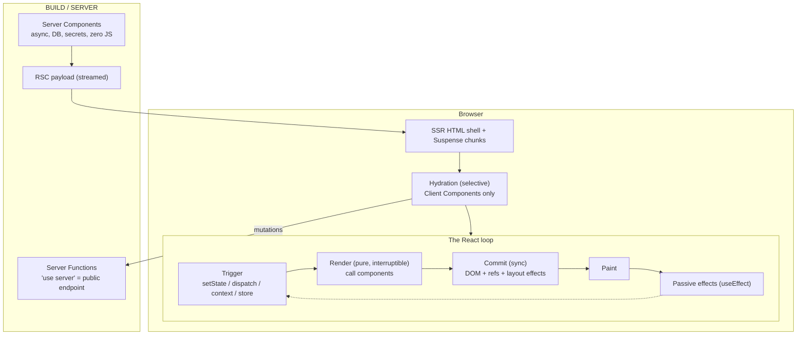
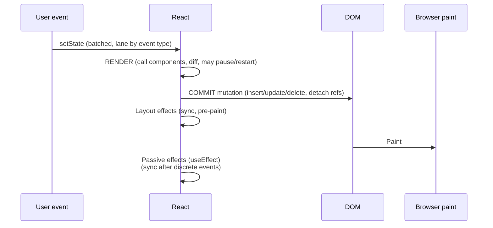
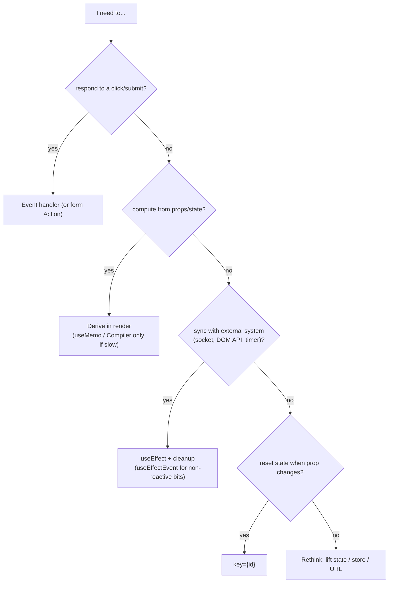
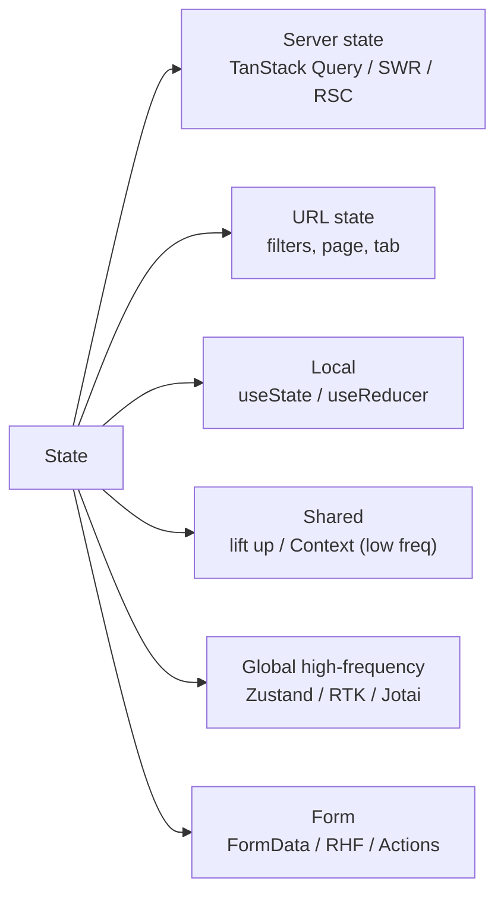
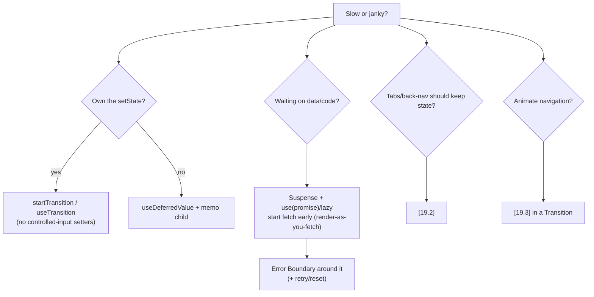
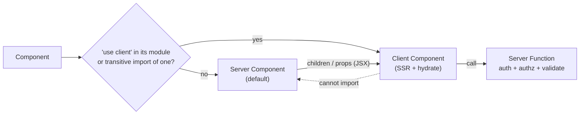
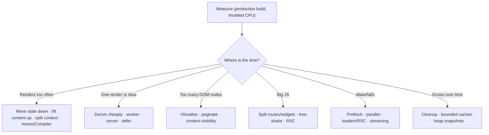

# React — Master Mental Model & Last-Minute Recall Map

> Read this the night before / an hour before the interview. It ties files 01–08 into one picture. It is **not** a substitute for reading them.
> Verified against react.dev on 2026-11-06 (latest stable: React **19.3**). Anything version-sensitive is marked **[19.x]**.

## How to Use This Page

1. Skim the **one-page mental model** (section 1).
2. Walk the **diagrams** (sections 2–8) and explain each aloud in 60 seconds.
3. Drill the **mnemonics** and **rapid-fire** lists (sections 9–10).
4. Rehearse the **"say this" answers** (section 11).
5. Check the **red-flag list** (section 12) — mistakes that cost offers.

---

## 1. The One-Page Mental Model

**Five sentences to remember:**
1. UI = f(props, state, context); render must be **pure**.
2. Update = **Trigger → Render → Commit → Effects**; render ≠ DOM update.
3. Identity (**type + position + key**) decides whether state survives.
4. **Priorities** (lanes) let urgent work interrupt non-urgent (transitions, deferred, Suspense).
5. **Server first** (RSC/streaming), **client where interactive**, **measure before optimising**.

---

## 2. Render → Commit → Effects Timeline

| Phase | Allowed | Not allowed |
|---|---|---|
| Render | compute, derive, `use(promise)`, local mutation of fresh values | side effects, `ref.current` read/write, mutate props/state, random/time |
| Layout effect | measure DOM, sync fix before paint | slow work |
| Passive effect | subscriptions, network, timers, analytics | derive state for render |

---

## 3. "Where Does This Code Go?" Decision Tree

---

## 4. State Placement Map

Rules: **derive don't duplicate · store IDs not objects · immutable updates · colocate first · server data is a cache, not Redux state.**

---

## 5. Concurrency & Loading Map

**Transition caveats (official):** updates after `await` need another `startTransition`; `setTimeout` updates aren't transitions; transitions can't drive text inputs; async actions can finish out of order → `useActionState`/`<form action>`.

---

## 6. React 19 / 19.2 / 19.3 at a Glance

| Version | Memorise |
|---|---|
| **19.0** (Dec 2024) | Actions · `useActionState` · `useOptimistic` · `useFormStatus` · `<form action>` · `use()` · `ref` as prop · `<Context>` provider · ref cleanup · metadata/stylesheet/preload · `prerender` · RSC + Server Functions stable · errors not re-thrown (`onCaughtError`/`onUncaughtError`) · Suspense pre-warming |
| **19.2** (Oct 2025) | `<Activity>` · `useEffectEvent` · `cacheSignal` · Performance Tracks · Partial Pre-rendering (`resume`) · batched SSR reveals · eslint-plugin-react-hooks v6 |
| **19.3** (Sep 2026) | `<ViewTransition>` stable (+`addTransitionType`) · Fragment Refs · `use(browser())` · Trusted Types · Server Components can render Context from client module · transitions render independently |
| **Compiler 1.0** (Oct 2025) | Auto-memoization · Rules of React · keep `useMemo/useCallback` as escape hatch · pin version |
| **Removed in 19** | `propTypes`/function `defaultProps` · legacy context · string refs · `ReactDOM.render/hydrate/findDOMNode/unmountComponentAtNode` · `react-dom/test-utils` (except `act` → `react`) · UMD |
| **Security** | CVE-2025-55182 (CVSS 10 RCE in RSC payload decoding) → patched 19.0.1/19.1.2/19.2.1 + follow-up DoS/source-exposure CVEs; Server Functions = public endpoints |

---

## 7. Server Components Cheat Map

Props crossing the boundary: **serialisable only** (plain objects, primitives, Date, Map/Set, Promises, JSX, Server Functions) — **no** class instances or arbitrary functions. There is **no directive** for Server Components.

---

## 8. Performance Triage Map

Metrics: **LCP ≤ 2.5 s · INP ≤ 200 ms · CLS ≤ 0.1** (p75, field data).

---

## 9. Mnemonics

| Mnemonic | Expands to |
|---|---|
| **T-R-C-E** | **T**rigger → **R**ender → **C**ommit → **E**ffects |
| **PKT** (identity) | **P**osition + **K**ey + **T**ype decide state survival |
| **DIED** (what to avoid in render) | **D**ata fetching, **I**mpure random/time, **E**ffects/subscriptions, **D**OM/ref access |
| **SPUD** (state hygiene) | **S**ingle source · **P**rimitives/IDs · **U**nion status (no contradictions) · **D**erive don't duplicate |
| **CLEAN** (effects) | **C**leanup · **L**ist all deps · **E**vent-not-effect · **A**bort stale async · **N**o derived state |
| **SWAT** (Suspense) | **S**tart fetch early · **W**rap in boundary · **A**dd error boundary · **T**ransition navigations |
| **STAMP** (Server Functions security) | **S**ession check · **T**ype/schema validate · **A**uthorise resource · **M**inimal response · **P**atch deps |
| **MCR** (perf order) | **M**easure → **C**hange architecture → **R**educe/defer work → memoize last |

---

## 10. Rapid-Fire Recall (answer each in one breath)

| # | Question | Answer |
|---|---|---|
| 1 | Render vs commit? | Render calls components (pure, interruptible); commit mutates DOM (sync). |
| 2 | Why keys? | Stable identity → preserve state/DOM and minimal moves. |
| 3 | Why hook order matters? | Hooks are a linked list on the fiber indexed by call order. |
| 4 | Why does an effect run twice in dev? | Strict Mode mount-unmount-mount to verify cleanup. |
| 5 | Batched updates? | All updates batched since 18; `flushSync` opts out. |
| 6 | `setCount(count+1)` ×3? | Snapshot → +1; use updater for +3. |
| 7 | Reset state on prop change? | `key={id}`. |
| 8 | Stale closure fix? | Updater, `useReducer`, `useEffectEvent`, latest-ref. |
| 9 | `useMemo` guarantee? | No; it's a performance hint. |
| 10 | Context downside? | All consumers re-render; no selectors. |
| 11 | When `useSyncExternalStore`? | External mutable store; prevents tearing. |
| 12 | `useTransition` vs `useDeferredValue`? | Wrap setter vs wrap value. |
| 13 | Can transitions control inputs? | No. |
| 14 | What suspends? | `use(promise)`, `lazy`, Suspense-enabled libs — not `useEffect` fetches. |
| 15 | Error boundary gaps? | Not event handlers, async code, SSR, itself. |
| 16 | `use()` rules? | Render only; can be conditional; promise must be stable. |
| 17 | `useActionState` benefit? | Pending + last result + queued ordering + form integration. |
| 18 | `useOptimistic` rule? | Call inside an Action; auto-reverts when settled. |
| 19 | `useFormStatus` placement? | Inside a child of the `<form>`. |
| 20 | `ref` in 19? | Plain prop; callback refs can return cleanup. |
| 21 | What does `'use client'` do? | Marks module graph boundary; imports become client code. |
| 22 | Server Function = ? | Public HTTP endpoint: authn + authz + validate. |
| 23 | `cache()`? | Per-request memoization, not cross-request. |
| 24 | Activity hidden mode? | Hides UI, keeps state, unmounts effects, defers updates. |
| 25 | `useEffectEvent`? | Non-reactive effect logic; not in deps; same component/hook. |
| 26 | Hydration mismatch causes? | `Date.now()`, `Math.random()`, `typeof window`, locale, bad HTML nesting, extensions. |
| 27 | Virtualise when? | Hundreds+ rows after measuring. |
| 28 | Compiler needs? | Rules of React; pin version; keep manual hooks for escape hatches. |
| 29 | Server vs client state? | Async/stale/shared (cache lib) vs sync/UI-owned. |
| 30 | URL state? | Filters/sort/page/tab → shareable, back-button friendly. |

---

## 11. "Say This" Model Answers (60-second scripts)

**"Explain how React updates the UI."**
> A state update schedules a render with a priority lane. In the render phase React calls the affected components, which must be pure, and diffs the returned elements against the current fiber tree using type and key. That phase can be paused or restarted. In the commit phase React applies the minimal DOM changes synchronously, attaches refs and runs layout effects; after paint it runs passive effects. Updates are batched, and urgent updates like typing can interrupt non-urgent ones like a transition.

**"How do you optimise a slow React app?"**
> I measure first in a production build with the Profiler, the Performance panel and RUM. Then I fix the architecture—move state down, lift content up, avoid waterfalls—reduce work with virtualisation and code splitting, prioritise work with transitions and Suspense, and only then memoize, preferably with the React Compiler. I guard with budgets in CI.

**"What changed in React 19?"**
> Async mutations became first-class with Actions, `useActionState`, `useOptimistic`, `useFormStatus` and form actions, plus the `use` API for reading promises and context. Refs are plain props, context renders as its own provider, and document metadata and stylesheets are supported natively. Server Components and Server Functions are stable. 19.2 added Activity and `useEffectEvent`, 19.3 stabilised ViewTransition and Fragment Refs. The Compiler is stable too.

**"Redux, Context or Zustand?"**
> I classify state first: server state goes to a cache library, URL state to the router, local state stays local. For the rest, Context handles low-frequency values; for high-frequency shared state I want selectors—Zustand for light needs, Redux Toolkit for large teams and strict conventions.

**"How do Server Components change the architecture?"**
> Server is the default: components run on the server, can be async, and don't ship JS. I push `'use client'` to interactive leaves and pass server-rendered content as children. Mutations go through Server Functions, which are public endpoints, so every one authenticates, authorises and validates. Data should be fetched in parallel and streamed with Suspense. And we keep React and the framework patched—the December 2025 RCE showed why.

---

## 12. Red-Flag List (things that sink answers)

- Saying "React re-renders the whole DOM" or "setState is async because of a queue" without batching/snapshot nuance.
- Equating **render** with **DOM update**.
- "Use `useEffect` to fetch and derive state" as best practice.
- Memoizing everything / claiming `useMemo` guarantees caching.
- Claiming Server Components are marked by `'use server'`, or that Client Components don't SSR.
- Treating Server Functions as private/internal and skipping authorisation.
- Putting server data into Redux by hand.
- Index keys for dynamic lists; components defined inside components.
- Not knowing that transitions can't drive controlled inputs.
- Optimising without measuring.

---

## 13. Last-Minute Checklist

- [ ] Can I draw Trigger → Render → Commit → Effects and place hooks on it?
- [ ] Can I explain keys, identity and state reset with an example?
- [ ] Can I fix a stale closure three ways?
- [ ] Can I describe transitions vs deferred value vs debounce?
- [ ] Can I design loading + error UX (Suspense + Error Boundary + retry)?
- [ ] Can I list React 19/19.2/19.3 features and the Compiler status?
- [ ] Can I explain RSC boundaries, serialisation and Server Function security?
- [ ] Can I choose a state tool with reasons and trade-offs?
- [ ] Can I walk through an INP investigation?
- [ ] Do I have 2 stories (impact, metrics, trade-offs) ready from real work?

---

## 14. Map to the Detailed Files

| File | Use it for |
|---|---|
| [01-rendering-model-and-reconciliation.md](01-rendering-model-and-reconciliation.md) | Render/commit, keys, Fiber, lanes, events |
| [02-hooks-deep-dive.md](02-hooks-deep-dive.md) | All hooks, effects, stale closures, custom hooks |
| [03-concurrent-react-suspense-and-transitions.md](03-concurrent-react-suspense-and-transitions.md) | Transitions, deferred values, Suspense, Error Boundaries, streaming, Activity |
| [04-react-19-and-beyond.md](04-react-19-and-beyond.md) | Actions, forms, `use`, 19.2/19.3, migration |
| [05-server-components-and-server-functions.md](05-server-components-and-server-functions.md) | RSC, serialization, Server Functions, security |
| [06-state-management-and-data-fetching.md](06-state-management-and-data-fetching.md) | State taxonomy, TanStack Query, stores, mutations |
| [07-component-patterns-and-architecture.md](07-component-patterns-and-architecture.md) | Patterns, a11y components, coding-round UIs, architecture |
| [08-react-performance-optimization.md](08-react-performance-optimization.md) | Profiling, memoization, Compiler, virtualisation, INP |
| React Native tie-ins | [Tier 6: React internals in RN](../react-native/10-tire6-react-internals-in-react-native.md) · [RN performance](../react-native/02-performance.md) · [Master RN recall map](../react-native/17-master-mental-model-recall-map.md) |
