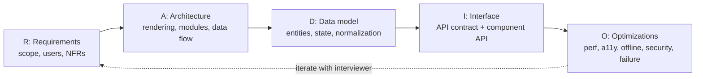
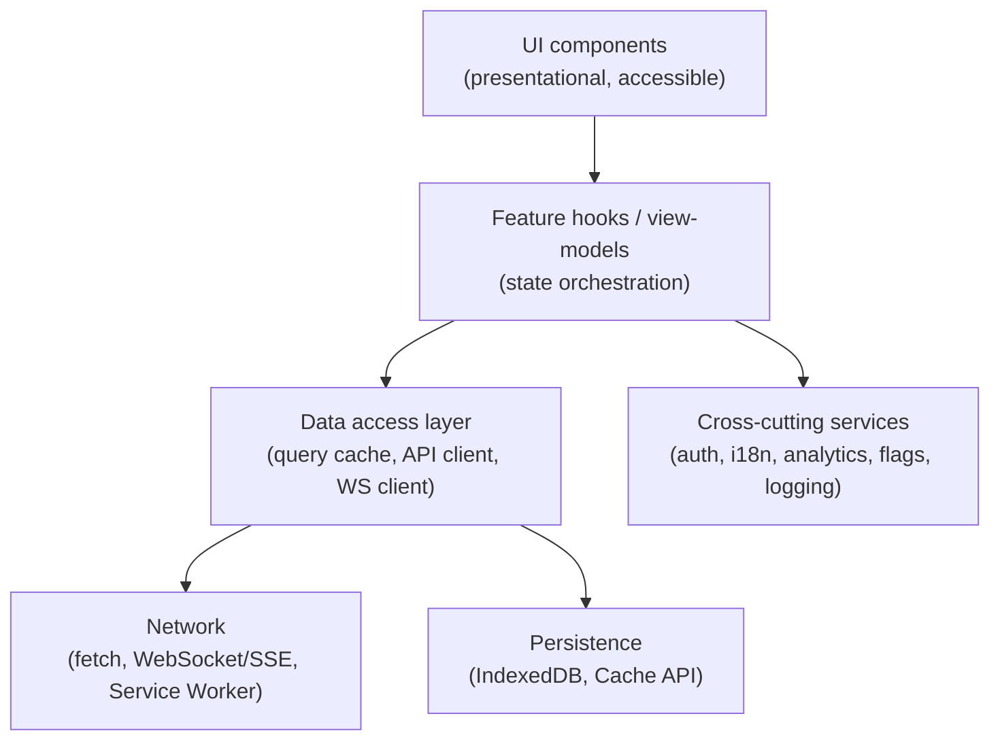
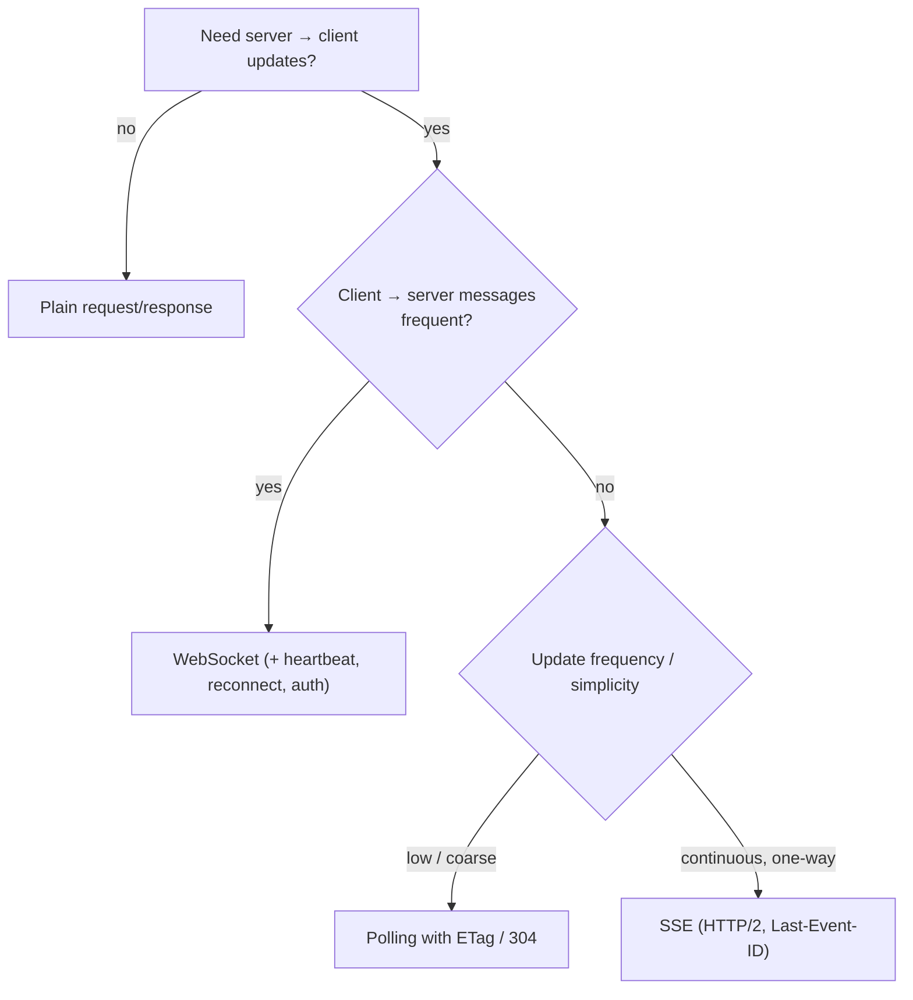
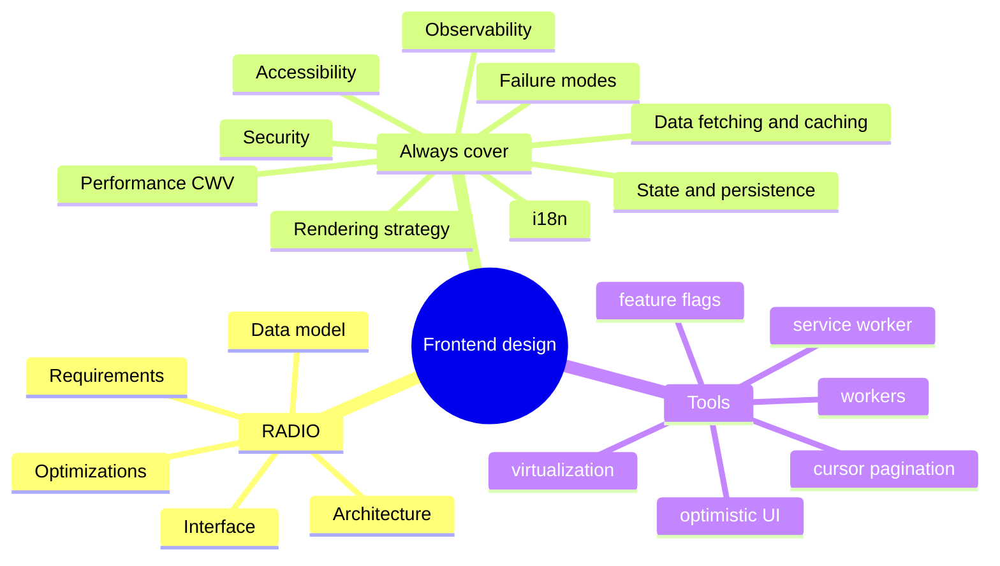

# Frontend System Design — Framework, Building Blocks & How to Run the Interview

> Verified (2026-11-10) against MDN and web.dev for the web-platform facts used here: `scheduler.yield()` support (Chrome/Edge 129, Firefox 142, **not Safari/iOS**), SSE connection limits (6 per browser+domain on HTTP/1.1, negotiated ~100 streams on HTTP/2), `content-visibility: auto` (Baseline "newly available" since Sep 15, 2025; needs `contain-intrinsic-size`). Core Web Vitals thresholds: **LCP ≤ 2.5 s, INP ≤ 200 ms, CLS ≤ 0.1** at the 75th percentile.
> This is the **method file**. The case studies reuse it: [02 News Feed](02-news-feed-and-infinite-scroll.md) · [03 Autocomplete](03-autocomplete-and-typeahead-search.md) · [04 Chat](04-chat-and-real-time-messaging.md) · [05 Dashboard](05-analytics-dashboard.md) · [06 Design System](06-design-system-and-component-library.md) · [07 Image Gallery](07-image-gallery-and-media-heavy-ui.md) · [08 Collaborative Editor](08-collaborative-editor.md) · [09 Recall Map](09-system-design-recall-map.md).

## Table of Contents

1. [Quick Summary (TL;DR)](#1-quick-summary-tldr)
2. [What Interviewers Actually Evaluate](#2-what-interviewers-actually-evaluate)
3. [The RADIO Framework](#3-the-radio-framework)
4. [A 45-Minute Timeline](#4-a-45-minute-timeline)
5. [Requirements: The Checklist](#5-requirements-the-checklist)
6. [Architecture Building Blocks](#6-architecture-building-blocks)
7. [Networking and Data Delivery](#7-networking-and-data-delivery)
8. [Caching Layers](#8-caching-layers)
9. [Client State, Persistence and Offline](#9-client-state-persistence-and-offline)
10. [Rendering Performance Toolbox](#10-rendering-performance-toolbox)
11. [Security, Accessibility, i18n, Observability](#11-security-accessibility-i18n-observability)
12. [Resilience and Failure Handling](#12-resilience-and-failure-handling)
13. [Numbers to Know (Back-of-the-Envelope)](#13-numbers-to-know-back-of-the-envelope)
14. [Communicating Trade-offs](#14-communicating-trade-offs)
15. [Common Mistakes and Pitfalls](#15-common-mistakes-and-pitfalls)
16. [Performance Considerations](#16-performance-considerations)
17. [Trade-offs and Alternatives](#17-trade-offs-and-alternatives)
18. [Interview Questions — Fundamentals](#18-interview-questions--fundamentals)
19. [Interview Questions — Senior Scenarios](#19-interview-questions--senior-scenarios)
20. [Cheat Sheet](#20-cheat-sheet)
21. [Key Terms Glossary](#21-key-terms-glossary)
22. [Further Reading](#22-further-reading)

---

## 1. Quick Summary (TL;DR)

- A frontend system design interview tests whether you can **turn an ambiguous product ask into a client architecture**: components, data flow, API contract, state, performance, accessibility and failure modes — and **explain trade-offs** crisply.
- Use a framework so you never freeze: **R**equirements → **A**rchitecture → **D**ata model → **I**nterface (API + component API) → **O**ptimizations & deep dives (**RADIO**).
- Spend time on the **hard parts that make the problem unique** (e.g. feed → pagination, virtualization, ranking changes; chat → ordering, delivery, reconnection; editor → conflict resolution), not on generic boilerplate.
- Always cover: **rendering strategy, networking, caching, state, performance budget (CWV), accessibility, security, i18n, observability, resilience, testing**.
- Decide with **numbers and constraints** (device, network, payload size, update frequency), and state **what you'd do differently at 10× scale**.
- Senior = correct design with trade-offs. Staff/architect = also **org concerns** (ownership, API evolution, rollout, cost, team boundaries).



---

## 2. What Interviewers Actually Evaluate

| Signal | What it looks like | Red flag |
|---|---|---|
| **Problem exploration** | Clarifies users, devices, scale, must-haves vs nice-to-haves; states assumptions | Jumps into components immediately |
| **Architecture** | Clear layers/modules, data flow, rendering strategy justified | Buzzword soup, no data flow |
| **Data & API** | Entities, relationships, pagination, error shapes, versioning | Hand-waves "REST API" |
| **Performance** | Budgets, virtualization, caching, loading strategy tied to metrics | Premature micro-optimization or none |
| **UX quality** | Loading/empty/error states, optimistic UI, keyboard, a11y | Happy path only |
| **Trade-off reasoning** | "A vs B because X; I'd pick A unless Y" | Single solution presented as the only one |
| **Depth** | Goes deep on 2–3 hard problems with correct mechanisms | Shallow everywhere |
| **Communication** | Structured, draws diagrams, checks in | Monologue |
| **Pragmatism** | MVP first, evolution path, cost awareness | Over-engineering |

---

## 3. The RADIO Framework

### R — Requirements (≈ 10–15%)
Clarify:
- **Users & platforms:** web only? mobile web? native app too? desktop? low-end devices?
- **Functional scope:** core flows vs extras; **what's out of scope**.
- **Non-functional:** performance targets, accessibility level (WCAG 2.2 AA), i18n/RTL, offline, SEO, security/privacy, browser support, scale (items, QPS, concurrent users), real-time needs.
- **Constraints:** existing stack, team size, deadlines, third-party limits.

Write them down as a short list; restate assumptions.

### A — Architecture (≈ 15–20%)
- **High-level diagram:** client(s), BFF/API gateway, services, CDN, real-time gateway.
- **Rendering strategy:** CSR / SSR / SSG / ISR / streaming / RSC (see §6).
- **Client modules:** UI components, state store, data layer (cache), services (analytics, auth), workers.
- **Data flow:** unidirectional; where truth lives (server, cache, local); how updates propagate.

### D — Data model (≈ 10–15%)
- Entities and relationships (normalized vs nested), **IDs**, timestamps, versions.
- **Client state taxonomy:** server cache, UI state, URL state, form state, ephemeral.
- Pagination cursors, optimistic placeholders (client IDs), **derived data**.

### I — Interface (≈ 15–20%)
- **API contract:** endpoints/queries/events, request/response shapes, pagination, error model, idempotency, versioning, auth.
- **Component API:** props/events/slots for key reusable components (controlled/uncontrolled, composition).

### O — Optimizations & deep dives (≈ 25–35%)
Pick the problem-specific hard parts and cover **performance, accessibility, security, offline, failure, i18n, testing, rollout**. Offer to go deeper where the interviewer shows interest.

---

## 4. A 45-Minute Timeline

| Minutes | Activity |
|---|---|
| 0–5 | Restate problem; clarifying questions; list requirements and non-goals |
| 5–10 | High-level architecture diagram + rendering strategy |
| 10–15 | Data model + API contract |
| 15–25 | Component tree, state/data flow, key interactions |
| 25–38 | **Deep dives** (2–3 hard problems: performance, real-time, correctness) |
| 38–43 | Cross-cutting: a11y, security, i18n, observability, testing, rollout |
| 43–45 | Summarise trade-offs, risks, what you'd do next; ask for feedback |

Tip: announce the plan ("I'll cover requirements, architecture, data/API, then dive into X and Y") so the interviewer can steer.

---

## 5. Requirements: The Checklist

**Functional questions**
- Who are the users? What are the top 3 flows? What is explicitly out of scope?
- Read-heavy or write-heavy? Real-time updates needed? Collaboration?
- What content types (text, images, video, rich text)? User-generated?

**Non-functional questions**
| Area | Questions |
|---|---|
| Performance | Target LCP/INP/CLS? Low-end devices? 3G/4G? Large lists? |
| Scale | Items per user? Concurrent users? Update frequency? Payload size? |
| Reliability | Offline support? Poor network behaviour? Data loss tolerance? |
| Accessibility | WCAG level? Screen readers? Keyboard-only? |
| i18n/l10n | Languages? RTL? Time zones/currencies? Pluralization? |
| Security/privacy | Auth model? PII? XSS surface (user content)? Compliance (GDPR)? |
| SEO | Public pages? Social previews? |
| Analytics/experimentation | Events? A/B tests? Feature flags? |
| Platform | Browsers/devices? PWA? Embedded webview? |

**Tip:** convert into **testable acceptance criteria** (e.g., "append 50 feed items within 100 ms on a mid-tier phone").

---

## 6. Architecture Building Blocks

### Rendering strategy decision
| Strategy | When | Pros | Cons |
|---|---|---|---|
| **CSR (SPA)** | Authenticated apps, dashboards, editors | Simple hosting, rich interactivity | Slow first paint, SEO needs care, big JS |
| **SSR (streaming)** | Public, personalised pages needing SEO/LCP | Fast first content, SEO | Server cost, hydration cost |
| **SSG / ISR** | Mostly static/content pages | CDN-fast, cheap | Staleness/rebuild complexity |
| **RSC + streaming** | Data-heavy pages with interactive islands | Smaller bundles, fewer waterfalls | Framework coupling, mental model |
| **Islands/partial hydration** | Content sites with few interactive widgets | Minimal JS | Cross-island state sharing |
| **Edge rendering** | Geo-distributed personalisation | Low latency | Runtime limits, data locality |

Heuristic: **public + SEO → SSR/SSG/RSC; logged-in tool → CSR + route-level code splitting**; mix per route.

### Layering a frontend

- Keep **business logic out of components**; hooks/services are testable.
- **Dependency direction** downward; no circular imports.
- **Public module APIs**; feature folders; lint boundaries (see [react/07](../react/07-component-patterns-and-architecture.md)).

### Micro-frontends (only when justified)
Independent deploys across many teams. Integration: build-time packages, Module Federation, iframes, web components. Costs: duplicated deps, UX drift, shared state/auth, perf overhead. Default to a **modular monolith**.

### BFF and API gateway
A **Backend-for-Frontend** aggregates/reshapes service calls for one client (fewer round trips, tailored payloads, token handling). Trade-off: another service to own.

### CDN/Edge
Static assets with immutable hashed filenames (`Cache-Control: public, max-age=31536000, immutable`), HTML short-lived or revalidated, **edge caching** for public API responses, image CDNs for resizing/format negotiation.

---

## 7. Networking and Data Delivery

### API style
| Style | Use | Notes |
|---|---|---|
| **REST** | Resource CRUD, cacheable GETs | Simple, HTTP-cache friendly; over/under-fetching |
| **GraphQL** | Many clients with varied shape needs | Single endpoint, fine-grained queries; caching/complexity/N+1 considerations; persisted queries |
| **tRPC / RPC** | TS monorepos | End-to-end types; less public-API friendly |
| **gRPC-web / Connect** | Typed streaming APIs | Tooling needs |
| **WebSocket** | Bi-directional real-time | Stateful; scaling and reconnection logic |
| **SSE** | One-way server push | Auto-reconnect + `Last-Event-ID`; **6 connections per browser+domain on HTTP/1.1** (HTTP/2 negotiates ~100 streams); can't send from client |
| **Polling / long polling** | Simple/fallback | Wasteful or higher latency |
| **WebTransport / WebRTC data channels** | Low-latency/p2p | Newer/complex |

### Real-time choice heuristics


### Pagination
| Type | Pros | Cons |
|---|---|---|
| Offset/limit | Simple, jump to page | Drift/duplicates on inserts, slow deep offsets |
| **Cursor/keyset** | Stable, efficient | No random page jump |
| Time-based (`since`) | Great for feeds/sync | Clock/ordering subtleties |
| Page tokens | Opaque, flexible | Server-defined |

### Efficient requests
- **Cancel** stale requests (`AbortController`), **dedupe** identical in-flight ones, **batch** small calls (GraphQL batching, DataLoader), **prefetch** (hover/viewport/idle), **conditional requests** (`ETag`/`If-None-Match`), **compression** (Brotli/gzip; consider delta payloads), **HTTP/2/3** multiplexing (don't over-shard domains), `fetchpriority`, `preconnect`.
- **Retries** with exponential backoff + jitter for idempotent requests; **idempotency keys** for writes.
- **Timeouts** and user-visible failure states.
- **Payload design:** trim fields, normalise (IDs + lookup tables), avoid deep nesting, version schemas.

---

## 8. Caching Layers

| Layer | What | Notes |
|---|---|---|
| **In-memory app cache** | TanStack Query/SWR/Apollo/Relay | Dedupe, SWR semantics, optimistic updates |
| **Browser HTTP cache** | `Cache-Control`, `ETag`, `Vary` | Immutable assets; short or revalidated API responses |
| **Service Worker + Cache API** | Offline shell, runtime caching strategies | Stale-while-revalidate, cache-first for assets, network-first for HTML/API |
| **IndexedDB** | Structured persistence, offline data, drafts | Async, large quota (but evictable) |
| **CDN/edge** | Static + public API | Cache keys, purge/tag invalidation |
| **Server caches** | Redis, query cache | Out of scope for frontend, but mention |

**Invalidation strategies:** TTL, `staleTime`, tag-based invalidation after mutations, push invalidation over WS/SSE, versioned URLs. Phil Karlton's joke is real: define **who owns freshness**.

**Service worker strategies:** cache-first (immutable assets), network-first with fallback (HTML), stale-while-revalidate (API reads, avatars), network-only (auth, sensitive). Beware stale clients after deploys: **versioned precache + update prompt**.

---

## 9. Client State, Persistence and Offline

### State taxonomy (details in [react/06](../react/06-state-management-and-data-fetching.md))
- **Server state** (cache lib), **UI state** (local), **URL state** (shareable), **form state**, **derived**, **ephemeral/real-time**.
- **Normalise** entity collections (`byId` + `ids`) for O(1) updates and consistent views.

### Optimistic updates
Apply immediately with a **client-generated ID**, show a pending marker, reconcile with the server response, **roll back + surface error** on failure; ensure **idempotency** so retries don't duplicate.

### Offline and sync
- **Read offline:** persist query cache/IndexedDB; show staleness indicators.
- **Write offline:** **outbox queue** of mutations (persisted), replay on reconnect with backoff, **idempotency keys**, conflict resolution (last-write-wins, field-level merge, versioning/ETag, CRDT/OT for collaborative data).
- **Detect connectivity** carefully (`navigator.onLine` only tells you there's *a* network interface; verify with a heartbeat).
- Background Sync / Periodic Sync (Chromium-only features) are enhancements, not foundations.

### Storage choices
| Store | Capacity/Behaviour | Use |
|---|---|---|
| Cookies | ~4 KB, sent on every request | Session (HttpOnly) |
| `localStorage` | ~5 MB, sync (blocks main thread) | Tiny preferences |
| `sessionStorage` | per-tab | Wizard state |
| **IndexedDB** | large, async, structured | Offline data, drafts, caches |
| Cache API | Request/response pairs | SW caches |
| Memory | fastest, volatile | Query cache |

(Quotas are browser- and device-dependent and evictable; use `navigator.storage.persist()` for important data, and design for loss.)

---

## 10. Rendering Performance Toolbox

| Problem | Techniques |
|---|---|
| Large lists | **Virtualization/windowing**, pagination, `content-visibility: auto` + `contain-intrinsic-size` (Baseline since Sep 2025; keeps content findable and in the a11y tree, but avoid DOM APIs that force layout on skipped subtrees) |
| Long tasks (INP) | Break work with **`scheduler.yield()`** (Chrome/Edge 129+, Firefox 142+; **no Safari** → feature-detect and fall back to `setTimeout`/`MessageChannel`), `requestIdleCallback` (not Safari), Web Workers, React transitions/deferred values |
| Heavy CPU (parsing, diffing, crypto, image ops) | **Web Workers** (+ Comlink), OffscreenCanvas, WASM |
| Bundle size | Route/feature code splitting, tree shaking, dependency audit, RSC |
| Slow first paint | SSR/streaming, critical CSS, preload LCP image, `fetchpriority="high"`, font `display: swap` + preload |
| Layout shift | Reserve space (`aspect-ratio`, intrinsic sizes), skeletons matching final size |
| Scroll jank | Passive listeners, `IntersectionObserver` instead of scroll handlers, CSS `transform`/`opacity` animations, avoid layout reads/writes interleaving |
| Re-render storms | State colocation, selectors, memoisation/Compiler, context splitting (see [react/08](../react/08-react-performance-optimization.md)) |
| Image-heavy UIs | Responsive images (`srcset`/`sizes`), AVIF/WebP, lazy-load, LQIP/blurhash, CDN transforms |

```ts
// Yield helper with fallback (scheduler.yield is not available in Safari)
export const yieldToMain = (): Promise<void> =>
  "scheduler" in globalThis && "yield" in (globalThis as any).scheduler
    ? (globalThis as any).scheduler.yield()
    : new Promise((r) => setTimeout(r, 0));

export async function processInChunks<T>(items: T[], work: (t: T) => void, budgetMs = 8) {
  let start = performance.now();
  for (const item of items) {
    work(item);
    if (performance.now() - start > budgetMs) { await yieldToMain(); start = performance.now(); }
  }
}
```

---

## 11. Security, Accessibility, i18n, Observability

### Security (frontend-relevant)
- **XSS**: escape by default (React does), never `dangerouslySetInnerHTML` raw user HTML — sanitise (DOMPurify) and use **CSP** (+ **Trusted Types** where supported; React 19.3 passes Trusted Types through).
- **CSRF**: SameSite cookies, CSRF tokens/origin checks for cookie-authenticated mutations.
- **Token storage**: prefer **HttpOnly, Secure, SameSite cookies** (or BFF session) over `localStorage` for tokens (XSS-stealable).
- **Clickjacking**: `frame-ancestors`/`X-Frame-Options`. **CORS** configured narrowly. **Subresource Integrity** for third-party scripts. Dependency/supply-chain hygiene.
- **User-generated content**: URL validation, upload type/size checks, link `rel="noopener noreferrer"`.
- **Privacy**: minimise PII in logs/analytics, consent management.

### Accessibility (WCAG 2.2 AA baseline)
Semantic HTML, keyboard operability, visible focus, labels, `aria-live` for dynamic updates, focus management on route/modal changes, reduced motion, contrast, touch targets, captions/transcripts for media. Every case study below lists specific a11y concerns.

### i18n/l10n
`Intl` APIs (dates, numbers, plurals, relative time, lists), ICU message format, RTL via **logical CSS properties** (`margin-inline-start`), locale-aware sorting (`Intl.Collator`), time zones (store UTC; display local; **Temporal** is coming/typed in TS 6 but check runtime support), text expansion (~30–40% longer), font fallback, avoid concatenating translated strings.

### Observability
- **RUM**: `web-vitals` library (LCP, INP, CLS, TTFB), custom marks/measures, long animation frames/long tasks, per-route dashboards, p75 by device/network.
- **Errors**: Sentry/Datadog with source maps, release tracking, user/session context, sampling; error budgets.
- **Logging/analytics**: typed event schema, batching with `navigator.sendBeacon`/`fetch(..., { keepalive: true })`, consent.
- **Experimentation**: feature flags, A/B tests (avoid layout flicker: server-assign or SSR variant), kill switches.
- **Tracing**: propagate trace IDs from client to backend.

---

## 12. Resilience and Failure Handling

| Failure | Mitigation |
|---|---|
| Slow/failed requests | Timeouts, retries with backoff + jitter (idempotent only), skeletons, retry UI |
| Offline | Cached reads, outbox for writes, banner + queued state |
| Partial failure (one widget fails) | Error boundaries per widget; degrade gracefully |
| Stale clients after deploy | Versioned assets, SW update prompt, API versioning/backward compat, chunk-load error → refresh |
| Real-time disconnect | Reconnect with backoff, resume from last event ID, resync snapshot |
| Out-of-order responses | Abort/cancel, sequence numbers, ignore stale |
| Thundering herd on reconnect | Jittered backoff, server hints, token buckets |
| Third-party failure | Async/deferred loading, timeouts, kill switch |
| Rate limits (429) | Respect `Retry-After`, client-side throttling, queueing |
| Data conflicts | Versioning, merge strategies, user-visible conflict resolution |

Principles: **graceful degradation**, **idempotency**, **observability**, **bulkheads** (isolate failures), **feature flags/kill switches**, **canary rollouts**.

---

## 13. Numbers to Know (Back-of-the-Envelope)

| Quantity | Value / heuristic |
|---|---|
| Frame budget | 60 fps ⇒ **16.7 ms/frame** (≈ 10 ms of your work after browser overhead) |
| CWV (p75) | **LCP ≤ 2.5 s**, **INP ≤ 200 ms**, **CLS ≤ 0.1** |
| Long task | Main-thread task > **50 ms** |
| Perceived instant | < ~100 ms; flow-breaking > ~1 s |
| JS budget | Often cited rule of thumb: keep critical JS in the low hundreds of KB compressed for mid-tier mobile; **measure on target devices** |
| HTTP/1.1 per-origin connections | ~6; HTTP/2 multiplexes (SSE streams ~100 negotiated) |
| WebSocket connection cost | Memory + keep-alives on servers; use heartbeats (30 s typical) |
| Image sizes | Hero 100–300 KB optimised; thumbnails 5–30 KB |
| DOM size | Keep under ~1–1.5k nodes per screen if possible; thousands of rows ⇒ virtualise |
| JSON payload | Aim < 100 KB per request (compressed); paginate |
| Text message size | ~100–500 bytes; presence/typing events are high-frequency but tiny |
| Storage | IndexedDB large but evictable; localStorage ~5 MB sync |

Show a quick calculation: *10 000 rows × 40 DOM nodes = 400 k nodes → virtualise; at 60 visible + overscan 20 ⇒ ~3 k nodes.*

---

## 14. Communicating Trade-offs

Template: **"Option A gives X but costs Y; Option B gives P but costs Q. Given [requirement], I'd choose A and revisit if [signal]."**

Examples:
- "Cursor pagination avoids duplicate items when new posts arrive, at the cost of random page access — fine for a feed."
- "SSE is simpler and works over HTTP/2, but we need client→server typing events at high frequency, so I'd choose WebSocket and send low-frequency actions over REST."
- "I'd start with polling (simple, cacheable) and move to push if latency requirements tighten or server load is an issue."

Habits: draw boxes and data flow; name assumptions; call out risks; offer an **MVP** and a **v2**; mention **metrics you'd monitor**; invite the interviewer to steer.

---

## 15. Common Mistakes and Pitfalls

| Mistake | Why it hurts |
|---|---|
| Starting with components/React hooks before understanding requirements | Solves the wrong problem |
| Designing only the happy path | Misses loading/error/empty/offline |
| Ignoring accessibility and i18n | Fails senior rubric |
| Over-engineering (micro-frontends, GraphQL federation for a small app) | Poor judgement |
| Hand-waving the API | No data model clarity |
| Not choosing — listing every option without a decision | Seems indecisive |
| Treating perf as "use memo" | Wrong level of abstraction |
| Forgetting stale cache/invalidation | Real bugs |
| Missing security (XSS in UGC, tokens in localStorage) | Red flag |
| Not discussing testing/rollout/observability | Misses production mindset |
| Overlooking mobile/low-end constraints | Unrealistic design |
| Not time-boxing | Never reaching deep dives |

---

## 16. Performance Considerations

- Tie every optimisation to a **metric** (LCP/INP/CLS/TTFB, custom feature timings) and **budget**.
- **Order of impact:** architecture (rendering strategy, data fetching waterfalls) → network (payload, caching, prioritisation) → JS (bundle, long tasks) → rendering (DOM size, layout) → micro-optimisations.
- **Measure in the field** (RUM) and lab (Lighthouse/Performance panel); segment by device/network.
- Use **performance budgets in CI** and regress-guard critical flows.
- Treat third-party scripts as budgeted dependencies.

---

## 17. Trade-offs and Alternatives

| Decision | Option A | Option B | Pick A when / B when |
|---|---|---|---|
| Rendering | CSR | SSR/RSC | A for authed tools; B for public/SEO/LCP |
| Real-time | WebSocket | SSE / polling | A for bi-directional/high-frequency; B for one-way/simple |
| State | Query cache + local | Global store everywhere | A for server data; B only for complex client state |
| Persistence | IndexedDB | localStorage | A for large/structured/async; B for tiny prefs |
| Pagination | Cursor | Offset | A for feeds/streams; B for admin tables |
| Lists | Virtualise | Paginate | A for continuous scroll; B for discrete navigation |
| API | REST | GraphQL | A for simple/cacheable; B for varied clients |
| Monorepo vs polyrepo | Monorepo | Polyrepo | A for shared code/atomic changes |
| Component lib | Build in-house | Adopt headless + theme | A for brand/scale; B for speed |

---

## 18. Interview Questions — Fundamentals

### Q1. How do you approach a frontend system design problem?
Clarify requirements and constraints, sketch architecture (client modules, data flow, rendering strategy), define the data model and API, design component APIs and state, then deep dive on the problem-specific hard parts (performance, real-time, correctness) while covering accessibility, security, i18n, observability and failure modes. Use RADIO and time-box.

### Q2. How do you choose between CSR, SSR and SSG?
Based on SEO/LCP needs, personalisation, update frequency and team/infra: public/SEO → SSR/SSG/RSC; authenticated tools → CSR with code splitting; mostly static → SSG/ISR. Mix per route.

### Q3. REST vs GraphQL?
REST is simple and HTTP-cache friendly; GraphQL lets clients specify shapes, reducing over/under-fetching and round trips but adds server complexity and caching considerations. Pick based on client diversity and team capability.

### Q4. How do you design pagination for a feed?
Cursor-based pagination (opaque cursor from last item) for stable ordering under inserts, with `hasMore`, plus a "new items" pill using a `since` token for fresh content instead of prepending automatically.

### Q5. How do you reduce perceived latency?
Skeletons with stable dimensions, optimistic updates, prefetching on intent, caching with stale-while-revalidate, streaming/progressive rendering, and avoiding waterfalls.

### Q6. How would you handle offline?
Cache the app shell with a service worker, persist read data (IndexedDB/query cache), queue writes in a persisted outbox with idempotency keys, replay with backoff, and show clear offline/pending states with a conflict strategy.

### Q7. How do you keep UI responsive under heavy computation?
Move work to Web Workers, chunk with `scheduler.yield()` (feature-detect; fallback), virtualise big lists, use React transitions/deferred values, and measure INP.

### Q8. How do you secure a frontend that renders user content?
Escape by default, sanitise HTML (DOMPurify), CSP/Trusted Types, HttpOnly cookies for sessions, CSRF protections, validate URLs and uploads, and avoid inline scripts.

### Q9. What do you monitor in production?
Core Web Vitals (RUM p75), JS errors with source maps, API error/latency rates from the client, feature funnel analytics, release health, and custom feature timings.

### Q10. How do you decide what goes in client state vs server?
Server state (source of truth elsewhere) belongs in a cache layer with invalidation; UI/ephemeral state stays local; shareable view state in the URL; derived data computed, not stored.

### Q11. What's a Backend-for-Frontend?
A server tailored to a specific client that aggregates and shapes backend calls, handles auth/session, and reduces client round trips.

### Q12. How do you handle stale clients after deployments?
Immutable hashed assets, versioned APIs with backward compatibility, a service worker update flow, chunk-load error handling with reload prompt, and feature flags.

### Q13. How do you design for accessibility from the start?
Semantic components, keyboard flows, focus management for dynamic UI, live regions for async updates, contrast/motion preferences, and automated + manual testing as part of the definition of done.

### Q14. How do you evaluate third-party scripts?
Measure impact (blocking time, CLS), load asynchronously/deferred, isolate (iframes/workers like Partytown), enforce budgets and CSP, and add kill switches.

### Q15. How do you estimate whether to virtualise?
Compute nodes × cost: if a screen would render thousands of DOM nodes or rows with non-trivial components, virtualise; otherwise paginate or `content-visibility`.

---

## 19. Interview Questions — Senior Scenarios

### S1. "You have 10 minutes left and haven't covered performance, a11y and failure modes. What do you do?"
Summarise what's designed so far in 30 seconds, then rapid-fire a prioritised checklist tied to the product: top 2 performance risks with metrics and fixes, top a11y requirements (keyboard + live regions + focus), the two most likely failure modes (offline/out-of-order) with mitigations, then offer to deep-dive where the interviewer chooses. Show you triage by risk and impact.

### S2. "The interviewer pushes back on your choice of WebSocket. How do you respond?"
Acknowledge the trade-off; restate requirements that drove the choice (bi-directional, high-frequency, latency); compare alternatives (SSE + REST, polling) with costs (connection limits, infra, reconnection logic); propose a phased approach (start with SSE/polling behind an interface, upgrade if needed); mention operational concerns (sticky sessions, fan-out, backpressure). Demonstrate flexibility without abandoning reasoning.

### S3. "How do you design a frontend architecture that supports 8 teams?"
Feature-based modular monolith with enforced boundaries (lint/Nx), shared design system and platform package, API client generated from contracts, per-team ownership (CODEOWNERS), consistent state/data patterns, independent testability, CI with affected-only builds, performance budgets per route, ADRs/RFCs. Consider micro-frontends only if independent deploy cadence is essential.

### S4. "How do you roll out a risky UI redesign safely?"
Feature flags with gradual rollout (internal → 1% → 10% → 50% → 100%), A/B with guardrail metrics (conversion, errors, CWV), kill switch, shadow traffic for new API, visual regression and e2e tests, observability dashboards, rollback plan, communication to support, and a deprecation timeline for the old UI.

### S5. "Walk me through diagnosing a regression in INP after a release."
Check RUM for affected pages/devices; correlate with release; reproduce with CPU throttling; Performance panel/React tracks to find long tasks; bisect changes (new dependency, rerender storm, third-party script); apply targeted fix (yield, virtualise, memo/Compiler, defer); verify in canary; add a regression test/budget.

### S6. "What would you change at 10× scale?"
Server-driven pagination/search, CDN/edge caching, request coalescing, push invalidation, sharded real-time gateways, client-side sampling for telemetry, virtualisation and workers, stricter budgets, more granular code splitting, isolating failure domains (widget boundaries), and capacity/cost monitoring.

---

## 20. Cheat Sheet



| Prompt | One-liner |
|---|---|
| Feed | Cursor pagination + virtualization + optimistic reactions + "new posts" pill |
| Autocomplete | Debounce + abort + cache + keyboard/ARIA combobox |
| Chat | WebSocket + ordered/idempotent messages + outbox + resync |
| Dashboard | Widget isolation + data tiering + polling/push + chart perf |
| Design system | Tokens + headless a11y + semver/codemods + docs/visual tests |
| Gallery | Responsive images + virtualised grid + progressive loading |
| Editor | Contenteditable/model + CRDT/OT + presence + undo |

---

## 21. Key Terms Glossary

| Term | Definition |
|---|---|
| RADIO | Requirements, Architecture, Data model, Interface, Optimizations |
| BFF | Backend-for-Frontend |
| Virtualization | Render only visible rows/items |
| Cursor pagination | Pagination via opaque pointer to last item |
| Outbox | Persisted queue of pending offline mutations |
| Idempotency key | Client token making retries safe |
| Stale-while-revalidate | Serve cached then refresh in background |
| Backpressure | Handling producers faster than consumers |
| RUM | Real User Monitoring |
| CRDT/OT | Algorithms for conflict-free collaborative edits |

---

## 22. Further Reading

- [web.dev — Core Web Vitals](https://web.dev/articles/vitals) · [INP](https://web.dev/articles/inp) · [`content-visibility`](https://web.dev/articles/content-visibility)
- [MDN — `Scheduler.yield()`](https://developer.mozilla.org/en-US/docs/Web/API/Scheduler/yield) · [Using server-sent events](https://developer.mozilla.org/en-US/docs/Web/API/Server-sent_events/Using_server-sent_events)
- [MDN — Service Worker API](https://developer.mozilla.org/en-US/docs/Web/API/Service_Worker_API) · [IndexedDB](https://developer.mozilla.org/en-US/docs/Web/API/IndexedDB_API)
- [WAI-ARIA Authoring Practices](https://www.w3.org/WAI/ARIA/apg/) · [WCAG 2.2](https://www.w3.org/TR/WCAG22/)
