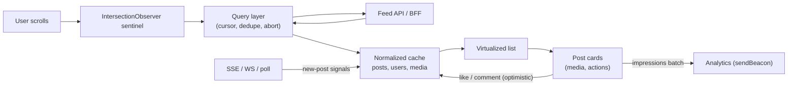
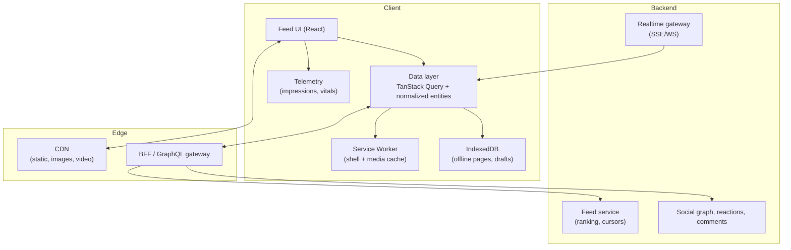
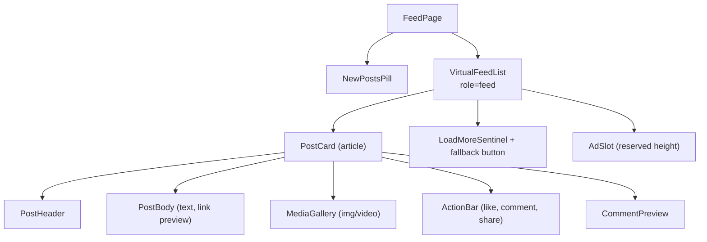
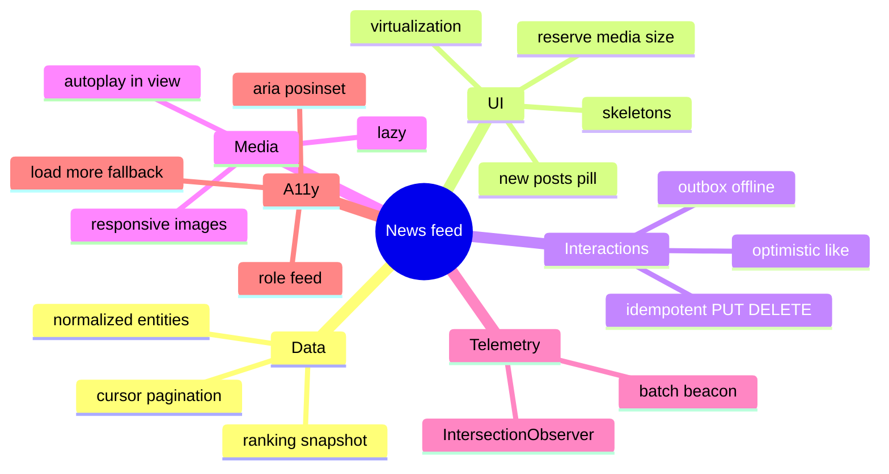

# System Design: News Feed & Infinite Scroll

> Method: [01-frontend-system-design-framework.md](01-frontend-system-design-framework.md) (RADIO). Web-platform facts verified against MDN/web.dev on 2026-11-10 (`content-visibility`, `IntersectionObserver`-based patterns, `scheduler.yield()` support). Companion code patterns: [react/06 (infinite queries)](../react/06-state-management-and-data-fetching.md), [react/08 (virtualisation)](../react/08-react-performance-optimization.md).
> Typical prompts: "Design the Facebook/Twitter/LinkedIn/Instagram news feed", "Design infinite scroll", "Design a social timeline".

## Table of Contents

1. [Quick Summary (TL;DR)](#1-quick-summary-tldr)
2. [Requirements and Scope](#2-requirements-and-scope)
3. [Estimation and Constraints](#3-estimation-and-constraints)
4. [High-Level Architecture](#4-high-level-architecture)
5. [Data Model and Normalization](#5-data-model-and-normalization)
6. [API Design](#6-api-design)
7. [Component Architecture and State](#7-component-architecture-and-state)
8. [Deep Dive 1: Pagination, Freshness, Ranking Stability](#8-deep-dive-1-pagination-freshness-ranking-stability)
9. [Deep Dive 2: Virtualization with Variable Heights and Scroll Restoration](#9-deep-dive-2-virtualization-with-variable-heights-and-scroll-restoration)
10. [Deep Dive 3: Optimistic Interactions](#10-deep-dive-3-optimistic-interactions)
11. [Deep Dive 4: Media, Autoplay, Impressions](#11-deep-dive-4-media-autoplay-impressions)
12. [Real-Time Updates](#12-real-time-updates)
13. [Performance Plan](#13-performance-plan)
14. [Accessibility, i18n, Security, Observability](#14-accessibility-i18n-security-observability)
15. [Failure Modes and Edge Cases](#15-failure-modes-and-edge-cases)
16. [Testing and Rollout](#16-testing-and-rollout)
17. [Trade-offs and Alternatives](#17-trade-offs-and-alternatives)
18. [Interview Questions — Fundamentals](#18-interview-questions--fundamentals)
19. [Interview Questions — Senior Scenarios](#19-interview-questions--senior-scenarios)
20. [Cheat Sheet](#20-cheat-sheet)
21. [Key Terms Glossary](#21-key-terms-glossary)
22. [Further Reading](#22-further-reading)

---

## 1. Quick Summary (TL;DR)

- **Core problem:** an unbounded, ranked, media-heavy, frequently changing list that must scroll smoothly and load progressively on weak devices.
- **Backbone:** **cursor pagination** → **normalized client cache** → **virtualised (or windowed) list** → **optimistic reactions** → **batched analytics (impressions)**.
- **Hard parts to deep-dive:** (1) pagination + freshness + stable ordering when ranking/new posts change, (2) variable-height virtualization + scroll restoration + layout stability, (3) optimistic updates with consistent counters across views, (4) media loading/autoplay and impression tracking without jank.
- **First paint:** SSR/stream the first page (or at least the shell + first posts); hydrate; then client-side infinite loading.
- **Accessibility:** ARIA **feed** pattern (`role="feed"`, `article`s, `aria-posinset`/`aria-setsize`), keyboard navigation, "Load more" alternative to pure infinite scroll.



---

## 2. Requirements and Scope

**Functional**
- Home feed of posts (text, images, video, links, polls), ranked by a server algorithm.
- Infinite scroll (load more on demand), pull-to-refresh / "new posts" indicator.
- Interactions: like/react, comment (inline preview), share, save, follow, report/hide.
- Post composer (out of scope for this deep dive; mention integration).
- Impressions/analytics, ads/sponsored insertion (slots).

**Non-functional**
- **Performance:** LCP ≤ 2.5 s on 4G mid-tier phone; INP ≤ 200 ms; smooth 60 fps scroll; CLS ≤ 0.1 (no jump when images/ads load).
- **Scale:** millions of users; user sessions scroll hundreds of posts; heterogeneous content.
- **Reliability:** graceful on flaky networks; resume position after navigation back.
- **Accessibility:** WCAG 2.2 AA; screen reader and keyboard support.
- **i18n:** RTL, translations, relative time.
- **Security/privacy:** sanitise UGC, respect blocks/mutes, privacy settings, consent for analytics.

**Out of scope (state explicitly):** feed ranking algorithm, post creation UI, notifications, moderation tooling.

**Clarifying questions to ask**
- Is the feed personalised and ranked or chronological? How fresh must it be?
- Are there edits/deletes after posting? Do counters need to be real-time?
- Native app too? Is SEO needed (public posts) or logged-in only?
- Media types and max sizes? Autoplay video? Ads?

---

## 3. Estimation and Constraints

| Item | Assumption | Implication |
|---|---|---|
| Page size | 10–20 posts | ~20–60 KB JSON per page (compressed) |
| Post card DOM | ~40–80 nodes + media | 100 posts ⇒ 4–8 k nodes ⇒ **virtualise** or cap |
| Images per post | 1–10, 50–300 KB originals | Responsive formats via CDN; lazy-load |
| Session scroll depth | 200–500 posts | Memory growth; evict offscreen media |
| Update frequency | New posts every few seconds globally, a few per minute for a user | "New posts" pill, not auto-prepend |
| Tail devices | 2–4 GB RAM Android | Strict DOM/memory/JS budgets |

Rule of thumb: keep **≤ ~50 post components mounted** at once (visible + overscan); keep per-post JS small; prefetch **one page ahead**.

---

## 4. High-Level Architecture



**Rendering strategy:** SSR (or RSC + streaming) for the **first page** for fast LCP and shell; client-side data layer afterwards. If logged-in only and SEO not needed, CSR with a **server-embedded first page payload** (bootstrap data) still avoids an extra round trip.

**Why a BFF:** assemble post + author + reaction summary + viewer state into **one response per page**, hide service topology, shrink payloads.

---

## 5. Data Model and Normalization

```ts
type ID = string;

interface User { id: ID; name: string; handle: string; avatarUrl: string; verified?: boolean }

interface Media {
  id: ID;
  type: "image" | "video";
  width: number; height: number;                 // intrinsic size → reserve space (CLS)
  blurhash?: string;                             // low-quality placeholder
  sources: { url: string; width: number; type: string }[];   // responsive sources (AVIF/WebP/JPEG)
  poster?: string; durationSec?: number;
}

interface Post {
  id: ID;
  authorId: ID;
  createdAt: string;                             // ISO UTC
  text: string;                                  // sanitized/markup per policy
  mediaIds: ID[];
  counts: { likes: number; comments: number; shares: number };
  viewer: { liked: boolean; saved: boolean };    // viewer-specific state
  version: number;                               // for conflict/ordering of updates
  deleted?: boolean;
}

// Normalized client state (cache)
interface Entities { posts: Record<ID, Post>; users: Record<ID, User>; media: Record<ID, Media> }

// Feed structure = ordered list of IDs per feed + paging info
interface FeedPage { items: { postId: ID; rankToken?: string }[]; nextCursor: string | null; snapshotId: string }
```

Why normalise: **one source of truth per post** → liking in the feed updates post detail/profile views; **partial updates** from real-time events are O(1); smaller memory vs duplicate nested copies.

Client-generated IDs for optimistic items (`tmp_123`) are swapped for server IDs on success.

---

## 6. API Design

### Feed read
```
GET /v1/feed?limit=15&cursor=<opaque>&snapshot=<id>
→ 200 {
  "snapshotId": "s_8f3",              // pins ranking context for this scroll session
  "items": [ { "post": {...}, "author": {...}, "media": [...] } ],
  "nextCursor": "c_9ab" | null,
  "prefetchHints": ["https://cdn/img1", ...]
}
```
- **Opaque cursor**, server-defined, encodes position in the ranked list for that snapshot.
- Response embeds authors/media to avoid N+1 follow-up requests; or GraphQL with fragments.
- **ETag/If-None-Match** for the first page (cheap revalidation); `Cache-Control: private, no-store` or short `max-age` for personalised data.

### New content signal
```
GET /v1/feed/updates?since=<snapshotId>  → { "newCount": 3, "latestCursor": "..." }
// or SSE: event: feed-updated  data: {"newCount": 3}
```

### Reactions (idempotent)
```
PUT /v1/posts/:id/like        (idempotent set)    → 200 { counts, viewer }
DELETE /v1/posts/:id/like     (idempotent unset)
Headers: Idempotency-Key: <uuid>
```
Prefer **PUT/DELETE state-setting** over POST toggle to survive retries and double taps.

### Error model
```json
{ "error": { "code": "RATE_LIMITED", "retryAfterSec": 3, "message": "..." } }
```

### Impressions (batch)
```
POST /v1/telemetry/impressions  [{ postId, visibleMs, position, ts }, ...]   (sendBeacon, fire-and-forget)
```

---

## 7. Component Architecture and State



**State split**
| State | Where |
|---|---|
| Feed pages + entities | TanStack Query (infinite query) + normalizer (or Relay/Apollo normalized cache) |
| Pending reactions | Mutation state keyed by post |
| Scroll position/virtualizer | Virtualizer + `history.state`/session cache |
| Expanded text, menus | Local component state |
| Visibility/impressions | Ref-based observer manager (no re-render) |

```tsx
function useFeed() {
  return useInfiniteQuery({
    queryKey: ["feed", "home"],
    queryFn: ({ pageParam, signal }) => api.getFeed({ cursor: pageParam, signal }),
    initialPageParam: null as string | null,
    getNextPageParam: (last) => last.nextCursor ?? undefined,
    staleTime: 60_000,
    maxPages: 10,                                  // cap memory; evict far-away pages
  });
}
```

---

## 8. Deep Dive 1: Pagination, Freshness, Ranking Stability

### Why cursor pagination (not offset)
New posts arrive continuously. With `offset=30`, inserted posts shift the window → **duplicates and gaps**. A **cursor tied to a ranking snapshot** gives stable, efficient continuation.

### Ranked feeds change between requests
Rankers are non-deterministic across time. Strategies:
1. **Snapshot ID**: server caches a ranked candidate list for the session; subsequent pages reference it → consistent order while scrolling.
2. **Client dedupe**: always merge by `post.id` (Set) as a safety net; drop deleted/blocked.
3. **Never reorder what the user already saw**: new content goes **above** via a pill, not by shifting existing items under the user's cursor.

### "New posts" pill
```tsx
function NewPostsPill({ count, onClick }: { count: number; onClick: () => void }) {
  if (!count) return null;
  return (
    <button className="new-posts" onClick={onClick} aria-live="polite">
      {count} new posts
    </button>
  );
}
// onClick: scroll to top + prepend (or refetch page 1), reset snapshot, announce via aria-live
```
Rules: do not auto-insert while the user is scrolled; if the user is at the top, optionally auto-merge small updates; coalesce signals to avoid pill flapping.

### Prefetching the next page
```tsx
function useLoadMoreSentinel(fetchNext: () => void, enabled: boolean) {
  const ref = useRef<HTMLDivElement>(null);
  const load = useEffectEvent(fetchNext);
  useEffect(() => {
    if (!enabled || !ref.current) return;
    const io = new IntersectionObserver(([e]) => { if (e.isIntersecting) load(); }, { rootMargin: "1200px 0px" }); // start before reaching the end
    io.observe(ref.current);
    return () => io.disconnect();
  }, [enabled]);
  return ref;
}
```
- Guard against duplicate fetches (`isFetchingNextPage`), **exponential backoff** on failure with a visible "Retry" button.
- **Prefetch one page ahead** when idle/after first paint, but cap bandwidth on slow connections (`navigator.connection.saveData`, effective type — non-standard, feature-detect).

### Back navigation and refresh
- Keep pages in the query cache (`gcTime` long enough) and restore **scroll offset + anchor post ID** (see §9).
- Pull-to-refresh: refetch page 1, **merge** by ID, highlight new items.

---

## 9. Deep Dive 2: Virtualization with Variable Heights and Scroll Restoration

### Why
100–500 posts with media = thousands of DOM nodes → slow style/layout, high memory. Virtualization renders only items near the viewport.

### Variable heights are the hard part
Posts differ (text length, media aspect ratios, embeds, expand/collapse). Options:

| Approach | Pros | Cons |
|---|---|---|
| **Measure-and-cache** (TanStack Virtual `measureElement`) | Accurate, handles dynamic content | Scroll jumps if estimates are off; needs `ResizeObserver` |
| **Reserve space from metadata** (media `width/height`, text-length heuristic) | Stable layout, fewer corrections | Heuristics for text; fonts may differ |
| **`content-visibility: auto` + `contain-intrinsic-size: auto <h>`** | No virtual scroll library; native find-in-page & a11y tree retention; Baseline since Sep 2025 | DOM nodes still exist (memory); avoid APIs forcing layout in skipped subtrees; less control |
| **Windowing + DOM recycling** | Lowest DOM | Complexity; focus/state loss for recycled nodes |

```tsx
import { useVirtualizer } from "@tanstack/react-virtual";

function VirtualFeedList({ posts }: { posts: Post[] }) {
  const parentRef = useRef<HTMLDivElement>(null);
  const v = useVirtualizer({
    count: posts.length,
    getScrollElement: () => parentRef.current,
    estimateSize: () => 520,                 // average card height; refined by measurement
    overscan: 4,
    getItemKey: (i) => posts[i].id,          // stable keys: preserves measurements on prepend
  });

  return (
    <div ref={parentRef} role="feed" aria-busy={false} style={{ overflow: "auto", height: "100vh" }}>
      <div style={{ height: v.getTotalSize(), position: "relative" }}>
        {v.getVirtualItems().map((row) => (
          <article
            key={row.key}
            data-index={row.index}
            ref={v.measureElement}
            aria-posinset={row.index + 1}
            aria-setsize={-1}                 // unknown total (infinite)
            style={{ position: "absolute", top: 0, width: "100%", transform: `translateY(${row.start}px)` }}
          >
            <PostCard postId={posts[row.index].id} />
          </article>
        ))}
      </div>
    </div>
  );
}
```
(Using the window as the scroller is also possible via `useWindowVirtualizer`; prefer the document scroller on mobile for native scroll behaviours and the URL bar.)

### Avoiding layout shift inside rows
- Reserve media size via `aspect-ratio` from `width/height`; use blurhash/LQIP placeholders.
- **Ads/embeds:** reserve slot heights; collapse gracefully if no fill.
- Late fonts: `font-display: swap` + metric-compatible fallbacks (size-adjust).
- **Scroll anchoring** (`overflow-anchor`) helps the browser keep content steady when items above change size; virtualizers may need to adjust scroll offset when measured sizes differ.

### Scroll restoration
```ts
history.scrollRestoration = "manual";
// On leave: store { anchorPostId, offsetWithinPost } in sessionStorage / history.state
// On return: restore cached pages, then scrollToIndex(indexOf(anchorPostId)) + offset
```
Don't restore raw `scrollY` — heights change; restore by **anchor item + offset**.

### Memory management
- Cap retained pages (`maxPages`), release offscreen heavy media (pause/unload video, drop `` `src` for far rows if needed), avoid unbounded arrays of impressions.

---

## 10. Deep Dive 3: Optimistic Interactions

Goal: tapping like feels instant; counts stay consistent everywhere; failures roll back.

```tsx
function useLike(postId: string) {
  const qc = useQueryClient();
  return useMutation({
    mutationFn: ({ liked }: { liked: boolean }) => api.setLike(postId, liked, { idempotencyKey: crypto.randomUUID() }),
    onMutate: async ({ liked }) => {
      await qc.cancelQueries({ queryKey: ["post", postId] });
      const prev = qc.getQueryData<Post>(["post", postId]);
      patchPost(qc, postId, (p) => ({
        ...p,
        viewer: { ...p.viewer, liked },
        counts: { ...p.counts, likes: p.counts.likes + (liked ? 1 : -1) },
      }));
      return { prev };
    },
    onError: (_e, _v, ctx) => ctx?.prev && patchPost(qc, postId, () => ctx.prev!),
    onSettled: () => qc.invalidateQueries({ queryKey: ["post", postId], refetchType: "none" }), // mark stale; reconcile lazily
  });
}
```
Key points:
- **Normalised patch** updates the post everywhere (feed card, detail, profile).
- **Debounce/coalesce rapid toggles**: track *desired* state; send the last one (or let idempotent PUT/DELETE handle ordering with a version/sequence).
- **Counts are eventually consistent**: display server counts when they arrive; never show negative numbers; avoid showing exact like counts that jump backwards (use `max` with local optimistic delta).
- **Conflict**: if a real-time event for the same post arrives mid-mutation, apply by `version`; ignore stale versions.
- **Comments**: optimistic inline comment with `tmp_id`, status `sending | failed | sent`, retry affordance; keep **order** via client timestamp then server ID swap.
- React 19 alternative for local UI: `useOptimistic` inside an Action ([react/04](../react/04-react-19-and-beyond.md)); for cross-view consistency the normalised cache approach is better.

---

## 11. Deep Dive 4: Media, Autoplay, Impressions

### Images
- **Responsive:** `srcset` + `sizes`, AVIF/WebP with fallback, CDN resizing (`w=`), `decoding="async"`, `loading="lazy"` for below-the-fold; **first post's image eager** with `fetchpriority="high"` (LCP candidate).
- **Placeholders:** blurhash/LQIP + fixed `aspect-ratio`.
- **Cancel offscreen loads** when scrolling fast (virtualization unmounts).

### Video
- **Autoplay muted** only when ≥ 50–60% visible (IntersectionObserver thresholds), **pause** when out of view or tab hidden (`visibilitychange`), **one video at a time**, respect `prefers-reduced-motion` and data-saver, `preload="metadata"`, adaptive streaming (HLS/DASH), poster images, captions.
- Avoid decoding multiple videos simultaneously on low-end devices.

### Impression tracking (viewability)
Define: an impression = post ≥ 50% visible for ≥ 1 s (configurable). Implement with **one shared `IntersectionObserver`**, per-post timers, batching, and `sendBeacon`:

```ts
class ImpressionTracker {
  private seen = new Set<string>();
  private timers = new Map<string, number>();
  private queue: { postId: string; ts: number }[] = [];
  private io = new IntersectionObserver((entries) => {
    for (const e of entries) {
      const id = (e.target as HTMLElement).dataset.postId!;
      if (e.intersectionRatio >= 0.5 && !this.seen.has(id)) {
        this.timers.set(id, window.setTimeout(() => { this.seen.add(id); this.queue.push({ postId: id, ts: Date.now() }); }, 1000));
      } else {
        clearTimeout(this.timers.get(id)); this.timers.delete(id);
      }
    }
  }, { threshold: [0, 0.5, 1] });

  observe(el: Element) { this.io.observe(el); }
  unobserve(el: Element) { this.io.unobserve(el); }

  flush = () => {
    if (!this.queue.length) return;
    const body = JSON.stringify(this.queue.splice(0));
    navigator.sendBeacon("/v1/telemetry/impressions", body);        // survives page unload
  };
}
// flush on interval (e.g. 5s), on `visibilitychange: hidden`, and `pagehide`
```
- Dedupe per session, cap queue size, sample if needed, respect consent.

### Link previews/embeds
Server-generated previews (no client unfurling); sandbox iframes; lazy-load embeds on interaction (click-to-load) to protect CWV.

---

## 12. Real-Time Updates

| Need | Choice |
|---|---|
| "New posts available" | **SSE** or lightweight polling (e.g., 30–60 s) with ETag; one-way and simple |
| Live counters (likes/comments) on visible posts | Subscribe to **visible post IDs only** via WS/SSE channel; throttle updates |
| Presence/typing in comments | WebSocket (see chat design) |

Details:
- **Fan-out control:** subscribe only for posts in/near the viewport; unsubscribe on unmount; batch subscription changes.
- **Throttle UI updates** (e.g., animate counts at most once per second).
- **SSE** note: HTTP/1.1 allows only ~6 SSE connections per browser+domain; use HTTP/2 (≈100 streams) or multiplex one stream per tab/BroadcastChannel leader.
- **Reconnect:** `Last-Event-ID`/cursor resume; on long gaps, refetch instead of replaying.

---

## 13. Performance Plan

| Area | Plan | Metric |
|---|---|---|
| First paint | SSR/stream first page; inline critical CSS; preload LCP image with `fetchpriority="high"`; avoid blocking JS | LCP |
| JS | Route split; defer composer, ads SDK, emoji picker; RSC/server-only for static parts | JS KB, TBT |
| Scroll | Virtualization; passive listeners; `IntersectionObserver` not scroll handlers; GPU-friendly transforms | INP, jank |
| Rendering | Memoised/Compiler-optimised `PostCard`; selector-based subscriptions; avoid context churn | Re-render counts |
| Media | Responsive images, lazy, blurhash, video constraints | LCP, bandwidth |
| Network | Cursor pages of 10–20; prefetch one ahead; compress; HTTP/2/3; dedupe | TTFB, waterfalls |
| Long tasks | `scheduler.yield()` when parsing/normalizing big payloads (feature-detect; Safari lacks it) or move normalization to a worker | Long tasks |
| Memory | `maxPages`, unmount offscreen media, cap analytics buffers | Heap size |
| Layout | Reserve media/ad sizes; font metrics | CLS |

**Budget example:** ≤ 170 KB critical JS (rule of thumb—verify on your device mix), first page JSON ≤ 60 KB, ≤ 2 images eager, ≤ 50 mounted cards.

---

## 14. Accessibility, i18n, Security, Observability

**Accessibility (ARIA Feed pattern)**
- Container `role="feed"` with `aria-busy="true"` while loading; each post an `<article>` with `aria-posinset`/`aria-setsize` (`-1` when unknown), labelled by author/headline and described by body.
- **Keyboard:** feed-level shortcuts (e.g., `j`/`k` next/previous post) with focus management and discoverable help; interactive controls reachable by Tab; visible focus; don't trap focus in the infinite list.
- **Infinite scroll pitfalls:** footer unreachable → provide a **"Load more" button** option or stop auto-load after N pages; announce loading and new items with `aria-live="polite"`; avoid moving focus unexpectedly.
- Media: alt text (user-provided/AI-suggested), captions, `prefers-reduced-motion` stops autoplay, buttons for play/pause.
- Contrast, touch targets (≥ 44 px), semantic headings.

**i18n**: `Intl.RelativeTimeFormat` for timestamps (re-render on interval sparingly), pluralised counts, number compaction (`Intl.NumberFormat` `notation: "compact"`), RTL layout with logical properties, language tagging per post (`lang` attribute), bidi isolation (`<bdi>`) for names.

**Security**: render user text as text (escape), sanitise rich text server-side + DOMPurify; validate/rewrite URLs (`rel="noopener noreferrer ugc"`), sandbox embeds, CSP, HttpOnly session cookies, rate limiting for reactions, block/mute/privacy enforcement server-side, don't leak private posts through prefetch/caches (`Cache-Control: private`).

**Observability**: RUM (LCP/INP/CLS by device/network), scroll depth, time-to-first-post, feed error rate, retry rates, memory warnings, impression delivery rate, experiment exposure logging with flags.

---

## 15. Failure Modes and Edge Cases

| Case | Handling |
|---|---|
| Page fetch fails mid-scroll | Inline error row with retry; keep existing items; backoff |
| Duplicates across pages | Dedupe by ID; server snapshot |
| Post deleted/blocked after load | Real-time tombstone or on next fetch → replace with "removed" placeholder or collapse smoothly |
| Edit after load | Version check; update in place |
| Offline | Show cached pages, mark stale, disable reactions or queue with outbox |
| Very long text/links | Clamp with "See more" (expand toggles height → virtualizer remeasure) |
| Image fails | Fallback tile with retry; keep reserved size |
| Rapid like/unlike | Coalesce; idempotent PUT/DELETE |
| Rate limited | Respect `Retry-After`; UI cooldown |
| Memory pressure | Reduce overscan, drop offscreen media, lower `maxPages` |
| Ads/sponsored inserts | Fixed placeholders, lazy fill, labelled for a11y, never shift content |
| Back from detail page | Restore cache + anchor |
| Feed ranking change | Snapshot; "new posts" pill; no silent reorder |

---

## 16. Testing and Rollout

- **Unit:** normalisation, dedupe/merge, cursor logic, impression logic (fake timers), optimistic reducers.
- **Component/integration:** RTL + MSW for pagination, errors, optimistic rollback; accessibility (axe) on the list; keyboard navigation.
- **E2E (Playwright):** scroll through N pages, back navigation restoration, offline behaviours, media autoplay rules; performance traces on throttled CPU.
- **Visual regression:** post variants (text/media/embeds/long content/RTL).
- **Performance CI:** Lighthouse/CWV budget; memory leak test (scroll 500 posts; heap stable).
- **Rollout:** feature flag; shadow traffic for new feed API; canary by region/cohort; guardrails on CWV, error rate, engagement; kill switch for autoplay/prefetch.

---

## 17. Trade-offs and Alternatives

| Decision | Option A | Option B | Notes |
|---|---|---|---|
| Pagination | Cursor + snapshot | Offset | Cursor for stability/perf |
| New content | Pill | Auto-prepend | Pill avoids layout jumps |
| List | Virtualize | `content-visibility` | Virtualize for huge feeds/memory; CV simpler, keeps find-in-page, but DOM stays |
| Infinite vs paged | Infinite with fallback | Numbered pages/"Load more" | Accessibility/footers favour explicit load-more |
| Real-time | SSE/poll | WebSocket | Feed signals are one-way; WS if you need two-way channels |
| Data layer | TanStack Query + normalizer | Relay/Apollo normalized cache | Relay/Apollo give normalization for free but heavier |
| Rendering | SSR first page | CSR | SSR for LCP/SEO; CSR + bootstrap JSON is a simpler alternative |
| Counters | Optimistic local | Wait for server | Optimistic for feel; reconcile |
| Video | Autoplay muted | Click to play | Autoplay costs bandwidth/battery; respect data saver |

---

## 18. Interview Questions — Fundamentals

### Q1. Why cursor pagination instead of offset for a feed?
Because new/removed items shift offsets, causing duplicates/gaps and deep offsets are slow; cursors (tied to a snapshot) provide stable, efficient paging.

### Q2. How do you implement infinite scroll?
An `IntersectionObserver` sentinel with a generous `rootMargin` triggers `fetchNextPage`; guard against duplicate fetches, handle errors with retry, cap memory, and offer an accessible alternative ("Load more").

### Q3. What is virtualization and when do you use it?
Rendering only visible rows plus overscan to keep DOM/memory/render cost constant; use when lists reach hundreds/thousands of rich items.

### Q4. How do you handle variable-height items in a virtual list?
Estimate then measure (`ResizeObserver`/`measureElement`), cache sizes by stable keys, reserve media dimensions from metadata, and adjust scroll offsets to avoid jumps; or use `content-visibility: auto` with `contain-intrinsic-size`.

### Q5. How do you restore scroll position when returning to the feed?
Persist the anchor item ID and offset (not `scrollY`), keep pages cached, set `history.scrollRestoration = "manual"`, and scroll to the anchor after the list renders.

### Q6. How do you implement the like button optimistically?
Cancel in-flight queries, patch the normalised post (viewer.liked + count), send idempotent PUT/DELETE, roll back on error, reconcile with server data.

### Q7. How do you track impressions efficiently?
One shared `IntersectionObserver`, visibility threshold + dwell timer, per-session dedupe, batched `sendBeacon` flush on interval and `visibilitychange`.

### Q8. How do you prevent layout shift?
Reserve media aspect ratios, fixed ad slots, skeleton sizes, font fallbacks, no content injected above the viewport without user action.

### Q9. How would you add real-time updates?
SSE/WS "new posts available" signal feeding a pill; subscribe to live counters only for visible posts; throttle UI updates; resume with last event ID.

### Q10. How do you make an infinite feed accessible?
ARIA feed pattern, keyboard shortcuts, live-region announcements, a "Load more" fallback so footer content is reachable, focus management, alt text, and reduced-motion handling.

---

## 19. Interview Questions — Senior Scenarios

### S1. "Scrolling becomes janky after ~200 posts on low-end Android. Diagnose and fix."
Profile with throttled CPU and Performance panel; likely culprits: too many mounted cards/media, heavy re-renders from state updates (counts, timers), image decoding, layout thrash from measuring, large JSON normalization on main thread, video autoplay. Fixes: virtualise with small overscan, unmount/lazy media, memoised cards with narrow selectors, `content-visibility` for sub-sections, reduce per-card JS, move normalization to worker or chunk with `scheduler.yield()` (fallback for Safari), cap `maxPages`, downscale images via CDN, restrict concurrent videos, measure heap; verify with INP/long-task metrics and field data.

### S2. "Users complain the feed 'jumps' when new posts load. What causes it and how do you fix it?"
Causes: auto-prepending above the viewport, images/ads without reserved size, virtualizer remeasurement without anchor correction, rank changes between pages. Fixes: pill for new posts, keep ranking snapshot, reserve media sizes, scroll anchoring/`overflow-anchor`, virtualizer with stable keys and offset adjustment on prepend, consistent skeleton dimensions.

### S3. "Design the data layer so liking in the feed also updates the post page and profile."
Normalised entity cache keyed by post ID; feed pages store IDs only; mutations patch entities; selectors/hooks read entities by ID; real-time events patch by ID with version checks; invalidate lazily. Compare TanStack Query + manual normaliser vs Relay/Apollo normalized caches (automatic cache updates via IDs) and trade-offs (bundle size, GraphQL commitment).

### S4. "How would you reduce server cost and latency for the feed API at 10× traffic?"
CDN/edge caching for static parts and public posts; cache ranked candidate snapshots; coalesce requests; send deltas for refresh; shrink payloads (field selection, compression, IDs + shared entity dictionaries); batch reaction counts; throttle real-time subscriptions; client prefetch only on idle/good networks; sample telemetry; observe cache hit ratio.

### S5. "How do you make impressions accurate but cheap?"
One observer, threshold + dwell, dedupe, batch/beacon, handle tab visibility, don't count programmatic scroll jumps, sample for analytics but exact for billing (server validation), idempotent ingestion, privacy/consent.

### S6. "Compare building this with RSC/Next.js vs a SPA."
RSC/SSR improves LCP and bundle size (server-render post bodies, only interactive actions as client components), streaming first page, but the infinite scroll list, optimistic reactions, and virtualization are client-heavy islands. Use Server Components for static shells/first page + client infinite list; Server Functions for reactions (idempotent + authz). Trade-offs: server cost, caching complexity with personalised data, hydration of long lists.

### S7. "How do you A/B test a new ranking UI without hurting performance?"
Assign variants server-side/at edge to avoid flicker, include variant in cache key, lazy-load variant code, track guardrail metrics (INP/LCP/errors), keep one code path performant, kill switch.

---

## 20. Cheat Sheet



| Problem | Answer |
|---|---|
| Duplicates/gaps | Cursor + snapshot + dedupe |
| Jank | Virtualize, memo, media limits |
| Layout shift | Reserve sizes, pill, anchor |
| Counter drift | Normalised cache + versions |
| Back nav | Cache + anchor restoration |
| Real-time | SSE/poll for "new", subscribe visible counters |
| A11y | ARIA feed + load-more fallback |

---

## 21. Key Terms Glossary

| Term | Definition |
|---|---|
| Cursor | Opaque pointer to continue a list |
| Snapshot | Server-pinned ranking context for a session |
| Virtualization | Rendering only visible items |
| Scroll anchoring | Browser/virtualizer technique to keep content steady during layout changes |
| Impression | A post counted as seen under visibility rules |
| Optimistic update | UI update before server confirmation |
| Tombstone | Marker for deleted content |
| Overscan | Extra rows rendered outside viewport |
| LQIP/blurhash | Low-quality image placeholders |
| ARIA feed | Accessibility pattern for streams of articles |

---

## 22. Further Reading

- [WAI-ARIA Authoring Practices — Feed pattern](https://www.w3.org/WAI/ARIA/apg/patterns/feed/)
- [web.dev — `content-visibility`](https://web.dev/articles/content-visibility) · [Optimize LCP](https://web.dev/articles/optimize-lcp) · [Optimize CLS](https://web.dev/articles/optimize-cls)
- [MDN — IntersectionObserver](https://developer.mozilla.org/en-US/docs/Web/API/Intersection_Observer_API) · [`navigator.sendBeacon`](https://developer.mozilla.org/en-US/docs/Web/API/Navigator/sendBeacon)
- [TanStack Virtual](https://tanstack.com/virtual) · [TanStack Query — Infinite Queries](https://tanstack.com/query/latest/docs/framework/react/guides/infinite-queries)
