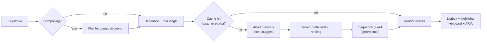
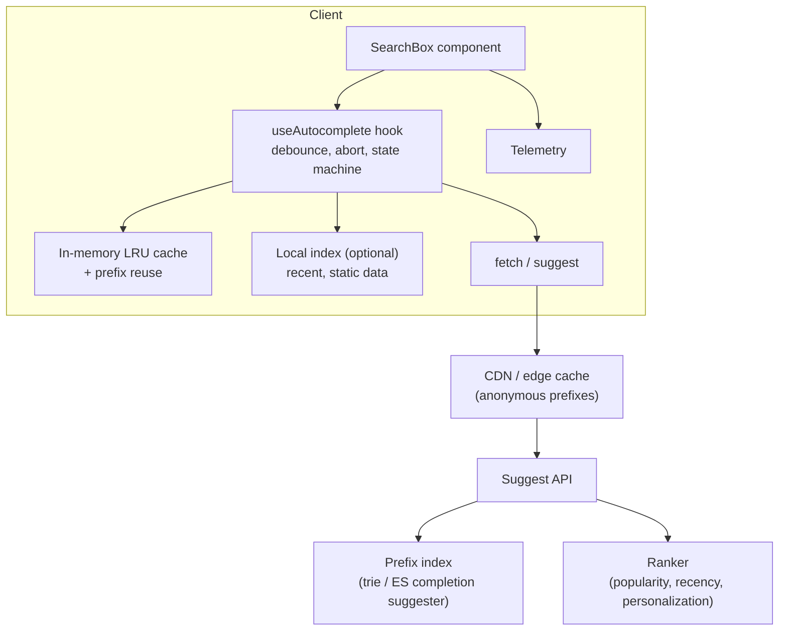
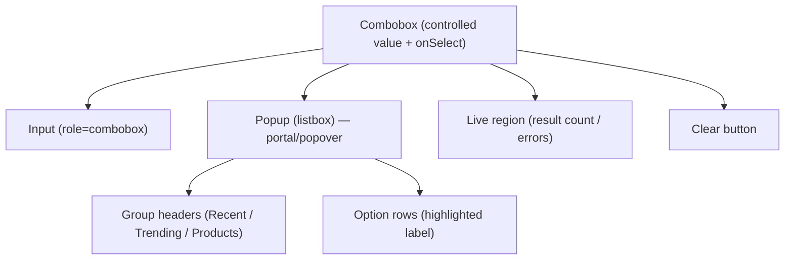
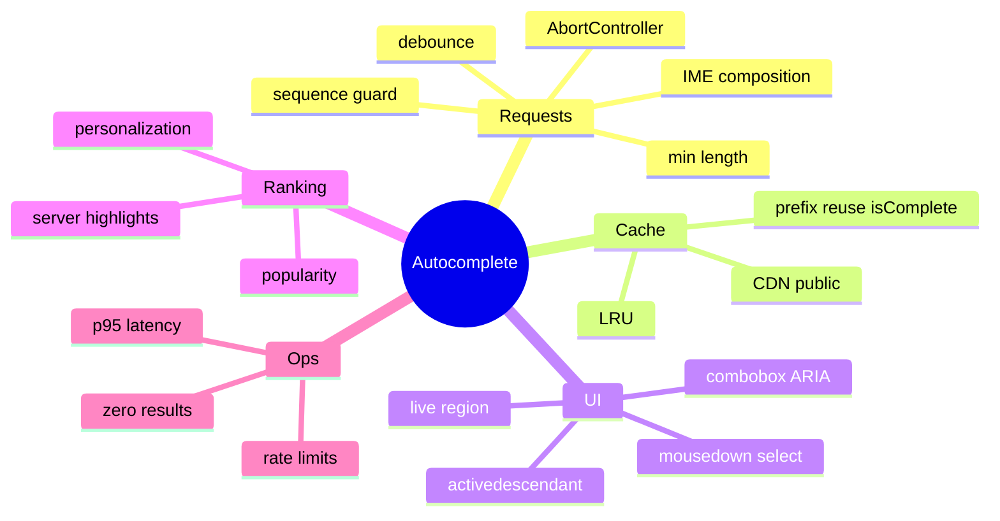

# System Design: Autocomplete / Typeahead Search

> Method: [01-frontend-system-design-framework.md](01-frontend-system-design-framework.md). Related: [react/03 (deferred values, transitions)](../react/03-concurrent-react-suspense-and-transitions.md), [react/07 (combobox coding round)](../react/07-component-patterns-and-architecture.md#12-classic-ui-coding-round-components), [react/02 (custom hooks)](../react/02-hooks-deep-dive.md).
> Typical prompts: "Design Google-style search suggestions", "Design a typeahead/combobox component", "Design autocomplete for an e-commerce search bar / user mention picker / address field".

## Table of Contents

1. [Quick Summary (TL;DR)](#1-quick-summary-tldr)
2. [Requirements and Scope](#2-requirements-and-scope)
3. [Estimation and Constraints](#3-estimation-and-constraints)
4. [High-Level Architecture](#4-high-level-architecture)
5. [Data Model](#5-data-model)
6. [API Design](#6-api-design)
7. [Component Architecture and State](#7-component-architecture-and-state)
8. [Deep Dive 1: Request Strategy (Debounce, Abort, Races, IME)](#8-deep-dive-1-request-strategy-debounce-abort-races-ime)
9. [Deep Dive 2: Caching and Local Search](#9-deep-dive-2-caching-and-local-search)
10. [Deep Dive 3: Accessible Combobox Behaviour](#10-deep-dive-3-accessible-combobox-behaviour)
11. [Deep Dive 4: Ranking, Highlighting, Personalisation](#11-deep-dive-4-ranking-highlighting-personalisation)
12. [Performance Plan](#12-performance-plan)
13. [Accessibility, i18n, Security, Observability](#13-accessibility-i18n-security-observability)
14. [Failure Modes and Edge Cases](#14-failure-modes-and-edge-cases)
15. [Testing and Rollout](#15-testing-and-rollout)
16. [Trade-offs and Alternatives](#16-trade-offs-and-alternatives)
17. [Interview Questions — Fundamentals](#17-interview-questions--fundamentals)
18. [Interview Questions — Senior Scenarios](#18-interview-questions--senior-scenarios)
19. [Cheat Sheet](#19-cheat-sheet)
20. [Key Terms Glossary](#20-key-terms-glossary)
21. [Further Reading](#21-further-reading)

---

## 1. Quick Summary (TL;DR)

- Autocomplete is a **latency-critical, high-frequency, stateful interaction**: every keystroke can trigger a request; results must be **correct for the latest input**, accessible, and fast.
- Core pipeline: **input → (debounce/min-length) → cache lookup → network (abortable) → ranked results → highlighted, keyboard-navigable listbox**.
- Hard parts: (1) **race conditions** and wasted requests, (2) **IME composition** (CJK) and mobile keyboards, (3) **caching/local filtering** (prefix reuse, LRU), (4) **ARIA combobox** semantics, (5) **ranking/personalisation** and safe highlighting.
- Quality bar: perceived instant (< ~100–200 ms from keystroke to suggestions), no flicker, no stale results, 100% keyboard accessible, screen reader announcements.
- Always mention **abort + sequence guard**, **debounce 150–300 ms (tune)**, **LRU cache**, **`aria-activedescendant`**, **escape before highlight**.



---

## 2. Requirements and Scope

**Functional**
- Suggestions appear as the user types; navigate with keyboard/mouse/touch; select to fill input or trigger search.
- Suggestion types: **queries**, **entities** (products, users, places), **recent searches**, **trending**, with categories/icons.
- Highlight matched text; show "no results" and error states; clear button; submit free text.
- Optional: spell correction ("did you mean"), multi-select tokens (mention/tag picker), async remote data + local data.

**Non-functional**
- **Latency:** results visible quickly; typical engineering budgets aim for < 100–200 ms server + network p95 for suggest endpoints (validate with your data).
- **Scale:** very high QPS (every keystroke); read-only → cacheable.
- **Accessibility:** APG-compliant combobox; screen reader friendly.
- **i18n:** IME composition, RTL, accents/normalisation (`NFC`/diacritic-insensitive), locale-aware collation.
- **Security/privacy:** don't leak private entities; don't log sensitive text; escape rendering.
- **Robustness:** poor networks, slow responses, repeated typing/backspace.

**Out of scope:** the full search results page, indexing pipeline, ML ranking models (but describe interfaces).

**Clarifying questions**
- Remote or local dataset? Size? Update frequency?
- Entities vs queries? Personalised? Multi-language?
- Mobile web? Voice input? Select multiple?
- Does selecting navigate or fill the input?

---

## 3. Estimation and Constraints

| Factor | Assumption | Implication |
|---|---|---|
| Typing speed | ~5 chars/s fast typist | Without debounce: ~5 requests/s/user |
| Debounce 200 ms | Cuts requests ~60–80% | Plus abort + caching |
| Suggestion payload | 5–10 items × ~100–300 B | ~1–3 KB; compress; trivial |
| Cache hit potential | Popular prefixes dominate | **CDN/edge caching** for anonymous suggestions |
| DOM | ≤ 10 visible options | No virtualization (unless large local lists) |
| Local dataset | ≤ ~5–10 k items | Client-side index (trie/Fuse/FlexSearch); larger → server |

Back-of-envelope: 10 M DAU × 8 searches × ~6 keystrokes after debounce/cache ≈ 480 M suggest calls/day ≈ ~5.5 k RPS average, much higher at peak → **cache at the edge and keep responses tiny**.

---

## 4. High-Level Architecture



**Server note (brief):** suggestions usually come from a **prefix-optimised index** (trie/FST, Elasticsearch completion suggester, edge n-grams), ranked by popularity/recency/personalisation. The frontend contract matters more than the index internals in this interview.

---

## 5. Data Model

```ts
type SuggestionKind = "query" | "product" | "user" | "place" | "recent" | "trending";

interface Suggestion {
  id: string;                         // stable key
  kind: SuggestionKind;
  label: string;                      // plain text (escape when rendering)
  secondary?: string;                 // e.g., category, address
  matches?: [start: number, end: number][];   // server-computed highlight ranges (code-unit indices)
  score?: number;
  payload?: Record<string, unknown>;  // what selecting does (url, entity id)
}

interface SuggestResponse {
  queryId: string;                    // echoes request id for stale detection/analytics
  q: string;                          // normalized query the server used
  suggestions: Suggestion[];
  isComplete: boolean;                // true when results cover all matches for this prefix (enables local filtering of longer prefixes)
}

type AutocompleteState =
  | { status: "idle" }
  | { status: "loading"; query: string; stale?: Suggestion[] }
  | { status: "ready"; query: string; items: Suggestion[]; activeIndex: number }
  | { status: "empty"; query: string }
  | { status: "error"; query: string; retry: () => void };
```

Model UI as a **state machine** (discriminated union) → no impossible states (see [typescript/03](../typescript/03-narrowing-and-type-safety-patterns.md)).

---

## 6. API Design

```
GET /v1/suggest?q=<prefix>&limit=8&types=query,product&locale=en-US&ctx=<opaque>
Headers: Accept-Language, Authorization (optional for personalization)
→ 200 {
  "queryId": "q_123",
  "q": "reac",
  "suggestions": [
    { "id": "s1", "kind": "query", "label": "react hooks", "matches": [[0,4]], "score": 0.93 }
  ],
  "isComplete": false
}
Cache-Control: public, max-age=60, stale-while-revalidate=300     // anonymous only
Vary: Accept-Language
```
Design notes:
- **Idempotent GET** → HTTP/CDN cacheable; personalised responses `private, no-store` (or separate endpoint for "recent/personal" served from local storage).
- **Normalise the query server- and client-side** the same way (trim, lowercase, Unicode normalisation) so cache keys match.
- **Return highlight ranges** or let the client compute; server ranges are more accurate for stemming/accents.
- **Limit & fields:** small `limit`, minimal fields; detail fetched after selection.
- **Rate limit** per IP/user; respond `429` with `Retry-After`.
- **HTTP/2/3** keepalive; `fetch(..., { priority: "high" })` is not universal—don't rely on it.

---

## 7. Component Architecture and State



- **Headless hook** (`useAutocomplete`) owns query state, fetching, cache, keyboard handling; **presentational** components render per the design system.
- **Props API (component):** `value`, `onValueChange`, `onSelect(suggestion)`, `fetchSuggestions(query, signal)`, `renderOption`, `minChars`, `debounceMs`, `openOnFocus`, `allowFreeText`, `getKey`.
- **Controlled/uncontrolled** both supported (see [react/07](../react/07-component-patterns-and-architecture.md#3-controlled-vs-uncontrolled-component-apis)).

---

## 8. Deep Dive 1: Request Strategy (Debounce, Abort, Races, IME)

### Debounce vs throttle
- **Debounce (trailing)**: wait for typing pause (150–300 ms typical) — best for suggestions.
- **Throttle**: guarantees periodic updates during long typing; sometimes used with a short interval + trailing call for faster feedback.
- Optional **leading call for the first character(s)** to feel instantaneous, then debounce.
- **Min length** (e.g. 1–2 chars; some products request from 1 char using cached popular results).

### Race conditions
Responses can return **out of order**. Use both:
1. **`AbortController`**: cancel the previous in-flight request when a new one starts.
2. **Sequence/query guard**: ignore any response whose `queryId`/sequence isn't the latest (aborts don't cover cached/mocked paths or already-parsed responses).

```ts
import { useEffect, useReducer, useRef } from "react";

export function useSuggestions(query: string, fetchSuggestions: (q: string, s: AbortSignal) => Promise<Suggestion[]>, opts = { minChars: 2, debounceMs: 200 }) {
  const [state, dispatch] = useReducer(reducer, { status: "idle" } as AutocompleteState);
  const seq = useRef(0);
  const cache = useRef(new LRU<string, Suggestion[]>(100));

  useEffect(() => {
    const q = normalize(query);
    if (q.length < opts.minChars) { dispatch({ type: "reset" }); return; }

    const cached = cache.current.get(q);
    if (cached) { dispatch({ type: "success", query: q, items: cached }); return; }

    const mySeq = ++seq.current;
    const controller = new AbortController();
    const id = setTimeout(async () => {
      dispatch({ type: "loading", query: q });
      try {
        const items = await fetchSuggestions(q, controller.signal);
        if (mySeq !== seq.current) return;                 // stale guard
        cache.current.set(q, items);
        dispatch({ type: "success", query: q, items });
      } catch (e) {
        if ((e as Error).name === "AbortError") return;
        if (mySeq === seq.current) dispatch({ type: "error", query: q });
      }
    }, opts.debounceMs);

    return () => { clearTimeout(id); controller.abort(); };  // cancel timer + request on next keystroke/unmount
  }, [query, fetchSuggestions, opts.minChars, opts.debounceMs]);

  return state;
}
```

### IME composition (CJK, some mobile keyboards)
During composition the input fires intermediate values (e.g. pinyin) that are not final text. Don't search or trigger selection on every composition update; use `compositionstart/compositionend` or `event.nativeEvent.isComposing`:
```tsx
const [composing, setComposing] = useState(false);
<input
  onCompositionStart={() => setComposing(true)}
  onCompositionEnd={(e) => { setComposing(false); setQuery(e.currentTarget.value); }}
  onChange={(e) => { if (!composing) setQuery(e.target.value); else setDraft(e.target.value); }}
  onKeyDown={(e) => { if (e.nativeEvent.isComposing) return; /* handle Enter/Arrow keys only when not composing */ }}
/>
```
(Alternatively search on every change but never treat Enter as "select" while composing.)

### Other request-level optimisations
- **Request coalescing**: if the same query is in-flight, reuse the promise.
- **Prefetch/preconnect**: `preconnect` to the suggest origin on focus; warm popular suggestions.
- **Retry**: at most one quick retry for transient errors; otherwise show an inline "couldn't load suggestions".
- **Offline**: fall back to recent/local results.
- **Data saver**: increase debounce or disable remote suggestions.

---

## 9. Deep Dive 2: Caching and Local Search

### LRU cache with prefix reuse
```ts
class LRU<K, V> {
  private map = new Map<K, V>();
  constructor(private max: number) {}
  get(k: K) { const v = this.map.get(k); if (v !== undefined) { this.map.delete(k); this.map.set(k, v); } return v; }
  set(k: K, v: V) { this.map.delete(k); this.map.set(k, v); if (this.map.size > this.max) this.map.delete(this.map.keys().next().value as K); }
}

// Prefix reuse: if "re" results are complete, "rea" can be filtered locally
function fromPrefixCache(cache: Map<string, { items: Suggestion[]; isComplete: boolean }>, q: string): Suggestion[] | null {
  for (let i = q.length - 1; i >= 1; i--) {
    const hit = cache.get(q.slice(0, i));
    if (hit?.isComplete) return hit.items.filter((s) => normalize(s.label).includes(q));
  }
  return null;
}
```
Only valid when the server signals the shorter prefix result is **complete** (`isComplete`), otherwise you'd miss matches.

### Cache keys & invalidation
Key by `(normalizedQuery, locale, types, personalisationContext)`; TTL 30–120 s for anonymous suggestions; clear personal caches on logout; cap memory; share across tabs via `BroadcastChannel` only for non-sensitive data.

### HTTP/CDN caching
`Cache-Control: public, max-age=60, stale-while-revalidate` for anonymous; varies by locale; popular prefixes yield high CDN hit ratios; avoid caching user-specific data publicly.

### Local (client-side) search
For small, static datasets (countries, timezones, commands): index on load.

```ts
class TrieNode { children = new Map<string, TrieNode>(); items: Suggestion[] = []; }
class Trie {
  root = new TrieNode();
  insert(key: string, s: Suggestion, topK = 8) {
    let n = this.root;
    for (const ch of key) {
      n = n.children.get(ch) ?? (n.children.set(ch, new TrieNode()), n.children.get(ch)!);
      if (n.items.length < topK) n.items.push(s);        // precomputed top-K per prefix (assumes insertion sorted by score)
    }
  }
  search(prefix: string) { let n = this.root; for (const ch of prefix) { const c = n.children.get(ch); if (!c) return []; n = c; } return n.items; }
}
```
- Complexity: **O(L)** lookup for prefix length L; memory heavy for large sets → use compressed structures (radix tree/FST) or server.
- For fuzzy/typo tolerance: **Fuse.js**, **FlexSearch**, `MiniSearch`; run in a **Web Worker** for large indexes.
- **Normalise**: lowercase, NFD + strip diacritics for matching (but display original), tokenise on whitespace.

### Recent searches
Stored locally (IndexedDB/localStorage), shown on focus with empty input; allow removal/clear; **don't store sensitive queries** in shared devices; respect privacy settings.

---

## 10. Deep Dive 3: Accessible Combobox Behaviour

Follow the **WAI-ARIA APG combobox (list autocomplete)** pattern.

### Semantics
```tsx
<div>
  <label htmlFor={inputId}>Search</label>
  <input
    id={inputId}
    role="combobox"
    aria-autocomplete="list"
    aria-expanded={open}
    aria-controls={listId}
    aria-activedescendant={active >= 0 ? `${listId}-opt-${active}` : undefined}
    autoComplete="off"                       // suppress browser autofill dropdown
    value={query}
    onChange={...}
    onKeyDown={onKeyDown}
    onBlur={closeSoon}
  />
  <ul id={listId} role="listbox" aria-label="Suggestions" hidden={!open}>
    {items.map((it, i) => (
      <li key={it.id} id={`${listId}-opt-${i}`} role="option" aria-selected={i === active}
          onMouseDown={(e) => { e.preventDefault(); select(it); }}   // mousedown avoids blur-before-click race
          onMouseEnter={() => setActive(i)}>
        <Highlight text={it.label} ranges={it.matches} />
      </li>
    ))}
  </ul>
  <div role="status" aria-live="polite" className="sr-only">{statusText}</div>   {/* "5 suggestions available" */}
</div>
```
- **Focus stays in the input**; the "active" option is communicated with **`aria-activedescendant`** (not DOM focus).
- **Live region** announces result count/no results (debounced to avoid chatter).

### Keyboard model (APG)
| Key | Behaviour |
|---|---|
| ↓ | Open if closed; move to next option (wrap optional) |
| ↑ | Move to previous option (or last if none active) |
| Enter | Select active option (or submit free text if none active) |
| Esc | Close popup; second Esc clears input |
| Home/End | Move caret in the input (don't hijack) unless pattern states otherwise |
| Tab | Close popup; optionally accept active suggestion (document the behaviour) |
| Alt+↓ / Alt+↑ | Open/close without changing selection (optional) |
| Typing | Updates query, resets active index |

### Pointer/touch
- Use **`onMouseDown` with `preventDefault`** (or `onPointerDown`) so the input doesn't blur before click.
- Touch targets ≥ 44 px; scroll within list without closing; avoid hover-only affordances.
- Mobile keyboards: `enterkeyhint="search"`, `inputmode`, `autocapitalize="off"`, `autocorrect="off"`, `spellcheck="false"`.

### Popup positioning
Use a portal/popover layer with anchor positioning (Floating UI) — flip when near viewport edges, match input width, handle `visualViewport` changes (mobile keyboard), close on outside click/scroll appropriately. The native **Popover API** and CSS anchor positioning are emerging options—check support before relying on them.

---

## 11. Deep Dive 4: Ranking, Highlighting, Personalisation

### Ranking inputs (server)
Popularity (query frequency), recency/trending, personalisation (history, locale, location), entity type boosts, typo-tolerance, safety filters. The frontend's role: **send context** (locale, surface, user id via auth), **display the ranking as given**, **log selections** for feedback.

### Safe highlighting (don't use `innerHTML`)
```tsx
function Highlight({ text, ranges = [] }: { text: string; ranges?: [number, number][] }) {
  if (!ranges.length) return <>{text}</>;
  const parts: React.ReactNode[] = [];
  let cursor = 0;
  for (const [s, e] of [...ranges].sort((a, b) => a[0] - b[0])) {
    if (s > cursor) parts.push(text.slice(cursor, s));
    parts.push(<mark key={s}>{text.slice(s, e)}</mark>);
    cursor = e;
  }
  if (cursor < text.length) parts.push(text.slice(cursor));
  return <>{parts}</>;
}
```
- Never inject server HTML; if computing client-side, **escape regex** input (`RegExp.escape` is in the `es2025` lib (TypeScript 6+) but check runtime support; otherwise `replace(/[.*+?^${}()|[\]\\]/g, "\\$&")`).
- Handle **Unicode**: indices in UTF-16 code units vs graphemes (emoji) → use `Intl.Segmenter` for display slicing if ranges are by grapheme.
- Bold the **non-matching remainder** (Google style) or the match (e-commerce style) — product decision.

### Personalisation & privacy
- **Recent** (local) + **trending** (server) + **personal** (server, requires auth) with distinct visual sections.
- Respect "pause search history", private mode; avoid showing sensitive suggestions on shared screens; **filter offensive/unsafe** content server-side.

### Selection semantics
- Selecting a **query** suggestion fills the input and submits search; selecting an **entity** navigates directly. Make the behaviour consistent and announced (`aria-label`).
- **Inline completion** (ghost text) is optional; if used, announce it and make it dismissible.

---

## 12. Performance Plan

| Area | Technique |
|---|---|
| Keystroke → input paint | Keep input **uncontrolled by heavy tree**; isolate the combobox state so typing doesn't re-render the page; `useDeferredValue` for result rendering if heavy (see [react/03](../react/03-concurrent-react-suspense-and-transitions.md)) |
| Network | Debounce + abort + cache; HTTP/2/3; CDN for anonymous; small payloads; `preconnect` on focus |
| Server | Prefix index, in-memory, precomputed top-K per prefix, edge compute for hot prefixes |
| Rendering | ≤ 10 options; memoised rows; avoid layout thrash when opening popup; no virtualisation unless large |
| Bundle | Lazy-load fuzzy search libs/worker; code-split advanced features; avoid loading the whole index eagerly |
| Long tasks | Local fuzzy search in Web Worker; chunk with `scheduler.yield()` when available (not Safari) |
| Perceived speed | Show recent/trending immediately on focus; keep previous results visible while loading (avoid blank flashes); skeleton only if > ~200–300 ms |

**Metrics:** keystroke-to-suggestion latency (client-measured p50/p95), cache hit ratio, aborted-request rate, zero-result rate, INP on the input, error rate.

---

## 13. Accessibility, i18n, Security, Observability

**Accessibility**: APG combobox semantics, `aria-activedescendant`, live region for counts, visible focus on the active option, sufficient contrast, zoom/reflow support, don't rely on color alone, Esc/Tab behaviours documented, works with screen readers (NVDA/VoiceOver/TalkBack — test), reduced motion for popup animations.

**i18n**: IME composition; Unicode normalisation (NFC/NFD) and accent-insensitive matching; locale-aware case folding (Turkish dotless i); `Intl.Collator` for sort; RTL popup alignment (logical properties); translate section headers/status messages with pluralisation; language-specific tokenisation (CJK has no spaces).

**Security & privacy**: escape output (no `dangerouslySetInnerHTML`); don't expose private entities in suggestions (authz in the suggest API); rate limit; avoid logging raw queries with PII (hash/sample/redact); `autocomplete="off"` carefully (don't break password managers on login forms); CSP; avoid leaking via URL/referrer; for sensitive fields (SSN, passwords) never provide suggestions.

**Observability**: log **query length buckets**, selection position, abandonment, zero-result queries (privacy-safe), latency, errors, cache hits; experiments (A/B ranking) with flags; session replays must mask inputs.

---

## 14. Failure Modes and Edge Cases

| Case | Handling |
|---|---|
| Out-of-order responses | Abort + sequence guard |
| Slow network | Keep previous results; subtle spinner after delay; allow submit anyway |
| Server error/429 | Inline message, backoff, fall back to recent/local |
| Empty results | "No suggestions"; offer search-as-typed; spell-correction suggestion |
| Very fast typing/backspacing | Cache + prefix reuse; debounce |
| IME composition | Don't search/submit mid-composition |
| Paste long text | Cap length; trim; avoid sending huge queries |
| Special characters/emoji | Normalise; encode (`encodeURIComponent`) |
| Popup obscured/offscreen | Flip/shift positioning; scroll into view; mobile keyboard overlap |
| Browser autofill overlap | `autocomplete="off"` + unique `name` |
| Blur vs click race | `onMouseDown` selection, delayed close |
| Multiple comboboxes on page | Unique IDs (`useId`), single open at a time |
| Stale cache after data change | TTL; invalidate on known updates |
| Screen reader chatter | Debounce live region updates |

---

## 15. Testing and Rollout

- **Unit:** debounce/abort/sequence guard (fake timers), LRU, prefix reuse correctness (`isComplete`), highlight function (Unicode), normalisation, reducer state machine.
- **Component:** RTL + `userEvent`: typing, keyboard navigation (↓ ↑ Enter Esc), mouse selection, blur/click race, IME events (`fireEvent.compositionStart/End`), error/empty states.
- **Accessibility:** axe, manual screen reader scripts; verify `aria-activedescendant` updates; live region announcements.
- **E2E:** Playwright with network throttling and out-of-order mocked responses; mobile viewport with virtual keyboard emulation.
- **Load/perf:** server QPS tests; client p95 latency monitoring; INP.
- **Rollout:** flag the new ranking/UI; A/B on selection rate and time-to-success; guardrails on latency/errors; kill switch to disable remote suggestions (fallback to local/recent).

---

## 16. Trade-offs and Alternatives

| Decision | Option A | Option B | Notes |
|---|---|---|---|
| Source | Remote suggest API | Local index | Local for small/static data; remote for large/dynamic |
| Rate control | Debounce | Throttle (+leading) | Debounce fewer requests; leading call feels faster |
| Matching | Prefix | Fuzzy/typo-tolerant | Fuzzy better UX, costlier (worker/server) |
| Cache | In-memory LRU | HTTP/CDN only | Use both: client LRU + CDN for anonymous |
| Highlight | Server ranges | Client compute | Server handles stemming/accents; client simpler for exact |
| Popup | Custom | Native datalist | `<datalist>` is limited in styling/a11y/consistency |
| Library | Downshift/React Aria/Radix | Build in-house | Libraries solve a11y edge cases |
| Submit on select | Fill + submit | Fill only | Depends on UX; document |
| Personalisation | On | Off/anonymous | Privacy/regulatory constraints; caching implications |

---

## 17. Interview Questions — Fundamentals

### Q1. How do you prevent a stale response from overwriting newer results?
Abort the previous request with `AbortController` and also guard with a sequence/`queryId` so only the latest response updates state.

### Q2. Debounce vs throttle for typeahead?
Debounce waits for a pause (fewer requests); throttle guarantees periodic calls. Typically debounce 150–300 ms, optionally with a leading call for the first character; tune with data.

### Q3. How do you make the combobox accessible?
APG combobox pattern: `role="combobox"` input, `aria-expanded`, `aria-controls`, `aria-activedescendant`, `role="listbox"`/`option`, keyboard support, live region for result counts, focus stays on the input.

### Q4. How do you handle IME input?
Don't trigger search/selection during composition; wait for `compositionend` or check `isComposing`, otherwise users typing CJK see broken behaviour.

### Q5. How do you cache suggestions?
LRU per normalised query (plus locale/context), TTL, prefix reuse when the server marks shorter results complete, and HTTP/CDN caching for anonymous requests.

### Q6. Why use `onMouseDown` instead of `onClick` for options?
Input `blur` fires before `click`, closing the popup and canceling the click; `mousedown` + `preventDefault` selects before blur.

### Q7. How do you highlight matches safely?
Render via React nodes using ranges (no `innerHTML`); escape regex if computing client-side; handle Unicode graphemes.

### Q8. How would you do client-side search for 5,000 items?
Pre-normalise and index (trie/MiniSearch/Fuse), run in a worker if heavy, debounce, limit results; for tens of thousands move to server search.

### Q9. How do you avoid blank flashes between keystrokes?
Keep previous results visible with a subtle loading indicator until new results arrive; only show skeletons after a delay.

### Q10. What metrics do you track?
Keystroke-to-suggestion latency, cache hit ratio, aborted requests, zero-result rate, selection rank/CTR, abandonment, errors, INP.

---

## 18. Interview Questions — Senior Scenarios

### S1. "Design autocomplete for a global e-commerce site with 50M suggestions and strict latency."
Server: prefix index (trie/FST/ES completion), precomputed top-K per prefix, popularity + recency blending, regional shards, edge cache for anonymous; client: debounce, abort, LRU, prefix reuse with `isComplete`, tiny payloads, preconnect on focus, show recents instantly. Handle typos via server-side fuzzy fallback only when prefix results are sparse. Personalisation via separate small request (or merge at the BFF) to keep the cacheable path pure. Observability: p95 latency, hit ratios, zero-result queries feeding catalogue/synonym improvements. Rollout: shadow ranking, A/B on conversion.

### S2. "Search suggestions are slower on mobile and sometimes show wrong results. Debug."
Check out-of-order responses (missing abort/sequence guard), cache key mismatches (normalisation differences), debounce too aggressive on slow devices, large payloads, JS main thread jank from rendering/highlighting, IME composition, CDN `Vary` misconfiguration, locale mismatches. Add tracing per queryId, client latency metrics, throttled-network tests, and fix with guards and caching.

### S3. "How would you build a mention picker (@user) in a rich text editor?"
Trigger on `@` token detection in the editor model (not the DOM selection alone); query scoped to channel membership (server authz); popup anchored to caret range; keyboard handling that doesn't break editor shortcuts; insert a **structured node** (not plain text) with an ID; accessible via the same combobox pattern but with `aria-activedescendant` on the editor; handle IME and composition; debounce/caching like standard autocomplete.

### S4. "Make it work offline."
Cache recent searches and a compact local index; fall back to local results when offline (`fetch` fails/`navigator.onLine` is a hint); show state; queue analytics; sync when online.

### S5. "How do you A/B test ranking changes safely?"
Server-side assignment with stable bucketing; log exposure and selection (position, kind); metrics: CTR, success rate, time to result, zero-result rate; guardrails on latency/errors; ramp gradually; keep cache keys variant-aware to avoid cross-contamination.

### S6. "How do you handle rate limits and abuse?"
Client-side debounce/min-length, token-bucket throttling; server-side per-IP/user limits with `429 + Retry-After`; bot detection; ensure UI degrades to recents; don't expose enumerating private data through suggestions (authz + generic results).

### S7. "How would you implement this as a reusable design-system component?"
Headless hook + styled component; props for data source, rendering, selection modes (single/multi), async state, grouping; a11y and keyboard baked in; extensibility via slots; controlled/uncontrolled; theming tokens; visual regression and a11y tests; semver + docs; avoid owning data fetching—accept `loadOptions(query, signal)`.

---

## 19. Cheat Sheet



| Gotcha | Fix |
|---|---|
| Stale results | Abort + sequence |
| Blur eats click | `onMouseDown` |
| CJK broken | Respect composition |
| XSS in highlight | React nodes only |
| Over-cached personal data | `private` caching only |
| Screen reader silence | Live region + activedescendant |

---

## 20. Key Terms Glossary

| Term | Definition |
|---|---|
| Typeahead | Suggestions while typing |
| Combobox | Input + popup list widget pattern |
| `aria-activedescendant` | Points to the visually active option while focus stays on input |
| IME | Input Method Editor for composing complex scripts |
| Prefix reuse | Deriving longer-prefix results from complete shorter-prefix results |
| LRU | Least-recently-used eviction cache |
| Trie/FST | Prefix tree / finite-state transducer for fast prefix lookup |
| Debounce | Delay until input pauses |
| Zero-result rate | Share of queries with no suggestions |
| Completion suggester | Search engine feature optimised for prefix suggestions |

---

## 21. Further Reading

- [WAI-ARIA APG — Combobox pattern](https://www.w3.org/WAI/ARIA/apg/patterns/combobox/) · [Listbox pattern](https://www.w3.org/WAI/ARIA/apg/patterns/listbox/)
- [MDN — AbortController](https://developer.mozilla.org/en-US/docs/Web/API/AbortController) · [Composition events](https://developer.mozilla.org/en-US/docs/Web/API/Element/compositionstart_event) · [`Intl.Segmenter`](https://developer.mozilla.org/en-US/docs/Web/JavaScript/Reference/Global_Objects/Intl/Segmenter)
- [Downshift](https://www.downshift-js.com/) · [React Aria Combobox](https://react-spectrum.adobe.com/react-aria/ComboBox.html) · [Floating UI](https://floating-ui.com/)
