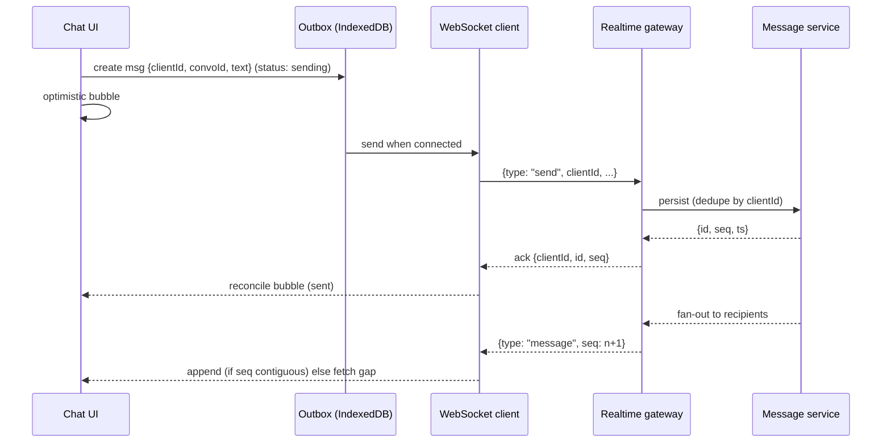
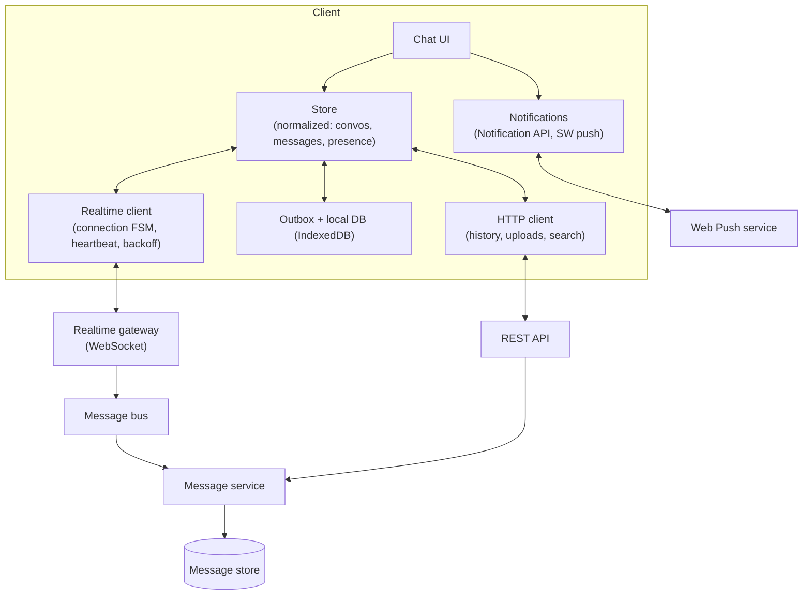
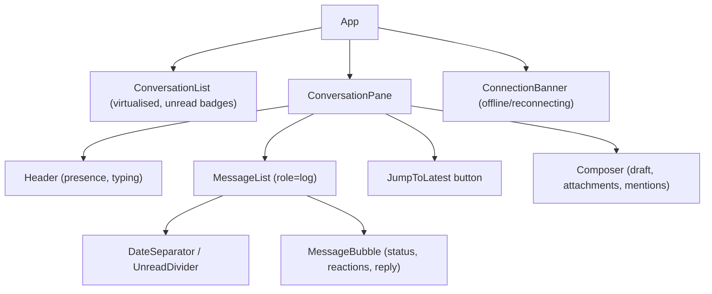
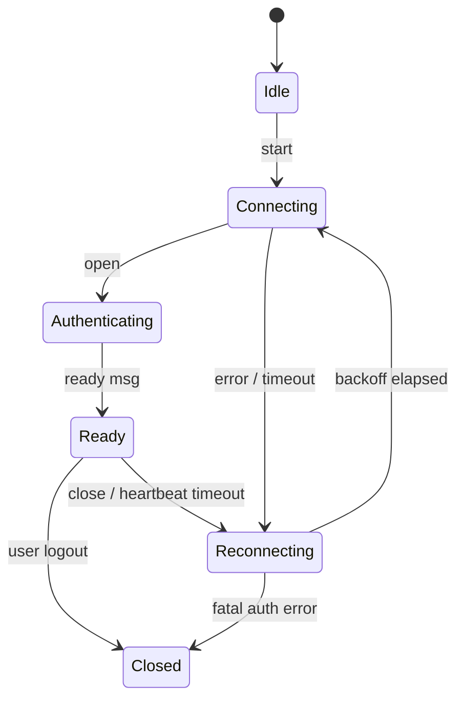
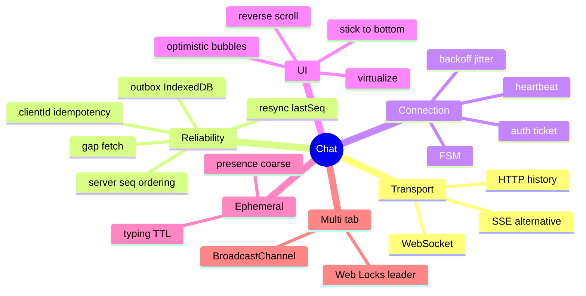

# System Design: Chat & Real-Time Messaging

> Method: [01-frontend-system-design-framework.md](01-frontend-system-design-framework.md). Facts used here were checked against MDN on 2026-11-10: SSE is one-way, auto-reconnects with `Last-Event-ID`, and is limited to **6 connections per browser+domain on HTTP/1.1** (≈100 streams over HTTP/2). Related: [react/06 (optimistic updates, real-time + cache)](../react/06-state-management-and-data-fetching.md), [react/03 (Suspense, transitions)](../react/03-concurrent-react-suspense-and-transitions.md).
> Typical prompts: "Design WhatsApp/Slack/Messenger on the web", "Design a live chat widget", "Design real-time comments / notifications".

## Table of Contents

1. [Quick Summary (TL;DR)](#1-quick-summary-tldr)
2. [Requirements and Scope](#2-requirements-and-scope)
3. [Estimation and Constraints](#3-estimation-and-constraints)
4. [High-Level Architecture](#4-high-level-architecture)
5. [Data Model](#5-data-model)
6. [Protocol and API Design](#6-protocol-and-api-design)
7. [Component Architecture and State](#7-component-architecture-and-state)
8. [Deep Dive 1: Connection Management](#8-deep-dive-1-connection-management)
9. [Deep Dive 2: Message Lifecycle, Ordering, Idempotency, Resync](#9-deep-dive-2-message-lifecycle-ordering-idempotency-resync)
10. [Deep Dive 3: The Message List UI](#10-deep-dive-3-the-message-list-ui)
11. [Deep Dive 4: Presence, Typing, Receipts, Notifications](#11-deep-dive-4-presence-typing-receipts-notifications)
12. [Offline, Multi-Tab, Background Behaviour](#12-offline-multi-tab-background-behaviour)
13. [Performance Plan](#13-performance-plan)
14. [Accessibility, i18n, Security, Observability](#14-accessibility-i18n-security-observability)
15. [Failure Modes and Edge Cases](#15-failure-modes-and-edge-cases)
16. [Testing and Rollout](#16-testing-and-rollout)
17. [Trade-offs and Alternatives](#17-trade-offs-and-alternatives)
18. [Interview Questions — Fundamentals](#18-interview-questions--fundamentals)
19. [Interview Questions — Senior Scenarios](#19-interview-questions--senior-scenarios)
20. [Cheat Sheet](#20-cheat-sheet)
21. [Key Terms Glossary](#21-key-terms-glossary)
22. [Further Reading](#22-further-reading)

---

## 1. Quick Summary (TL;DR)

- **Chat is a distributed-systems problem at the edge:** an unreliable, reconnecting transport must deliver **ordered, de-duplicated, resumable** messages while the UI stays instant.
- **Backbone:** **WebSocket** (bi-directional) + **REST/HTTP** for history and uploads; **client-generated message IDs** (idempotency), **per-conversation sequence numbers** (ordering/gap detection), **outbox** (persisted pending sends), **resync on reconnect** (`lastSeq`).
- **UI:** reverse-infinite message list with **stick-to-bottom** logic, scroll anchoring when prepending history, optimistic bubbles with statuses, unread divider, typing/presence kept **ephemeral**.
- **Hard parts:** connection lifecycle (heartbeat, backoff + jitter, auth refresh), ordering/gaps/duplicates, multi-tab coordination, background-tab throttling, performance under bursts.
- **Mention explicitly:** at-least-once delivery + idempotent processing ≈ "effectively exactly once", server-assigned ordering, acks, backpressure, privacy of typing/read receipts, E2EE trade-offs.



---

## 2. Requirements and Scope

**Functional**
- 1:1 and group conversations; send/receive text (+ attachments, emoji, reactions).
- Message history with infinite scroll up; unread counts and "jump to latest".
- Delivery states: sending, sent, delivered, read; failed with retry.
- Typing indicators, presence (online/last seen), read receipts.
- Notifications (in-app, browser push), search (optional), edit/delete.

**Non-functional**
- **Latency:** messages appear to others in ~100s of ms; local echo immediate.
- **Reliability:** no lost or duplicated messages across reconnects, tab sleeps, flaky mobile networks.
- **Scale:** many concurrent connections; large rooms (thousands); bursty traffic.
- **Security/privacy:** authz per conversation, XSS-safe rendering, rate limits, optional E2EE.
- **Accessibility:** screen reader announcements, keyboard operability.
- **Offline:** read cached history; queue sends.

**Out of scope:** voice/video (WebRTC), server fan-out architecture, E2EE protocol details (mention trade-offs).

**Clarifying questions**
- Web only or multi-device sync? Group size limits? Retention? Search? Threads?
- Delivery guarantees needed? Read receipts mandatory? E2EE?
- Peak concurrent users? Mobile web constraints?

---

## 3. Estimation and Constraints

| Item | Assumption | Implication |
|---|---|---|
| Concurrent connections | 1 WS per tab/session | Multi-tab dedupe to cut server load |
| Message size | 200–500 B text; attachments by reference | Tiny frames; uploads via HTTP |
| Active conversation | 50–200 messages mounted | Virtualise long histories |
| Burst | Large room 50+ msgs/s | Batch/coalesce renders; throttle live UI |
| Ephemeral events | typing (every 2–3 s while typing), presence heartbeats | Throttle; TTL on server/client |
| Reconnect storms | Mass reconnect after outage | Jittered backoff; resumption tokens |

---

## 4. High-Level Architecture



**Choice:** WebSocket for the live channel; HTTP for history, auth, uploads, search. Reasoning in §17.

---

## 5. Data Model

```ts
type ID = string;

type MessageStatus = "sending" | "sent" | "delivered" | "read" | "failed";

interface Message {
  id: ID;                         // server ID (undefined/tmp until acked)
  clientId: string;               // UUID/ULID generated on the client (idempotency key)
  conversationId: ID;
  senderId: ID;
  seq?: number;                   // monotonic per conversation, assigned by server
  createdAt: string;              // server timestamp (authoritative for display order within seq)
  clientCreatedAt: number;        // local time for optimistic ordering before ack
  body: { type: "text"; text: string } | { type: "image"; attachmentId: ID; width: number; height: number } | { type: "file"; attachmentId: ID; name: string; size: number };
  status: MessageStatus;
  editedAt?: string; deletedAt?: string;
  reactions?: Record<string, ID[]>;       // emoji → userIds
  replyTo?: ID;
}

interface Conversation {
  id: ID;
  type: "dm" | "group";
  memberIds: ID[];
  lastSeq: number;                // highest seq known locally
  lastReadSeq: number;            // for unread computation
  unreadCount: number;
  draft?: string;                 // persisted draft per convo
}

// Normalized store
interface ChatState {
  conversations: Record<ID, Conversation>;
  messagesByConvo: Record<ID, { bySeq: Map<number, Message>; pending: Message[]; oldestSeqLoaded: number | null; hasMoreOlder: boolean }>;
  presence: Record<ID, { online: boolean; lastSeen?: number }>;     // ephemeral
  typing: Record<ID /*convo*/, Record<ID /*user*/, number /*expiresAt*/>>;
}
```

---

## 6. Protocol and API Design

### WebSocket envelope (JSON; consider binary/compression later)
```jsonc
// client → server
{ "t": "auth",    "ticket": "<short-lived>" }
{ "t": "sub",     "convos": [{ "id": "c1", "lastSeq": 120 }] }       // subscribe + resume
{ "t": "send",    "clientId": "01J...", "convoId": "c1", "body": {...} }
{ "t": "ack",     "convoId": "c1", "seq": 125 }                     // delivered receipt (batched)
{ "t": "read",    "convoId": "c1", "seq": 125 }
{ "t": "typing",  "convoId": "c1" }
{ "t": "ping",    "n": 17 }

// server → client
{ "t": "ready",   "connId": "...", "resumeToken": "...", "serverTime": 1730000000 }
{ "t": "msg",     "convoId": "c1", "seq": 126, "message": {...} }
{ "t": "sendAck", "clientId": "01J...", "id": "m9", "seq": 126, "ts": "..." }
{ "t": "sendErr", "clientId": "01J...", "code": "RATE_LIMITED", "retryAfterMs": 2000 }
{ "t": "gap",     "convoId": "c1", "from": 121, "to": 125 }          // server tells client to fetch
{ "t": "evt",     "convoId": "c1", "seq": 127, "kind": "edit|delete|reaction", ... }
{ "t": "presence","userId": "u2", "online": true }
{ "t": "pong",    "n": 17 }
```
Notes:
- **Auth:** don't put long-lived tokens in the URL (logged by proxies); use a **short-lived ticket** (fetched over HTTP with the session cookie) sent as the first message or `Sec-WebSocket-Protocol`/query with one-time ticket; validate **Origin**; re-auth before token expiry.
- **Versioning:** `protocolVersion` in handshake; backward-compatible additive fields.
- **Compression/binary:** `permessage-deflate`, or protobuf/MessagePack for high volume.
- **Heartbeat:** the browser `WebSocket` API cannot send ping frames; servers send protocol pings (browsers auto-reply). Add **application-level ping/pong** to detect half-open connections and measure latency.

### HTTP APIs
```
GET  /v1/conversations                          → list with lastMessage, unread
GET  /v1/conversations/:id/messages?before=<seq>&limit=50      (history)
GET  /v1/conversations/:id/messages?after=<seq>&limit=200      (gap fill)
POST /v1/conversations/:id/messages             (HTTP fallback; Idempotency-Key = clientId)
POST /v1/uploads → resumable upload (tus / multipart) returns attachmentId
POST /v1/push-subscriptions                     (Web Push)
```
**SSE + REST alternative:** SSE for server→client stream (`Last-Event-ID` resume built-in), REST POST for sends — simpler infra, avoids WebSocket statefulness, but needs HTTP/2 (6-connection limit on HTTP/1.1) and can't carry client→server typing at high frequency efficiently.

---

## 7. Component Architecture and State



**State layering**
| State | Where |
|---|---|
| Messages, conversations | Normalized store (Zustand/Redux/own) + IndexedDB persistence |
| Connection status | FSM in the realtime client; exposed via `useSyncExternalStore` |
| Typing/presence | Ephemeral store with TTL timers, separate from messages (avoid list re-renders) |
| Draft text | Per-conversation (persisted), uncontrolled textarea |
| Scroll state | List component (refs): `isAtBottom`, anchor |

Use **`useSyncExternalStore`** to subscribe components to external stores (messages/connection) without tearing ([react/02](../react/02-hooks-deep-dive.md#10-usesyncexternalstore)).

---

## 8. Deep Dive 1: Connection Management

### Connection state machine


### Reconnect with exponential backoff + jitter
```ts
type Listener = (e: any) => void;

export class RealtimeClient {
  private ws?: WebSocket;
  private attempt = 0;
  private hbTimer?: number;
  private lastPong = 0;
  private listeners = new Set<Listener>();
  state: "idle" | "connecting" | "ready" | "reconnecting" | "closed" = "idle";

  constructor(private getTicket: () => Promise<string>, private url: string) {}

  async connect() {
    this.setState(this.attempt ? "reconnecting" : "connecting");
    const ticket = await this.getTicket();                       // short-lived auth ticket
    const ws = new WebSocket(this.url);
    this.ws = ws;
    ws.onopen = () => ws.send(JSON.stringify({ t: "auth", ticket }));
    ws.onmessage = (e) => this.onMessage(JSON.parse(e.data));
    ws.onclose = (e) => this.onClose(e);
    ws.onerror = () => ws.close();
  }

  private onMessage(m: any) {
    if (m.t === "ready") { this.attempt = 0; this.setState("ready"); this.startHeartbeat(); this.emit({ t: "ready" }); return; }
    if (m.t === "pong") { this.lastPong = Date.now(); return; }
    this.emit(m);
  }

  private startHeartbeat() {
    clearInterval(this.hbTimer);
    this.lastPong = Date.now();
    this.hbTimer = window.setInterval(() => {
      if (Date.now() - this.lastPong > 45_000) { this.ws?.close(); return; }   // half-open connection → reconnect
      this.ws?.send(JSON.stringify({ t: "ping", n: Date.now() }));
    }, 15_000);
  }

  private onClose(e: CloseEvent) {
    clearInterval(this.hbTimer);
    if (this.state === "closed" || e.code === 4401 /* unauthorized */) return;
    const base = Math.min(30_000, 500 * 2 ** this.attempt++);
    const delay = Math.random() * base;                          // full jitter avoids thundering herd
    setTimeout(() => this.connect(), delay);
  }

  send(msg: object) { if (this.state === "ready") this.ws!.send(JSON.stringify(msg)); else throw new Error("not ready"); }
  on(l: Listener) { this.listeners.add(l); return () => this.listeners.delete(l); }
  private emit(e: any) { this.listeners.forEach((l) => l(e)); }
  private setState(s: RealtimeClient["state"]) { this.state = s; this.emit({ t: "state", s }); }
}
```
Production notes:
- **Close codes** distinguish: normal, going away, auth failure (don't retry blindly), policy/rate-limit (honour `retryAfter`).
- **Network hints:** `online`/`offline` events and `visibilitychange` can trigger immediate reconnect attempts (don't wait for the backoff).
- **Background tabs:** browsers throttle timers (heartbeats may slip) — keep timeouts lenient, rely on server pings, and resync on `visibilitychange: visible`.
- **Token refresh** before expiry via the `auth` message (re-auth without dropping the socket) or controlled reconnect.
- **Send buffering:** never silently drop; route all sends through the **outbox**.
- **Backpressure:** monitor `ws.bufferedAmount` for large sends; pause uploads/bulk operations when high.

---

## 9. Deep Dive 2: Message Lifecycle, Ordering, Idempotency, Resync

### Send path (at-least-once + idempotent = effectively once)
1. Compose → create `Message` with **`clientId` (ULID/UUID)**, `status: "sending"`, `clientCreatedAt`.
2. **Persist to outbox (IndexedDB)** then render the optimistic bubble.
3. Send over WS (or HTTP fallback with `Idempotency-Key: clientId`).
4. Server **dedupes by `(convoId, clientId)`**, assigns `id` + **`seq`**, persists, acks.
5. On `sendAck` → replace temp with server message (`status: "sent"`), remove from outbox.
6. On timeout/error → retry with backoff (same `clientId`); after N failures mark `failed` with **Retry/Delete** UI.

```ts
async function sendMessage(convoId: string, body: Message["body"]) {
  const msg: Message = { id: "", clientId: ulid(), conversationId: convoId, senderId: me.id, createdAt: "", clientCreatedAt: Date.now(), body, status: "sending" };
  await outbox.put(msg);                         // survives refresh/crash
  store.addPending(msg);                         // optimistic UI
  flushOutbox();                                 // try now; also triggered on reconnect
}

async function flushOutbox() {
  if (realtime.state !== "ready") return;
  for (const m of await outbox.pendingInOrder()) {      // preserve per-conversation send order
    realtime.send({ t: "send", clientId: m.clientId, convoId: m.conversationId, body: m.body });
    await waitForAckOrTimeout(m.clientId, 8000).catch(() => markRetry(m));
  }
}
```

### Ordering
- **Server-assigned per-conversation `seq`** is the source of truth for order (not client clocks).
- Pending (unacked) local messages display **at the end** ordered by `clientCreatedAt`; when acked they slot in by `seq` (usually same place).
- Edits/deletes/reactions are **events with their own seq** (event-sourced view) so replicas converge.

### Gap detection and resync
```ts
function onServerMessage(convoId: string, m: Message) {
  const c = store.convo(convoId);
  if (m.seq === c.lastSeq + 1) { store.append(convoId, m); c.lastSeq = m.seq; return; }
  if (m.seq <= c.lastSeq) return;                              // duplicate → ignore
  store.bufferOutOfOrder(convoId, m);                          // seq > lastSeq + 1 → gap
  fetchGap(convoId, c.lastSeq + 1, m.seq - 1);                 // GET ?after=lastSeq
}
```
- On **reconnect**, send `sub` with `lastSeq` per **active** conversation; server replays missing messages; for very large gaps respond with `snapshotRequired` → fetch latest page via HTTP and drop old local range.
- **Idempotent reducers** — applying the same event twice is harmless.
- **Dedupe** by `(convoId, seq)` and `clientId`.

### Delivery & read receipts
- **Delivered**: client acks batched seq ranges (`ack`), throttled.
- **Read**: send `read` when the conversation is visible **and** the user is at/near bottom; debounce; privacy setting to disable.
- Aggregate for groups (`readBy count`) to avoid O(N²) events.

### Edits/deletes/reactions
Apply as events; tombstones for deletes (keep seq slot); show "message deleted"; reactions as set operations by userId (idempotent).

---

## 10. Deep Dive 3: The Message List UI

### Reverse infinite scroll and scroll anchoring
- Load **older** messages when scrolled near the top (`IntersectionObserver` sentinel).
- **Prepending** history must **preserve the visual position**: record `scrollHeight` before, add items, then adjust `scrollTop += newScrollHeight - oldScrollHeight` (or rely on `overflow-anchor` + stable keys; with virtualizers use anchor-aware APIs).
- Alternative: render the container as **`flex-direction: column-reverse`** (browser keeps bottom anchored) — simple but has quirks (a11y reading order, text selection, Safari differences); test thoroughly.

### Stick-to-bottom behaviour
```tsx
function useStickToBottom(ref: React.RefObject<HTMLElement | null>) {
  const atBottom = useRef(true);
  const [unseen, setUnseen] = useState(0);

  useEffect(() => {
    const el = ref.current!;
    const onScroll = () => { atBottom.current = el.scrollHeight - el.scrollTop - el.clientHeight < 80; if (atBottom.current) setUnseen(0); };
    el.addEventListener("scroll", onScroll, { passive: true });
    return () => el.removeEventListener("scroll", onScroll);
  }, [ref]);

  const onNewMessages = useCallback((count: number) => {
    const el = ref.current!;
    if (atBottom.current) el.scrollTo({ top: el.scrollHeight });         // follow
    else setUnseen((n) => n + count);                                     // show "N new messages ↓" pill
  }, [ref]);

  return { atBottom, unseen, onNewMessages };
}
```
Rules: **auto-scroll only if the user is already near the bottom** (or sent the message); otherwise show a pill; **images** loading late change heights → reserve `width/height`; use `ResizeObserver` to re-stick if at bottom.

### Rendering a long history
- **Virtualise** beyond ~200 messages; dynamic heights via measurement; keep **stable keys** (`clientId` → server `id` mapping so the bubble isn't remounted on ack — key by `clientId`).
- **Grouping:** consecutive messages by the same sender within N minutes share a header; date separators; unread divider (from `lastReadSeq`).
- **Memoised bubbles** with narrow selectors; status changes only re-render the single bubble.
- **Rich content:** markdown subset (sanitize), emoji (Unicode/CDN sprites), link previews (server-fetched), code blocks, mentions as structured tokens, long-message "show more".
- **Attachments:** upload progress UI with **resumable uploads** (tus/chunked), cancel, thumbnail generation; lazy-load media; virus scan/status states.

### Composer
Auto-growing `textarea`, draft persistence per conversation, IME-safe Enter (Shift+Enter newline; ignore Enter while composing), paste images, drag-and-drop, mention picker (see [autocomplete design](03-autocomplete-and-typeahead-search.md)), disabled state when offline? (prefer queueing).

---

## 11. Deep Dive 4: Presence, Typing, Receipts, Notifications

### Typing indicators (ephemeral)
- Client sends `typing` at most every ~3 s while input changes; server broadcasts with TTL; client shows "Alex is typing…" and **auto-expires** after ~5 s without refresh.
- Keep typing state in a **separate store** so message list doesn't re-render; collapse multiple users ("3 people are typing").

### Presence
- Server tracks connections; client sends heartbeat via WS activity; **coarse granularity** (online / away / offline) to avoid event storms; subscribe only to **visible** users/conversations; throttle UI updates; show "last seen" per privacy settings.

### Unread counts and badges
Computed from `lastSeq - lastReadSeq` per conversation; update **document title** (`(3) Chat`) and favicon badge; sync across tabs/devices via server events.

### Notifications
- **In-app toasts/sounds** for non-focused conversations; respect Do Not Disturb.
- **Browser Notifications** (`Notification.requestPermission()` — ask **in context** after a user gesture, never on page load; remember denial).
- **Web Push** (service worker + push subscription) for offline notifications: payload minimal (encrypted), **don't include sensitive text** if privacy-sensitive; click handler focuses/opens the right conversation; dedupe with in-app notifications when the tab is visible.
- Badges via `navigator.setAppBadge` where supported (installed PWAs).

---

## 12. Offline, Multi-Tab, Background Behaviour

**Offline**
- IndexedDB persists **recent messages per conversation**, conversation list, drafts, and the **outbox**; UI shows cached history immediately (stale-while-revalidate).
- On reconnect: flush outbox in order → resubscribe with `lastSeq` → fill gaps → reconcile read states.
- Show clear connection state: *Connecting… / Offline — messages will send when you're back*.

**Multi-tab**
- Each tab opening its own WebSocket multiplies server load and duplicates notifications. Options:
  1. **Leader election** with the **Web Locks API** (`navigator.locks.request("chat-leader", async () => { /* this tab owns the socket */ })`) and **BroadcastChannel** to relay events to follower tabs.
  2. **SharedWorker** hosting the connection (not supported everywhere — e.g. historically absent on some mobile browsers; feature-detect).
  3. Accept one socket per tab for simplicity, with server-side per-user connection limits.
- Coordinate **read state** and **unread badge** across tabs via BroadcastChannel/storage events; avoid duplicate notifications (only the leader notifies, or notify only if no tab is focused).

**Background tabs & mobile**
- Timers throttled; sockets may be killed by the OS/browser on mobile; on `visibilitychange: visible`/`pageshow` verify connection (ping) and resync.
- `beforeunload`/`pagehide` flush pending read receipts with `navigator.sendBeacon`.

---

## 13. Performance Plan

| Area | Plan |
|---|---|
| Message bursts | **Batch incoming events** and apply to the store once per frame/idle (`requestAnimationFrame` or microtask batching); React 18+ batches automatically; throttle live counters |
| Rendering | Virtualise list; memoised bubbles; selectors; typing/presence in separate stores; avoid re-rendering the conversation list on every message (update only affected rows) |
| Network | Binary/compressed frames for high volume; subscribe only to active/visible conversations (others get lightweight unread counters); pagination sizes 30–50 |
| Memory | Cap in-memory messages per conversation (keep window + persist the rest in IndexedDB); revoke object URLs; unload media off-screen |
| Startup | Render cached conversation list immediately from IndexedDB; connect WS in parallel; lazy-load emoji picker, markdown/editor, call UI |
| Main thread | Move heavy work (markdown parsing of long messages, search indexing, E2EE crypto) to Web Workers; use `scheduler.yield()` with fallback (not in Safari) for large history processing |
| Scroll | Passive listeners, IO-based pagination, avoid layout reads in loops |

Metrics: **time-to-first-message render**, **send-to-ack latency (p50/p95)**, **end-to-end delivery latency**, reconnect time, dropped/failed send rate, duplicate rate, INP in composer, memory over long sessions.

---

## 14. Accessibility, i18n, Security, Observability

**Accessibility**
- Message list as **`role="log"`** with `aria-live="polite"` (implicit) so screen readers announce new messages; avoid announcing your own sends and avoid chatter from presence/typing (or make typing announcements opt-in).
- Keyboard: focus order composer ↔ list; shortcuts (Up to edit last message, Esc to cancel, Ctrl/Cmd+K switch conversation); focus management when conversations switch; visible focus; skip links.
- Each bubble exposes sender, time, status as text (not just colour/icon); status icons have text alternatives; reduced motion for animations; large touch targets; high contrast.
- **Live announcements throttled**: batch multiple new messages ("3 new messages").

**i18n**: RTL bubbles (logical CSS), per-message `dir="auto"`, `Intl.DateTimeFormat`/`RelativeTimeFormat`, time zones, emoji/ligatures, IME-safe composer, translate system messages.

**Security & privacy**
- **XSS:** render message text as text; sanitise any markup; strict URL handling (`rel="noopener noreferrer"`), CSP; sandbox embeds; escape mentions.
- **Authz per conversation** on subscribe and send (server-side); verify `Origin` for WebSocket handshake; short-lived tickets; rotate/revoke on logout.
- **Rate limiting & spam** (per user/conversation/IP), message size caps, attachment type/size/malware checks, signed URLs for media.
- **Privacy:** typing/read receipts toggles, retention policies, delete-for-everyone semantics, don't log message bodies in analytics/error tools, push payload minimisation.
- **E2EE (optional):** Web Crypto for key handling; implications: server can't search/moderate, multi-device key sync, backups, notification previews, larger client complexity — state trade-offs rather than designing the protocol.

**Observability**: connection state transitions, reconnect counts, ack latency, gap-fill frequency, outbox depth, failed sends, WS close codes, server error codes, client version distribution; trace IDs on send/ack; session replay with masking; alerts on reconnect storms.

---

## 15. Failure Modes and Edge Cases

| Case | Handling |
|---|---|
| Duplicate delivery after reconnect | Dedupe by `seq`/`clientId`; idempotent reducers |
| Gap in sequence | Buffer + fetch missing range; if too large → snapshot |
| Out-of-order across conversations | Per-conversation ordering only; don't assume global order |
| Send while offline | Outbox; show queued state; flush in order |
| Ack lost (message actually saved) | Retry with same `clientId` → server dedupe returns original |
| Reconnect storm | Full-jitter backoff; server-provided `retryAfter`; connection admission control |
| Half-open TCP | App-level heartbeat timeouts |
| Token expired mid-session | Re-auth message or reconnect with fresh ticket; queue sends meanwhile |
| Clock skew | Server timestamps/seq authoritative; display relative using server time offset |
| Huge room burst | Batch render, drop non-critical ephemeral events, subscribe selectively |
| Edit/delete race with send ack | Events ordered by seq; apply tombstones idempotently |
| Large attachment upload fails | Resumable chunks; retry; preserve draft |
| Multiple tabs both mark read | Idempotent `read(seq)` max-wins |
| Image loads shift scroll | Reserve dimensions; re-stick at bottom |
| Notification permission denied | Fall back to in-app badges; don't nag |
| Security: user removed from group | Server revokes subscription; client handles `forbidden` by leaving the convo UI |
| Very old client versions | Protocol version negotiation, forced refresh banner |

---

## 16. Testing and Rollout

- **Unit:** reducers (seq ordering, dedupe, gaps), backoff/jitter, heartbeat timeouts (fake timers), outbox ordering/retry, scroll anchoring math, unread computation.
- **Integration:** mock WebSocket server (e.g., `mock-socket`/MSW WS) simulating disconnects, duplicates, out-of-order, delayed acks; verify no loss/dupes.
- **Property-based/fuzz:** random interleavings of send/ack/reconnect events → invariants (no duplicates, monotonic seq).
- **E2E (Playwright):** two browser contexts chatting; offline/online toggles; multi-tab; mobile viewports; screen-reader smoke tests; throttled CPU.
- **Load tests:** many connections, bursty rooms (server) and heavy client render (client perf).
- **Rollout:** protocol versioning; canary by cohort; feature flags for new transports/features; dark-launch message receipts; kill switches (disable typing/presence under load); monitoring of reconnect rate and delivery latency.

---

## 17. Trade-offs and Alternatives

| Decision | Option A | Option B | Notes |
|---|---|---|---|
| Transport | **WebSocket** | **SSE + REST** | WS for bi-directional/high-frequency; SSE simpler, HTTP/2 needed (6 conn/HTTP1.1 limit), auto-resume with `Last-Event-ID` |
| | WebSocket | Long polling | Polling only as fallback |
| | WebSocket | WebTransport | Newer, QUIC-based, limited support/tooling |
| Library | Raw WS + own protocol | Socket.IO/Ably/Pusher/Firebase | Libraries give reconnect/rooms/fallbacks; vendor/protocol lock-in and bundle size |
| Ordering | Server seq per conversation | Client timestamps | Seq is deterministic; timestamps drift |
| Delivery | At-least-once + idempotency | Exactly-once claims | Exactly-once is achieved by idempotent processing |
| History | Cursor by seq | Offset | Seq/cursor stable under inserts |
| Multi-tab | Leader election | Socket per tab | Leader reduces load; adds complexity |
| List | Virtualised | Capped DOM + "load more" | Virtualisation for long scrollbacks |
| Rendering | `column-reverse` | JS anchoring | Simplicity vs control/accessibility |
| Storage | IndexedDB | In-memory only | Offline and fast startup need IDB |
| Security | E2EE | Server-side encryption at rest | E2EE limits search/moderation, increases complexity |

---

## 18. Interview Questions — Fundamentals

### Q1. WebSocket vs SSE vs polling for chat?
WebSocket for bi-directional, low-latency (sends + receives + typing). SSE for one-way server push with built-in reconnect/resume but needs separate REST for sends and has connection limits on HTTP/1.1. Polling is simple but wasteful/high-latency; use as fallback.

### Q2. How do you guarantee no duplicate messages?
Client-generated `clientId` as an idempotency key; server dedupes by `(conversation, clientId)`; client dedupes incoming events by `seq`/`id`; reducers are idempotent.

### Q3. How do you order messages?
Server-assigned monotonic sequence per conversation; pending local messages shown at the end by local time until acked; detect gaps via seq and fetch missing ranges.

### Q4. What happens when the connection drops?
FSM moves to reconnecting; exponential backoff with jitter; on success resubscribe with `lastSeq` to replay missed messages; outbox flushes queued sends in order; UI shows connection state.

### Q5. How do you implement optimistic sending?
Create a pending bubble with `clientId`, persist to outbox, send; on ack replace with server data; on failure mark failed with retry; key by `clientId` to avoid remounting.

### Q6. How do you handle infinite scroll upward in a chat?
Load older messages via sentinel at the top, preserve scroll position after prepending (scroll height delta or `overflow-anchor`), virtualise long lists, and only auto-scroll to bottom when the user is already near the bottom.

### Q7. How do typing indicators work without spamming?
Throttle `typing` events (e.g. every 3 s), server fan-out with TTL, client auto-expires indicators, separate store from messages.

### Q8. How do you handle multiple tabs?
Elect a leader tab (Web Locks) to hold the WebSocket and broadcast via BroadcastChannel, or use a SharedWorker where available; sync read/unread state across tabs.

### Q9. How do you secure the WebSocket connection?
TLS (`wss`), short-lived auth ticket, Origin validation, per-conversation authorization, rate limiting, message size limits, input sanitisation/escaping on render.

### Q10. How do you show unread counts correctly?
Track `lastReadSeq` and `lastSeq` per conversation; update on visible/at-bottom reads; sync across devices/tabs via server events.

---

## 19. Interview Questions — Senior Scenarios

### S1. "Messages sometimes appear twice or out of order after flaky mobile connectivity. How do you debug and fix?"
Instrument: log `clientId`, `seq`, connection transitions, acks; reproduce with network emulation. Likely causes: client retries without idempotency, missing dedupe on replay after reconnect, using client timestamps for order, gap handling absent. Fix: idempotency keys + server dedupe, per-conversation seq as order, gap detection with buffered out-of-order events, idempotent reducers, resume via `lastSeq`, and property-based tests for event interleavings. Add metrics for duplicate/gap rates.

### S2. "A 20k-member channel with bursts of 100 msgs/sec makes the UI freeze. What do you do?"
Batch store updates per frame; render a **windowed live view** (virtualised, capped DOM); drop/coalesce non-critical ephemeral events (typing/presence); sample or aggregate reactions; move parsing/markdown to a worker; throttle read receipts; "pause live scroll" when the user scrolls up; server-side fan-out limits and slow-mode; measure INP and long tasks.

### S3. "Design reconnection to avoid thundering herd after an outage."
Client: exponential backoff with full jitter and a max cap; respect server `retryAfter`; staggered re-subscription (active conversation first); lazy resync of inactive conversations. Server: admission control/queues, resume tokens to minimise full state sync, rate-limited reconnects, regional capacity buffers; observability on reconnect rate; chaos tests.

### S4. "How would you implement read receipts in groups without O(N²) traffic?"
Track per-user `lastReadSeq` (monotonic), send only max updates (debounced), aggregate server-side into counts and a bounded "seen by" list; clients request details on demand; privacy settings; throttle UI updates.

### S5. "Support offline compose and multi-device sync."
Persisted outbox with idempotency keys; per-device sync cursors; server as authority for seq; conflict-free events for edits/reactions; on login device downloads latest window then syncs by `after=lastSeq`; handle device-local drafts; E2EE considerations (keys per device).

### S6. "WebSocket vs managed service (Ably/Pusher/Firebase) — how do you decide?"
Time-to-market, scale, ops burden, features (presence, history, resume, fallbacks) vs cost, lock-in, data residency, custom protocol needs, latency. For startups use managed; for large/specialised needs build/host your own gateway with clear abstractions so the transport is swappable.

### S7. "How do you keep the UI accessible under constant updates?"
`role="log"` with polite announcements, batching of announcements ("3 new messages"), no focus stealing, optional typing announcements, keyboard-friendly navigation among messages, status text alternatives, reduced motion, and testing with screen readers.

---

## 20. Cheat Sheet



| Problem | Answer |
|---|---|
| Duplicates | Idempotency key + seq dedupe |
| Order | Server seq per conversation |
| Lost connection | FSM + backoff + resume |
| Offline send | Persisted outbox |
| Scroll jumps | Anchor on prepend; stick-to-bottom rule |
| Typing spam | Throttle + TTL |
| Many tabs | Leader election |
| Security | Ticket auth, Origin, authz, sanitise |

---

## 21. Key Terms Glossary

| Term | Definition |
|---|---|
| Idempotency key | Client token making retries safe (`clientId`) |
| Sequence number | Monotonic per-conversation order assigned by the server |
| Outbox | Persisted queue of unsent messages |
| Gap fill | Fetching missing sequence range |
| Half-open connection | TCP link dead but not detected; needs heartbeats |
| Full jitter | Randomised backoff delay within an exponential cap |
| Tombstone | Marker for deleted message |
| Leader election | Choosing one tab to own shared resources |
| Backpressure | Handling when producers outpace consumers |
| Presence | Online/away/offline signal |

---

## 22. Further Reading

- [MDN — WebSockets API](https://developer.mozilla.org/en-US/docs/Web/API/WebSockets_API) · [Using server-sent events](https://developer.mozilla.org/en-US/docs/Web/API/Server-sent_events/Using_server-sent_events)
- [MDN — Web Locks API](https://developer.mozilla.org/en-US/docs/Web/API/Web_Locks_API) · [BroadcastChannel](https://developer.mozilla.org/en-US/docs/Web/API/Broadcast_Channel_API) · [Push API](https://developer.mozilla.org/en-US/docs/Web/API/Push_API) · [Notifications API](https://developer.mozilla.org/en-US/docs/Web/API/Notifications_API)
- [WAI-ARIA — `log` role](https://developer.mozilla.org/en-US/docs/Web/Accessibility/ARIA/Reference/Roles/log_role)
- [AWS Architecture Blog — Exponential Backoff and Jitter](https://aws.amazon.com/blogs/architecture/exponential-backoff-and-jitter/)
