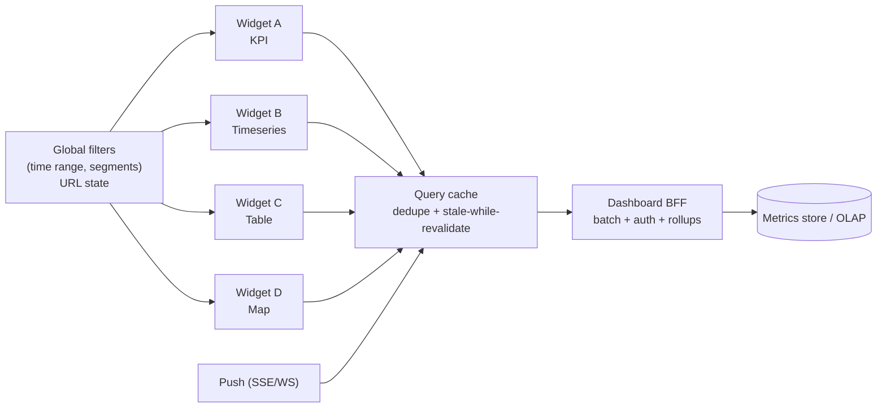
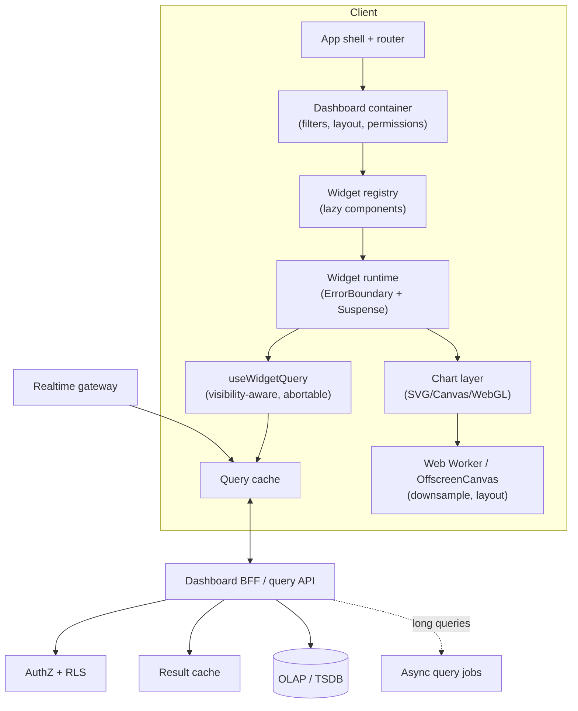
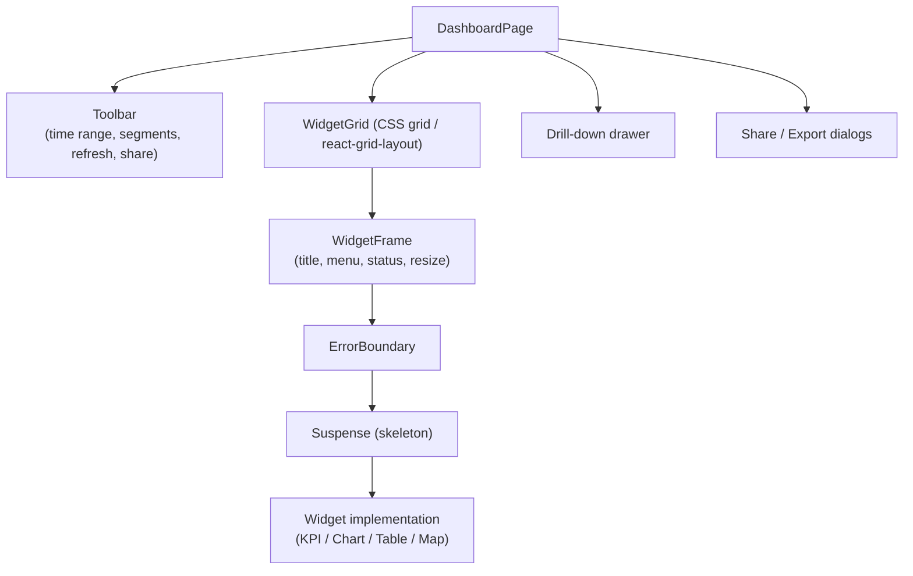
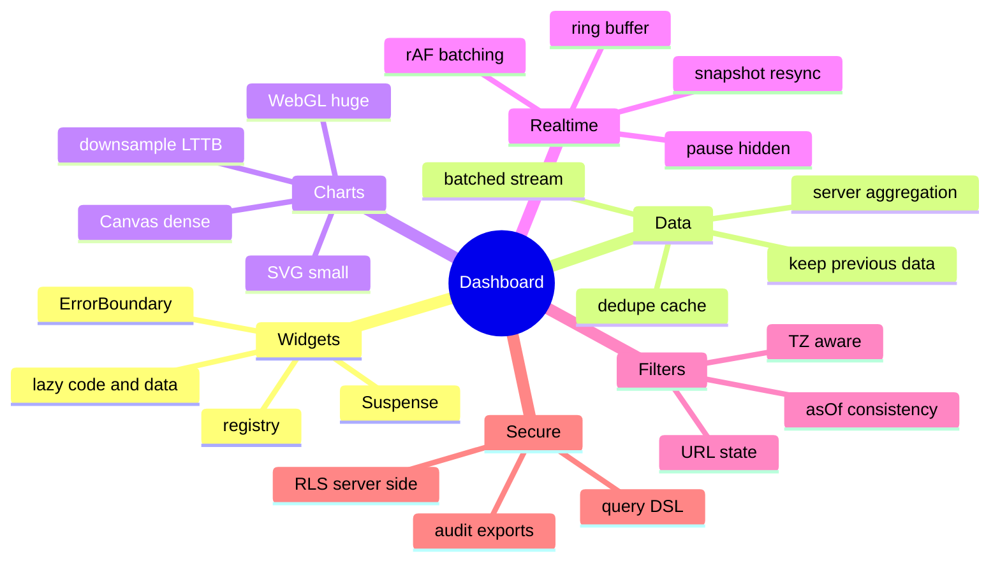

# System Design: Analytics Dashboard

> Method: [01-frontend-system-design-framework.md](01-frontend-system-design-framework.md). Related: [react/06 (query cache, polling, invalidation)](../react/06-state-management-and-data-fetching.md), [react/08 (virtualisation, INP)](../react/08-react-performance-optimization.md), [react/03 (Suspense + Error Boundaries per widget)](../react/03-concurrent-react-suspense-and-transitions.md). Platform facts verified on 2026-11-10: `content-visibility: auto` is Baseline (newly available Sep 15, 2025) and needs `contain-intrinsic-size`; `scheduler.yield()` is unavailable in Safari (feature-detect).
> Typical prompts: "Design a monitoring/analytics/BI dashboard", "Design an admin dashboard with charts and tables", "Design a real-time metrics board".

## Table of Contents

1. [Quick Summary (TL;DR)](#1-quick-summary-tldr)
2. [Requirements and Scope](#2-requirements-and-scope)
3. [Estimation and Constraints](#3-estimation-and-constraints)
4. [High-Level Architecture](#4-high-level-architecture)
5. [Data Model and Widget Contract](#5-data-model-and-widget-contract)
6. [API Design](#6-api-design)
7. [Component Architecture and State](#7-component-architecture-and-state)
8. [Deep Dive 1: Widget Isolation and Data Loading Strategy](#8-deep-dive-1-widget-isolation-and-data-loading-strategy)
9. [Deep Dive 2: Chart Rendering (SVG vs Canvas vs WebGL) and Downsampling](#9-deep-dive-2-chart-rendering-svg-vs-canvas-vs-webgl-and-downsampling)
10. [Deep Dive 3: Real-Time Updates and Time Series Buffers](#10-deep-dive-3-real-time-updates-and-time-series-buffers)
11. [Deep Dive 4: Filters, Time Ranges, URL State, Saved Views](#11-deep-dive-4-filters-time-ranges-url-state-saved-views)
12. [Customisable Layouts](#12-customisable-layouts)
13. [Performance Plan](#13-performance-plan)
14. [Accessibility, i18n, Security, Observability](#14-accessibility-i18n-security-observability)
15. [Failure Modes and Edge Cases](#15-failure-modes-and-edge-cases)
16. [Testing and Rollout](#16-testing-and-rollout)
17. [Trade-offs and Alternatives](#17-trade-offs-and-alternatives)
18. [Interview Questions — Fundamentals](#18-interview-questions--fundamentals)
19. [Interview Questions — Senior Scenarios](#19-interview-questions--senior-scenarios)
20. [Cheat Sheet](#20-cheat-sheet)
21. [Key Terms Glossary](#21-key-terms-glossary)
22. [Further Reading](#22-further-reading)

---

## 1. Quick Summary (TL;DR)

- A dashboard is a **composition of independent widgets** (KPIs, charts, tables, maps) driven by **shared global filters** (time range, segments). The design challenge is **many concurrent data requests + heavy visualisation + freshness** without freezing the page.
- **Principles:** **isolate widgets** (error boundary + Suspense + own query), **share filters via URL state**, **dedupe/batch queries**, **aggregate on the server** (never ship raw rows), **downsample for pixels**, **render to the right surface** (SVG/Canvas/WebGL), **pause when hidden**, **show staleness** and partial failure.
- **Hard parts:** (1) loading 10–30 widgets progressively and cancelling on filter change, (2) high-density charts (10⁴–10⁶ points) smoothly, (3) live updates without re-render storms, (4) consistent filters/time zones across widgets, (5) accessibility of charts, (6) secure data access (RBAC/RLS).
- **Perf levers:** viewport-based lazy widget loading, `content-visibility`, imperative canvas updates, ring buffers, workers/OffscreenCanvas, query-cache dedupe, server rollups.



---

## 2. Requirements and Scope

**Functional**
- Multiple widget types: KPI cards, line/area/bar/pie, heatmap, tables, maps, funnels, logs.
- Global filters (date range with presets and comparison period, segments/dimensions), per-widget overrides.
- Drill-down (click series → filtered view), tooltips, legends, zoom/brush.
- Auto-refresh and real-time widgets; manual refresh; "last updated" indicator.
- Customisation: add/remove/resize/move widgets, save views, share links, export (CSV/PNG/PDF), schedule reports.
- Multi-tenant, role-based access.

**Non-functional**
- **Performance:** first meaningful widget < ~2 s; full dashboard progressively; INP ≤ 200 ms while interacting with filters; smooth chart interactions (60 fps).
- **Scale:** up to ~30 widgets; time series 10³–10⁶ points; tables 10⁵+ rows (server-side).
- **Reliability:** partial failures shouldn't take down the page; clear stale/empty/error states.
- **Accessibility:** WCAG 2.2 AA including charts (text alternatives, keyboard).
- **i18n:** time zones, locale number/date formats, currencies, RTL.
- **Security:** least privilege, row-level security, audit, safe exports.

**Out of scope:** the ETL/OLAP backend internals, ML anomaly detection (mention hooks).

**Clarifying questions**
- Real-time or batch? Data volumes and granularities? Who customises layouts? Embedded in other products? Offline? Print/PDF? How do permissions work?

---

## 3. Estimation and Constraints

| Item | Assumption | Implication |
|---|---|---|
| Widgets per page | 12–30 | Must not fire 30 heavy queries at once → priority tiers, batching, lazy load |
| Points per line series | 1k–100k raw | Downsample to ~pixel width (≈ 2 points per pixel max) |
| Chart width | ~600–1200 px | LTTB/min-max to 600–2400 points |
| Table rows | 10⁵–10⁷ in DB | Server-side pagination/sort/filter; virtualise rows in view |
| Refresh | 10–60 s polling or push | Pause hidden tabs; stagger refresh |
| Payload per widget | 5–200 KB | Compress; binary formats (Arrow/MessagePack) for big series |
| Concurrent dashboards | many tenants | Cache popular queries at the BFF/CDN (private per tenant) |

---

## 4. High-Level Architecture



**Rendering strategy:** authenticated tool → **CSR** with route-level splitting; SSR/RSC optional for the shell and first KPI row (fast LCP). Heavy chart libraries **lazy-loaded** per widget type.

---

## 5. Data Model and Widget Contract

```ts
type TimeRange =
  | { kind: "relative"; value: "15m" | "1h" | "24h" | "7d" | "30d" }
  | { kind: "absolute"; from: string; to: string };    // ISO UTC

interface GlobalFilters {
  range: TimeRange;
  compareTo?: "previous_period" | "previous_year";
  timeZone: string;                    // IANA, e.g. "America/New_York"
  segments: Record<string, string[]>;  // dimension → selected values
  granularity?: "auto" | "minute" | "hour" | "day";
}

interface WidgetDef<TConfig = unknown> {
  id: string;
  type: "kpi" | "timeseries" | "bar" | "table" | "map" | "funnel";
  title: string;
  config: TConfig;                          // metrics, dimensions, display options
  layout: { x: number; y: number; w: number; h: number };      // grid units
  refreshSec?: number;                      // 0/undefined = no auto refresh
  priority: "critical" | "normal" | "deferred";
}

interface DashboardDef { id: string; name: string; version: number; widgets: WidgetDef[]; defaultFilters: GlobalFilters; permissions: { owner: string; viewers: string[] } }

// Widget data (normalized shapes)
interface TimeSeries { series: { name: string; points: [t: number, v: number][] }[]; bucketSec: number; truncated?: boolean; asOf: string }
interface TableData { columns: { key: string; label: string; type: "string" | "number" | "date" }[]; rows: unknown[][]; totalRows: number; nextCursor?: string }
```
**Widget registry contract:** each widget type exports `{ Component, loadData(spec, filters, signal), defaultSize, minSize, a11yDescription }`; the dashboard is **config-driven** (JSON stored per user/tenant, versioned with migrations).

---

## 6. API Design

### Batched query endpoint (reduces round trips; shared auth/filter parsing)
```
POST /v1/dashboards/:id/query
{
  "filters": { "range": {...}, "segments": {...}, "timeZone": "Europe/Berlin" },
  "widgets": [
    { "widgetId": "w1", "query": { "metric": "revenue", "agg": "sum", "groupBy": [] } },
    { "widgetId": "w2", "query": { "metric": "sessions", "agg": "count", "groupBy": ["time"], "bucket": "auto", "maxPoints": 1200 } }
  ]
}
→ 200 (NDJSON/streaming or JSON map)
{ "results": { "w1": { "status": "ok", "data": {...}, "asOf": "...", "cached": true }, "w2": { "status": "error", "error": { "code": "TIMEOUT" } } } }
```
- **Streaming results (NDJSON/SSE/chunked)** lets fast widgets render before slow ones; or allow per-widget requests with HTTP/2 multiplexing.
- **Server-side aggregation** with `bucket=auto` and `maxPoints` (client sends width in px) → payload bounded.
- **Query DSL, not SQL:** parameterised, validated queries → prevents injection and enables caching/authorisation.
- **Async jobs** for heavy queries: `202 Accepted { jobId }` → poll/subscribe → fetch result; show progress.
- **Caching:** cache key = hash(tenant + normalized query + filters); `ETag`/`304`; `Cache-Control: private`; include `asOf` for freshness display.
- **Exports:** server-generated CSV stream (don't build 1M-row CSVs in the browser).

### Real-time
`SSE /v1/dashboards/:id/stream?widgets=w5,w9` pushing deltas/new points; **subscribe only to visible live widgets**; resume with `Last-Event-ID`; fallback to polling. (HTTP/1.1 limit: 6 SSE connections per browser+domain → one multiplexed stream per dashboard.)

---

## 7. Component Architecture and State



| State | Home |
|---|---|
| Global filters, time range, selected dashboard | **URL** (shareable, back button) + store |
| Layout/config | Server (saved), local draft while editing |
| Widget data | Query cache (keyed by widget + filters) |
| Hover/tooltip/crosshair | Imperative/ref or tiny store (not React state per mousemove) |
| Live buffers | Ring buffers outside React; render via rAF |
| Table state (sort/page) | Per-widget (URL optional) |

---

## 8. Deep Dive 1: Widget Isolation and Data Loading Strategy

### Isolation
Each widget = **ErrorBoundary + Suspense + own query**. One failing/slow widget must not block or crash others ([react/03](../react/03-concurrent-react-suspense-and-transitions.md#7-error-boundaries)). Show per-widget retry and error codes (not stack traces).

### Priority tiers and lazy loading
1. **Critical** (above-the-fold KPIs): fetch immediately.
2. **Normal**: fetch when within ~1 viewport of the screen (`IntersectionObserver` with `rootMargin`).
3. **Deferred**: heavy/rare (maps, big tables) after idle or on interaction.

```tsx
function useInViewOnce<T extends Element>(rootMargin = "300px") {
  const ref = useRef<T>(null);
  const [seen, setSeen] = useState(false);
  useEffect(() => {
    if (seen || !ref.current) return;
    const io = new IntersectionObserver(([e]) => { if (e.isIntersecting) { setSeen(true); io.disconnect(); } }, { rootMargin });
    io.observe(ref.current);
    return () => io.disconnect();
  }, [seen, rootMargin]);
  return [ref, seen] as const;
}
```
Also lazy-load widget **code** (`React.lazy`) so charting libs don't bloat the shell; `content-visibility: auto` + `contain-intrinsic-size` for offscreen widget frames reduces rendering cost.

### Data hook: abortable, filter-keyed, visibility-aware polling
```tsx
function useWidgetData<T>(widget: WidgetDef, filters: GlobalFilters, enabled: boolean) {
  const pageVisible = usePageVisibility();
  return useQuery({
    queryKey: ["widget", widget.id, widget.config, filters],            // filters in key → cache + cancel on change
    queryFn: ({ signal }) => api.queryWidget(widget, filters, { signal, maxPoints: Math.floor(window.innerWidth) }),
    enabled,                                                              // lazy: only when near viewport
    staleTime: (widget.refreshSec ?? 60) * 500,
    refetchInterval: pageVisible && widget.refreshSec ? widget.refreshSec * 1000 : false,   // pause when hidden
    refetchIntervalInBackground: false,
    placeholderData: keepPreviousData,                                    // keep old chart while new filters load (no flash)
  });
}
```
Key behaviours:
- **Dedupe identical queries** across widgets (same key) automatically; in the BFF too.
- **Cancel stale requests** when filters change (new key → previous aborted).
- **Concurrency cap** on the client (e.g., 6 parallel) or rely on HTTP/2; the **batched endpoint** reduces overhead.
- **Stagger refreshes** (jitter per widget) to avoid synchronized spikes.
- **Keep previous data** while loading (dim with `isPlaceholderData`) to avoid blank states.
- **Dependent widgets** (drill-down) query only after parent selection.
- **Optimistic UI** rarely needed (read-heavy) except layout edits.

### Progressive/streaming
Render widgets as results arrive; show skeletons with **fixed dimensions** (no CLS); announce completion for assistive tech sparingly.

---

## 9. Deep Dive 2: Chart Rendering (SVG vs Canvas vs WebGL) and Downsampling

### Choosing a surface

| Surface | Good for | Limits | Libraries |
|---|---|---|---|
| **SVG** | Few hundred–few thousand elements; crisp text; CSS styling; easy a11y/DOM events | DOM node cost grows (slow beyond ~5–10 k elements) | Recharts, Visx, D3, Nivo |
| **Canvas 2D** | 10⁴–10⁶ points, frequent updates | No DOM per element → manual hit-testing and a11y | Chart.js, ECharts, uPlot, Highcharts (boost) |
| **WebGL** | 10⁶+ points, heatmaps, maps, 3D | Complexity, context loss, a11y | deck.gl, regl, ECharts GL, Plotly GL |

(Thresholds are heuristics — benchmark with your data and devices.)

### Downsampling (server preferred, client fallback)
You can't display more than ~1–2 points per horizontal pixel. Use **time bucketing** (min/max/avg per bucket) or **LTTB** (Largest-Triangle-Three-Buckets) to preserve visual shape:

```ts
export function lttb(data: [number, number][], threshold: number): [number, number][] {
  const n = data.length;
  if (threshold >= n || threshold < 3) return data;
  const out: [number, number][] = [data[0]];
  const every = (n - 2) / (threshold - 2);
  let a = 0;
  for (let i = 0; i < threshold - 2; i++) {
    const avgStart = Math.floor((i + 1) * every) + 1;
    const avgEnd = Math.min(Math.floor((i + 2) * every) + 1, n);
    let avgX = 0, avgY = 0;
    for (let j = avgStart; j < avgEnd; j++) { avgX += data[j][0]; avgY += data[j][1]; }
    const len = avgEnd - avgStart; avgX /= len; avgY /= len;

    const start = Math.floor(i * every) + 1, end = Math.floor((i + 1) * every) + 1;
    const [ax, ay] = data[a];
    let maxArea = -1, next = start;
    for (let j = start; j < end; j++) {
      const area = Math.abs((ax - avgX) * (data[j][1] - ay) - (ax - data[j][0]) * (avgY - ay)) * 0.5;
      if (area > maxArea) { maxArea = area; next = j; }
    }
    out.push(data[next]); a = next;
  }
  out.push(data[n - 1]);
  return out;
}
```
- **Min/max bucketing** preserves spikes (important for monitoring); LTTB preserves shape; choose per use case.
- On **zoom**, request **higher resolution for the visible range** from the server (multi-resolution rollups: 1 s/1 min/1 h/1 d tables).
- Run downsampling in a **Web Worker** for large local datasets; transfer `Float64Array`s (transferable) rather than JSON arrays.

### Resize, DPR, and rendering loop
- `ResizeObserver` per chart container; redraw with `devicePixelRatio`-aware canvas size; throttle via rAF.
- **Imperative updates** for streaming: mutate the chart instance (e.g., `uPlot.setData`) rather than re-rendering React trees.
- **OffscreenCanvas** in a worker for heavy drawing (supported in modern browsers; feature-detect).
- Avoid animating thousands of points; respect `prefers-reduced-motion`.

### Interaction
- **Tooltip/crosshair:** spatial index (binary search on sorted time) for hover → O(log n); throttle with rAF; **synchronised crosshair** across charts via a lightweight event bus.
- **Brush/zoom:** pointer events with capture; update global time range on release (debounced) to refetch finer data; undo zoom.
- **Legend toggles**, series visibility, threshold lines, annotations.

---

## 10. Deep Dive 3: Real-Time Updates and Time Series Buffers

### Don't re-render per tick
```ts
class RingBuffer {
  private t: Float64Array; private v: Float64Array; private head = 0; size = 0;
  constructor(private capacity: number) { this.t = new Float64Array(capacity); this.v = new Float64Array(capacity); }
  push(ts: number, val: number) { const i = (this.head + this.size) % this.capacity; if (this.size < this.capacity) this.size++; else this.head = (this.head + 1) % this.capacity; this.t[i] = ts; this.v[i] = val; }
  toArrays() { /* return ordered views for the chart library */ }
}
// Producer (SSE/WS) pushes into buffers; a single rAF loop redraws charts that are dirty and visible.
```
- **Batch incoming points** (coalesce to ≤ 1 redraw per frame, or throttle to 1–2 Hz for dashboards).
- **Rolling window** (last N minutes) bounded by the ring buffer; periodically re-sync with the server snapshot to correct drift.
- **Pause/Resume** control for investigations; auto-pause when hovering a point or when the tab is hidden; resume with a snapshot fetch.
- **Out-of-order/late data:** buffer by event time with small watermark; indicate incomplete latest bucket ("partial").
- **Reconnect:** resume from last timestamp/event ID; fall back to polling.

### Live tables/logs
Append with virtualization; cap rows; "follow tail" toggle (like chat stick-to-bottom, see [chat design §10](04-chat-and-real-time-messaging.md)); pause on hover/selection.

---

## 11. Deep Dive 4: Filters, Time Ranges, URL State, Saved Views

- **URL as source of truth** for dashboard id, time range, segments, compare mode, selected widget/drill state → shareable, back/forward works. Parse/validate with a schema (zod) and coerce defaults.

```ts
const FiltersSchema = z.object({
  range: z.union([z.string().regex(/^(\d+)(m|h|d)$/), z.string()]).default("24h"),
  from: z.string().datetime().optional(),
  to: z.string().datetime().optional(),
  tz: z.string().default(Intl.DateTimeFormat().resolvedOptions().timeZone),
  seg: z.record(z.string(), z.array(z.string())).default({}),
});
```
- **Relative vs absolute ranges:** relative ranges ("last 24h") must **recompute `now`** on refresh; display the resolved absolute range in the UI; freeze `now` per request to keep all widgets consistent (send `asOf`/resolved range from a single computation).
- **Time zones:** store UTC; send IANA TZ; bucket boundaries by TZ (day buckets differ!); display with `Intl.DateTimeFormat({ timeZone })`; DST edge cases (23/25-hour days); consider **Temporal** (types in TS 6; check runtime availability) or date-fns-tz/Luxon.
- **Comparison periods:** align buckets (previous period shifted), show delta % with sign/color + text.
- **Debounce filter changes** (e.g. text filters), apply on commit for expensive multi-select; show "applying…" state; cancel in-flight.
- **Saved views:** server-persisted filter+layout presets; versioned; sharing permissions; "reset to default".
- **Cross-filtering:** clicking a bar sets a segment filter (adds to URL state) with clear chips to remove.

---

## 12. Customisable Layouts

- Grid system: 12-column CSS grid or `react-grid-layout` with breakpoints; widgets have `minSize`/`maxSize`; collision/compaction policy.
- **Edit mode** (drag/resize/add/remove) vs **view mode**; autosave draft; "Revert".
- **Persist layout JSON** (versioned + migrations); validate on load (schema) and **fall back to default** if corrupt.
- Responsive: collapse to single column on mobile; reorder via priority; hide non-essential widgets.
- Keyboard-accessible reordering (not drag-only): move up/down/resize via buttons; announce changes (`aria-live`).
- Performance while dragging: transform-based movement, avoid re-fetching on layout change (data keys exclude layout).
- **Multi-user conflicts:** last-write-wins with version check (`409`), or per-user personalised copies of shared templates.

---

## 13. Performance Plan

| Area | Plan |
|---|---|
| Initial load | Route splitting; lazy chart libs per widget type; SSR/stream shell + critical KPIs; preconnect to API; fetch critical widgets in parallel with JS parse (preload/bootstrap) |
| Network | Batched/streamed queries; server-side aggregation with `maxPoints`; compression; binary (Arrow/MessagePack) for large series; ETag/304; dedupe |
| Main thread | Downsample in workers; OffscreenCanvas; avoid JSON parsing huge payloads on main thread (stream/worker); `scheduler.yield()` when available else `setTimeout`; React transitions for filter changes |
| Rendering | Canvas/WebGL for dense series; virtualised tables; `content-visibility` for offscreen widgets; memoised widgets keyed by data identity; avoid context churn for global filters (selector-based store) |
| Memory | Cap buffers; dispose chart instances on unmount; revoke object URLs; bound cache `gcTime`; avoid keeping 100k-point arrays in React state (use typed arrays) |
| Layout/CLS | Fixed-size widget frames and skeletons; reserve legend space |
| Refresh | Pause when hidden; jittered polling; push for live widgets only; cancel on filter change |
| Perceived | Keep previous data while loading (dimmed); progressive reveal; optimistic layout edits |

**Metrics:** time-to-first-widget, time-to-all-widgets p95, per-widget query latency, long-task count, INP on filter changes, chart frame times, memory growth in long sessions, API error/timeouts per widget.

---

## 14. Accessibility, i18n, Security, Observability

**Accessibility**
- **Charts need alternatives:** short `aria-label`/summary ("Revenue rose 12% vs last week, peaking Tuesday"), **data table view toggle**, downloadable CSV, keyboard-navigable data points (arrow keys through points with live tooltip text), focus ring on interactive elements; ensure the canvas has `role="img"` + label or an off-screen table.
- **Colour:** don't rely on colour alone — patterns/markers/direct labels; contrast ≥ 3:1 for graphical objects; colour-blind-safe palettes; dark mode.
- **Live regions:** announce significant updates sparingly (e.g., alerts) — never every tick.
- **Keyboard:** toolbar controls, grid navigation, layout editing alternatives to drag-and-drop, drill-down via Enter.
- **Reduced motion:** disable chart animations; **zoom/reflow:** responsive layouts.
- Tables use proper `<table>` semantics or ARIA grid with sort state (`aria-sort`).

**i18n/l10n**: `Intl.NumberFormat` (compact notation, currency, units), date/time formats per locale and time zone, RTL charts (axis mirroring), pluralisation in labels, large-number abbreviations ("1.2K/1,2 Mio."), fiscal calendars, week start day.

**Security & privacy**
- **AuthZ on every query:** RBAC + **row/column-level security** enforced **server-side** (client filters are UX only); tenant isolation in caches; signed embeds.
- **No raw SQL from clients**; parameterised DSL; limit query cost (time range caps, row limits, timeouts) to prevent abuse/DoS.
- **Export controls** (permissions, audit, watermarking), PII masking, k-anonymity thresholds for small cohorts.
- **Embeds/iframes:** `sandbox`, CSP `frame-ancestors`, signed short-lived URLs; share links respecting permissions.
- **XSS:** escape labels from data (series names, dimension values are user-controlled); sanitise tooltips (no `innerHTML`).
- **Audit logging** for views/exports/config changes.

**Observability**: per-widget load/error metrics, query latency by widget type, slow-query reports, client-side render times (`performance.measure`), RUM (INP/LCP), feature usage analytics (widgets used, filters), alerting on error spikes, release tracking.

---

## 15. Failure Modes and Edge Cases

| Case | Handling |
|---|---|
| One widget query fails/times out | Widget-level error with retry; others unaffected; show error code/trace ID |
| Slow query | Skeleton → progress/"still working"; async job + notification; allow cancel |
| Partial data (late buckets) | Mark latest bucket partial; shaded area |
| Empty data | Explain (filters too narrow, no data in range); CTA to reset |
| Stale data | "Updated 2 m ago" + stale badge if refresh failed; keep showing last data |
| Filter change race | Abort previous; keys per filter; ignore stale responses |
| Too many points | Server `maxPoints`, client downsample; show "downsampled" indicator |
| Time zone/DST | Server-side bucketing by TZ; tests for DST days |
| Permission denied on a widget | Show restricted placeholder (don't leak existence of data) |
| Layout JSON invalid/version old | Migrate or fall back to defaults |
| Browser tab hidden | Pause polling/animations; refetch on visible |
| Memory growth (live) | Ring buffers; dispose; sampled retention |
| Huge CSV export | Server-streamed download; progress; background job emailed link |
| Clock skew | Use server `asOf` for "last updated" |
| Third-party chart library bug/regression | Wrap behind adapter interface; version pin; visual tests |

---

## 16. Testing and Rollout

- **Unit:** time range/TZ math (DST), downsampling, ring buffer, filter schema parsing, layout migrations, formatters.
- **Component/integration:** RTL + MSW for per-widget loading/error/empty; filter changes cancel stale requests; polling pauses on hidden.
- **Visual regression:** charts across themes/sizes/locales (Playwright/Chromatic); tolerance for anti-aliasing.
- **Accessibility:** axe, keyboard walkthroughs, screen-reader summaries.
- **Performance:** Playwright traces with CPU throttle on a 30-widget dashboard; budgets for time-to-first-widget, long tasks, memory (heap snapshot after 30 min live); load tests on BFF.
- **E2E:** shareable URL restores state; saved views; permissions; export flows.
- **Rollout:** feature flags per widget type/renderer (e.g., new canvas engine), shadow queries comparing old/new results, canary tenants, kill switches for auto-refresh, monitoring of query cost.

---

## 17. Trade-offs and Alternatives

| Decision | Option A | Option B | Notes |
|---|---|---|---|
| Data fetching | Per-widget queries | Single batched/streamed endpoint | Batched reduces overhead; per-widget gives independence; streaming gives both |
| Rendering | SVG (Recharts/Visx) | Canvas (uPlot/ECharts/Chart.js) | SVG for few elements + rich styling/a11y; Canvas for density/perf |
| Aggregation | Server rollups | Client aggregation | Server for scale/security; client only for small sets |
| Refresh | Polling | Push (SSE/WS) | Polling simple; push for low-latency widgets only |
| State | URL-driven | In-memory only | URL for shareability/back button |
| Layout lib | `react-grid-layout` | CSS grid + custom | Library for drag/resize; custom for simplicity |
| Build vs buy | Embedded BI (Superset/Metabase/Looker) | Custom UI | Custom for product-specific UX; BI for speed/coverage |
| Charts lib | Highcharts/ECharts (feature-rich) | Visx/D3 (custom) | Feature-rich faster; custom for control/bundle size |
| Large tables | Server-side ops | Client-side | Server-side for >10k rows |
| Time handling | Server buckets by TZ | Client bucketing | Server avoids inconsistencies |

---

## 18. Interview Questions — Fundamentals

### Q1. How do you load many widgets efficiently?
Lazy-load widget code and data by priority (critical now, others near viewport), batch/stream queries, dedupe identical queries, cap concurrency, and isolate failures with error boundaries.

### Q2. How do global filters stay consistent across widgets?
Put filters in URL/store; include them in each widget's query key; resolve relative ranges once per refresh and pass the same `asOf`/range to all queries; cancel stale requests on change.

### Q3. SVG vs Canvas for charts?
SVG for small/medium data with rich styling/accessibility; Canvas/WebGL for dense data and frequent updates, accepting manual hit-testing/a11y work.

### Q4. How do you render 1M points?
Don't — downsample server-side or with LTTB/min-max to ~pixel width, use multi-resolution rollups and zoom-driven refetch, render on Canvas/WebGL, and process in workers.

### Q5. How do you implement live updates?
Subscribe only to visible live widgets via SSE/WS, buffer points in ring buffers, batch redraws via rAF/throttle, pause when hidden, and resync periodically with a snapshot.

### Q6. How do you make charts accessible?
Provide text summaries, data table alternative, keyboard navigation for data points, non-colour encodings, sufficient contrast, reduced motion, and avoid announcing every update.

### Q7. How do you handle time zones?
Store/transport UTC, send IANA TZ for bucketing (day boundaries differ), format with `Intl`, test DST transitions, and avoid ambiguous local-time parsing.

### Q8. How do you keep one failing widget from breaking the page?
ErrorBoundary + Suspense per widget, per-widget queries/status, retry controls, and graceful partial rendering.

### Q9. How do you secure data access?
Server-side RBAC/row-level security, parameterised query DSL, tenant-scoped caching, query cost limits, audited exports, and no trust in client filters.

### Q10. How do you let users customise layouts?
Config-driven widget grid with edit mode, versioned layout JSON, constraints, keyboard-accessible reordering, and server persistence with migrations.

---

## 19. Interview Questions — Senior Scenarios

### S1. "The dashboard takes 12 s to become usable and freezes when filters change. Diagnose and fix."
Measure: waterfall (30 simultaneous requests?), payload sizes, main-thread long tasks (JSON parse, chart redraws), React re-render storms from global filter context. Fixes: batch/stream endpoint; viewport/priority loading; server aggregation (`maxPoints`); worker downsampling; Canvas renderer for dense charts; selector-based filter store; `useDeferredValue`/transitions for filter changes; `placeholderData` to avoid blank flashes; cancel stale requests; `content-visibility` for offscreen widgets; chunk work with `scheduler.yield()` (fallback). Verify with RUM and traces; add budgets.

### S2. "Design a real-time monitoring dashboard (1-second updates, 50 live charts)."
Single multiplexed push stream per dashboard (SSE over HTTP/2 or one WebSocket); server downsamples/pre-aggregates per resolution; clients subscribe only to visible widgets; ring buffers + one rAF loop drawing dirty charts on Canvas; throttle to ~1–2 Hz visually; pause on hidden/hover; backfill via snapshot on reconnect; backpressure (drop/aggregate under load); alerts via live regions; memory bounds; test on low-end devices.

### S3. "A KPI shows different numbers on two dashboards. How do you prevent that?"
Define metrics in a **semantic layer** (single source of truth for definitions) consumed by both; version metric definitions; consistent time bucketing/TZ; same filters/`asOf`; display definitions/tooltips; contract tests across dashboards; cache keys include metric version.

### S4. "How would you implement drill-down and cross-filtering?"
Click handlers on chart elements map to dimension values; update URL filters (segments) and breadcrumbs; keep chips to clear; dependent widgets react via shared filters; detail drawer with table/charts; ensure keyboard access; avoid refetch storms (batch + debounce); handle ambiguous mappings; log analytics.

### S5. "How do you support exporting a dashboard to PDF reliably?"
Server-side rendering via headless browser from a **signed, print-optimised route** with fixed viewport and paginated layout; wait for data/`window.__READY__`; avoid canvas resolution issues (high DPR); deterministic fonts; run as background job with progress/notification; permissions and audit. Client-side `window.print()` as a lightweight fallback.

### S6. "Build vs integrate (Superset/Looker/Metabase embed)?"
Integrate for breadth/speed with standard BI needs and SSO embedding; build custom when UX, performance, tenant isolation, or tight product integration are differentiators; hybrid: embed BI for ad hoc, custom for core operational dashboards. Consider cost, customisation limits, security (embed tokens), maintenance.

### S7. "How do you test chart-heavy UIs?"
Unit-test data transforms; contract-test the chart adapter; visual regression snapshots at fixed sizes with deterministic data/fonts; accessibility tests; performance tests with synthetic big datasets; fuzz time zone/DST; avoid brittle canvas pixel tests by testing the underlying scale/data model.

---

## 20. Cheat Sheet



| Problem | Answer |
|---|---|
| 30 requests at once | Priority tiers + batching + viewport loading |
| Dense lines | Downsample + Canvas |
| Live updates | Ring buffer + rAF + pause hidden |
| Filter flicker | `placeholderData`, abort stale |
| Inconsistent numbers | Semantic layer + shared `asOf` |
| A11y | Summary + data table + keyboard points |
| Security | Server RLS + DSL + audit |

---

## 21. Key Terms Glossary

| Term | Definition |
|---|---|
| Widget | Self-contained dashboard component with its own data/query |
| Semantic layer | Central definitions of metrics/dimensions |
| LTTB | Largest-Triangle-Three-Buckets downsampling algorithm |
| Rollup | Pre-aggregated data at coarser time resolution |
| Ring buffer | Fixed-size circular buffer for streaming data |
| OffscreenCanvas | Canvas rendering usable in workers |
| `asOf` | Timestamp indicating data freshness/resolved "now" |
| Cross-filtering | Clicking one chart filters others |
| RLS | Row-level security |
| Partial bucket | Latest time bucket still accumulating data |

---

## 22. Further Reading

- [web.dev — `content-visibility`](https://web.dev/articles/content-visibility) · [Optimize long tasks](https://web.dev/articles/optimize-long-tasks)
- [MDN — OffscreenCanvas](https://developer.mozilla.org/en-US/docs/Web/API/OffscreenCanvas) · [ResizeObserver](https://developer.mozilla.org/en-US/docs/Web/API/ResizeObserver) · [`Intl.DateTimeFormat`](https://developer.mozilla.org/en-US/docs/Web/JavaScript/Reference/Global_Objects/Intl/DateTimeFormat)
- [Steinarsson — Downsampling Time Series for Visual Representation (LTTB)](https://skemman.is/handle/1946/15343)
- [uPlot](https://github.com/leeoniya/uPlot) · [Apache ECharts](https://echarts.apache.org/) · [deck.gl](https://deck.gl/) · [react-grid-layout](https://github.com/react-grid-layout/react-grid-layout)
- [WAI — Complex images / charts guidance](https://www.w3.org/WAI/tutorials/images/complex/)
