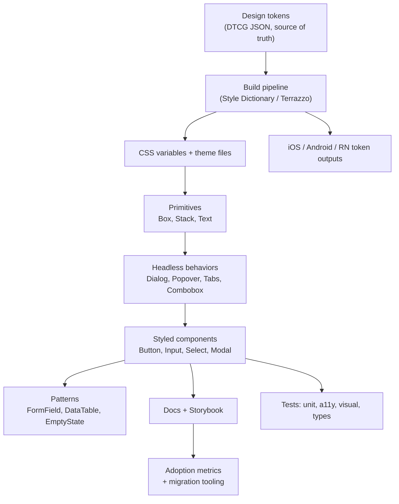
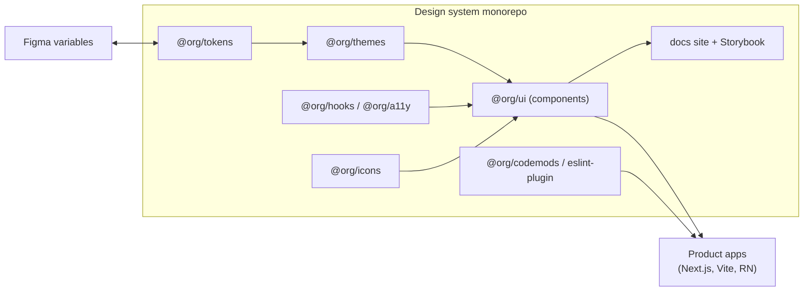
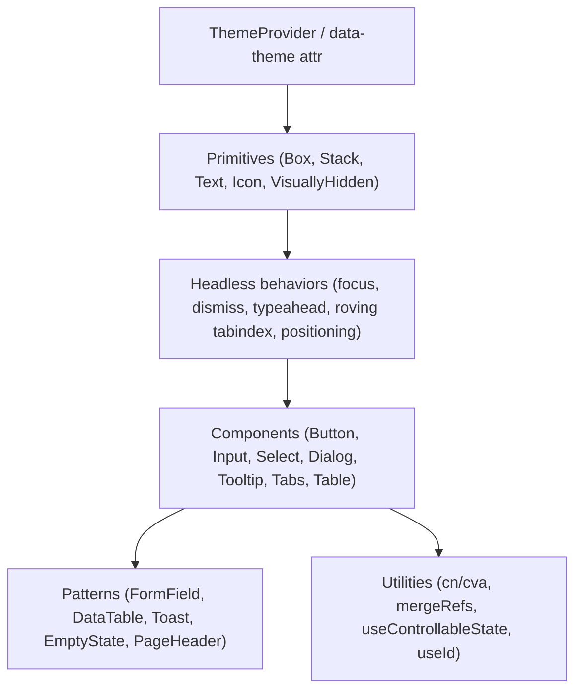
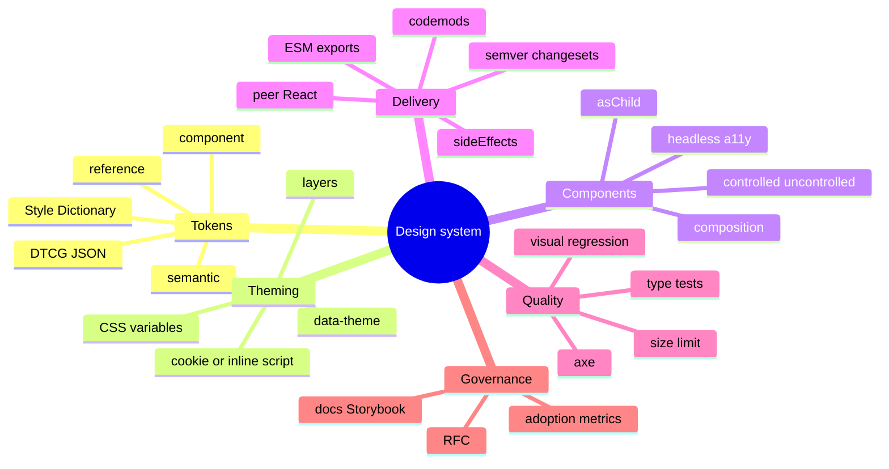

# System Design: Design System & Component Library

> Method: [01-frontend-system-design-framework.md](01-frontend-system-design-framework.md). Related: [react/07 (component patterns, headless, polymorphic)](../react/07-component-patterns-and-architecture.md), [typescript/04 (publishing types, `exports`, `isolatedDeclarations`)](../typescript/04-tsconfig-modules-and-tooling.md), [typescript/05 (typing components)](../typescript/05-typescript-with-react-and-apis.md).
> Platform facts verified on 2026-11-10: the **Design Tokens Community Group (DTCG) specification reached its first stable version, 2025.10**; the **Popover API is Baseline 2025 (newly available)** — Chrome/Edge 114, Firefox 125, Safari 17 (`popover="hint"` is newer and less supported); **CSS anchor positioning** has a Level 1/2 spec and `position-area`/`position-try-fallbacks` — check current browser support before depending on it without a fallback.
> Typical prompts: "Design a design system / component library for 20 product teams", "Design a Button/Select/Modal library", "Design theming (dark mode, multi-brand)".

## Table of Contents

1. [Quick Summary (TL;DR)](#1-quick-summary-tldr)
2. [Requirements and Scope](#2-requirements-and-scope)
3. [Estimation and Constraints](#3-estimation-and-constraints)
4. [High-Level Architecture](#4-high-level-architecture)
5. [Data Model: Tokens and Component Contracts](#5-data-model-tokens-and-component-contracts)
6. [Interface Design: Component and Package APIs](#6-interface-design-component-and-package-apis)
7. [Component Architecture](#7-component-architecture)
8. [Deep Dive 1: Design Tokens and Theming](#8-deep-dive-1-design-tokens-and-theming)
9. [Deep Dive 2: Component API, Styling Strategy, SSR/RSC Compatibility](#9-deep-dive-2-component-api-styling-strategy-ssrrsc-compatibility)
10. [Deep Dive 3: Accessibility and Overlays](#10-deep-dive-3-accessibility-and-overlays)
11. [Deep Dive 4: Distribution, Versioning, Migration](#11-deep-dive-4-distribution-versioning-migration)
12. [Governance, Documentation, Adoption](#12-governance-documentation-adoption)
13. [Quality Strategy](#13-quality-strategy)
14. [Performance Plan](#14-performance-plan)
15. [i18n, Multi-Brand, Multi-Platform, Security, Observability](#15-i18n-multi-brand-multi-platform-security-observability)
16. [Failure Modes and Edge Cases](#16-failure-modes-and-edge-cases)
17. [Trade-offs and Alternatives](#17-trade-offs-and-alternatives)
18. [Interview Questions — Fundamentals](#18-interview-questions--fundamentals)
19. [Interview Questions — Senior Scenarios](#19-interview-questions--senior-scenarios)
20. [Cheat Sheet](#20-cheat-sheet)
21. [Key Terms Glossary](#21-key-terms-glossary)
22. [Further Reading](#22-further-reading)

---

## 1. Quick Summary (TL;DR)

- A design system is a **product with customers (engineers, designers)**: tokens, components, patterns, docs, tooling and **governance**. Success = **adoption, consistency, accessibility, velocity** — not component count.
- **Layers:** **tokens** (decisions) → **primitives/layout** → **headless behaviours** (a11y + state) → **styled components** → **patterns/templates** → **docs & tooling**.
- **Hard parts:** (1) token architecture and theming (dark/high-contrast/multi-brand) without FOUC or perf cost, (2) component API design (composable, accessible, stable), (3) **styling strategy** compatible with SSR/RSC and bundle budgets, (4) **versioning/migration** across many teams, (5) accessibility as a guarantee, (6) governance and adoption metrics.
- Prefer **headless/accessible primitives + token-driven styling + composition**; keep the API surface small; **semver + changesets + codemods**; measure usage and bundle size; **test a11y/visuals in CI**.
- Mention trade-offs: build vs adopt (Radix/React Aria/Headless UI/MUI), runtime CSS-in-JS vs zero-runtime CSS, monolith package vs per-component packages, Web Components vs framework-specific.



---

## 2. Requirements and Scope

**Functional**
- Reusable, themeable UI components used by many product teams (web; maybe React Native too).
- Consistent visual language via tokens; dark/light, high contrast, density, multi-brand.
- Documentation site with live examples, guidelines, accessibility notes, do/don't.
- Design ↔ code workflow (Figma variables/tokens sync).
- Tooling: CLI/codemods, ESLint rules, templates.

**Non-functional**
- **Accessibility:** WCAG 2.2 AA by default.
- **Performance:** tree-shakable, small CSS/JS, SSR/RSC friendly, no layout shift on theming.
- **Stability:** semver, predictable upgrades, deprecation windows.
- **DX:** TypeScript types, autocompletion, great error messages, fast Storybook.
- **Scale:** 10–100 consuming apps/teams; different React versions/bundlers; micro-frontend coexistence.
- **Security/Compliance:** supply chain hygiene, license, CSP-compatible (no inline `eval`).

**Out of scope:** product-specific features, visual design process (mention how it feeds tokens).

**Clarifying questions**
- How many teams/apps? Frameworks (React only? Angular/Vue?) Web + native?
- Existing brand/design language? Multi-brand/white-label needs?
- SSR/RSC (Next.js)? Micro-frontends? Browser support?
- Who owns the system (dedicated team vs federated)? Release cadence?

---

## 3. Estimation and Constraints

| Item | Assumption | Implication |
|---|---|---|
| Consumers | 30 apps, 150 engineers | Need codemods, deprecation policy, support rotation |
| Components | 40–60 core, 100+ with patterns | Prioritise by usage; avoid long tail early |
| Bundle impact | Typical app imports 10–20 components | Per-component entry points/tree-shaking; CSS size budget (e.g., ≤ 30–50 KB gz) |
| Release cadence | Minor biweekly, major yearly | Backward compat + codemods |
| Browser support | Last 2 evergreen versions | Modern CSS allowed with fallbacks (layers, container queries) |
| A11y bar | AA | Automated + manual checks per component |

---

## 4. High-Level Architecture



**Packaging decision:** single `@org/ui` with **per-component subpath exports** (good DX) vs many packages (`@org/button`) (independent versioning, but release overhead). Most orgs choose a **small number of packages** (tokens, ui, icons, charts, forms) with `sideEffects: false` and subpath exports.

---

## 5. Data Model: Tokens and Component Contracts

### Token tiers
| Tier | Example | Purpose |
|---|---|---|
| **Reference/primitive** | `color.blue.600`, `space.4`, `radius.2` | Raw palette/scale values; not used directly by components |
| **Semantic/alias** | `color.action.primary.bg`, `color.text.default`, `color.border.focus` | Intent-based; **themes remap these** |
| **Component** | `button.primary.bg`, `input.border.error` | Optional overrides per component |

```jsonc
// tokens (DTCG-style: $type/$value). Value encodings for color/dimension follow the spec version you adopt
// (the stable 2025.10 spec tightened them) — verify against the current spec/tooling.
{
  "color": {
    "blue": { "600": { "$type": "color", "$value": "<blue-600>" } },
    "action": { "primary": { "bg": { "$type": "color", "$value": "{color.blue.600}" } } }   // alias → semantic
  },
  "space": { "4": { "$type": "dimension", "$value": "<16px>" } }
}
```

### Component contract (public API surface)
```ts
interface ButtonProps extends React.ComponentProps<"button"> {
  variant?: "primary" | "secondary" | "ghost" | "danger";
  size?: "sm" | "md" | "lg";
  loading?: boolean;
  startIcon?: React.ReactNode;
  endIcon?: React.ReactNode;
  asChild?: boolean;                 // render as child element (Link, a)
}
// Plus: documented a11y contract, supported states (hover/focus/active/disabled/loading), tokens consumed,
// keyboard interactions, test IDs policy, SSR safety, deprecation status.
```
Store a **machine-readable component manifest** (props, tokens, status) for docs, codemods and usage analytics.

---

## 6. Interface Design: Component and Package APIs

### API principles
1. **Few, semantic props** (variants over booleans) with sensible defaults.
2. **Composition over configuration:** slots/children (`<Card><Card.Header/>…</Card>`), compound components for complex widgets (Tabs, Select, Dialog).
3. **Controlled + uncontrolled** (`value/defaultValue/onValueChange`; `open/defaultOpen/onOpenChange`).
4. **Forward everything:** `ref` (React 19: plain prop; keep `forwardRef` for React 18 consumers), `className`, `data-*`, `aria-*`, event handlers.
5. **Expose state via data attributes** (`data-state="open"`, `data-disabled`) so CSS can style without JS.
6. **Polymorphism via `asChild`** (slot pattern) or `as` for links/routers.
7. **Escape hatches** (class names, style tokens) but discourage overriding internals; provide supported theming hooks.
8. **Stability:** never rename/remove props in minors; deprecate with warnings (dev-only) and codemods.
9. **Naming consistency:** `onOpenChange`, `isDisabled` vs `disabled` (choose one family), sizes `sm|md|lg`, intent `danger` not `red`.

### Package API
```json
{
  "name": "@org/ui",
  "version": "4.2.0",
  "type": "module",
  "sideEffects": ["**/*.css"],
  "exports": {
    ".": { "types": "./dist/index.d.ts", "default": "./dist/index.js" },
    "./button": { "types": "./dist/button/index.d.ts", "default": "./dist/button/index.js" },
    "./styles.css": "./dist/styles.css",
    "./package.json": "./package.json"
  },
  "peerDependencies": { "react": "^18 || ^19", "react-dom": "^18 || ^19" }
}
```

---

## 7. Component Architecture



### Build vs adopt
| Layer | Recommendation |
|---|---|
| Behaviour/a11y (Dialog, Menu, Combobox, Tabs, Slider) | **Adopt** (Radix, React Aria, Ark/Zag, Headless UI) unless you have specific needs — a11y edge cases are expensive |
| Styling & tokens | **Build** (your brand) |
| Complex widgets (DataTable, DatePicker, Rich text) | Adopt (TanStack Table, React Aria DatePicker, TipTap/Lexical) wrapped by your API |
| Icons | Build pipeline (SVGR/sprite) from the design source |

---

## 8. Deep Dive 1: Design Tokens and Theming

### Pipeline
Design source (Figma variables) → **tokens JSON (DTCG)** → **build (Style Dictionary / Terrazzo)** → outputs: CSS custom properties, TS constants/types, iOS/Android/RN artifacts, docs. Version tokens with the library; CI checks **contrast** pairs and **token deprecations**.

### CSS output with semantic aliasing
```css
:root {
  /* reference */
  --ref-blue-600: #0a5cff;
  --ref-gray-900: #111418;
  --ref-white: #ffffff;
  /* semantic (what components use) */
  --color-bg-surface: var(--ref-white);
  --color-text-default: var(--ref-gray-900);
  --color-action-primary-bg: var(--ref-blue-600);
  --color-border-focus: var(--ref-blue-600);
  --space-4: 1rem;
  --radius-2: 0.5rem;
  color-scheme: light;
}
[data-theme="dark"] {
  --color-bg-surface: #0f1216;
  --color-text-default: #f2f4f7;
  --color-action-primary-bg: #5b8cff;
  color-scheme: dark;
}
@media (prefers-contrast: more) { :root { --color-border-focus: #000; } }
@media (forced-colors: active) { .btn { border: 1px solid ButtonText; } }   /* respect forced colors (Windows high contrast) */
```
Notes:
- **Components only reference semantic/component tokens**, so themes (dark, brand B, high contrast) just **remap semantic variables** — zero component code changes.
- `color-scheme` makes native controls/scrollbars match. CSS `light-dark()` and `color-mix()` can reduce duplication — use with fallbacks per browser-support policy.
- **Density** (compact/comfortable) = spacing/size tokens remap via `[data-density="compact"]`.
- **Motion tokens** (`--duration-fast`, easing) with `prefers-reduced-motion` overrides.

### Avoiding theme flash (FOUC) and SSR mismatch
```html
<script>
  // inline, blocking, tiny: set theme before first paint
  (function () {
    try {
      var t = localStorage.getItem("theme") || (matchMedia("(prefers-color-scheme: dark)").matches ? "dark" : "light");
      document.documentElement.dataset.theme = t;
    } catch (e) {}
  })();
</script>
```
- Use **cookies** for theme so the **server** renders the right `data-theme` (no mismatch, SSR-friendly) and CSP allows a nonce-based inline script.
- Avoid theme-dependent JS rendering in components (use CSS variables), which prevents hydration mismatches.

### Multi-brand / white-label
Brand packs = alternate **reference + semantic mappings** (and fonts/radii); components unchanged; **CSS layers** for ordering: `@layer reset, tokens, components, brand, overrides;` so consumer overrides win predictably without `!important`.

### Fluid and responsive tokens
Type scale with `clamp()`, spacing scale, **container queries** for components (`@container`) so components adapt to their container, not just viewport. Use **logical properties** (`margin-inline`, `padding-block`) for RTL.

---

## 9. Deep Dive 2: Component API, Styling Strategy, SSR/RSC Compatibility

### Example: Button with variants, tokens, data attributes
```tsx
import { cva, type VariantProps } from "class-variance-authority";   // or tailwind-variants / vanilla-extract recipes
import { Slot } from "./slot";

const button = cva("btn", {
  variants: {
    variant: { primary: "btn--primary", secondary: "btn--secondary", ghost: "btn--ghost", danger: "btn--danger" },
    size: { sm: "btn--sm", md: "btn--md", lg: "btn--lg" },
  },
  defaultVariants: { variant: "primary", size: "md" },
});

export interface ButtonProps extends React.ComponentProps<"button">, VariantProps<typeof button> {
  loading?: boolean;
  asChild?: boolean;
}

export function Button({ variant, size, loading, asChild, className, disabled, children, ...rest }: ButtonProps) {
  const Comp = asChild ? Slot : "button";
  return (
    <Comp
      className={button({ variant, size, className })}
      data-loading={loading || undefined}
      aria-busy={loading || undefined}
      disabled={disabled || loading}      // for links via asChild, use aria-disabled instead (disabled isn't valid on <a>)
      {...rest}
    >
      {children}
    </Comp>
  );
}
```
```css
@layer components {
  .btn { background: var(--button-bg, var(--color-action-primary-bg)); border-radius: var(--radius-2); padding-inline: var(--space-4); }
  .btn:focus-visible { outline: 2px solid var(--color-border-focus); outline-offset: 2px; }
  .btn[data-loading] { cursor: progress; }
}
```

### Styling strategy options

| Option | Pros | Cons | Fit |
|---|---|---|---|
| **CSS Modules / plain CSS + tokens + `@layer`** | Zero runtime, SSR/RSC safe, simple | Variants require class mapping | Excellent default |
| **vanilla-extract / Panda / StyleX** | Type-safe, zero-runtime, atomic | Build integration | Strong for TS-heavy teams |
| **Tailwind (preset consuming tokens)** | Speed, consistency, small CSS | Class noise; library must ship a preset | App-level and libs with preset |
| **Runtime CSS-in-JS (emotion/styled-components)** | Dynamic props, DX | Runtime cost, SSR/streaming complexity, **client-only in RSC**, `useInsertionEffect` coupling | Legacy; avoid for new libs targeting RSC |
| **Web Components + Shadow DOM** | Framework-agnostic, style encapsulation | Theming through variables/parts, SSR (declarative shadow DOM), React interop quirks | Multi-framework orgs |

### SSR / RSC compatibility rules
- Mark only **interactive components** `'use client'`; keep **primitives/layout/text** server-safe (no hooks/browser APIs).
- Avoid **module-level side effects** (injecting styles/`window` access) at import.
- Provide **CSS file(s)** consumers import once (no runtime injection) or bundler-extracted CSS.
- IDs via `useId`; no `Math.random()` in render; portals only after mount; don't rely on `useLayoutEffect` for first render output.
- Don't create context in server code; export provider components from client modules (React 19.3 lets Server Components render context from a client module).
- Test the library in **Next.js (App Router)**, Vite SPA, and Storybook; verify hydration with no warnings.

### Controlled/uncontrolled utilities
Ship shared hooks: `useControllableState`, `useId`, `mergeRefs`, `useEventCallback`, `useResizeObserver`, `useMediaQuery` (SSR-safe), `Portal`, `VisuallyHidden`, `Slot`.

---

## 10. Deep Dive 3: Accessibility and Overlays

### Make accessibility a *contract*, not a hope
- **Adopt APG patterns** for complex widgets (Dialog, Menu, Tabs, Combobox, Listbox, Tooltip, Accordion, Disclosure, Slider, Toast/alert) via headless libraries; wrap with your tokens.
- **Every component ships:** keyboard map, ARIA roles/states, focus management rules, screen-reader behaviour, and **tests** (axe + keyboard interaction tests) as part of Definition of Done.
- **Focus:** visible `:focus-visible` ring tokens (≥ 3:1 contrast, ≥ 2 px), focus trapping/restoration in modals, roving tabindex in composite widgets, skip links in layout components.
- **Forms:** `FormField` wires `label` `for`, `aria-describedby` (help/error), `aria-invalid`, required semantics, error summary pattern; announce validation via live regions.
- **Colour:** token pipeline verifies **contrast ratios** (4.5:1 text, 3:1 UI components) across themes; never encode state by colour alone.
- **Motion:** respect `prefers-reduced-motion`; no auto-playing carousels without controls.
- **Targets:** ≥ 24×24 CSS px minimum target size (WCAG 2.2), prefer 44 px on touch.
- **High contrast / forced colors** support.

### Overlay layer strategy (Dialog, Popover, Tooltip, Menu, Toast)
| Need | Approach |
|---|---|
| Modal dialog | Native **`<dialog>` + `showModal()`** (top layer, focus trap, Esc, `::backdrop`) or Radix/React Aria Dialog |
| Non-modal popovers/menus | **Popover API** (`popover` attribute, light dismiss, top layer; Baseline 2025) or headless library; position with Floating UI or **CSS anchor positioning** (verify support; keep a JS fallback) |
| Tooltips | Describe via `aria-describedby`; show on hover **and focus**; dismissible; not for essential info; consider `popover="hint"`/interest invokers only where supported |
| Toasts | `role="status"`/`alert` regions; pause on hover/focus; don't auto-dismiss critical errors; stack management |
| z-index wars | Prefer **top layer** (dialog/popover) over numeric z-index; if needed, token scale (`--z-modal`) |

Pitfalls: nested portals and focus return; scroll lock on iOS; `inert` for background; SSR hydration for portals; screen readers and `aria-modal`.

---

## 11. Deep Dive 4: Distribution, Versioning, Migration

### Build output
- **ESM** (+ optional CJS) with `exports` map, `sideEffects` set correctly (CSS only), **no giant barrel files** that defeat tree-shaking in dev tooling; per-component subpaths and a root barrel for convenience.
- **Types:** generate `.d.ts`; annotate public API (use `isolatedDeclarations`), validate with **attw/publint**; export prop types (`ButtonProps`).
- **CSS delivery:** (a) single `styles.css` import, (b) per-component CSS auto-imported (watch order/duplication), (c) runtime injection (avoid). Document import order and `@layer` usage.
- **Peer dependencies** for React (support N and N-1 majors), avoid bundling React; deduplicate to prevent **multiple React copies** (hooks break).
- **Source maps**, minimal polyfills, modern target.

### Versioning and release
- **Semver strictly:** patch (fixes), minor (additive), major (breaking). Treat **visual changes and a11y changes** as potentially breaking; communicate.
- **Changesets/Conventional commits** → automated changelog, release notes, npm publish; **canary/next** channels, **PR preview** packages for consumers to test.
- **Deprecation policy:** mark deprecated in types (`@deprecated`), dev-only console warnings with docs link, keep for ≥ 1 major/N months, provide **codemods** (jscodeshift/ts-morph/ast-grep) and an **upgrade guide**.
- **Visual regression gates** on every PR; **API extractor** report to detect public API changes.

```ts
// jscodeshift codemod sketch: rename prop `color` → `variant` on <Button>
export default function transformer(file: FileInfo, api: API) {
  const j = api.jscodeshift;
  return j(file.source)
    .find(j.JSXOpeningElement, { name: { name: "Button" } })
    .forEach((p) => p.node.attributes?.forEach((a) => { if (a.type === "JSXAttribute" && a.name.name === "color") a.name.name = "variant"; }))
    .toSource();
}
```

### Migration at scale
- **Usage analytics:** static analysis (react-scanner, custom ts-morph scripts) in a central pipeline to see which props/components each app uses → prioritise, target outreach, **know the blast radius** before breaking.
- **Incremental adoption:** coexist with legacy components (adapters), theme bridge so old/new look consistent, **lint rules** to ban legacy imports in new code, dashboards for adoption.
- **Version skew in micro-frontends:** run multiple versions side-by-side via CSS layers/namespaced tokens or share a single runtime via Module Federation singletons — decide upfront.

---

## 12. Governance, Documentation, Adoption

- **Operating model:** dedicated core team + federated contributors; **contribution guide** (proposal → RFC → design review → implementation → docs → a11y review → release); decision records (ADRs).
- **Criteria to add a component:** used by ≥ N teams, clear pattern, owner, a11y spec, tests, docs. Avoid one-off components in the system.
- **Docs site (Storybook + MDX/Docusaurus):** props tables from TS, live playground, usage guidelines, a11y notes, design tokens browser, changelog, migration guides, "when not to use".
- **Design/dev workflow:** Figma variables ↔ tokens sync (e.g., Tokens Studio / DTCG exports), component parity audits, naming alignment, handoff via Storybook.
- **Support:** office hours, Slack channel SLAs, triage rotations, roadmap & public status of components (experimental/stable/deprecated).
- **Metrics:** adoption % (components from DS vs custom), time-to-build UI, a11y violations in apps, bundle size per app, upgrade lag (how many apps on latest major), issue response time, satisfaction survey.

---

## 13. Quality Strategy

| Layer | Tooling | What it catches |
|---|---|---|
| **Unit/behaviour** | Vitest/Jest + React Testing Library + `user-event` | Keyboard/focus/ARIA behaviours, controlled/uncontrolled |
| **Accessibility** | `jest-axe`/`axe-core`, Storybook a11y addon, Playwright + axe, manual SR passes (NVDA/VoiceOver/TalkBack) | Contrast, labels, roles, focus traps |
| **Visual regression** | Chromatic/Playwright snapshots across themes/sizes/RTL | Unintended style changes |
| **Interaction tests** | Storybook play functions | Complex widget flows |
| **Type tests** | `expectTypeOf`/`tsd`, `@ts-expect-error` suites; attw | Public type regressions |
| **Contract/API** | api-extractor diff | Accidental breaking API changes |
| **Performance** | Bundle size (size-limit), render count tests, SSR smoke tests | Regressions in size/perf |
| **Cross-browser** | Playwright (Chromium/WebKit/Firefox) | Browser-specific CSS bugs |
| **Compatibility matrix** | Test in Next.js (RSC), Vite, Remix, RN (if applicable); React 18 & 19 | Integration problems |

---

## 14. Performance Plan

- **Bundle:** per-component subpath exports, `sideEffects` flags, no heavy deps in core (date libs, icon packs) — lazy load heavy components (DataTable, DatePicker, RichText) behind separate entry points.
- **CSS:** token variables + shared utility layers; avoid duplicating per-component CSS; purge unused; consider **CSS size budget** (e.g., ≤ 30–50 KB gz for core).
- **Runtime:** avoid runtime style computation; avoid context re-render storms in theme providers (use CSS variables & attributes, not React state) — theme switching should be **O(1)** (attribute change), not a React re-render of the whole app.
- **Rendering:** memoisation not required if components are pure/small; list components (Table/Menu) support virtualization hooks; **React Compiler** compatible code (pure render).
- **Icons:** sprite or tree-shakable per-icon modules; avoid importing the entire icon set (`import * as Icons`).
- **Fonts:** variable fonts, `font-display: swap`, preload critical, `size-adjust` fallbacks to reduce CLS.
- **SSR:** no layout shift from theme/density; avoid `useLayoutEffect` warnings; static extraction.
- **Measure:** bundle analysis per component, Lighthouse on docs/example apps, INP for interactive components.

---

## 15. i18n, Multi-Brand, Multi-Platform, Security, Observability

**i18n/RTL:** logical properties everywhere; `dir` handled by a `DirectionProvider` for JS positioning libs; text expansion tolerance (no fixed widths); localised strings passed via props (components don't hardcode English — provide message dictionaries for built-ins like "Close"); locale-aware components (date/number formatting via `Intl`); keyboard mirroring in RTL (arrow keys in tabs/sliders).

**Multi-brand:** token overrides, brand-specific assets (logos/fonts), runtime theme switching by attribute, isolated test snapshots per brand.

**Multi-platform:** shared **tokens** → CSS (web), Swift/Kotlin constants, RN theme objects; **separate component implementations per platform** with shared API naming (don't force one codebase through leaky abstractions; consider react-native-web/Tamagui only with eyes open).

**Security:** no `dangerouslySetInnerHTML` in components without sanitisation; `target="_blank"` links add `rel="noopener noreferrer"`; CSP-friendly (no inline styles requiring `unsafe-inline` if possible, or nonce support); dependency audit/SBOM/provenance for npm publishing; avoid install scripts; lockfile hygiene; protect npm tokens (2FA, trusted publishing/provenance).

**Observability:** usage telemetry (opt-in, privacy-safe) or static usage analysis; deprecation warning counters (dev); docs analytics (search misses); error reports from design-system components with component name/version tags in Sentry; bundle size tracking in CI.

---

## 16. Failure Modes and Edge Cases

| Case | Mitigation |
|---|---|
| Breaking change slips into a minor | api-extractor/visual diff gates; canary releases to pilot apps; fast patch + revert policy |
| Theme flash / hydration mismatch | Cookie/inline-script theme, CSS variables, no JS-theme branching |
| Multiple React copies → hook errors | Peer dependency, dedupe in apps, `resolutions`/`overrides`, library doesn't bundle React |
| CSS order/specificity conflicts | `@layer`, low-specificity selectors, documented import order |
| Global CSS leaks from apps | Scoped class names, CSS layers, avoid element selectors in library CSS |
| z-index/stacking context bugs | Top layer APIs (dialog/popover), token scale |
| Portal/focus issues in nested modals | Tested focus-return stack, `inert` background |
| Apps stuck on old major | Support window, backport critical fixes, codemods, adoption dashboards |
| A11y regression | axe in CI, Storybook a11y checks, manual audits per release |
| Slow Storybook/CI | Per-package builds, caching, sharded visual tests |
| Designers/devs drift | Token sync automation, parity audits, single source of truth |
| Bundle bloat from a new dependency | size-limit budget gates |
| SSR-only bugs (window undefined) | SSR smoke tests in Next/Vite SSR |
| Third-party headless lib breaking change | Wrap behind your API; pin; adapter layer |
| Licensing/compliance issues | License checks in CI |

---

## 17. Trade-offs and Alternatives

| Decision | Option A | Option B | Notes |
|---|---|---|---|
| Foundation | Build on headless (Radix/React Aria) | Build everything | A: faster, safer a11y; B: full control, high cost |
| Adopt vs build UI kit | MUI/Chakra/Ant/shadcn-style | Custom DS | Kits are fast but brand constraints; "copy-paste" models (shadcn-style) give ownership with maintenance burden |
| Styling | Zero-runtime CSS + tokens | Runtime CSS-in-JS | Zero-runtime for SSR/RSC/perf |
| Packaging | One package, subpath exports | Many packages | One = simpler; many = independent versioning but overhead |
| Framework | React only | Web Components | WC for multi-framework orgs; React for velocity/ecosystem |
| Distribution | npm package | Copy source into apps | npm = central updates; copy = customization but drift |
| Governance | Central team | Federated | Hybrid: core team + guild |
| Theming | CSS variables | JS theme objects | Variables switch instantly, SSR-safe |
| Docs | Storybook | Custom site | Storybook for live components; custom for guidelines (often both) |
| Versioning | Strict semver + codemods | Rolling latest | Strict semver for many consumers |

---

## 18. Interview Questions — Fundamentals

### Q1. What is a design system and what does it include?
Tokens, components, patterns, documentation, tooling, and governance that together give teams a consistent, accessible way to build UI quickly.

### Q2. What are design tokens and why tiers?
Named design decisions (colors, spacing…). Tiers: reference (raw values), semantic (intent), component (overrides). Themes remap semantic tokens so components remain unchanged.

### Q3. How do you implement dark mode?
Semantic CSS variables remapped under `[data-theme="dark"]` (+ `color-scheme`), theme chosen server-side via cookie or inline script before paint to avoid flash, respecting `prefers-color-scheme` and user override.

### Q4. How do you ensure accessibility in a component library?
Use proven headless primitives/APG patterns, bake in keyboard/ARIA/focus behaviours, test with axe and keyboard tests in CI, verify contrast in the token pipeline, and document a11y per component.

### Q5. Controlled vs uncontrolled API?
Support both via `value/defaultValue/onValueChange` patterns (e.g., `useControllableState`) so consumers choose.

### Q6. How do you version and ship breaking changes?
Strict semver, changesets, canaries, deprecation warnings, codemods, migration guides, and usage analytics to understand impact.

### Q7. What's the best styling approach for a modern library?
Zero-runtime CSS with tokens and `@layer` (CSS Modules, vanilla-extract, or Tailwind preset). Avoid runtime CSS-in-JS for RSC/SSR performance reasons.

### Q8. How do you keep bundle size small?
Per-component exports, `sideEffects: false` (except CSS), no heavy dependencies in core, lazy-loaded complex components, size-limit budgets.

### Q9. How do you avoid duplicate React issues?
Declare React as a peer dependency, don't bundle it, and have apps dedupe; test in consumer apps.

### Q10. How do you measure adoption?
Static usage scans (components/props per app), percentage of UI from DS vs custom, upgrade lag, bundle impact, support requests, and surveys.

---

## 19. Interview Questions — Senior Scenarios

### S1. "Design a design system for 40 teams migrating from three legacy UI kits."
Phase 0: audit components/usage; define principles and a11y bar. Phase 1: tokens + theming + 10 highest-use components via headless foundations; docs + Storybook; adapter layer so legacy and new coexist visually (theme bridge). Phase 2: codemods for the most common legacy → DS replacements; lint rules to block new legacy usage; adoption dashboard; champions per team. Phase 3: expand patterns (forms, data tables); deprecate legacy with timelines. Governance: core team + federated contributors, RFCs, support rotation. Metrics: adoption %, a11y issues, bundle size, upgrade lag. Risks: scope creep, parity expectations, stalled migrations → address with incentives and tooling.

### S2. "A breaking visual change shipped in a minor and broke 5 apps' screenshots. What process changes do you make?"
Treat visual changes as potentially breaking; require visual regression approvals; **canary** releases to pilot apps; consumer-facing changelog with before/after; feature flags/tokens for opt-in changes; define "visual breaking" policy; automated API/visual diff gates; communication cadence; rollback strategy.

### S3. "Dark mode flickers on first load in your Next.js app. Fix it."
Cause: theme resolved on client after hydration. Fix: store preference in a cookie, render `data-theme` on `<html>` on the server; for "system" preference, add a tiny blocking inline script (with CSP nonce) to set the attribute before paint; ensure components use CSS variables (no JS branching); use `color-scheme` meta; avoid theme-specific images rendered differently between server/client (use `<picture>` or CSS).

### S4. "How would you design the Select component API and accessibility?"
Compound API (`Select`, `Select.Trigger`, `Select.Content`, `Select.Item`) over headless listbox/combobox behaviour; controlled/uncontrolled value; typeahead; keyboard map (↑/↓, Home/End, Esc, Enter, type-to-select); `aria-activedescendant` or roving focus; native `<select>` fallback on mobile or for simple cases (better UX/a11y) — provide a `NativeSelect`; portalled popover positioning with collision handling; forms integration (hidden input, `name`, validation, `required`); virtualised option lists optional; RTL support; tests.

### S5. "Should the design system be Web Components?"
Pros: framework-agnostic, encapsulation, longevity; cons: SSR complexity (declarative shadow DOM), React interop (events/props), form-association quirks, theming via CSS variables/parts only, smaller ecosystem for complex a11y widgets. Choose WC when multiple frameworks must share one implementation; else React-first with tokens shared across platforms. A hybrid is common: tokens + CSS shared; React components built on headless libraries.

### S6. "How do you handle design system adoption resistance?"
Make it the **easiest path**: great DX/docs, templates/CLI, codemods; show metrics (faster delivery, fewer a11y bugs); embed contributors/champions; accept contributions with clear process; respond to issues quickly; provide escape hatches; align with leadership goals (accessibility compliance, brand consistency); avoid mandates without tooling.

### S7. "How do you test accessibility at scale?"
Automate axe checks in unit/Storybook/E2E; keyboard interaction tests per component; token contrast checks; manual SR testing matrix on release candidates; accessibility acceptance criteria in definition of done; periodic external audits; track app-level violations and regressions; provide a11y guidelines and examples.

---

## 20. Cheat Sheet



| Problem | Answer |
|---|---|
| Theme flash | Cookie/inline script + CSS variables |
| Style conflicts | `@layer` + low specificity |
| Many teams | Strict semver + codemods + usage scans |
| A11y guarantee | Headless + axe + keyboard tests |
| Bundle | Subpath exports + `sideEffects` + budgets |
| RSC support | Zero-runtime CSS, client only where needed |
| Overlays | `<dialog>`/Popover API/Floating UI |

---

## 21. Key Terms Glossary

| Term | Definition |
|---|---|
| Design token | Named design decision (value) shared across design and code |
| DTCG | Design Tokens Community Group format/spec (stable 2025.10) |
| Semantic token | Intent-named token remapped by themes |
| Headless component | Behaviour/a11y without styling |
| `asChild`/Slot | Merge props into a single child element |
| `@layer` | CSS cascade layers for predictable override order |
| Top layer | Browser layer for dialogs/popovers above z-index stacking |
| Codemod | Automated code transformation for migrations |
| Changeset | Declared version bump + notes for release automation |
| Forced colors | OS high-contrast mode needing explicit styling support |

---

## 22. Further Reading

- [Design Tokens Community Group](https://www.designtokens.org/) · [Style Dictionary](https://styledictionary.com/)
- [WAI-ARIA Authoring Practices Guide](https://www.w3.org/WAI/ARIA/apg/) · [WCAG 2.2](https://www.w3.org/TR/WCAG22/)
- [MDN — Popover API](https://developer.mozilla.org/en-US/docs/Web/API/Popover_API) · [`<dialog>`](https://developer.mozilla.org/en-US/docs/Web/HTML/Reference/Elements/dialog) · [CSS anchor positioning](https://developer.mozilla.org/en-US/docs/Web/CSS/Guides/Anchor_positioning) · [`@layer`](https://developer.mozilla.org/en-US/docs/Web/CSS/Reference/At-rules/@layer)
- [Radix Primitives](https://www.radix-ui.com/primitives) · [React Aria](https://react-spectrum.adobe.com/react-aria/) · [Changesets](https://github.com/changesets/changesets) · [jscodeshift](https://github.com/facebook/jscodeshift)
- This repo: [react/07](../react/07-component-patterns-and-architecture.md), [typescript/04](../typescript/04-tsconfig-modules-and-tooling.md)
