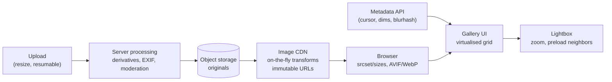
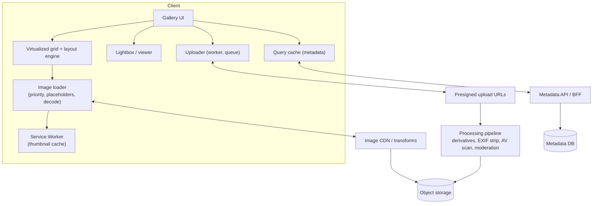
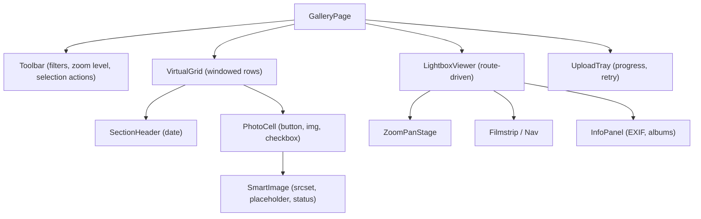
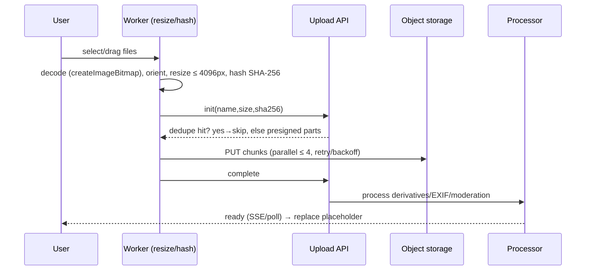

# System Design: Image Gallery & Media-Heavy UI

> Method: [01-frontend-system-design-framework.md](01-frontend-system-design-framework.md). Related: [02 News Feed (virtualisation, impressions)](02-news-feed-and-infinite-scroll.md), [react/03 (`<ViewTransition>`, Activity)](../react/03-concurrent-react-suspense-and-transitions.md), [react/08 (INP, virtualisation)](../react/08-react-performance-optimization.md).
> Platform facts verified on 2026-11-10 (MDN, web.dev): **AVIF** support — Chrome 85, Edge 121, Firefox 93, Safari 16.1 (use a `<picture>` fallback; AVIF has **no progressive rendering**); **WebP** broadly supported; **JPEG XL** — Chrome 155, Firefox 158, Safari 17 (still needs a fallback); **`fetchpriority`** — Chrome 102, Safari 17.2, Firefox 132 (a *hint*, not a directive; `high` for the LCP image, `low` for off-screen carousel images that are "close enough" to otherwise be boosted); Chrome boosts the first ~5 large images to Medium by default; `content-visibility: auto` is Baseline (Sep 2025).
> Typical prompts: "Design Google Photos / Pinterest / Unsplash / Instagram grid", "Design an image gallery with lightbox", "Design a media-heavy e-commerce product gallery".

## Table of Contents

1. [Quick Summary (TL;DR)](#1-quick-summary-tldr)
2. [Requirements and Scope](#2-requirements-and-scope)
3. [Estimation and Constraints](#3-estimation-and-constraints)
4. [High-Level Architecture](#4-high-level-architecture)
5. [Data Model](#5-data-model)
6. [API Design](#6-api-design)
7. [Component Architecture and State](#7-component-architecture-and-state)
8. [Deep Dive 1: The Image Pipeline and Delivery](#8-deep-dive-1-the-image-pipeline-and-delivery)
9. [Deep Dive 2: Layout Algorithms and Virtualised Grids](#9-deep-dive-2-layout-algorithms-and-virtualised-grids)
10. [Deep Dive 3: Loading Strategy, Placeholders, Memory](#10-deep-dive-3-loading-strategy-placeholders-memory)
11. [Deep Dive 4: Lightbox, Gestures, Zoom, Transitions](#11-deep-dive-4-lightbox-gestures-zoom-transitions)
12. [Video and Other Media](#12-video-and-other-media)
13. [Uploads and Client-Side Processing](#13-uploads-and-client-side-processing)
14. [Selection, Albums, Bulk Operations](#14-selection-albums-bulk-operations)
15. [Performance Plan](#15-performance-plan)
16. [Accessibility, i18n, Security and Privacy, Observability](#16-accessibility-i18n-security-and-privacy-observability)
17. [Failure Modes and Edge Cases](#17-failure-modes-and-edge-cases)
18. [Testing and Rollout](#18-testing-and-rollout)
19. [Trade-offs and Alternatives](#19-trade-offs-and-alternatives)
20. [Interview Questions — Fundamentals](#20-interview-questions--fundamentals)
21. [Interview Questions — Senior Scenarios](#21-interview-questions--senior-scenarios)
22. [Cheat Sheet](#22-cheat-sheet)
23. [Key Terms Glossary](#23-key-terms-glossary)
24. [Further Reading](#24-further-reading)

---

## 1. Quick Summary (TL;DR)

- A media-heavy UI is a **bandwidth, memory, and layout-stability problem**. The levers: **right-sized, right-format images** (CDN transforms, `srcset/sizes`, AVIF/WebP with fallbacks), **reserved space** (metadata aspect ratios), **prioritised loading** (LCP image eager + `fetchpriority="high"`, everything else lazy), **virtualised/windowed grids**, and **bounded decoded memory**.
- **Pipeline:** upload → server processing (derivatives, metadata, moderation) → CDN with **immutable, versioned URLs** → client picks a size via `srcset/sizes` → placeholder (blurhash/dominant colour) → decode → display.
- **Hard parts:** (1) layout algorithms (justified rows/masonry) with zero CLS, (2) loading priority and memory for thousands of images, (3) lightbox with gestures/zoom/preload/transition, (4) uploads with client-side resize and resumable transfer, (5) accessibility and privacy (EXIF, signed URLs).
- **Memory rule:** decoded bitmap ≈ `width × height × 4 bytes` (a 12 MP photo ≈ 48 MB) — **never decode originals for thumbnails**.



---

## 2. Requirements and Scope

**Functional**
- Browse a large collection (10³–10⁶ items) in a responsive grid (uniform, justified rows, or masonry), grouped by date/album.
- Open an item in a **lightbox** (next/prev, zoom/pan, captions/EXIF, share/download, keyboard/touch gestures).
- Upload (single/bulk), delete, organise into albums, favourite, search/filter (tags/date/people).
- Support images **and video**; deep-linkable URLs for items.

**Non-functional**
- **Performance:** LCP ≤ 2.5 s (first screenful), smooth scrolling (60 fps), INP ≤ 200 ms for open/close/zoom.
- **Stability:** CLS ≤ 0.1 — no jumping while images load.
- **Efficiency:** minimal bytes on mobile/data-saver; bounded memory over long sessions.
- **Accessibility:** WCAG 2.2 AA: alt text, keyboard, screen reader, reduced motion.
- **Privacy/security:** private galleries, signed URLs, EXIF stripping, safe upload handling.
- **Resilience:** flaky networks, partial failures, offline cached thumbnails.

**Out of scope:** ML features (face clustering, search embeddings), editing tools (mention extension points).

**Clarifying questions**
- Public vs private content? SEO needed (public galleries) or authenticated app?
- Image sizes (phone 12–50 MP, RAW?) and volumes? Video length? Live photos/HEIC?
- Layout style (Pinterest masonry vs Google Photos justified timeline)?
- Offline/PWA? Sharing/collaboration? Download originals?

---

## 3. Estimation and Constraints

| Item | Assumption | Implication |
|---|---|---|
| Grid thumbnails | 200–400 px wide, ~10–30 KB each (AVIF/WebP) | 60 visible items ≈ 0.6–1.8 MB first screen |
| Lightbox image | 1600–2560 px, 150–600 KB | Progressive enhancement: thumb → medium → original on zoom |
| Decoded memory | `w × h × 4` | 300×300 thumb ≈ 360 KB; 2560×1707 ≈ 17 MB; 4000×3000 ≈ 48 MB |
| Items mounted | ≤ ~100–200 `` at once | Virtualise/window; unload far images |
| Parallel requests | HTTP/2/3 multiplexed; browser still limits concurrent image decodes | Prioritise visible; cancel off-screen |
| Network | 4G median ~ 10 Mbps, high variance | Responsive sizes + data saver; avoid originals by default |
| Scroll speed | Fast flings skip thousands of px | Don't load images for rows scrolled past; debounce load |

---

## 4. High-Level Architecture



**Rendering strategy:** public galleries → SSR/SSG the first rows + canonical item pages (SEO, social previews with `og:image`); authenticated apps → CSR with a server-embedded first page of metadata. Always **server-provide dimensions** so layout is computed before images load.

---

## 5. Data Model

```ts
type ID = string;

interface PhotoSummary {
  id: ID;
  width: number;                    // original pixel dimensions (for aspect ratio)
  height: number;
  takenAt: string;                  // ISO UTC (group by local date on the client)
  blurhash?: string;                // or thumbhash / dominant colour
  dominantColor?: string;           // fallback placeholder
  type: "image" | "video";
  durationSec?: number;
  version: string;                  // content hash → part of immutable URL (cache busting)
  title?: string;
  alt?: string;                     // user/AI generated description
  flags: { favorite?: boolean; private?: boolean };
}

interface PhotoDetail extends PhotoSummary {
  exif?: { camera?: string; lens?: string; iso?: number; aperture?: number; shutter?: string; location?: { lat: number; lng: number } };
  tags: string[];
  albumIds: ID[];
  originalBytes: number;
}

interface Page<T> { items: T[]; nextCursor: string | null; sections?: { date: string; count: number }[] }

// Client-side derived layout
interface LayoutRow { top: number; height: number; items: { id: ID; left: number; width: number; height: number }[] }
```

**URL template (immutable, versioned):** `https://img.cdn.example/i/{id}/{version}?w={w}&fmt={avif|webp|jpeg}&q={q}&dpr={n}` — any change to the image changes `version`, so URLs can be cached forever.

---

## 6. API Design

```
GET /v1/photos?cursor=<c>&limit=100&sort=takenAt:desc&album=<id>&q=<query>
→ { items: PhotoSummary[], nextCursor, sections? }       // lightweight: no EXIF

GET /v1/photos/:id            → PhotoDetail
GET /v1/photos/:id/neighbors?n=3  → ids/summaries around an item for lightbox prefetch

POST /v1/uploads/init  { name, size, type, sha256 } → { uploadId, presignedParts[] }   // resumable multipart
PUT  <presigned part URLs>
POST /v1/uploads/:id/complete → { photoId }  (async processing; status via poll/SSE)

DELETE /v1/photos/:id | POST /v1/photos:batchDelete { ids }
POST /v1/albums/:id/photos:batchAdd { ids }
```
- **Cursor by `(takenAt, id)`** for stable ordering even when items share timestamps.
- Return **thousands of summaries cheaply** (compact JSON/columnar) and fetch details lazily.
- **Signed URL strategy:** public CDN URLs (immutable) for public content; for private content use short-lived signed URLs or **signed cookies** (CDN) so images remain cacheable per session without per-image tokens expiring mid-scroll. Document the trade-off: per-URL expiry vs cache efficiency.
- **ETag/If-None-Match** on list endpoints; `Cache-Control: private, max-age=…` for personalised lists; `immutable` for image bytes.

---

## 7. Component Architecture and State



| State | Where |
|---|---|
| Photo summaries & pages | Query cache (infinite query by cursor) + normalised map by id |
| Layout (rows) | Derived (memoised) from summaries + container width + target row height |
| Selection | Local store (Set of ids) + anchor id for shift-select |
| Lightbox current id | **URL** (`/photos/:id` or `?photo=`) so back closes it and links are shareable |
| Upload queue | Persistent store (IndexedDB) + worker |
| Image load status | Per-cell state/ref (avoid global re-renders) |

---

## 8. Deep Dive 1: The Image Pipeline and Delivery

### Formats and fallbacks
- Prefer **AVIF** (best compression, no progressive rendering) and **WebP** (broad support) with **JPEG** fallback via `<picture>`; consider **JPEG XL** only where the CDN negotiates support — still needs a fallback.
- Photos → lossy (AVIF/WebP/JPEG); screenshots/UI/diagrams → lossless/PNG/SVG. Strip metadata (EXIF GPS) on derivatives; convert HEIC server-side.
- **Quality** tuned per format/size (e.g., AVIF q≈50–60, WebP q≈75, JPEG progressive q≈75–80) — verify visually and by SSIM/Butteraugli budgets.
- **Content negotiation:** either explicit `<source type>` or CDN `Accept`-header negotiation (`Vary: Accept` → cache fragmentation; prefer explicit `fmt=` URLs).

### Responsive images
```html
<picture>
  <source type="image/avif" srcset="/i/42/v1?w=320&fmt=avif 320w, /i/42/v1?w=640&fmt=avif 640w, /i/42/v1?w=1280&fmt=avif 1280w" sizes="(min-width: 1024px) 25vw, 50vw" />
  <source type="image/webp" srcset="/i/42/v1?w=320&fmt=webp 320w, /i/42/v1?w=640&fmt=webp 640w, /i/42/v1?w=1280&fmt=webp 1280w" sizes="(min-width: 1024px) 25vw, 50vw" />
  
</picture>
```
- **`sizes` must reflect the real rendered width** — a wrong `sizes` makes the browser fetch oversized images (most common mistake). For JS-computed layouts (justified rows), set `sizes` from the computed pixel width: `sizes={`${Math.round(item.width)}px`}`.
- Offer a **ladder of widths** (e.g., 160, 320, 640, 960, 1280, 1920, 2560); the browser multiplies by DPR automatically with `w` descriptors.
- **Intrinsic `width`/`height`** attributes (or `aspect-ratio`) reserve space (no CLS).
- **Art direction** (`media` in `<source>`) for different crops per breakpoint (hero images).

### CDN/Delivery
- **On-the-fly transforms** (resize, format, quality, crop/focal point) with cached derivatives; **immutable URLs** (`Cache-Control: public, max-age=31536000, immutable`).
- **Origin shielding**, tiered caches, request coalescing; signed transform parameters to prevent **resize abuse** (DoS via arbitrary sizes).
- HTTP/2/3; Brotli for SVG/JSON; Preconnect to the image origin.
- Data saver: honour `Save-Data` header/`prefers-reduced-data` (limited support) by lowering quality/width.

### Progressive vs baseline
JPEG progressive and (in some browsers) JPEG XL render progressively; AVIF does not — for large AVIF, show a placeholder until fully decoded and keep file sizes small via responsive widths.

---

## 9. Deep Dive 2: Layout Algorithms and Virtualised Grids

### Layout options

| Layout | Pros | Cons | Notes |
|---|---|---|---|
| **Uniform grid** (`aspect-ratio: 1`, `object-fit: cover`) | Simplest, trivially virtualisable | Crops images | CSS grid `auto-fill` |
| **Justified rows** (Flickr/Google Photos) | Preserves aspect ratios, tidy rows | Needs JS layout; recompute on resize | Great for timelines |
| **Masonry** (Pinterest) | Dense, variable heights | Harder virtualisation, reading order issues | CSS columns (order top-to-bottom per column) or JS shortest-column; native CSS grid masonry is newly emerging — check support |

### Justified rows (greedy)
```ts
export interface Item { id: string; ratio: number }   // width / height from metadata (no image load needed)
export function justify(items: Item[], containerW: number, targetH = 220, gap = 4) {
  const rows: { top: number; height: number; items: { id: string; left: number; width: number; height: number }[] }[] = [];
  let row: Item[] = [];
  let top = 0;

  const flush = (last: boolean) => {
    const sumRatio = row.reduce((s, i) => s + i.ratio, 0);
    let h = (containerW - gap * (row.length - 1)) / sumRatio;
    if (last && h > targetH * 1.3) h = targetH;            // don't blow up the last short row
    let left = 0;
    rows.push({ top, height: h, items: row.map((i) => { const w = i.ratio * h; const out = { id: i.id, left, width: w, height: h }; left += w + gap; return out; }) });
    top += h + gap;
    row = [];
  };

  for (const it of items) {
    row.push(it);
    const sumRatio = row.reduce((s, i) => s + i.ratio, 0);
    const h = (containerW - gap * (row.length - 1)) / sumRatio;
    if (h <= targetH) flush(false);
  }
  if (row.length) flush(true);
  return rows;
}
```
- Complexity **O(n)**; compute **once per width** (debounced `ResizeObserver`); memoise rows; cache by `(containerW, targetH)`.
- A **linear-partition (optimal)** variant minimises row-height variance — better visuals, higher cost.
- **Because ratios come from metadata**, rows/heights are known *before* images load → zero CLS and exact total height for virtualization.

### Virtualised rows
```tsx
function VirtualJustifiedGrid({ rows }: { rows: LayoutRow[] }) {
  const parentRef = useRef<HTMLDivElement>(null);
  const v = useVirtualizer({
    count: rows.length,
    getScrollElement: () => parentRef.current,
    estimateSize: (i) => rows[i].height,              // exact, not estimated
    overscan: 3,
  });
  return (
    <div ref={parentRef} style={{ overflow: "auto", height: "100dvh" }}>
      <div style={{ height: v.getTotalSize(), position: "relative" }}>
        {v.getVirtualItems().map((vr) => (
          <div key={vr.key} role="list" style={{ position: "absolute", top: 0, left: 0, width: "100%", height: rows[vr.index].height, transform: `translateY(${vr.start}px)` }}>
            {rows[vr.index].items.map((it) => <PhotoCell key={it.id} item={it} />)}
          </div>
        ))}
      </div>
    </div>
  );
}
```
- **Date section headers** are extra "rows" in the same virtual list (sticky headers via `position: sticky` or an overlay).
- **Fast scrubber** (timeline scrollbar) needs a **section index** (`sections[]` with counts) to jump to dates without loading everything: jump → fetch the page at that cursor/date → render.
- **Window resize / orientation change:** recompute layout; **anchor** on the first visible item to keep context.
- **Zoom levels** (pinch or slider changes `targetH`) → recompute; use FLIP/transition sparingly.
- Alternative for smaller sets: **`content-visibility: auto`** on row containers with `contain-intrinsic-size` equal to known row heights — simpler, keeps find-in-page, DOM stays.

---

## 10. Deep Dive 3: Loading Strategy, Placeholders, Memory

### Prioritisation
| Image | Strategy |
|---|---|
| First screenful (LCP candidate) | Render in SSR HTML, **no `loading="lazy"`**, `fetchpriority="high"` on the single most important image; `<link rel="preload" as="image" imagesrcset imagesizes>` if discovered late |
| Rest of first row(s) | Default priority (browser boosts first ~5 large images in Chrome) |
| Below the fold | `loading="lazy"` + `decoding="async"`; virtualization controls mounting |
| Carousel/lightbox neighbours | Explicit `Image()` preloads on idle; `fetchpriority="low"` for off-screen-but-near images so they don't steal bandwidth |
| Fast scroll | Delay loading until scroll velocity drops (don't fetch images the user flings past) |

> `fetchpriority` is a **hint**; priorities are relative; CDNs may not honour HTTP/2/3 prioritisation uniformly — measure, don't assume.

### Placeholder strategy
- **Blurhash/thumbhash** (≈ 20–30 bytes) decoded to a tiny canvas/CSS gradient, or **dominant colour** background; crossfade when the real image decodes (respect `prefers-reduced-motion`).
- **LQIP** inlined as base64 (small) for the first screenful only.
- **Never show blank boxes**: reserve exact size from metadata.

```tsx
function SmartImage({ photo, width, height, priority }: { photo: PhotoSummary; width: number; height: number; priority?: boolean }) {
  const [loaded, setLoaded] = useState(false);
  const src = (w: number, fmt: string) => `https://img.cdn.example/i/${photo.id}/${photo.version}?w=${w}&fmt=${fmt}`;
  const widths = [160, 320, 640, 960, 1280].filter((w) => w <= photo.width);
  return (
    <div style={{ width, height, background: photo.dominantColor ?? "#ddd", position: "relative", overflow: "hidden" }}>
      <picture>
        <source type="image/avif" srcSet={widths.map((w) => `${src(w, "avif")} ${w}w`).join(", ")} sizes={`${Math.round(width)}px`} />
        <source type="image/webp" srcSet={widths.map((w) => `${src(w, "webp")} ${w}w`).join(", ")} sizes={`${Math.round(width)}px`} />
         setLoaded(true)}
          style={{ width: "100%", height: "100%", objectFit: "cover", opacity: loaded ? 1 : 0, transition: "opacity .2s" }}
        />
      </picture>
    </div>
  );
}
```
(React supports `fetchPriority`; check your React/DOM typings version.)

### Decoding and main-thread jank
- `decoding="async"` lets the browser decode off the main thread where possible; for programmatic swaps use **`await img.decode()`** before inserting to avoid a blank frame/jank.
- Large originals decode on demand in the lightbox — show the medium size first, swap when `decode()` resolves.

### Memory management
- **Decoded size = `w × h × 4`**: unmount (virtualise) far-away images; browsers may discard decoded data for off-screen images but don't rely on it.
- In long sessions, cap **retained blobs/object URLs**; `URL.revokeObjectURL` for local previews; avoid keeping large `ImageBitmap`s (`bitmap.close()`).
- **Don't use CSS `background-image` for content images** (no `srcset`, harder prioritisation, poor a11y).
- For canvases/WebGL galleries, texture memory budgeting and LRU eviction.

### Caching
- Browser HTTP cache (immutable URLs), **Service Worker + Cache API** for thumbnails (stale-while-revalidate, size-bounded LRU), CDN cache; **storage quotas are evictable** — treat as cache not storage.

---

## 11. Deep Dive 4: Lightbox, Gestures, Zoom, Transitions

### Routing and history
- Open viewer by **navigating** to `/photos/:id` (or `?photo=`): **Back closes**, links shareable, SSR-able canonical page for SEO; with frameworks use intercepting/parallel routes to overlay the viewer on the grid while keeping scroll position.
- Preserve grid **scroll position** and layout when the viewer closes (keep the grid mounted behind the overlay, or restore by anchor).

### Viewer accessibility
- Native `<dialog>` + `showModal()` or an accessible dialog primitive: `role="dialog"`, `aria-modal`, labelled; **focus trap**, move focus into the viewer, **return focus to the originating thumbnail** on close; background `inert`; Esc closes; scroll lock.
- Keyboard: ←/→ navigate, `+`/`-`/`0` zoom, Esc, Home/End; visible buttons with labels for all gestures (not gesture-only).
- Announce position ("Photo 3 of 120") via live region; provide alt text and caption.

### Navigation and preloading
```ts
function preloadNeighbors(ids: string[], index: number, w: number) {
  for (const i of [index + 1, index - 1, index + 2]) {
    const id = ids[i]; if (!id) continue;
    const img = new Image();
    img.decoding = "async";
    (img as any).fetchPriority = "low";           // don't compete with the current image
    img.src = photoUrl(id, w);
    img.decode?.().catch(() => {});               // warm decode off the critical path
  }
}
```
- Progressive enhancement: show the **already-loaded grid thumbnail** instantly (stretched) → swap to medium → swap to original on zoom/high-DPR.
- Cancel pending loads when the user swipes quickly (track "current request id"; ignore stale `decode()` results).

### Zoom and pan (touch + mouse)
- Use **Pointer Events** (`pointerdown/move/up` + `setPointerCapture`), track active pointers for **pinch** (distance ratio) and **pan**; CSS `touch-action: none` on the stage so the browser doesn't hijack gestures; apply `transform: translate3d(x,y,0) scale(s)` (GPU-composited; avoid layout properties); `will-change: transform` only during gestures.
- **Double-tap/double-click** toggles fit/100%; **wheel/trackpad** zoom with `ctrlKey` pinch on desktop; clamp pan to image bounds with inertia; keep zoom centred on the gesture focal point.
- **Very large images** (panoramas, maps, 100 MP): **tiled deep-zoom** (DZI/IIIF) loading tiles per zoom level (OpenSeadragon-style) instead of one giant bitmap.
- **Rotation/EXIF orientation:** have the server bake orientation into derivatives or use CSS `image-orientation: from-image` (default on modern browsers) — test consistency.

### Shared-element transition (grid → lightbox)
- **React 19.3 `<ViewTransition>`** (stable) or the browser View Transition API: give the thumbnail and the viewer image the same `name` so the browser animates between rects; wrap navigation in a transition; fall back to a FLIP animation or no animation where unsupported; keep durations short and honour `prefers-reduced-motion`.
- Avoid animating `width/height` (layout); animate `transform`/`opacity`.

### Controls and metadata
Download original (signed URL, `Content-Disposition`), share (Web Share API when available, copy link), info panel (EXIF; hide GPS unless owner), edit/rotate (server-side non-destructive), delete with undo.

---

## 12. Video and Other Media

- **Poster first:** `<video poster preload="metadata">`; load video data only on interaction/near-viewport; **one active video at a time**.
- **Adaptive streaming:** HLS/DASH (MSE or native HLS on Safari), multiple renditions, ABR; thumbnails sprite + VTT for scrubbing; captions as WebVTT `<track>`.
- **Autoplay muted** only in view (IntersectionObserver ≥ 50–60%), pause when out of view/tab hidden; respect Save-Data and reduced motion; **GIF → short MP4/WebM/AV1** for efficiency.
- **Memory/CPU:** limit concurrent decoders on mobile; release video elements (`removeAttribute("src"); load()`) when virtualised away.
- **Live Photos/animated formats:** use video/animated WebP/AVIF thoughtfully; provide stills for LCP.
- **Audio/other embeds:** lazy-load facades (click-to-load) for third-party players (YouTube) to protect CWV.

---

## 13. Uploads and Client-Side Processing


- **Client-side resize/compress** (optional): `createImageBitmap(file, { imageOrientation: "from-image" })` → draw to `OffscreenCanvas` → `convertToBlob({ type: "image/webp"|"image/jpeg", quality })` in a **Web Worker** (keeps UI smooth); keep the **original** for archival if required.
- **Resumable/chunked uploads** (tus or S3 multipart): track per-part ETags, retry parts with backoff, resume after refresh (persist upload state in IndexedDB), cap concurrency (global 3–6), prioritise visible/small files.
- **Dedupe** via SHA-256 (`crypto.subtle.digest`, streaming for big files) to avoid re-uploading.
- **Optimistic placeholders** in the grid (object URL preview → replaced by server derivative); progress rings, cancel/retry, error states, **batch progress** summary.
- **Validation:** file type by magic bytes (not just extension), size limits, dimension limits, reject SVG with scripts or sanitise server-side, HEIC/RAW conversion on server; show clear errors.
- **Privacy:** strip EXIF/GPS from derivatives; ask before publishing location.
- Drag-and-drop, paste, camera capture (`<input type="file" accept="image/*" capture>`), `showOpenFilePicker` where available.

---

## 14. Selection, Albums, Bulk Operations

- **Selection model:** click toggles; **Shift+click** selects range from anchor (needs stable ordering across virtualised rows → operate on IDs from the sorted list, not DOM); **Ctrl/Cmd+click** toggles; drag-select (rubber-band) with pointer events; select-all-in-section.
- **A11y:** checkboxes with labels ("Select photo, taken May 3"), `aria-selected`/`aria-checked`, live region "12 selected", keyboard (Space toggles, Shift+Arrow extends), clear selection (Esc).
- **Bulk actions:** delete/move/add to album/download as **streamed ZIP** (server-generated; or client `streamsaver`/File System Access with care); progress and partial failure reporting; **undo** window with soft delete.
- **Optimistic updates** with rollback for album membership; batch endpoints with idempotency keys.
- **Performance:** selection state in a Set + subscription per cell (avoid re-rendering whole grid on each selection).

---

## 15. Performance Plan

| Area | Plan | Metric |
|---|---|---|
| First paint | SSR first rows with exact dimensions; preload the LCP image; AVIF/WebP; HTTP/2/3; preconnect | LCP |
| Bytes | `srcset/sizes` ladder; quality tuning; data-saver; thumbnails ≤ ~30 KB | Transferred bytes |
| Layout | Metadata ratios; reserved space; no layout reads in scroll | CLS |
| Scrolling | Virtualised rows; passive listeners; avoid heavy work on scroll; delay loads during flings | Frame rate, INP |
| Decode/memory | `decoding="async"`, avoid decoding originals for thumbs; unmount far images; close bitmaps | JS heap/GPU memory |
| Lightbox | Preload neighbours at low priority; progressive swap; transform-based zoom | INP, interaction latency |
| Cache | Immutable URLs, SW thumbnail cache with LRU, CDN hit ratio | Repeat-view speed |
| Main thread | Layout compute O(n) memoised; resize/hash/compress in workers | Long tasks |
| Concurrency | Limit parallel uploads/downloads; prioritise visible | Network contention |

**Budget examples:** first screen ≤ ~1.5 MB; ≤ 150 `` mounted; interaction (open lightbox) ≤ 100 ms to first paint of the thumbnail-stretched image.

---

## 16. Accessibility, i18n, Security and Privacy, Observability

**Accessibility**
- **Alt text:** meaningful `alt` for content images (user-provided or generated and editable); empty `alt=""` for decorative; don't repeat adjacent captions; for galleries use a list of buttons/links with accessible names (title/date).
- **Keyboard:** grid navigable (Tab through items or roving tabindex with arrow keys), Enter opens, lightbox shortcuts, focus return.
- **Motion:** reduce/disable crossfades and view transitions with `prefers-reduced-motion`; no auto-advancing carousels without controls.
- **Zoom/low vision:** support browser zoom/reflow; ensure controls ≥ 24–44 px; sufficient contrast over images (scrim); don't convey info by colour only.
- **Video:** captions/transcripts, audio description where relevant, accessible controls.
- **Carousel** semantics follow the APG carousel pattern (labelled region, controls, `aria-live` off when auto-rotating).

**i18n**: RTL (reverse navigation arrows and layouts with logical properties), localised dates/section headers via `Intl`, text expansion in captions, locale-specific alt text.

**Security & privacy**
- **EXIF/GPS stripping** on public derivatives; explicit location sharing controls.
- **Private media:** signed URLs/cookies, short TTL for originals, no directory listing, **hotlink protection**, `Referrer-Policy`.
- **Upload safety:** MIME sniffing, size/dimension caps, decompression-bomb protection, antivirus scan, re-encode derivatives (don't serve user bytes directly), SVG sanitisation/forbid inline scripts, serve user content from a **separate cookieless domain** (avoid XSS/cookie exposure), `X-Content-Type-Options: nosniff`.
- **CSP `img-src`/`media-src`** allow-listing CDN origins; avoid `data:` except for tiny placeholders.
- **Abuse controls:** transform parameter signing/allow-lists, rate limits, quota per user, moderation pipeline for UGC (NSFW/illegal content), DMCA workflows.
- **Consent/privacy:** analytics on viewing behaviour minimised; face recognition features need explicit consent/regulatory review.

**Observability**: image load success/failure rates by format/CDN POP, LCP element attribution (image URL/size), `PerformanceObserver` (`resource` timings), cache hit ratios, decode times (`img.decode()` timing), memory warnings, upload success/retry rates, bytes per session, CLS sources, error beacons for 4xx/5xx (e.g., expired signed URLs), format support distribution (AVIF/WebP/JPEG).

---

## 17. Failure Modes and Edge Cases

| Case | Handling |
|---|---|
| Image fails to load (404/403/5xx) | Fallback tile with retry (backoff), refetch signed URL on 403, show broken-image placeholder preserving layout |
| Slow network | Placeholders, lower quality ladder, prioritise visible; offer "load high quality" |
| Signed URL expires mid-session | Detect 403, refresh URL batch via API, retry; prefer signed cookies for continuous browsing |
| Huge originals/panoramas | Tiled deep zoom; cap derivative size; warn on download size |
| EXIF orientation inconsistencies | Normalise server-side; test CSS `image-orientation` |
| HEIC/unsupported format | Server conversion; client fallback message |
| Rapid lightbox navigation | Cancel stale loads; ignore stale decode results; keep UI responsive |
| Layout shifts from late metadata | Require dimensions in metadata; reject uploads without; fallback to 4:3 + correct on load (animated) |
| Memory pressure (mobile) | Reduce overscan, lower resolution ladder, unload offscreen, release video decoders |
| Offline | Cached thumbnails/metadata; disable upload or queue; show offline state |
| Duplicate uploads | Hash dedupe; server idempotency |
| Partial upload failure | Per-file retry/resume; summary with failures |
| Browser lacks AVIF/WebP | `<picture>` fallback chain |
| Selection across virtualised rows | ID-based selection; anchor id |
| Delete during viewing | Move to next item; announce; undo |
| Privacy leak in shared album | Server-enforced ACL; strip EXIF; signed URLs scoped to album |
| CDN misconfig (`Vary: Accept` cache poisoning) | Explicit `fmt=` URLs; verify cache keys |

---

## 18. Testing and Rollout

- **Unit:** justified layout (property tests: row widths sum to container, heights ≥ min), blurhash decode wrapper, section index/jump math, selection range logic, URL builder, upload state machine.
- **Visual regression:** grid layouts at multiple widths/DPR, RTL, loading/error placeholders, lightbox states.
- **Performance tests:** Playwright/Lighthouse CI on a seeded 10k-photo dataset with CPU/network throttling; metrics (LCP element, CLS, long tasks, heap after scrolling 1,000 images); **memory leak** test (open/close lightbox 200×).
- **Accessibility:** axe, keyboard-only flows, screen-reader smoke tests; reduced motion.
- **E2E:** upload → process → appears; offline thumbnails; shared link access control; deep link to `/photos/:id`; back button semantics.
- **Cross-browser/device matrix:** Safari iOS (WebP/AVIF support, memory limits), low-end Android, desktop; gesture tests with touch emulation.
- **Rollout:** flag the new layout/loader; A/B on LCP and engagement; progressive rollout of AVIF/new quality settings with image-error and bytes dashboards; kill switch to revert to JPEG-only.

---

## 19. Trade-offs and Alternatives

| Decision | Option A | Option B | Notes |
|---|---|---|---|
| Layout | Justified rows | Masonry / uniform grid | Justified: timeline apps; masonry: discovery feeds; uniform: simplest |
| Virtualisation | JS virtualised rows | `content-visibility: auto` | Virtualise for very large sets; CV simpler, keeps find-in-page, DOM stays |
| Formats | AVIF + WebP + JPEG | WebP + JPEG | AVIF saves bytes but costs encode time/CPU decode and no progressive rendering |
| Image delivery | Image CDN with transforms | Pre-generated derivatives | CDN flexible; pre-generated simpler caching/cost predictability |
| Placeholders | Blurhash/thumbhash | Dominant colour/LQIP | Blurhash best perception; colour cheapest |
| Lazy loading | Native `loading=lazy` | IntersectionObserver custom | Native simple; custom for velocity-aware/prefetch control |
| Private images | Signed URLs | Signed cookies / auth proxy | Cookies cache better; URLs simpler cross-domain |
| Lightbox | Own implementation | Library (PhotoSwipe, etc.) | Libraries handle gestures/a11y edge cases; own for design control |
| Uploads | Direct-to-storage presigned | Through app server | Presigned scales and avoids server bandwidth |
| Client resize | In worker before upload | Server-only | Client resize saves bandwidth; adds CPU and quality risk |
| Transitions | `<ViewTransition>`/View Transition API | FLIP/none | Native smoother; needs fallback and reduced-motion handling |
| Rendering | SSR first rows | CSR | SSR for LCP/SEO on public galleries |

---

## 20. Interview Questions — Fundamentals

### Q1. How do you serve images efficiently?
Responsive `srcset/sizes` with a width ladder, modern formats (AVIF/WebP) with JPEG fallback via `<picture>`, CDN resizing with immutable versioned URLs, correct `sizes`, quality tuning, and lazy loading below the fold.

### Q2. How do you prevent layout shift in a gallery?
Provide width/height (aspect ratio) from metadata, compute layout before images load, use placeholders of exact size, and avoid inserting content above the viewport.

### Q3. How do you prioritise the LCP image?
Don't lazy-load it, add `fetchpriority="high"`, ensure it's in the initial HTML (SSR) or preload it (with `imagesrcset`), and avoid competing early resources.

### Q4. How do you handle thousands of images?
Virtualise rows (or use `content-visibility`), unmount far-away images, cap concurrent loads, use thumbnails, and avoid decoding large originals.

### Q5. What's the memory cost of an image?
Decoded bitmap ≈ width × height × 4 bytes regardless of file size, so a 12 MP photo costs ~48 MB decoded — use appropriately sized derivatives.

### Q6. How do you implement pinch-to-zoom?
Pointer Events with pointer capture, track two pointers for scale and pan, apply `transform` (GPU), `touch-action: none`, clamp bounds, double-tap toggle, and use tiled images for huge assets.

### Q7. How do you make the lightbox accessible?
Dialog semantics, focus trap and return, keyboard navigation and Esc, labelled controls, announce position, alt text, reduced motion, inert background.

### Q8. How do you upload many large photos reliably?
Presigned resumable multipart uploads with parallel capped concurrency, retry with backoff, persisted state, hash dedupe, client-side resize in a worker (optional), and optimistic placeholders.

### Q9. Why avoid CSS background images for gallery content?
No `srcset`, no native lazy loading/priorities, no alt text, worse accessibility and prioritisation.

### Q10. How do you secure private photos?
Server-enforced ACLs, signed URLs/cookies with limited scope/TTL, strip EXIF, serve from a separate cookieless domain, validate uploads, and avoid public listing.

---

## 21. Interview Questions — Senior Scenarios

### S1. "Scrolling a 50k-photo timeline stutters and the app crashes on older iPhones. Diagnose and fix."
Likely too many mounted images/decoded bitmaps and oversized derivatives. Check heap/GPU memory, number of `` nodes, requested sizes vs rendered (wrong `sizes`), simultaneous decode, video elements. Fixes: virtualise rows with exact heights, serve correct width ladder, unmount far items, `decoding="async"`, delay loading during fast scroll, lower overscan on low-memory devices (`navigator.deviceMemory` is non-standard; use heuristics/feature detection), avoid blur filters/box-shadows on many layers, release video decoders, use Safari-friendly formats; add memory dashboards and reproduce with throttled devices.

### S2. "LCP regressed after introducing a hero carousel with 6 images."
Probably all images were eager/high priority or lazy-loaded the first one incorrectly. Make only the first slide eager with `fetchpriority="high"`; set the others `loading="lazy"` and `fetchpriority="low"` (they may be 'close enough' to load anyway); preload the LCP image if late-discovered; avoid JS-driven rendering of the first slide; use correct `sizes`/AVIF; ensure CDN caching and `Cache-Control`. Validate with trace/LCP attribution.

### S3. "Design the 'jump to date' scrubber for a photo timeline."
Server provides a **section index** (counts per month/day). The scrubber maps scroll thumb → section; clicking requests a page at that date cursor; the virtual list uses section heights computed from counts × estimated row height (corrected as real layout arrives); anchor on the target; placeholders while loading; prefetch neighbours; maintain consistent scroll height to avoid thumb jumping; test with huge libraries.

### S4. "How do you build a Pinterest-style masonry feed with virtualization?"
Metadata ratios → deterministic column layout (assign each item to the shortest column) computed O(n) with a min-heap or linear scan; store item positions; virtualise by position windows (binary search by top); maintain stable positions on append; recompute on width change with anchor; reading order for a11y (DOM order vs visual order) — provide logical order; handle new items without shifting visible ones; consider performance of absolute positioning and many layers.

### S5. "A shared album link leaked images to unauthorised users. How do you prevent this class of issue?"
Capabilities should be scoped and revocable: signed URLs tied to album/viewer with short TTL, server-side ACL checks at the CDN edge (token validation), no predictable URLs, versioned IDs, revocation lists/rotating secrets, audit logs, rate-limit and anomaly detection, strip EXIF, avoid exposing original URLs in public metadata, and test authorisation paths (IDOR). Communicate trade-offs between cacheability and revocation speed.

### S6. "Implement client-side image compression without hurting UX."
Do it in a Web Worker: `createImageBitmap` (orientation aware) → resize to max dimension → `OffscreenCanvas.convertToBlob` with quality; concurrency-limit to avoid memory spikes (process sequentially for big files); show progress; keep originals if required; detect failures (unsupported codecs) and fall back to direct upload; verify quality via thresholds; measure CPU/battery; skip for already-small files; handle EXIF and colour profiles (convert to sRGB).

### S7. "How would you make the gallery work offline?"
Service worker caches app shell + recent metadata + thumbnails (bounded LRU), IndexedDB stores metadata and an upload outbox, offline UI states, queue uploads/deletes with idempotency, sync on reconnect; note storage eviction risk; don't cache private originals unless required (security).

---

## 22. Cheat Sheet

```mermaid
mindmap
  root((Image gallery))
    Delivery
      srcset sizes
      AVIF WebP JPEG
      CDN transforms
      immutable URLs
    Layout
      metadata ratios
      justified rows
      masonry
      zero CLS
    Loading
      LCP eager high
      lazy rest
      blurhash
      decode async
      neighbors low
    Scale
      virtualized rows
      memory w h 4
      unload far images
    Viewer
      dialog a11y
      pointer events zoom
      tiled deep zoom
      view transitions
    Upload
      worker resize
      resumable chunks
      hash dedupe
    Security
      strip EXIF
      signed access
      separate domain
```



| Problem | Answer |
|---|---|
| Oversized downloads | Correct `sizes` + width ladder |
| CLS | Dimensions from metadata |
| LCP | Eager + `fetchpriority=high` + preload if late |
| Memory | `w×h×4`; unmount far images |
| Gestures | Pointer events + transform |
| Huge images | Tiled deep zoom |
| Private media | Signed cookies/URLs + ACL |

---

## 23. Key Terms Glossary

| Term | Definition |
|---|---|
| `srcset`/`sizes` | HTML attributes letting the browser choose an image width |
| Justified layout | Rows scaled so each fills container width |
| Masonry | Column-based variable-height layout |
| Blurhash | Compact string encoding a blurred placeholder |
| LQIP | Low-quality image placeholder |
| `fetchpriority` | Hint to raise/lower resource fetch priority |
| Decode | Converting compressed image bytes to pixels |
| Deep zoom/tiling | Loading image tiles per zoom level |
| Presigned URL | Time-limited URL for direct storage access |
| Signed cookie | CDN-validated credential enabling cached private media |

---

## 24. Further Reading

- [MDN — Image file type and format guide](https://developer.mozilla.org/en-US/docs/Web/Media/Guides/Formats/Image_types) · [Responsive images](https://developer.mozilla.org/en-US/docs/Web/HTML/Guides/Responsive_images)
- [web.dev — Fetch Priority](https://web.dev/articles/fetch-priority) · [Optimize LCP](https://web.dev/articles/optimize-lcp) · [Browser-level image lazy loading](https://web.dev/articles/browser-level-image-lazy-loading) · [`content-visibility`](https://web.dev/articles/content-visibility)
- [MDN — Pointer events](https://developer.mozilla.org/en-US/docs/Web/API/Pointer_events) · [`HTMLImageElement.decode()`](https://developer.mozilla.org/en-US/docs/Web/API/HTMLImageElement/decode) · [`createImageBitmap`](https://developer.mozilla.org/en-US/docs/Web/API/Window/createImageBitmap) · [OffscreenCanvas](https://developer.mozilla.org/en-US/docs/Web/API/OffscreenCanvas)
- [WAI-ARIA APG — Carousel](https://www.w3.org/WAI/ARIA/apg/patterns/carousel/) · [Blurhash](https://blurha.sh/) · [tus resumable upload protocol](https://tus.io/)
- [React `<ViewTransition>`](https://react.dev/reference/react/ViewTransition)
