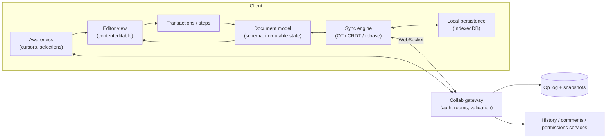
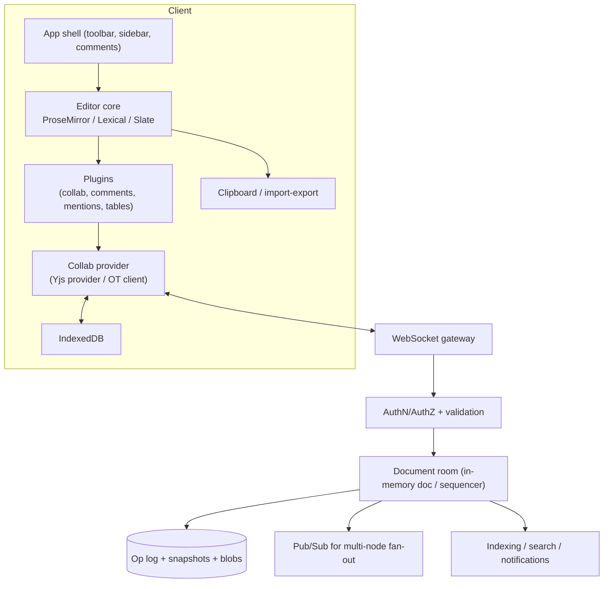
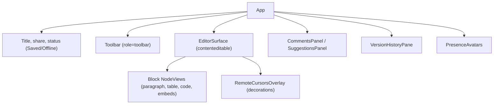
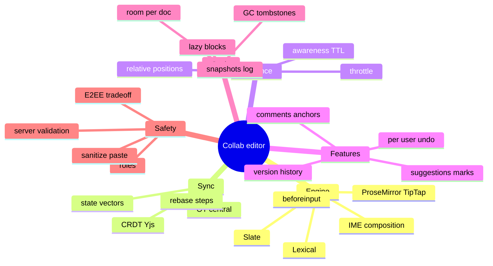

# System Design: Collaborative Rich-Text Editor (Google Docs-style)

> Method: [01-frontend-system-design-framework.md](01-frontend-system-design-framework.md). Related: [04 Chat (transport, reconnect, outbox, presence)](04-chat-and-real-time-messaging.md), [react/06 (optimistic updates)](../react/06-state-management-and-data-fetching.md), [typescript/03 (parse at boundaries)](../typescript/03-narrowing-and-type-safety-patterns.md).
> Platform fact verified on 2026-11-10 (MDN): the **EditContext API** (custom editable regions, e.g. canvas-rendered editors, with IME/emoji-picker support) is **experimental and Chromium-only** (Chrome/Edge 121; no Firefox/Safari support) — so production editors still rely on `contenteditable` + `beforeinput` (or hidden inputs) with careful IME handling, and canvas-based editors must keep an accessible DOM mirror.
> Typical prompts: "Design Google Docs / Notion / Figma comments / collaborative code editor", "Design a real-time collaborative text editor", "How do OT and CRDT differ?"

## Table of Contents

1. [Quick Summary (TL;DR)](#1-quick-summary-tldr)
2. [Requirements and Scope](#2-requirements-and-scope)
3. [Estimation and Constraints](#3-estimation-and-constraints)
4. [High-Level Architecture](#4-high-level-architecture)
5. [Document Model and Data Model](#5-document-model-and-data-model)
6. [Protocol and API Design](#6-protocol-and-api-design)
7. [Component Architecture and State](#7-component-architecture-and-state)
8. [Deep Dive 1: Input Pipeline (contenteditable, IME, Selection, Clipboard)](#8-deep-dive-1-input-pipeline-contenteditable-ime-selection-clipboard)
9. [Deep Dive 2: Concurrency Control — OT vs CRDT vs Central Authority](#9-deep-dive-2-concurrency-control--ot-vs-crdt-vs-central-authority)
10. [Deep Dive 3: Presence, Cursors, Comments, Suggestions](#10-deep-dive-3-presence-cursors-comments-suggestions)
11. [Deep Dive 4: Undo/Redo, Offline, History](#11-deep-dive-4-undoredo-offline-history)
12. [Rendering Performance for Large Documents](#12-rendering-performance-for-large-documents)
13. [Persistence, Scaling, and Server Responsibilities](#13-persistence-scaling-and-server-responsibilities)
14. [Accessibility, i18n, Security, Observability](#14-accessibility-i18n-security-observability)
15. [Failure Modes and Edge Cases](#15-failure-modes-and-edge-cases)
16. [Testing and Rollout](#16-testing-and-rollout)
17. [Trade-offs and Alternatives](#17-trade-offs-and-alternatives)
18. [Interview Questions — Fundamentals](#18-interview-questions--fundamentals)
19. [Interview Questions — Senior Scenarios](#19-interview-questions--senior-scenarios)
20. [Cheat Sheet](#20-cheat-sheet)
21. [Key Terms Glossary](#21-key-terms-glossary)
22. [Further Reading](#22-further-reading)

---

## 1. Quick Summary (TL;DR)

- A collaborative editor is **three systems in one**: (1) a **rich-text editor** (document model, input handling, rendering), (2) a **concurrency-control layer** (OT, CRDT, or central-authority rebasing) guaranteeing convergence and intent preservation, and (3) a **real-time sync/persistence stack** (transport, presence, offline, history).
- **Don't build the editing engine from scratch**: use **ProseMirror/TipTap, Lexical, Slate, or CodeMirror 6** (code). The hard browser problems — `contenteditable` quirks, IME, selection mapping, clipboard — are already encoded there.
- **Pick the collaboration model deliberately:** **OT** (central server transforms ops; Google Docs, Quill/ShareDB lineage), **CRDT** (Yjs/Automerge; peers merge in any order; great for offline/P2P), or **central authority + rebasing** (ProseMirror's collab module). Know the trade-offs (metadata/tombstones, server complexity, rich-text semantics, undo).
- **Presence** (cursors/selections) is **ephemeral** and separate from the document; anchor it with **relative positions** so it survives concurrent edits.
- **Undo is local**: undo *my* last change, not whatever happened last (needs per-origin undo stacks).
- Mention: offline merges, version history, comments anchored to ranges, permissions enforced **server-side**, IME correctness, large-document performance, accessibility, E2EE trade-offs.



---

## 2. Requirements and Scope

**Functional**
- Rich text: headings, lists, tables, links, images, code blocks, mentions, embeds; formatting marks (bold/italic/…).
- **Real-time collaboration** for N users: concurrent edits converge; remote cursors/selections with names/colours.
- **Comments & suggestions** anchored to ranges; threads; resolve; mentions/notifications.
- **Undo/redo** (per user), copy/paste (including from Word/Google Docs/web), drag-drop, find/replace.
- **Offline** editing with later merge; **autosave** with status ("Saving… / Saved / Offline").
- **Version history** (named versions, restore, diff), export/import (Markdown/HTML/DOCX/PDF).
- **Permissions:** owner/editor/commenter/viewer; link sharing; audit log.

**Non-functional**
- **Latency:** local echo immediate; remote edits visible within ~100–300 ms typical.
- **Correctness:** convergence (all replicas equal), intent preservation, no lost edits.
- **Scale:** docs up to 10⁵–10⁶ characters (tens of pages to hundreds); 2–100 concurrent editors per doc; millions of docs.
- **Reliability:** reconnect/offline; no data loss on crash/refresh.
- **Accessibility, i18n (IME/bidi), security**, mobile support.

**Out of scope:** full layout/pagination engine (describe options), OCR/AI features, server infra details.

**Clarifying questions**
- Rich text or plain/code? Tables/embeds/images? Max doc size? Concurrent editors?
- Offline required? P2P or server-mediated? Comments/suggestions? Mobile?
- Compliance (E2EE, data residency, retention)? Export formats?

---

## 3. Estimation and Constraints

| Item | Assumption | Implication |
|---|---|---|
| Typing rate | ~5–10 keystrokes/s per active user | Batch/coalesce ops (debounce network sends ~20–50 ms) |
| Active editors/doc | 2–20 typical, 100 peak (read-only audience larger) | Fan-out cost; awareness throttling; view-only via snapshots/streams |
| Doc size | 50k words ≈ 300 KB text; CRDT metadata multiplies | Tombstone GC, compaction, snapshots |
| Op size | 20–200 bytes/op | Binary encoding; compression |
| Reconnect gap | seconds–hours | Replay op log or state-vector diff; fallback to snapshot |
| Render | 1–5 k DOM nodes ideal; 50k+ is slow | Virtualise/lazy render blocks; avoid per-keystroke full re-render |

---

## 4. High-Level Architecture



**Rendering strategy:** authenticated app → **CSR**; ship the **document snapshot with the initial HTML/JSON** (or fetch + stream) so the editor mounts fast; hydrate collaboration after first render ("read-only shell → live").

---

## 5. Document Model and Data Model

### Structured document (schema-driven)
Rich-text editors model a **tree**: block nodes (paragraph, heading, list, table, code block) containing inline nodes (text with **marks**: bold, link, comment).

```ts
type Mark = { type: "bold" | "italic" | "code" } | { type: "link"; href: string } | { type: "comment"; threadId: string };

type InlineNode = { type: "text"; text: string; marks?: Mark[] } | { type: "mention"; userId: string } | { type: "image"; src: string; alt?: string };

type BlockNode =
  | { id: string; type: "paragraph"; content: InlineNode[]; align?: "left" | "center" | "right" }
  | { id: string; type: "heading"; level: 1 | 2 | 3; content: InlineNode[] }
  | { id: string; type: "list"; ordered: boolean; items: BlockNode[][] }
  | { id: string; type: "table"; rows: BlockNode[][][] }
  | { id: string; type: "code"; lang?: string; text: string };

interface DocSnapshot { docId: string; schemaVersion: number; version: number; content: BlockNode[]; updatedAt: string }
```
- **Schema** defines allowed nesting/marks; **normalisation** repairs invalid structures after merges (e.g., list item without list).
- **Stable block IDs** help comments, deep links, diffing and moves.
- **Positions:** integer offsets in a flattened model; under concurrency, raw integers are unstable → use **relative positions** (CRDT item IDs) or **mapped positions** (OT/step mapping).
- **Schema versioning/migrations** for evolving the model (old clients must still sync or be forced to refresh).

### Operations
- **Steps/transactions** (ProseMirror): `ReplaceStep(from, to, slice)`, `AddMark(...)`, etc.; **invertible** for undo; **mappable** to rebase positions.
- **OT ops** (Quill Delta): `retain(n)`, `insert(text, attrs)`, `delete(n)` sequences.
- **CRDT updates:** binary deltas of inserted/deleted items with unique IDs (Yjs updates).

### Server-side entities
```
Document { id, ownerId, title, schemaVersion, currentVersion, createdAt }
OpLog { docId, seq, clientId, payload(binary), ts }         // append-only
Snapshot { docId, version, state(binary), createdAt }        // periodic compaction
Comment { id, docId, threadId, anchor(relativeRange), authorId, body, resolved }
Permission { docId, principal, role }                         // enforced server-side
Presence (ephemeral, in memory/Redis)
```

---

## 6. Protocol and API Design

### Real-time channel (WebSocket)
```jsonc
// client → server
{ "t": "join", "docId": "d1", "token": "<ticket>", "since": { "version": 4021 /* or stateVector */ } }
{ "t": "ops",  "docId": "d1", "clientId": "c9", "baseVersion": 4021, "payload": "<base64 binary ops>" }
{ "t": "awareness", "docId": "d1", "state": { "name": "Ana", "color": "#e91e63", "cursor": <relative-pos>, "selection": <range> } }
// server → client
{ "t": "sync", "docId": "d1", "snapshot?": "...", "updates": ["<binary>", ...], "version": 4090 }
{ "t": "ops",  "docId": "d1", "from": "c3", "payload": "...", "version": 4091 }
{ "t": "ack",  "clientId": "c9", "version": 4092 }
{ "t": "awareness", "states": { "c3": { ... } } }
{ "t": "reject", "code": "FORBIDDEN|INVALID_OP|VERSION_MISMATCH", "retry": true }
```
- **Handshake:** short-lived ticket; server checks role (viewer vs editor); returns snapshot + missing ops (state-vector diff for CRDT; `version` for central authority).
- **Binary encoding** (Yjs update v1/v2, MessagePack/protobuf) + compression for bulk sync.
- **Batching:** coalesce local ops for ~20–50 ms before sending; server broadcasts in order.
- **Heartbeats** and **reconnect with backoff + jitter** as in the chat design.

### HTTP APIs
```
GET  /v1/docs/:id/snapshot                → latest snapshot (fast initial load / view-only)
GET  /v1/docs/:id/versions                → version list
GET  /v1/docs/:id/versions/:v             → state at version (history viewer)
POST /v1/docs/:id/versions {name}         → named version
POST /v1/docs/:id/restore {version}       → creates new head (non-destructive)
CRUD /v1/docs/:id/comments ...
POST /v1/docs/:id/export?format=pdf|docx|md
POST /v1/uploads (images/attachments)
```

---

## 7. Component Architecture and State



| State | Home |
|---|---|
| Document content | **Editor engine state** (ProseMirror state / Lexical editor state / Y.Doc) — *not* React state |
| Selection, composition | Editor engine |
| Awareness/presence | Awareness store (ephemeral) → decorations |
| Toolbar state (active marks) | Derived from editor selection via subscription |
| Comments/threads | Query cache + realtime updates; anchors in doc marks/relative positions |
| Connection/save status | Sync provider FSM exposed via `useSyncExternalStore` |
| UI (menus, panels) | React local state |

**Key principle:** the editor engine is the **source of truth** for content; React renders around it. Avoid controlled-component patterns that re-render the document on each keystroke.

---

## 8. Deep Dive 1: Input Pipeline (contenteditable, IME, Selection, Clipboard)

### Why `contenteditable` is hard
Browsers implement editing differently (DOM mutations, caret behaviour, undo stacks, spellcheck). Editor libraries therefore **intercept** input and treat the DOM as a **view**:
1. Listen to **`beforeinput`** (`inputType`: `insertText`, `deleteContentBackward`, `insertFromPaste`, `formatBold`, `insertCompositionText`, …) and translate to **model transactions**; `preventDefault()` when the model handles it, then re-render the affected DOM.
2. Fall back to **DOM mutation observation** for unhandled changes (spellcheck replacement, some IMEs, Android keyboards), reconciling DOM → model.
3. Map **DOM selection ↔ model positions** (nodes/offsets ↔ document positions) on `selectionchange`.

### IME composition (CJK, mobile, dead keys)
- During composition (`compositionstart` → updates → `compositionend`), the browser owns an in-progress text range; **mutating the DOM underneath it breaks the IME**. Strategies: don't re-render the composing node; defer applying remote updates **around the composition range**; commit the model on `compositionend` (some libs update incrementally while preserving the composing DOM node).
- **Collaboration + composition:** remote ops arriving mid-composition must be **applied without destroying the active text node** — a notorious source of bugs; test with real IMEs (Japanese/Chinese/Korean, Android GBoard).
- The **EditContext API** (experimental, Chromium-only) lets apps own rendering while still integrating IME/emoji pickers; production editors can't depend on it cross-browser yet.

### Selection and cursors
Model selection as `{ anchor, head }` positions; handle collapsed/range, node selections (images), table cell selections; **visual caret rendering** for remote users via decorations (not real selections).

### Clipboard and paste
- **Parse `text/html`** with the **schema** (drop disallowed nodes/marks), sanitise (strip scripts/styles/event handlers, normalise Word/Google Docs markup), fallback to `text/plain`; handle images (files → upload placeholder).
- **Copy** serialises selection to both HTML (schema → DOM) and plain text, plus a custom MIME type to preserve structure within the app.
- **Paste size limits** and chunked insertion to avoid blocking; **link detection**, smart paste (URLs over selection → link).

### Keyboard shortcuts & commands
Command registry (`toggleBold`, `splitBlock`, `liftListItem`) bound to keymaps; **platform differences** (Cmd vs Ctrl); don't override accessibility shortcuts; expose discoverable help.

### Mobile
Virtual keyboard resize (`visualViewport`), selection handles, predictive text/autocorrect (composition-heavy on Android), long-press, scroll-into-view of caret, avoid fixed toolbars hidden by keyboard.

---

## 9. Deep Dive 2: Concurrency Control — OT vs CRDT vs Central Authority

### The problem
Two users concurrently edit "ABC": User 1 inserts `X` at position 1; user 2 inserts `Y` at position 1. If each applies the other's op naively they diverge. We need **convergence** (all replicas equal) and **intention preservation** (edits land where users meant).

### Option A — Operational Transformation (OT)
Ops are **transformed** against concurrent ops before applying. Usually requires a **central server** that orders ops and (in Jupiter-style systems) transforms client ops against server history.

```ts
type Ins = { type: "ins"; pos: number; text: string; site: string };
// Transform `a` so it can be applied AFTER `b` has been applied (both made against the same base)
function transform(a: Ins, b: Ins): Ins {
  if (b.pos < a.pos || (b.pos === a.pos && b.site < a.site)) return { ...a, pos: a.pos + b.text.length };   // tie-break by site id
  return a;
}
// base "ABC": u1 = ins(1,"X"), u2 = ins(1,"Y")
// replica1: apply u1 → "AXBC", then transform(u2,u1) → ins(2,"Y") ("site" tiebreak) → "AXYBC"
// replica2: apply u2 → "AYBC", then transform(u1,u2) → ins(1,"X") (u1 wins tie) → "AXYBC"  ✔ converge
```
- **Pros:** compact ops, no tombstones, mature (Google Docs, ShareDB/Quill Delta), good for **server-authoritative** products (permissions, validation, history are straightforward).
- **Cons:** transform functions for **rich/tree** documents (tables, nested lists, moves) are **hard to get right** (TP1/TP2 properties); needs a central sequencer; offline/P2P is awkward; correctness proofs are tricky.

### Option B — CRDTs (Conflict-free Replicated Data Types)
Every character/item has a **globally unique ID** and ordering metadata so operations **commute**; replicas converge regardless of delivery order.
- **Sequence CRDTs for text:** RGA-style (Automerge), **YATA** (Yjs), Logoot/LSEQ (position identifiers), Fugue (reduces interleaving).
- **Rich text:** **Peritext** (Ink & Switch) formalises mark semantics (bold ranges expanding/shrinking) for CRDTs; Yjs/Automerge ecosystems offer rich-text bindings (ProseMirror/TipTap `y-prosemirror`, Lexical `@lexical/yjs`, Slate `slate-yjs`, CodeMirror `y-codemirror.next`).
- **Deletes become tombstones** (item marked deleted, content may be GC'd) → **metadata growth**; mitigations: GC of tombstones when safe, compaction/snapshots, run-length encoding of items.
- **State sync:** exchange **state vectors** (what each replica has) and send only missing updates; updates are idempotent and commutative.

```ts
// Yjs sketch
import * as Y from "yjs";
const doc = new Y.Doc();
const text = doc.getText("body");                       // or Y.XmlFragment for rich text with y-prosemirror
doc.on("update", (update: Uint8Array, origin: unknown) => { if (origin !== "remote") ws.send(update); });
ws.onmessage = (m) => Y.applyUpdate(doc, new Uint8Array(m.data), "remote");
// On connect: sync state vectors
const sv = Y.encodeStateVector(doc);                    // send to server; server replies with Y.encodeStateAsUpdate(serverDoc, sv)
```
- **Pros:** offline-first, P2P-capable, simple server (relay + persistence), **convergence by construction**, great ecosystem.
- **Cons:** metadata/memory overhead; harder **server-side validation** (opaque updates — need schema validation on server by applying into a server doc and checking); **undo/permissions/history** need extra design; interleaving anomalies in some algorithms; **schema evolution** harder; deleting data permanently (privacy/legal) is tricky because history lives in the doc.

### Option C — Central authority with rebasing (ProseMirror collab)
Server holds the canonical step log with **version numbers**. Clients send steps with their base version; the server **accepts only if the base equals the current head** (else client must first receive and **rebase** over the missed steps using step mapping, then resend).
```ts
// server
function receiveSteps(doc: Doc, baseVersion: number, steps: Step[]) {
  if (baseVersion !== doc.version) return { ok: false, missing: doc.steps.slice(baseVersion) };   // client rebases & retries
  doc.steps.push(...steps); doc.version += steps.length;
  return { ok: true, version: doc.version };
}
```
- **Pros:** simple mental model, **server validates every step**, small ops, no tombstones, easy history/permissions.
- **Cons:** needs the server for ordering (no true offline merging beyond rebase), contention under high concurrency (retries), scaling the sequencer per document (single writer per doc).

### Choosing

| Criterion | OT | CRDT | Central + rebase |
|---|---|---|---|
| Offline editing & long divergence | Hard | **Excellent** | Limited (rebase conflicts) |
| P2P / decentralised | Hard | **Yes** | No |
| Server-side validation/authz | **Easy** | Harder | **Easy** |
| Op/metadata size | Small | Larger (IDs, tombstones) | Small |
| Implementation complexity | Hard (transform fns) | Library-solved (Yjs/Automerge) | Moderate |
| Rich-text/tree semantics | Hard | Improving (Peritext, y-prosemirror) | Natural (steps/mapping) |
| Undo | Complex | Needs per-origin undo manager | Natural w/ inversion |
| Scaling | Per-doc sequencer | Stateless relay possible | Per-doc sequencer |

**Pragmatic recommendation for most teams:** use **Yjs + a proven editor binding (TipTap/ProseMirror or Lexical)** with a hosted/own WebSocket provider, add **server-side validation** and **persistence compaction**; choose **central authority** when strict server control matters more than offline; **OT** mostly when extending existing OT stacks.

---

## 10. Deep Dive 3: Presence, Cursors, Comments, Suggestions

### Presence/awareness (ephemeral)
- Separate **awareness channel**: each client publishes `{ user, color, cursor, selection, typing }`; server relays; entries **expire** if a client stops heartbeating (~15–30 s).
- **Throttle** cursor updates (e.g., 10–20 Hz max; send on selection change, coalesce) and **diff** before sending.
- **Anchor with relative positions**: remote cursors referencing a CRDT item ID (or mapped through steps) remain correct as text changes (absolute integers drift). Convert to absolute positions only at render time.
- **Rendering**: decorations/widgets in the editor (colored caret + name flag + selection highlight); don't create real DOM selections; avoid layout thrash by batching decoration updates per frame; hide idle users; cap rendering when 50+ users (aggregate).
- **Follow mode**, "jump to collaborator", presence avatars; privacy (hide viewing activity if required).

### Comments
- Store threads **outside** the document body (server entities) and anchor them via:
  1. **Comment marks** in the doc (the mark's `threadId` moves with text; simple; creates doc history noise), or
  2. **Relative range anchors** (CRDT relative positions/step-mapped ranges) stored with the comment.
- Behaviours: anchors survive edits; deleting anchored text orphans/"resolves" the thread; **highlight on hover/selection**, sidebar alignment to anchor y-position (layout measurement with throttling), mentions/notifications, permissions (commenters can comment but not edit), real-time sync of comments, resolved/open filters.

### Suggestions (track changes)
Represent insertions/deletions as **marks with author/time/status** (`suggestion_insert`, `suggestion_delete`) so they render as colored changes; **accept** applies/removes marks, **reject** reverts; collaboration merges marks like any text; permissions: only editors accept; handle suggestions overlapping with edits.

---

## 11. Deep Dive 4: Undo/Redo, Offline, History

### Collaborative undo
Global "undo last operation" would undo someone else's edit. Requirements: **undo only the local user's changes**, preserving others'. Implementation:
- **CRDT:** `Y.UndoManager` tracks transactions by `trackedOrigins` (local origin), groups within `captureTimeout` (~500 ms default), and applies inverse operations as new edits.
- **OT/rebase:** invert the user's steps and **transform/map** over concurrent steps (ProseMirror history plugin supports collab by rebasing).
- **UX:** group typing by word/time; separate formatting actions; selection restore after undo; undo stack survives reconnects; clear semantics when the content was deleted by others.

### Offline editing and merge
- Persist the doc state (Y.Doc update log or step log + pending steps) in **IndexedDB** (`y-indexeddb` style); on reconnect exchange state vectors (CRDT) or rebase pending steps over server steps (central authority).
- **Offline indicators** and queued-changes counts; protect against **very long offline divergence** (e.g., warn, or fork into a new version if merge conflicts are semantic like deleted sections/tables).
- **Multi-tab same doc:** share the provider (BroadcastChannel) or let IndexedDB sync between tabs to avoid duplicate sockets and divergent local state.

### Version history
- **Snapshots** at intervals/idle points + the op log between them; **named versions**; history viewer renders a read-only doc at a version and highlights **diffs** (word/block-level) — compute diffs on the server or in a worker.
- **Restore** = create a new head state from the snapshot (non-destructive), broadcast as a normal change.
- **Attribution** ("who wrote this") from per-op author metadata (compact via run-length encoding).
- **Compaction/GC:** merge old ops into snapshots (keeping enough history for requirements); privacy deletions (GDPR) require rewriting history — plan for it.

---

## 12. Rendering Performance for Large Documents

| Problem | Techniques |
|---|---|
| Per-keystroke latency | Incremental DOM updates (editor engine's view diff), avoid React re-render of the document, memoise NodeViews, keep plugins cheap (decorations O(visible)) |
| Remote update bursts | **Batch** remote updates into one transaction/frame (`requestAnimationFrame`), apply in the CRDT/doc then render once; throttle awareness rendering |
| Huge docs (100k+ words) | Block-level **lazy rendering**: `content-visibility: auto` + `contain-intrinsic-size` for off-screen blocks (keeps find-in-page/a11y; DOM remains), or block virtualisation with placeholders (breaks native selection/find across unmounted blocks — complex), or pagination/chunked loading by section |
| Layout thrash | Batch reads/writes; avoid measuring in loops; use `ResizeObserver`; position comments/cursors using cached rects |
| Initial load | Load a **snapshot** (HTML/JSON) to render read-only immediately, then attach collaboration; stream large docs by section; lazy-load heavy plugins (tables, math, embeds) |
| Tombstone/metadata bloat | Garbage collect (Yjs `gc: true`), periodic snapshot compaction server-side, avoid storing huge undo stacks |
| Main-thread jank | Move heavy transforms (export, diff, spellcheck, search index) to workers; yield (`scheduler.yield()` where available — not Safari — or `setTimeout`) during large pastes/imports |
| Images/embeds | Lazy-load, reserve size, sandbox iframes; thumbnails with progressive loading |
| Memory | Limit undo depth/size; dispose NodeViews/listeners; cap awareness states |

**Canvas-rendered editors** (Google Docs' modern renderer) give full layout control and consistent pagination but must reimplement text input/IME/selection/a11y (EditContext helps only in Chromium) — a very large investment; most products stay on DOM + contenteditable.

---

## 13. Persistence, Scaling, and Server Responsibilities

- **Document room** (one authoritative in-memory doc per active document, sticky routing by `docId` via consistent hashing): loads snapshot + tail ops, applies/relays updates, writes to an **append-only log** (durable queue) and periodically **snapshots**.
- **Multi-node scaling:** shard by `docId`; use pub/sub (Redis/NATS/Kafka) for cross-node fan-out when viewers are spread; keep a **single writer** per doc for ordering (central authority/OT) or rely on CRDT idempotence with at-least-once delivery.
- **Backpressure/rate limits** per connection and per document; max update size; cap concurrent editors; **degrade to view-only** under load.
- **Server-side validation:** apply incoming ops to a server-side document model with the **schema** and reject invalid structure/oversized payloads (protects from corruption/DoS); enforce **roles** (viewer connections cannot send ops; commenters limited to comment ops).
- **Storage:** binary blobs in object storage/DB; secondary indexes for search; images/files in blob storage with signed URLs.
- **Consistency of side effects:** notifications for mentions/comments emitted exactly once via outbox pattern/idempotent consumers.
- **Disaster recovery:** snapshot replication; replayable logs; integrity checks (hash of state per version).

---

## 14. Accessibility, i18n, Security, Observability

**Accessibility**
- Editable surface: `role="textbox"` + `aria-multiline="true"` + `aria-label`; `contenteditable` content exposes native semantics (headings, lists, tables) — preserve semantic HTML in rendering.
- **Toolbar** `role="toolbar"` with roving tabindex, labelled buttons with `aria-pressed` for toggles, keyboard shortcuts documented, **Esc** returns focus to the editor; menus follow APG patterns.
- **Live region** for status ("All changes saved", "You are offline"), and **polite** announcements for collaborator joins/leaves (optional) — avoid announcing every remote keystroke.
- Comments: keyboard navigation between threads and anchors; focus management; screen-reader labels linking comment ↔ highlighted text.
- Remote cursors are visual-only — provide non-visual alternatives (collaborator list with "editing section X").
- **Canvas-based rendering** needs an offscreen DOM mirror for assistive tech.
- Zoom/reflow, high-contrast mode, reduced motion for cursor animations, focus-visible styles.

**i18n/l10n**: **IME** (see §8), **bidi** (`dir="auto"` per block; caret movement in mixed text), complex scripts/shaping, emoji, locale-specific quotes/smart punctuation, spellcheck languages per block (`lang` attribute), localisation of UI/shortcuts, RTL toolbar mirroring, font fallback.

**Security & privacy**
- **AuthN/AuthZ** at join and on every op; roles enforced **server-side**; capability links with scoped permissions, revocable and expiring.
- **XSS:** schema-based parsing/serialisation (no raw HTML injection); sanitise pasted/imported HTML; links `rel="noopener noreferrer"` and URL scheme allow-list; embeds in sandboxed iframes with CSP; attachments from a separate domain.
- **Abuse/DoS:** per-user/doc rate limits, max op size, schema/depth limits (prevent deeply nested documents), protection against **malicious CRDT updates** (validate by applying to a server doc/limits on structure and size).
- **Data protection:** encryption in transit/at rest; **E2EE** collaborative editing is possible (clients hold keys; server relays opaque updates) but removes server-side validation/search/indexing, complicates history and permission revocation — state the trade-off.
- **Privacy:** audit logs, retention policies, right-to-erasure (history rewriting), presence privacy.

**Observability**: op/update rates, **sync latency** (local op → remote render), reconnect rates, rejected-op rates, doc size/tombstone ratio, snapshot/compaction lag, render/typing latency (INP), IME bug reports, divergence checks (hash comparisons between clients/server), error tracking with doc/version context (no content), save-failure alerts.

---

## 15. Failure Modes and Edge Cases

| Case | Handling |
|---|---|
| Concurrent edits at same position | OT tie-break by site ID; CRDT deterministic ordering; avoid interleaving surprises (e.g., Fugue-style algorithms) |
| Offline for hours, then merge | CRDT merge or rebase; show merge notice; fork/restore if semantic conflict |
| Remote update during IME composition | Defer/apply without replacing the composing node; test with real IMEs |
| Paste huge HTML | Size limits, chunked parse in idle slices, sanitise, progress UI |
| Invalid/malicious op from client | Server validation → reject, drop connection, audit |
| Reconnect with stale state | State-vector diff / version replay; fallback to snapshot reload |
| Tombstone bloat | GC, snapshots, compaction; archive old versions |
| Comment anchor text deleted | Orphan state; show "original text deleted"; allow resolve |
| Two tabs same doc offline | Shared IndexedDB/BroadcastChannel; merge deterministic |
| Schema upgrade mid-session | Version negotiation; force refresh with draft preserved |
| Permission revoked while editing | Server closes/downgrades connection; client becomes read-only; preserve unsent local changes (export) |
| Server node failover | Clients reconnect to another node; replay from log; idempotent ops |
| Undo after others edited the same text | Undo applies inverse relative to current content; some undo becomes no-op; communicate |
| Very large tables/images | Lazy-load; virtualise rows; limit nesting; progressive rendering |
| Clock skew in "last edited" metadata | Use server timestamps/lamport clocks for ordering |
| Divergence bug (should never happen) | Periodic hash checks; auto-resync from server snapshot; telemetry and fuzz tests |

---

## 16. Testing and Rollout

- **Convergence/property-based tests (essential):** simulate N clients with random ops (insert/delete/format/move), random network delays/reorders/duplicates/partitions; assert all replicas converge to the same state and invariants hold (schema validity). Run thousands of seeds in CI.
- **Unit:** transform/rebase functions, position mapping, relative positions, schema normalisation, clipboard parsing, undo manager behaviours.
- **Integration:** mock WebSocket server with fault injection; reconnect/offline flows; multi-tab.
- **E2E (Playwright/WebDriver):** multiple browser contexts typing concurrently; IME simulation is limited — maintain **manual IME test matrix** (Windows/macOS/Android/iOS keyboards); screen-reader smoke tests.
- **Performance:** typing latency under load (INP), large-doc load time, remote burst rendering, memory growth during 1-hour sessions, snapshot compaction time.
- **Security:** fuzz malformed ops/pasted HTML, permission matrix tests, rate-limit tests.
- **Rollout:** schema versioning with feature flags; dual-write/shadow validation when changing sync stack; gradual rollout by doc cohorts; **kill switch to read-only mode**; backup/restore drills; monitor divergence/rejection metrics.

---

## 17. Trade-offs and Alternatives

| Decision | Option A | Option B | Notes |
|---|---|---|---|
| Editor engine | ProseMirror/TipTap | Lexical / Slate / Quill | ProseMirror: mature schema + collab; Lexical: modern, performant, Yjs binding; Slate: flexible but rougher edges; Quill: simpler, Delta |
| Concurrency | CRDT (Yjs/Automerge) | OT / central authority | CRDT for offline/P2P; central for strict control/validation |
| Transport | WebSocket | WebRTC (P2P) / SSE+POST | WS standard; WebRTC for P2P (NAT/TURN complexity) |
| Rendering | DOM contenteditable | Canvas (EditContext/own) | Canvas = full control; huge cost; EditContext Chromium-only (experimental) |
| Comments anchors | Marks in doc | Relative-range anchors | Marks simple; anchors keep doc clean |
| Large docs | `content-visibility`/lazy blocks | Pagination/virtualisation | CV simple; virtualisation complex with selection/find |
| Persistence | Op log + snapshots | State blobs only | Log enables history/audit; blobs simpler |
| Undo | Per-user stacks | Global | Per-user is the expected collaborative UX |
| Hosting | Managed (Liveblocks, Tiptap Cloud, Hocuspocus hosting) | Self-host (y-websocket/Hocuspocus) | Managed faster; self-host for control/compliance |
| E2EE | Yes | No | Privacy vs server features |
| Build vs buy | Use SaaS/OSS stack | Custom engine | Custom only for specialised needs |

---

## 18. Interview Questions — Fundamentals

### Q1. What is the main challenge in collaborative editing?
Concurrent edits to the same document must converge to the same state on all replicas while preserving each user's intent and keeping local latency near zero.

### Q2. Explain OT vs CRDT.
OT transforms operations against concurrent ones (typically with a central server ordering them); CRDTs give each element a unique ID and merge rules so operations commute and replicas converge regardless of order. OT: compact ops, server-centric, hard for complex structures. CRDT: offline/P2P friendly, metadata overhead.

### Q3. Why not use `contenteditable` directly with `innerHTML` syncing?
Browsers mutate the DOM inconsistently, IME/selection break when the DOM is replaced, and HTML diffing loses intent. Editors use a model + transactions with `beforeinput` and treat the DOM as a view.

### Q4. How do remote cursors stay correct as text changes?
Anchor them to relative positions (CRDT item IDs or step-mapped positions) instead of absolute integers, and convert to indexes only at render time.

### Q5. How does undo work in collaboration?
Per-user undo that inverts only that user's operations (tracked by origin) and applies them as new edits so concurrent changes by others are preserved.

### Q6. How do you handle offline edits?
Persist local state in IndexedDB; on reconnect merge (CRDT state-vector exchange) or rebase pending steps over server steps; show offline/pending UI.

### Q7. How do you store history?
Append-only op log plus periodic snapshots; named versions; restore creates a new head; diff rendering from snapshots.

### Q8. What is the awareness protocol?
An ephemeral channel for presence/cursor state with TTL, separate from document updates.

### Q9. How do you sanitise pasted content?
Parse HTML with the editor schema to drop unsupported nodes/marks, strip scripts/styles/handlers, normalise markup, and fall back to plain text.

### Q10. How do you secure collaborative editing?
Authenticate and authorise at the server for every connection/op, validate ops against schema/size limits, rate-limit, sanitise content, sandbox embeds, and use scoped revocable share links.

---

## 19. Interview Questions — Senior Scenarios

### S1. "Design the sync layer for a doc editor supporting offline mode and 50 concurrent editors."
Choose **CRDT (Yjs)** with a ProseMirror/TipTap or Lexical binding: clients persist to IndexedDB, exchange **state vectors** on connect; WebSocket provider with batching (20–50 ms), compression and backpressure; server rooms sharded by `docId` apply updates into a server-side Y.Doc (for **validation** and snapshotting), relay to peers, append to a durable log, snapshot periodically with GC; awareness for cursors (throttled, TTL). Handle permissions on join and per update; load shedding (cap editors, degrade extra users to view-only with a read stream); metrics for sync latency, tombstone ratio, and reconnects. Call out risks (metadata growth, long-offline merges) and mitigations (compaction, forks/versions).

### S2. "Users report text disappearing/duplicating on Android while typing with predictive keyboards."
Likely IME/composition + DOM reconciliation issues (Android keyboards fire `insertCompositionText`/mutations out of order, replacing text nodes). Investigate with `beforeinput` logs and mutation records; ensure the editor doesn't re-render the composing text node; handle `deleteContentBackward`/`insertReplacementText` variants; avoid applying remote updates into the active composition range; update the editor library; add a device test matrix and targeted tests; as a fallback, reduce re-render scope during composition and sync after `compositionend`.

### S3. "A 200-page document is slow to open and type in. What do you change?"
Load a **snapshot** and render quickly (read-only first), then enable collaboration; chunk/lazy render blocks (`content-visibility: auto` + intrinsic sizes) or paginate by sections; reduce plugin/decoration cost to visible ranges; batch remote updates; GC tombstones and compact history server-side; move export/search/diff to workers; keep React out of the keystroke path; measure INP and long tasks; consider splitting huge docs into subdocuments (Yjs subdocuments / per-section sync).

### S4. "How do you add comments that stay anchored through heavy editing?"
Store comments separately with **relative range anchors** (CRDT positions) or use comment **marks** carrying thread IDs; recompute sidebar positions from DOM rects with throttling; handle orphaned anchors; support resolve/reopen; real-time sync of comment entities; permissions; notifications via an outbox; tests for edits around anchors (insert at boundaries, deletions, moves).

### S5. "How would you migrate the document schema without breaking active collaborators?"
Version the schema; make changes **additive** when possible; deploy readers first, then writers; use **migrations on load** and server-side upgrade transforms; negotiate versions at join (refuse old clients with a refresh prompt and preserve unsent local changes); keep CRDT/OT compatibility (don't change node IDs semantics); feature-flag rollout; test with mixed-version fuzzing.

### S6. "Explain how you'd guarantee no data loss on crash or network failure."
Local-first persistence (IndexedDB) before sending; at-least-once delivery with idempotent ops; server acks after durable log append; client keeps pending ops until acked; periodic snapshots; replay on reconnect; integrity hashes; backups; chaos tests (kill server mid-write, drop packets) and recovery drills.

### S7. "OT vs CRDT — what would you say about Google Docs vs Figma vs Notion?"
Google Docs: OT with a central server (mature, server-authoritative). Figma: server-authoritative, CRDT-inspired model for properties (last-writer-wins per property, tuned for design objects, not text). Notion-style block editors: block-level operations with server transactions (and recent offline/CRDT work for text). Emphasise that product constraints (offline, server control, data model) drive the choice; avoid claiming internals beyond public knowledge.

---

## 20. Cheat Sheet



| Problem | Answer |
|---|---|
| Concurrent inserts | OT transform / CRDT IDs |
| Offline | CRDT + IndexedDB / rebase |
| Cursors drift | Relative positions |
| Undo others' edits | Per-origin undo manager |
| Huge docs | Snapshot load + lazy blocks + GC |
| IME bugs | Don't re-render composing node; real-device tests |
| Corrupt ops | Server schema validation |

---

## 21. Key Terms Glossary

| Term | Definition |
|---|---|
| OT | Operational Transformation: transform concurrent ops so replicas converge |
| CRDT | Conflict-free Replicated Data Type: commutative, idempotent merge |
| YATA / RGA | Sequence CRDT algorithms (Yjs / Automerge lineage) |
| Peritext | CRDT model for rich-text formatting marks |
| State vector | Summary of what updates a replica has seen |
| Tombstone | Marker for deleted item retained for convergence |
| Relative position | Position anchored to an item ID, stable under edits |
| Awareness | Ephemeral presence state (cursors, names) |
| Step/transaction | Atomic document change (ProseMirror) |
| `beforeinput` | Event describing an upcoming input change (inputType) |
| IME composition | Multi-step text entry for complex scripts |
| EditContext | Experimental API for custom editable regions (Chromium) |

---

## 22. Further Reading

- [Yjs docs](https://docs.yjs.dev/) · [Automerge](https://automerge.org/) · [Peritext (Ink & Switch)](https://www.inkandswitch.com/peritext/)
- [ProseMirror guide (collab module)](https://prosemirror.net/docs/guide/#collab) · [Lexical](https://lexical.dev/) · [TipTap](https://tiptap.dev/) · [CodeMirror 6](https://codemirror.net/)
- [MDN — `beforeinput` event](https://developer.mozilla.org/en-US/docs/Web/API/Element/beforeinput_event) · [Composition events](https://developer.mozilla.org/en-US/docs/Web/API/Element/compositionstart_event) · [EditContext API](https://developer.mozilla.org/en-US/docs/Web/API/EditContext_API)
- [Martin Kleppmann et al. — CRDT/local-first research (Ink & Switch "Local-first software")](https://www.inkandswitch.com/local-first/)
- This repo: [04 Chat — transport & offline](04-chat-and-real-time-messaging.md)
