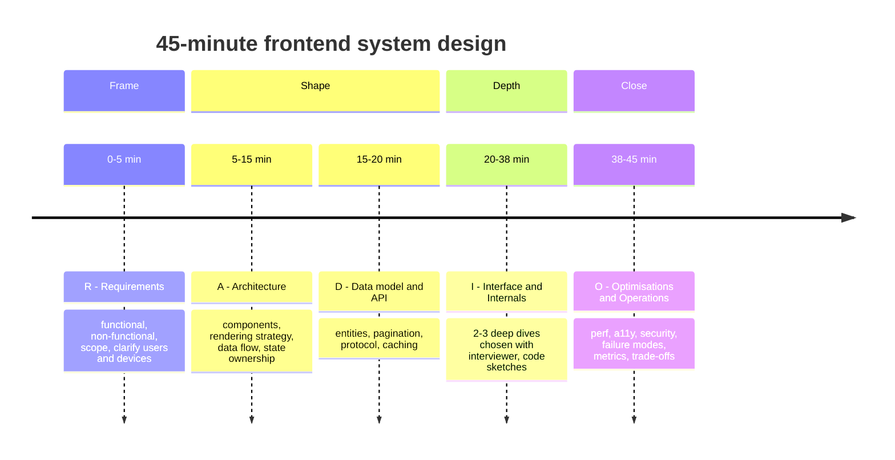
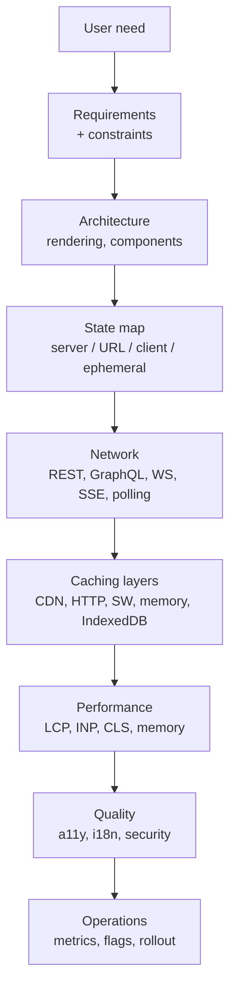
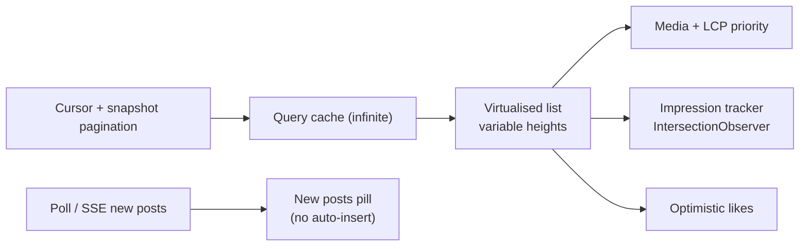
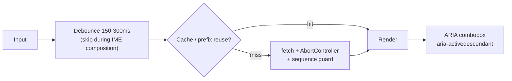
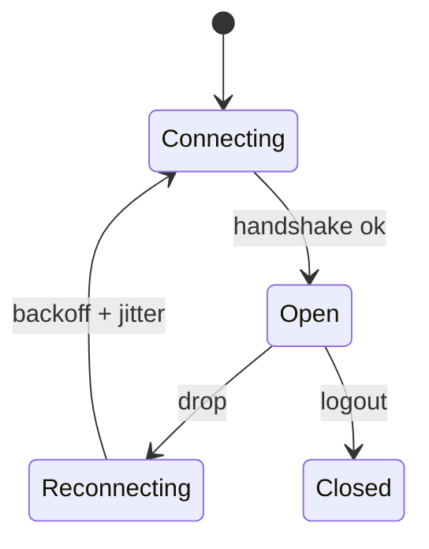
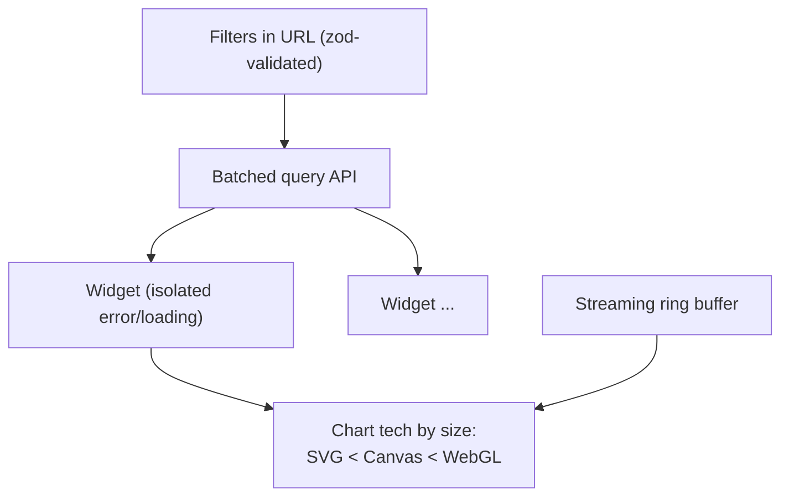
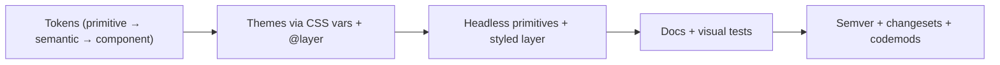
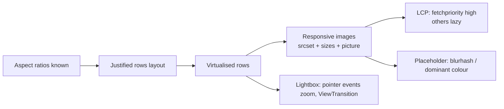
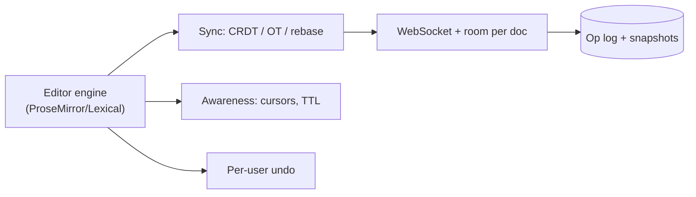

# Frontend System Design — Recall Map (Last-Minute Read)

> One-page mental model for the whole `system-design/` folder. Read this in the final hour; open the full file only for the case you are weak on.
> Full docs: [01 Framework](01-frontend-system-design-framework.md) · [02 Feed](02-news-feed-and-infinite-scroll.md) · [03 Autocomplete](03-autocomplete-and-typeahead-search.md) · [04 Chat](04-chat-and-real-time-messaging.md) · [05 Dashboard](05-analytics-dashboard.md) · [06 Design System](06-design-system-and-component-library.md) · [07 Image Gallery](07-image-gallery-and-media-heavy-ui.md) · [08 Collaborative Editor](08-collaborative-editor.md)

## Table of Contents

1. [The 45-Minute Script (RADIO)](#1-the-45-minute-script-radio)
2. [Master Mental Model](#2-master-mental-model)
3. [Case Study One-Pagers](#3-case-study-one-pagers)
4. [Cross-Cutting Pattern Cheat Sheet](#4-cross-cutting-pattern-cheat-sheet)
5. [Decision Tables](#5-decision-tables)
6. [Extra Prompts — Quick Blueprints](#6-extra-prompts--quick-blueprints)
7. [Numbers and Defaults to Remember](#7-numbers-and-defaults-to-remember)
8. [Mnemonics](#8-mnemonics)
9. [Rapid-Fire Q&A](#9-rapid-fire-qa)
10. [Say-This Scripts](#10-say-this-scripts)
11. [Red Flags and Green Flags](#11-red-flags-and-green-flags)
12. [Final 10-Minute Checklist](#12-final-10-minute-checklist)

---

## 1. The 45-Minute Script (RADIO)

Rules: **clarify before designing**, **draw before talking**, **pick 2–3 deep dives**, **state trade-offs out loud**, **finish with failure modes + metrics**.

---

## 2. Master Mental Model

**Four questions that unlock any design**
1. **Where does each piece of state live?** (server cache · URL · client · ephemeral · persisted)
2. **How does data move?** (pull · push · stream · batch · optimistic)
3. **What can be slow or fail?** (network · CPU · memory · concurrency · third parties)
4. **Who can't use it?** (keyboard · screen reader · slow device · offline · other locales)

---

## 3. Case Study One-Pagers

### 3.1 News Feed — [02](02-news-feed-and-infinite-scroll.md)

**Remember:** cursor not offset · snapshot id to avoid duplicates · virtualise (TanStack Virtual) · measure dynamic heights · restore scroll by anchor id · "new posts" pill · `role="feed"` + `aria-posinset` · impressions batched with `sendBeacon`.

### 3.2 Autocomplete — [03](03-autocomplete-and-typeahead-search.md)

**Remember:** debounce + abort + ignore stale responses · IME composition · LRU cache + prefix reuse · min chars · highlight safely (no `innerHTML` with raw input) · combobox pattern (APG) · keyboard: Up/Down/Enter/Esc · prefetch popular · server: trie/ranking.

### 3.3 Chat — [04](04-chat-and-real-time-messaging.md)

**Remember:** WebSocket envelope with types · `clientId` idempotency · per-conversation `seq` + gap fill · outbox for offline/pending · optimistic send with status (sending/sent/failed) · stick-to-bottom logic · typing/presence throttled with TTL · multi-tab via leader election (Web Locks) · virtualised history both directions.

### 3.4 Dashboard — [05](05-analytics-dashboard.md)

**Remember:** widget isolation + priority tiers (above fold first) · URL as filter state · downsample (LTTB) · SVG→Canvas→WebGL by point count · ring buffers for streams · time zones explicit · stale-while-revalidate with "updated at" · export/permissions (row-level) · a11y: tables/summaries for charts.

### 3.5 Design System — [06](06-design-system-and-component-library.md)

**Remember:** token tiers · CSS variables for runtime theming · FOUC prevention (inline theme script) · headless + variants (cva) · RSC-safe styling · overlays via `<dialog>`/Popover API · a11y baked in · versioning + codemods + deprecation policy · governance/contribution model.

### 3.6 Image Gallery — [07](07-image-gallery-and-media-heavy-ui.md)

**Remember:** reserve space (width/height or aspect-ratio) · decoded memory = `w × h × 4` bytes · AVIF/WebP with fallback · fetchpriority only for LCP · blurhash · resumable uploads · strip EXIF on upload · lightbox focus trap + Esc + arrow keys.

### 3.7 Collaborative Editor — [08](08-collaborative-editor.md)

**Remember:** don't build `contenteditable` from scratch · `beforeinput` + IME · OT (server transforms) vs CRDT (IDs, tombstones, state vectors) vs central rebase · relative positions for cursors/comments · per-user undo · offline via IndexedDB · server validates ops + roles · EditContext is Chromium-only experimental.

---

## 4. Cross-Cutting Pattern Cheat Sheet

| Need | Pattern | Where used |
|---|---|---|
| Don't duplicate/skip items | **Cursor + snapshot pagination** | Feed, chat |
| Don't render everything | **Virtualisation** / `content-visibility: auto` | Feed, chat, gallery, editor |
| Don't show stale responses | **AbortController + sequence guard** | Autocomplete, dashboards |
| Instant feel | **Optimistic update + rollback** | Likes, chat send, comments |
| Survive flaky networks | **Backoff + jitter, outbox, idempotency keys** | Chat, uploads, editor |
| Real-time | **WebSocket** (bi-di) · **SSE** (server→client) · **polling** (simple) | Chat/editor · feed/notifications · fallback |
| Avoid layout shift | **Reserve space** (aspect-ratio, skeletons) | Gallery, feed, dashboard |
| Large data viz | **Downsample + Canvas/WebGL + ring buffer** | Dashboard |
| Shareable state | **URL as state** | Dashboard filters, gallery |
| Multi-tab | **BroadcastChannel / Web Locks / SharedWorker** | Chat, editor |
| Heavy CPU | **Web Worker**, `scheduler.yield()` (feature-detect; not Safari) | Dashboard, editor |
| Telemetry reliability | **`sendBeacon` / `fetch keepalive`**, batching | Impressions, analytics |
| Isolation of failures | **Error boundaries per widget/section** | Dashboard, feed |
| Runtime theming | **CSS variables + `@layer`** | Design system |
| Accessible custom widgets | **APG patterns + roving tabindex + live regions** | All |

---

## 5. Decision Tables

**Rendering strategy**

| Situation | Choose |
|---|---|
| Public, SEO, content-heavy | SSG/ISR or SSR + streaming |
| Authenticated app, highly interactive | CSR (shell via CDN) + prefetch |
| Personalised + fast first paint | SSR/RSC with streaming + client islands |
| Real-time collaborative surface | CSR for the surface, SSR for shell |

**Transport**

| Need | Choose |
|---|---|
| Bi-directional, low latency | WebSocket |
| Server → client only, auto-reconnect | SSE (mind HTTP/1.1 6-connection limit) |
| Rare updates, simple infra | Polling (with ETag/If-None-Match) |
| Peer media/data | WebRTC |
| Background/offline sync | Service worker + Background Sync (where supported) + outbox |

**Concurrency control (editor)**

| Priority | Choose |
|---|---|
| Offline/P2P, ready ecosystem | CRDT (Yjs/Automerge) |
| Server authority/validation | Central authority + rebasing / OT |
| Existing OT stack | Stay OT |

**Chart tech**

| Points | Choose |
|---|---|
| < ~1–5k | SVG (accessible, styleable) |
| ~5k–100k | Canvas |
| 100k+ / many series | WebGL + downsampling |

---

## 6. Extra Prompts — Quick Blueprints

> Use the same RADIO flow; these are the "heart" of each.

| Prompt | Heart of the design | Key pitfalls / talking points |
|---|---|---|
| **Notifications center** | SSE/WS push → store with unread counts; badge; mark-read batching; grouping; permission prompt UX; Push API for background | Dedup, ordering, read-state sync across tabs/devices, rate limit, do-not-disturb |
| **Kanban board (Trello)** | Normalised cards/columns, fractional indexing for order, optimistic drag-drop (pointer events + keyboard alternative), realtime sync | Order conflicts (fractional index rebalancing), a11y DnD alternatives (move menu), virtualised long columns |
| **Video player (YouTube)** | Media Source Extensions + adaptive bitrate (HLS/DASH), buffering strategy, custom controls over `<video>`, captions, PiP | Keyboard controls, `prefers-reduced-motion`, analytics (QoE), preloading next video, DRM (EME) |
| **Booking / checkout** | Multi-step form state machine, inventory holds with expiry, idempotent payment submit, price recalculation, address autocomplete | Double-submit, session expiry, race on inventory, PCI scope (hosted fields), error recovery, a11y forms |
| **Maps (Google Maps)** | Tile pyramid (raster/vector), viewport-based fetching, clustering, WebGL/canvas rendering, geo-indexing in viewport queries | Memory/tile cache eviction, gesture handling, offline tiles, attribution/accessibility alternatives |
| **Form builder / low-code UI** | Schema-driven rendering, JSON schema + validation, drag-drop canvas, undo/redo, plugin registry | Versioned schemas, sandboxed custom code, preview isolation, a11y of generated forms |
| **Spreadsheet** | Virtualised grid (rows × cols), dependency graph for formulas, worker calc, sparse storage | Large ranges, copy/paste interop, collaboration (CRDT/OT), formula injection in exports |
| **E-commerce listing/PLP** | Faceted filters in URL, SSR for SEO, pagination vs infinite, image optimisation, skeletons | CLS, filter combinatorics (canonical URLs), prefetch PDP on hover, analytics |
| **Social stories / carousel** | Preload next media, gesture/timer FSM, pause on hover/hold, segmented progress | Autoplay policy (muted), reduced motion, memory for many videos, a11y controls |
| **Rate-limited API client / SDK** | Request queue, retries w/ backoff, dedupe, token refresh single-flight, cancellation | Thundering herd, idempotency, typed responses, observability |
| **Micro-frontends platform** | Module Federation/import maps, shared deps, contract/versioning, isolation | Bundle duplication, shared state coupling, routing, perf budget, governance |
| **Offline-first PWA** | Service worker caching strategies, IndexedDB, sync queue, conflict resolution | Update flow (skipWaiting UX), storage quotas, iOS limitations, data migrations |

---

## 7. Numbers and Defaults to Remember

| Topic | Value |
|---|---|
| Core Web Vitals "good" (75th percentile) | **LCP ≤ 2.5 s · INP ≤ 200 ms · CLS ≤ 0.1** |
| 60 fps frame budget | ~16.7 ms (less after browser work) |
| Perceived instant / flow / attention | ~100 ms / ~1 s / ~10 s |
| Autocomplete debounce | ~150–300 ms |
| Typing batch send (editor) | ~20–50 ms |
| Awareness TTL | ~15–30 s |
| Awareness/cursor send rate | ≤ ~10–20 Hz |
| Backoff | exponential (1 s → 30 s cap) **with jitter** |
| SSE on HTTP/1.1 | **6** connections per browser+domain (HTTP/2 allows ~100 streams) |
| Decoded image memory | `width × height × 4` bytes |
| Image fetch priority | `fetchpriority="high"` on the LCP image only |
| `scheduler.yield()` | Chrome/Edge 129, Firefox 142, **no Safari** → fallback `setTimeout` |
| `content-visibility: auto` | Baseline newly available (Sept 2025); pair with `contain-intrinsic-size` |
| EditContext API | Experimental; Chrome/Edge 121+; no Firefox/Safari |
| Virtualisation overscan | ~3–10 items |
| Pagination | cursor-based for feeds/chat; offset only for static/admin lists |

> Version-sensitive: verify browser support before citing in an interview if it matters; say "as of my last check".

---

## 8. Mnemonics

- **RADIO** — Requirements · Architecture · Data model · Interface (API/components) · Optimisations.
- **S-N-C-P-Q-O** — State · Network · Caching · Performance · Quality (a11y/i18n/security) · Operations.
- **"FADE-IT" for lists** — **F**etch (cursor) · **A**bort stale · **D**e-dupe · **E**stimate heights · **I**ntersection (impressions/infinite) · **T**ear-down (cleanup).
- **"STAMP" for resilience** — **S**tale-while-revalidate · **T**imeouts · **A**bort · **M**ulti-tab · **P**ersist/outbox.
- **"PACER" for real-time** — **P**rotocol · **A**uth · **C**onnection FSM · **E**ntropy (backoff+jitter) · **R**econciliation (seq/gap fill/idempotency).
- **A11y: "KFLR"** — **K**eyboard · **F**ocus · **L**ive regions · **R**oles/names.
- **Perf: "RIDE"** — **R**eserve space · **I**mages optimised · **D**efer non-critical · **E**liminate long tasks.

---

## 9. Rapid-Fire Q&A

- **Offset vs cursor pagination?** Cursor: stable under inserts/deletes, O(1) seek; offset: simple but duplicates/skips and slow at depth.
- **Why virtualise?** DOM/memory/layout cost scales with node count; render ~visible + overscan.
- **Downside of virtualisation?** Breaks find-in-page, a11y semantics (need `aria-setsize`/`posinset`), anchor/scroll restoration complexity, variable heights.
- **How avoid stale autocomplete results?** AbortController + request id/sequence guard + cache keyed by normalised query.
- **WebSocket reconnect strategy?** Exponential backoff + jitter, resume with last `seq`/version, resubscribe, outbox replay with idempotency.
- **Idempotency key?** Client-generated ID so retries don't duplicate side effects.
- **Why URL as state?** Shareable, back/forward works, SSR-friendly, restorable.
- **SVG vs Canvas?** SVG: DOM nodes, accessible/styleable, slow at scale; Canvas: fast bitmap, you manage hit-testing/a11y.
- **How does LTTB help?** Downsamples series while preserving visual shape (peaks/troughs).
- **Design tokens tiers?** Primitive (raw values) → semantic (intent) → component (specific).
- **How to theme at runtime without rebuild?** CSS custom properties switched via attribute/class on root.
- **Headless component?** Behaviour + a11y without styling; you supply the UI.
- **OT vs CRDT in one line?** OT transforms ops via a server; CRDT makes ops commutative with unique IDs.
- **Why relative positions?** Absolute indexes drift when others edit; IDs stay valid.
- **Per-user undo?** Undo only local-origin changes; apply inverse as new op.
- **contenteditable pitfalls?** Browser inconsistencies, IME, selection mapping, paste junk → use an engine and `beforeinput`.
- **Tombstone?** Deleted-but-retained item needed for convergence; GC when safe.
- **How to prevent CLS in galleries?** Known aspect ratios/dimensions, skeleton/placeholder, `aspect-ratio`.
- **LCP image tuning?** Don't lazy-load it, `fetchpriority="high"`, preload if discovered late, right size/format, CDN.
- **INP improvement?** Break long tasks, avoid layout thrash, defer work (`yield`), reduce main-thread JS, debounce input handlers, memo/transition for heavy renders.
- **Multi-tab chat duplicates?** One socket via leader election (Web Locks) + BroadcastChannel fan-out.
- **Optimistic update failure?** Roll back + show retry; keep outbox for retriable errors.

---

## 10. Say-This Scripts

**Opening (30 s):** "Before I design, I'd like to clarify scope: users and devices, scale, real-time needs, offline, and accessibility. Then I'll propose architecture, data/API, go deep on two areas you choose, and close with performance, failure modes, and metrics."

**Trade-off phrasing:** "Option A gives X at the cost of Y; given requirement Z I'd choose A, and I'd revisit if the constraint changes."

**State ownership:** "Server state lives in a query cache, filters in the URL, ephemeral UI in component state, and anything that must survive reload in IndexedDB or localStorage — each with a clear invalidation story."

**Failure handling:** "I'd assume the network fails: timeouts, abort, retries with backoff and jitter, idempotency keys, optimistic updates with rollback, and visible status so the user is never guessing."

**Performance:** "I'd set budgets for LCP/INP/CLS and bundle size, reserve space to avoid layout shift, virtualise large lists, defer non-critical work, and monitor with RUM."

**Accessibility:** "Custom widgets follow APG patterns: roles and names, full keyboard support, managed focus, live regions for async updates, and reduced-motion respect."

**Wrap-up:** "To summarise: key decisions were …; main risks are …; metrics I'd watch are …; next iterations could be …."

---

## 11. Red Flags and Green Flags

| Red flags (avoid) | Green flags (show) |
|---|---|
| Jumping to components without requirements | Clarifying questions + explicit assumptions |
| "Use Redux/WebSocket for everything" | Matching tool to need; stating alternatives |
| Ignoring failure/offline/slow device | Failure modes, retries, degraded states |
| Offset pagination for feeds | Cursor + snapshot; dedupe |
| `innerHTML` with user input | Escaping/sanitising; CSP awareness |
| No a11y mention | Keyboard, ARIA, live regions, reduced motion |
| Unbounded lists/caches | Virtualisation, LRU, eviction |
| Claims without numbers | Budgets, estimates, metrics |
| Over-engineering v1 | Phased plan: MVP → scale → polish |
| Can't explain a trade-off | Tables/pros-cons with a recommendation |

---

## 12. Final 10-Minute Checklist

- [ ] Can I state RADIO and time-box each phase?
- [ ] For each case study, can I name the **one key algorithm** (cursor+snapshot, debounce+abort, seq+idempotency, LTTB+ring buffer, token tiers, justified rows, CRDT/OT)?
- [ ] Can I list state homes (server cache, URL, client, ephemeral, persisted)?
- [ ] Can I justify WebSocket vs SSE vs polling?
- [ ] Do I have numbers: CWV thresholds, debounce times, backoff, memory formula?
- [ ] Can I discuss a11y, i18n, security, observability for any design in 60 seconds?
- [ ] Do I have 2 failure modes and 2 metrics ready per design?
- [ ] Can I sketch the architecture diagram in under 2 minutes?

Related recall maps: [React](../react/09-react-recall-map.md) · [TypeScript](../typescript/06-typescript-recall-map.md) · [React Native](../react-native/17-master-mental-model-recall-map.md)
