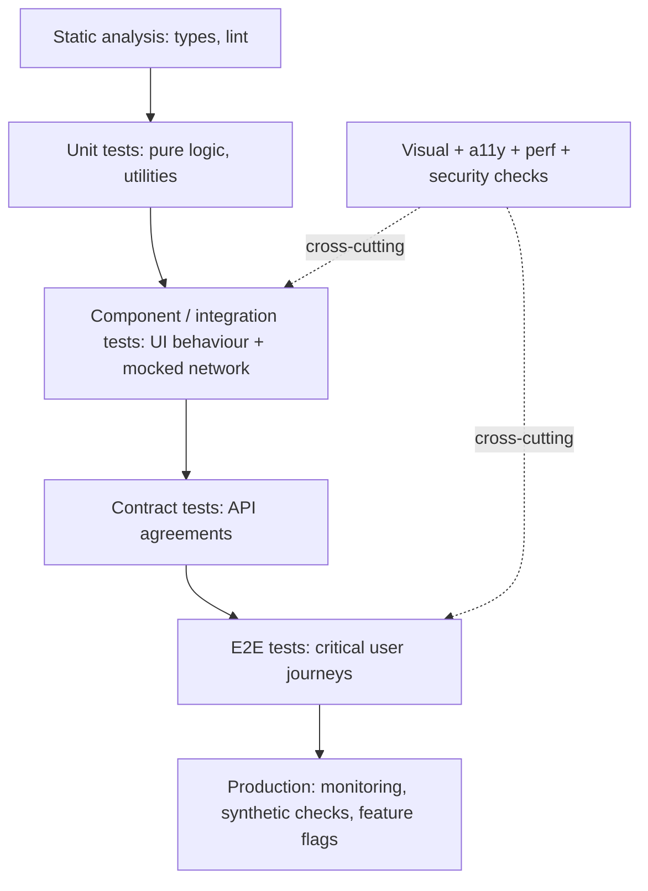
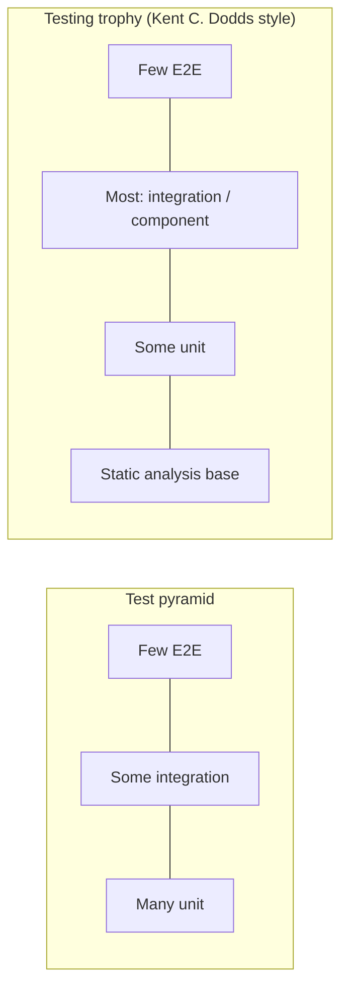
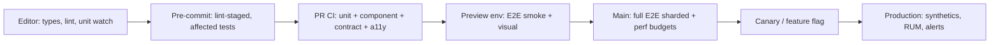
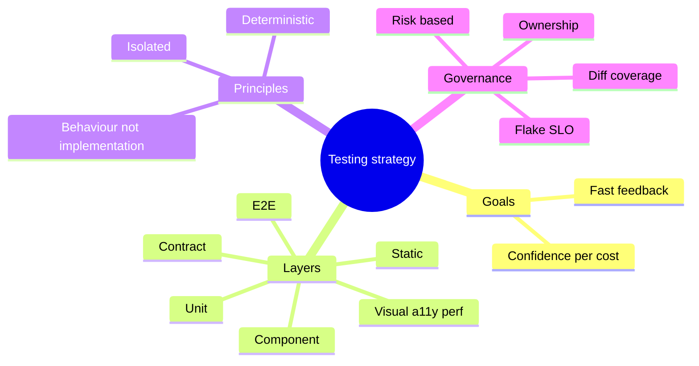

# Testing Strategy: What to Test, Where, and Why

> Verification note: tool facts in this folder were checked against **Playwright release notes** (latest 1.65; Nov 2026) and **Vitest Browser Mode docs** (updated Oct 2026; docs navigation references Vitest 5.0) — see [02](02-unit-testing-and-test-doubles.md), [03](03-component-testing-react.md) and [04](04-end-to-end-testing-with-playwright.md). **Strategy models (testing pyramid/trophy/honeycomb), risk-based testing, cost/confidence reasoning, test taxonomy, flakiness classes, coverage and mutation-testing guidance, and the CI examples are established engineering practice, not "facts" to verify; where I cite numbers (e.g., typical coverage targets) they are heuristics marked *(hedged)*.** Related: [web-performance/07](../web-performance/07-performance-debugging-budgets-and-culture.md) (performance budgets/CI), [networking-and-apis/07 §7](../networking-and-apis/07-api-client-architecture-and-contracts.md#7-mocking-and-testing-the-network-layer) (network-layer testing), [web-security/01 §9](../web-security/01-frontend-threat-model-and-owasp-top-10.md#9-security-in-the-delivery-lifecycle) (security in the delivery lifecycle).

## Table of Contents

1. [Quick Summary (TL;DR)](#1-quick-summary-tldr)
2. [Why We Test: Confidence per Unit of Cost](#2-why-we-test-confidence-per-unit-of-cost)
3. [Test Types and What Each Buys You](#3-test-types-and-what-each-buys-you)
4. [Shapes: Pyramid, Trophy, Honeycomb](#4-shapes-pyramid-trophy-honeycomb)
5. [Risk-Based Test Planning](#5-risk-based-test-planning)
6. [What to Test (and What Not To) in a Frontend App](#6-what-to-test-and-what-not-to-in-a-frontend-app)
7. [Properties of Good Tests](#7-properties-of-good-tests)
8. [Test Design Techniques](#8-test-design-techniques)
9. [Coverage, Mutation Testing and Other Metrics](#9-coverage-mutation-testing-and-other-metrics)
10. [Toolchain Map (2026)](#10-toolchain-map-2026)
11. [Testing Across the Delivery Pipeline](#11-testing-across-the-delivery-pipeline)
12. [Pitfalls](#12-pitfalls)
13. [Interview Questions — Fundamentals](#13-interview-questions--fundamentals)
14. [Interview Questions — Senior Scenarios](#14-interview-questions--senior-scenarios)
15. [Cheat Sheet](#15-cheat-sheet)
16. [Key Terms Glossary](#16-key-terms-glossary)
17. [Further Reading](#17-further-reading)

---

## 1. Quick Summary (TL;DR)

- **Tests buy confidence to change code.** The goal is not "coverage" but **maximum confidence per unit of cost** (writing, running, maintaining, debugging). Choose the cheapest test that would catch the failure you fear.
- **Test behaviour users and callers rely on, not implementation details.** Tests coupled to internals (private functions, component state, CSS classes) break on refactors without catching bugs.
- **A balanced portfolio beats a dogma.** Many fast **unit** tests for logic, **component/integration** tests for UI behaviour with realistic collaborators (the "trophy" emphasis), a thin set of **end-to-end** tests for critical journeys, plus targeted **contract**, **visual**, **accessibility**, **performance** and **security** checks.
- **Risk drives depth:** payment, auth, data-loss and compliance paths deserve layered tests; static marketing copy does not.
- **Flaky tests are worse than no tests** — they erode trust and slow teams; treat flakiness as a defect with an owner and an SLA ([07](07-flakiness-ci-and-non-functional-testing.md)).
- **Fast feedback loop:** types and lint first (static analysis is a test layer), then unit/component tests in watch mode, then E2E in CI with parallelism, traces and retries used *diagnostically*.
- **Tooling reality (2026):** Vitest (unit + component, Browser Mode available), Jest still common, Testing Library for user-centric component tests, Playwright (v1.65) as the dominant E2E tool, MSW for network mocking, Storybook for component states.

---

## 2. Why We Test: Confidence per Unit of Cost

| Value | How tests provide it |
|---|---|
| **Regression safety** | Detect unintended behaviour changes during refactors/upgrades |
| **Design feedback** | Hard-to-test code usually has tangled responsibilities (TDD pressure) |
| **Living documentation** | Examples of intended behaviour and edge cases |
| **Release velocity** | Small, safe, frequent deploys; automated gates |
| **Cost containment** | Bugs found earlier are cheaper (local < CI < staging < production) |
| **Compliance/auditability** | Evidence for regulated flows (accessibility, security, financial calculations) |

**Cost dimensions per test:** authoring effort, execution time, flakiness probability, maintenance when product changes, diagnosis time when failing, infrastructure cost. **Confidence** = how closely the test mirrors real usage × how much of the stack it exercises × how precisely it fails.

Practical rule: **push checks down to the cheapest layer that can detect the bug**, but keep a few high-level tests that prove the layers integrate.

---

## 3. Test Types and What Each Buys You

| Type | Scope | Speed | Fidelity | Typical tool | Best for |
|---|---|---|---|---|---|
| **Static analysis** | Types, lint, formatting, dependency rules | Instant | Low (structure) | TypeScript, ESLint, Biome, dependency-cruiser *(hedged)* | Whole classes of bugs for free |
| **Unit** | One function/module in isolation | ms | Low–medium | Vitest/Jest | Pure logic, reducers, formatters, validators, hooks logic |
| **Component** | One UI component/tree with real DOM, mocked network | 10s–100s ms | Medium–high | Testing Library + Vitest/Jest, Vitest Browser Mode, Playwright CT | Interactions, states, a11y semantics, forms |
| **Integration** | Several modules working together (UI + state + API client + router) | 100s ms–s | High | Testing Library, MSW, Playwright | Feature slices, data flows |
| **Contract** | Consumer ↔ provider API agreement | s | High for interfaces | Pact, OpenAPI diff/validation | Preventing cross-team breaking changes |
| **End-to-end (E2E)** | Real browser + (staging or local) full stack | s–min | Highest | Playwright, Cypress | Critical journeys, cross-cutting wiring |
| **Visual regression** | Pixel/structure comparison of rendered UI | s | UI appearance | Playwright screenshots, Chromatic, Percy *(hedged)* | Design systems, layout regressions |
| **Accessibility** | Automated rules + manual/AT checks | s | Partial (≈30–40% of issues automatable *(hedged)*) | axe-core, Playwright ARIA snapshots | Baseline a11y and regressions |
| **Performance** | Metrics, budgets, load | s–min | Lab-based | Lighthouse CI, Playwright traces, k6 | Budgets, regressions ([web-performance/07](../web-performance/07-performance-debugging-budgets-and-culture.md)) |
| **Security** | Dependency scans, SAST/DAST, header tests | varies | Varies | See [web-security/01 §9](../web-security/01-frontend-threat-model-and-owasp-top-10.md#9-security-in-the-delivery-lifecycle) | Guardrails |
| **Manual/exploratory** | Human judgement | slow | Highest for novelty | — | Usability, edge cases, new features |
| **Production checks** | Synthetic monitoring, RUM, canaries | continuous | Real | Synthetics, feature flags | Detect what tests can't |

---

## 4. Shapes: Pyramid, Trophy, Honeycomb

| Model | Idea | When it fits | Caveats |
|---|---|---|---|
| **Pyramid** (Cohn) | Many fast unit tests, fewer integration, fewest UI/E2E | Backend/service logic, libraries, algorithm-heavy code | Over-mocking in UI apps yields brittle tests that don't reflect user behaviour |
| **Trophy** | Static analysis base, some unit, **most integration/component**, few E2E | Frontend apps where bugs live in wiring between components/state/network | "Integration" is ambiguous; keep tests fast with MSW and Testing Library |
| **Honeycomb** (Spotify, microservices) | Emphasise integration tests of a service; few implementation-detail unit tests | Microservices | Needs reliable test environments/containers |
| **Ice-cream cone (anti-pattern)** | Mostly manual/E2E tests, few unit | Legacy teams | Slow, flaky, expensive feedback |

**Interview stance:** *"I don't follow one shape religiously; I choose per risk and layer. For a React app I lean toward component/integration tests with realistic DOM and mocked network, unit tests for pure logic, and a small, stable E2E suite for money-paths."*

---

## 5. Risk-Based Test Planning

1. **List critical user journeys and failure impacts** (login, checkout, payment, data export, permissions, onboarding).
2. **Score by likelihood × impact** (complexity, change frequency, past defects, third-party dependence, regulatory exposure).
3. **Assign layers:** high-risk → unit (rules) + component (UI) + contract (API) + E2E (journey) + monitoring; medium → component/integration; low → static checks and manual spot checks.
4. **Define exit criteria:** "No P1 journey ships without E2E + passing a11y/perf budgets."
5. **Revisit after incidents:** every escaped defect gets a regression test at the cheapest layer that would have caught it ("test the bug, not the symptom") plus a postmortem on *why existing tests missed it*.
6. **Keep a test ownership map:** which team owns which journey tests and contract suites.

| Area (example) | Impact | Change frequency | Investment |
|---|---|---|---|
| Checkout | Very high | High | Layer heavily: unit + component + contract + E2E + monitoring |
| Auth | Very high | Medium | Layer heavily: unit + component + E2E + security checks |
| Admin export | High | Low | Contract + E2E smoke |
| Search filters | Medium | High | Component/integration tests |
| Marketing banner | Low | High | Static checks, visual spot checks |

---

## 6. What to Test (and What Not To) in a Frontend App

### Test
- **Business rules and calculations** (pricing, validation, permissions logic) as pure functions → unit tests.
- **User-visible behaviour:** forms (validation errors, submit, disabled states), navigation, loading/empty/error states, optimistic updates, keyboard interaction, focus management ([03](03-component-testing-react.md)).
- **Integration seams:** API client error mapping, auth refresh, cache invalidation, feature flags ([networking-and-apis/07](../networking-and-apis/07-api-client-architecture-and-contracts.md)).
- **Accessibility semantics:** roles, names, labels, focus order ([05](05-visual-accessibility-and-component-states-testing.md)).
- **Critical journeys end to end** ([04](04-end-to-end-testing-with-playwright.md)).
- **Error/edge paths:** offline, timeouts, 401/403/422/429/500, empty data, huge lists, locale/time zone/RTL.
- **Regression for every fixed bug.**

### Don't (or rarely) test
- **Framework/library internals** (React renders, Next routing, date-fns correctness).
- **Implementation details:** private methods, hook internals, component state shape, call order of internal functions, CSS class names (unless the class *is* the contract).
- **Trivial code:** getters, constants, pass-through wrappers.
- **Everything via E2E** — slow and flaky; reserve for journeys.
- **Pixel-perfect snapshots of everything** — high noise, low signal.
- **Third-party APIs live in CI** — use mocks/contracts/sandboxes.

### Snapshot tests: use sparingly
Large DOM/JSON snapshots become "approve all" rubber stamps. Prefer **explicit assertions**, **inline snapshots for small structured outputs**, and **ARIA/role snapshots** for accessibility structure; review snapshot diffs like code.

---

## 7. Properties of Good Tests

| Property | Meaning | Anti-pattern |
|---|---|---|
| **Fast** | Seconds for the inner loop | Real network/timers/sleeps |
| **Deterministic** | Same result every run | Shared state, random data, real clocks |
| **Isolated** | Independent of order and other tests | Tests depending on previous test's side effects |
| **Readable** | Intent obvious (Arrange–Act–Assert/Given–When–Then) | Helper mazes, magic numbers |
| **Behavioural** | Asserts outcomes users/callers observe | Asserting internals/mocks' call counts |
| **Precise failures** | Failure message points to the cause | One mega-test with 20 assertions |
| **Maintainable** | Survives refactors | Brittle selectors (`div > div:nth-child(3)`) |
| **Owned** | Someone fixes it when it breaks | Orphaned quarantined tests |

**FIRST** mnemonic: **F**ast, **I**solated, **R**epeatable, **S**elf-validating, **T**imely. **AAA:** Arrange, Act, Assert.

---

## 8. Test Design Techniques

- **Equivalence partitioning & boundary values:** group inputs into classes and test edges (0, 1, max, max+1, empty, null).
- **Decision tables / state transitions:** for permission matrices, checkout steps, form wizards.
- **Table-driven (parametrised) tests:** `test.each` for many cases with one structure ([02](02-unit-testing-and-test-doubles.md)).
- **Property-based testing:** assert invariants over generated inputs (fast-check) for parsers, formatters, reducers *(hedged on library specifics)*.
- **Example mapping / BDD scenarios:** collaboratively derive acceptance examples (Given/When/Then) from stories ([08](08-testing-in-practice-tdd-architecture-mobile-and-ai.md)).
- **Pairwise/combinatorial testing** for configuration matrices (browser × locale × plan).
- **Error guessing/exploratory heuristics:** SFDIPOT, tours, "what if the user double-clicks / goes back / loses connection?".
- **Mutation testing** to evaluate test strength ([§9](#9-coverage-mutation-testing-and-other-metrics)).
- **Characterisation tests** for legacy code: capture current behaviour before refactoring.

---

## 9. Coverage, Mutation Testing and Other Metrics

| Metric | Measures | Use | Caveat |
|---|---|---|---|
| **Line/branch/function coverage** | Code executed by tests | Find untested areas; gate on *changed code* | Executed ≠ verified; 100% can still miss bugs; chasing targets encourages low-value tests |
| **Diff/patch coverage** | Coverage of lines changed in a PR | Healthy gate (e.g., ≥ 80% on new code *(hedged heuristic)*) | Ignores existing gaps |
| **Mutation score** (Stryker *(hedged)*) | % of injected bugs caught | Measures assertion strength on critical modules | Slow; apply to core logic only |
| **Flake rate** | % of runs failing then passing on retry | Reliability SLO | Needs retry-aware reporting (Playwright flaky status) |
| **Test duration/time-to-green** | CI feedback speed | Optimise parallelism/sharding | Can hide in retries |
| **Escaped defects & MTTR** | Bugs reaching production; time to fix | Ultimate quality outcome | Lagging indicator |
| **Change failure rate (DORA)** | % of deploys causing incidents *(hedged)* | Delivery health | Multi-factor |

Guidelines: **gate on trends and diffs, not absolute global numbers**; combine coverage with mutation testing on business-critical modules; review uncovered branches rather than adding assertion-free tests.

---

## 10. Toolchain Map (2026)

| Need | Common choices | Notes |
|---|---|---|
| Test runner (unit/component) | **Vitest** (Vite-based; Browser Mode via Playwright/WebdriverIO providers), **Jest** (still widely used; RN default), Node's built-in `node:test` for libraries *(hedged)* | Vitest has migration guides from Jest/Mocha; docs reference Vitest 5.0 |
| DOM environment | jsdom, happy-dom, **real browser (Vitest Browser Mode / Playwright)** | Real-browser tests avoid jsdom gaps (layout, CSS, events) at higher cost |
| Component queries/interactions | **@testing-library/react** (+ `user-event` in jsdom; Vitest's `userEvent` in Browser Mode) | Query by role/label/text |
| Network mocking | **MSW** | Same handlers for unit, Storybook, E2E *(hedged for E2E)* |
| E2E | **Playwright (1.65)**, Cypress | Playwright: multi-browser, auto-waiting, traces, sharding |
| Visual | Playwright `toHaveScreenshot`, Storybook + Chromatic/Percy *(hedged)* | Stability controls needed |
| A11y | axe-core / `@axe-core/playwright`, jest-axe/vitest-axe *(hedged)*, ARIA snapshots | `page.accessibility` was removed in Playwright 1.57 — use axe |
| Contract | Pact, OpenAPI diff + schema validation, Schemathesis *(hedged)* | [06](06-api-contract-and-integration-testing.md) |
| Performance | Lighthouse CI, WebPageTest, Playwright traces, k6 | [07](07-flakiness-ci-and-non-functional-testing.md) |
| Mobile (React Native) | Jest + React Native Testing Library, Detox, Maestro, Appium *(hedged)* | [08](08-testing-in-practice-tdd-architecture-mobile-and-ai.md) |
| Coverage | V8 coverage (Vitest `@vitest/coverage-v8`), Istanbul | Prefer diff coverage |
| Mutation | Stryker | Targeted use |
| Reporting | Playwright HTML reporter (with Speedboard), JUnit XML, GitHub annotations | Surface flaky tests |

---

## 11. Testing Across the Delivery Pipeline

- **Inner loop (seconds):** type-check + watch mode (`vitest`), run only affected tests (`--changed`/`--only-changed` in Playwright *(hedged for Vitest)*).
- **PR gate (minutes):** unit/component/contract/a11y, lint, build; E2E smoke on a preview deployment; required checks protect main.
- **Post-merge/nightly:** full cross-browser E2E, visual regression, performance budgets, long-running suites, dependency audits.
- **Release:** progressive delivery (canary/flags), automated rollback signals, synthetic checks of critical paths.
- **Production:** RUM + error tracking + alerts on journeys (tests can't cover everything).
- **Ownership:** developers own tests; QA/SDET coach, build frameworks and exploratory testing; a flaky-test triage rotation.
- **Environment strategy:** hermetic tests (mocks/containers) by default; shared staging only for a few smoke checks; ephemeral environments per PR for E2E where feasible.

---

## 12. Pitfalls

1. **Chasing coverage numbers** instead of risk and behaviour.
2. **Testing implementation details** (breaks on refactor, misses bugs).
3. **Over-mocking** until tests only verify the mocks.
4. **Heavy E2E suites** (slow, flaky, hard to debug) while lower layers are thin.
5. **Snapshot overuse** and blind updates.
6. **Shared mutable state/test order dependence.**
7. **Real time/network/randomness** in tests.
8. **Ignoring flaky tests** (or blanket retries that hide real races).
9. **No ownership** for test infrastructure and failures.
10. **Skipping non-functional tests** (a11y, perf, security) until late.
11. **Tests that can't fail** (assertion-free, wrong `await`, always-true conditions).
12. **Treating tests as second-class code** (no review, duplication, poor naming).

---

## 13. Interview Questions — Fundamentals

### Q1. Pyramid vs trophy — which do you use for a React app?
A trophy-leaning portfolio: static analysis everywhere, unit tests for pure logic, most effort on component/integration tests with real DOM and mocked network, and a few E2E tests for critical journeys.

### Q2. What makes a test brittle and how do you avoid it?
Coupling to implementation details (internal state, selectors, call order). Query by role/label/text, assert observable behaviour, avoid asserting on mocks' internals, and use stable test ids only when semantics aren't available.

### Q3. Is 100% coverage a good goal?
No — coverage shows what executed, not what was verified. Use diff coverage on new code, review uncovered branches, and apply mutation testing to critical modules.

### Q4. What is a flaky test and why is it harmful?
A test that passes and fails without code changes (timing, shared state, network, order). It erodes trust, slows delivery and hides real regressions; fix the root cause, quarantine temporarily with an owner/SLA.

### Q5. What belongs in E2E tests?
Critical user journeys and cross-system wiring (login, checkout, permissions flow) — few, stable, with good diagnostics — not every UI variation.

### Q6. How do you test code that depends on time or randomness?
Inject clocks/RNGs or use fake timers (`vi.useFakeTimers`, Playwright `page.clock`), seed randomness, and avoid real sleeps ([02](02-unit-testing-and-test-doubles.md)).

### Q7. What is the Arrange–Act–Assert pattern?
Structure tests as setup, a single action under test, and assertions on outcomes — improving readability and focus.

### Q8. Why treat static analysis as testing?
Types and lint catch entire categories of defects instantly at near-zero marginal cost and enforce contracts across the codebase.

---

## 14. Interview Questions — Senior Scenarios

### S1. "Our team has 90% coverage but production bugs keep escaping. Diagnose."
Coverage measures execution not assertions. Audit escaped bugs: which layer should have caught them? Look for assertion-free/over-mocked tests, missing integration seams (API client, auth, feature flags), untested error paths and environment differences. Introduce mutation testing on critical modules, add regression tests per defect, shift to risk-based planning, add contract tests and production monitoring, and track escaped defects/MTTR rather than coverage alone.

### S2. "Design a test strategy for a new checkout feature."
Risk map: pricing/tax rules (unit + property-based), form validation and states (component), API contract with payment/tax services (contract tests + schema validation), accessibility (axe + keyboard flows), one or two E2E happy/failure journeys on a preview env with sandbox PSP, performance budget for the page, security checks (CSRF/CSP/headers), idempotency and retry behaviour tests, feature-flagged rollout with synthetic monitoring and alerts.

### S3. "E2E suite takes 90 minutes and is flaky. What do you do?"
Triage by flake data (retry-aware reports): fix top offenders (waits, shared data, env instability); shift coverage down to component/contract tests; shard across machines with merged reports; use Playwright project dependencies/storage state to avoid repeated logins; isolate data per test; run smoke on PR and full suite post-merge/nightly; quarantine with ownership and deadlines; use traces on first retry for diagnosis ([04](04-end-to-end-testing-with-playwright.md), [07](07-flakiness-ci-and-non-functional-testing.md)).

### S4. "How do you introduce testing to a legacy untested codebase?"
Start with characterisation tests around the riskiest/changed areas, add seams (dependency injection, adapters) to make code testable, enforce diff coverage on new/changed code, add E2E smoke for core journeys, add static checks incrementally (TypeScript strict per folder), and celebrate "boy scout" improvements; avoid a big-bang rewrite.

### S5. "Developers say tests slow them down. Response?"
Measure: where is the time (writing vs waiting vs fixing flaky tests)? Improve inner-loop speed (Vitest watch, affected tests), reduce flakiness, provide good test utilities (render helpers, MSW handlers, factories), and fix test architecture. Show value with incident data. Teach what not to test to reduce churn.

---

## 15. Cheat Sheet

| Question | Answer |
|---|---|
| What do I test? | Behaviour at the cheapest effective layer |
| Shape for React apps | Trophy-ish: static > unit > **component/integration** > few E2E |
| Coverage gate | Diff coverage + review, not global % |
| Flaky test policy | Fix or quarantine with owner and deadline |
| Time/random | Inject or fake; never real sleeps |
| Selectors | Role/label/text first; test ids as fallback |
| Escaped bug | Add regression test + ask why tests missed it |
| E2E scope | Critical journeys only |

---

## 16. Key Terms Glossary

| Term | Definition |
|---|---|
| **SUT** | System under test |
| **Test double** | Stand-in for a dependency (stub, mock, spy, fake, dummy) |
| **Characterisation test** | Test capturing existing legacy behaviour |
| **Flaky test** | Non-deterministic test outcome |
| **Mutation testing** | Injecting faults to check tests detect them |
| **Diff coverage** | Coverage of changed lines only |
| **Hermetic test** | Self-contained test with controlled dependencies |
| **Smoke test** | Minimal check that critical paths work |
| **Contract test** | Verifies consumer/provider agreement |

---

## 17. Further Reading

- [Playwright docs — Best practices](https://playwright.dev/docs/best-practices) · [Vitest — Why Vitest / Browser Mode](https://vitest.dev/guide/browser/) · [Testing Library — Guiding principles](https://testing-library.com/docs/guiding-principles/) *(hedged: stable principles)*
- [Martin Fowler — Test Pyramid](https://martinfowler.com/bliki/TestPyramid.html) · [Kent C. Dodds — Testing Trophy](https://kentcdodds.com/blog/the-testing-trophy-and-testing-classifications) *(hedged: community references)*
- This repo: [02 Unit testing](02-unit-testing-and-test-doubles.md) · [03 Component testing](03-component-testing-react.md) · [04 E2E with Playwright](04-end-to-end-testing-with-playwright.md) · [web-performance/07](../web-performance/07-performance-debugging-budgets-and-culture.md)
