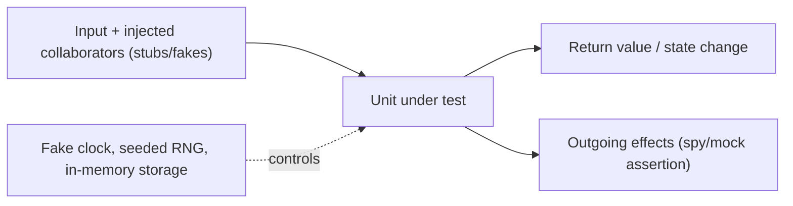
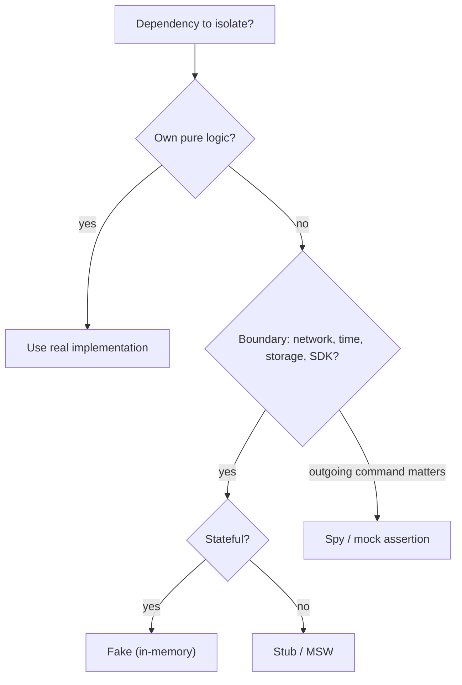

# Unit Testing and Test Doubles

> Verification note: Vitest facts here were checked against the **Vitest Browser Mode docs** (updated Oct 2026): native-ESM module namespaces are sealed in Browser Mode so `vi.spyOn(module, 'fn')` throws and `vi.mock('./m.js', { spy: true })` is the workaround; `alert`/`confirm`/`print` are auto-mocked; the docs navigation lists `vi.when`, test tags/annotations, `using`-based auto-cleanup, "Migrating to Vitest 5.0" and "Migrating from Jest". Playwright's `page.clock` (since 1.45) was verified in the release notes. **Everything else — test-double taxonomy, `vi.mock` hoisting, fake-timer APIs, Jest-vs-Vitest differences, fast-check/property-based testing, Stryker, coverage providers, `renderHook` — is established practice not re-fetched in this session; API names and defaults are marked *(hedged)* where they vary by version.** Strategy context: [01](01-testing-strategy-and-test-design.md). Component-level testing: [03](03-component-testing-react.md).

## Table of Contents

1. [Quick Summary (TL;DR)](#1-quick-summary-tldr)
2. [What a Unit Is (and the Sociable vs Solitary Debate)](#2-what-a-unit-is-and-the-sociable-vs-solitary-debate)
3. [Vitest and Jest: Setup and Differences](#3-vitest-and-jest-setup-and-differences)
4. [Anatomy of a Good Unit Test](#4-anatomy-of-a-good-unit-test)
5. [Test Doubles: Dummy, Stub, Spy, Mock, Fake](#5-test-doubles-dummy-stub-spy-mock-fake)
6. [Module Mocking and Its Limits](#6-module-mocking-and-its-limits)
7. [Dependency Injection and Seams](#7-dependency-injection-and-seams)
8. [Time, Randomness, Environment and I/O](#8-time-randomness-environment-and-io)
9. [Async Code, Promises and Errors](#9-async-code-promises-and-errors)
10. [Parametrised and Property-Based Tests](#10-parametrised-and-property-based-tests)
11. [Snapshots: When They Help](#11-snapshots-when-they-help)
12. [Testing Reducers, State Machines and Custom Hooks](#12-testing-reducers-state-machines-and-custom-hooks)
13. [Test Data: Factories, Builders and Fixtures](#13-test-data-factories-builders-and-fixtures)
14. [Coverage and Mutation Testing in Practice](#14-coverage-and-mutation-testing-in-practice)
15. [Pitfalls](#15-pitfalls)
16. [Interview Questions — Fundamentals](#16-interview-questions--fundamentals)
17. [Interview Questions — Senior Scenarios](#17-interview-questions--senior-scenarios)
18. [Cheat Sheet](#18-cheat-sheet)
19. [Key Terms Glossary](#19-key-terms-glossary)
20. [Further Reading](#20-further-reading)

---

## 1. Quick Summary (TL;DR)

- **Unit tests verify small pieces of logic quickly and deterministically** — pure functions, reducers, validators, formatters, hooks' core logic, parsers, permission rules. They're the cheapest layer; keep them **behavioural** and **hermetic**.
- **Mock at architectural boundaries** (network, time, randomness, storage, third-party SDKs), **not** between your own cohesive modules. Over-mocking creates tests that only mirror the implementation.
- **Prefer fakes over mocks** where practical (in-memory repository, fake clock), and **stubs** for canned data; use **spies/mocks** to assert *outgoing side-effects* that matter (e.g., "analytics event sent").
- **Control time and randomness** with fake timers/injected clocks/seeded RNGs; never `sleep`.
- **Async tests must await** (or return) promises; assert rejections with `await expect(...).rejects`.
- **Parametrise** (`test.each`) edge cases; use **property-based testing** (fast-check *(hedged)*) for invariants of parsers/formatters/reducers.
- **Browser-mode caveat (verified):** in Vitest Browser Mode, `vi.spyOn` on module exports throws — use `vi.mock(path, { spy: true })` or design seams.
- **Coverage is a map, mutation testing is a stress test** — use diff coverage as a gate and mutation testing on critical logic.



---

## 2. What a Unit Is (and the Sociable vs Solitary Debate)

- **Solitary ("mockist") unit tests** isolate one class/function by replacing all collaborators with doubles. Pros: precise failures; cons: coupling to interactions, brittle on refactor.
- **Sociable ("classicist") unit tests** exercise a unit with its *real, cheap, deterministic* collaborators (pure helpers, in-memory objects) and double only slow/non-deterministic boundaries. Pros: refactor-friendly; cons: failures may point to a collaborator.
- **Practical default for frontends:** sociable. Test a "unit of behaviour" (e.g., `calculateCart(items, coupons, taxRules)` including its pure helpers) and fake only boundaries (HTTP, time, storage).
- **UI units** are better tested as components (real DOM) than as isolated render functions ([03](03-component-testing-react.md)).

---

## 3. Vitest and Jest: Setup and Differences

| Topic | Vitest | Jest |
|---|---|---|
| Foundation | Vite pipeline (ESM-first, TypeScript/JSX via esbuild/SWC transforms), shares app config | Babel/ts-jest/SWC transforms; CommonJS-first (ESM support via flags/`transform`) *(hedged)* |
| Speed | Fast watch mode via Vite module graph; parallel workers | Fast enough; heavier transforms in large repos |
| Globals | Opt-in (`globals: true`) or import from `vitest` | Globals by default |
| Mocking | `vi.fn`, `vi.spyOn`, `vi.mock` (hoisted), `vi.mocked`, `vi.stubGlobal`, `vi.useFakeTimers`, `vi.when` | `jest.fn`, `jest.spyOn`, `jest.mock`, fake timers, manual mocks |
| Browser testing | **Browser Mode** (real browser via Playwright/WebdriverIO provider; `@vitest/browser-playwright`, `@vitest/browser-webdriverio`, preview) | jsdom/happy-dom; real browser via other tools |
| Projects | `test.projects` (e.g., node "unit" project + "browser" project) | `projects` in config |
| Migration | Official guides **from Jest** and from Mocha/Chai/Sinon | — |
| Ecosystem | Works with Testing Library, MSW; Jest-compatible API for most tests | Largest historical ecosystem; default for React Native |

```ts
// vitest.config.ts — unit (node) + component (browser) projects (config shape verified from Vitest docs)
import { defineConfig } from 'vitest/config';
import { playwright } from '@vitest/browser-playwright';

export default defineConfig({
  test: {
    projects: [
      { test: { name: 'unit', environment: 'node', include: ['src/**/*.unit.test.ts'] } },
      {
        test: {
          name: 'browser',
          include: ['src/**/*.browser.test.tsx'],
          browser: { enabled: true, provider: playwright(), instances: [{ browser: 'chromium' }] },
        },
      },
    ],
  },
});
```
- **Environments:** `node` for pure logic, `jsdom`/`happy-dom` for DOM-ish tests (fast but incomplete — no layout, CSS cascade, real focus/IME quirks), **real browser** when fidelity matters ([03 §11](03-component-testing-react.md#11-jsdom-happy-dom-or-a-real-browser)).
- **Config hygiene:** reset mocks between tests (`restoreMocks`/`clearMocks`/`mockReset` options *(hedged names)*), set a setup file for global matchers/MSW, enable TypeScript type-checking of tests in CI (`tsc --noEmit`).
- **Isolation:** test files run in isolated contexts; avoid global state; be careful with module-level singletons.

---

## 4. Anatomy of a Good Unit Test

```ts
import { describe, it, expect } from 'vitest';
import { applyCoupon } from './pricing';

describe('applyCoupon', () => {
  it('reduces the total by the percentage, rounded to cents', () => {
    // Arrange
    const cart = { subtotalCents: 9999, currency: 'USD' };
    const coupon = { code: 'SAVE15', type: 'percent', value: 15 } as const;
    // Act
    const result = applyCoupon(cart, coupon);
    // Assert
    expect(result.totalCents).toBe(8499);
  });

  it('never returns a negative total', () => {
    expect(applyCoupon({ subtotalCents: 500, currency: 'USD' }, { code: 'BIG', type: 'fixed', value: 1000 }).totalCents).toBe(0);
  });
});
```
- **Name tests as behaviour** ("returns 0 when…", "rejects expired coupons"), not method names.
- **One reason to fail:** a focused scenario per test; multiple assertions are fine if they describe one outcome.
- **No logic in tests** (loops/conditionals) beyond parametrisation; avoid copying production algorithms into assertions.
- **Assert outcomes, not calls**, unless the call *is* the outcome (e.g., "sends a `purchase_completed` event").
- **Arrange helpers:** keep factories small and explicit ([§13](#13-test-data-factories-builders-and-fixtures)).
- **Test the public API** of a module; cover private helpers through it.

---

## 5. Test Doubles: Dummy, Stub, Spy, Mock, Fake

| Double | Purpose | Example |
|---|---|---|
| **Dummy** | Fills a parameter, never used | `new Logger()` passed but ignored |
| **Stub** | Returns canned answers | `getUser: () => ({ id: 1, role: 'admin' })` |
| **Spy** | Records calls while (optionally) delegating to the real thing | `vi.spyOn(console, 'error')` |
| **Mock** | Pre-programmed expectations about calls (interaction verification) | `expect(sendEvent).toHaveBeenCalledWith('purchase', {...})` |
| **Fake** | Working lightweight implementation | In-memory repository, fake timers, `FakeStorage`, `msw` handlers |

```ts
// Stub + spy using Vitest
import { vi, it, expect } from 'vitest';

it('notifies analytics once on successful purchase', async () => {
  const track = vi.fn();                                         // spy/mock
  const payments = { charge: vi.fn().mockResolvedValue({ ok: true, id: 'ch_1' }) };  // stub
  await purchase({ payments, track }, { amountCents: 500 });
  expect(track).toHaveBeenCalledTimes(1);
  expect(track).toHaveBeenCalledWith('purchase_completed', { chargeId: 'ch_1' });
});
```
**Guidance**
- **Prefer fakes** for stateful collaborators (repositories, caches, local storage) — they behave consistently and don't encode call sequences.
- **Use mocks/spies for outgoing commands** whose occurrence is the requirement (analytics, emails, `window.open`).
- **Don't mock what you don't own** deeply (e.g., full `fetch` implementations) — wrap third parties behind your adapter and fake the adapter; mock the **network** with MSW at the HTTP boundary ([03 §8](03-component-testing-react.md#8-network-in-component-tests-msw-and-friends)).
- **Don't assert call order/counts for queries** (they're implementation details).
- **Verify you can fail:** temporarily break the code to confirm tests detect it.

---

## 6. Module Mocking and Its Limits

```ts
import { vi, it, expect } from 'vitest';
import * as flags from './flags';
vi.mock('./flags');                                         // hoisted: replaces module with auto-mocks
// or provide a factory
vi.mock('./flags', () => ({ isEnabled: vi.fn(() => true) }));

it('uses the new checkout when the flag is on', () => {
  vi.mocked(flags.isEnabled).mockReturnValue(true);
  /* ... */
});
```
- **`vi.mock` is hoisted** above imports (Vitest and Jest *(hedged on exact hoisting rules)*); factories can't reference variables unless created with `vi.hoisted`.
- **Partial mocks:** `vi.mock('./utils', async (importOriginal) => ({ ...(await importOriginal<typeof import('./utils')>()), fetchUser: vi.fn() }))`.
- **ESM caveat in Browser Mode (verified):** the browser's module namespace is **sealed**; `vi.spyOn(module, 'method')` throws. Use **`vi.mock('./module.js', { spy: true })`** to auto-spy every export without replacing implementations, then `vi.mocked(module.method).mockImplementation(...)`. Mutable exported variables can only be "mocked" via an exported setter (e.g., `changeMode()`).
- **Prefer seams over module mocking:** pass dependencies as arguments/props/context so tests don't need path-based mocks ([§7](#7-dependency-injection-and-seams)).
- **Global stubbing:** `vi.stubGlobal('fetch', ...)`, `vi.stubEnv('NODE_ENV', 'production')`; restore with `vi.unstubAllGlobals()/unstubAllEnvs()` *(hedged names)*.
- **Dialogs:** in Browser Mode, `alert/confirm/print` are auto-mocked to avoid hangs (verified) — mock them explicitly for meaningful assertions.
- **Next.js/React modules:** mock `next/navigation`, `next/headers`, `server-only`, `next/image` at the module level in unit/component tests; prefer higher-level tests (Playwright) for routing behaviour ([03 §9](03-component-testing-react.md#9-testing-nextjs-app-router-rsc-and-server-actions)).
- **Reset between tests:** `vi.restoreAllMocks()` in `afterEach` or config flags; leaked mocks cause order-dependent failures.
- **`vi.when` conditional mocking** (listed in Vitest docs) lets you return different values per argument without hand-rolled `mockImplementation` branching *(hedged: check API)*.

---

## 7. Dependency Injection and Seams

Design code so tests can substitute collaborators **without** module-path mocking.

```ts
// Before: hard-wired
export async function loadProfile() { const res = await fetch('/api/me'); return res.json(); }

// After: injectable client + clock
export function createProfileService({ http, now = () => Date.now() }: { http: HttpClient; now?: () => number }) {
  return {
    async load() {
      const started = now();
      const profile = await http.get<Profile>('/me');
      return { profile, latencyMs: now() - started };
    },
  };
}
```
- **Seams:** function parameters, constructor injection, React context providers, hooks accepting clients, factory functions, adapters (ports & adapters).
- **React:** supply dependencies via props or providers (`<ApiProvider client={fake}>`); test utilities wrap components with providers ([03 §5](03-component-testing-react.md#5-providers-routing-state-and-test-utilities)).
- **Pure core, impure shell:** keep business logic pure (data in, data out) and push I/O to thin edges — most tests then need no doubles.
- **Time/random/IDs** as injectable functions (`now`, `random`, `uuid`).

---

## 8. Time, Randomness, Environment and I/O

```ts
import { vi, it, expect, beforeEach, afterEach } from 'vitest';

beforeEach(() => { vi.useFakeTimers(); vi.setSystemTime(new Date('2026-11-18T10:00:00Z')); });
afterEach(() => { vi.useRealTimers(); });

it('shows "5 minutes ago"', () => {
  expect(formatRelative(new Date('2026-11-18T09:55:00Z'))).toBe('5 minutes ago');
});

it('debounces search input', async () => {
  const fn = vi.fn(); const d = debounce(fn, 300);
  d('a'); d('ab'); d('abc');
  await vi.advanceTimersByTimeAsync(300);
  expect(fn).toHaveBeenCalledTimes(1);
  expect(fn).toHaveBeenCalledWith('abc');
});
```
- **Fake timers:** `vi.useFakeTimers()`, `advanceTimersByTime(Async)`, `runAllTimers`, `setSystemTime`; remember to restore; beware libraries relying on real `performance.now` or `requestAnimationFrame` (fake `toFake` options *(hedged)*).
- **Time zones/locales:** pin `TZ` (`process.env.TZ = 'UTC'` in global setup) and `Intl` locale-dependent output; test DST boundaries, month ends, leap years, RTL/locale formats.
- **Randomness/IDs:** inject RNG/UUID generators; seed property-based tests and log the seed on failure.
- **Browser-level clocks:** Playwright **`page.clock`** (since 1.45) lets E2E tests install a fake clock, pause/fast-forward time ([04](04-end-to-end-testing-with-playwright.md)).
- **Storage:** use in-memory fakes or jsdom's `localStorage` with `beforeEach(() => localStorage.clear())`; for IndexedDB use `fake-indexeddb` *(hedged)*.
- **Environment variables/feature flags:** stub per test; avoid reading `process.env` at import time in modules under test.
- **Filesystem/network:** none in unit tests; use MSW or fakes ([06](06-api-contract-and-integration-testing.md)).
- **Console noise:** treat unexpected `console.error` as failures (spy and assert none) to catch React warnings.

---

## 9. Async Code, Promises and Errors

```ts
it('maps 404 to NotFoundError', async () => {
  const http = { get: vi.fn().mockRejectedValue(new HttpError(404)) };
  await expect(getUser(http, '42')).rejects.toBeInstanceOf(NotFoundError);
});

it('retries transient failures then succeeds', async () => {
  vi.useFakeTimers();
  const op = vi.fn().mockRejectedValueOnce(new Error('503')).mockResolvedValueOnce('ok');
  const p = retrying(op, { retries: 2, base: 100 });
  await vi.advanceTimersByTimeAsync(100);
  await expect(p).resolves.toBe('ok');
  expect(op).toHaveBeenCalledTimes(2);                        // here the call count IS the behaviour
});
```
- **Always `await`/`return`** async assertions; unhandled rejections can pass silently. Use `expect.assertions(n)` where a missing assertion could hide a bug *(hedged)*.
- **Prefer `await expect(promise).resolves/rejects`**; avoid `try/catch` that swallows failures.
- **Polling assertions:** `vi.waitFor(() => expect(...))` or `expect.poll` for eventually-true conditions *(hedged API)*; avoid arbitrary `setTimeout` waits.
- **Race conditions:** control promise resolution order with deferred helpers (`const d = deferred(); ... d.resolve()`) to test stale-response handling and cancellation ([networking-and-apis/02 §4](../networking-and-apis/02-fetch-api-and-browser-networking.md#4-cancellation-timeouts-and-race-conditions)).
- **AbortSignal:** assert code reacts to `signal.aborted` and cleans up.
- **Error messages/types:** assert on error **type/code**, not message text (unless user-facing copy is the requirement).

---

## 10. Parametrised and Property-Based Tests

```ts
import { it, expect } from 'vitest';

it.each([
  { input: '',            valid: false },
  { input: 'a@b.co',      valid: true  },
  { input: 'a@b',         valid: false },
  { input: ' a@b.co ',    valid: true  },   // trimmed
  { input: 'a@@b.co',     valid: false },
])('validateEmail($input) → $valid', ({ input, valid }) => {
  expect(validateEmail(input)).toBe(valid);
});
```
**Property-based testing** *(fast-check; API names hedged)* generates many inputs and checks invariants, shrinking failures to minimal cases:
```ts
import fc from 'fast-check';

it('parse(format(x)) round-trips for any valid money amount', () => {
  fc.assert(fc.property(fc.integer({ min: 0, max: 10_000_000 }), (cents) => {
    expect(parseMoney(formatMoney(cents))).toBe(cents);
  }));
});

it('sort is idempotent and preserves length', () => {
  fc.assert(fc.property(fc.array(fc.integer()), (xs) => {
    const once = sortNumbers(xs);
    expect(sortNumbers(once)).toEqual(once);
    expect(once).toHaveLength(xs.length);
  }));
});
```
Use properties for: round-trips (serialise/parse), idempotence, ordering invariants, commutativity, "never throws", reducers (state invariants after any action sequence), URL/query-string builders, diff/patch algorithms. Log the **seed** to reproduce failures.

---

## 11. Snapshots: When They Help

| Good use | Bad use |
|---|---|
| Small, stable serialisable outputs (error shapes, CSV rows, AST of a tiny parser) | Entire rendered component trees (huge DOM snapshots) |
| **Inline snapshots** (`toMatchInlineSnapshot`) reviewed in the same diff | External `.snap` files updated with `-u` without review |
| ARIA/role trees for accessibility structure ([05](05-visual-accessibility-and-component-states-testing.md)) | Snapshots including dynamic IDs/dates/classnames |
| Characterisation tests for legacy output | Substituting assertions for thinking |

Rules: keep snapshots **small and meaningful**, normalise volatile values (dates, IDs), **review diffs** like code, delete obsolete snapshots, and prefer explicit assertions for behaviour.

---

## 12. Testing Reducers, State Machines and Custom Hooks

- **Reducers/state machines:** pure → test transitions table-driven; assert invalid transitions are ignored; use property tests over random action sequences (invariants like "total never negative", "selection ⊆ items").
- **Selectors/derived state:** test memoised selectors with fixed inputs; assert reference stability only if it's a requirement.
- **Custom hooks:** use `renderHook` from Testing Library *(hedged: package/API names)* with providers; wrap state updates in `act` (RTL does for `renderHook` results; for async updates use `waitFor`). Prefer testing hooks **through components** when they're UI-coupled ([03 §6](03-component-testing-react.md#6-testing-custom-hooks-context-and-forms)).
- **XState/other FSMs:** test the machine definition with simulated events (pure), then integrate in component tests.
- **Zustand/Redux stores:** test actions/selectors/reducers purely; reset store state between tests (`store.setState(initial)`).
- **Validation schemas (zod):** table tests of valid/invalid inputs; assert error paths/messages used by the UI ([networking-and-apis/07 §3](../networking-and-apis/07-api-client-architecture-and-contracts.md#3-runtime-validation-at-the-boundary)).

---

## 13. Test Data: Factories, Builders and Fixtures

```ts
// factories/order.ts
let seq = 0;
export const buildOrder = (overrides: Partial<Order> = {}): Order => ({
  id: `ord_${++seq}`,
  status: 'pending',
  total: { amount: 4599, currency: 'USD' },
  items: [buildItem()],
  createdAt: '2026-11-18T10:00:00Z',
  ...overrides,
});
```
- **Builders/factories** produce valid defaults; tests override only what matters (makes intent obvious). Libraries: fishery, @faker-js/faker (seeded) *(hedged)*.
- **Deterministic data:** seed Faker; avoid `Date.now()` and random IDs in assertions.
- **Fixtures as files** for large payloads (JSON from real API samples, validated against the schema in a test) — prevents mock drift ([networking-and-apis/07 §7](../networking-and-apis/07-api-client-architecture-and-contracts.md#7-mocking-and-testing-the-network-layer)).
- **Test data for E2E:** isolated per test/worker via API seeding (see [04](04-end-to-end-testing-with-playwright.md)).
- **Avoid shared mutable fixtures** across tests; clone or rebuild per test. Vitest `test.extend` fixtures *(hedged)* and `using` disposables help auto-cleanup (listed in Vitest docs).

---

## 14. Coverage and Mutation Testing in Practice

```ts
// vitest.config.ts (coverage; names hedged)
test: { coverage: { provider: 'v8', reporter: ['text', 'lcov'], include: ['src/**'], exclude: ['**/*.stories.*', '**/*.d.ts'], thresholds: { statements: 0 } } }
```
- **Coverage uses:** find untested branches (error paths!), see dead code; gate **diff coverage** in PRs rather than a global threshold.
- **Don't count** generated code, stories, config, barrel files.
- **Mutation testing** (Stryker *(hedged)*): mutates code (`>` → `>=`, remove calls) and expects tests to fail; use on **pricing/permissions/parsing modules**, run nightly or on changed files due to cost; survivors reveal weak assertions.
- **Test the tests:** periodically revert a fix to ensure the regression test fails; use code review to check assertions are meaningful.
- **Type tests:** for library types use `expectTypeOf`/`tsd` *(hedged)* ([typescript/](../typescript/README.md)).

---

## 15. Pitfalls

1. **Mocking your own modules heavily** → tests mirror implementation.
2. **Assertion-free or wrong-`await` tests** that always pass.
3. **Real timers/sleeps** → slow and flaky.
4. **Leaking mocks/global stubs** between tests.
5. **Testing private functions or internal state.**
6. **Giant snapshots** updated blindly.
7. **Order-dependent tests** relying on shared state.
8. **Copying production logic into tests** (tautologies).
9. **Asserting error message text** that changes with copy edits.
10. **Ignoring time zones/locales** (tests pass on dev laptops, fail in CI).
11. **Using `any` in test helpers** hiding type errors.
12. **Treating `vi.spyOn(module)` as universally available** (fails in Browser Mode ESM).

---

## 16. Interview Questions — Fundamentals

### Q1. Mock vs stub vs spy vs fake?
Stub returns canned data; spy records calls (possibly delegating); mock has expectations about interactions; fake is a lightweight working implementation (in-memory repo). Dummy just fills a parameter.

### Q2. When should you mock?
At boundaries you don't control or that are slow/non-deterministic (network, time, randomness, storage, third-party SDKs). Avoid mocking your own cohesive internals.

### Q3. How do you test code using `setTimeout`/debounce?
Use fake timers (`vi.useFakeTimers`, `advanceTimersByTime`) and restore them; assert behaviour after advancing time.

### Q4. How do you test async errors?
`await expect(promise).rejects.toThrow/toBeInstanceOf(...)`, never swallow in `try/catch` without failing, and ensure the test awaits.

### Q5. What is property-based testing?
Generating many random inputs to verify invariants (round-trips, idempotence), shrinking failures to minimal counterexamples; complements example-based tests.

### Q6. Why prefer fakes over mocks?
Fakes behave like the real thing and avoid coupling to call sequences, so refactors don't break tests.

### Q7. Why can `vi.spyOn(module, 'fn')` fail in Browser Mode?
Browser ESM namespaces are sealed; use `vi.mock('./module', { spy: true })` or introduce a seam.

### Q8. What belongs in a snapshot?
Small, stable structured outputs; avoid whole DOM trees and volatile data; review diffs.

---

## 17. Interview Questions — Senior Scenarios

### S1. "Our unit tests break on every refactor but missed a pricing bug. Why and what do you change?"
Tests assert implementation (mocks, call order) rather than outcomes. Refactor to sociable tests of pure pricing logic with table-driven and property-based cases (rounding, discount stacking, boundary values), keep mocks only at boundaries, add mutation testing on the pricing module, and write a regression test for the escaped bug at the unit level.

### S2. "How would you make a legacy module with hidden dependencies testable?"
Characterise current behaviour first, introduce seams (inject clock/http/storage via parameters or factory), extract pure functions, test those, then replace module-path mocks with injected fakes; add contract tests for the boundary; refactor incrementally under test.

### S3. "Tests pass locally but fail in CI at midnight UTC or in another time zone."
Time/zone dependence: pin `TZ`, fake system time, avoid `new Date()` in code under test (inject `now`), test DST/month-end cases explicitly, and run CI with a different zone occasionally to catch assumptions.

### S4. "Design a testing approach for a complex form wizard's validation logic."
Model rules as pure schema/functions (zod) tested table-driven with boundary values; state machine for step transitions tested with events/property tests; component tests for UX (errors, focus, a11y); contract tests for server-side validation messages; one E2E journey for happy path ([03](03-component-testing-react.md)).

### S5. "Explain how you'd test a custom `useDebouncedSearch` hook."
Test the pure debounce/search logic with fake timers and an injected fetcher; use `renderHook` (or a tiny test component) for React integration; assert latest-wins and cancellation with deferred promises/AbortSignal; ensure cleanup on unmount; keep UI behaviour in component tests.

---

## 18. Cheat Sheet

| Need | Tool |
|---|---|
| Parametrised cases | `it.each` / `test.each` |
| Canned return | `vi.fn().mockReturnValue/mockResolvedValue` |
| Assert outgoing call | `expect(fn).toHaveBeenCalledWith(...)` |
| Fake time | `vi.useFakeTimers()` + `advanceTimersByTime(Async)` + `setSystemTime` |
| Module mock | `vi.mock(path, factory)` / `{ spy: true }` in Browser Mode |
| Async rejection | `await expect(p).rejects.toThrow()` |
| Property tests | fast-check `fc.assert(fc.property(...))` |
| Coverage gate | Diff coverage; mutation on core modules |



---

## 19. Key Terms Glossary

| Term | Definition |
|---|---|
| **Seam** | Point where behaviour can be substituted without editing code |
| **Fake** | Lightweight working implementation of a dependency |
| **Fake timers** | Controlled replacement of timer/clock APIs |
| **Property-based test** | Test over generated inputs checking invariants |
| **Shrinking** | Reducing a failing input to a minimal case |
| **Characterisation test** | Captures current behaviour of legacy code |
| **Hoisting** | Moving `vi.mock` calls above imports |
| **Mutation testing** | Evaluating tests by injecting faults |

---

## 20. Further Reading

- [Vitest — Guide](https://vitest.dev/guide/) · [Mocking](https://vitest.dev/guide/mocking) · [Browser Mode](https://vitest.dev/guide/browser/) · [Migrating from Jest](https://vitest.dev/guide/migration/jest)
- [Jest docs](https://jestjs.io/docs/getting-started) · [fast-check](https://fast-check.dev/) · [Stryker Mutator](https://stryker-mutator.io/) *(hedged: check current URLs)*
- This repo: [01 Testing strategy](01-testing-strategy-and-test-design.md) · [03 Component testing](03-component-testing-react.md) · [js/03](../js/03-advanced-fundamentals-and-coding.md)
