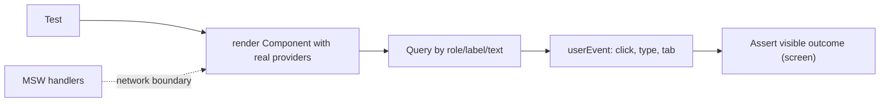
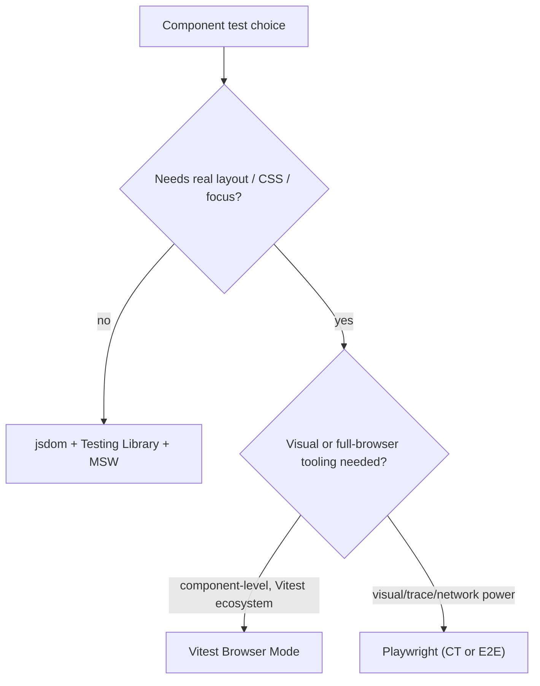

# Component Testing for React

> Verification note: **Vitest Browser Mode** facts (providers `@vitest/browser-playwright`/`@vitest/browser-webdriverio`/preview, `instances` config, `vitest-browser-react` renderer, retrying `expect.element`, `page`/`userEvent` from `vitest/browser`, guidance **not** to use `@testing-library/user-event` in Browser Mode, sealed-ESM `vi.spyOn` limitation, auto-mocked dialogs, Vitest UI/Trace View) were verified against the Vitest docs (updated Oct 2026). **Playwright's new component-testing model** (stories + gallery + `mount` fixture in 1.62; `@playwright/experimental-ct-react`/`-react17`/`-vue` no longer updated as of 1.63) and `toMatchAriaSnapshot` were verified in Playwright's release notes (1.65). **Testing Library philosophy and query priority, `act` behaviour, React 19 test-utils changes, MSW 2 handler APIs, Next.js App Router/RSC/Server Action testing approaches, and `renderHook` details are established practice not re-fetched in this session — marked *(hedged)*.** Network mocking at the API-client level is covered in [networking-and-apis/07 §7](../networking-and-apis/07-api-client-architecture-and-contracts.md#7-mocking-and-testing-the-network-layer); a11y tooling in [05](05-visual-accessibility-and-component-states-testing.md).

## Table of Contents

1. [Quick Summary (TL;DR)](#1-quick-summary-tldr)
2. [Testing Library Philosophy](#2-testing-library-philosophy)
3. [Queries: Priority and Patterns](#3-queries-priority-and-patterns)
4. [Interactions: `userEvent`, Events and Focus](#4-interactions-userevent-events-and-focus)
5. [Providers, Routing, State and Test Utilities](#5-providers-routing-state-and-test-utilities)
6. [Testing Custom Hooks, Context and Forms](#6-testing-custom-hooks-context-and-forms)
7. [Async UI: `findBy`, `waitFor`, `act`, Suspense and Transitions](#7-async-ui-findby-waitfor-act-suspense-and-transitions)
8. [Network in Component Tests: MSW and Friends](#8-network-in-component-tests-msw-and-friends)
9. [Testing Next.js App Router, RSC and Server Actions](#9-testing-nextjs-app-router-rsc-and-server-actions)
10. [Errors, Loading, Empty States and Edge Cases](#10-errors-loading-empty-states-and-edge-cases)
11. [jsdom, happy-dom or a Real Browser](#11-jsdom-happy-dom-or-a-real-browser)
12. [Anti-Patterns and Refactors](#12-anti-patterns-and-refactors)
13. [Pitfalls](#13-pitfalls)
14. [Interview Questions — Fundamentals](#14-interview-questions--fundamentals)
15. [Interview Questions — Senior Scenarios](#15-interview-questions--senior-scenarios)
16. [Cheat Sheet](#16-cheat-sheet)
17. [Key Terms Glossary](#17-key-terms-glossary)
18. [Further Reading](#18-further-reading)

---

## 1. Quick Summary (TL;DR)

- **Test components like a user would use them:** render, find by **role/label/text**, interact (`userEvent`), assert **visible outcomes** (text, enabled state, focus, navigation) — not internal state or implementation structure.
- **Queries signal accessibility:** `getByRole('button', { name: /save/i })` fails if the markup isn't accessible, so tests double as a11y checks.
- **Mock the network at the boundary (MSW)**, not `fetch` or your API client internals; provide realistic handlers and test loading/error/empty states.
- **Wrap with real providers** (router, query client, theme, i18n, store) via a shared `renderWithProviders` utility so tests mirror production wiring.
- **Async UI = `await findBy…` / `waitFor`** with real assertions — never arbitrary sleeps. Libraries wrap updates in `act` for you; unexpected `act` warnings often indicate unawaited async work.
- **jsdom is fast but incomplete** (no layout, limited CSS, imperfect events). For layout/focus/real-browser behaviour use **Vitest Browser Mode** or **Playwright** (component or E2E) — pick per need ([§11](#11-jsdom-happy-dom-or-a-real-browser)).
- **Server Components:** async RSCs are hard to unit-render; test **data/domain functions** and **client components** at the unit/component level, and verify composed pages with **E2E/integration** tests ([§9](#9-testing-nextjs-app-router-rsc-and-server-actions)).



---

## 2. Testing Library Philosophy

*"The more your tests resemble the way your software is used, the more confidence they can give you."* (Testing Library guiding principle *(hedged: stable wording)*.)

- **Test what the user perceives:** text, roles, labels, focus, disabled/aria states, navigation results.
- **Avoid implementation details:** component state, hook internals, instance methods, CSS class names, DOM structure, snapshot-of-everything.
- **Queries reflect accessibility:** role + accessible name are what assistive tech uses.
- **Realistic interactions:** `userEvent` simulates sequences (pointer, focus, keydown/keypress/input/keyup) rather than dispatching a single synthetic event.
- **Realistic environment:** include providers/routing; mock only boundaries.
- **Refactor safety:** a test should only fail when user-visible behaviour breaks.

```tsx
import { render, screen } from '@testing-library/react';
import userEvent from '@testing-library/user-event';

it('adds an item to the cart and announces it', async () => {
  const user = userEvent.setup();
  render(<ProductCard product={buildProduct({ name: 'Trail Shoes', priceCents: 12900 })} />);

  await user.click(screen.getByRole('button', { name: /add to cart/i }));

  expect(await screen.findByRole('status')).toHaveTextContent(/trail shoes added/i);
  expect(screen.getByRole('button', { name: /add to cart/i })).toBeEnabled();
});
```

---

## 3. Queries: Priority and Patterns

| Priority | Query | Use for |
|---|---|---|
| 1 | `getByRole(role, { name })` | Almost everything interactive (button, link, textbox, checkbox, dialog, heading) |
| 2 | `getByLabelText` | Form fields |
| 3 | `getByPlaceholderText` | Fallback when no label (a11y smell) |
| 4 | `getByText` | Non-interactive content |
| 5 | `getByDisplayValue` | Current input/select values |
| 6 | `getByAltText`, `getByTitle` | Images/titles |
| 7 | `getByTestId` | Last resort when no semantic hook exists |

| Variant | Behaviour | Use |
|---|---|---|
| `getBy*` | Throws if 0 or >1 | Element must exist now |
| `queryBy*` | `null` if 0 | Assert absence: `expect(queryByRole(...)).not.toBeInTheDocument()` |
| `findBy*` | Async; waits until found | Elements appearing after async work |
| `getAllBy*/queryAllBy*/findAllBy*` | Multiple | Lists/rows |
| `within(element)` | Scope queries | Dialogs, rows, cards |

```tsx
const dialog = await screen.findByRole('dialog', { name: /delete project/i });
await user.click(within(dialog).getByRole('button', { name: /delete/i }));

const rows = screen.getAllByRole('row').slice(1);                 // skip header
expect(within(rows[0]).getByRole('cell', { name: 'Alice' })).toBeVisible();
```
- **Use regex/`i` for names** to avoid brittle copy matching; for i18n, render with the app's i18n provider and pick a test locale (or use message keys via a test double).
- **Accessible name issues** (e.g., icon-only buttons without labels) will make `getByRole` fail — **fix the component**, don't switch to test ids.
- **Test ids:** configure `testIdAttribute` if your codebase uses `data-test`. Keep for elements without semantics (canvas, chart regions) *(hedged)*.
- **Playwright's locators and Vitest Browser Mode's `page.getBy*`** follow the same philosophy (role/label/text) ([04](04-end-to-end-testing-with-playwright.md)).
- **`screen.debug()`/`logRoles`** and Testing Playground help discover queries *(hedged)*.

---

## 4. Interactions: `userEvent`, Events and Focus

- **`userEvent.setup()`** per test (jsdom/happy-dom with `@testing-library/user-event`): `click`, `dblClick`, `hover`, `type`, `clear`, `selectOptions`, `upload`, `keyboard('{Enter}')`, `tab()`, `paste`. Prefer `await user.type(...)` over `fireEvent.change` — it fires realistic key/input events (important for controlled inputs, IME-sensitive logic, masks).
- **In Vitest Browser Mode**, **do not** use `@testing-library/user-event` (it simulates events); use **`userEvent` from `vitest/browser`** or `locator.fill()/click()`, which drive the browser via CDP/WebDriver (Vitest docs).
- **`fireEvent`** only for low-level events that `userEvent` doesn't model (e.g., custom events, `scroll`, `resize`, `load`).
- **Keyboard & focus assertions:** `await user.tab(); expect(screen.getByRole('link', { name: 'Skip to content' })).toHaveFocus();` — test **focus management** for dialogs, menus, route changes and error summaries ([05](05-visual-accessibility-and-component-states-testing.md)).
- **Pointer-specific logic:** drag/drop, resize, hover tooltips — jsdom lacks layout (`getBoundingClientRect` returns zeros); mock minimal geometry or use a real browser ([§11](#11-jsdom-happy-dom-or-a-real-browser)).
- **Debounced/throttled inputs:** use fake timers with `userEvent.setup({ advanceTimers: vi.advanceTimersByTime })` *(hedged option name)* or await the effect with `findBy`.
- **File uploads:** `await user.upload(input, new File(['x'], 'a.png', { type: 'image/png' }))`; in Playwright use `setInputFiles` / `locator.drop()` (1.60).
- **Clipboard/dialogs:** stub `navigator.clipboard`; `alert/confirm` mocks (Browser Mode auto-mocks, per Vitest docs).
- **Check disabled/pending states** after submit to ensure double-submit protection.

---

## 5. Providers, Routing, State and Test Utilities

```tsx
// test-utils.tsx — one place to mirror production wiring
import { render, type RenderOptions } from '@testing-library/react';
import { QueryClient, QueryClientProvider } from '@tanstack/react-query';
import { MemoryRouter } from 'react-router-dom';          // or Next.js test router mocks
import { ThemeProvider } from '@/theme';
import { I18nProvider } from '@/i18n';

export function renderWithProviders(ui: React.ReactElement, { route = '/', client = makeClient(), ...opts }: { route?: string; client?: QueryClient } & RenderOptions = {}) {
  const Wrapper = ({ children }: { children: React.ReactNode }) => (
    <QueryClientProvider client={client}>
      <I18nProvider locale="en-US">
        <ThemeProvider>
          <MemoryRouter initialEntries={[route]}>{children}</MemoryRouter>
        </ThemeProvider>
      </I18nProvider>
    </QueryClientProvider>
  );
  return { client, ...render(ui, { wrapper: Wrapper, ...opts }) };
}

const makeClient = () => new QueryClient({ defaultOptions: { queries: { retry: false, gcTime: Infinity }, mutations: { retry: false } } });
```
- **New `QueryClient` per test** with `retry: false` (otherwise failed queries retry with backoff and slow/flake tests) ([react/06](../react/06-state-management-and-data-fetching.md)).
- **Routing:** `MemoryRouter`/`createMemoryRouter` for React Router; for Next.js, mock `next/navigation` (`useRouter`, `usePathname`, `useSearchParams`) or use a provider that supplies them *(hedged)*; assert navigation via router spy or resulting UI.
- **State libraries:** create a fresh store per test with `preloadedState`; reset singletons (Zustand `setState(initial)`).
- **Auth/permissions:** provide a fake session context; test role-based UI **and** assert the server enforcement elsewhere ([web-security/05](../web-security/05-authentication-and-authorization-in-the-frontend.md)).
- **Feature flags:** wrapper accepts flag overrides.
- **Global setup:** `setupFiles` for `@testing-library/jest-dom` matchers (`toBeInTheDocument`, `toHaveAccessibleName`), `matchMedia`/`ResizeObserver`/`IntersectionObserver` polyfills or mocks for jsdom, MSW server lifecycle, `afterEach(cleanup)` (automatic with most runners).
- **Custom queries/matchers** live in test utils; keep them tiny.

---

## 6. Testing Custom Hooks, Context and Forms

### Hooks
- Prefer **testing hooks through a component** that uses them (user-visible outcomes). Use **`renderHook`** *(hedged: from `@testing-library/react`)* for reusable hooks with no UI:
```tsx
const { result } = renderHook(() => useCounter({ initial: 1 }), { wrapper: Providers });
act(() => result.current.increment());
expect(result.current.count).toBe(2);
```
- Re-render with new props via `rerender`; assert cleanup by calling `unmount()` and checking spies (subscriptions, timers).
- Hooks that fetch: wrap in `QueryClientProvider` and use `waitFor(() => expect(result.current.isSuccess).toBe(true))`.

### Context
- Test **consumers** with real providers; for providers themselves, render a probe component that exposes context values and assert behaviour via UI.

### Forms
```tsx
it('shows field errors from the server and keeps user input', async () => {
  server.use(http.post('/api/orders', () => HttpResponse.json(
    { type: 'validation', status: 422, errors: [{ pointer: '/email', code: 'invalid', message: 'Email looks invalid' }] },
    { status: 422, headers: { 'Content-Type': 'application/problem+json' } })));

  const user = userEvent.setup();
  renderWithProviders(<CheckoutForm />);
  await user.type(screen.getByLabelText(/email/i), 'bad@');
  await user.click(screen.getByRole('button', { name: /place order/i }));

  expect(await screen.findByText(/email looks invalid/i)).toBeVisible();
  expect(screen.getByLabelText(/email/i)).toHaveValue('bad@');
  expect(screen.getByLabelText(/email/i)).toHaveAccessibleErrorMessage(/email looks invalid/i);   // jest-dom matcher (hedged)
});
```
- Cover: required/format validation, async validation, disabled/submitting states, success message/navigation, preserved input on error, keyboard submit (Enter), error summary focus, autofill attributes, double-submit prevention, i18n/locale formats, accessibility of errors (`aria-invalid`, `aria-describedby`).
- **React 19 forms:** test `useActionState`/`useFormStatus`/`useOptimistic` behaviour via UI (pending text, optimistic item appears then reconciles); server-action-backed forms require mocking the action or integration tests ([react/04](../react/04-react-19-and-beyond.md), [§9](#9-testing-nextjs-app-router-rsc-and-server-actions)).

---

## 7. Async UI: `findBy`, `waitFor`, `act`, Suspense and Transitions

- **`await screen.findByRole(...)`** = `waitFor(() => getByRole(...))` — default timeout ~1 s *(hedged)*; configure per test when needed.
- **`waitFor(() => expect(...))`** retries a callback until it passes: put **only assertions** inside; avoid side effects (clicks) in `waitFor` (they repeat).
- **`waitForElementToBeRemoved`** for spinners/skeletons disappearing.
- **`act` warnings** ("not wrapped in act(...)") usually mean state updates happened after your test finished or without awaiting — fix by awaiting the right query, flushing the effect, or cancelling/aborting work on unmount (a real bug sometimes). Testing Library wraps `render`, `userEvent` and `waitFor` in `act` automatically; for React 18/19 use `React.act` where manual act is needed *(hedged: react-dom/test-utils `act` is deprecated)*.
- **Suspense:** render with a `<Suspense fallback>` boundary and assert fallback then content with `findBy`; for `use(promise)` ensure the promise is stable across renders.
- **Transitions/`useDeferredValue`:** assert eventual consistency (`findBy`) rather than intermediate states; to test pending UI use `isPending` indicators.
- **Timers:** fake timers + `userEvent.setup({ advanceTimers })`; or avoid timers in component logic via injected schedulers.
- **Avoid `setTimeout` sleeps** and `await new Promise(r => setTimeout(r, 500))`.
- **Strict Mode:** render components under `<StrictMode>` in tests to surface double-invoked effects/cleanup bugs *(hedged)*.

---

## 8. Network in Component Tests: MSW and Friends

MSW intercepts requests at the network layer (Node: interceptors; browser: service worker), so your components/API client run **unchanged**.

```ts
// test/server.ts
import { setupServer } from 'msw/node';
import { handlers } from './handlers';
export const server = setupServer(...handlers);

// setup file
beforeAll(() => server.listen({ onUnhandledRequest: 'error' }));   // fail on unexpected requests
afterEach(() => server.resetHandlers());
afterAll(() => server.close());
```
```ts
// per-test overrides for error/slow/edge cases
server.use(http.get('/api/orders', () => HttpResponse.json([], { status: 200 })));          // empty state
server.use(http.get('/api/orders', () => new HttpResponse(null, { status: 503, headers: { 'Retry-After': '1' } })));
server.use(http.get('/api/orders', async () => { await delay('infinite'); }));                 // perpetual loading (API names hedged)
```
- **`onUnhandledRequest: 'error'`** prevents silent real network calls.
- **Handlers share fixtures with Storybook and (optionally) Playwright** (`msw` browser worker / Playwright's own `route` mocking) *(hedged)*.
- **Assert requests, sparingly:** capture request bodies/headers in a handler when the contract matters (auth header, idempotency key, CSRF header) — assert the **observable request**, not internal client calls.
- **Validate mocks against schemas/OpenAPI** to avoid drift ([06](06-api-contract-and-integration-testing.md)).
- **Alternatives:** Playwright `page.route` (E2E/CT), `fetch-mock`, `nock` (Node), stubbing the API client — the last couples tests to internals; prefer MSW.
- **Playwright component testing** (new stories model in 1.62; older `router` fixture accepted MSW handlers) *(verify current API before use)* ([§11](#11-jsdom-happy-dom-or-a-real-browser)).
- **Streaming/WebSocket/SSE:** MSW supports WebSocket interception in v2 *(hedged)*; Playwright offers `page.routeWebSocket` (1.48) for browser tests.

---

## 9. Testing Next.js App Router, RSC and Server Actions

*(Approaches are established practice; framework specifics hedged — check nextjs.org testing docs. Architecture background: [nextjs-and-rendering/](../nextjs-and-rendering/README.md).)*

| Unit under test | Recommended approach |
|---|---|
| **Pure domain/data functions** (DAL, pricing, mappers) | Plain unit tests (no React) — put logic here so it's easy to test |
| **Client Components** (`'use client'`) | Testing Library + MSW; mock `next/navigation`, `next/image` if needed |
| **Synchronous Server Components** | Can be rendered like function components in unit tests (props in, markup out) *(hedged)* |
| **Async Server Components** | Hard to render in jsdom/Testing Library *(hedged)*: test their data dependencies as units and cover the composed page with **E2E** (Playwright) or an integration harness |
| **Server Actions** | Treat as server functions: unit test by calling with `FormData` after mocking `next/headers`/`cookies`, `next/cache` (`revalidatePath/Tag`), `redirect` (throws) and your DB/DAL; assert authz, validation and returned state; E2E for the form wiring |
| **Route handlers** | Call the exported `GET/POST` with a `Request`; assert `Response` status/headers/body; mock auth/DB |
| **`proxy.ts`/middleware** | Unit test the function with `NextRequest` objects (matchers, redirects, headers) *(hedged)* |
| **Layouts/streaming/Suspense boundaries, caching, revalidation** | E2E/integration against a built or dev server; assert behaviour (stale/fresh data, loading UI) |

```ts
// Server Action unit test sketch
vi.mock('next/cache', () => ({ revalidatePath: vi.fn(), revalidateTag: vi.fn() }));
vi.mock('next/navigation', () => ({ redirect: vi.fn(() => { throw new Error('NEXT_REDIRECT'); }) }));
vi.mock('@/lib/session', () => ({ getSession: vi.fn() }));

it('rejects unauthenticated users and does not touch the DB', async () => {
  vi.mocked(getSession).mockResolvedValue(null);
  await expect(createPost(initialState, formData({ title: 'x' }))).resolves.toMatchObject({ ok: false, error: 'unauthorized' });
  expect(db.post.create).not.toHaveBeenCalled();        // here "not called" is the security requirement
});

it('creates the post and revalidates the list for an authorised editor', async () => { /* ... */ });
```
- **Security tests belong here:** Server Actions are public endpoints — test **authn/authz, ownership checks, validation, error shapes** directly ([web-security/05 §10](../web-security/05-authentication-and-authorization-in-the-frontend.md#10-authorization-in-react-nextjs-and-apis)).
- **Pattern:** keep Server Actions/route handlers **thin** (parse → authorise → call domain service → shape response) so most logic tests don't need Next mocks.
- **Vitest + Next:** async RSC support in unit environments is limited; the official guidance (as commonly cited) is Vitest for unit/sync components and E2E for async components *(hedged)*.

---

## 10. Errors, Loading, Empty States and Edge Cases

Every async region has loading / success / **empty** / **error** (+ stale/refreshing); test them all:
```tsx
it.each([
  ['loading', () => server.use(http.get('/api/orders', () => delay('infinite'))), /loading orders/i],
  ['empty',   () => server.use(http.get('/api/orders', () => HttpResponse.json([]))), /no orders yet/i],
  ['error',   () => server.use(http.get('/api/orders', () => new HttpResponse(null, { status: 500 }))), /something went wrong/i],
])('renders the %s state', async (_name, arrange, expected) => {
  arrange();
  renderWithProviders(<OrdersPage />);
  expect(await screen.findByText(expected)).toBeVisible();
});
```
- **Retry UX:** click "Retry" → refetch; assert recovery.
- **Error boundaries:** render a component that throws; assert fallback UI and reset behaviour; silence expected `console.error` noise explicitly (spy + assert it was expected).
- **Edge data:** very long strings, unicode/emoji/RTL, huge lists (virtualisation), missing optional fields, `null`s, unknown enum values ([networking-and-apis/03 §6](../networking-and-apis/03-rest-api-design-and-consumption.md#6-versioning-and-evolution)).
- **Responsive behaviour:** `matchMedia` mocks in jsdom; real viewports in Browser Mode/Playwright.
- **i18n/locale/time zone:** render with different locales/time zones; assert formatting via `Intl` outputs rather than hard-coded strings where possible.
- **Permissions:** role-based UI variants; keyboard-only usage.
- **Concurrency:** rapid clicks, double submit, navigating away mid-request (aborted fetch should not update unmounted UI).

---

## 11. jsdom, happy-dom or a Real Browser

| Environment | Pros | Cons | Use when |
|---|---|---|---|
| **jsdom** | Mature, fast, Node-only | No layout/real CSS, partial APIs (`ResizeObserver`, `IntersectionObserver`, `matchMedia` missing), event quirks | Most component logic tests |
| **happy-dom** | Faster, lightweight | Less complete/accurate in places *(hedged)* | Speed-sensitive suites, simple DOM |
| **Vitest Browser Mode** (real browser via Playwright/WebdriverIO) | Real layout, CSS, focus, events; retrying `expect.element`; `userEvent` via CDP; Vitest UI/Trace View | Slower than jsdom; ESM spy limitation; needs browser install in CI | Components depending on layout/CSS/real events; high-fidelity component tests |
| **Playwright component testing** (new stories/gallery `mount` model in 1.62) | Real browsers, Playwright tooling (traces, screenshots) | Experimental packages replaced; migration needed; different from Testing Library | Visual/interaction tests of components with full Playwright power |
| **Storybook interaction tests** *(hedged)* | Reuses stories; visual + interaction in one | Tooling complexity | Design systems ([05](05-visual-accessibility-and-component-states-testing.md)) |

**Vitest Browser Mode example (APIs verified from docs):**
```tsx
import { expect, test } from 'vitest';
import { render } from 'vitest-browser-react';
import { userEvent } from 'vitest/browser';

test('toggles the menu with the keyboard', async () => {
  const screen = await render(<NavMenu />);
  const button = screen.getByRole('button', { name: /menu/i });
  await userEvent.keyboard('{Tab}');
  await expect.element(button).toHaveFocus();
  await userEvent.keyboard('{Enter}');
  await expect.element(screen.getByRole('menu')).toBeVisible();   // retries until true (real layout)
});
```
- **Strategy:** default to jsdom/Node project for speed; add a **browser project** for layout-sensitive components (tooltips/popovers, virtualised lists, resize/scroll/focus traps, CSS-driven visibility) — Vitest's `projects` option runs both (verified).
- **Playwright CT note:** as of 1.63 the old `@playwright/experimental-ct-*` packages are not updated; new `mount` of stories requires a served gallery — evaluate whether Vitest Browser Mode or Storybook fits your stack better.

---

## 12. Anti-Patterns and Refactors

| Anti-pattern | Refactor |
|---|---|
| `wrapper.state()`/instance method calls (Enzyme-style) | Assert rendered output after user actions |
| `container.querySelector('.btn-primary')` | `getByRole('button', { name })` |
| `fireEvent.change(input, …)` for typing | `await user.type(...)` |
| `await sleep(500)` | `await screen.findBy…` / `waitFor` |
| Snapshot whole component | Specific assertions, small inline snapshots |
| Mock child components to "isolate" | Render real children; mock network only |
| Testing implementation of hooks via spies | Assert UI results |
| One giant test per component | Separate behaviours/states; share arrange helpers |
| Repeating provider setup in every test | `renderWithProviders` utility |
| Asserting `useEffect` ran / `setState` called | Assert user-visible consequences |
| `jest.mock('axios')` everywhere | MSW at the HTTP boundary |
| `data-testid` on everything | Fix semantics/labels; test ids only as last resort |

---

## 13. Pitfalls

1. **Testing implementation** (state, class names) → brittle.
2. **Using `getByTestId` by default** and missing accessibility bugs.
3. **Forgetting `await`** on `user.*`/`findBy*`/`waitFor` → flaky or false passes.
4. **Side effects inside `waitFor`** (repeated clicks).
5. **Shared `QueryClient`/store** across tests (cache leaks, order dependence).
6. **Retries enabled in test QueryClient** → slow, confusing failures.
7. **Unmocked network** (real calls, flaky) — use `onUnhandledRequest: 'error'`.
8. **Relying on jsdom for layout/CSS** (e.g., `toBeVisible` with CSS classes, scroll/resize behaviour).
9. **Mocking too many modules** (router, hooks, children).
10. **Ignoring console errors/warnings** (act warnings, React key warnings, hydration).
11. **Large DOM snapshots** and blind updates.
12. **Mixing `@testing-library/user-event` into Vitest Browser Mode** (use `vitest/browser`'s `userEvent`).
13. **Treating async Server Components like client components in unit tests.**

---

## 14. Interview Questions — Fundamentals

### Q1. Why query by role instead of test id?
Roles and accessible names mirror how users and assistive tech perceive the UI, tests survive refactors, and they surface accessibility problems; test ids are a last resort.

### Q2. `getBy`, `queryBy`, `findBy` — when to use each?
`getBy` for elements that must exist now, `queryBy` to assert absence, `findBy` for elements that appear asynchronously.

### Q3. Why `userEvent` over `fireEvent`?
It simulates realistic interaction sequences (pointer, focus, key and input events), catching bugs `fireEvent`'s single synthetic event would miss.

### Q4. How do you mock API calls in component tests?
Use MSW to intercept at the network boundary with realistic handlers, override per test for error/empty/slow cases, and fail on unhandled requests.

### Q5. What does an `act` warning mean?
State updated outside React's test batching — often async work finishing after the test or unawaited queries; await the right condition or clean up effects.

### Q6. When is jsdom insufficient?
Layout-dependent logic, real CSS visibility, focus/scroll/resize subtleties, and browser-specific events — use Vitest Browser Mode or Playwright.

### Q7. How do you test a form?
Type with `userEvent`, submit, assert validation messages, disabled/pending states, preserved input, success outcome, server errors via MSW and accessibility attributes.

### Q8. How should you test hooks?
Through components when UI-coupled; with `renderHook` for pure reusable hooks; assert outputs and cleanup.

---

## 15. Interview Questions — Senior Scenarios

### S1. "Our component tests are slow and brittle (Enzyme-style + shallow rendering). Migration plan?"
Adopt Testing Library, write new tests behaviourally, build `renderWithProviders` and MSW handlers, migrate high-churn components first, delete tests tied to implementation, keep a few snapshot/characterisation tests during transition, parallelise in CI, and add lint rules (`testing-library/*` *(hedged)*) to enforce patterns.

### S2. "How do you test Server Actions and async Server Components in Next.js?"
Keep actions thin; unit test them as functions (mock `next/headers`, `next/cache`, auth, DB) focusing on authz/validation/outcomes; test domain/data functions separately; test client components with Testing Library; verify composed async pages, streaming and caching with Playwright E2E against a built app ([04](04-end-to-end-testing-with-playwright.md)).

### S3. "A tooltip/popover component works in production but its jsdom tests are meaningless. What do you do?"
Positioning/visibility depend on layout and CSS; run these in a real browser — Vitest Browser Mode project or Playwright component/E2E tests — and keep jsdom for logic-only cases; add a visual regression test ([05](05-visual-accessibility-and-component-states-testing.md)).

### S4. "Design the component-test harness for a design system."
Per-component test files covering variants/states/keyboard/ARIA; shared `renderWithProviders`; Storybook stories as the visual states with interaction tests; axe checks per story; visual regression in CI; a11y snapshot assertions (`toMatchAriaSnapshot`); Browser Mode for layout-sensitive components; contract tests for tokens/theming; versioned releases with changelog tests.

### S5. "Tests intermittently fail with 'Unable to find element' for async data."
Missing waits/unmocked timing: use `findBy`/`waitFor`, ensure MSW handlers respond deterministically, disable query retries, avoid fake timers conflicts, await `user` actions, and print DOM (`screen.debug`) on failure; investigate race conditions in the component (cancellation/stale responses).

---

## 16. Cheat Sheet

| Task | Do |
|---|---|
| Find interactive element | `getByRole(role, { name })` |
| Form field | `getByLabelText` |
| Appears later | `await findBy…` |
| Assert absent | `queryBy…` + `not.toBeInTheDocument()` |
| Type/click | `const user = userEvent.setup(); await user.type/click` |
| Scoped query | `within(container)` |
| Network | MSW + `onUnhandledRequest: 'error'` |
| Providers | `renderWithProviders` (fresh QueryClient, `retry: false`) |
| Layout-sensitive | Vitest Browser Mode / Playwright |
| Async RSC | Unit-test data fns + E2E |



---

## 17. Key Terms Glossary

| Term | Definition |
|---|---|
| **Accessible name** | Computed label of an element exposed to assistive tech |
| **`act`** | React helper batching/flushing updates in tests |
| **MSW** | Mock Service Worker: network-layer request interception |
| **`renderWithProviders`** | Test helper mirroring production providers |
| **Browser Mode** | Vitest feature running tests in real browsers |
| **Component testing (Playwright)** | Mounting components/stories in real browsers via Playwright |
| **Characterisation** | Capturing existing behaviour before refactor |
| **Test id** | Attribute-based selector used as last resort |

---

## 18. Further Reading

- [Testing Library — React](https://testing-library.com/docs/react-testing-library/intro/) · [Queries](https://testing-library.com/docs/queries/about) · [user-event](https://testing-library.com/docs/user-event/intro) *(hedged: stable docs)*
- [Vitest — Browser Mode](https://vitest.dev/guide/browser/) · [Playwright — Components (experimental)](https://playwright.dev/docs/test-components) · [MSW](https://mswjs.io/docs/)
- This repo: [02 Unit testing](02-unit-testing-and-test-doubles.md) · [05 Visual and a11y](05-visual-accessibility-and-component-states-testing.md) · [react/](../react/README.md) · [nextjs-and-rendering/04](../nextjs-and-rendering/04-data-fetching-and-mutations.md)
