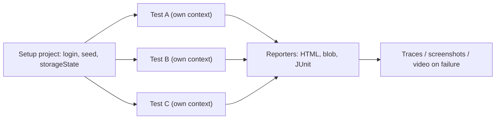
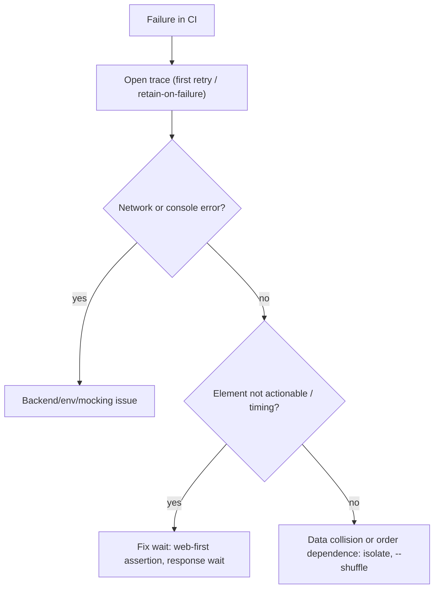

# End-to-End Testing with Playwright

> Verification note: Playwright facts were verified against the official **release notes (latest 1.65, Nov 2026)**: Node.js 20 is no longer tested (use Node 22, 24 or 26); the runner can run under Bun (`bunx --bun playwright test`, no watch mode); **test locks** (`{ lock: 'name' }` since 1.63; built-in `-exclusive-` lock in 1.65) serialise tests that share a resource across files/workers/projects; `--shuffle` (1.64), `testProject.default` (1.64), `locator.within()` (1.64), `locator.visible()` (1.63), `retryStrategy: 'isolated'` (1.62), `signal` on actions (1.62), `failures` reporter and `onlyFailures` (1.65), WebAuthn passkeys virtual authenticator (1.61), Web Storage API (1.61), `page.clock` (1.45), `routeWebSocket` (1.48), `--only-changed` (1.46), `--last-failed` (1.44), `failOnFlakyTests` (1.45/1.52), project dependencies/teardown (1.31/1.34), blob reporter + `merge-reports` (1.37), trace modes (`retain-on-first-failure` 1.43, `retain-on-failure-and-retries` 1.59), aria snapshots (1.49, page-level in 1.60), `page.accessibility` removed in 1.57 (use axe), storage state incl. IndexedDB (1.51), Test Agents (planner/generator/healer, 1.56) and bundled MCP/CLI (1.62). **Best-practice guidance (locator strategy, isolation, data seeding, CI patterns, POM vs fixtures, Cypress comparison) is established practice; CI YAML uses organisation defaults (`bby-ubuntu`, Artifactory npm registry) and generic action names that must be pinned by SHA — marked *(hedged)* where specifics vary.** Strategy context: [01](01-testing-strategy-and-test-design.md); flakiness/CI depth: [07](07-flakiness-ci-and-non-functional-testing.md).

## Table of Contents

1. [Quick Summary (TL;DR)](#1-quick-summary-tldr)
2. [When E2E Is the Right Tool](#2-when-e2e-is-the-right-tool)
3. [Project Setup and Configuration](#3-project-setup-and-configuration)
4. [Locators: Resilient Selection](#4-locators-resilient-selection)
5. [Auto-Waiting, Actionability and Web-First Assertions](#5-auto-waiting-actionability-and-web-first-assertions)
6. [Fixtures, Page Objects and Test Structure](#6-fixtures-page-objects-and-test-structure)
7. [Authentication and Sessions](#7-authentication-and-sessions)
8. [Test Data and Isolation](#8-test-data-and-isolation)
9. [Network Control: Mocking, Waiting and Time](#9-network-control-mocking-waiting-and-time)
10. [Parallelism, Sharding, Locks and Ordering](#10-parallelism-sharding-locks-and-ordering)
11. [Debugging: Traces, UI Mode, Codegen and Agents](#11-debugging-traces-ui-mode-codegen-and-agents)
12. [CI: GitHub Actions, Sharding and Reports](#12-ci-github-actions-sharding-and-reports)
13. [Special Scenarios: Multi-Tab, Iframes, Downloads, WebAuthn, Mobile](#13-special-scenarios-multi-tab-iframes-downloads-webauthn-mobile)
14. [Playwright vs Cypress and Others](#14-playwright-vs-cypress-and-others)
15. [Pitfalls](#15-pitfalls)
16. [Interview Questions — Fundamentals](#16-interview-questions--fundamentals)
17. [Interview Questions — Senior Scenarios](#17-interview-questions--senior-scenarios)
18. [Cheat Sheet](#18-cheat-sheet)
19. [Key Terms Glossary](#19-key-terms-glossary)
20. [Further Reading](#20-further-reading)

---

## 1. Quick Summary (TL;DR)

- **Playwright (v1.65 at time of writing)** drives real Chromium, Firefox and WebKit with **auto-waiting**, **web-first retrying assertions**, **isolated browser contexts per test**, built-in **parallelism/sharding**, rich **traces**, and API testing via the `request` fixture.
- **Write few, high-value E2E tests** for critical journeys; make each **independent** (own data, own session), **role-based locators**, **no fixed sleeps**, and **diagnosable** (trace on first retry, screenshots/video on failure).
- **Locators:** `getByRole` / `getByLabel` / `getByText` first; `getByTestId` as fallback; combine with `filter`, `within`, `visible()`; never brittle CSS/XPath chains.
- **Assertions:** use `await expect(locator).toBeVisible()` etc. (auto-retry until timeout); avoid `expect(await locator.isVisible())` (no retry).
- **Auth once, reuse everywhere:** a **setup project** logs in and writes `storageState`; tests depend on it; for role matrices keep one state per role; passkeys can be tested with the virtual authenticator.
- **Data isolation:** seed via API (`request` fixture) per test/worker with unique identifiers; clean up; use **test locks** for truly shared resources.
- **Scale with shards + blob reports + merge-reports**; treat flaky status as signal (`failOnFlakyTests`), use `retryStrategy: 'isolated'` to reduce retry interference.
- **Runtime requirement:** Node.js 22/24/26 (Node 20 no longer tested as of 1.65).



---

## 2. When E2E Is the Right Tool

| Use E2E for | Don't use E2E for |
|---|---|
| Critical journeys (sign-up, login, checkout, permissions, payments) | Every validation rule or UI variation (component tests) |
| Cross-system wiring (frontend + BFF + auth + real browser behaviour) | Pure logic (unit tests) |
| Browser-specific behaviour (cookies/SameSite, CSP, redirects, bfcache-like navigation) | API contract details (contract tests) |
| Smoke tests post-deploy (synthetic checks) | Visual details of dozens of states (Storybook/visual) |
| Regression for bugs only reproducible with full stack | Performance micro-benchmarks |

**Budget rule of thumb *(hedged)*:** tens (not hundreds) of E2E tests; each < ~1 minute; total pipeline wall-clock < ~15 minutes with sharding.

---

## 3. Project Setup and Configuration

```ts
// playwright.config.ts
import { defineConfig, devices } from '@playwright/test';

export default defineConfig({
  testDir: './e2e',
  fullyParallel: true,
  forbidOnly: !!process.env.CI,                       // fail CI on committed test.only
  retries: process.env.CI ? 2 : 0,
  retryStrategy: 'isolated',                          // 1.62+: retries run at the end, one by one, in a single worker
  failOnFlakyTests: !!process.env.CI,                 // optionally fail runs containing flaky tests
  workers: process.env.CI ? '50%' : undefined,
  reporter: process.env.CI
    ? [['blob'], ['github'], ['failures']]            // 'failures' reporter added in 1.65
    : [['html', { open: 'never' }]],
  use: {
    baseURL: process.env.BASE_URL ?? 'http://localhost:3000',
    trace: 'retain-on-failure-and-retries',           // 1.59+: compare passing vs failing attempts
    screenshot: 'only-on-failure',
    video: 'retain-on-failure',
    testIdAttribute: 'data-testid',
  },
  expect: { timeout: 7_000, toHaveScreenshot: { maxDiffPixelRatio: 0.01 } },
  projects: [
    { name: 'setup', testMatch: /.*\.setup\.ts/ },
    { name: 'chromium', use: { ...devices['Desktop Chrome'], storageState: 'e2e/.auth/user.json' }, dependencies: ['setup'] },
    { name: 'webkit',   use: { ...devices['Desktop Safari'], storageState: 'e2e/.auth/user.json' }, dependencies: ['setup'], default: false },  // 1.64: kept but not run by default
    { name: 'mobile',   use: { ...devices['Pixel 7'],        storageState: 'e2e/.auth/user.json' }, dependencies: ['setup'], default: false },
  ],
  webServer: {
    command: 'npm run build && npm run start',
    url: 'http://localhost:3000',
    reuseExistingServer: !process.env.CI,
    timeout: 180_000,
  },
});
```
Notes:
- **Test against a production-like build** (`next build && next start`), not the dev server, for fidelity (caching, streaming, minification, CSP) — dev servers hide bugs and add overlays.
- **`webServer.wait`** (1.57) can wait for a log line (regex) when there's no HTTP readiness endpoint.
- **Projects** model browsers/viewports/roles; `testProject.default: false` keeps cross-browser projects configured but off by default locally; run all with `--project="*"` in CI (1.64).
- **TypeScript & JSX** compile per your `tsconfig` (1.64 notes: JSX follows `jsx*` options; class fields follow `useDefineForClassFields`).
- **Install browsers** in CI with `npx playwright install --with-deps` (or use the official Docker image, now with Node 26 in 1.65).
- **Environment:** require Node 22/24/26; Bun is supported with caveats (no watch mode; `tsconfig` options ignored) — treat as optional.
- **Config knobs worth knowing:** `timeout` (per test), `expect.timeout`, `globalSetup` (prefer setup projects), `outputDir`, `snapshotPathTemplate`, `tag`, `grep`, `metadata`, `captureGitInfo`.

---

## 4. Locators: Resilient Selection

```ts
// Role-first, user-facing
await page.getByRole('button', { name: 'Place order' }).click();
await page.getByLabel('Email').fill('a@example.com');
await expect(page.getByRole('heading', { name: /order confirmed/i })).toBeVisible();

// Scope and filter
const row = page.getByRole('row').filter({ hasText: 'Trail Shoes' });
await row.getByRole('button', { name: 'Remove' }).click();

// Chain from parents ("this button within that dialog" — locator.within, 1.64)
const dialog = page.getByRole('dialog', { name: 'Settings' });
await page.getByRole('button', { name: 'Save' }).within(dialog).click();

// Visible-only instead of :visible (1.63)
await page.getByRole('link', { name: 'Docs' }).visible().first().click();

// Describe for readable traces/errors (1.53)
const submit = page.getByTestId('btn-sub').describe('Subscribe button');
```
| Strategy | Notes |
|---|---|
| **`getByRole`** (with `name`) | Default choice; encourages accessible markup |
| `getByLabel`, `getByPlaceholder`, `getByText`, `getByAltText`, `getByTitle` | User-visible hooks |
| **`getByTestId`** | Fallback for elements without semantics (charts, canvases); keep ids stable and meaningful |
| `locator.filter({ hasText / has / hasNot / visible })` | Narrow lists/cards |
| `nth()`, `first()`, `last()` | Avoid unless order is the requirement; `.nth(2).within(rows)` handles column-like queries (1.64) |
| `frameLocator()` | Iframes; no-arg form searches all frames (1.63) |
| `locator.or()/and()` | Handle alternative states (e.g., cookie banner vs button) |
| `page.addLocatorHandler()` | Auto-dismiss overlays/consent dialogs that intermittently block actions |
| CSS/XPath | Last resort; never layout-position chains |
- **Strict mode:** locators must match exactly one element for actions — good; fix ambiguity with better names/scoping.
- **Codegen/Inspector pick-locator** (`npx playwright codegen`, `page.pickLocator()`, `locator.normalize()` in 1.59) suggest best-practice locators.
- **Shadow DOM:** open shadow roots are pierced by default for role/text/CSS locators; closed roots are not accessible.
- **Accessibility assertions:** `toHaveAccessibleName/Description/Role`, `toHaveAccessibleErrorMessage` ([05](05-visual-accessibility-and-component-states-testing.md)).

---

## 5. Auto-Waiting, Actionability and Web-First Assertions

- **Actionability checks before actions:** element is attached, **visible**, **stable** (not animating), **enabled**, **receives events** (not obscured) and — as of 1.65 — **not inert** (`click`, `check`, `fill`, `selectOption` time out on inert elements). No manual `waitFor` before clicks.
- **Web-first assertions retry until they pass or time out:**
```ts
await expect(page.getByTestId('status')).toHaveText('Paid');          // retries
await expect(page).toHaveURL(/\/orders\/\d+$/);
await expect(page.getByRole('listitem')).toHaveCount(3);
// Anti-pattern: single-shot, no retry
expect(await page.getByTestId('status').textContent()).toBe('Paid');
```
- **Polling arbitrary async conditions:**
```ts
await expect.poll(async () => (await request.get('/api/orders/42')).json(), { timeout: 15_000 }).toMatchObject({ status: 'shipped' });
await expect(async () => { const r = await request.get('/api/health'); expect(r.ok()).toBeTruthy(); }).toPass({ intervals: [500, 1000, 2000] });
```
- **Soft assertions** (`expect.soft`, `expect.soft.poll` since 1.61) collect multiple failures without stopping.
- **No `waitForTimeout`** in committed tests (it's a sleep); wait for **observable conditions**: UI state, `page.waitForResponse`, `locator.waitFor()`, `expect.poll`.
- **Navigation waiting:** `page.goto` waits for `load` by default; for SPAs wait for a UI condition. `waitUntil: 'domcontentloaded'` only waits for the target frame since 1.26.
- **Cancel long waits with `signal`** (1.62) when a test has custom cancellation logic.
- **Per-assertion timeout & test timeout:** tune `expect.timeout` (default 5 s) and `timeout`; use `test.slow()` sparingly; don't inflate timeouts to hide flakiness.
- **Animation/transition stability:** disable animations for screenshots (`animations: 'disabled'`), use `reducedMotion: 'reduce'` (standalone `reducedMotion` option in 1.63).

---

## 6. Fixtures, Page Objects and Test Structure

### Fixtures (Playwright's DI)
```ts
// e2e/fixtures.ts
import { test as base, expect } from '@playwright/test';
import { CheckoutPage } from './pages/checkout';

type Fixtures = { checkout: CheckoutPage; account: { email: string; token: string } };

export const test = base.extend<Fixtures>({
  account: async ({ request }, use, testInfo) => {
    const email = `e2e+${testInfo.workerIndex}-${Date.now()}@example.test`;
    const res = await request.post('/api/test/users', { data: { email } });       // test-only seeding endpoint (protected)
    const user = await res.json();
    await use({ email, token: user.token });
    await request.delete(`/api/test/users/${user.id}`);                           // teardown
  },
  checkout: async ({ page }, use) => { await use(new CheckoutPage(page)); },
});
export { expect };
```
- **Merge fixtures** from modules with `mergeTests` and custom matchers with `mergeExpects` (1.39); **option fixtures** (`[default, { option: true }]`) parametrise projects; **box** noisy fixtures (1.46).
- **Worker-scoped fixtures** (`{ scope: 'worker' }`) for expensive shared resources (DB connection, seeded tenant) — keep immutable or per-worker.

### Page Object Model (light)
```ts
export class CheckoutPage {
  constructor(private readonly page: Page) {}
  readonly email = this.page.getByLabel('Email');
  readonly submit = this.page.getByRole('button', { name: 'Place order' });
  async placeOrder(email: string) { await this.email.fill(email); await this.submit.click(); }
}
```
- **POM guidelines:** expose **locators and user-level actions**, not assertions everywhere; keep them thin; avoid deep inheritance; **note (1.65 breaking change):** class field initialisers that read constructor parameter properties (`readonly x = this.page...` with `constructor(private readonly page)`) can fail when `useDefineForClassFields` is enabled — initialise in the constructor or disable the option.
- **Alternatives:** function helpers/fixtures per feature, "screenplay" style; choose consistency.
- **`test.step`** for readable traces/reports (supports `box`, `timeout`, `subtitle`, `params` in 1.63).
- **Tags & annotations:** `test('…', { tag: ['@smoke', '@checkout'] }, …)`; run with `--grep @smoke`; `test.skip/fixme/fail/slow(description)` (1.65: accept only a description).
- **Structure by journey/feature**, not by page; one logical journey per test file; keep tests readable top-to-bottom.

---

## 7. Authentication and Sessions

```ts
// e2e/auth.setup.ts — runs once (setup project), saves session
import { test as setup, expect } from '@playwright/test';
const authFile = 'e2e/.auth/user.json';

setup('authenticate', async ({ page }) => {
  await page.goto('/login');
  await page.getByLabel('Email').fill(process.env.E2E_USER!);
  await page.getByLabel('Password').fill(process.env.E2E_PASSWORD!);
  await page.getByRole('button', { name: 'Sign in' }).click();
  await expect(page.getByRole('heading', { name: /dashboard/i })).toBeVisible();
  await page.context().storageState({ path: authFile, indexedDB: true });     // include IndexedDB (1.51) if tokens live there
});
```
- **Reuse state** via project `use.storageState` + `dependencies: ['setup']`; **never commit** `.auth` files or credentials; add `e2e/.auth` to `.gitignore`.
- **Roles:** one storage state per role (`admin.json`, `member.json`); tests choose via `test.use({ storageState })`.
- **Parallel isolation vs shared accounts:** for tests that mutate account state, create **per-worker/per-test users** via API fixtures ([§8](#8-test-data-and-isolation)); shared state only for read-only flows.
- **API login shortcut:** authenticate via `request.post('/api/login')` and set storage state — faster and less flaky than UI login (test the UI login itself in a dedicated test).
- **Session expiry/refresh tests:** manipulate cookies (`context.addCookies`, `clearCookies({ name })`), use `page.clock` to jump time, assert refresh/redirect flows ([web-security/05](../web-security/05-authentication-and-authorization-in-the-frontend.md)).
- **Cookie checks:** assert `Secure`/`HttpOnly`/`SameSite`/`__Host-` attributes via `context.cookies()` (partition keys supported since 1.54) ([web-security/04](../web-security/04-cookies-sessions-and-csrf.md)).
- **MFA/SSO/IdP:** use test tenants/sandbox IdPs, TOTP generators, or bypass flags available only in test environments; avoid hitting production IdPs.
- **Passkeys (1.61):** `context.credentials` virtual authenticator registers/answers `navigator.credentials.create/get`; seed with `credentials.create()`; persist credentials in storage state (`credentials` option, 1.62) — works in all browsers.
- **Web Storage (1.61):** `page.localStorage`/`page.sessionStorage` APIs read/write storage for the current origin (e.g., seed feature flags).
- **Multiple users in one test** (chat/collab): create separate contexts: `const a = await browser.newContext({ storageState: 'a.json' })`.

---

## 8. Test Data and Isolation

- **Each test must be independent**: no reliance on order or leftovers; new browser context per test by default (isolated cookies/storage).
- **Seed via API/DB, not via UI**, except in the journey under test. Use unique identifiers per test (`${testInfo.testId}`/worker index/timestamp) to avoid collisions in parallel runs.
- **Idempotent setup, guaranteed cleanup:** put teardown in fixtures (runs even on failure) rather than at the end of tests; use TTL-based cleanup jobs for leaked data in shared environments.
- **Test-only endpoints** (`/api/test/*`) must be disabled in production and authenticated (header secret, network ACL); prefer direct DB seeding in CI over exposing endpoints *(hedged; weigh security)*.
- **Ephemeral environments per PR** (preview deployments + isolated database/schema) give the best isolation; shared staging needs namespacing and locks.
- **Locks for shared resources (1.63/1.65):** `test('update global settings', { lock: 'global-settings' }, …)` ensures tests sharing the lock never run concurrently across files/workers/projects; `-exclusive-` runs a test only when nothing else is running (e.g., restarting a service). Prefer redesigning for isolation; use locks as an escape hatch.
- **Serial mode** (`test.describe.configure({ mode: 'serial' })`) only for inherently ordered flows; failures skip the rest.
- **Third-party services:** use sandboxes or mock at the network layer (`page.route`) — never charge real cards; PSP test cards in sandbox.
- **Deterministic environments:** fixed feature flags, locale/time zone (`use: { locale, timezoneId }`), fake clock when needed ([§9](#9-network-control-mocking-waiting-and-time)).
- **Email/SMS flows:** use mail-catcher services/APIs (Mailpit, MailHog *(hedged)*) to read OTP/links.
- **File outputs:** write artifacts under `testInfo.outputPath()`.

---

## 9. Network Control: Mocking, Waiting and Time

```ts
// Wait for a specific response triggered by an action (no sleeps)
const [res] = await Promise.all([
  page.waitForResponse((r) => r.url().includes('/api/orders') && r.request().method() === 'POST'),
  page.getByRole('button', { name: 'Place order' }).click(),
]);
expect(res.status()).toBe(201);
expect(res.request().headers()['idempotency-key']).toBeTruthy();         // assert the contract

// Mock a failure path
await page.route('**/api/orders', (route) => route.fulfill({ status: 503, headers: { 'Retry-After': '1' }, json: { title: 'Unavailable' } }));
await page.getByRole('button', { name: 'Place order' }).click();
await expect(page.getByRole('alert')).toContainText(/try again/i);

// Modify a real response
await page.route('**/api/settings', async (route) => {
  const response = await route.fetch(); const json = await response.json(); json.theme = 'dark';
  await route.fulfill({ response, json });
});

// WebSocket mocking (1.48)
await page.routeWebSocket('/ws', (ws) => ws.onMessage((m) => { if (m === 'ping') ws.send('pong'); }));
```
- **Mock at the edge, not everything:** keep E2E mostly real; mock third parties, error paths and slow responses; keep a few **unmocked** smoke tests against staging.
- **HAR replay** (`routeFromHAR`) for stable external dependencies; update HARs deliberately; record HAR with `tracing.startHar` (1.60) — **sanitise secrets**.
- **Clock API (`page.clock`, 1.45):** `install({ time })`, `pauseAt`, `fastForward('30:00')`, `runFor` — test countdowns, session timeouts, polling, "laptop lid" scenarios without real waits.
- **Unrouting:** `page.unrouteAll({ behavior: 'ignoreErrors' })` in teardown; `await using route = await page.route(...)` (1.59) auto-cleans.
- **Request assertions:** `page.on('request')`, `page.requests()` (1.56), `response.httpVersion()` (1.59) (verify HTTP/2/3 in tests), service worker network events (Chromium, 1.57).
- **Console/page errors:** fail tests on unexpected `pageerror`/`console.error` via a fixture (with allow-list) to catch runtime errors ([02](02-unit-testing-and-test-doubles.md)).
- **Offline:** `context.setOffline(true)`; test offline UI/outbox ([networking-and-apis/06](../networking-and-apis/06-resilience-retries-timeouts-and-offline.md)).
- **API testing:** `request` fixture performs HTTP calls from Node with the same cookie jar (`apiRequestContext.addCookies/cookies/clearCookies` in 1.64; typed `get<User>()` in 1.63) for setup/verification.

---

## 10. Parallelism, Sharding, Locks and Ordering

- **Parallel by default across files;** `fullyParallel: true` parallelises tests within files; `workers` default ~half of CPUs; set `'50%'` or fixed numbers in CI.
- **Sharding:** `npx playwright test --shard=1/4` splits the suite across machines; use the **blob reporter** and `npx playwright merge-reports` to produce one HTML/JUnit report; since 1.65 a sharded run **fails with "No tests found"** if no shard has tests (use `--pass-with-no-tests` to allow).
- **Locks** (verified): tests with the same `lock` name never run concurrently (across files, workers, projects); `test.describe.configure({ lock: 'x' })` applies to a group; `-exclusive-` built-in lock (1.65).
- **`--shuffle` (1.64):** randomises test order (prints a seed; pass the seed to reproduce) — use periodically to detect inter-test dependencies.
- **Selective runs:** `--only-changed[=ref]` (tests affected by git changes), `--last-failed`, `--grep`, `--project`, `--test-list` (1.56).
- **Retries:** `retries` + `retryStrategy: 'isolated'` (1.62) runs retries at the end one at a time, reducing interference from load; `failOnFlakyTests` (and `--fail-on-flaky-tests`) fails the run if any test passed only on retry — decide policy deliberately ([07](07-flakiness-ci-and-non-functional-testing.md)).
- **Project dependencies/teardown:** `setup` → tests → `teardown` (global cleanup) instead of `globalSetup` so setup appears in reports/traces.
- **Resource control:** limit workers when tests are heavy (video, WebKit); mind memory in containers.
- **Speedboard** (HTML report tab, 1.57) shows slow tests; the perfetto reporter (1.63) renders a timeline of workers.

---

## 11. Debugging: Traces, UI Mode, Codegen and Agents

| Tool | Use |
|---|---|
| **Trace Viewer** (`npx playwright show-trace`, or drag onto trace.playwright.dev) | Time-travel through actions with DOM snapshots, network, console, source; `retain-on-failure-and-retries` helps compare |
| **UI Mode** (`--ui`) | Watch mode with timeline, locator picking, filters; shows only tests affected by source changes (1.59) |
| **`--debug` / Inspector / `page.pause()`** | Step through; `PWDEBUG=1` |
| **Codegen** (`npx playwright codegen`) | Record interactions → starter code; assertions tools; review output for locator quality |
| **VS Code extension** | Run/debug, live locators, record at cursor |
| **HTML report** | Steps, attachments, traces, Speedboard, merged files grouping (`mergeFiles`) |
| **`failures` reporter** (1.65) | Concise CI logs showing failures/successful retries as they occur |
| **Screenshots/video** | `only-on-failure`/`retain-on-failure`; video options in 1.64 (fps, action decorations, VP9) |
| **`test.info()`/annotations/attachments** | Attach logs, API responses, HAR |
| **Aria snapshot in error context** (1.60) | Failure context includes aria snapshot of the receiver |
| **Agents (1.56+, hedged adoption)** | `npx playwright init-agents` generates planner/generator/healer agent definitions for LLM tools; `--debug=cli` and `npx playwright trace` let agents debug via CLI (1.59); Playwright MCP/CLI are bundled (1.62) — review AI-generated tests like any code ([08](08-testing-in-practice-tdd-architecture-mobile-and-ai.md)) |

Debug workflow for a CI failure: open the **trace** (first-retry), check the **last action's snapshot**, network failures/4xx/5xx, console errors, timing; reproduce locally with `--repeat-each=20 --workers=4` to expose races; inspect **video/screenshot**; verify test data collisions.

---

## 12. CI: GitHub Actions, Sharding and Reports

```yaml
name: e2e
on:
  pull_request:
  push:
    branches: [main]

permissions:
  contents: read

jobs:
  e2e:
    runs-on: bby-ubuntu                      # org default runner label (avoid xlarge unless memory-bound)
    strategy:
      fail-fast: false
      matrix:
        shardIndex: [1, 2, 3, 4]
        shardTotal: [4]
    steps:
      - uses: actions/checkout@<full-commit-sha>          # pin by SHA (hedged: use your org's approved versions)
      - uses: actions/setup-node@<full-commit-sha>
        with:
          node-version: 22                                # Playwright 1.65 no longer tests Node 20
          cache: npm
          registry-url: https://artifactory.tools.bestbuy.com/artifactory/api/npm/npm-virtual
      - run: npm ci --ignore-scripts && npm rebuild
      - run: npx playwright install --with-deps chromium
      - run: npx playwright test --shard=${{ matrix.shardIndex }}/${{ matrix.shardTotal }}
        env:
          CI: true
          BASE_URL: ${{ vars.PREVIEW_URL }}
      - uses: actions/upload-artifact@<full-commit-sha>
        if: ${{ !cancelled() }}
        with:
          name: blob-report-${{ matrix.shardIndex }}
          path: blob-report
          retention-days: 7

  merge-reports:
    if: ${{ !cancelled() }}
    needs: e2e
    runs-on: bby-ubuntu
    steps:
      - uses: actions/checkout@<full-commit-sha>
      - uses: actions/setup-node@<full-commit-sha>
        with: { node-version: 22, registry-url: 'https://artifactory.tools.bestbuy.com/artifactory/api/npm/npm-virtual' }
      - run: npm ci --ignore-scripts
      - uses: actions/download-artifact@<full-commit-sha>
        with: { path: all-blob-reports, pattern: blob-report-*, merge-multiple: true }
      - run: npx playwright merge-reports --reporter html ./all-blob-reports
      - uses: actions/upload-artifact@<full-commit-sha>
        with: { name: html-report, path: playwright-report, retention-days: 14 }
```
- **Preview environments:** run E2E against a deployed preview URL (`BASE_URL`) per PR; use `webServer` only for self-contained local servers.
- **Secrets:** pass credentials via GitHub secrets/GIAM short-lived tokens (use `bby-corp/tplat-gha-configure-github-credentials` where cloud/registry credentials are required — see [web-security/07 §7](../web-security/07-supply-chain-and-third-party-script-security.md#7-cicd-and-github-actions-hardening)); never commit auth states.
- **Browsers cache:** cache `~/.cache/ms-playwright` keyed by Playwright version, or use the official Docker image (pin version and keep it matched to `@playwright/test`).
- **Cost:** sharding increases total CPU minutes but reduces wall-clock; measure and tune; run only Chromium on PRs and the full matrix nightly/on main.
- **Reports:** blob → merged HTML + JUnit for dashboards; use `onlyFailures` (1.65) to slim reports; publish flaky-test lists; add PR annotations (`github` reporter).
- **Version alignment:** keep `@playwright/test`, browsers, and Docker image versions identical; update via scheduled PRs and run the release-notes "breaking changes" checklist (e.g., 1.65: sharded "No tests found", cookie matching per RFC 6265, inert elements).

---

## 13. Special Scenarios: Multi-Tab, Iframes, Downloads, WebAuthn, Mobile

- **Multi-tab/popups:** `const [popup] = await Promise.all([page.waitForEvent('popup'), page.getByText('Open').click()])`; OAuth popups; `context.on('page')`.
- **Iframes:** `page.frameLocator('#payment').getByLabel('Card number')` — real PSP iframes are cross-origin; prefer sandbox test cards or mock; elements inside hidden iframes are treated as hidden (1.64).
- **Downloads/uploads:** `page.waitForEvent('download')`, `download.path()`; uploads via `setInputFiles` (directories supported) or `locator.drop()` for drop zones (1.60).
- **Dialogs:** `page.on('dialog')` (auto-dismissed by default); `dialogclosed` event (1.63).
- **Clipboard:** isolated from the OS in headless mode (1.62) — tests using `navigator.clipboard` no longer affect the host machine.
- **Drag & drop:** `locator.dragTo`, `page.dragAndDrop`; for complex libs, use mouse steps (`steps` option).
- **Mobile emulation:** `devices['Pixel 7']`/`iPhone 15` *(hedged names)*: viewport, UA, touch, `isMobile`; real-device testing needs other tools ([08](08-testing-in-practice-tdd-architecture-mobile-and-ai.md)); `screen` property forwarded from descriptors in 1.64.
- **Geolocation/permissions/locale/timezone/color scheme/reduced motion/forced colors/contrast:** context options (`geolocation`, `permissions`, `locale`, `timezoneId`, `colorScheme`, standalone `reducedMotion`/`forcedColors`/`contrast` in 1.63).
- **Service workers:** control with `serviceWorkers: 'block'`; network events from SWs reported in Chromium (1.57) — test offline/update flows.
- **WebAuthn/passkeys:** `context.credentials` virtual authenticator (all browsers).
- **Third-party consent banners:** `addLocatorHandler` or seed cookies/localStorage in `storageState`.
- **Accessibility:** run axe via `@axe-core/playwright` (since `page.accessibility` was removed in 1.57) and assert ARIA snapshots ([05](05-visual-accessibility-and-component-states-testing.md)).
- **Performance assertions:** read `performance` entries/CWV in page context for coarse budgets; leave deep analysis to Lighthouse/RUM ([07](07-flakiness-ci-and-non-functional-testing.md)).
- **Electron/Android:** supported via dedicated APIs *(hedged)*.

---

## 14. Playwright vs Cypress and Others

| Aspect | Playwright | Cypress *(hedged)* | Selenium/WebDriver *(hedged)* |
|---|---|---|---|
| Architecture | Out-of-process driver, multi-context/tab/origin | Runs inside the browser, one origin focus historically (multi-origin via `cy.origin`) | WebDriver protocol, many languages |
| Browsers | Chromium, Firefox, WebKit (+ branded Chrome/Edge) | Chromium-family, Firefox, WebKit (experimental) | All via drivers, real Safari |
| Auto-waiting | Built-in actionability + web-first assertions | Built-in retry-ability for queries | Manual waits/expected conditions |
| Parallelism | Free, built-in sharding | Paid dashboard for orchestration (parallelisation tooling varies) | Grid/infra required |
| Languages | JS/TS, Python, Java, .NET | JS/TS | Many |
| Debugging | Trace viewer, UI mode, codegen | Time-travel runner UI | Varies |
| Network | `route`, HAR, WebSocket routing, API testing | `cy.intercept` | Needs proxies |
| Component testing | New stories-based model (1.62), older experimental packages deprecated | Built-in CT | No |

Choose Playwright for cross-browser coverage, parallel CI speed and traceability; Cypress remains popular for its runner UX; Selenium for legacy/real-device grids and language ecosystems.

---

## 15. Pitfalls

1. **`waitForTimeout`/fixed sleeps** and non-retrying assertions.
2. **Brittle selectors** (CSS chains, text that changes, `nth` indices).
3. **Shared mutable test data** and order-dependent tests.
4. **UI-login in every test** (slow, flaky) instead of storage state/API login.
5. **Testing against the dev server** instead of a production-like build.
6. **Huge E2E suites** replicating component-level checks.
7. **Hitting real third parties** (PSP, email, analytics) in CI.
8. **Committing auth states/secrets;** exposing unauthenticated test endpoints in production.
9. **Ignoring flaky retries** (green after retry = hidden defect).
10. **Version drift** between `@playwright/test`, browsers and Docker image.
11. **Unpinned/unreviewed CI actions** and long-lived credentials.
12. **No artifacts** (trace/video) on CI failures → impossible diagnosis.
13. **Over-mocking network in E2E** until it's not end-to-end.
14. **Page objects with business logic/assertions everywhere** or class-field init bugs (1.65 `useDefineForClassFields`).

---

## 16. Interview Questions — Fundamentals

### Q1. How does Playwright auto-waiting work?
Before each action it checks the element is attached, visible, stable, enabled, receiving events (and, in 1.65, not inert), retrying until the timeout — so tests rarely need explicit waits.

### Q2. What are web-first assertions?
Assertions like `expect(locator).toHaveText()` that retry until the condition holds or times out; contrast with one-shot `expect(await locator.textContent())`.

### Q3. How do you handle login across tests?
A setup project logs in once and saves `storageState`; projects depend on it and reuse the state (per role); use API login or per-test users when tests mutate account state.

### Q4. How do you make tests independent in parallel?
Fresh browser context per test, unique/seeded data per test or worker via API fixtures, cleanup in fixtures, locks for truly shared resources.

### Q5. How do you debug a CI-only failure?
Use traces (first retry/retain-on-failure), video/screenshots, console/network logs from the trace, reproduce with `--repeat-each` and the same workers/CPU limits, and check test-data collisions.

### Q6. When mock the network in E2E?
For third-party services, error/slow paths and nondeterministic data; keep core flows against the real backend/staging.

### Q7. What is sharding and how do you merge results?
Splitting the suite across machines (`--shard=i/n`); use the blob reporter and `npx playwright merge-reports` for a combined report.

### Q8. How do you test time-dependent behaviour?
`page.clock` (install/pause/fast-forward) instead of real waiting.

---

## 17. Interview Questions — Senior Scenarios

### S1. "Our 600 E2E tests take 80 minutes with 8% flakiness. Fix it."
Audit by flake/slow data (Speedboard, retry reports): delete/move low-value E2E to component/contract tests; fix root causes (sleeps, shared data, unstable envs); shard (4–8) with merged reports; storage-state auth and API seeding; `retryStrategy: 'isolated'`; `--shuffle` to find order dependencies; locks only where needed; smoke set on PR (Chromium) and full matrix nightly; enforce flaky budget with `failOnFlakyTests` for protected branches ([07](07-flakiness-ci-and-non-functional-testing.md)).

### S2. "Design E2E for a multi-role admin app with SSO."
Setup project per role using sandbox IdP/test tenants and API login shortcuts where possible; store states per role; tests tagged by role/journey; seed data via API per worker; mock external integrations; cover permission matrices partly at component/contract levels; security checks (cookies attributes, redirects) in a few E2E tests; run in preview environments with isolated DB.

### S3. "How do you E2E-test a feature behind a flag that rolls out gradually?"
Control flags per test (cookie/header/storage or API override in test environment), test both variants, avoid depending on production flag state, include a smoke test for the default variant in prod-like env, and monitor with synthetics after rollout.

### S4. "Flaky test: passes locally, fails 1/20 on CI at checkout." 
Check trace for race: missing wait for response/UI state, animation overlays, third-party iframe load, parallel data collisions, resource constraints. Add deterministic waits (`waitForResponse`, web-first assertions), mock unstable third parties, isolate data, run `--repeat-each=50 --workers=…` locally with CPU throttling, examine retries' traces (`retain-on-failure-and-retries`) and fix instead of retry-masking.

### S5. "Should we adopt Playwright's AI agents (planner/generator/healer)?"
Use as accelerators, not authorities: generate drafts from plans, then review for locator quality, isolation, assertions that verify outcomes, and secrets handling; healer fixes should be reviewed (don't auto-merge); measure flake/maintenance impact; keep humans owning test strategy and critical-path coverage.

---

## 18. Cheat Sheet

| Need | Playwright feature |
|---|---|
| Resilient selection | `getByRole/Label/Text`, `filter`, `within` |
| Retry assertions | `await expect(locator).to…` |
| Poll API/UI | `expect.poll`, `toPass` |
| Reuse login | setup project + `storageState` |
| Isolation | Context per test, API fixtures, `lock` |
| Time | `page.clock` |
| Network | `route`, `waitForResponse`, `routeWebSocket` |
| Scale | `--shard`, blob + `merge-reports` |
| Debug | Trace Viewer, UI mode, `--debug` |
| Detect order deps | `--shuffle` |
| Flaky policy | `retries` + `retryStrategy: 'isolated'` + `failOnFlakyTests` |
| Passkeys | `context.credentials` |



---

## 19. Key Terms Glossary

| Term | Definition |
|---|---|
| **Locator** | Lazy, auto-retrying description of how to find elements |
| **Actionability** | Pre-action checks (visible, stable, enabled, not inert...) |
| **Web-first assertion** | Retrying assertion on a locator/page |
| **Browser context** | Isolated browser profile (cookies/storage) |
| **Storage state** | Serialised cookies/localStorage/IndexedDB for reuse |
| **Fixture** | Dependency-injected setup/teardown unit |
| **Shard** | Partition of the suite run on one machine |
| **Blob report** | Mergeable raw report format |
| **Test lock** | Named mutex preventing concurrent tests |
| **Trace** | Recorded timeline with snapshots/network/console |

---

## 20. Further Reading

- [Playwright — Best practices](https://playwright.dev/docs/best-practices) · [Release notes](https://playwright.dev/docs/release-notes) · [Test sharding](https://playwright.dev/docs/test-sharding) · [Trace viewer](https://playwright.dev/docs/trace-viewer) · [Authentication](https://playwright.dev/docs/auth) · [Parallelism / test locks](https://playwright.dev/docs/test-parallel)
- [Playwright — Accessibility testing (axe)](https://playwright.dev/docs/accessibility-testing)
- This repo: [01 Testing strategy](01-testing-strategy-and-test-design.md) · [07 Flakiness and CI](07-flakiness-ci-and-non-functional-testing.md) · [web-security/07 §7 CI hardening](../web-security/07-supply-chain-and-third-party-script-security.md#7-cicd-and-github-actions-hardening) · [networking-and-apis/08](../networking-and-apis/08-network-debugging-and-troubleshooting.md)
