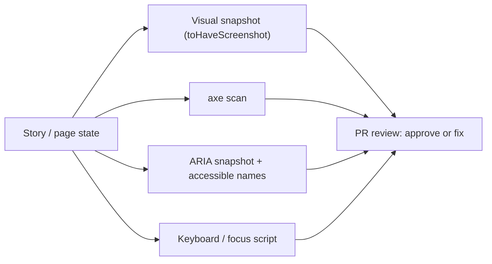
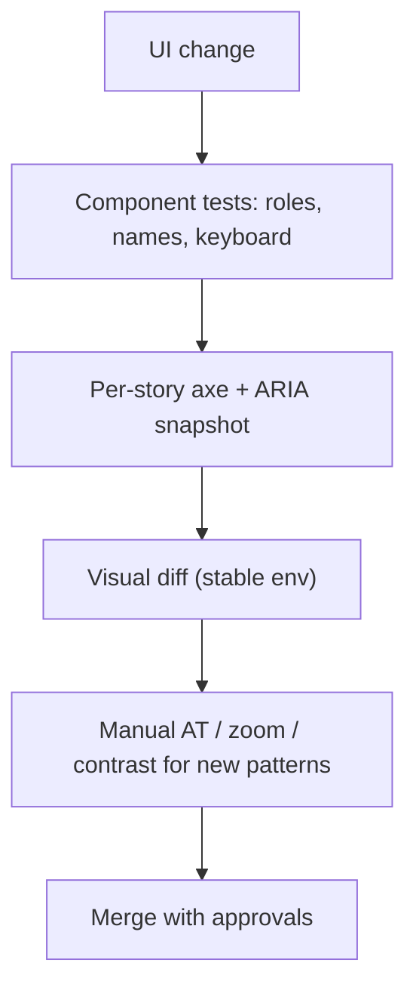

# Visual, Accessibility and Component-State Testing

> Verification note: Playwright capabilities were verified in the official **release notes (1.65, Nov 2026)**: `toHaveScreenshot` (stabilised screenshots; since 1.22), `animations: 'disabled'`, `mask`/`maskColor` (1.35), `style`/`stylePath` (1.41), WebP snapshots (1.62), `--update-snapshots` modes (`changed` 1.50; `missing` passes the run in 1.64), `updateSourceMethod`, `snapshotPathTemplate`, `toMatchAriaSnapshot` (1.49; `/children` and `/url` in 1.52; page-level in 1.60; `ariaSnapshotJSON` in 1.63), `toHaveAccessibleName/Description/ErrorMessage/Role` (1.44/1.50), standalone `reducedMotion`/`forcedColors`/`contrast` options (1.63), and the removal of `page.accessibility` in 1.57 in favour of axe. The Vitest docs (Oct 2026) list **visual regression testing** and **ARIA snapshots** for Browser Mode. **Everything else — axe-core coverage percentages, WCAG success criteria details, Storybook interaction/a11y addons, Chromatic/Percy behaviour, screen-reader practice, jest-axe/vitest-axe packages — is established practice not re-fetched in this session and marked *(hedged)*; automated tools find only a subset of accessibility issues and never replace manual and assistive-technology testing.** Component-level behavioural testing: [03](03-component-testing-react.md); E2E: [04](04-end-to-end-testing-with-playwright.md).

## Table of Contents

1. [Quick Summary (TL;DR)](#1-quick-summary-tldr)
2. [Visual Regression: What and Why](#2-visual-regression-what-and-why)
3. [Making Screenshots Deterministic](#3-making-screenshots-deterministic)
4. [Snapshot Workflow: Baselines, Updates and Review](#4-snapshot-workflow-baselines-updates-and-review)
5. [Storybook and Component State Matrices](#5-storybook-and-component-state-matrices)
6. [Automated Accessibility Testing with axe](#6-automated-accessibility-testing-with-axe)
7. [ARIA Snapshots and Accessible-Name Assertions](#7-aria-snapshots-and-accessible-name-assertions)
8. [Keyboard, Focus and Screen-Reader Testing](#8-keyboard-focus-and-screen-reader-testing)
9. [User Preferences: Reduced Motion, Contrast, Dark Mode, Zoom, Locale](#9-user-preferences-reduced-motion-contrast-dark-mode-zoom-locale)
10. [Design-System and Cross-Browser Testing](#10-design-system-and-cross-browser-testing)
11. [CI Integration and Governance](#11-ci-integration-and-governance)
12. [Pitfalls](#12-pitfalls)
13. [Interview Questions — Fundamentals](#13-interview-questions--fundamentals)
14. [Interview Questions — Senior Scenarios](#14-interview-questions--senior-scenarios)
15. [Cheat Sheet](#15-cheat-sheet)
16. [Key Terms Glossary](#16-key-terms-glossary)
17. [Further Reading](#17-further-reading)

---

## 1. Quick Summary (TL;DR)

- **Visual regression tests** catch what behavioural tests can't: layout shifts, broken CSS, overlapping elements, theming bugs. They're **high-signal for design systems** and critical pages, **high-noise** if screenshots aren't deterministic.
- **Determinism is the work:** fixed viewport, disabled animations, masked dynamic regions, loaded fonts/images, stable data, **same OS/browser build for baselines** (use the CI container to generate them), and tolerances (`maxDiffPixelRatio`).
- **Accessibility testing is layered:** (1) semantic queries in component tests (role/name), (2) **axe-core** automated checks per page/story, (3) **ARIA snapshots** for structure, (4) **keyboard and focus** tests, (5) **manual screen-reader and zoom/contrast testing**. Automation finds only a subset of issues *(hedged: commonly cited ~30–40%)*.
- **Component-state matrices** (default, hover, focus-visible, active, disabled, loading, error, empty, long text, RTL, dark/high-contrast) are best expressed as **stories** and verified via visual + a11y + interaction tests.
- **Playwright features that matter:** `toHaveScreenshot` with stabilisation, `mask`, `animations: 'disabled'`, `toMatchAriaSnapshot`, `toHaveAccessibleName/Description/ErrorMessage/Role`, emulation of `reducedMotion`/`forcedColors`/`contrast`/`colorScheme`.
- **Governance:** treat snapshot diffs as code review items; keep baselines per browser/project; limit visual tests to stable, valuable surfaces; fix flakiness quickly.



---

## 2. Visual Regression: What and Why

| Question | Answer |
|---|---|
| What does it catch? | Unintended visual changes: spacing, overflow, z-index/stacking, font/theming regressions, responsive breakpoints, RTL layout |
| What does it miss? | Behaviour, performance, semantics, subtle interaction states not captured, content correctness |
| Where is it worth it? | Design-system components, marketing/landing pages, checkout/critical UI, emails/PDF templates |
| Where is it not? | Highly dynamic dashboards, A/B content, pages dominated by third-party ads/maps |
| Granularity | **Component/story level** (stable, fast, precise) > page-level (flaky but integration realistic) |

**Approaches**
1. **Playwright `toHaveScreenshot`** — pixel comparison with built-in stabilisation (waits for consecutive identical screenshots), animation disabling, caret hiding, masks.
2. **SaaS visual platforms** (Chromatic, Percy, Applitools *(hedged)*) — cloud rendering across browsers, review UI, smart diffing, Storybook integration; cost and vendor trade-offs.
3. **Vitest Browser Mode** visual regression (documented in Vitest guide) — component-level screenshots in real browsers.
4. **DOM/structure snapshots** (ARIA/YAML, small HTML) — cheaper, less sensitive, complementary.

---

## 3. Making Screenshots Deterministic

```ts
import { test, expect } from '@playwright/test';

test('pricing card matches design', async ({ page }) => {
  await page.goto('/pricing');
  await page.evaluate(() => document.fonts.ready);                           // wait for web fonts
  await expect(page.getByTestId('pricing-card')).toHaveScreenshot('pricing-card.png', {
    animations: 'disabled',                                                   // default for toHaveScreenshot; stops CSS animations/transitions
    caret: 'hide',
    mask: [page.getByTestId('live-price-ticker')],                            // hide dynamic regions
    maskColor: '#FF00FF',                                                     // 1.35+: customise mask colour
    stylePath: './e2e/screenshot.css',                                        // inject CSS to hide cursors, carousels, etc. (1.41+)
    maxDiffPixelRatio: 0.01,
  });
});
```
| Source of nondeterminism | Mitigation |
|---|---|
| **Fonts / anti-aliasing / OS rendering** | Generate and compare baselines **in the same container/OS** (Docker image or CI runner); keep browser versions pinned; separate snapshots per project/OS (`snapshotPathTemplate`) |
| **Animations/transitions/carousels/video** | `animations: 'disabled'`, `reducedMotion: 'reduce'` (1.63 standalone option), freeze videos, hide via `stylePath` |
| **Dynamic content** (dates, counters, ads, avatars) | Mock data, fake clock (`page.clock`), `mask`, seed deterministic fixtures |
| **Lazy-loaded images/fonts** | Wait for `load`/network idle conditions, `await expect(img).toHaveJSProperty('complete', true)` *(hedged)*, preload assets in tests |
| **Scrollbars / hover states / focus rings** | Fixed viewport, hide scrollbars via CSS, move the mouse away, deterministic focus |
| **Viewport/device scale factor** | Explicit `viewport`, `deviceScaleFactor`; use `scale: 'css'` option *(hedged)* for consistent sizes |
| **Time/locale/timezone/random** | Pin `locale`, `timezoneId`, fake clock, seeded random |
| **Third-party widgets** | Mock or hide (`mask`/`stylePath`) |
| **GPU/hardware differences** | Headless Chromium in container; avoid canvas/WebGL snapshots unless necessary |
- **Format:** snapshots can be stored as **WebP** (`'x.webp'`, lossless by default; 1.62) to shrink repo size; or set `type: 'webp'` in `expect.toHaveScreenshot` config.
- **Thresholds:** prefer `maxDiffPixelRatio`/`threshold` small and explicit; large tolerances hide regressions.
- **Element vs full-page:** element-level screenshots are more stable; full-page for layout checks with masking.
- **Stability loop:** Playwright retries until two consecutive screenshots match (up to timeout), reducing animation flake.

---

## 4. Snapshot Workflow: Baselines, Updates and Review

- **Baseline creation:** first run writes missing snapshots; since **1.64** `--update-snapshots=missing` creates only missing snapshots **and the run passes** (useful on CI to generate then verify new snapshots in one run); the default mode writes missing snapshots but **fails** the test.
- **Updating:** `--update-snapshots` (all) vs `--update-snapshots=changed` (only those that differ; 1.50). Prefer `changed`; commit snapshot diffs as part of the PR.
- **Source updates:** `updateSourceMethod` (`patch` | `overwrite` | `3way`) controls how inline/aria snapshot source edits are written.
- **Paths & naming:** `snapshotPathTemplate` with tokens (`{testFilePath}`, `{arg}`, `{projectName}`, `{platform}`, `{testFileBaseName}` in 1.60) to separate by browser/OS.
- **Review discipline:** visual diffs in the HTML report (expected/actual/diff slider); reviewers must **look at the images** — require explicit approval for snapshot changes (CODEOWNERS for design/UX on `__screenshots__` *(hedged)*).
- **Storage:** commit small images to git (WebP/PNG), or use Git LFS/artifact storage for large suites; avoid bloating repos.
- **Flaky snapshots:** investigate root cause (fonts, animation, data) rather than raising thresholds; quarantine with an owner if unavoidable ([07](07-flakiness-ci-and-non-functional-testing.md)).
- **Skipping:** `--ignore-snapshots` / per-project `ignoreSnapshots` to skip visual assertions in environments where baselines don't apply (e.g., local macOS dev) *(hedged)*.
- **Cross-browser:** baselines per browser project; WebKit/Firefox rendering differences are expected — keep separate baselines or restrict visual tests to one browser.

---

## 5. Storybook and Component State Matrices

**Stories as the single source of truth for UI states** *(Storybook specifics hedged)*:
```tsx
// Button.stories.tsx
export default { component: Button } satisfies Meta<typeof Button>;
export const Default: Story = { args: { children: 'Save' } };
export const Disabled: Story = { args: { children: 'Save', disabled: true } };
export const Loading: Story = { args: { children: 'Saving…', loading: true } };
export const LongLabel: Story = { args: { children: 'A very long label that should wrap or truncate gracefully…' } };
export const RTL: Story = { parameters: { direction: 'rtl' }, args: { children: 'حفظ' } };
export const WithIcon: Story = { args: { children: 'Save', icon: <SaveIcon aria-hidden /> } };
```
**State matrix checklist (per component):**
| Dimension | Variants to cover |
|---|---|
| **Interaction** | default, hover, focus-visible, active/pressed, selected, disabled, read-only |
| **Async** | loading/skeleton, success, error, empty, partial/stale |
| **Content** | short, long/overflow, multiline, unicode/emoji, RTL, missing optional parts |
| **Layout** | breakpoints/containers, min/max widths, text zoom 200%/400% |
| **Theming** | light/dark, high contrast/forced colors, brand themes, density |
| **Accessibility** | with/without label, error message association, `aria-*` states |
| **Locale** | date/number formats, pluralisation, pseudo-localisation (expanded strings) |

- **Interaction tests in stories** (`play` functions with Testing Library queries) verify behaviour per story and can run in CI via the Storybook test runner or Vitest integration *(hedged)* — reuse the same states for visual and a11y checks.
- **Visual coverage per story** via Chromatic/Percy *(hedged)* or Playwright pointing at Storybook iframe URLs (`/iframe.html?id=button--default&viewMode=story`).
- **Storybook a11y addon** (axe in the UI) provides fast feedback during development *(hedged)*.
- **Mock data and providers** via decorators; keep stories deterministic (fixed dates, seeded data).
- **Docs as tests:** controls/args tables + stories ensure documented states exist.

---

## 6. Automated Accessibility Testing with axe

```ts
import { test, expect } from '@playwright/test';
import AxeBuilder from '@axe-core/playwright';

test('checkout page has no detectable a11y violations', async ({ page }) => {
  await page.goto('/checkout');
  await expect(page.getByRole('heading', { name: /checkout/i })).toBeVisible();   // wait for the UI to settle

  const results = await new AxeBuilder({ page })
    .withTags(['wcag2a', 'wcag2aa', 'wcag21a', 'wcag21aa'])       // target standards (WCAG 2.2 tags available in newer axe — hedged)
    .exclude('#third-party-chat')                                  // out of our control (document the exception)
    .analyze();

  expect(results.violations).toEqual([]);                          // or snapshot known issues with a ratchet
});
```
- **Playwright removed `page.accessibility` in 1.57**; use **axe-core** (`@axe-core/playwright`) as Playwright's docs recommend.
- **Component level:** jest-axe / vitest-axe *(hedged)* on rendered DOM in jsdom (note: color-contrast rules need real rendering → run in a browser).
- **Scope:** run axe on **each major page state** (empty, error, modal open, menu expanded) and on **each Storybook story**; scan after interactions (dialogs, validation errors).
- **Ratchet strategy for legacy apps:** record existing violations (allow-list with IDs and owners), fail on **new** violations, burn down over time.
- **What axe finds:** missing alt/labels, invalid ARIA, contrast (in browsers), landmark/heading issues, duplicate IDs, focusable-hidden elements. **What it can't:** meaningful alt text quality, logical reading/focus order, keyboard traps in complex widgets, cognitive load, screen-reader announcements, caption accuracy, motion/vestibular issues.
- **Lighthouse accessibility score** uses a subset of axe rules — useful as a smoke signal, not a conformance measure ([web-performance/07](../web-performance/07-performance-debugging-budgets-and-culture.md)).
- **Document exceptions** with rationale and expiry; treat `aria-hidden`/`role="presentation"` hacks to silence axe as defects.

---

## 7. ARIA Snapshots and Accessible-Name Assertions

**ARIA snapshots** (Playwright `toMatchAriaSnapshot`) assert the **accessibility-tree structure** as YAML — resilient to markup refactors, sensitive to semantics.
```ts
await expect(page.getByRole('navigation', { name: 'Main' })).toMatchAriaSnapshot(`
  - navigation "Main":
    - list:
      - listitem:
        - link "Home"
      - listitem:
        - link "Products"
`);

// Strict matching of children and link targets (1.52+)
await expect(page.getByRole('list', { name: 'Features' })).toMatchAriaSnapshot(`
  - list:
    - /children: equal
    - listitem: Feature A
    - listitem:
      - link "Feature B":
        - /url: "https://example.com/b"
`);

// Page-level (1.60) and JSON form for programmatic checks (1.63)
await expect(page).toMatchAriaSnapshot(`- main: - heading "Orders" [level=1]`);
const json = await page.ariaSnapshotJSON();
```
- Generate with Codegen's aria-snapshot picker or `--update-snapshots`; store in separate YAML files for larger trees (1.50).
- **1.65 behaviour change:** text that isn't rendered (e.g., unassigned slot text, text inside closed `<details>`) no longer contributes to accessible names/aria snapshots — expect snapshot updates when upgrading.
- **Targeted assertions** for critical widgets:
```ts
await expect(page.getByRole('button', { name: 'Close' })).toHaveAccessibleName('Close');
await expect(page.getByLabel('Password')).toHaveAccessibleDescription(/at least 12 characters/i);
await expect(page.getByLabel('Email')).toHaveAccessibleErrorMessage('Enter a valid email');
await expect(page.getByTestId('save')).toHaveRole('button');
```
- **Component tests (Testing Library + jest-dom)**: `toHaveAccessibleName`, `toHaveAccessibleDescription`, `toHaveAccessibleErrorMessage`, `toBeRequired`, `toBeInvalid`, `toHaveFocus`, `aria-*` state assertions ([03](03-component-testing-react.md)).
- **Vitest Browser Mode** documents ARIA snapshots for component tests as well.
- **Keep snapshots small** (landmarks, dialogs, forms) to avoid churn.

---

## 8. Keyboard, Focus and Screen-Reader Testing

**Automated keyboard tests (Playwright/Testing Library):**
```ts
test('dialog traps focus and restores it on close', async ({ page }) => {
  await page.goto('/settings');
  const trigger = page.getByRole('button', { name: 'Open preferences' });
  await trigger.focus();
  await page.keyboard.press('Enter');

  const dialog = page.getByRole('dialog', { name: 'Preferences' });
  await expect(dialog).toBeVisible();
  await expect(dialog.getByRole('button', { name: 'Close' })).toBeFocused();   // initial focus

  for (let i = 0; i < 10; i++) {                                               // focus never escapes the dialog
    await page.keyboard.press('Tab');
    await expect(dialog.locator(':focus')).toHaveCount(1);
  }
  await page.keyboard.press('Escape');
  await expect(dialog).toBeHidden();
  await expect(trigger).toBeFocused();                                         // focus restored
});
```
- **Cover:** logical tab order, visible focus indicators (`:focus-visible` styles — visual test), skip links, roving tabindex (tabs/menus/grids), arrow-key navigation, `Escape` closes overlays, `Enter/Space` activation, no keyboard traps, focus moves to headings/error summaries after route changes/form errors, **`inert`** background when modal (Playwright actions respect inert as of 1.65).
- **Live regions:** assert `role="status"`/`aria-live` content updates (via text assertions); screen-reader announcement timing needs manual checks.
- **Manual/AT testing (essential):** VoiceOver (macOS/iOS), NVDA/JAWS (Windows), TalkBack (Android); test critical flows with keyboard-only and screen readers at least per release for key journeys; include users with disabilities where possible *(hedged: organisational practice)*.
- **Zoom/reflow:** test at 200% text zoom and 400% browser zoom/320 CSS px width (WCAG reflow) *(hedged on criteria)*; emulate small viewports in Playwright.
- **Target size, motion and timing:** ensure interactive targets are adequately sized, no time limits without controls, respect `prefers-reduced-motion`.
- **Forms:** labels associated, errors programmatically linked (`aria-describedby`/`aria-errormessage`), required indicators, autocomplete attributes, no placeholder-only labels.
- **Content/structure:** one `h1`, heading hierarchy, landmarks, link purpose, image alt quality, language attributes (`lang`), page titles on route change.

---

## 9. User Preferences: Reduced Motion, Contrast, Dark Mode, Zoom, Locale

Playwright emulation options (context/test options):
```ts
test.use({
  colorScheme: 'dark',          // prefers-color-scheme
  reducedMotion: 'reduce',      // standalone option (1.63)
  forcedColors: 'active',       // Windows High Contrast emulation (1.63 standalone)
  contrast: 'more',             // prefers-contrast (1.51 / 1.63)
  locale: 'ar-EG',
  timezoneId: 'Africa/Cairo',
  viewport: { width: 375, height: 800 },
});
```
| Preference | What to verify |
|---|---|
| **Dark mode** | Contrast ratios, images/logos, borders, focus rings, shadows; no flash of wrong theme (SSR/theme script) |
| **Reduced motion** | Animations replaced/removed, no parallax/auto-play; essential motion still understandable |
| **Forced colors/high contrast** | Borders/focus visible (use system colors), SVG icons use `currentColor`, no information by colour alone |
| **Increased contrast** | Tokens respond to `prefers-contrast` |
| **Locale/RTL** | Layout mirroring, logical CSS properties, number/date formats, text expansion (pseudo-loc) |
| **Zoom/text-size** | No clipped content, no horizontal scrolling at reflow breakpoints |
| **Print** | Print stylesheet for receipts/invoices (emulate `media: 'print'`) |
| **Data saver/offline** | Degraded modes ([networking-and-apis/06](../networking-and-apis/06-resilience-retries-timeouts-and-offline.md)) |

Combine these emulations with **visual snapshots** and **axe** runs per theme/locale for design-system components.

---

## 10. Design-System and Cross-Browser Testing

- **Per-component contract:** props/variants → stories; keyboard/ARIA behaviour per WAI-ARIA Authoring Practices pattern; unit/component tests for logic; visual baselines per variant; axe per story; documentation of accessibility behaviour.
- **Tokens & theming:** unit-test token generation (Style Dictionary/DTCG pipelines *(hedged)*), contrast ratio checks in CI for token pairs, snapshot of compiled CSS variables for breaking changes.
- **Versioning safety:** visual diff + API/type diff (TypeScript `tsd`/`api-extractor` *(hedged)*) + changelog gating before releases; consumers' visual regression via Chromatic/own Playwright runs.
- **Cross-browser:** run behavioural tests on Chromium, Firefox, WebKit; visual baselines per browser or one reference browser; test known problem areas (flexbox gaps, `:has()`, container queries, `position: sticky`, date inputs, scrollbars, `popover`/`dialog` top layer, `content-visibility`) ([browser-internals/03](../browser-internals/03-parsing-dom-cssom-layout-and-paint.md)).
- **Real devices:** supplement emulation with real iOS Safari/Android Chrome for touch/IME/viewport quirks (cloud device farms *(hedged)*).
- **Contract with design:** Figma-to-code visual diffs are a *review aid*, not a pixel oracle; agree tolerances.
- **Performance of the design system:** bundle-size and rendering budgets per component ([web-performance/07](../web-performance/07-performance-debugging-budgets-and-culture.md)).
- **i18n pseudo-locale CI job:** render key screens in an expanded pseudo-locale to catch truncation.

---

## 11. CI Integration and Governance

- **Where to run:** component-level visual + a11y on every PR (fast, targeted via affected stories/`--only-changed` *(hedged)*); page-level visual on main/nightly or against preview deployments; full cross-browser matrix nightly.
- **Same environment for baselines:** generate/update snapshots inside the CI container (or the official Playwright Docker image pinned to the Playwright version) to avoid OS drift; document the update command (`npm run test:visual:update` running in Docker).
- **Artifacts:** upload diffs/traces; PR comments linking to report; block merge on new a11y violations (ratchet) and unapproved visual diffs.
- **Ownership:** designers/design-system maintainers approve visual changes; a11y champions review exceptions; failing visual tests assigned like other flaky tests.
- **Metrics:** number of visual flakes, snapshot churn per PR, a11y violation count trend, time to review diffs.
- **Cost control:** limit visual tests to stable, high-value surfaces; share baselines across PR runs via cache/artifacts; avoid snapshotting entire pages for every route.
- **Docs:** contributor guide on writing deterministic visual tests, masking rules, and updating snapshots.

---

## 12. Pitfalls

1. **Non-deterministic screenshots** (animations, fonts, dynamic data) → noisy diffs and ignored failures.
2. **Baselines generated on developer laptops** but compared in CI (OS/font mismatch).
3. **Blindly updating snapshots** (`-u`) without reviewing images.
4. **Page-level visual tests everywhere** (slow, brittle) instead of component-level.
5. **Treating a clean axe run as "accessible".**
6. **Silencing axe** with `aria-hidden`/`role=presentation` hacks or broad excludes.
7. **Colour-contrast checks in jsdom** (unreliable without rendering).
8. **Testing only mouse paths;** no keyboard/focus tests.
9. **Ignoring reduced-motion/forced-colors/RTL variants.**
10. **Huge ARIA snapshots** of whole pages → churn.
11. **Large diff tolerances** hiding real regressions.
12. **No manual screen-reader testing** of critical flows.

---

## 13. Interview Questions — Fundamentals

### Q1. How do you make visual tests stable?
Fix viewport/device scale, disable animations, wait for fonts/images, mock/mask dynamic content, pin locale/timezone/clock, and generate baselines in the same container as CI.

### Q2. What can automated accessibility tools detect?
A subset: missing labels/alt, invalid ARIA, contrast, landmark/heading and duplicate-ID problems; not reading order quality, keyboard traps in complex widgets, announcement behaviour or content quality — manual and AT testing remain necessary.

### Q3. What is an ARIA snapshot?
A YAML representation of the accessibility tree (roles, names, structure) compared in `toMatchAriaSnapshot`, resilient to markup changes but sensitive to semantic regressions.

### Q4. How do you test focus management in a modal?
Keyboard tests: initial focus inside, Tab cycles within, Escape closes, focus restored to the trigger, background inert/unreachable.

### Q5. How do you test dark mode/reduced motion?
Emulate via context options (`colorScheme`, `reducedMotion`, `forcedColors`, `contrast`) and assert styles/visuals/behaviour; run axe and snapshots in each mode.

### Q6. Why use stories for testing?
They enumerate component states once and feed visual, interaction and a11y checks consistently, doubling as documentation.

### Q7. How do you handle existing accessibility debt in CI?
Ratchet: baseline known violations (owned, tracked), fail on new ones, and burn down over time.

---

## 14. Interview Questions — Senior Scenarios

### S1. "Visual tests fail randomly in CI (font anti-aliasing and animations). What do you do?"
Make baselines in the CI Docker image (same OS/browser/fonts), pin versions, disable animations, wait for fonts, mask dynamic regions, use element-level screenshots, adopt small explicit tolerances, and add a stability check (re-run N times) before accepting new visual tests; track flake rate per test.

### S2. "Design the a11y testing strategy for a large design system and its consumers."
Layered: component tests (roles/names/keyboard), per-story axe checks and ARIA snapshots, visual states, manual AT audits per component pattern (documented), a ratchet in consuming apps (axe per page state), design tokens contrast tests, release gates, and an accessibility champion rotation; publish guidance and known limitations.

### S3. "A PR changes a shared button's padding. How do you evaluate the impact?"
Run visual regression across all stories and consuming apps (Chromatic/Playwright against Storybook), review diffs, check responsive/density variants, run component tests and axe, evaluate performance impact (none expected), and communicate via changelog/semver; add tests for the changed contract if it was implicit.

### S4. "Management wants 'WCAG compliance proof' from automated tests."
Explain limits: automation covers a portion of WCAG success criteria; compliance requires manual evaluation (keyboard, screen readers, zoom, content review), documented conformance reports (VPAT/ACR *(hedged)*), and ongoing monitoring; propose a program: automated gates + manual audits + user testing + remediation SLAs.

### S5. "Our Playwright ARIA snapshots churn after Playwright upgrades."
Expect changes from semantics updates (e.g., 1.65 excludes unrendered text from accessible names); pin Playwright versions, upgrade deliberately with `--update-snapshots=changed`, review diffs for real regressions, keep snapshots targeted to critical components, and read release notes' breaking-change sections.

---

## 15. Cheat Sheet

| Goal | Tool/Setting |
|---|---|
| Stable screenshot | `toHaveScreenshot` + `animations: 'disabled'` + mask + fonts ready + same container |
| New snapshots in CI | `--update-snapshots=missing` (passes in 1.64+) |
| Accessibility scan | `@axe-core/playwright` per page/story |
| Structure assertion | `toMatchAriaSnapshot` (element or page) |
| Accessible name/desc/error | `toHaveAccessibleName/Description/ErrorMessage` |
| Preferences | `colorScheme`, `reducedMotion`, `forcedColors`, `contrast`, `locale` |
| State matrix | Stories: default, hover, focus, disabled, loading, error, empty, long, RTL, dark |
| Manual | Keyboard-only + VoiceOver/NVDA + 200%/400% zoom |



---

## 16. Key Terms Glossary

| Term | Definition |
|---|---|
| **Visual regression** | Detecting unintended appearance changes via image comparison |
| **Baseline / golden** | Approved reference screenshot |
| **Mask** | Region excluded/covered during screenshot comparison |
| **axe-core** | Rule engine for automated accessibility checks |
| **ARIA snapshot** | YAML snapshot of the accessibility tree |
| **Accessible name** | Computed label exposed to assistive tech |
| **Forced colors** | OS high-contrast mode (`forced-colors` media feature) |
| **Ratchet** | Allow existing issues, fail on new ones |
| **Story** | A named component state in Storybook |
| **Pseudo-localisation** | Synthetic expanded/accented text to test layouts |

---

## 17. Further Reading

- [Playwright — Visual comparisons](https://playwright.dev/docs/test-snapshots) · [Aria snapshots](https://playwright.dev/docs/aria-snapshots) · [Accessibility testing](https://playwright.dev/docs/accessibility-testing) · [Emulation](https://playwright.dev/docs/emulation)
- [Vitest — Visual regression testing / ARIA snapshots (Browser Mode)](https://vitest.dev/guide/browser/visual-regression-testing) · [axe-core](https://github.com/dequelabs/axe-core) · [WAI-ARIA Authoring Practices](https://www.w3.org/WAI/ARIA/apg/) · [WCAG 2.2](https://www.w3.org/TR/WCAG22/) *(hedged: check current URLs)*
- This repo: [03 Component testing](03-component-testing-react.md) · [04 E2E with Playwright](04-end-to-end-testing-with-playwright.md) · [browser-internals/03](../browser-internals/03-parsing-dom-cssom-layout-and-paint.md) · [system-design/06 Design system](../system-design/06-design-system-and-component-library.md)
