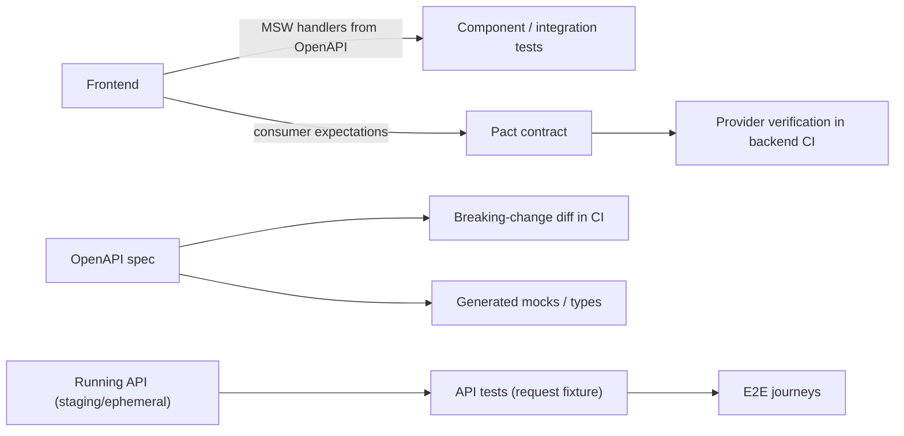
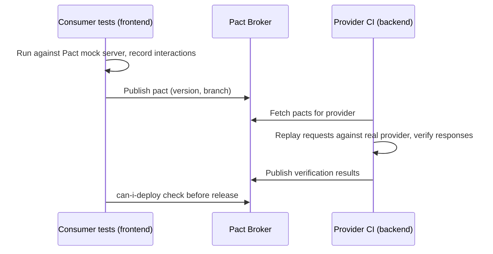
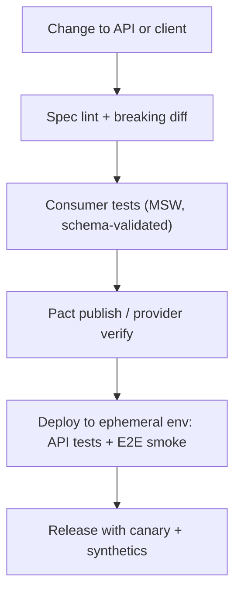

# API, Contract and Integration Testing

> Verification note: Playwright API-testing facts were verified in the official **release notes (1.65, Nov 2026)** — the `request` fixture (API testing since 1.16), typed responses `request.get<User>()` (1.63), `failOnStatusCode` (1.51), `maxRetries` on `fetch` (1.46), `apiRequestContext.addCookies/cookies/clearCookies` (1.64; cookie matching per RFC 6265 in 1.65), `apiResponse.timing()` (1.62), HAR routing and `routeWebSocket` (1.48). HTTP semantics used in assertions (idempotency, `412`/`409`/`422`/`429`, `Retry-After`, problem+json) were verified earlier in [networking-and-apis/01](../networking-and-apis/01-http-semantics-and-protocol-versions.md) and [03](../networking-and-apis/03-rest-api-design-and-consumption.md). **Pact workflow details (broker, `can-i-deploy`, bi-directional contracts), OpenAPI tooling (Prism, Schemathesis, Dredd, oasdiff, Spectral), Testcontainers, MSW 2 APIs, Toxiproxy and GraphQL schema-check tooling are established practice not re-fetched in this session — marked *(hedged)*; verify tool versions and options before adopting.** Related: [03 Component testing](03-component-testing-react.md) (MSW in UI tests), [networking-and-apis/07 §7, §10](../networking-and-apis/07-api-client-architecture-and-contracts.md#7-mocking-and-testing-the-network-layer) (mocks and contract testing from the client-architecture view).

## Table of Contents

1. [Quick Summary (TL;DR)](#1-quick-summary-tldr)
2. [Where API and Integration Tests Fit](#2-where-api-and-integration-tests-fit)
3. [Keeping Mocks Honest](#3-keeping-mocks-honest)
4. [Contract Testing: Consumer-Driven and Provider-Driven](#4-contract-testing-consumer-driven-and-provider-driven)
5. [OpenAPI-Based Testing and Breaking-Change Detection](#5-openapi-based-testing-and-breaking-change-detection)
6. [Playwright API Testing](#6-playwright-api-testing)
7. [Testing BFFs, Route Handlers and Server Actions](#7-testing-bffs-route-handlers-and-server-actions)
8. [Test Data and Environments](#8-test-data-and-environments)
9. [Testing Resilience: Retries, Timeouts, Rate Limits, Idempotency](#9-testing-resilience-retries-timeouts-rate-limits-idempotency)
10. [Real-Time, Webhooks and Event Contracts](#10-real-time-webhooks-and-event-contracts)
11. [Security-Relevant API Tests](#11-security-relevant-api-tests)
12. [Third-Party Integrations: Sandboxes and Record/Replay](#12-third-party-integrations-sandboxes-and-recordreplay)
13. [Pitfalls](#13-pitfalls)
14. [Interview Questions — Fundamentals](#14-interview-questions--fundamentals)
15. [Interview Questions — Senior Scenarios](#15-interview-questions--senior-scenarios)
16. [Cheat Sheet](#16-cheat-sheet)
17. [Key Terms Glossary](#17-key-terms-glossary)
18. [Further Reading](#18-further-reading)

---

## 1. Quick Summary (TL;DR)

- **The boundary between frontend and backend is where integration bugs live.** Cover it with (a) **component/integration tests using MSW**, (b) **contract tests** that prevent breaking changes between teams, (c) **API tests** against a running service, and (d) a few **E2E** journeys.
- **Mocks drift.** Keep them honest: **generate handlers/fixtures from OpenAPI**, **validate mock responses against schemas** in tests, and verify mocks against the real provider with **contract tests**.
- **Two contract styles:** **consumer-driven** (Pact: frontends publish expectations; provider verifies) and **provider-driven** (OpenAPI is the contract; consumers validate against it; CI detects breaking changes). Pick one primary approach and automate it in CI.
- **Playwright's `request` fixture** is a good API-testing tool and also the fastest way to **seed data** and **verify server-side effects** for E2E (cookie jar shared with the page when using `page.request`).
- **Test the unhappy paths of the contract:** `401/403/404/409/412/422/429/5xx`, problem+json shape, pagination edge cases, idempotency replays, `Retry-After`, unknown enum values, partial failures.
- **Environments:** hermetic (containers/ephemeral DB) beats shared staging; shared environments need namespaced data and cleanup.
- **Don't test the backend's business logic through the frontend** — own it at the backend layer; frontend tests assert the **integration** and **UI handling**.



---

## 2. Where API and Integration Tests Fit

| Layer | What it verifies | Speed | Runs |
|---|---|---|---|
| **Component + MSW** | UI handles responses/errors correctly | fast | Every PR |
| **API client unit/integration tests** | Auth refresh, retries, error normalisation, schema validation ([networking-and-apis/07](../networking-and-apis/07-api-client-architecture-and-contracts.md)) | fast | Every PR |
| **Contract tests** | Consumer/provider agree on shapes/behaviours | fast–medium | PR (consumer publishes; provider verifies) |
| **Backend integration tests** | Service + real DB/queue (containers) | medium | Backend CI |
| **API tests (black-box)** | Deployed/ephemeral service endpoints end to end | medium | Post-deploy/PR env |
| **E2E** | Browser + full stack journey | slow | Main/nightly/smoke on PR |
| **Synthetic monitoring** | Production availability/journeys | continuous | Production |

The frontend team typically owns the first three rows' *consumer* side; the backend owns provider-side verification; shared ownership of API tests and E2E smoke.

---

## 3. Keeping Mocks Honest

Risks: handlers written by hand diverge from the real API; fixtures go stale; tests pass while production breaks.

**Practices**
1. **Single source of truth = OpenAPI (or GraphQL SDL).** Generate **types** and **MSW handlers/examples** (e.g., `orval`/`openapi-msw`/`msw-auto-mock`-style tools *(hedged)*), or write handlers typed with `openapi-typescript` types so changes break compilation.
2. **Validate every mocked response against the schema** in a shared test helper:
```ts
// test/handlers.ts
import { http, HttpResponse } from 'msw';
import { OrderSchema } from '@/api/schemas';

export const handlers = [
  http.get('/api/orders/:id', ({ params }) => {
    const body = buildOrder({ id: String(params.id) });
    OrderSchema.parse(body);                               // throws in tests if the fixture drifts from the contract
    return HttpResponse.json(body);
  }),
];
```
3. **Record real samples** (sanitised) from staging into fixtures; version them; refresh on contract changes.
4. **Cover contract edge cases in fixtures:** nullable fields, unknown enum values, empty lists, pagination end, large text, problem+json errors.
5. **Fail on unhandled requests** (`onUnhandledRequest: 'error'`) so new calls require explicit handlers.
6. **Share handlers** across unit, Storybook and (optionally) E2E to reduce duplication *(hedged for E2E)*.
7. **Verify against the real provider periodically** (contract tests/nightly smoke) — mocks alone can't prove compatibility.
8. **Don't mock your API client** in component tests; mock HTTP so client logic (auth, retries, mapping) is exercised ([03 §8](03-component-testing-react.md#8-network-in-component-tests-msw-and-friends)).

---

## 4. Contract Testing: Consumer-Driven and Provider-Driven

### Consumer-driven contracts (Pact-style) *(workflow hedged)*

- **Consumer test** (frontend/BFF client) describes **only what it uses**: request (method, path, headers, body) and minimal expected response (types/matchers, not exact values) — **Postel's law in contracts**.
```ts
// consumer.pact.test.ts (shape illustrative; API names hedged)
await provider
  .given('order 42 exists')
  .uponReceiving('a request for order 42')
  .withRequest({ method: 'GET', path: '/orders/42', headers: { Accept: 'application/json' } })
  .willRespondWith({ status: 200, headers: { 'Content-Type': 'application/json' },
    body: { id: like('42'), status: regex(/pending|paid|shipped/, 'paid'), total: { amount: integer(4599), currency: like('USD') } } })
  .executeTest(async (mock) => { const order = await createClient({ baseUrl: mock.url }).getOrder('42'); expect(order.total.currency).toBe('USD'); });
```
- **Provider verification** replays pacts against the real service with **provider states** (setup hooks like "order 42 exists").
- **Benefits:** catches breaking changes before deploy; documents real usage; enables independent deployability (`can-i-deploy`). **Costs:** tooling/broker, provider state maintenance, requires backend buy-in.
- **Good fit:** many consumers/microservices; BFF ↔ services; mobile + web clients.
- **Bi-directional contract testing** *(hedged)*: consumers publish Pact; providers publish OpenAPI; the platform compares compatibility — lower provider effort.

### Provider-driven contracts (OpenAPI/GraphQL schema as contract)
- **Backend** publishes the spec; CI runs **breaking-change detection** (diff against main) and **response validation** against the spec ([§5](#5-openapi-based-testing-and-breaking-change-detection)).
- **Frontend** generates types/mocks and validates in tests; runtime validation catches drift in staging/production ([networking-and-apis/07 §3](../networking-and-apis/07-api-client-architecture-and-contracts.md#3-runtime-validation-at-the-boundary)).
- **GraphQL:** schema registry + **schema checks** (operation usage vs proposed schema changes) block breaking changes *(hedged: Apollo GraphOS/Hive-style tools)*; persisted operations list = consumer contract.
- **When to choose:** one API consumed by many unknown/external clients (public API) → provider-driven; few known internal consumers → consumer-driven adds precision.

### What a contract should cover
Shapes and types, required/optional fields, enums (tolerant), status codes and error format (problem+json), pagination behaviour, headers (auth, `ETag`, `Retry-After`, `Idempotency-Key`), content types — **not** exact data values or business logic.

---

## 5. OpenAPI-Based Testing and Breaking-Change Detection

| Task | Tools *(hedged)* | CI use |
|---|---|---|
| **Lint spec quality** (naming, errors, examples) | Spectral | Fail PRs on rule violations |
| **Diff for breaking changes** | oasdiff, openapi-diff | Compare PR spec vs main; block removals/type changes/new required params |
| **Mock server from spec** | Prism, MSW-from-OpenAPI | Local dev, frontend tests before backend ready |
| **Property/fuzz testing against the running API** | Schemathesis | Finds 5xx, schema violations, edge cases automatically |
| **Example-based API tests from spec** | Dredd | Verify documented examples |
| **Response validation in tests** | `ajv` + generated JSON Schema, zod schemas | Assert API tests' responses match spec |
| **Generate types/clients** | openapi-typescript, orval, hey-api | Compile-time guard + usage |

```yaml
# CI sketch (generic; action/tool names hedged) — runs on PRs that touch the spec
name: api-contract
on: { pull_request: { paths: ['openapi/**'] } }
permissions: { contents: read }
jobs:
  contract:
    runs-on: bby-ubuntu
    steps:
      - uses: actions/checkout@<full-commit-sha>
        with: { fetch-depth: 0 }
      - uses: actions/setup-node@<full-commit-sha>
        with: { node-version: 22, registry-url: 'https://artifactory.tools.bestbuy.com/artifactory/api/npm/npm-virtual' }
      - run: npm ci --ignore-scripts
      - run: npx @stoplight/spectral-cli lint openapi/api.yaml
      - run: npx openapi-typescript openapi/api.yaml -o src/api/generated.ts && git diff --exit-code src/api/generated.ts   # fail if generated types are stale
      # breaking-change diff vs base branch (tool installation/name hedged)
      - run: git show origin/main:openapi/api.yaml > /tmp/base.yaml && oasdiff breaking /tmp/base.yaml openapi/api.yaml --fail-on ERR
```
- **Spec accuracy matters:** nullability, enums, `oneOf` discriminators, error responses, pagination parameters; inaccurate specs produce misleading types and false confidence.
- **Version the spec** alongside code; publish as an artifact/package for consumers.

---

## 6. Playwright API Testing

```ts
import { test, expect } from '@playwright/test';

test.describe('orders API', () => {
  test('creates an order idempotently', async ({ request }) => {
    const key = crypto.randomUUID();
    const body = { items: [{ sku: 'SKU-1', quantity: 1 }] };
    const headers = { 'Idempotency-Key': key };

    const first = await request.post('/api/orders', { data: body, headers });
    expect(first.status()).toBe(201);
    const order = await first.json();

    const replay = await request.post('/api/orders', { data: body, headers });      // same key + payload
    expect(replay.status()).toBe(201);
    expect((await replay.json()).id).toBe(order.id);                                  // replayed, not duplicated

    const conflict = await request.post('/api/orders', { data: { items: [] }, headers });  // same key, different payload
    expect([409, 422]).toContain(conflict.status());
  });

  test('returns problem+json for validation errors', async ({ request }) => {
    const res = await request.post('/api/orders', { data: { items: [{ sku: 'SKU-1', quantity: -1 }] } });
    expect(res.status()).toBe(422);
    expect(res.headers()['content-type']).toContain('application/problem+json');
    expect(await res.json()).toMatchObject({ status: 422, errors: expect.arrayContaining([expect.objectContaining({ pointer: '/items/0/quantity' })]) });
  });

  test('respects optimistic concurrency', async ({ request }) => {
    const get = await request.get('/api/products/42');
    const etag = get.headers()['etag'];
    const stale = await request.put('/api/products/42', { data: { name: 'x' }, headers: { 'If-Match': '"stale"' } });
    expect(stale.status()).toBe(412);
    const ok = await request.put('/api/products/42', { data: { name: 'x' }, headers: { 'If-Match': etag } });
    expect(ok.ok()).toBeTruthy();
  });
});
```
- **Typed JSON** (1.63): `const res = await request.get<User>('/api/users/42'); const user = await res.json(); // typed`.
- **`page.request`** shares cookies/storage with the page — useful for authenticated setup and verifying server state during E2E; **`request` fixture** is standalone with its own cookie jar (manage via `addCookies/cookies/clearCookies` in 1.64).
- **`failOnStatusCode: true`** (context option, 1.51) makes any non-2xx/3xx throw — good for setup calls.
- **`maxRetries`** for `ECONNRESET` (1.46) and `maxRedirects` (1.52) options; **`apiResponse.timing()`** (1.62) for latency assertions; use sparingly (non-deterministic).
- **Use for setup/teardown:** create users/orders, toggle feature flags, expire sessions, assert emails queued — faster and more reliable than UI.
- **Assertions on headers/contracts:** `Cache-Control`, `ETag`, `Vary`, CORS headers, security headers (`Strict-Transport-Security`, CSP) — see [web-security/06 §12](../web-security/06-security-headers-cors-and-transport.md#12-testing-monitoring-and-rollout).
- **Pagination:** assert cursor traversal returns each item exactly once, `hasMore` ends, and stable ordering under inserts (seed + insert between pages).
- **Schema validation helper:** parse responses with the same zod/JSON Schema used by the client to ensure server and client agree.

---

## 7. Testing BFFs, Route Handlers and Server Actions

*(Architecture: [networking-and-apis/04 §10](../networking-and-apis/04-graphql-trpc-grpc-and-api-styles.md#10-gateways-bffs-and-federation), [web-security/05 §5](../web-security/05-authentication-and-authorization-in-the-frontend.md#5-backend-for-frontend-bff-in-detail).)*

- **Route handlers (Next.js):** import the exported `GET/POST` and call with a `Request`; assert `Response` status/headers/body; mock auth session, DB/DAL and upstream HTTP via MSW *(hedged)*.
```ts
import { POST } from '@/app/api/orders/route';
it('rejects cross-site requests without the CSRF header', async () => {
  const res = await POST(new Request('http://localhost/api/orders', { method: 'POST', headers: { cookie: 'session=abc', origin: 'https://evil.example' }, body: '{}' }));
  expect(res.status).toBe(403);
});
```
- **BFF proxy tests:** upstream **allow-list** (cannot be pointed at arbitrary hosts), method/path restrictions, **token attachment** (access token never exposed to the browser), refresh-on-401 flow, header stripping (hop-by-hop, cookies), size/time limits, error mapping to problem+json, trace-ID propagation ([web-security/08 §8](../web-security/08-secure-frontend-patterns-and-vulnerability-catalogue.md#8-ssrf-and-open-proxies-bff-route-handlers-image-optimizers)).
- **Auth/authz matrix tests:** table-driven tests across roles × endpoints × expected status (`401/403/200`), including **IDOR** attempts (user A requests user B's resource) — essential for Server Actions as public endpoints ([web-security/05 §10](../web-security/05-authentication-and-authorization-in-the-frontend.md#10-authorization-in-react-nextjs-and-apis)).
```ts
it.each([
  ['anonymous', null, 401], ['member', member, 403], ['admin', admin, 200],
])('DELETE /api/users/:id as %s → %i', async (_n, session, status) => { /* call handler with session; assert status */ });
```
- **Validation:** boundary inputs, mass-assignment attempts (extra fields ignored), oversized payloads, wrong content-types (should be rejected for JSON endpoints).
- **Caching headers & revalidation:** assert `Cache-Control` for personalised vs public routes; for Next.js tags/paths, verify revalidation effects via E2E/integration against a running server ([nextjs-and-rendering/03](../nextjs-and-rendering/03-caching-and-revalidation.md)).
- **Streaming/long-running:** assert chunked responses arrive incrementally (use `fetch` with a reader in tests) and abort handling.
- **Rate limiting & abuse controls:** integration tests with a fake clock/store; assert `429` + `Retry-After`.

---

## 8. Test Data and Environments

| Strategy | Pros | Cons |
|---|---|---|
| **Hermetic containers** (Testcontainers/Docker Compose for DB, queue, mocks) *(hedged)* | Isolated, reproducible, fast resets | Setup effort; image pull times |
| **Ephemeral environments per PR** (preview deploy + isolated DB/schema) | Closest to prod; supports E2E | Cost/complexity; data seeding needed |
| **Shared staging** | Simple | Flaky data, collisions, deploy interference — namespace data, use locks |
| **Contract/mocks only** | Fast | No real integration confidence |
| **Production-safe synthetic tests** | Real signal | Must avoid side effects; use test tenants/flags |

Data patterns:
- **Seed via API/migrations/factories**, one tenant/namespace per worker or per test; unique IDs (UUID/test-run prefix).
- **Transactional rollback** per test for DB-level integration tests (backend) *(hedged)*; or truncate/reset between suites.
- **Golden data sets** for read-heavy scenarios (search, reports); keep versioned and small.
- **Time control:** server-side fake clocks or injectable time for expiry/billing tests; Playwright `page.clock` for browser time.
- **Feature flags:** deterministic overrides per test environment.
- **Secrets & PII:** synthetic data only; mask any production-derived data; manage test credentials in secret stores (short-lived; GIAM where applicable — [web-security/07 §7](../web-security/07-supply-chain-and-third-party-script-security.md#7-cicd-and-github-actions-hardening)).
- **Cleanup guarantees:** teardown in fixtures; TTL-based reaper for leaked data; monitor environment health to avoid blaming tests for infra.
- **Parallel safety:** avoid global singletons (e.g., single admin user) mutated by tests; use **test locks** in Playwright (1.63/1.65) only when isolation isn't feasible ([04 §8](04-end-to-end-testing-with-playwright.md#8-test-data-and-isolation)).

---

## 9. Testing Resilience: Retries, Timeouts, Rate Limits, Idempotency

Use MSW (component/integration) and API/chaos tools (staging) to verify client behaviours designed in [networking-and-apis/06](../networking-and-apis/06-resilience-retries-timeouts-and-offline.md):

| Behaviour | Test approach |
|---|---|
| **Retry only idempotent + transient** | MSW returns `503` once then `200`; assert one retry for `GET`, **no** retry for `POST` without key, retry with key reusing the same `Idempotency-Key` header |
| **`Retry-After` honoured** | Respond `429` + `Retry-After: 2`; with fake timers assert next call time ≥ 2 s; UI shows countdown |
| **Backoff + jitter bounds** | Inject seeded RNG; assert delay within `[0, cap]`; assert max attempts/deadline |
| **Timeouts/abort** | Delayed handler (`delay('infinite')`); assert `TimeoutError` mapping and UI message; assert no state update after unmount |
| **Circuit breaker** | N failures → open → no calls until cooldown → half-open probe |
| **Token refresh single-flight** | Concurrent requests with expired token → exactly one refresh call; originals retried once |
| **Offline/outbox** | `context.setOffline(true)` (Playwright) or fake connectivity; enqueue mutations; reconnect; assert replay order and idempotency keys |
| **Stale-while-revalidate** | Serve stale then fresh; assert UI shows stale immediately and updates |
| **Partial failures** | Bulk endpoint returns mixed results; assert per-item UI states |
| **Version skew** | Old client vs new API fixture (extra fields/unknown enums) → no crash |
| **Chaos in staging** | Toxiproxy/latency injection *(hedged)*, fault flags returning 5xx, to validate fallbacks and alerts |

---

## 10. Real-Time, Webhooks and Event Contracts

- **WebSocket/SSE tests:** unit-test message handlers with fake sockets (`mock-socket` *(hedged)*); in Playwright use `page.routeWebSocket` (1.48) to script server messages (ordering, duplicates, gaps, reconnect) and assert resync behaviour ([networking-and-apis/05 §8](../networking-and-apis/05-real-time-communication-websockets-sse-webtransport.md#8-connection-lifecycle-heartbeats-reconnection-resync)); traces/HAR include WebSocket requests since 1.61.
- **Protocol contracts:** define message schemas (JSON Schema/zod/protobuf) and test both producer and consumer against them; version messages; test unknown message types are ignored safely.
- **Webhooks:** verify signature validation (HMAC), replay protection/timestamps, idempotent processing, retry behaviour, and ordering assumptions; test with signed fixtures; expose test hooks to trigger events.
- **Async messaging contracts (Kafka/SNS/etc.)** *(hedged)*: Pact supports message contracts; schema registries with compatibility checks (Avro/Protobuf) prevent breaking events.
- **Long-running operations:** poll endpoints with fake timers; assert `202` + status URL flows, cancellation, expiry ([networking-and-apis/03 §9](../networking-and-apis/03-rest-api-design-and-consumption.md#9-large-payloads-uploads-and-long-running-operations)).

---

## 11. Security-Relevant API Tests

*(Complements [web-security/](../web-security/README.md); automated tests are guardrails, not a pen test.)*
- **AuthN/AuthZ matrix** (roles × endpoints × object ownership) with negative tests (IDOR/BOLA).
- **CSRF protections:** cookie-authenticated mutation without token/custom header → rejected; wrong `Origin`/`Sec-Fetch-Site` → rejected ([web-security/04 §6](../web-security/04-cookies-sessions-and-csrf.md#6-csrf-defences)).
- **CORS:** allowed vs disallowed origins, credentials rules, `Vary: Origin`, preflight responses ([web-security/06 §4](../web-security/06-security-headers-cors-and-transport.md#4-cors-correct-configuration-and-common-mistakes)).
- **Security headers regression test** against preview URL (HSTS, CSP, `nosniff`, `frame-ancestors`, Referrer-Policy) in CI.
- **Input handling:** injection payload corpus for server-rendered/stored content (XSS vectors, oversized, unicode), file-upload type/size limits, SSRF guards in link preview features.
- **Session/cookies:** flags (`HttpOnly`, `Secure`, `SameSite`, `__Host-`), rotation on login, logout invalidation (old session rejected), idle/absolute timeout with fake clock.
- **Rate limiting/enumeration:** login/reset endpoints return uniform responses; limits enforced.
- **Error handling:** no stack traces; consistent problem+json; no secrets in responses.
- **Dependency/DAST:** schedule ZAP/Schemathesis scans in a safe environment *(hedged)*.

---

## 12. Third-Party Integrations: Sandboxes and Record/Replay

- **Prefer vendor sandboxes** (payment test cards, test tenants) for E2E; never hit production vendors.
- **Contract against vendor docs/OpenAPI:** wrap the vendor in an adapter, test the adapter against recorded fixtures validated by schema; run a small **live sandbox contract suite nightly** to detect vendor drift.
- **Record/replay:** Playwright HAR (`routeFromHAR`, `recordHar`, `tracing.startHar`) or MSW recorded handlers; **scrub secrets/PII**; refresh periodically; mark as characterisation of third-party behaviour.
- **Failure injection:** simulate vendor `429/5xx/timeouts/slow responses` with MSW/Playwright routes; verify fallbacks and user messaging.
- **Webhook/callback flows:** use tunnels or test endpoints; assert signature verification and idempotency.
- **Feature isolation:** feature-flag vendor integrations to disable quickly if they degrade.
- **Governance:** document vendor rate limits and test accounts; rotate credentials; alert on vendor API deprecations (`Sunset` headers — [networking-and-apis/03 §6](../networking-and-apis/03-rest-api-design-and-consumption.md#6-versioning-and-evolution)).

---

## 13. Pitfalls

1. **Hand-written mocks that drift** from the real API (no schema validation or contract tests).
2. **Only happy-path API tests;** no `4xx/5xx`, pagination edges, concurrency, idempotency.
3. **Using E2E for API-level assertions** (slow) instead of API tests.
4. **Shared staging data collisions** and cross-test coupling.
5. **Mocking the API client** instead of HTTP, hiding client bugs.
6. **Overly strict contracts** (exact values/order) causing churn; or too loose (any JSON) giving no protection.
7. **Consumer-driven contracts without provider ownership** (broker unmaintained, `can-i-deploy` ignored).
8. **Specs not kept in sync** with implementation; generated types lull teams.
9. **No negative authorization tests** (IDOR) for new endpoints/Server Actions.
10. **Test-only endpoints exposed in production** or unauthenticated.
11. **Chaos/failure paths untested** (retries, timeouts, offline) until incidents.
12. **Leaking secrets/PII in HAR fixtures** or test logs.

---

## 14. Interview Questions — Fundamentals

### Q1. What is contract testing and why use it?
It verifies that consumers and providers agree on API interactions without running full end-to-end environments, catching breaking changes early and enabling independent deployments.

### Q2. Consumer-driven vs provider-driven contracts?
Consumer-driven (Pact): consumers define expectations the provider must satisfy; provider-driven: the provider's OpenAPI/GraphQL schema is the contract with diff/validation in CI. Choose by number/knownness of consumers.

### Q3. How do you stop MSW mocks from drifting?
Generate or type handlers from OpenAPI, validate mock payloads against schemas in tests, use real sanitised samples, and run contract/smoke tests against the real provider.

### Q4. How do you test idempotency?
Send the same request with the same `Idempotency-Key` twice and assert one side effect and identical response; same key with different payload returns conflict/validation error.

### Q5. Why use Playwright's `request` fixture for setup?
It's faster and more reliable than UI flows, shares Node-based control, and can seed/verify server-side state; `page.request` shares the browser's cookies.

### Q6. What belongs in an authorization test matrix?
Roles × endpoints × object ownership with expected `401/403/404/200`, including IDOR attempts and cross-tenant access.

### Q7. How do you test retry logic?
Simulate transient failures with MSW, assert retried idempotent calls, no retries for unsafe calls without keys, `Retry-After` handling and bounded attempts using fake timers/seeded jitter.

### Q8. How do you handle third-party APIs in tests?
Sandboxes for E2E, recorded/validated fixtures for CI, failure injection for resilience, and a small live nightly contract suite.

---

## 15. Interview Questions — Senior Scenarios

### S1. "A backend deploy removed a field and broke the web app in production; tests were green. Prevent recurrence."
Add provider-side breaking-change detection (OpenAPI diff) and/or consumer-driven Pact verification gating deploys (`can-i-deploy`); make frontend mocks schema-validated; add tolerant parsing and runtime validation with `contract` error telemetry; add a post-deploy smoke test; run expand/contract migrations for API changes ([networking-and-apis/03 §6](../networking-and-apis/03-rest-api-design-and-consumption.md#6-versioning-and-evolution)).

### S2. "Design the integration testing approach for a BFF aggregating five services."
Unit/integration tests for the BFF with MSW for upstreams (schema-validated), Pact consumer tests for each upstream, authz/IDOR matrix tests, resilience tests (timeouts/partial failures/circuit breaker), contract tests from the web app to the BFF, ephemeral environment smoke E2E, trace propagation checks, and load tests on aggregation endpoints.

### S3. "Our staging environment is flaky; E2E fails due to data. What do you do?"
Move to ephemeral per-PR environments or hermetic containers, isolate data per worker with API seeding and cleanup, mock unstable third parties, lock truly shared resources, add environment health checks before running tests, and reduce reliance on shared accounts.

### S4. "How would you validate that the frontend tolerates API evolution?"
Fixtures including unknown enum values/extra fields/missing optional fields; tolerant schema parsing tests; consumer contract checks using minimal expectations; run the previous frontend build against the new API (compat matrix) in CI; monitor contract errors in production.

### S5. "Pact vs OpenAPI diff — which do you choose for a public API with thousands of clients?"
OpenAPI-driven (provider-driven): you can't collect consumer pacts from unknown clients; enforce backward-compatibility rules with automated diffing, maintain versioning/deprecation policy, provide sandbox/mocks and SDKs, telemetry per version, and compatibility test suites against representative client libraries.

---

## 16. Cheat Sheet

| Goal | Approach |
|---|---|
| Honest mocks | Generate from OpenAPI + validate payloads + `onUnhandledRequest: 'error'` |
| Prevent breaking changes | Pact (`can-i-deploy`) or OpenAPI diff in CI |
| API checks | Playwright `request` (typed `get<T>`), problem+json assertions |
| Idempotency | Same key twice → same result; different payload → conflict |
| Concurrency | `ETag` + `If-Match` → `412` |
| AuthZ | Roles × endpoints × ownership matrix |
| Resilience | MSW 503/429/slow + fake timers + seeded jitter |
| Env | Hermetic containers / ephemeral envs, per-worker data |



---

## 17. Key Terms Glossary

| Term | Definition |
|---|---|
| **Consumer-driven contract** | Contract derived from consumer expectations (Pact) |
| **Provider state** | Setup condition used during provider verification |
| **`can-i-deploy`** | Pact check ensuring compatibility before release |
| **Breaking-change detection** | Automated diff of API specs for incompatible changes |
| **Schemathesis** | Property-based API tester driven by OpenAPI *(hedged)* |
| **Hermetic test** | Self-contained, isolated test environment |
| **Ephemeral environment** | Short-lived per-PR deployment |
| **Record/replay** | Capture real traffic (HAR) and replay in tests |
| **IDOR/BOLA** | Object-level authorization flaw |

---

## 18. Further Reading

- [Playwright — API testing](https://playwright.dev/docs/api-testing) · [Network / mocking](https://playwright.dev/docs/mock) · [MSW](https://mswjs.io/docs/) · [Pact docs](https://docs.pact.io/) · [OpenAPI Specification](https://spec.openapis.org/oas/latest.html) *(hedged: check URLs)*
- [Schemathesis](https://schemathesis.readthedocs.io/) · [Spectral](https://stoplight.io/open-source/spectral) · [oasdiff](https://www.oasdiff.com/) · [Testcontainers](https://testcontainers.com/)
- This repo: [03 Component testing](03-component-testing-react.md) · [networking-and-apis/07](../networking-and-apis/07-api-client-architecture-and-contracts.md) · [networking-and-apis/03](../networking-and-apis/03-rest-api-design-and-consumption.md) · [web-security/05](../web-security/05-authentication-and-authorization-in-the-frontend.md)
