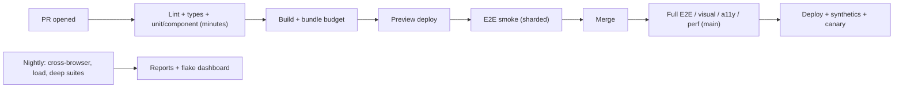
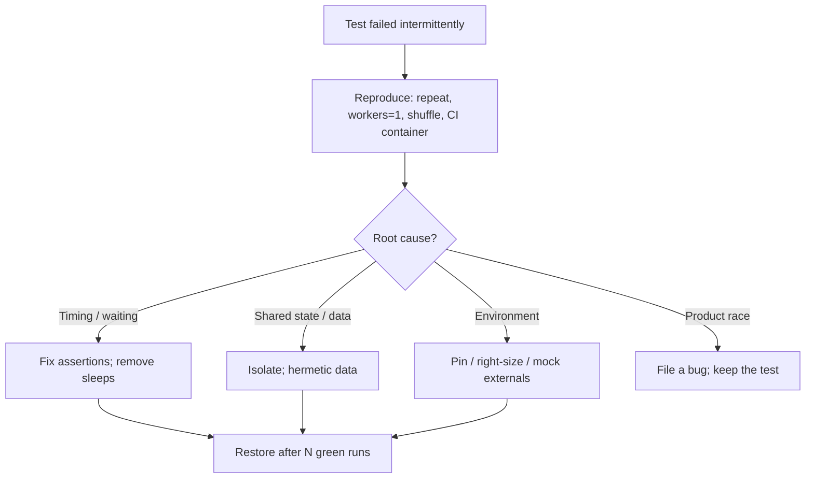

# Flakiness, CI and Non-Functional Testing

> Verification note: Playwright CI/flake features were verified in the official **release notes (1.65, Nov 2026)**: `retries` and `failOnFlakyTests` (1.45/1.52), `retryStrategy: 'isolated'` (1.62), `--last-failed` (1.44), `--only-changed` (1.46), `--shard` + blob reporter + `merge-reports` (1.37), `--shuffle` (1.64), `failures` reporter and `onlyFailures` option (1.65), trace modes `retain-on-first-failure` (1.43) and `retain-on-failure-and-retries` (1.59), test locks (1.63/1.65), project dependencies/teardown (1.31/1.34), Node 20 no longer tested and Docker images on Node 26 (1.65), and the 1.65 breaking change that a **sharded run with no tests in a shard fails with "No tests found"** (use `--pass-with-no-tests`). Vitest sharding/`--changed` and Vitest Browser Mode in CI follow the Vitest guide (Oct 2026). **GitHub Actions specifics follow organisation defaults (`bby-ubuntu` runners, Artifactory registries, GIAM action `bby-corp/tplat-gha-configure-github-credentials`); action input names and the pinned SHAs are placeholders to confirm. Lighthouse CI, k6, Artillery, Toxiproxy, Sentry/Datadog-style RUM, quarantine tooling and flake-rate SLO numbers are established practice not re-fetched in this session — marked *(hedged)*.** Strategy: [01](01-testing-strategy-and-test-design.md); E2E mechanics: [04](04-end-to-end-testing-with-playwright.md).

## Table of Contents

1. [Quick Summary (TL;DR)](#1-quick-summary-tldr)
2. [Flakiness: Taxonomy and Root Causes](#2-flakiness-taxonomy-and-root-causes)
3. [Triage, Quarantine and Flake SLOs](#3-triage-quarantine-and-flake-slos)
4. [Retry Policy: What Retries Do and Don't Fix](#4-retry-policy-what-retries-do-and-dont-fix)
5. [CI Pipeline Design for Frontend Tests](#5-ci-pipeline-design-for-frontend-tests)
6. [Sharding, Parallelism, Caching and Selective Runs](#6-sharding-parallelism-caching-and-selective-runs)
7. [GitHub Actions Reference Workflow](#7-github-actions-reference-workflow)
8. [Performance Testing: Lighthouse CI and Budgets](#8-performance-testing-lighthouse-ci-and-budgets)
9. [Load and Stress Testing](#9-load-and-stress-testing)
10. [Security and Dependency Guardrails in CI](#10-security-and-dependency-guardrails-in-ci)
11. [Test Reporting, Metrics and Cost](#11-test-reporting-metrics-and-cost)
12. [Production Verification: Synthetics, Canaries, Flags](#12-production-verification-synthetics-canaries-flags)
13. [Pitfalls](#13-pitfalls)
14. [Interview Questions — Fundamentals](#14-interview-questions--fundamentals)
15. [Interview Questions — Senior Scenarios](#15-interview-questions--senior-scenarios)
16. [Cheat Sheet](#16-cheat-sheet)
17. [Key Terms Glossary](#17-key-terms-glossary)
18. [Further Reading](#18-further-reading)

---

## 1. Quick Summary (TL;DR)

- **A flaky test is a bug** — in the test, the product, or the environment. Fix root causes (waiting, isolation, data, time, network, resources); do not normalise "just rerun".
- **Retries are a mitigation, not a fix.** Use few (CI only, 1–2), **surface flaky passes** (`failOnFlakyTests` or reporting), capture traces on first retry/failure, and track flake rate per test.
- **Triage loop:** detect → label → **quarantine with owner and expiry** → fix → restore. A quarantined test must not silently rot.
- **Pipeline shape:** fast checks first (lint/types/unit/component) → build → preview deploy → E2E smoke → broader suites (nightly) → post-deploy synthetics. Fail fast, parallelise, cache, shard.
- **Non-functional gates:** performance budgets (Lighthouse CI/bundle size), a11y checks, security scanning and dependency audits; load tests for critical APIs/BFFs.
- **Measure the test system:** pass rate on main, flake rate, p50/p95 duration, time to first signal, queue time, cost, and "escaped defects".



---

## 2. Flakiness: Taxonomy and Root Causes

| Category | Symptoms | Typical causes | Fix |
|---|---|---|---|
| **Async/timing** | Passes locally, fails in CI; intermittent "element not found" | Fixed sleeps, asserting before UI settles, race between request and render | Web-first assertions/auto-wait, wait on user-visible condition, avoid `waitForTimeout` |
| **Test isolation** | Order-dependent; passes alone fails in suite | Shared state (storage, DB rows, module singletons, cache), leaked timers/listeners | Fresh context per test, unique data, reset mocks/stores, `--shuffle` (1.64) to expose order dependence |
| **Data/environment** | Fails in shared staging | Collisions, stale seeds, deploys during run, third-party outages | Hermetic/ephemeral env, namespacing, mocks for third parties ([06](06-api-contract-and-integration-testing.md)) |
| **Time/locale/random** | Fails near midnight/DST/month-end | Real clock, timezone, `Math.random`, `Date.now` | Fake clock (`page.clock`, fake timers), pinned timezone/locale, seeded RNG |
| **Resources** | Timeouts under load | Underpowered runners, too many workers, memory pressure, slow cold starts | Right-size workers, reduce parallelism, warm builds, bigger runner only where needed |
| **Rendering/visual** | Pixel diffs | Fonts, animations, anti-aliasing | Same container, disable animations, masks ([05](05-visual-accessibility-and-component-states-testing.md)) |
| **Network** | Random failures calling external hosts | Real internet dependencies, rate limits | Mock/record, block external hosts in tests, retry-free hermetic setups |
| **Product bugs** | Rare real failures (race conditions) | Genuine concurrency issues, hydration mismatches | Treat as defects; reproduce with trace/stress runs |
| **Tooling** | Browser crash, version drift | Unpinned browsers, mismatched Playwright/browsers | Pin versions, use official containers, `npx playwright install --with-deps` in CI |
| **Test design** | Giant tests with many failure points | Implementation-coupled selectors, shared logins | Smaller tests, role/label locators, auth reuse via `storageState` |

**Repro techniques:** `--repeat-each=50` on the suspect test, `--workers=1` vs many, `--shuffle`, CPU throttling/slow network emulation, trace viewer diff of pass vs fail, run in the CI container locally, `retain-on-failure-and-retries` traces to compare attempts (1.59).

---

## 3. Triage, Quarantine and Flake SLOs

**Process**
1. **Detect:** CI reports flaky passes (Playwright flaky status in reports, `failOnFlakyTests` as a gate), plus a historical dashboard (failure rate per test over N runs).
2. **Classify:** infra vs test vs product (use trace/log evidence).
3. **Quarantine:** mark with `test.fixme('JIRA-123 flaky: ...')` or a quarantine tag (`@quarantine`) executed in a **non-blocking job**; Playwright 1.65 `test.skip/fixme` accept a description argument *(single description string)*. Always include **owner + ticket + expiry date**; auto-fail the quarantine job if a test sits beyond expiry *(custom script, hedged)*.
4. **Fix and restore:** require N consecutive green runs (`--repeat-each`) before un-quarantining.
5. **Review weekly:** top flaky tests, slowest tests, ownership.

**SLO examples *(illustrative targets, hedged)*:** main-branch pass rate ≥ 98% excluding true failures; flaky-test rate < 1% of runs; PR time-to-signal p95 < 15 min; quarantine age < 14 days; zero tests quarantined without an owner.

**Culture:** "stop the line" for main failures; rotate a **test-health owner** (like on-call); don't let red builds become normal; celebrate deleting low-value tests.

---

## 4. Retry Policy: What Retries Do and Don't Fix

```ts
// playwright.config.ts (excerpt)
export default defineConfig({
  retries: process.env.CI ? 1 : 0,           // keep small; local runs should fail fast
  failOnFlakyTests: !!process.env.CI,         // flaky pass = failure signal (or run as warning job first)
  use: { trace: 'retain-on-failure-and-retries' }, // compare first failure with retry attempts (1.59)
  reporter: process.env.CI ? [['blob'], ['github']] : [['list']],
});
```
- **Playwright semantics:** a test that fails then passes on retry is **"flaky"** in the report; the retry runs in a **fresh worker/context**; `retryStrategy: 'isolated'` (1.62) controls retry isolation *(see release notes for exact behaviour)*.
- **Retries hide** race conditions in the product and make suites slower; they are justified for **inherently non-deterministic infrastructure** (browser/container startup), not for logic bugs.
- **Never retry** at assertion level to mask problems (`expect.poll`/`toPass` are for legitimately eventual conditions, not general flake absorption).
- **Per-test overrides:** `test.describe.configure({ retries: 2 })` rarely; prefer fixing.
- **Retries multiply cost:** account in CI minutes; alert when retry rate rises.
- **Unit tests:** do not retry; flakiness there signals shared state or time dependence.
- **Rerun failed only:** `--last-failed` locally (1.44); in CI use the `failures` reporter/`onlyFailures` (1.65) to focus triage output *(check exact usage in release notes)*.

---

## 5. CI Pipeline Design for Frontend Tests

**Principles:** fast feedback first; parallel jobs; deterministic environments (pinned Node, lockfile, containers); least-privilege tokens; cache dependencies and build outputs; publish artifacts (reports, traces, screenshots); required checks map to merge policy.

| Stage | Contents | Typical budget | Blocking |
|---|---|---|---|
| **Static** | Lint, typecheck, format, dependency audit | 1–3 min | Yes |
| **Unit/component** | Vitest/Jest (sharded), coverage on changed code | 3–8 min | Yes |
| **Build** | App build, bundle-size budget, source maps | 3–8 min | Yes |
| **Integration/contract** | MSW integration, Pact publish/verify, OpenAPI diff | 3–8 min | Yes |
| **Preview E2E smoke** | 5–20 critical journeys, 1 browser, sharded | ≤10 min | Yes |
| **Visual/a11y** (component) | Story-level snapshots + axe | 5–10 min | Yes (with approvals) |
| **Post-merge full** | Full E2E on Chromium (+ WebKit/Firefox subsets), visual pages | 15–40 min | Alert/rollback |
| **Nightly** | Cross-browser/device, load, long-running, security scans | hours | Alert |
| **Post-deploy** | Synthetic journeys, canary metrics | continuous | Rollback trigger |

**Design choices**
- **Selective execution:** run tests affected by changes (`vitest --changed`, Nx/Turborepo affected graph, Playwright `--only-changed` (1.46)); but keep a full run on main to catch missed dependencies.
- **Test impact + monorepo:** compute affected projects; cache test results by input hash *(Nx/Turbo, hedged)*.
- **Preview environments:** deploy per PR with isolated backend/data when possible ([06 §8](06-api-contract-and-integration-testing.md#8-test-data-and-environments)); E2E targets the preview URL.
- **Required checks:** require static + unit + build + smoke; optional/informational for slow suites until stable; avoid making flaky checks required.
- **Merge queues** to avoid "green PR, red main" interactions *(hedged)*.
- **Secrets:** no long-lived cloud keys in repo secrets where GIAM/OIDC is available; fork PRs get no secrets; `pull_request_target` caution ([web-security/07 §7](../web-security/07-supply-chain-and-third-party-script-security.md#7-cicd-and-github-actions-hardening)).

---

## 6. Sharding, Parallelism, Caching and Selective Runs

| Technique | Detail |
|---|---|
| **Workers** | Playwright `workers` (default ~half the cores locally; set explicitly in CI, often 1–4 per runner); tests in a file run serially by default, `fullyParallel: true` parallelises tests within files |
| **Sharding** | `npx playwright test --shard=1/4` across matrix jobs; use the **blob reporter** and `npx playwright merge-reports` to combine into one HTML report (1.37). **1.65:** a shard with no tests fails with "No tests found" — add `--pass-with-no-tests` |
| **Balanced shards** | Prefer finer-grained test files so shards balance; consider duration-based sharding *(hedged tooling)* |
| **Vitest sharding** | `vitest --shard=1/3` with blob reporter and `--merge-reports` *(per Vitest guide; confirm flags)* |
| **Dependency cache** | Cache the package-manager store keyed on lockfile (`actions/setup-node` cache); cache Playwright browsers (`~/.cache/ms-playwright`) keyed on Playwright version, or use the official Docker image |
| **Build cache** | Reuse build outputs across jobs via artifacts; Nx/Turbo remote cache *(hedged)* |
| **Playwright projects** | Setup project (auth) + dependent browser projects (1.31); teardown (1.34); `testProject.default: false` (1.64) to exclude heavy projects from default runs |
| **Concurrency control** | `concurrency` group per PR to cancel superseded runs |
| **Test locks** | `{ lock: 'name' }` (1.63) for resources that can't be parallelised; avoid by isolating data |
| **Runner sizing** | Default runner for most; larger runner only for memory-heavy jobs (full-page visual/large E2E shards) and limit concurrency per policy |

---

## 7. GitHub Actions Reference Workflow

```yaml
name: ci
on:
  pull_request:
  push: { branches: [main] }

concurrency:
  group: ci-${{ github.ref }}
  cancel-in-progress: ${{ github.event_name == 'pull_request' }}

permissions:
  contents: read

env:
  NPM_CONFIG_REGISTRY: https://artifactory.tools.bestbuy.com/artifactory/api/npm/npm-virtual

jobs:
  static-and-unit:
    runs-on: bby-ubuntu
    timeout-minutes: 15
    steps:
      - uses: actions/checkout@<full-commit-sha>          # pin by SHA (placeholder)
      - uses: actions/setup-node@<full-commit-sha>
        with: { node-version: 22, cache: npm }              # Playwright 1.65 no longer tests Node 20
      - run: npm ci --ignore-scripts                        # then run required lifecycle scripts explicitly
      - run: npm run lint && npm run typecheck
      - run: npx vitest run --coverage --reporter=default --reporter=junit --outputFile.junit=reports/junit.xml
      - uses: actions/upload-artifact@<full-commit-sha>
        if: always()
        with: { name: unit-reports, path: reports/, retention-days: 7 }

  build:
    runs-on: bby-ubuntu
    needs: static-and-unit
    steps:
      - uses: actions/checkout@<full-commit-sha>
      - uses: actions/setup-node@<full-commit-sha>
        with: { node-version: 22, cache: npm }
      - run: npm ci --ignore-scripts && npm run build
      - run: npm run size-check                             # bundle budget (size-limit or equivalent; hedged)
      - uses: actions/upload-artifact@<full-commit-sha>
        with: { name: build, path: .next/, retention-days: 1 }   # adjust to build output

  e2e:
    runs-on: bby-ubuntu                                      # use an xlarge runner only if profiling shows need
    needs: build
    timeout-minutes: 30
    strategy:
      fail-fast: false
      matrix: { shard: [1, 2, 3, 4] }
    container: mcr.microsoft.com/playwright:v1.65.0-noble    # prefer mirrored via https://containers.artifactory.tools.bestbuy.com (path hedged)
    steps:
      - uses: actions/checkout@<full-commit-sha>
      - uses: actions/setup-node@<full-commit-sha>
        with: { node-version: 22, cache: npm }
      - run: npm ci --ignore-scripts
      - uses: actions/download-artifact@<full-commit-sha>
        with: { name: build }
      - run: npx playwright test --shard=${{ matrix.shard }}/4 --reporter=blob --pass-with-no-tests
        env: { CI: 'true' }
      - uses: actions/upload-artifact@<full-commit-sha>
        if: ${{ !cancelled() }}
        with: { name: blob-report-${{ matrix.shard }}, path: blob-report, retention-days: 1 }

  merge-reports:
    runs-on: bby-ubuntu
    needs: e2e
    if: ${{ !cancelled() }}
    steps:
      - uses: actions/checkout@<full-commit-sha>
      - uses: actions/setup-node@<full-commit-sha>
        with: { node-version: 22, cache: npm }
      - run: npm ci --ignore-scripts
      - uses: actions/download-artifact@<full-commit-sha>
        with: { path: all-blob-reports, pattern: blob-report-*, merge-multiple: true }
      - run: npx playwright merge-reports --reporter=html ./all-blob-reports
      - uses: actions/upload-artifact@<full-commit-sha>
        with: { name: playwright-report, path: playwright-report, retention-days: 14 }
```
- **Credentials:** if deploy/preview steps need cloud access, use the org GIAM action (`bby-corp/tplat-gha-configure-github-credentials`) with job-level `id-token: write` only on those jobs; E2E jobs need no cloud credentials.
- **Container images:** use images mirrored through the organisation's container Artifactory; the version tag must match the installed `@playwright/test` version.
- **Verify:** current action SHAs, container path, artifact action major versions and Node version policy.
- **Fork PRs:** run unprivileged tests only; no secrets.

---

## 8. Performance Testing: Lighthouse CI and Budgets

*(Concepts: [web-performance/07](../web-performance/07-performance-debugging-budgets-and-culture.md).)*
- **Lab gates in CI:** Lighthouse CI (or similar) against the preview URL with **assertions/budgets** for LCP, TBT (proxy for INP), CLS, total JS, image weights *(hedged tooling)*. Run multiple times (median) to reduce variance; use consistent throttling/runners; treat lab results as **regression detectors, not field truth**.
- **Bundle budgets:** `size-limit`/bundlewatch/Next.js build output diff; fail on per-route JS growth over threshold; comment on PRs with diffs.
- **Playwright performance assertions:** collect `PerformanceObserver`/Web Vitals in-page for smoke checks (LCP element, long tasks) *(hedged)*; avoid strict millisecond assertions (flaky) — prefer relative budgets or trend detection.
- **Interaction performance:** scripted interactions (open modal, type in search) with tracing/profiling for INP regressions; React Profiler tests on hot components *(hedged)*.
- **Field data:** RUM (web-vitals) is ground truth ([web-performance/01](../web-performance/01-performance-metrics-and-measurement.md)); alert on p75 regressions per release.
- **Build-time performance:** track build and test durations as first-class metrics.

---

## 9. Load and Stress Testing

- **Why frontend engineers care:** BFFs, SSR/Server Components, route handlers, image optimizers and search endpoints can saturate; SSR concurrency ≠ SPA static hosting.
- **Tools *(hedged)*:** k6 (JS scripting), Artillery, Locust, Gatling; browser-level load (Playwright-based) is expensive — use protocol-level load for APIs and a small number of real-browser checks.
- **Test types:** **load** (expected peak), **stress** (beyond capacity, find breaking point), **soak** (hours; leaks), **spike** (sudden traffic), **capacity planning** (requests/sec per instance, SSR render time p95).
- **What to measure:** latency percentiles, error rate, saturation (CPU/memory/event-loop lag), cache hit ratios, cold-start behaviour, downstream dependency limits, rate-limit effectiveness.
- **Realism:** representative data/cache state, auth, think time; avoid hammering production or shared staging without coordination; use isolated perf environments.
- **CI integration:** small smoke load test per release; larger tests scheduled; thresholds as pass/fail (e.g., p95 < X ms, errors < 1%) *(values are examples)*.
- **Resilience experiments:** inject latency/failures (Toxiproxy/feature flags) and verify timeouts/fallbacks/circuit breakers ([06 §9](06-api-contract-and-integration-testing.md#9-testing-resilience-retries-timeouts-rate-limits-idempotency)).

---

## 10. Security and Dependency Guardrails in CI

*(Details: [web-security/07](../web-security/07-supply-chain-and-third-party-script-security.md), [web-security/01 §9](../web-security/01-frontend-threat-model-and-owasp-top-10.md#9-security-in-the-delivery-lifecycle).)*
- **Dependency scanning:** `npm audit`/Dependabot/Renovate with triage rules; lockfile enforcement (`npm ci`), registry via Artifactory, `--ignore-scripts` with allow-listed scripts.
- **Secret scanning:** push protection and CI secret scanners; fail builds on exposed tokens.
- **SAST/CodeQL** (GitHub code scanning) for XSS sinks, unsafe `dangerouslySetInnerHTML`, `eval`; custom lint rules (`no-restricted-syntax`) for banned patterns.
- **Headers/CSP check** against preview deploys; SRI/CSP regression tests; Trusted Types violations logged in tests.
- **Actions hardening:** pin by SHA, minimal `permissions`, avoid `pull_request_target` with untrusted code, protect environments/secrets.
- **SBOM/provenance** for build artifacts *(hedged)*.
- **DAST/fuzz** against ephemeral envs on schedule (ZAP/Schemathesis *(hedged)*).

---

## 11. Test Reporting, Metrics and Cost

| Metric | Why |
|---|---|
| **Main-branch pass rate** | Health of the trunk |
| **Flake rate per test/suite** | Prioritise fixes; identify unstable areas |
| **Time to first signal / total pipeline duration (p50/p95)** | Developer productivity |
| **Queue time & runner utilisation** | Capacity planning; cost control |
| **Test duration distribution** | Find slow tests to optimise/delete |
| **Retry count** | Hidden instability |
| **Escaped defects & test-to-defect mapping** | Effectiveness of suites |
| **Coverage on changed lines / mutation score on critical modules** | Meaningful quality signals ([02](02-unit-testing-and-test-doubles.md#14-coverage-and-mutation-testing-in-practice)) |
| **CI minutes/cost per PR** | Budgeting; runner size decisions |
| **Quarantine count/age** | Debt visibility |

- **Reporting formats:** JUnit XML to CI/Test analytics, Playwright HTML + trace artifacts, GitHub annotations (`github` reporter), PR summaries (job summaries/comments), flaky dashboards (internal or SaaS *(hedged)*).
- **Playwright 1.65 `failures` reporter** prints just the failures with details — useful for concise CI logs *(see release notes for options)*.
- **Artifacts hygiene:** short retention, redact secrets/PII from traces/HAR/logs, avoid uploading huge videos by default (`video: 'retain-on-failure'` only).
- **Cost levers:** selective runs, test pyramid discipline, cache, right-sized runners, cancel superseded runs, nightly heavy suites.

---

## 12. Production Verification: Synthetics, Canaries, Flags

- **Synthetic monitoring:** run a minimal set of critical journeys against production on a schedule (Playwright scripts in a monitoring platform *(hedged)*) with test accounts and side-effect-safe flows; alert on failures/latency.
- **Canary releases:** release to a small percentage; compare error rates, Web Vitals, business KPIs; automatic rollback thresholds ([system-design/](../system-design/README.md) release strategies; [react-native/14](../react-native/14-tire10-ota-and-release-architecture.md) for mobile OTA).
- **Feature flags:** decouple deploy from release; test both flag states in CI for critical flags; kill switches for third-party integrations.
- **Post-deploy smoke:** run the E2E smoke subset against production-like environment right after deploy; fail the pipeline/rollback if broken.
- **Error monitoring as tests:** release health (crash-free sessions), new-error alerts per release, source maps uploaded in CI ([browser-internals/08](../browser-internals/README.md) debugging tools).
- **Rollback readiness:** test that rollback works (previous artifact available, DB compatibility via expand/contract).

---

## 13. Pitfalls

1. **Normalising retries/reruns** until nobody knows which tests are flaky.
2. **Quarantine without owners/expiry** → permanent graveyard.
3. **Unpinned browsers/Playwright/Node** causing sudden CI differences.
4. **Running everything on every PR** (slow, expensive) with no selective execution.
5. **Making flaky checks required** → merges blocked or checks bypassed.
6. **Shared state between tests;** relying on test order.
7. **Fixed sleeps** and arbitrary timeouts increased until green.
8. **E2E against unstable shared staging with third-party calls.**
9. **No artifacts (traces, screenshots)** on CI failures → unreproducible.
10. **Performance tests with high variance** used as hard gates.
11. **Secrets exposed to fork PRs / overly broad `GITHUB_TOKEN`.**
12. **Ignoring test-suite cost and duration** until developers skip tests.
13. **Not testing rollback/feature-flag-off paths.**

---

## 14. Interview Questions — Fundamentals

### Q1. What causes flaky E2E tests and how do you fix them?
Timing races, shared state, environment/data instability, time/random dependencies and resource limits. Use web-first assertions, isolation, hermetic data, fake clocks, pinned environments, traces for diagnosis, and fix instead of retrying.

### Q2. Should you use retries in CI?
Sparingly (1–2 in CI only), with flaky passes reported/tracked and traces captured; retries are mitigation for infrastructure noise, not a fix for logic or race bugs.

### Q3. How do you speed up a slow test suite?
Parallelise/shard, run affected tests, push tests down the pyramid, reuse auth state, mock unstable dependencies, cache dependencies/browsers, remove duplicated tests, and right-size runners.

### Q4. How do you shard Playwright tests and combine reports?
`--shard=i/N` in matrix jobs with the blob reporter, then `merge-reports` to build one HTML report; ensure empty shards don't fail (`--pass-with-no-tests` in 1.65).

### Q5. What belongs in a PR pipeline vs nightly?
PR: static checks, unit/component, build/budgets, contract tests, E2E smoke. Nightly: full cross-browser/visual, load, soak, deep security scans.

### Q6. How do you gate performance in CI?
Bundle-size budgets and Lighthouse CI assertions on preview deployments with repeat runs; field RUM for truth and alerting.

### Q7. What is quarantine?
Temporarily isolating a flaky test from blocking checks, with owner, ticket and expiry, while it's fixed.

---

## 15. Interview Questions — Senior Scenarios

### S1. "Our E2E suite has a 12% flake rate and engineers rerun until green. Plan the recovery."
Measure first (per-test flake data), freeze new E2E additions without owners, triage top offenders (traces, `--repeat-each`), quarantine with expiry, fix isolation/data/time issues, introduce hermetic environments and auth reuse, enable `failOnFlakyTests` in a ratcheting mode, set SLOs and a rotating test-health owner, and report trends to leadership.

### S2. "PR feedback takes 45 minutes. How do you reduce it?"
Profile stages; run static/unit in parallel; shard Vitest/Playwright; selective execution (affected + smoke), shared build artifacts and caches, trim E2E to critical smoke on PR and move deep suites post-merge/nightly, use larger runners only where profiling shows benefit, cancel superseded runs, and track p95 time-to-signal.

### S3. "Design the CI/CD test strategy for a monorepo with a web app and React Native app."
Affected-graph builds (Nx/Turbo), shared unit/component suites, Playwright for web, Detox/Maestro (hedged) for mobile critical flows, contract tests for shared APIs, per-platform release pipelines (OTA/store), device-farm nightly runs, shared flake dashboards, and required checks mapped per package ([08](08-testing-in-practice-tdd-architecture-mobile-and-ai.md); [react-native/16](../react-native/16-tire12-github-actions-cicd.md)).

### S4. "A visual test fails only on CI after a Playwright upgrade."
Check release notes for rendering/browser changes, regenerate baselines inside the CI container (not locally), review diffs, pin the Docker image to the Playwright version, and avoid mixing local and CI baselines.

### S5. "Leadership asks if we can cut test costs by 40% without lowering quality."
Analyse duration/cost per suite and defect-catch value; delete redundant/low-value E2E, shift to component/contract tests, selective runs, caching, nightly for heavy suites, optimise slow tests, and reduce retries; measure escaped defects and flake rate before/after.

---

## 16. Cheat Sheet

| Need | Do |
|---|---|
| Diagnose flake | Traces (`retain-on-failure-and-retries`), `--repeat-each`, `--shuffle`, CI container locally |
| Prevent flake | Web-first assertions, isolation, fake clock, hermetic data, pinned versions |
| Limit retries | `retries: CI ? 1 : 0`, `failOnFlakyTests` |
| Speed | Shard + blob + merge-reports, caches, affected tests, `--only-changed` |
| Empty shard | `--pass-with-no-tests` (1.65) |
| Gate quality | Required: lint/types/unit/build/smoke; budgets; a11y/visual with approvals |
| Org CI defaults | `bby-ubuntu`, Artifactory npm/container mirrors, SHA-pinned actions, GIAM action |
| Verify prod | Synthetics + canary + flags + rollback |



---

## 17. Key Terms Glossary

| Term | Definition |
|---|---|
| **Flaky test** | Test with nondeterministic pass/fail on the same code |
| **Quarantine** | Non-blocking isolation of a flaky test with owner/expiry |
| **Sharding** | Splitting a suite across parallel jobs |
| **Blob report** | Mergeable Playwright report fragment per shard |
| **Time to signal** | Time from push to first meaningful result |
| **Canary** | Gradual rollout to a subset with automated checks |
| **Synthetic monitoring** | Scheduled scripted checks of production journeys |
| **Soak test** | Long-duration load test to find leaks/degradation |
| **Merge queue** | Serialised/validated merges to keep trunk green |

---

## 18. Further Reading

- [Playwright — CI](https://playwright.dev/docs/ci) · [Sharding](https://playwright.dev/docs/test-sharding) · [Retries](https://playwright.dev/docs/test-retries) · [Release notes](https://playwright.dev/docs/release-notes) · [Vitest — Improving performance / sharding](https://vitest.dev/guide/improving-performance) *(hedged: check URLs)*
- [Lighthouse CI](https://github.com/GoogleChrome/lighthouse-ci) · [k6](https://grafana.com/docs/k6/latest/) · [GitHub Actions security hardening](https://docs.github.com/actions/security-for-github-actions/security-guides/security-hardening-for-github-actions)
- This repo: [04 E2E with Playwright](04-end-to-end-testing-with-playwright.md) · [web-performance/07](../web-performance/07-performance-debugging-budgets-and-culture.md) · [web-security/07](../web-security/07-supply-chain-and-third-party-script-security.md) · [react-native/16](../react-native/16-tire12-github-actions-cicd.md)
