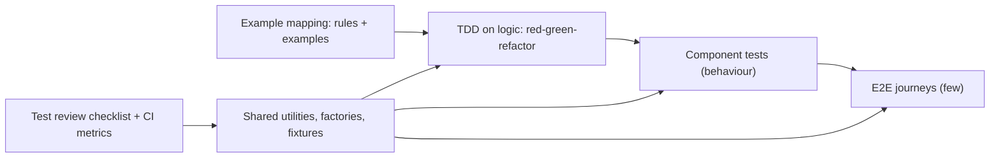
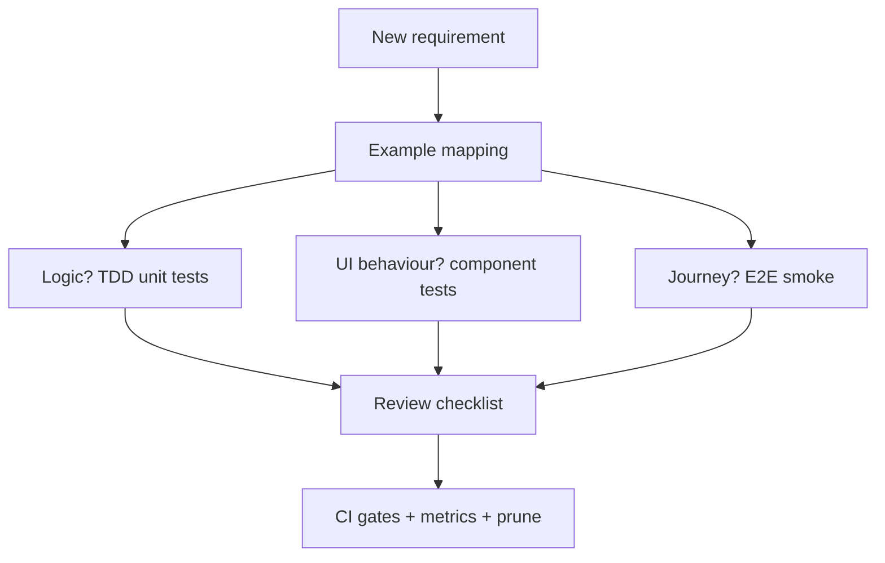

# Testing in Practice: TDD, Test Architecture, Mobile and AI-Assisted Testing

> Verification note: Playwright's **Test Agents** (planner, generator, healer; `npx playwright init-agents`, introduced 1.56) and the bundled MCP/CLI (1.62) were verified in the official **release notes (1.65, Nov 2026)**, as were `useDefineForClassFields` interactions with page-object class fields (1.65 breaking-changes note), `test.step`/`test.info` annotations, fixtures, tags and `test.skip/fixme` description-only signatures (1.65). Vitest migration guides (from Jest/Mocha), Browser Mode and `projects` were verified in the Vitest docs (Oct 2026). **TDD/BDD methodology, Jest→Vitest/Enzyme→RTL/Cypress→Playwright migration tactics, React Native testing tools (Jest preset, React Native Testing Library, Detox, Maestro, Appium, device farms), Expo specifics, snapshot-review and AI-assistant practices other than Playwright agents are established practice not re-fetched in this session — marked *(hedged)*; verify tool versions and the React Native/Expo new-architecture compatibility of any native-testing tool before adopting.** Related: [01 Strategy](01-testing-strategy-and-test-design.md), [react-native/](../react-native/README.md).

## Table of Contents

1. [Quick Summary (TL;DR)](#1-quick-summary-tldr)
2. [TDD, BDD and Example Mapping](#2-tdd-bdd-and-example-mapping)
3. [Test Architecture and Repository Layout](#3-test-architecture-and-repository-layout)
4. [Reviewing Tests: Checklist](#4-reviewing-tests-checklist)
5. [Legacy Code and Test Migrations](#5-legacy-code-and-test-migrations)
6. [Testing React Native Apps](#6-testing-react-native-apps)
7. [Testing Next.js and Full-Stack React: Putting It Together](#7-testing-nextjs-and-full-stack-react-putting-it-together)
8. [AI-Assisted Testing](#8-ai-assisted-testing)
9. [Building a Testing Culture](#9-building-a-testing-culture)
10. [Pitfalls](#10-pitfalls)
11. [Interview Questions — Fundamentals](#11-interview-questions--fundamentals)
12. [Interview Questions — Senior Scenarios](#12-interview-questions--senior-scenarios)
13. [Cheat Sheet](#13-cheat-sheet)
14. [Key Terms Glossary](#14-key-terms-glossary)
15. [Further Reading](#15-further-reading)

---

## 1. Quick Summary (TL;DR)

- **TDD** is a design tool: red → green → refactor produces small, testable units; use it where logic is intricate (reducers, parsers, validators, hooks) — not dogmatically for UI layout. **BDD/example mapping** aligns product, QA and engineering on concrete scenarios before coding.
- **Test architecture matters as much as production architecture:** co-located unit/component tests, shared test utilities (render-with-providers, factories, MSW handlers), page objects/fixtures for E2E, strict conventions, and ownership.
- **Review tests like code:** behaviour-focused names, one reason to fail, no implementation coupling, deterministic, meaningful assertions, correct level in the pyramid.
- **Migrations are incremental:** run old and new tooling side by side; migrate by directory/feature; add codemods/lint rules; don't rewrite everything at once.
- **React Native:** Jest + React Native Testing Library for logic/components; native modules mocked at the JS boundary; **E2E on real/simulated devices** with Detox/Maestro/Appium *(hedged)*; test across the **JS ↔ native** seams and OS permissions/lifecycle.
- **AI-assisted testing** speeds drafting (Playwright planner/generator/healer agents; LLM-generated unit tests) but requires human review: AI tests often assert implementation, over-mock, or "bless" bugs.
- **Culture:** tests are a product for developers — fast, trusted, owned; measure and prune.



---

## 2. TDD, BDD and Example Mapping

**TDD loop**
1. **Red:** write a failing test for the next small behaviour.
2. **Green:** minimal code to pass.
3. **Refactor:** clean up with the safety net.

**Where TDD pays off in frontend:** pure logic (price calculation, form validation, date/time rules), reducers/state machines, custom hooks, API client adapters, accessibility behaviours (keyboard maps), bug fixes (write the failing regression test first).
**Where it's awkward:** exploratory UI/visual design, CSS layout, spike prototypes — use visual/component tests after shape stabilises. Pragmatic rule: **test-first for logic and bug fixes; test-with for UI.**

**London vs Chicago/Detroit schools:** mockist (outside-in, interaction-heavy) vs classicist (state-based, fewer mocks). Frontend generally favours **classicist with network-boundary mocks** (render real components, mock HTTP) ([02 §5](02-unit-testing-and-test-doubles.md#5-test-doubles-dummy-stub-spy-mock-fake)).

**BDD/Gherkin:** `Given/When/Then` scenarios as shared language. Use full Cucumber-style tooling *(hedged)* only if non-engineers actively read/own the specs; otherwise use plain `describe/it` with scenario naming or Playwright `test.step`.

**Example mapping workshop (30 min):** story (yellow) → rules (blue) → examples (green) → open questions (red). Output feeds test cases directly: each example = one test or table row (`it.each`).
```ts
describe('shipping fee', () => {
  it.each([
    ['order below threshold', 49.99, 'standard', 5.99],
    ['order at free-shipping threshold', 50, 'standard', 0],
    ['express always charged', 100, 'express', 12.99],
  ])('%s', (_name, subtotal, method, expected) => {
    expect(shippingFee({ subtotal, method })).toBe(expected);
  });
});
```

**Acceptance criteria → tests mapping:** each criterion maps to the lowest level that can prove it (rule → unit; UI rendering/behaviour → component; cross-page journey → E2E).

**Playwright annotation features for traceability:** tags (`{ tag: '@smoke' }`), annotations (`test.info().annotations.push({ type: 'issue', description: 'JIRA-123' })`), `test.step` for readable traces/reports.

---

## 3. Test Architecture and Repository Layout

```
src/
  features/checkout/
    CheckoutForm.tsx
    CheckoutForm.test.tsx          # co-located component tests
    pricing.ts
    pricing.test.ts                # co-located unit tests
tests/
  setup/
    vitest.setup.ts                # jest-dom, MSW server lifecycle, cleanup
    msw/handlers.ts                # shared, schema-validated handlers (06)
  utils/
    render.tsx                     # renderWithProviders (router, query client, i18n, theme)
    factories.ts                   # buildUser, buildOrder (typed, overridable)
e2e/
  fixtures/                        # auth, data seeding, page objects
  pages/                           # POM for complex pages only
  specs/                           # journeys: checkout.spec.ts, ...
  global-setup / auth.setup.ts     # project dependency (storageState)
playwright.config.ts
vitest.config.ts                   # projects: unit (node/jsdom) + browser (Vitest Browser Mode)
```
**Principles**
- **Co-locate** unit/component tests with source (easy discovery; deleted together); keep E2E separately.
- **Shared utilities** under `tests/utils`: `renderWithProviders`, factories with sensible defaults, custom matchers (documented), fake timers helpers, a11y helpers.
- **Conventions:** `describe(unit)` → `it('does X when Y')`; AAA/Given-When-Then structure; one behaviour per test; no logic (loops/ifs) in tests except table-driven.
- **Test IDs strategy:** prefer role/label/text; `data-testid` only for non-semantic hooks; stable naming; strip or keep in production per policy *(hedged)*.
- **Page objects/fixtures (Playwright):** thin, expose user actions (not selectors); avoid assertion-heavy POMs; with class-field POMs note the `useDefineForClassFields` caveat in 1.65 notes (field initialisers that reference constructor parameters may not behave as expected).
- **Test environment config:** Vitest `projects` for node vs jsdom vs browser; consistent timezone/locale in setup; fail on `console.error` in tests *(hedged practice)*; fail on unhandled MSW requests.
- **Type-safe tests:** tests are TypeScript; share types with production; avoid `any` and unchecked casts in fixtures ([typescript/](../typescript/README.md)).
- **Ownership:** CODEOWNERS for shared test infra; docs (`TESTING.md`) with examples and anti-patterns; templates/generators for new tests.
- **Dependency policy:** pin test tooling; renovation cadence; changelog review for Playwright (browser/semantics changes) and Testing Library major versions.

---

## 4. Reviewing Tests: Checklist

| Question | Smell if "no" |
|---|---|
| Does the test name state behaviour and condition? | `it('works')`, `it('test 1')` |
| Would it fail if the feature broke? (try mutating code) | Vacuous assertion, over-mocking |
| Would it survive a safe refactor? | Asserts internal state/implementation, `getByTestId` everywhere, snapshot of large trees |
| Is it at the right level? | E2E for pure logic; unit tests of trivial getters |
| Deterministic? | `sleep`, real clock, random data, shared state |
| Are mocks at boundaries only? | Mocking child components/hooks/own modules |
| Is the failure message useful? | `expect(x).toBe(true)` where `toEqual`/specific matcher would explain |
| Does it test one thing? | Multiple unrelated assertions, long scenarios |
| Is the setup minimal and readable? | 80 lines of arrange, copy-pasted fixtures |
| Accessibility and error/loading/empty states covered where relevant? | Only happy path |
| Are test data and secrets safe? | Real PII/tokens in fixtures |
| Cleanup done? | Leaked timers/listeners/DB rows |
| Snapshot diffs reviewed intentionally? | `-u` blindly applied |
| Any `skip/fixme/only` left in? | Lint rule (`no-only-tests`, `no-skipped-tests`) catches this |

**Lint tooling *(hedged)*:** `eslint-plugin-testing-library`, `eslint-plugin-jest-dom`, `eslint-plugin-vitest`, `eslint-plugin-playwright` to enforce good practices (no `waitForTimeout`, no `.only`, prefer web-first assertions).

---

## 5. Legacy Code and Test Migrations

### Adding tests to untested legacy code
1. **Characterisation tests** — capture current behaviour (including odd outputs) before refactoring.
2. **Find seams** (Michael Feathers): extract pure functions, inject dependencies, wrap globals (`Date`, `window`, `fetch`).
3. **Test at the highest cheap level first** (component/E2E smoke) to protect refactors, then add unit tests as you extract logic.
4. **Boy-scout rule:** every bug fix or touched module gets a test; enforce **coverage on changed lines** rather than a global threshold.
5. **Strangler approach** for rewrites: keep E2E journeys as the invariant across old/new implementations.

### Common migrations
| From → To | Approach |
|---|---|
| **Jest → Vitest** | Official migration guide exists; run both runners in parallel by directory; replace `jest.*` with `vi.*` (codemods/aliases), enable `globals` only if needed; note `vi.spyOn` on ESM module namespaces fails (use `vi.mock(path, { spy: true })`); check fake-timers/snapshot-format differences; verify coverage provider settings |
| **Enzyme → React Testing Library** | Enzyme lacks adapters for modern React; replace shallow-render and `.state()` assertions with behavioural queries; migrate by component; remove adapter last |
| **Cypress → Playwright** | Map commands to locators/web-first assertions; Playwright is multi-tab/multi-origin friendly and has built-in sharding/trace; keep both in CI during transition; migrate highest-value flows first; rewrite custom commands as fixtures |
| **Selenium/WebDriver → Playwright** | Rewrite selectors to roles; remove explicit waits; reuse storageState |
| **JSDOM-only → real-browser component tests** | Move layout/CSS/focus/real-event tests to Vitest Browser Mode (provider `@vitest/browser-playwright`) or Playwright CT-style stories; keep logic tests in node/jsdom |
| **Snapshots → targeted assertions** | Replace large snapshots with behaviour/ARIA snapshots; keep inline snapshots for small stable outputs |
| **Class components/Redux tests → hooks/RTK/Query tests** | Test via public behaviour; avoid asserting reducer internals unless pure unit |

**Migration governance:** write an ADR; set dates; measure progress (percentage of tests migrated); freeze new tests in the old tool; provide codemods/templates; keep CI time in check.

---

## 6. Testing React Native Apps

*(Architecture and bridge/JSI/Fabric details: [react-native/01](../react-native/01-architecture-and-internals.md), [react-native/06](../react-native/06-tire2-old-vs-new-architecture.md), [react-native/13](../react-native/13-tire9-native-app-lifecycle.md); CI/CD: [react-native/16](../react-native/16-tire12-github-actions-cicd.md).)*

| Layer | Tools *(hedged)* | What to cover |
|---|---|---|
| **Unit (logic)** | Jest (RN preset) or Vitest where supported | Reducers, selectors, formatters, API adapters, validation |
| **Component** | `@testing-library/react-native` (RNTL) | Rendering by accessible role/label/text, user events (`userEvent`), async states, lists, forms |
| **Navigation/integration** | RNTL + mocked navigation containers | Screen transitions, deep-link handling, auth gating |
| **Native module boundary** | Jest mocks for native modules; Fabric/TurboModules specs typed via codegen | Contract between JS and native (arguments, errors, events) |
| **E2E on device/simulator** | Detox, Maestro, Appium; device farms (BrowserStack/Sauce/Firebase Test Lab/AWS Device Farm) | Install/launch, permissions, push, deep links, offline, upgrade flows |
| **Visual** | Screenshot comparisons on simulators; Storybook for RN *(hedged)* | Theming, dark mode, dynamic type, small screens |
| **Performance** | Flashlight/Perfetto/Instruments/Android Profiler, React DevTools profiler | Startup time, list FPS, memory, JS thread stalls ([react-native/08](../react-native/08-tire4-performance-internals.md)) |
| **Accessibility** | RNTL queries by role, manual VoiceOver/TalkBack | `accessibilityLabel/Role/State`, focus order, dynamic type |

**Practical rules**
- **Mock at the native boundary, not React:** native modules (camera, storage, permissions) via Jest mocks/setup files; avoid mocking RN core components.
- **Prefer `userEvent`** from RNTL over `fireEvent` for realistic interaction *(hedged on exact API in your RNTL version)*.
- **Async/timers:** use fake timers carefully with Animated/Reanimated; understand that Reanimated has its own Jest setup *(hedged)*.
- **E2E tooling choice (hedged):** Detox = gray-box, synchronises with app idle state (fast, stable) but heavy native setup; Maestro = black-box YAML flows, simple authoring, cross-platform; Appium = WebDriver standard, broad device support, slower/more brittle. Verify support for the new architecture and your RN/Expo version.
- **Expo:** EAS Build + dev clients; consider Maestro cloud/EAS workflows for E2E *(hedged)*.
- **Device matrix:** pick by analytics — lowest-spec Android, oldest supported iOS, small screens, tablets/foldables for layout-heavy apps.
- **Environment concerns:** permission prompts, push notifications, biometrics (use test hooks/mocks), keychain/keystore state reset between tests, deep-link schemes, network conditions, background/foreground transitions.
- **OTA/release testing:** test OTA update flows (download, rollback, compatibility with native runtime/fingerprint) in a staging channel ([react-native/14](../react-native/14-tire10-ota-and-release-architecture.md)); smoke-test store builds ([react-native/15](../react-native/15-tire11-app-store-play-store-release.md)).
- **Flakiness sources:** animations, simulators' cold boot, system dialogs, network — use deterministic test modes, disable animations in test builds, reset app state.
- **Code sharing with web:** shared unit tests for business logic; separate component tests per platform.

---

## 7. Testing Next.js and Full-Stack React: Putting It Together

| Concern | Where tested |
|---|---|
| Pure logic, utilities, schemas, reducers | Unit (Vitest) |
| Client components, hooks, forms | Component tests (RTL + MSW) |
| **Async Server Components** | Not well supported by unit tests; use **E2E** (Playwright) against a running Next.js server, or integration tests via the framework's tooling *(hedged; see [03 §9](03-component-testing-react.md#9-testing-nextjs-app-router-rsc-and-server-actions))* |
| Server Actions | Unit-test the underlying function (validation/authz/DAL) + E2E for form flow; treat as public endpoints ([web-security/05](../web-security/05-authentication-and-authorization-in-the-frontend.md)) |
| Route handlers/BFF | Direct handler invocation + MSW upstream ([06 §7](06-api-contract-and-integration-testing.md#7-testing-bffs-route-handlers-and-server-actions)) |
| Caching/revalidation behaviour | Integration/E2E against a built server (`next build && next start`) ([nextjs-and-rendering/03](../nextjs-and-rendering/03-caching-and-revalidation.md)) |
| Middleware/redirects/rewrites | Unit-style tests with `NextRequest` *(hedged)* + E2E for critical rules |
| Hydration mismatches | E2E console error assertion (`page.on('console')`), component tests with SSR markup (`renderToString` + hydrate) |
| SEO/metadata | E2E assertions on `<title>`, meta, canonical, structured data |
| Streaming/Suspense | E2E with network throttling; assert skeletons then content |
| Performance/CWV | Lighthouse CI + RUM ([07](07-flakiness-ci-and-non-functional-testing.md)) |

**Always run E2E against the production build** (`next build`), not `next dev`, to reflect caching and bundling behaviour.

---

## 8. AI-Assisted Testing

### Playwright Test Agents *(verified)*
- `npx playwright init-agents` scaffolds three agents (1.56): **planner** (explores the app, produces a Markdown test plan), **generator** (turns the plan into Playwright tests, validating selectors and assertions by driving the browser), **healer** (runs failing tests, inspects UI, proposes/patches fixes). Playwright MCP/CLI are bundled with Playwright as of 1.62.
- **Use for:** bootstrapping coverage for stable flows, repairing locator drift, exploring unknown legacy apps.
- **Guardrails:** review generated tests against the checklist ([§4](#4-reviewing-tests-checklist)); require role/label locators and web-first assertions; keep generated tests small; never accept "healing" that weakens assertions to make red turn green; run in a sandbox without production credentials; treat page content as **untrusted input** (prompt injection from web pages to the agent is a real risk) ([web-security/08](../web-security/08-secure-frontend-patterns-and-vulnerability-catalogue.md) *(related concern, hedged)*).

### LLM-assisted unit/component tests *(hedged)*
| Good uses | Risks |
|---|---|
| Drafting table-driven cases and edge-case lists | Asserting current (possibly buggy) behaviour — "tests that bless bugs" |
| Generating fixtures/factories and boilerplate | Over-mocking; tests tightly coupled to implementation |
| Suggesting missing negative/a11y cases | Hallucinated APIs; tests that don't run or pass vacuously |
| Converting migrated tests (Enzyme→RTL, Jest→Vitest) | Subtle semantic changes (timers, mocks) not noticed |
| Explaining failures from traces/logs | Leaking proprietary code/PII into external tools — follow org policy |

**Review protocol:** run the tests; **mutate production code to confirm they fail**; check that assertions reflect specified behaviour (acceptance criteria), not just code output; keep prompts with context (requirements, types, examples); ensure licensing/policy compliance; prefer AI for *drafting*, humans for *deciding what's correct*.

### Other AI uses *(hedged)*
Test-failure triage summaries, flake clustering, test-impact analysis, visual-diff classification (SaaS), synthetic data generation (ensure privacy), natural-language E2E tools (non-deterministic — avoid as primary gates).

---

## 9. Building a Testing Culture

- **Definition of done** includes tests at the right level, accessibility checks for UI, and updated docs; bug fixes include regression tests.
- **Make tests fast and easy:** one command, watch mode, great error messages, examples/templates.
- **Pair/mob on first tests** for newcomers; "testing guild"/champions; short brown-bag sessions on anti-patterns.
- **Metrics without gaming:** coverage on changed lines, mutation scores for critical modules, flake rate, time-to-signal; avoid targets that reward low-value tests.
- **Blameless incident reviews** include "why didn't tests catch this and at which level should they have?" → add a test at the cheapest effective level.
- **Prune regularly:** delete redundant/obsolete tests; celebrate deletions that don't reduce confidence.
- **Right-size investment:** risk-based ([01 §3](01-testing-strategy-and-test-design.md)); prototypes/spikes need less; payment/auth need more.
- **Leadership communication:** express testing value as reduced lead time, change failure rate and incident cost — the delivery metrics leadership understands.

---

## 10. Pitfalls

1. **TDD dogma** applied to layout/exploratory UI.
2. **No shared test utilities** → each test re-invents providers and fixtures.
3. **Page objects that become god classes** with assertions and business logic.
4. **Big-bang test migrations** that stall for months.
5. **Testing implementation** (internal state, call counts) instead of behaviour.
6. **Accepting AI-generated tests unreviewed** (vacuous, coupled, or blessing bugs).
7. **Healing tests by weakening assertions.**
8. **Mobile tests only on simulators** with no real-device/OS-version coverage.
9. **Mocking React Native core components** instead of native boundaries.
10. **Running Next.js E2E against `next dev`.**
11. **Global coverage targets driving low-value tests.**
12. **No ownership of test infrastructure** → decays into flakiness.

---

## 11. Interview Questions — Fundamentals

### Q1. When is TDD most valuable in frontend work?
For pure logic, reducers/state machines, hooks, validation and bug fixes (reproduce first), where fast feedback and design pressure help; less so for exploratory UI/CSS.

### Q2. What is a characterisation test?
A test that records current behaviour of legacy code to enable safe refactoring, even when the behaviour isn't "correct".

### Q3. How do you organise tests in a React repo?
Co-locate unit/component tests; share `renderWithProviders`, factories and MSW handlers in `tests/`; keep E2E specs with fixtures/POMs in `e2e/`; document conventions.

### Q4. How do you migrate Jest to Vitest safely?
Parallel runs by directory, mechanical `jest.*`→`vi.*` changes, check ESM/mocking differences (`vi.mock`, spying on module exports), verify timers/snapshots/coverage, then remove Jest.

### Q5. How do you test a React Native app?
Jest + RNTL for logic/components, native boundary mocks, a small device-level E2E suite (Detox/Maestro/Appium), manual a11y/perf checks on real devices, and OTA/store release smoke tests.

### Q6. What do you check when reviewing a test?
Behavioural name, fails when behaviour breaks, survives refactors, right level, deterministic, boundary-only mocks, useful failure messages, covers error/empty/a11y states.

### Q7. How can AI help and where is it risky?
It drafts cases/fixtures and speeds migrations, but can encode buggy behaviour, over-mock, hallucinate APIs, or weaken assertions when "healing"; always review and mutate-check.

---

## 12. Interview Questions — Senior Scenarios

### S1. "Inherit a 400k-line React app with 8% coverage and no E2E. Where do you start?"
Map critical journeys and risk; add E2E smoke for top 5–10 journeys on a production-like build; add characterisation tests around the areas of planned change; introduce shared test utilities and CI gates on changed-line coverage; fix flaky environment issues; add component tests as modules are touched; track escaped defects and adjust.

### S2. "Team tests are 70% snapshot tests and nobody reviews them."
Audit value: delete snapshots of large trees; replace with behavioural assertions and small inline/ARIA snapshots; add lint rules limiting snapshot size; require review of snapshot diffs; add visual tests only for key components; coach on why snapshots pass while behaviour breaks.

### S3. "Decide between Detox and Maestro for our React Native app."
Evaluate stability (gray-box sync vs black-box), authoring speed/team skills, CI/device-farm support, new-architecture and Expo compatibility, flow complexity (native modules, permissions), maintenance cost; pilot both on 3 journeys, measure flake rate and authoring time, then standardise; keep the suite small and complement with unit/component tests.

### S4. "Management wants AI to write all our tests."
Pilot: use agents/LLMs for drafting and locator repair under review; define quality gates (mutation checks, assertion quality, flake tracking); keep humans accountable for specs and critical-flow tests; measure defect-catch and maintenance cost; protect data/credentials and treat web content as untrusted for agents; scale if metrics improve.

### S5. "Migrate 1,500 Cypress tests to Playwright without stopping delivery."
Inventory by value and flake; run both in CI; migrate by journey priority; build fixtures/auth reuse first; port custom commands to fixtures; freeze new Cypress tests; delete low-value tests rather than porting; use sharding/blob reports; track migration burn-down and parity metrics; decommission Cypress after parity and a stable period.

---

## 13. Cheat Sheet

| Topic | Rule of thumb |
|---|---|
| TDD | Test-first for logic and bug fixes; test-with for UI |
| Structure | Co-located tests; shared utils/factories/MSW handlers; E2E fixtures |
| Review | Behaviour, determinism, right level, boundary mocks |
| Legacy | Characterisation + seams + changed-line coverage |
| Migration | Parallel tools, by directory, ADR, freeze old |
| RN | Jest + RNTL + native-boundary mocks + small device E2E |
| Next.js | Unit/component for client; E2E on `next build` for RSC/caching |
| AI | Draft with agents/LLMs; humans verify; mutate-check; never weaken assertions |



---

## 14. Key Terms Glossary

| Term | Definition |
|---|---|
| **TDD** | Test-driven development: red, green, refactor |
| **BDD** | Behaviour-driven development using shared scenario language |
| **Example mapping** | Workshop technique deriving rules/examples from stories |
| **Characterisation test** | Captures existing behaviour of legacy code |
| **Seam** | Point where behaviour can be altered without editing code |
| **Page object** | Abstraction of a page's actions for E2E tests |
| **RNTL** | React Native Testing Library |
| **Detox / Maestro / Appium** | Mobile E2E tools (gray-box / flow-based black-box / WebDriver) |
| **Healer agent** | Playwright agent that diagnoses/repairs failing tests |
| **Mutation check** | Verifying a test fails when production code is broken |

---

## 15. Further Reading

- [Playwright — Test agents](https://playwright.dev/docs/test-agents) · [Release notes](https://playwright.dev/docs/release-notes) · [Vitest — Migration guide](https://vitest.dev/guide/migration) · [Testing Library](https://testing-library.com/docs/) · [React Native Testing Library](https://callstack.github.io/react-native-testing-library/) *(hedged: check URLs)*
- Books/ideas *(hedged)*: Feathers — *Working Effectively with Legacy Code*; Beck — *Test-Driven Development by Example*; Kent C. Dodds' testing articles.
- This repo: [01 Strategy](01-testing-strategy-and-test-design.md) · [02 Unit](02-unit-testing-and-test-doubles.md) · [03 Component](03-component-testing-react.md) · [react-native/README](../react-native/README.md) · [typescript/](../typescript/README.md)
