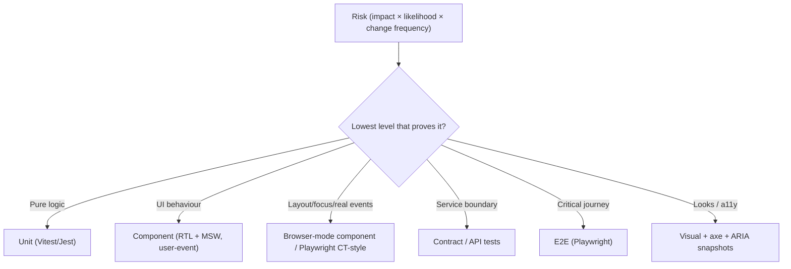
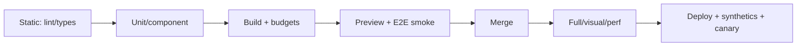

# Testing Recall Map (Last-Minute Review)

> Verification note: Playwright facts reflect the official release notes through **1.65 (Nov 2026)**; Vitest Browser Mode facts reflect the docs updated Oct 2026. Items tagged *(hedged)* are established practice not re-verified this session. Full detail: [README](README.md).

## Table of Contents

1. [60-Second Mental Model](#1-60-second-mental-model)
2. [Maps](#2-maps)
3. [Decision Tables](#3-decision-tables)
4. [Numbers, Defaults and Version Facts](#4-numbers-defaults-and-version-facts)
5. [Mnemonics](#5-mnemonics)
6. [Rapid-Fire Q&A](#6-rapid-fire-qa)
7. [Say-This Scripts](#7-say-this-scripts)
8. [Red Flags vs Green Flags](#8-red-flags-vs-green-flags)
9. [Final 10-Minute Checklist](#9-final-10-minute-checklist)
10. [Related Recall Maps](#10-related-recall-maps)

---

## 1. 60-Second Mental Model

1. **Tests buy confidence per unit of cost.** Choose the **lowest level that can prove the behaviour**; keep a few E2E journeys for integration confidence.
2. **Test behaviour users/consumers rely on, not implementation.** Roles/labels, public APIs, network boundaries.
3. **Mock only at boundaries** (HTTP via MSW, time, randomness, native modules); never your own components/hooks.
4. **Determinism is non-negotiable:** fake clocks, seeded data, isolated state, same container for visual baselines.
5. **Mocks drift → contracts.** Generate/validate mocks from OpenAPI; Pact or spec diffs in CI.
6. **Accessibility is layered:** role queries → axe → ARIA snapshots → keyboard/focus → manual screen reader.
7. **Flaky = bug.** Retries are mitigation; trace, quarantine with owner/expiry, fix.
8. **CI is a product:** fast feedback first, shard, cache, selective runs, measure time-to-signal and flake rate.
9. **Coverage is a smoke detector; mutation score measures assertion strength.**
10. **AI drafts, humans verify:** mutate-check; never "heal" by weakening assertions.

---

## 2. Maps

| Shape | Idea |
|---|---|
| Pyramid | Many unit, fewer integration, few E2E |
| Trophy | Static + integration-heavy (component tests), few unit/E2E |
| Honeycomb | Microservices: integration/contract in the middle |

---

## 3. Decision Tables

| Situation | Choose |
|---|---|
| Pure function, reducer | Unit test, table-driven / property-based |
| React component with data | RTL + MSW (don't mock fetch wrapper) |
| Need real layout/focus/pointer | Vitest Browser Mode (playwright provider) or Playwright |
| Async Server Component | E2E against built Next.js server |
| Server Action | Unit-test function + E2E form flow; authz tests |
| Third-party API | Sandbox for E2E, validated fixtures in CI, failure injection |
| Many consumers known | Pact (consumer-driven) |
| Public API unknown consumers | OpenAPI diff + provider tests |
| Flaky test, cause unknown | `--repeat-each`, traces, `--workers=1`, `--shuffle`, CI container |
| Visual diffs noisy | Same container, disable animations, mask, element-level shots |
| Large legacy app | Characterisation + E2E smoke + changed-line coverage |
| Mobile E2E | Detox (gray-box) / Maestro (flows) / Appium *(hedged)* |
| Perf regression | Bundle budget + Lighthouse CI (lab) + RUM (field) |
| Time-dependent logic | Fake timers / `page.clock` |

| Test double | Role |
|---|---|
| Dummy | Fills parameter |
| Stub | Canned answers |
| Spy | Records calls |
| Mock | Pre-programmed expectations (interaction) |
| Fake | Working lightweight implementation |

---

## 4. Numbers, Defaults and Version Facts

| Fact | Value |
|---|---|
| Playwright current (verified) | 1.65 (Chromium 158, Firefox 159, WebKit 27.2); Node 20 no longer tested |
| Sharded run with no tests (1.65) | Fails "No tests found" → `--pass-with-no-tests` |
| `test.skip/fixme/fail/slow` (1.65) | Take only a description |
| Test locks | `{ lock: 'name' }` (1.63); `-exclusive-` (1.65) |
| `--shuffle` | 1.64 |
| `--last-failed` / `--only-changed` | 1.44 / 1.46 |
| `failOnFlakyTests` | 1.45 (config) / 1.52 |
| Trace modes | `retain-on-first-failure` (1.43), `retain-on-failure-and-retries` (1.59) |
| Blob + merge-reports | 1.37 |
| `page.clock` / `routeWebSocket` | 1.45 / 1.48 |
| ARIA snapshots | 1.49; `/children`,`/url` 1.52; page-level 1.60; JSON 1.63 |
| `page.accessibility` | Removed 1.57 → use axe |
| `--update-snapshots=missing` | Passes the run (1.64) |
| WebP screenshots | 1.62 |
| Test Agents | planner/generator/healer (1.56); MCP/CLI bundled (1.62) |
| Vitest Browser Mode | `@vitest/browser-playwright` (recommended), `-webdriverio`, `-preview`; `expect.element` retries; `vi.spyOn(module)` throws → `vi.mock(path,{spy:true})` |
| Coverage | Statement/branch/function/line; high ≠ good |
| Typical retries | CI 1 (0 locally) |
| Flake SLO example *(hedged)* | < 1% flaky runs; PR time-to-signal p95 < 15 min |

---

## 5. Mnemonics

- **FIRST** tests: **F**ast, **I**solated, **R**epeatable, **S**elf-validating, **T**imely.
- **AAA:** Arrange, Act, Assert (or Given-When-Then).
- **RAMP** for flake causes: **R**ace/timing, **A**ccumulated state, **M**issing control of time/data, **P**latform/resources.
- **BRIDGE** for mocks: **B**oundaries only, **R**ealistic payloads (schema-validated), **I**dempotency cases, **D**rift checks (contracts), **G**enerate from spec, **E**rror paths.
- **KFAAC** for a11y: **K**eyboard, **F**ocus, **A**xe, **A**ccessible names/ARIA snapshot, **C**ontrast/zoom + manual screen reader.
- **Query priority (Testing Library):** role → label → placeholder/text → alt/title → test id.
- **Triage:** Detect → Classify → Quarantine (owner+expiry) → Fix → Restore.

---

## 6. Rapid-Fire Q&A

- **Testing pyramid vs trophy?** Pyramid emphasises unit; trophy emphasises integration/component tests with static analysis at the base.
- **What should you mock?** Network boundary, time, randomness, native modules — not your components or hooks.
- **Why MSW over mocking `fetch`?** Exercises the real client stack; same handlers reusable across tests/Storybook; fails on unhandled requests.
- **`getBy` vs `queryBy` vs `findBy`?** Throws if absent / returns null (assert absence) / async wait.
- **`userEvent` vs `fireEvent`?** `userEvent` simulates realistic interaction sequences; prefer it.
- **Why avoid `waitForTimeout`?** Arbitrary, slow and flaky; use auto-waiting assertions.
- **Playwright auto-waiting?** Actionability checks (visible, stable, enabled, receives events) before actions; web-first assertions retry.
- **Best locators?** `getByRole` with name, then label/text; `data-testid` as fallback.
- **How to reuse auth?** Setup project + `storageState` (cookies, localStorage, IndexedDB since 1.51).
- **What does `toHaveScreenshot` do?** Compares against baseline after stabilising; supports masks, animation disabling, thresholds.
- **Why baselines in CI container?** Fonts/anti-aliasing differ per OS.
- **What is an ARIA snapshot?** YAML of the accessibility tree via `toMatchAriaSnapshot`.
- **Can axe prove accessibility?** No — only a subset; manual/AT testing required.
- **Pact in one line?** Consumer records expectations; provider verifies; `can-i-deploy` gates release.
- **How keep mocks honest?** Generate from OpenAPI, validate with schemas, contract tests.
- **Idempotency test?** Same key twice → one effect, same response; changed payload → conflict.
- **What is a flaky test?** Nondeterministic pass/fail on same code.
- **Retry policy?** 1 in CI, report flaky, traces on retry, fix root cause.
- **Sharding?** `--shard=i/N` + blob reporter + `merge-reports`.
- **What to run on PR?** Static, unit/component, build/budgets, contract, E2E smoke.
- **Coverage vs mutation?** Coverage = executed; mutation = would tests catch a change.
- **jsdom limits?** No layout, limited CSS/focus/real events → use a real browser for those.
- **Fake timers gotcha?** Must advance timers and flush promises; restore real timers after.
- **Testing RSC?** Prefer E2E against built server; unit-test extracted logic.
- **RN component tests?** Jest + RNTL, mock native modules at the boundary.
- **Detox vs Maestro?** Gray-box sync vs black-box YAML flows *(hedged)*.
- **TDD sweet spot?** Logic, bug fixes; not layout exploration.
- **Characterisation test?** Pins current behaviour before refactoring.
- **AI test risk?** Blessing bugs, over-mocking, weakened "healing".
- **Visual diff review?** Humans must look at images; no blind `-u`.

---

## 7. Say-This Scripts

- **"What's your testing strategy?"** "Risk-based. I put logic in fast unit tests, behaviour in component tests with MSW, contracts at service boundaries, a handful of E2E journeys on a production build, and visual/a11y checks on design-system states. I measure flake rate and time-to-signal, and I prune."
- **"Tests are flaky — what do you do?"** "Reproduce with repeat/shuffle/CI container and traces, classify the cause, quarantine with an owner and expiry, fix the root cause, then restore after consecutive greens. Retries stay minimal and reported."
- **"How do you test a form?"** "Through the UI by role/label: valid submit, validation errors announced and associated, async submit with loading/error states, keyboard use, and network mocked at the HTTP boundary."
- **"How do you ensure the frontend and backend don't break each other?"** "Shared OpenAPI with breaking-change diffs, schema-validated mocks, and Pact or provider verification gating deploys; plus tolerant parsing and runtime validation."
- **"Is 90% coverage good?"** "It tells me what's *not* tested. Quality depends on assertions — I use changed-line coverage and mutation testing on critical modules."
- **"How do you use AI for tests?"** "Drafting and migration help, with review: run, mutate-check, ensure assertions reflect requirements. Healer fixes can't weaken assertions."
- **"Test a Next.js app?"** "Unit/component for client code, direct handler tests for routes/actions, E2E on `next build` for RSC, caching and streaming."

---

## 8. Red Flags vs Green Flags

| Red flags | Green flags |
|---|---|
| "We reach 100% coverage" as the goal | Changed-line coverage + mutation checks on critical code |
| Snapshots of whole component trees | Behavioural assertions, small ARIA/inline snapshots |
| `sleep`/`waitForTimeout` everywhere | Web-first assertions, fake clocks |
| Mocking own hooks/components | MSW at the HTTP boundary |
| Rerun until green culture | Flake dashboard, quarantine with owners, SLOs |
| Visual baselines from laptops | Baselines generated in CI container |
| E2E for everything | Pyramid/trophy discipline with a small E2E smoke set |
| "axe passed, so we're accessible" | Layered a11y incl. manual AT testing |
| Mocks that drift from API | Spec-generated/validated mocks + contract tests |
| AI tests merged unreviewed | Mutation-check and requirement-based review |

---

## 9. Final 10-Minute Checklist

- [ ] Pyramid/trophy/honeycomb and when each fits
- [ ] Query priority and `getBy/queryBy/findBy`
- [ ] Test doubles vocabulary; what not to mock
- [ ] Fake timers vs `page.clock`
- [ ] MSW handlers + schema validation + unhandled-request errors
- [ ] RSC/Server Actions testing approach
- [ ] Playwright: locators, auto-wait, fixtures, `storageState`, traces, sharding, `merge-reports`
- [ ] Visual determinism list; baselines in CI container
- [ ] a11y layers; ARIA snapshot; keyboard/focus tests; manual AT
- [ ] Contracts: Pact vs OpenAPI diff; idempotency, 412/429 tests
- [ ] Flake taxonomy, retry policy, quarantine process
- [ ] CI stages, required checks, selective runs, cost levers
- [ ] RN: Jest + RNTL + Detox/Maestro/Appium trade-offs
- [ ] TDD where it pays; characterisation tests; migration plan
- [ ] AI-assisted testing guardrails
- [ ] 1.65 facts: Node 20 dropped, `--pass-with-no-tests`, description-only `test.skip`

---

## 10. Related Recall Maps

- [React](../react/README.md) · [TypeScript](../typescript/README.md) · [Next.js & Rendering](../nextjs-and-rendering/README.md) · [Web Performance](../web-performance/README.md) · [Web Security](../web-security/README.md) · [Networking & APIs](../networking-and-apis/README.md) · [React Native recall map](../react-native/17-master-mental-model-recall-map.md)
