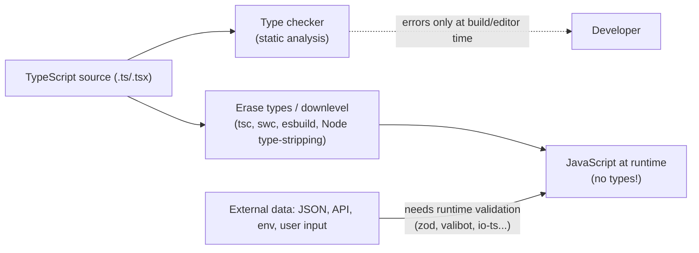
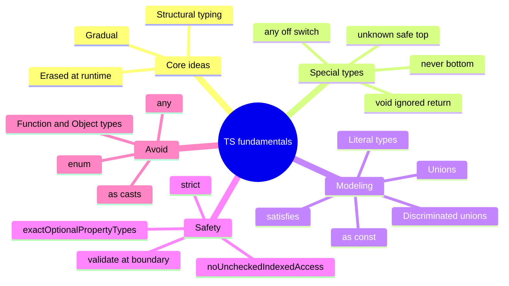

# TypeScript Type System Fundamentals — Interview Guide

> Verified against the TypeScript team's release posts (5.8, 5.9, 6.0, 7.0 — see [04-tsconfig-modules-and-tooling.md](04-tsconfig-modules-and-tooling.md) for the version story) and the TypeScript handbook concepts. Version-sensitive items are marked **[TS x.y]**. At verification time (Nov 2026): **TypeScript 6.0** was the last JS-based compiler, **7.0** (native Go port) is released, **7.1** is in beta.
> Next: [02-generics-and-advanced-types.md](02-generics-and-advanced-types.md) → [03-narrowing-and-type-safety-patterns.md](03-narrowing-and-type-safety-patterns.md).

## Table of Contents

1. [Quick Summary (TL;DR)](#1-quick-summary-tldr)
2. [What TypeScript Is (and Is Not)](#2-what-typescript-is-and-is-not)
3. [Structural Typing and Assignability](#3-structural-typing-and-assignability)
4. [Type Inference and Widening](#4-type-inference-and-widening)
5. [The Special Types: `any`, `unknown`, `never`, `void`, `null`, `undefined`](#5-the-special-types-any-unknown-never-void-null-undefined)
6. [Unions, Intersections, Literal Types](#6-unions-intersections-literal-types)
7. [`type` vs `interface`](#7-type-vs-interface)
8. [Objects: Optional, Readonly, Index Signatures, Excess Property Checks](#8-objects-optional-readonly-index-signatures-excess-property-checks)
9. [Functions: Signatures, Overloads, `this`, Variance](#9-functions-signatures-overloads-this-variance)
10. [Arrays, Tuples, `as const`](#10-arrays-tuples-as-const)
11. [Enums vs Literal Unions](#11-enums-vs-literal-unions)
12. [Classes in TypeScript](#12-classes-in-typescript)
13. [Built-in Utility Types](#13-built-in-utility-types)
14. [`keyof`, `typeof`, Indexed Access](#14-keyof-typeof-indexed-access)
15. [Declaration Merging, Ambient Declarations, Modules](#15-declaration-merging-ambient-declarations-modules)
16. [Soundness Holes You Must Know](#16-soundness-holes-you-must-know)
17. [Common Mistakes and Pitfalls](#17-common-mistakes-and-pitfalls)
18. [Performance Considerations](#18-performance-considerations)
19. [Trade-offs and Alternatives](#19-trade-offs-and-alternatives)
20. [Interview Questions — Fundamentals](#20-interview-questions--fundamentals)
21. [Interview Questions — Senior Scenarios](#21-interview-questions--senior-scenarios)
22. [Cheat Sheet](#22-cheat-sheet)
23. [Key Terms Glossary](#23-key-terms-glossary)
24. [Further Reading](#24-further-reading)

---

## 1. Quick Summary (TL;DR)

- TypeScript is **JavaScript + a static, structural, gradual type system** that is **erased at compile time**. Types give **no runtime guarantees**; data from outside (network, `JSON.parse`, `localStorage`) must be **validated at the boundary**.
- **Structural typing:** compatibility depends on *shape*, not names. Excess-property checks apply only to **fresh object literals**.
- `unknown` is the **type-safe top type** (must narrow before use); `any` **turns the checker off**; `never` is the **bottom type** (no values; exhaustiveness checking).
- Model state with **unions + literal types + discriminated unions** so *impossible states are unrepresentable*.
- Prefer **literal unions / `as const` objects** over `enum`; prefer **`interface` for object shapes that are extended**, **`type` for unions/mapped/conditional/tuples**.
- Know the **unsoundness trade-offs** (array covariance, method bivariance, `as`, index access, non-null `!`) and the strictness flags that tighten them.
- **Strict mode** is the baseline: `strict` is **`true` by default since TS 6.0** [TS 6.0], and `tsc --init` in 5.9+ also enables `noUncheckedIndexedAccess` and `exactOptionalPropertyTypes` [TS 5.9].



---

## 2. What TypeScript Is (and Is Not)

### Concept
TypeScript adds **static types**, tooling (completion, refactoring) and some syntax (enums, namespaces, decorators, parameter properties) on top of JavaScript. The compiler does two separable jobs:
1. **Type checking** (the "language" part) — reports errors, produces `.d.ts`.
2. **Emit** — strips/transforms syntax to JavaScript (targets, modules, JSX). Other tools (Babel, swc, esbuild, Vite, Node type stripping) can do emit **without** type-checking.

### Why it matters
- Catches whole bug classes pre-runtime (null access, typos, wrong shapes, missed cases in switches).
- Makes refactors safe and self-documents APIs; enables great editor tooling.
- In large orgs it is a **communication tool** between teams (typed contracts).

### What it does NOT do
- **No runtime checks.** `const u = JSON.parse(s) as User` does *nothing* to verify `s`.
- **No type-based runtime behaviour** (no overloading at runtime, no reflection of interfaces).
- **Not fully sound by design** — it prioritises usability (see §16).

### Erasable vs non-erasable syntax
Syntax that **has no runtime effect** is erasable (type annotations, `interface`, `type`, generics). Some TS-only constructs generate runtime code: `enum`, runtime `namespace`, **parameter properties** (`constructor(private x: number)`), `import x = require()`. Runtimes/tools that *only strip types* (Node.js type stripping, `ts-blank-space`, Amaro) reject these. **[TS 5.8]** `--erasableSyntaxOnly` makes the compiler error on them (combine with `verbatimModuleSyntax`).

---

## 3. Structural Typing and Assignability

TypeScript uses **structural typing ("duck typing at compile time")**: type `A` is assignable to `B` if `A` has at least the members `B` requires with compatible types.

```ts
interface Point { x: number; y: number }
class Vec { constructor(public x: number, public y: number, public label = "v") {} }

const p: Point = new Vec(1, 2);        // OK — Vec has x and y (extra members are fine for non-fresh values)
```

### Assignability rules in practice
| Source → Target | Rule |
|---|---|
| Object → object | Source must have all required target props with assignable types; extra props OK (except fresh literals) |
| Union source | **Every** member must be assignable to the target |
| Union target | Source must be assignable to **at least one** member |
| Intersection target | Source must be assignable to **every** member |
| Function → function | Params **contravariant** (under `strictFunctionTypes`), return **covariant** |
| `never` → anything | Always assignable |
| anything → `unknown` | Always assignable |
| `any` ↔ anything | Always (that's the problem) |

### Nominal-like behaviour when you need it (branding)
```ts
type UserId = string & { readonly __brand: "UserId" };
type OrderId = string & { readonly __brand: "OrderId" };
const asUserId = (s: string) => s as UserId;
function loadUser(id: UserId) {}
loadUser(asUserId("u1"));
// loadUser("u1" as OrderId); // error — prevents mixing IDs
```
Branded types are erased at runtime; create them only in validated constructors/parsers.

### Variance in one line
Output positions are covariant, input positions contravariant. With `strictFunctionTypes`, `(x: Animal) => void` is assignable to `(x: Dog) => void`, **not** vice versa. **Method shorthand** members stay **bivariant** (deliberately unsound for ergonomics, e.g. `Array<T>` methods).

---

## 4. Type Inference and Widening

### What gets inferred
- Variable initialisers: `const n = 1` → type `1` (literal; `const` doesn't widen), `let n = 1` → `number` (widened).
- Return types from function bodies (annotate **exported** functions' return types for stable public API and faster declaration emit).
- **Contextual typing**: callbacks get parameter types from the expected type (`arr.map(x => x.id)`).
- Generic arguments from call arguments (see file 02).

```ts
const a = "hi";            // "hi"
let b = "hi";              // string
const o = { kind: "x" };   // { kind: string }  — property widens because it's mutable
const o2 = { kind: "x" } as const; // { readonly kind: "x" }
```

### Control-flow analysis
The checker tracks the **narrowed type of a variable at each program point** (details in file 03):
```ts
function f(x: string | number) {
  if (typeof x === "string") x.toUpperCase();   // x: string here
  else x.toFixed();                             // x: number here
}
```

### When to annotate vs infer
- **Infer** locals and callbacks.
- **Annotate** public function parameters, exported return types, object literals that must match a contract (use `satisfies`, §file 03), and empty collections (`const xs: string[] = []`).
- Prefer `satisfies` / explicit generics over **type assertions** (`as`).

---

## 5. The Special Types: `any`, `unknown`, `never`, `void`, `null`, `undefined`

| Type | Meaning | Use |
|---|---|---|
| `any` | Opt out of checking; assignable to/from everything | Migration escape hatch only; **contagious** |
| `unknown` | Top type: can hold anything, **nothing can be done without narrowing** | Untrusted input, `catch` variable, generic "any value" |
| `never` | Bottom type: no value exists | Functions that never return, exhaustive checks, impossible branches, filtering in conditional types |
| `void` | "Return value is ignored"; a `() => void` type accepts functions returning anything | Callback return types |
| `undefined` / `null` | Real runtime values (with `strictNullChecks` they are not in every type) | Optional / absent values |
| `object` | Any non-primitive | Rare |
| `{}` | Any non-null/undefined value (including primitives!) | Almost never what you want |
| `Object` | Boxed JS `Object` — avoid | Never |

```ts
function parse(input: unknown): number {
  if (typeof input === "number") return input;
  if (typeof input === "string") return Number(input);
  throw new Error("Unsupported");
}

function assertNever(x: never): never { throw new Error(`Unhandled: ${JSON.stringify(x)}`); }
```

`void` gotcha: `const f: () => void = () => 42;` is **valid** (return value ignored), but a *function declaration* typed `(): void` cannot `return 42`.

`any` vs `unknown`: `any` lets you call `.foo()` on it; `unknown` forces a check. **Rule:** at system boundaries use `unknown`; reserve `any` for rare, commented, localised escapes (also see `@typescript-eslint/no-explicit-any`, `no-unsafe-*`).

---

## 6. Unions, Intersections, Literal Types

### Unions model "one of"
```ts
type Id = string | number;
type Status = "idle" | "loading" | "success" | "error";
```
Only members common to **all** union members are accessible without narrowing.

### Discriminated (tagged) unions — the most important pattern
```ts
type Result<T> =
  | { status: "loading" }
  | { status: "success"; data: T }
  | { status: "error"; error: Error };

function render(r: Result<User>) {
  switch (r.status) {
    case "loading": return "…";
    case "success": return r.data.name;      // narrowed
    case "error":   return r.error.message;
    default: { const _exhaustive: never = r; return _exhaustive; }  // compile error if a case is missed
  }
}
```
**Why:** replaces boolean flags (`isLoading && isError`) that allow contradictions; compiler enforces exhaustive handling.

### Intersections model "all of"
```ts
type WithId = { id: string };
type Timestamps = { createdAt: Date };
type Entity = WithId & Timestamps;
```
Caveats: intersecting objects with **conflicting property types** yields `never` for that property; prefer `interface extends` for object composition (clearer errors, cached).

### Literal types, `as const`, template literals
```ts
type Method = "GET" | "POST";
const config = { retries: 3, mode: "strict" } as const;   // readonly, literal types
type Mode = typeof config.mode;                            // "strict"
type Route = `/api/${string}`;                             // template literal type
```

---

## 7. `type` vs `interface`

| | `interface` | `type` alias |
|---|---|---|
| Object shapes | Yes | Yes |
| Union / intersection / tuple / mapped / conditional / primitives | No (extends other object types only) | **Yes** |
| Declaration merging | **Yes** (augmentation, global/library extension) | No (duplicate identifier error) |
| `extends` | `extends` (checked for compatibility, good errors, cached) | `&` (resolved eagerly; conflicts become `never`) |
| Implements by classes | Yes | Yes (for object types) |
| Computed/Mapped | No | Yes |

Guideline most teams adopt:
- **Public object shapes and component props that others may extend** → `interface` (or consistent `type` — pick one and lint it).
- **Unions, utility compositions, function types, tuples** → `type`.
- Need **module/global augmentation** (extend Express `Request`, `Window`) → `interface`.
- Inheritance-heavy hierarchies → `interface extends` for better error locality and compile performance.

Interview answer: "They're nearly interchangeable for object shapes; the practical differences are declaration merging, `extends` vs `&` semantics, and that only `type` can alias unions/mapped/conditional types."

---

## 8. Objects: Optional, Readonly, Index Signatures, Excess Property Checks

```ts
interface User {
  readonly id: string;           // cannot be reassigned (compile-time only)
  name: string;
  nickname?: string;             // string | undefined (property may be absent)
  tags: readonly string[];       // can't push
}
```

### Optional (`?`) vs `| undefined`
`nickname?: string` allows the property to be **missing**; `nickname: string | undefined` requires the property to be **present** (possibly `undefined`). With **`exactOptionalPropertyTypes`**, `nickname?: string` forbids explicitly assigning `undefined` (must omit), distinguishing "absent" from "undefined" — important for APIs/PATCH semantics.

### Index signatures and records
```ts
type Dict = { [key: string]: number };       // any string key → number
type Rec = Record<"a" | "b", number>;        // exactly keys a, b
```
`Dict["x"]` is typed `number` even if missing (unsound) → enable **`noUncheckedIndexedAccess`** so index access yields `number | undefined`.

### Excess property checks (EPC)
```ts
interface Opts { color?: string }
const ok = { color: "red", extra: 1 };
const a: Opts = ok;                    // OK — not a fresh literal
const b: Opts = { color: "red", extra: 1 };  // Error — fresh object literal
```
EPC catches typos in literals only; it is not a general "no extra properties" guarantee at runtime.

### Weak type detection
A type with **all-optional properties** requires at least one matching property: assigning an object sharing none gives an error (catches `{ colour: "red" }` typos).

### `readonly` is shallow and compile-time only
`Readonly<T>`, `readonly T[]` do not freeze at runtime (`Object.freeze` does, shallowly) and don't deep-protect nested objects (use `DeepReadonly` or Immer).

---

## 9. Functions: Signatures, Overloads, `this`, Variance

```ts
function add(a: number, b = 0, ...rest: number[]): number { return a + b + rest.reduce((x, y) => x + y, 0); }
type Handler = (event: MouseEvent) => void;
```

### Overloads
Multiple **call signatures** + one implementation signature (not visible to callers):
```ts
function format(x: string): string;
function format(x: number, digits: number): string;
function format(x: string | number, digits?: number): string {
  return typeof x === "string" ? x : x.toFixed(digits);
}
```
Prefer **union params or generics with conditional return types** when possible; overload order matters (first match wins; put specific before general).

### `this` parameter
```ts
function onClick(this: HTMLButtonElement, e: MouseEvent) { this.disabled = true; }
```
`this` parameters are compile-time only. In classes, `this` types support fluent APIs (`return this`).

### Callback parameter variance and `void`
```ts
[1, 2, 3].forEach((n): void => { return; });  // forEach accepts (v) => void; return values are ignored
```

### Method vs function property bivariance
```ts
interface A { m(x: Animal): void }      // method shorthand: bivariant (unsound but flexible)
interface B { f: (x: Animal) => void }  // property: contravariant under strictFunctionTypes
```

### Type predicates and assertion functions (preview; details in file 03)
```ts
function isString(x: unknown): x is string { return typeof x === "string"; }
function assertIsString(x: unknown): asserts x is string { if (typeof x !== "string") throw new TypeError(); }
```

### Function-related utility types
`ReturnType<typeof fn>`, `Parameters<typeof fn>`, `Awaited<ReturnType<typeof fetchUser>>`, `ConstructorParameters`, `InstanceType`, `ThisParameterType`, `NoInfer<T>` [TS 5.4].

---

## 10. Arrays, Tuples, `as const`

```ts
const xs: number[] = [1, 2];
const ro: readonly number[] = xs;                   // cannot mutate through ro
const pair: [string, number] = ["a", 1];            // tuple: fixed length & positions
const named: [id: string, qty?: number] = ["a"];    // labelled + optional
const [first, ...rest]: [string, ...number[]] = ["a", 1, 2];  // variadic tuple
const point = [10, 20] as const;                    // readonly [10, 20]
```
- **Tuples** model heterogenous fixed-size data (React's `useState` returns `[T, Dispatch]`).
- `as const` freezes **types** deeply to literals and `readonly`; it gives precise inference for lookup tables:

```ts
const ROLES = ["admin", "editor", "viewer"] as const;
type Role = (typeof ROLES)[number];         // "admin" | "editor" | "viewer"
```
- Array covariance is unsound: `const a: (string | number)[] = strings;` is allowed; later pushes may corrupt `strings` (see §16).
- `noUncheckedIndexedAccess` makes `xs[0]` of type `number | undefined`.

---

## 11. Enums vs Literal Unions

| | Numeric `enum` | String `enum` | `const enum` | Union of literals / `as const` object |
|---|---|---|---|---|
| Runtime code | Yes (object, reverse mapping) | Yes | Inlined (but problematic with `isolatedModules`/bundlers) | **None** (erasable) |
| Type-safety | Any number assignable to numeric enum pre-5.0 quirks | Nominal-ish | Same | Strong, structural |
| Tree-shakeable | Poor | Poor | n/a | Excellent |
| `erasableSyntaxOnly` / Node type stripping | ❌ | ❌ | ❌ | ✅ |
| Iterate values | Awkward | Awkward | Not available | Easy (`Object.values`) |

```ts
// Recommended
export const Status = { Idle: "idle", Loading: "loading", Done: "done" } as const;
export type Status = (typeof Status)[keyof typeof Status];   // same name for value + type is allowed
```
Use enums only for legacy compatibility or when you explicitly want a runtime object *and* accept the trade-offs; **avoid `const enum` in libraries** (breaks across `isolatedModules`/Babel/swc).

---

## 12. Classes in TypeScript

```ts
abstract class Repo<T extends { id: string }> {
  protected items = new Map<string, T>();
  abstract validate(item: T): void;
  add(item: T): this { this.validate(item); this.items.set(item.id, item); return this; }
}

class UserRepo extends Repo<User> {
  override validate(u: User) { if (!u.name) throw new Error("name"); }   // `override` checked with noImplicitOverride
}
```
- **Access modifiers** `public/protected/private` are **compile-time only**; JS `#private` fields are **runtime-private**. Prefer `#x` for true privacy.
- **Parameter properties** (`constructor(private readonly db: Db) {}`) generate runtime assignments (not erasable).
- `readonly` fields; `abstract` classes; `implements` checks shape only (no inheritance).
- `strictPropertyInitialization` forces fields to be initialised (use `!` definite assignment sparingly).
- **Decorators**: TS 5.0 implements the **standard (TC39) decorators**; legacy `experimentalDecorators` still exists for frameworks (Angular/NestJS historically).
- **`using`/`await using`** [TS 5.2] for resource management (`Symbol.dispose`).
- Class instance types are **structural**: a plain object can satisfy a class type unless it has private/protected members (which make the type nominal-ish).

---

## 13. Built-in Utility Types

| Utility | Meaning | Example |
|---|---|---|
| `Partial<T>` / `Required<T>` | Make props optional / required | `Partial<User>` for patches |
| `Readonly<T>` | Props readonly (shallow) | config |
| `Pick<T,K>` / `Omit<T,K>` | Select / drop keys | `Omit<User,"password">` |
| `Record<K,V>` | Object with keys K | `Record<Role, Permissions>` |
| `Exclude<U,X>` / `Extract<U,X>` | Filter union members | `Exclude<Status,"error">` |
| `NonNullable<T>` | Remove `null` and `undefined` from T | `NonNullable<string \| null>` |
| `ReturnType<F>` / `Parameters<F>` | Function types | |
| `Awaited<T>` | Unwrap promises recursively | `Awaited<Promise<Promise<number>>>` = `number` |
| `InstanceType<C>` / `ConstructorParameters<C>` | Class helpers | |
| `NoInfer<T>` [5.4] | Block inference from a position | default values |
| `Uppercase/Lowercase/Capitalize/Uncapitalize` | String intrinsics | template types |

`Omit` is **not distributive** over unions (`Omit<A | B, K>` collapses); write a distributive version (file 02).

---

## 14. `keyof`, `typeof`, Indexed Access

```ts
const user = { id: "u1", name: "Ada", age: 36 };
type User = typeof user;                    // { id: string; name: string; age: number }
type UserKey = keyof User;                  // "id" | "name" | "age"
type AgeType = User["age"];                 // number
type Values = User[keyof User];             // string | number

function getProp<T, K extends keyof T>(obj: T, key: K): T[K] { return obj[key]; }
getProp(user, "name");                      // string
```
- `keyof T` for `string` index signature is `string | number`.
- `typeof` in **type position** queries a value's type; in value position it's the JS operator.
- Combined with `as const`, you get single-source-of-truth values + types.

---

## 15. Declaration Merging, Ambient Declarations, Modules

- **Interfaces merge** by name (also namespaces + classes/functions/enums). Used to extend libraries:
```ts
// types/express.d.ts
import "express";
declare module "express-serve-static-core" {
  interface Request { user?: { id: string; roles: string[] } }
}
```
- **Ambient declarations** (`declare`) describe values that exist at runtime but are defined elsewhere (globals, untyped JS packages): `declare const __DEV__: boolean;`, `declare module "legacy-lib";`.
- **`.d.ts` files** contain only types. Libraries ship them via `types`/`exports` in `package.json`; third-party typings come from DefinitelyTyped (`@types/*`).
- **Global augmentation:** `declare global { interface Window { analytics: Analytics } }` inside a module file (`export {}` makes a file a module).
- **Modules vs scripts:** a file with a top-level `import`/`export` is a module; otherwise it's a global script (**`moduleDetection: "force"`** treats all as modules).
- **Type-only imports:** `import type { User } from "./user"` / `import { type User }` — erased; required under **`verbatimModuleSyntax`**.
- **[TS 6.0]** legacy `module Foo {}` namespace syntax is an error; use `namespace Foo {}` (ambient `declare module "x"` is still fine). `import … asserts {…}` is gone — use `with { type: "json" }` import attributes.

---

## 16. Soundness Holes You Must Know

| Hole | Example | Mitigation |
|---|---|---|
| **Type assertions** | `x as User` lies | Validate; prefer `satisfies`/guards; ban in lint for data from boundaries |
| **`any`** | Spreads silently | `no-explicit-any`, `no-unsafe-*`, `unknown` at edges |
| **Index access** | `arr[10]` typed `T` | `noUncheckedIndexedAccess` |
| **Array covariance** | `Dog[]` assignable to `Animal[]` | Use `readonly` arrays for inputs |
| **Method bivariance** | handler accepts wider/narrower param | Use function-typed properties; `strictFunctionTypes` |
| **Non-null `!`** | `el!.focus()` | Narrow; assertion functions |
| **Object.keys** | returns `string[]` not `(keyof T)[]` | Deliberate (objects can have extra keys); cast locally or write helper |
| **JSON.parse / fetch().json()** | return `any` | Parse with zod/valibot |
| **Declaration lies** | wrong `.d.ts` | Test types; `skipLibCheck` hides issues |
| **Excess property on non-fresh** | extra props pass | Use `satisfies`, exact types |
| **Mutation of readonly via alias** | `readonly` is not deep | Immutable libs |
| **`void` returns ignored** | callback returns value dropped | Intentional |
| **Intersections of primitives** | `string & number` = `never` silently | Review |
| **Class private is compile-time** | `(obj as any).secret` | `#private` |

> Interview line: *"TypeScript's type system is intentionally unsound in a few places to keep JavaScript patterns usable; I compensate with strict flags, lint rules, runtime validation at boundaries, and avoiding assertions."*

---

## 17. Common Mistakes and Pitfalls

| Mistake | Why it hurts | Fix |
|---|---|---|
| Using `any` to "make it compile" | Silently disables checks everywhere it flows | `unknown` + narrowing, correct generics |
| `as` to cast API data | Zero runtime safety | Schema validation (zod/valibot) |
| Returning `any` from `JSON.parse` unnoticed | Type holes in app | `unknown` wrapper helper |
| Overusing optional props | Unclear states | Discriminated unions |
| Boolean flag soup | Impossible states representable | Tagged unions |
| `enum` in modern codebases | Runtime code, not erasable | Literal unions / `as const` |
| `Function`, `Object`, `{}` as types | Too permissive | Specific signatures; `unknown`; `Record` |
| Type-only import without `import type` under `verbatimModuleSyntax` | Build/runtime error | `import type` |
| `export default` anonymous generics | Poor inference/rename | Named exports |
| Complex types without tests | Regressions | `expectTypeOf`/`tsd`/`@ts-expect-error` tests |
| Annotating everything | Noise, loses inference | Infer locals; annotate boundaries |
| Ignoring `strict` | Null bugs | Enable strict (default in TS 6+) |
| Using `!` liberally | Hidden crashes | Narrow or assert with message |

---

## 18. Performance Considerations

Compile-time performance matters in big repos (CI minutes, editor lag). TypeScript 7 (native) is ~8–12× faster on full builds, but type complexity still matters.
- Annotate **exported** function return types and use `interface extends` for faster, cached checking.
- Avoid **deeply recursive conditional/mapped types** and huge unions (hundreds of members); they explode instantiation counts. (TS 5.9 cached mapper instantiations to help libraries like Zod/tRPC.)
- Prefer **simple generics**; avoid layering conditional types on every API.
- Use **project references** + `incremental` for monorepos; `skipLibCheck: true` for speed.
- Control global types: **`types: []` is the default since TS 6.0** [TS 6.0] (previously every `@types/*` was loaded) — list only what you need (`["node"]`).
- Diagnose with `tsc --extendedDiagnostics`, `--generateTrace` + Perfetto/`@typescript/analyze-trace`.

---

## 19. Trade-offs and Alternatives

| Choice | Pros | Cons |
|---|---|---|
| Strict TS everywhere | Fewer bugs, safer refactors | Upfront effort; verbose generics |
| JSDoc-typed JS | No build step; gradual | Weaker ergonomics; TS 7 reworked JS support (see file 04) |
| Flow | Facebook ecosystem | Small ecosystem; RN moved to TS-first |
| Runtime validators (zod) + inferred types | Single source of truth, safe boundaries | Bundle size, runtime cost |
| Codegen from OpenAPI/GraphQL | Accurate API types | Pipeline maintenance |
| Type-level programming | Powerful APIs | Hard to read, slow, brittle |

Rule: *simple types for app code; sophisticated types for library/platform code behind well-tested, documented utilities.*

---

## 20. Interview Questions — Fundamentals

### Q1. What's the difference between `any`, `unknown`, and `never`?
`any` disables checking and is assignable to/from everything. `unknown` accepts any value but requires narrowing before use (safe top type). `never` is the bottom type with no values — used for unreachable code, exhaustiveness checks and conditional-type filtering.

### Q2. Explain structural typing and give a consequence.
Compatibility is based on shape. A class instance can be passed where an interface is expected if members match; two unrelated types with identical shape are interchangeable (hence branding for IDs). Consequence: excess properties are allowed on non-literal values, and you can mock dependencies with plain objects.

### Q3. `interface` vs `type`?
See §7: both describe object shapes; only interfaces merge and only types alias unions/mapped/conditional/tuple types. `extends` on interfaces gives better error messages and caching than intersections.

### Q4. What's a discriminated union and why use it?
A union where each member has a literal-typed discriminant property (e.g., `status`). Narrowing by checking the discriminant gives per-case types and enables exhaustiveness via `never`. It models state machines and API responses without invalid combinations.

### Q5. What does `strict` enable?
A family: `strictNullChecks`, `noImplicitAny`, `strictFunctionTypes`, `strictBindCallApply`, `strictPropertyInitialization`, `noImplicitThis`, `useUnknownInCatchVariables`, `alwaysStrict`, `strictBuiltinIteratorReturn`. Default `true` since TS 6.0.

### Q6. `unknown` vs `any` for `catch` variables?
With `useUnknownInCatchVariables` (part of `strict`), `catch (e)` is `unknown`; narrow with `instanceof Error`. Don't assume thrown values are errors.

### Q7. What are enums' downsides, and what do you use instead?
They generate runtime code, aren't erasable (break with type-stripping, `erasableSyntaxOnly`), poor tree-shaking and reverse-mapping quirks. Use `as const` objects/literal unions.

### Q8. How does TypeScript treat optional properties vs `| undefined`?
`?` allows absence; `| undefined` requires presence with possibly-undefined value. `exactOptionalPropertyTypes` makes `?` mean "absent, not explicitly undefined".

### Q9. Why is `Object.keys(obj)` typed `string[]`?
Because objects may contain extra properties at runtime (structural subtyping), so `keyof T` could be wrong; the lib stays sound-ish. Use helper functions or targeted casts when the object is known exact.

### Q10. What is `satisfies` and when to use it?
`expr satisfies T` (TS 4.9) checks that `expr` is assignable to `T` **without widening** its inferred type — keeping literal types and precise keys while still validating (e.g. route tables, config objects).

### Q11. What is type narrowing?
Control-flow analysis refining a type within branches via `typeof`, `instanceof`, `in`, equality, truthiness, discriminants, user-defined guards, assertion functions.

### Q12. What does `readonly` guarantee?
Compile-time prevention of assignment through that reference; shallow; doesn't freeze runtime objects.

### Q13. Difference between `type assertion` and `type annotation`?
Annotation declares what a variable's type should be and the checker verifies the initialiser; assertion tells the checker to trust you (no runtime effect), which can be unsafe.

### Q14. What are declaration files and when do you write one?
`.d.ts` provides types for JS code or ambient globals; write for untyped modules, global augmentations, and library publishing (usually generated by `declaration: true`).

### Q15. What does `verbatimModuleSyntax` do?
Makes TypeScript preserve imports/exports exactly as written (no import elision); requires `import type` for type-only imports and errors on CommonJS-style `export =` in ESM output. Pairs with `isolatedModules` and type-stripping tools.

---

## 21. Interview Questions — Senior Scenarios

### S1. "We have `any` all over a legacy codebase. How do you migrate to strict TypeScript safely?"
1. **Baseline & visibility:** enable `noImplicitAny` per package, measure `any` count (`type-coverage`), set a CI ratchet (not allowed to increase).
2. **Incremental strictness:** turn on `strictNullChecks` first on leaf modules via project references / per-directory `tsconfig`; use `// @ts-expect-error` (not `@ts-ignore`) with tickets for the remainder so unused suppressions error when fixed.
3. **Boundaries first:** type external I/O with runtime validators; generated API types.
4. **Lint:** `@typescript-eslint/no-explicit-any`, `no-unsafe-*`, `ban-ts-comment`.
5. **Automate:** codemods/ts-migrate; fix by dependency order.
6. **Governance:** define conventions (`type` vs `interface`, enums, assertion rules).
7. Prefer **`unknown` + guards** over casts. Track error counts per module and burn down.

### S2. "Design a type-safe API client."
Source of truth: OpenAPI/GraphQL schema or a shared zod schema. Generate types (`openapi-typescript`, GraphQL Code Generator) or infer from zod (`z.infer`). Wrap `fetch` in a generic function `request<TResponse>(op)` that **validates the response at runtime** (schema parse) and returns a discriminated result/throws typed `ApiError`. Discuss: branded IDs, pagination types, error taxonomy, versioning, avoiding `as`, testing types with `expectTypeOf`, handling `null` vs missing for PATCH (`exactOptionalPropertyTypes`).

### S3. "Why does TypeScript allow this bug?" (`arr.forEach(async x => ...)` / array covariance / `Object.keys`)
Explain by category: `void`-returning callbacks accept `Promise`-returning functions (return ignored → floating promises; fix with `@typescript-eslint/no-misused-promises`/`no-floating-promises`), unsound covariance trade-off, and structural subtyping with `Object.keys`. Show the lint/strict flag that mitigates each.

### S4. "How do you model an API response with loading/error/data in a way that prevents impossible states?"
Discriminated union keyed by `status` (see §6), and a generic `AsyncState<T>`; pair with exhaustive `switch` + `never` assertion; with React Query use the library's union types (`isPending`/`isError` narrow). Compare with three booleans, which allow `isLoading && isError` states.

### S5. "Library authors: how do you ship types correctly?"
Generate `.d.ts` with `declaration` (+ `declarationMap`); `package.json` `exports` with `types` conditions per entry; `type: module` and dual publishing considerations; avoid exporting complicated inferred types (annotate); `isolatedDeclarations` for fast parallel declaration emit; test with `are-the-types-wrong` (attw) and a consumer matrix across `moduleResolution` modes; don't depend on `@types/*` unless re-exporting its types (use `dependencies` then).

### S6. "Is `as unknown as T` ever acceptable?"
Rarely: in test doubles, interop with poorly typed libs, or within a validated factory (branded constructors). It bypasses all safety; wrap in a named helper with a comment/test; never on boundary data.

### S7. "Explain `interface extends` vs intersections for performance and errors."
Interfaces are named, cached object types; `extends` checks compatibility at declaration (conflicts reported at the declaration). Intersections create anonymous composed types repeatedly resolved and conflicts show up as `never`/confusing errors at use sites. Large unions of intersections are a common source of slow type-checking.

---

## 22. Cheat Sheet



| Need | Use |
|---|---|
| Untrusted input | `unknown` + validation |
| State with variants | Discriminated union |
| Constant lookup tables | `as const` + `typeof` + `keyof` |
| Validate shape, keep literals | `satisfies` |
| Distinguish IDs | Branded types |
| Extend library types | Interface merging / module augmentation |
| Ensure exhaustive switch | `never` assertion |
| Safe array access | `noUncheckedIndexedAccess` |
| Node type stripping | `erasableSyntaxOnly` + `verbatimModuleSyntax` |

---

## 23. Key Terms Glossary

| Term | Definition |
|---|---|
| Structural typing | Compatibility by shape rather than declared name |
| Widening | Inference of a broader type (`string`) from a literal for mutable locations |
| Narrowing | Refining a type via control-flow checks |
| Discriminated union | Union with a literal tag property enabling narrowing |
| Top / bottom type | `unknown` (all values) / `never` (no values) |
| Contravariance | Parameter positions accept wider types |
| Bivariance | Both directions allowed (method parameters) |
| Fresh literal | Object literal directly assigned; subject to excess property check |
| Ambient declaration | `declare` statement describing existing runtime values |
| Branded type | Primitive intersected with a phantom tag for nominal-like typing |
| Type erasure | Types removed during emit |

---

## 24. Further Reading

- [TypeScript Handbook](https://www.typescriptlang.org/docs/handbook/intro.html) · [TSConfig reference](https://www.typescriptlang.org/tsconfig/)
- [Announcing TypeScript 5.8](https://devblogs.microsoft.com/typescript/announcing-typescript-5-8/) (`erasableSyntaxOnly`), [5.9](https://devblogs.microsoft.com/typescript/announcing-typescript-5-9/), [6.0](https://devblogs.microsoft.com/typescript/announcing-typescript-6-0/), [7.0](https://devblogs.microsoft.com/typescript/announcing-typescript-7-0/)
- [typescript-eslint rules](https://typescript-eslint.io/rules/)
