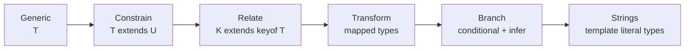
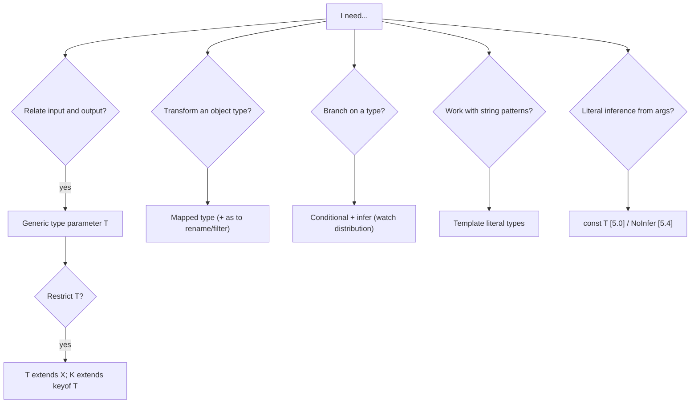

# TypeScript Generics & Advanced Types — Interview Guide

> Verified against TypeScript release posts (5.8, 5.9, 6.0, 7.0). Version-sensitive features are marked **[TS x.y]**. TypeScript 7.0 is a faithful native port of 6.0's type-checking behaviour, so everything here applies to 5.x, 6.x and 7.x unless stated.
> Prerequisite: [01-type-system-fundamentals.md](01-type-system-fundamentals.md). Next: [03-narrowing-and-type-safety-patterns.md](03-narrowing-and-type-safety-patterns.md).

## Table of Contents

1. [Quick Summary (TL;DR)](#1-quick-summary-tldr)
2. [Generics Fundamentals](#2-generics-fundamentals)
3. [Constraints, Defaults, `const` and `NoInfer`](#3-constraints-defaults-const-and-noinfer)
4. [How Inference Works](#4-how-inference-works)
5. [Conditional Types and `infer`](#5-conditional-types-and-infer)
6. [Mapped Types and Key Remapping](#6-mapped-types-and-key-remapping)
7. [Template Literal Types](#7-template-literal-types)
8. [Recursive Types and Their Limits](#8-recursive-types-and-their-limits)
9. [Variance Annotations (`in` / `out`)](#9-variance-annotations-in--out)
10. [Implementing the Built-in Utility Types](#10-implementing-the-built-in-utility-types)
11. [Production Patterns](#11-production-patterns)
12. [Testing Types](#12-testing-types)
13. [Common Mistakes and Pitfalls](#13-common-mistakes-and-pitfalls)
14. [Performance Considerations](#14-performance-considerations)
15. [Trade-offs and Alternatives](#15-trade-offs-and-alternatives)
16. [Interview Questions — Fundamentals](#16-interview-questions--fundamentals)
17. [Type Challenges with Solutions](#17-type-challenges-with-solutions)
18. [Interview Questions — Senior Scenarios](#18-interview-questions--senior-scenarios)
19. [Cheat Sheet](#19-cheat-sheet)
20. [Key Terms Glossary](#20-key-terms-glossary)
21. [Further Reading](#21-further-reading)

---

## 1. Quick Summary (TL;DR)

- **Generics = type parameters**: write one implementation that preserves relationships between inputs and outputs (`identity<T>(x: T): T`) instead of collapsing to `any`.
- **Constrain** with `extends`, **default** with `= X`; use `K extends keyof T` to relate keys to objects.
- **Conditional types** (`A extends B ? X : Y`) are type-level `if`; they **distribute over naked union type parameters**, and **`infer`** captures parts of a type.
- **Mapped types** (`{ [K in keyof T]: … }`) transform object types; **key remapping** (`as`) renames/filters keys.
- **Template literal types** model string patterns (routes, event names, camelCase conversion).
- Recent tools: **`const` type parameters** [TS 5.0], **`NoInfer<T>`** [TS 5.4], `infer X extends U` [TS 4.7], `in`/`out` variance annotations [TS 4.7].
- Senior rule: **use advanced types to make APIs safe and pleasant for callers, not to show off.** Test them, keep them shallow, hide complexity behind named utilities, and watch compile-time cost.



---

## 2. Generics Fundamentals

### Concept
A generic type/function takes **type parameters** which callers provide explicitly or the compiler infers.

```ts
function identity<T>(value: T): T { return value; }
const n = identity(42);            // T inferred as 42 -> returns number literal 42 (as const-like for primitives)
const s = identity<string>("x");   // explicit

interface Box<T> { value: T }
type Maybe<T> = T | null | undefined;
class Stack<T> {
  private items: T[] = [];
  push(item: T) { this.items.push(item); }
  pop(): T | undefined { return this.items.pop(); }
}
```

### Why it matters
Without generics you either duplicate code per type or use `any`/`unknown` and lose the link between input and output (e.g. `first(arr)` returning the element type). Generics make **reusable and type-preserving** APIs: collections, hooks, HTTP clients, state stores, component libraries.

### How it works internally
- The checker infers type arguments by **unifying** parameter types with argument types (candidate collection, then union/common supertype selection).
- Each use of a generic **instantiates** it with concrete types; instantiations are cached. Heavy generic code therefore costs compile time proportional to distinct instantiations.
- Type parameters are **erased** at runtime; you cannot use `T` as a value (`new T()` is impossible; pass a constructor `new () => T` instead).

```ts
function create<T>(ctor: new () => T): T { return new ctor(); }
```

### Practical examples
```ts
// Relate key to value
function pluck<T, K extends keyof T>(items: T[], key: K): T[K][] { return items.map((i) => i[key]); }
const names = pluck([{ id: 1, name: "a" }], "name"); // string[]

// Generic React hook
function useLocalState<T>(key: string, initial: T): [T, (v: T) => void] { /* ... */ return [initial, () => {}]; }

// Generic async result
type Result<T, E = Error> = { ok: true; value: T } | { ok: false; error: E };
```

---

## 3. Constraints, Defaults, `const` and `NoInfer`

### Constraints
```ts
function longest<T extends { length: number }>(a: T, b: T): T { return a.length >= b.length ? a : b; }
longest("abc", "de");      // string
longest([1], [1, 2, 3]);   // number[]
// longest(1, 2);          // error: number has no length
```

### Default type parameters
```ts
interface ApiResponse<TData = unknown, TError = Error> { data?: TData; error?: TError }
```

### `const` type parameters **[TS 5.0]**
Ask the compiler to infer **literal/readonly** types for arguments as if `as const` had been written:
```ts
function tuple<const T extends readonly unknown[]>(...xs: T): T { return xs; }
const t = tuple("a", 1, true);   // readonly ["a", 1, true]  (without `const`: (string | number | boolean)[])

declare function defineRoutes<const T extends Record<string, { path: string }>>(routes: T): T;
const routes = defineRoutes({ home: { path: "/" }, user: { path: "/u/:id" } });
// routes.user.path is "/u/:id" (literal) -> enables route-param type extraction
```

### `NoInfer<T>` **[TS 5.4]**
Stops a position from contributing inference candidates:
```ts
function createLight<C extends string>(colors: C[], initial?: NoInfer<C>) {}
createLight(["red", "green"], "red");     // ok
// createLight(["red", "green"], "blue"); // error — "blue" is not used to widen C
```

### Generic lint rule worth knowing
`@typescript-eslint/no-unnecessary-type-parameters`: a type parameter used **once** doesn't relate anything and is usually a disguised `unknown`/`any`.

---

## 4. How Inference Works

1. **Candidates** are collected from each argument position (covariant positions union/widen; contravariant positions intersect).
2. **Context-sensitive functions** (callbacks with unannotated params) are skipped in the first pass; TypeScript infers from other arguments first, then checks callbacks. **[TS 6.0]** functions that never use `this` are no longer considered context-sensitive even with method syntax, fixing order-dependence bugs:
```ts
declare function callIt<T>(o: { produce: (x: number) => T; consume: (y: T) => void }): void;
callIt({ consume(y) { return y.toFixed(); }, produce(x: number) { return x * 2; } }); // OK in 6.0+
```
3. If inference fails you get `unknown` (or the constraint) — fix with explicit type arguments or restructure parameters.
4. **Return-type inference** from contextual type: `const x: Promise<string[]> = Promise.resolve([])` infers `[]` as `string[]`.
5. TS 5.9/6.0/7.0 tightened some inference "leaks"; code that relied on odd inference may need an explicit type argument.

Practical rules: put the "anchor" parameter (from which T is inferred) **first**; use `NoInfer` for defaults; avoid using `T` only in return type (can't be inferred from args → callers must specify).

---

## 5. Conditional Types and `infer`

### Syntax and semantics
```ts
type IsString<T> = T extends string ? true : false;
type A = IsString<"x">;    // true
type B = IsString<number>; // false
```

### Distribution over unions (a classic interview question)
When the checked type is a **naked type parameter**, the conditional distributes over a union:
```ts
type ToArray<T> = T extends unknown ? T[] : never;
type X = ToArray<string | number>;   // string[] | number[]

type ToArrayND<T> = [T] extends [unknown] ? T[] : never;   // wrap in tuple to prevent distribution
type Y = ToArrayND<string | number>; // (string | number)[]
```
- Distribution over `never` yields **`never`** (empty union): `ToArray<never>` is `never`. Test with `[T] extends [never]`.
```ts
type IsNever<T> = [T] extends [never] ? true : false;
```

### `infer`: pattern-match and capture
```ts
type ElementOf<T> = T extends readonly (infer E)[] ? E : never;
type Unpromise<T> = T extends Promise<infer U> ? Unpromise<U> : T;   // see built-in Awaited
type Params<F> = F extends (...args: infer P) => unknown ? P : never;
type FirstArg<F> = F extends (first: infer A, ...rest: any[]) => any ? A : never;

// infer with constraint [TS 4.7]
type FirstString<T> = T extends [infer S extends string, ...unknown[]] ? S : never;
```

### Filtering and branching with `never`
```ts
type NonFunctionKeys<T> = { [K in keyof T]: T[K] extends (...a: any[]) => any ? never : K }[keyof T];
```

### Conditional return types in functions
Function bodies can't be checked precisely against deferred conditional return types — **overloads** or assertions are needed:
```ts
type ParseResult<T extends "json" | "text"> = T extends "json" ? unknown : string;
function parse<T extends "json" | "text">(kind: T, s: string): ParseResult<T>;
function parse(kind: "json" | "text", s: string) { return kind === "json" ? JSON.parse(s) : s; }
```
(TS 5.8 added granular checks per branch of a conditional **return expression**, helping catch mismatches like returning `string` where `URL` is expected.)

---

## 6. Mapped Types and Key Remapping

```ts
type MyPartial<T> = { [K in keyof T]?: T[K] };
type MyRequired<T> = { [K in keyof T]-?: T[K] };           // -? removes optional
type Mutable<T> = { -readonly [K in keyof T]: T[K] };      // -readonly
type Nullable<T> = { [K in keyof T]: T[K] | null };
```
- **Homomorphic** mapped types (`keyof T` over a type parameter) preserve modifiers (`readonly`, `?`) and map **arrays/tuples element-wise**.
- **Key remapping with `as`:**
```ts
type Getters<T> = { [K in keyof T & string as `get${Capitalize<K>}`]: () => T[K] };
type G = Getters<{ name: string; age: number }>;   // { getName: () => string; getAge: () => number }

type RemoveKind<T> = { [K in keyof T as Exclude<K, "kind">]: T[K] };        // filter keys
type OnlyStrings<T> = { [K in keyof T as T[K] extends string ? K : never]: T[K] }; // filter by value
```
- **Mapped over unions** to build discriminated unions:
```ts
type Events = { click: { x: number }; key: { code: string } };
type EventUnion = { [K in keyof Events]: { type: K } & Events[K] }[keyof Events];
// { type: "click"; x: number } | { type: "key"; code: string }
```

---

## 7. Template Literal Types

```ts
type Method = "GET" | "POST";
type Path = `/api/${string}`;
type Route = `${Method} ${Path}`;            // "GET /api/..." | "POST /api/..."

type CssUnit = `${number}${"px" | "rem" | "%"}`;
type Handler<E extends string> = `on${Capitalize<E>}`;   // "onClick" ...
```
### Parsing with `infer`
```ts
type ExtractParams<P extends string> =
  P extends `${string}:${infer Param}/${infer Rest}` ? Param | ExtractParams<Rest>
  : P extends `${string}:${infer Param}` ? Param
  : never;
type RouteParams<P extends string> = { [K in ExtractParams<P>]: string };
type R = RouteParams<"/users/:userId/posts/:postId">;   // { userId: string; postId: string }

type SnakeToCamel<S extends string> = S extends `${infer H}_${infer T}` ? `${H}${Capitalize<SnakeToCamel<T>>}` : S;
type CamelKeys<T> = { [K in keyof T as K extends string ? SnakeToCamel<K> : K]: T[K] };
type U = CamelKeys<{ user_id: string; created_at: Date }>;   // { userId: string; createdAt: Date }
```
Notes: a combinatorial explosion occurs with several large unions in one template (cross-product); **[TS 7.0]** inference over template literal types now treats **Unicode code points** (not UTF-16 code units) as units — a breaking change for exotic type-level string utilities (e.g., `Length`).

---

## 8. Recursive Types and Their Limits

```ts
type DeepPartial<T> = T extends (...a: any[]) => any ? T
  : T extends object ? { [K in keyof T]?: DeepPartial<T[K]> } : T;

type DeepReadonly<T> = T extends (...a: any[]) => any ? T
  : T extends object ? { readonly [K in keyof T]: DeepReadonly<T[K]> } : T;

type Json = string | number | boolean | null | Json[] | { [k: string]: Json };

type Paths<T> = T extends object
  ? { [K in keyof T & string]: T[K] extends object ? K | `${K}.${Paths<T[K]>}` : K }[keyof T & string]
  : never;
```
Limits:
- The compiler caps **instantiation depth** and total instantiation count ("Type instantiation is excessively deep and possibly infinite").
- **Tail-recursive conditional types** (accumulator pattern) are optimised and allow much deeper recursion (on the order of 1000):
```ts
type Repeat<S extends string, N extends number, Acc extends string = "", Count extends unknown[] = []> =
  Count["length"] extends N ? Acc : Repeat<S, N, `${Acc}${S}`, [...Count, unknown]>;
```
- Cyclic structures (`Paths` on circular types) hang or error; guard with depth counters.

---

## 9. Variance Annotations (`in` / `out`)

Variance is computed structurally (expensive for recursive types). **[TS 4.7]** lets you declare it:
```ts
interface Producer<out T> { get(): T }       // covariant: Producer<Dog> assignable to Producer<Animal>
interface Consumer<in T> { accept(v: T): void }  // contravariant
interface Mutable<in out T> { get(): T; set(v: T): void } // invariant
```
Benefits: faster checks, clearer intent, errors if the annotation contradicts usage. Rare in app code; valuable in libraries with heavy generics.

---

## 10. Implementing the Built-in Utility Types

```ts
type MyPick<T, K extends keyof T> = { [P in K]: T[P] };
type MyOmit<T, K extends PropertyKey> = { [P in keyof T as P extends K ? never : P]: T[P] };
type MyExclude<T, U> = T extends U ? never : T;
type MyExtract<T, U> = T extends U ? T : never;
type MyReturnType<F extends (...a: any) => any> = F extends (...a: any) => infer R ? R : never;
type MyParameters<F extends (...a: any) => any> = F extends (...a: infer P) => any ? P : never;
type MyAwaited<T> = T extends PromiseLike<infer U> ? MyAwaited<U> : T;
type MyRecord<K extends PropertyKey, V> = { [P in K]: V };
type MyNonNullable<T> = T & {};                              // modern definition

// Handy extras
type Prettify<T> = { [K in keyof T]: T[K] } & {};            // flatten intersections for readable hovers
type UnionToIntersection<U> = (U extends unknown ? (k: U) => void : never) extends (k: infer I) => void ? I : never;
type DistributiveOmit<T, K extends PropertyKey> = T extends unknown ? Omit<T, K> : never;
type IsEqual<A, B> = (<T>() => T extends A ? 1 : 2) extends (<T>() => T extends B ? 1 : 2) ? true : false;
```
Why `UnionToIntersection` works: `(k: U) => void` produces a union of function types; inferring a single parameter from a union of **contravariant** candidates intersects them.

---

## 11. Production Patterns

### 11.1 Typed event emitter
```ts
type Events = { login: { userId: string }; logout: void };   // must be a `type` alias to satisfy Record<string, unknown>

class Emitter<E extends Record<string, unknown>> {
  private handlers = new Map<keyof E, Set<(payload: any) => void>>();     // internal `any` contained
  on<K extends keyof E>(event: K, handler: (payload: E[K]) => void): () => void {
    const set = this.handlers.get(event) ?? new Set();
    set.add(handler); this.handlers.set(event, set);
    return () => set.delete(handler);
  }
  emit<K extends keyof E>(event: K, ...args: E[K] extends void ? [] : [payload: E[K]]): void {
    this.handlers.get(event)?.forEach((h) => h(args[0]));
  }
}
const bus = new Emitter<Events>();
bus.on("login", (p) => p.userId);
bus.emit("login", { userId: "u1" });
bus.emit("logout");
// bus.emit("login");   // error: payload required
```
(Gotcha: `interface Events {}` is **not** assignable to `Record<string, unknown>` because interfaces lack implicit index signatures; type aliases are.)

### 11.2 Type-safe route table + params (with `const` type parameter)
```ts
declare function defineRoutes<const R extends Record<string, string>>(r: R): R;
const routes = defineRoutes({ user: "/users/:userId", post: "/users/:userId/posts/:postId" });
declare function href<K extends keyof typeof routes>(name: K, params: RouteParams<(typeof routes)[K]>): string;
href("post", { userId: "1", postId: "2" });
```

### 11.3 Typed `pipe` (overloads vs variadic tuples)
```ts
function pipe<A, B>(f: (a: A) => B): (a: A) => B;
function pipe<A, B, C>(f: (a: A) => B, g: (b: B) => C): (a: A) => C;
function pipe<A, B, C, D>(f: (a: A) => B, g: (b: B) => C, h: (c: C) => D): (a: A) => D;
function pipe(...fns: Array<(x: any) => any>) { return (x: unknown) => fns.reduce((acc, fn) => fn(acc), x); }
```
Libraries use overload ladders because variadic generic chaining is hard to infer.

### 11.4 Strongly typed `Object.entries` / `fromEntries` helpers
```ts
const entries = <T extends Record<string, unknown>>(o: T) => Object.entries(o) as { [K in keyof T]: [K, T[K]] }[keyof T][];
```
(Cast is localised; explain that `Object.keys` isn't narrowed by default because objects may have extra keys.)

### 11.5 Discriminated union reducers and action creators
```ts
type Action = { type: "add"; text: string } | { type: "remove"; id: string };
type ActionOf<T extends Action["type"]> = Extract<Action, { type: T }>;
function handle<T extends Action["type"]>(type: T, payload: Omit<ActionOf<T>, "type">) { /* ... */ }
```

### 11.6 Branded/opaque types
```ts
declare const brand: unique symbol;
type Brand<T, B extends string> = T & { readonly [brand]: B };
type UserId = Brand<string, "UserId">;
```

### 11.7 Builder accumulating types
```ts
declare class Builder<T extends object = {}> {
  set<K extends string, V>(key: K, value: V): Builder<T & { [P in K]: V }>;
  build(): Prettify<T>;
}
// new Builder().set("a", 1).set("b", "x").build()  // { a: number; b: string }
```

### 11.8 Overloads vs generics vs conditional return
- Few fixed shapes → **overloads**.
- Return depends on input literal → **generic + lookup map** (`type Map = { a: A; b: B }; fn<K extends keyof Map>(k: K): Map[K]`) — often cleaner and implementable without casts.
- Avoid conditional return types unless inputs are literal unions; implementation usually needs a cast.

---

## 12. Testing Types

```ts
type Equal<X, Y> = (<T>() => T extends X ? 1 : 2) extends (<T>() => T extends Y ? 1 : 2) ? true : false;
type Expect<T extends true> = T;

type _t1 = Expect<Equal<MyPick<{ a: 1; b: 2 }, "a">, { a: 1 }>>;
// @ts-expect-error — must fail
type _t2 = Expect<Equal<MyPick<{ a: 1 }, "a">, { a: 2 }>>;
```
Tools: **`expectTypeOf`** (Vitest), **`tsd`**, **`@ts-expect-error`** lines in a dedicated `types.test.ts` compiled in CI, **`attw`** for published packages. Always test **negative cases** (things that must *not* compile).

---

## 13. Common Mistakes and Pitfalls

| Mistake | Problem | Fix |
|---|---|---|
| Generic used once (`<T>(x: T): void`) | Adds nothing | Use concrete/`unknown` |
| Unconstrained `T` then property access | Error | Constrain `extends {…}` |
| Using `any` inside generic internals leaking out | Unsound API | Contain with overload/internal cast |
| Forgetting distribution | Unexpected union splitting | Wrap in `[T]` to disable |
| `T extends never` expecting to test never | Distributes to never | `[T] extends [never]` |
| Return-only type param (`function f<T>(): T`) | Caller must supply T; it's a disguised cast | Make T inferable or avoid |
| Mapped type over `keyof T` for union T | Collapses union | Distribute with `T extends unknown` |
| Depending on property order in unions | Brittle (stable ordering only in 7.0/`--stableTypeOrdering`) | Don't rely on union order |
| Excessively deep recursion | Compiler errors/slow | Tail recursion, depth limits, simplify |
| Cleverness without tests | Regressions | Type tests |
| Interfaces passed to `Record<string, unknown>` constraints | Not assignable | Use `type` alias or relax constraint |
| `keyof` on arrays/unions unexpected | Includes methods / only common keys | Use `T[number]`, distribute |

---

## 14. Performance Considerations

- **Instantiation count** drives cost: each distinct generic instantiation creates new types. Deep chains of conditional/mapped types across large unions multiply cost; TS 5.9 added mapper-instantiation caching which helped libs like Zod/tRPC.
- **Big unions** (> a few hundred members) and **cross-products in template literal types** (e.g. 100 × 100) are classic slowdowns.
- **Annotate exported return types** to avoid re-inferring complex types; use `interface` and `extends` where possible.
- Prefer **simple, flat helper types**; memoize with type aliases (aliases are cached when instantiated identically).
- Diagnose: `tsc --extendedDiagnostics`, `--generateTrace trace/` then Chrome's Perfetto / `@typescript/analyze-trace`.
- TypeScript 7.0's native compiler and parallel checking (default 4 checker workers, `--checkers`) reduce wall-clock time ~8–12× on large builds but do not remove pathological types.

---

## 15. Trade-offs and Alternatives

| Technique | Benefit | Cost |
|---|---|---|
| Rich generics | Strong inference, DX | Complexity, error-message quality, compile time |
| Overloads | Readable per-case signatures | Verbose, order-sensitive |
| Runtime schemas as the source (`z.infer`) | One definition for runtime + types | Library dependency; complex inferred types |
| Codegen (OpenAPI/GraphQL) | Accurate, simple types | Pipeline & generated-file churn |
| Hand-written type utilities | Tailored | Maintenance + testing burden |
| Plain interfaces + validation | Simple, fast | More duplication |

Guideline: if a teammate can't read a type in 30 seconds, hide it behind a well-named, documented, tested alias — or simplify the API.

---

## 16. Interview Questions — Fundamentals

### Q1. What problem do generics solve?
They preserve type relationships across inputs/outputs without code duplication or `any` — e.g. `Array<T>.map<U>`, `Promise<T>`, hooks and stores.

### Q2. What are generic constraints?
`T extends U` restricts acceptable type arguments and lets you use members of `U` on `T`. `K extends keyof T` ties keys to the object type.

### Q3. Explain `keyof`, `typeof`, indexed access types together.
`typeof value` → type of a value; `keyof Type` → union of keys; `Type[Key]` → property type. Common combo: `(typeof ROLES)[number]` for union from a tuple; `T[keyof T]` for value union.

### Q4. What is a conditional type? What is `infer`?
Type-level ternary `A extends B ? X : Y`. `infer` introduces a type variable inside the `extends` clause to capture part of the matched type (e.g. a function's return type or array element).

### Q5. What's distributive conditional typing?
For `T extends U ? X : Y` with naked `T`, a union input is split and results are unioned. Use `[T] extends [U]` to avoid. `never` input yields `never`.

### Q6. What are mapped types? How do `-?`, `-readonly`, and `as` work?
Iterate over keys to build new object types. `-?` removes optionality, `-readonly` removes readonly, `as` remaps/filters keys (`as never` drops a key).

### Q7. What are template literal types good for?
Typed string formats: route params, event names (`on${Capitalize<E>}`), CSS units, key conversion (snake↔camel).

### Q8. Implement `Pick`, `Omit`, `Readonly`, `ReturnType`.
See §10. `Omit` is `Pick<T, Exclude<keyof T, K>>` in lib; non-distributive over unions.

### Q9. What is `const` in `<const T>` and when is it useful?
TS 5.0 const type parameter — infers literal readonly types from arguments, avoiding callers writing `as const` (route/config definition helpers).

### Q10. What is `NoInfer`?
TS 5.4 intrinsic to prevent inference from a particular parameter, ensuring a default/secondary argument doesn't widen the type parameter.

### Q11. Why is `Omit` not distributive and how do you fix it?
`keyof (A | B)` is the common keys only; `Omit` over a union loses members. Use `T extends unknown ? Omit<T, K> : never`.

### Q12. How can you get a union from an array literal?
`const xs = [...] as const; type U = (typeof xs)[number];`

### Q13. What does `T extends any[] ? T[number] : T` do for `string[] | number`?
Distributes: `string` for the array member and `number` for the primitive → `string | number`.

### Q14. When would you use overloads vs generics?
Overloads for a small number of discrete signatures; generics for relationships (output depends on input type); conditional returns rarely.

### Q15. How do variance annotations help?
`in`/`out` document and enforce how a type parameter is used (contravariant/covariant), enabling faster, more predictable assignability checks in complex generic types.

---

## 17. Type Challenges with Solutions

```ts
// 1. First element of a tuple
type First<T extends readonly unknown[]> = T extends readonly [infer F, ...unknown[]] ? F : never;

// 2. Tuple to union / length
type TupleToUnion<T extends readonly unknown[]> = T[number];
type Length<T extends readonly unknown[]> = T["length"];

// 3. Concat tuples (variadic tuples)
type Concat<A extends readonly unknown[], B extends readonly unknown[]> = [...A, ...B];

// 4. Includes (strict equality)
type Includes<T extends readonly unknown[], U> =
  T extends readonly [infer H, ...infer R] ? (IsEqual<H, U> extends true ? true : Includes<R, U>) : false;

// 5. If
type If<C extends boolean, T, F> = C extends true ? T : F;

// 6. Push / Unshift / Pop
type Push<T extends unknown[], U> = [...T, U];
type Pop<T extends unknown[]> = T extends [...infer R, unknown] ? R : never;

// 7. Trim whitespace
type Trim<S extends string> = S extends ` ${infer R}` | `${infer R} ` | `\n${infer R}` | `${infer R}\n` ? Trim<R> : S;

// 8. Capitalize first / KebabCase
type KebabCase<S extends string> = S extends `${infer F}${infer R}`
  ? R extends Uncapitalize<R> ? `${Lowercase<F>}${KebabCase<R>}` : `${Lowercase<F>}-${KebabCase<R>}`
  : S;

// 9. Get optional/required keys
type OptionalKeys<T> = { [K in keyof T]-?: {} extends Pick<T, K> ? K : never }[keyof T];
type RequiredKeys<T> = Exclude<keyof T, OptionalKeys<T>>;

// 10. Flatten (tuple)
type Flatten<T extends readonly unknown[]> =
  T extends readonly [infer H, ...infer R] ? (H extends readonly unknown[] ? [...Flatten<H>, ...Flatten<R>] : [H, ...Flatten<R>]) : [];

// 11. Mutable deep + PromiseAll-like typing
type PromiseAllResult<T extends readonly unknown[]> = Promise<{ -readonly [K in keyof T]: Awaited<T[K]> }>;
declare function promiseAll<const T extends readonly unknown[]>(values: T): PromiseAllResult<T>;

// 12. Chainable options
type Chainable<Result = {}> = {
  option<K extends string, V>(key: K extends keyof Result ? never : K, value: V): Chainable<Omit<Result, K> & Record<K, V>>;
  get(): Result;
};

// 13. Required keys picker by type
type PickByType<T, U> = { [K in keyof T as T[K] extends U ? K : never]: T[K] };

// 14. Replace string
type Replace<S extends string, From extends string, To extends string> =
  From extends "" ? S : S extends `${infer A}${From}${infer B}` ? `${A}${To}${B}` : S;

// 15. Absolute value of number literal via string
type Absolute<T extends number | string | bigint> = `${T}` extends `-${infer N}` ? N : `${T}`;
```
Explain the reasoning aloud: **pattern-match with `infer`, recurse on the rest, terminate on base case**; mention distribution, `never` handling, and recursion limits.

---

## 18. Interview Questions — Senior Scenarios

### S1. "Design the types for a router where route definitions drive `navigate(name, params)`."
Use a `const` route table (`defineRoutes<const R extends Record<string,string>>`), extract params from the path with a template-literal parser, and type `navigate` with `K extends keyof R` and `params: RouteParams<R[K]>` (optional when no params via conditional tuple rest args). Discuss query/hash params, optional segments (`:id?`), nested routes, compile-time cost with large route tables (keep per-route computation O(1), avoid cross-products), runtime validation (zod) for params, and codegen as an alternative for very large apps.

### S2. "A generic helper compiles in the editor but fails in CI (or is very slow). Why?"
Possible causes: different TS versions (editor uses workspace TS; CI uses another — pin and align; note TS 7's native `tsc` vs TS 6 language service differences in embedded-language workflows), **instantiation depth** limits near-threshold, `--stableTypeOrdering`/ordering-dependent inference (TS 7 sorts types deterministically), different `lib`/`types` (TS 6/7 default `types: []`), or `skipLibCheck`. Remedies: pin versions, add explicit type arguments where inference is order-dependent, simplify, add type tests, use `--generateTrace`.

### S3. "How would you type a form library's `register('address.street')`?"
`Paths<T>` template-literal key union with depth limiting; value lookup `PathValue<T, P>` via recursive `infer` splitting on `.`; arrays via `${number}` segments; discuss performance cost on large schemas (limit recursion depth, cache with aliases), alternatives like builder/proxy field objects, or schema-driven (zod) inference.

### S4. "Why would you avoid conditional return types in a public function?"
Function implementations cannot verify the deferred conditional so you need casts; error messages become opaque; inference with unions distributes unexpectedly. Prefer overloads or a mapping interface (`Map[K]`) with a generic key — implementable without casts and readable.

### S5. "Explain variance with a real example (React props or event handlers)."
`(e: MouseEvent) => void` is not assignable to `(e: Event) => void` under `strictFunctionTypes` because handlers are contravariant (a handler needing a `MouseEvent` can't handle every `Event`). Method shorthand bypasses this (bivariance), which is why `EventListener` typed via methods are looser. Demonstrate how React's `onClick={(e: React.MouseEvent<HTMLButtonElement>) => …}` relies on contextual typing.

### S6. "How do you keep advanced types maintainable in a monorepo?"
Centralise in a `types` package with docs and tests; ban ad-hoc type gymnastics in app code via review; add type-test suites (`tsd`/`expectTypeOf`) and CI trace budgets; prefer generated types for external schemas; keep recursion bounded; document known compiler limits; revisit after TS upgrades (6.0/7.0 inference changes).

---

## 19. Cheat Sheet



| Pattern | Snippet |
|---|---|
| Value union from tuple | `(typeof xs)[number]` |
| Key/value relation | `<T, K extends keyof T>(o: T, k: K): T[K]` |
| Disable distribution | `[T] extends [U]` |
| Detect never | `[T] extends [never]` |
| Flatten intersection | `{ [K in keyof T]: T[K] } & {}` |
| Union → intersection | `(U extends unknown ? (k: U) => void : never) extends (k: infer I) => void ? I : never` |
| Equal check | `(<T>() => T extends A ? 1 : 2) extends (<T>() => T extends B ? 1 : 2)` |

---

## 20. Key Terms Glossary

| Term | Definition |
|---|---|
| Type parameter | Placeholder type supplied by caller or inference |
| Constraint | Upper bound on a type parameter (`extends`) |
| Distributive conditional | Conditional that maps over union members of a naked type parameter |
| `infer` | Declares a type variable captured during conditional matching |
| Homomorphic mapped type | Mapped type over `keyof T` preserving modifiers |
| Key remapping | `as` clause in mapped types |
| Variadic tuple | Tuple with spread of generic arrays: `[...A, ...B]` |
| Tail recursion (type) | Recursive conditional where the recursive call is in tail position; optimised |
| Instantiation | Creating a concrete type from a generic with arguments |
| Phantom type | Type parameter only used for type-level information (branding) |

---

## 21. Further Reading

- [TypeScript Handbook: Generics](https://www.typescriptlang.org/docs/handbook/2/generics.html), [Conditional Types](https://www.typescriptlang.org/docs/handbook/2/conditional-types.html), [Mapped Types](https://www.typescriptlang.org/docs/handbook/2/mapped-types.html), [Template Literal Types](https://www.typescriptlang.org/docs/handbook/2/template-literal-types.html)
- [Utility Types](https://www.typescriptlang.org/docs/handbook/utility-types.html)
- [type-challenges](https://github.com/type-challenges/type-challenges) for practice
- [TypeScript 6.0](https://devblogs.microsoft.com/typescript/announcing-typescript-6-0/) and [7.0](https://devblogs.microsoft.com/typescript/announcing-typescript-7-0/) release notes (inference/ordering/Unicode changes)
