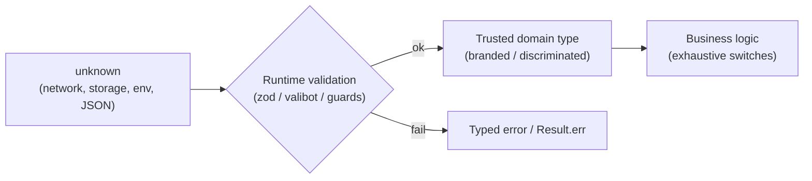
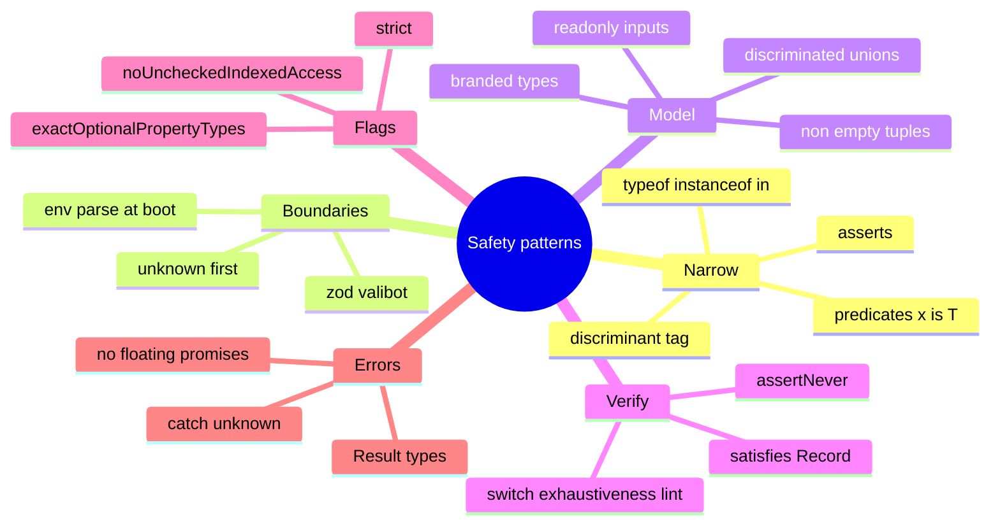

# TypeScript Narrowing, Runtime Boundaries & Type-Safety Patterns — Interview Guide

> Verified against TypeScript release posts (5.8, 5.9, 6.0, 7.0). Version-sensitive items are marked **[TS x.y]**; features introduced before 5.8 (`satisfies` 4.9, `using` 5.2, closure narrowing 5.4, inferred type predicates 5.5) are described from the TypeScript release notes.
> Prerequisites: [01-type-system-fundamentals.md](01-type-system-fundamentals.md), [02-generics-and-advanced-types.md](02-generics-and-advanced-types.md). Next: [04-tsconfig-modules-and-tooling.md](04-tsconfig-modules-and-tooling.md).

## Table of Contents

1. [Quick Summary (TL;DR)](#1-quick-summary-tldr)
2. [Narrowing: How Control-Flow Analysis Works](#2-narrowing-how-control-flow-analysis-works)
3. [Narrowing Tools, One by One](#3-narrowing-tools-one-by-one)
4. [Type Predicates and Assertion Functions](#4-type-predicates-and-assertion-functions)
5. [Discriminated Unions and Exhaustiveness](#5-discriminated-unions-and-exhaustiveness)
6. [`satisfies`, `as const`, and When Assertions Are Acceptable](#6-satisfies-as-const-and-when-assertions-are-acceptable)
7. [Runtime Boundaries: Parse, Don't Cast](#7-runtime-boundaries-parse-dont-cast)
8. [Typed Error Handling](#8-typed-error-handling)
9. [Strictness Flags That Pay Off](#9-strictness-flags-that-pay-off)
10. [Making Illegal States Unrepresentable](#10-making-illegal-states-unrepresentable)
11. [Resource Management: `using`](#11-resource-management-using)
12. [Lint Rules That Complement the Compiler](#12-lint-rules-that-complement-the-compiler)
13. [Common Mistakes and Pitfalls](#13-common-mistakes-and-pitfalls)
14. [Performance Considerations](#14-performance-considerations)
15. [Trade-offs and Alternatives](#15-trade-offs-and-alternatives)
16. [Interview Questions — Fundamentals](#16-interview-questions--fundamentals)
17. [Interview Questions — Senior Scenarios](#17-interview-questions--senior-scenarios)
18. [Cheat Sheet](#18-cheat-sheet)
19. [Key Terms Glossary](#19-key-terms-glossary)
20. [Further Reading](#20-further-reading)

---

## 1. Quick Summary (TL;DR)

- **Narrowing** refines a wide type to a specific one using runtime checks the compiler understands (`typeof`, `instanceof`, `in`, equality, truthiness, discriminants, type predicates, assertion functions).
- **TypeScript types are erased.** Everything that crosses a boundary (HTTP, `JSON.parse`, storage, env vars, `postMessage`, URL params, form data) is `unknown` until **validated at runtime**. *Parse, don't cast.*
- **Make illegal states unrepresentable:** discriminated unions, branded types, non-empty tuples, state machines.
- Use **exhaustive `switch` with `never`** so adding a union member produces compile errors where it must be handled.
- Prefer **`satisfies`** and **type guards** over **`as`**. Treat every assertion as technical debt that needs a justification.
- Turn on the strictness flags beyond `strict`: **`noUncheckedIndexedAccess`**, **`exactOptionalPropertyTypes`**, `noImplicitOverride`, `noImplicitReturns`, `noFallthroughCasesInSwitch`. (`tsc --init` in 5.9+ already enables the first two.)
- Add **typescript-eslint type-aware rules** (`no-floating-promises`, `no-misused-promises`, `switch-exhaustiveness-check`, `no-unnecessary-condition`) — the compiler alone doesn't catch these.



---

## 2. Narrowing: How Control-Flow Analysis Works

### Concept
At every point in a function the compiler holds a **narrowed type** for each reference (variable, property path like `a.b.c`, element access with literal keys). Conditions and assignments **refine** it; joins (after `if`/`else`, loops, `try`) **union** the possibilities.

```ts
function len(x: string | string[] | null) {
  if (x === null) return 0;          // x: string | string[]
  if (typeof x === "string") return x.length;   // x: string
  return x.length;                   // x: string[]
}
```

### How it works internally (mental model)
The checker builds a **control-flow graph** of the function. Each node carries "flow type" computation: walking *backwards* from a use to its declarations/assignments/conditions, applying each narrowing and union-ing at merge points. That's why:
- **Assignments narrow**: `let x: string | number = "a"; x.toUpperCase()` works.
- **Function calls generally do not invalidate** narrowing of local `const`s but **do** for mutable object properties in theory — TypeScript is optimistic (a known unsoundness).
- **Closures** historically reset narrowing for `let` variables because the callback may run later; **[TS 5.4]** preserves narrowing in closures created **after the last assignment** to that variable.

```ts
function f(url: string | URL) {
  if (typeof url === "string") url = new URL(url);       // last assignment
  return () => url.href;    // TS 5.4+: url is URL inside the closure
}
```

### Limits
- Narrowing works on **references**, not arbitrary expressions: `if (obj.items.length) obj.items[0]` is fine for `readonly`/stable paths but **aliasing** (`const x = obj; x.items = ...`) may defeat it.
- Narrowing on **computed keys** requires literal or `const` keys (and since 4.7 `unique symbol` keys).
- Boolean conditions stored in variables narrow in some cases (**aliased conditions**, 4.4): `const isString = typeof x === "string"; if (isString) x.length` works when `x` is a `const`/readonly/unmodified parameter.

---

## 3. Narrowing Tools, One by One

| Tool | Example | Notes |
|---|---|---|
| `typeof` | `typeof x === "string"` | Results: `"string" "number" "bigint" "boolean" "symbol" "undefined" "object" "function"`. **`typeof null === "object"`** — `object` branch includes `null` unless excluded |
| Truthiness | `if (x) …` | Removes `null`/`undefined`/`0`/`""`/`false`; careful with `0` and `""` being valid |
| Equality | `x === undefined`, `x == null` | `== null` narrows both `null` and `undefined`; `===` to literal narrows unions |
| `instanceof` | `e instanceof Error` | Uses prototype chain; fails across realms (iframes) and for plain objects |
| `in` | `"swim" in pet` | Narrows union members by property presence; **[4.9]** also narrows `unknown`/object to `object & Record<"swim", unknown>` |
| Discriminant | `shape.kind === "circle"` | Most robust for unions |
| `Array.isArray` | `Array.isArray(x)` | Narrows to `any[]` (or the array member of a union) |
| Assignment | `x = value` | Narrows declared union to assigned type |
| Switch/case | `switch (x.kind)` | Fall-through merges types |
| Optional chaining | `a?.b` | Removes `undefined`/`null` from `a` inside truthy checks |
| User-defined guard | `isUser(x)` | Type predicate (§4) |
| Assertion function | `assert(x)` | Narrows for the rest of the scope (§4) |

```ts
type Pet = { swim(): void } | { fly(): void };
function move(p: Pet) { if ("swim" in p) p.swim(); else p.fly(); }

// narrowing unknown with `in` [TS 4.9]
function hasName(x: unknown): x is { name: string } {
  return typeof x === "object" && x !== null && "name" in x && typeof x.name === "string";
}
```

### `typeof` pitfalls
```ts
function f(x: unknown) {
  if (typeof x === "object") { x; /* object | null */ }
  if (typeof x === "object" && x !== null) { x; /* object */ }
}
```

---

## 4. Type Predicates and Assertion Functions

### User-defined type guards (`x is T`)
```ts
interface Cat { meow(): void }
interface Dog { bark(): void }
function isCat(a: Cat | Dog): a is Cat { return (a as Cat).meow !== undefined; }
```
**The compiler trusts your predicate.** A wrong implementation is a lie that spreads — test guards, and prefer schema validators for data shapes.

### Inferred type predicates **[TS 5.5]**
TypeScript infers a predicate from simple arrow functions when it can prove "returns true iff the parameter is T":
```ts
const xs = [1, undefined, 2];
const nums = xs.filter((x) => x !== undefined);   // number[] (5.5+); before: (number | undefined)[]
```
It does **not** infer for `x => !!x` (because `0`/`""` break the "iff" guarantee) — write `(x): x is number => x !== undefined`.

### Assertion functions
```ts
function assertDefined<T>(v: T, msg = "Expected value"): asserts v is NonNullable<T> {
  if (v === undefined || v === null) throw new Error(msg);
}
function assert(cond: unknown, msg?: string): asserts cond {
  if (!cond) throw new Error(msg ?? "Assertion failed");
}

const el = document.getElementById("root");
assertDefined(el);       // el: HTMLElement afterwards
el.focus();
```
Rules: assertion functions must be called through an **explicitly typed** reference (function declaration or annotated variable). They **throw** when the assertion fails (never return silently).

### `this` guards
```ts
class FileSystemObject { isFile(): this is FileRep { return this instanceof FileRep; } }
```

---

## 5. Discriminated Unions and Exhaustiveness

```ts
type Shape =
  | { kind: "circle"; radius: number }
  | { kind: "rect"; width: number; height: number }
  | { kind: "tri"; base: number; height: number };

function area(s: Shape): number {
  switch (s.kind) {
    case "circle": return Math.PI * s.radius ** 2;
    case "rect":   return s.width * s.height;
    case "tri":    return (s.base * s.height) / 2;
    default:       return assertNever(s);   // compile error if a new member is added without a case
  }
}
function assertNever(x: never): never { throw new Error(`Unexpected: ${JSON.stringify(x)}`); }
```

Why this matters in real systems:
- **Redux/`useReducer` actions**, **API results**, **UI state machines**, **feature flags**, **payment states** — adding a member forces review of every switch.
- Combine with lint **`@typescript-eslint/switch-exhaustiveness-check`** so even non-throwing `switch`es are checked.
- **`satisfies Record<Union, …>`** is another exhaustiveness technique for lookup tables:
```ts
const label = { idle: "Idle", loading: "Loading…", error: "Failed" } satisfies Record<Status, string>;
```

Pitfall: using `string` for the tag (instead of literal types) breaks narrowing; declare with `as const` or literal types.

---

## 6. `satisfies`, `as const`, and When Assertions Are Acceptable

### `satisfies` (4.9)
Validates an expression against a type **without changing** the expression's inferred type:
```ts
type Palette = Record<string, string | [number, number, number]>;
const colors = {
  red: [255, 0, 0],
  green: "#00ff00",
} satisfies Palette;

colors.red.map((c) => c / 255);        // still a tuple: [number, number, number]
colors.green.toUpperCase();            // still a string
// colors.blue                          // error: no such key (annotation `: Palette` would allow it)
```

### `as const`
Deep `readonly` + literal types. Combine: `const cfg = {...} as const satisfies Config`.

### Assertions (`as`)
Acceptable (with a reason):
1. **Narrowing you can prove but the compiler can't** — prefer a guard/assert function.
2. **DOM queries** (`document.querySelector("canvas") as HTMLCanvasElement | null` — prefer generic `querySelector<HTMLCanvasElement>(...)`, still unchecked).
3. **Test doubles** (`{ ... } as unknown as Service`).
4. **Branded-type constructors** after validation.
Unacceptable: casting **external data** (`await res.json() as User`), double-casting to silence errors, using `as any` to bypass a design problem.

### Non-null assertion `!`
`el!.focus()` suppresses `null | undefined` — runtime crash if wrong. Prefer narrowing or `assertDefined`. Lint: `no-non-null-assertion`.

---

## 7. Runtime Boundaries: Parse, Don't Cast

### Principle
Validate **once**, at the edge, then pass **trusted types** inward. Don't scatter `if (typeof …)` checks through the app.

```ts
import { z } from "zod";                       // valibot / arktype / io-ts follow the same idea

const UserSchema = z.object({
  id: z.string().uuid(),
  email: z.string().email(),
  role: z.enum(["admin", "editor", "viewer"]),
  createdAt: z.coerce.date(),
});
type User = z.infer<typeof UserSchema>;        // single source of truth for runtime + static types

async function getUser(id: string): Promise<User> {
  const res = await fetch(`/api/users/${encodeURIComponent(id)}`);
  if (!res.ok) throw new HttpError(res.status);
  return UserSchema.parse(await res.json());   // throws ZodError on mismatch
}

const parsed = UserSchema.safeParse(input);    // no-throw variant -> { success, data | error }
```

### Typical boundaries to validate
| Boundary | Example | Pattern |
|---|---|---|
| HTTP responses | `fetch().json()` returns `any` | schema parse; generated client + runtime validation for critical paths |
| Request bodies/params (server) | Express/Fastify/Next route handlers, **Server Functions** (public endpoints!) | schema parse + authz |
| Env vars | `process.env.X` is `string \| undefined` | `Env.parse(process.env)` at startup |
| Storage | `localStorage.getItem` | parse + versioning/migration |
| URL/search params | `useSearchParams` | schema with coercion/defaults |
| `postMessage`/WebSocket messages | `event.data` | discriminated union schema |
| Third-party SDK callbacks | untyped | guards |
| Forms | `FormData.get` is `FormDataEntryValue \| null` | schema parse |

### Generic validated fetch helper
```ts
async function fetchJson<S extends z.ZodType>(url: string, schema: S, init?: RequestInit): Promise<z.infer<S>> {
  const res = await fetch(url, init);
  if (!res.ok) throw new HttpError(res.status, await res.text());
  return schema.parse(await res.json());
}
```

### Branded types from parsing ("parse, don't validate")
```ts
type Email = string & { readonly __brand: "Email" };
const Email = z.string().email().transform((s) => s as Email);   // only the schema can mint an Email
function sendWelcome(to: Email) { /* guaranteed valid */ }
```

### Typed env
```ts
const Env = z.object({
  NODE_ENV: z.enum(["development", "test", "production"]),
  API_URL: z.string().url(),
  PORT: z.coerce.number().int().default(3000),
});
export const env = Env.parse(process.env);   // fails fast at boot
```
(Never expose secrets via client-bundled env prefixes such as `NEXT_PUBLIC_`/`VITE_`.)

---

## 8. Typed Error Handling

### `catch` variables are `unknown`
With `strict` (`useUnknownInCatchVariables`) the `catch (e)` binding is `unknown`:
```ts
try { await save(); }
catch (e) {
  if (e instanceof HttpError && e.status === 409) return "conflict";
  if (e instanceof Error) log(e.message, { cause: e.cause });
  else log("non-error thrown", e);
  throw e;
}
```

### Custom errors with codes (erasable-syntax friendly)
```ts
type ErrorCode = "NOT_FOUND" | "FORBIDDEN" | "VALIDATION";
class AppError extends Error {
  readonly code: ErrorCode;
  constructor(code: ErrorCode, message: string, options?: ErrorOptions) {   // ErrorOptions: lib es2022
    super(message, options);
    this.name = "AppError";
    this.code = code;                       // explicit field, not a parameter property (keeps syntax erasable)
  }
}
```

### Result type: errors as values
```ts
type Ok<T> = { ok: true; value: T };
type Err<E> = { ok: false; error: E };
type Result<T, E = AppError> = Ok<T> | Err<E>;

const ok = <T>(value: T): Ok<T> => ({ ok: true, value });
const err = <E>(error: E): Err<E> => ({ ok: false, error });

function parsePort(s: string): Result<number, "NaN" | "RANGE"> {
  const n = Number(s);
  if (Number.isNaN(n)) return err("NaN");
  if (n < 1 || n > 65535) return err("RANGE");
  return ok(n);
}
const r = parsePort("80");
if (r.ok) r.value; else r.error;   // narrowed by discriminant
```
**When to use:** expected failures (validation, parsing, not-found) where callers must handle every case. **Exceptions** for unexpected/programmer errors and cross-cutting failures. TypeScript can't type `throws`, so Results provide type-visible failure modes (libraries: `neverthrow`, `effect`, `ts-results`). Caveat: ecosystem friction (promises/async, interop).

### Promise rejections
`Promise<T>` has no error type; `await` + `try/catch` yields `unknown`. Use lint **`no-floating-promises`**, **`no-misused-promises`** (e.g. `array.forEach(async ...)`), and `only-throw-error`.

---

## 9. Strictness Flags That Pay Off

| Flag | Effect | Example |
|---|---|---|
| `strict` (default `true` since **TS 6.0**) | Family: `strictNullChecks`, `noImplicitAny`, `strictFunctionTypes`, `strictBindCallApply`, `strictPropertyInitialization`, `noImplicitThis`, `useUnknownInCatchVariables`, `alwaysStrict`, `strictBuiltinIteratorReturn` | baseline |
| `noUncheckedIndexedAccess` | `arr[i]`, `obj[key]` for index signatures become `T \| undefined` | forces handling missing items |
| `exactOptionalPropertyTypes` | `prop?: T` disallows assigning `undefined` explicitly | PATCH semantics: absent vs null/undefined |
| `noImplicitOverride` | Require `override` keyword | safe refactors in class hierarchies |
| `noImplicitReturns` | All code paths return | no silent `undefined` |
| `noFallthroughCasesInSwitch` | Error on accidental fallthrough | |
| `noPropertyAccessFromIndexSignature` | Force `obj["key"]` for index-signature props | makes dynamic access visible |
| `noUncheckedSideEffectImports` | Error on unresolved `import "x"` (default `true` since 6.0) | typos in side-effect imports |
| `isolatedModules` / `verbatimModuleSyntax` | Per-file transpilation safety / explicit type imports | required by Babel/swc/esbuild/type-stripping |
| `erasableSyntaxOnly` [5.8] | Error on enums, namespaces with runtime code, parameter properties | Node type-stripping compatibility |

`noUncheckedIndexedAccess` in practice:
```ts
const users: User[] = [];
const first = users[0];            // User | undefined
if (first) first.name;
for (const u of users) { /* u: User — iteration unaffected */ }
```
`exactOptionalPropertyTypes`:
```ts
interface Patch { nickname?: string }
const p: Patch = { nickname: undefined };   // error — omit the key instead, or declare `nickname?: string | undefined`
```

---

## 10. Making Illegal States Unrepresentable

```ts
// Bad: 8 combinations of three booleans, only 3 valid
interface Fetch { isLoading: boolean; isError: boolean; data?: Data }

// Good
type FetchState =
  | { status: "idle" }
  | { status: "loading"; startedAt: number }
  | { status: "success"; data: Data }
  | { status: "error"; error: AppError; retryable: boolean };
```
More tools:
- **Non-empty arrays**: `type NonEmpty<T> = [T, ...T[]]` — `first(xs: NonEmpty<T>): T` without `undefined`.
- **Branded IDs / validated strings**: prevent mixing `UserId`/`OrderId`; `Email`, `NonNegativeInt`.
- **Phantom state machines** (typestate): `Door<"open"> | Door<"closed">` with methods only available in valid states.
- **Mutually exclusive props**: `{ href: string; onClick?: never } | { onClick: () => void; href?: never }`.
- **Required vs optional by variant**: separate union members rather than many optional properties.
- **`readonly` params** for functions that must not mutate inputs: `(xs: readonly T[])`.
- **Tuple-based APIs** with labels: `[width: number, height: number]`.

Typestate example:
```ts
declare class Connection<S extends "closed" | "open"> {
  private s: S;
  open(this: Connection<"closed">): Connection<"open">;
  query(this: Connection<"open">, sql: string): Promise<Row[]>;
  close(this: Connection<"open">): Connection<"closed">;
}
```

---

## 11. Resource Management: `using`

**[TS 5.2]** Explicit resource management (TC39 `using` / `await using` with `Symbol.dispose` / `Symbol.asyncDispose`) ensures cleanup at scope exit:
```ts
function lock(name: string): Disposable {
  acquire(name);
  return { [Symbol.dispose]() { release(name); } };
}
function work() {
  using _l = lock("db");        // released when scope exits, even on throw
  // ...
}
```
Needs a runtime or polyfill supporting disposables and a suitable `target`/`lib` (`esnext.disposable`). Good for locks, file handles, test fixtures, transaction scopes.

---

## 12. Lint Rules That Complement the Compiler

Use **typescript-eslint** with type information (`recommendedTypeChecked` / `strictTypeChecked`). Highlights:

| Rule | Catches |
|---|---|
| `no-floating-promises` | Un-awaited promises (silent failures) |
| `no-misused-promises` | Async functions in places expecting `void` callbacks (e.g. `forEach`, event handlers) |
| `switch-exhaustiveness-check` | Missing union cases |
| `no-unnecessary-condition` | Conditions TS knows are always true/false (stale checks, bad optional chaining) |
| `no-unsafe-assignment / -call / -member-access / -return / -argument` | `any` leaking |
| `no-explicit-any`, `ban-ts-comment` (`@ts-expect-error` with description only) | Escape hatches |
| `consistent-type-imports` / `consistent-type-definitions` | Style aligned with `verbatimModuleSyntax` |
| `no-non-null-assertion` | `!` usage |
| `prefer-nullish-coalescing`, `prefer-optional-chain` | Correct operators (`??` vs `||`) |
| `only-throw-error`, `prefer-promise-reject-errors` | Non-Error throws |
| `no-unnecessary-type-parameters` | Single-use generics |

> **TypeScript 7 note:** the native compiler ships **no stable programmatic API** (planned for 7.1). `typescript-eslint` and similar tools still import the TypeScript 6 API — run them against `@typescript/typescript6` via an npm alias while using TS 7's `tsc` for fast type-checking (details in file 04).

---

## 13. Common Mistakes and Pitfalls

| Mistake | Why wrong | Fix |
|---|---|---|
| `await res.json() as T` | No validation | Schema parse |
| Type guards that don't check enough | Lying predicate | Test + schema |
| `typeof x === "object"` without null check | `null` slips through | Also `x !== null` |
| `if (!value)` for numbers/strings | Treats `0`/`""` as missing | Compare to `undefined`/`null` explicitly or use `??` |
| `||` for defaults where `0`/`""` valid | Wrong defaults | `??` |
| `forEach(async …)` | Promises not awaited | `for…of` with `await` or `Promise.all(map)` |
| Mutating narrowed objects then relying on narrowing | Narrowing is optimistic | Use `readonly`, re-check |
| Using optional props + booleans for state | Impossible states | Discriminated unions |
| Defaulting `default:` to silent return in switches | New cases unhandled | `assertNever` / lint rule |
| Overusing `!` and `as` | Runtime crashes | Narrow/guard |
| Validating inside deep components | Scattered, inconsistent | Parse at boundary |
| Different schema vs TS type (manual duplication) | Drift | Infer types from schemas |
| `catch (e: any)` | Hides non-Error throws | `unknown` + narrowing |
| `Object.keys(obj).forEach(k => obj[k])` | `string` not `keyof` | Typed helper / `for…in` with guard |

---

## 14. Performance Considerations

- **Runtime validation cost:** schema parsing on hot paths (large payloads) is non-trivial. Validate at boundaries only; consider **lighter validators** (valibot, arktype), parse once and cache, validate samples/shapes in prod for very large lists, or rely on generated clients plus contract tests for internal trusted services.
- **Bundle size:** validators add KBs; tree-shakable (valibot) vs monolithic. In RSC/server code it doesn't affect client bundles.
- **Type-level cost:** narrowing is cheap; huge unions with discriminants are fine, but huge *conditional* types aren't (file 02).
- **Exhaustiveness** checks are compile-time only (zero runtime cost besides the `never` throw).
- **`noUncheckedIndexedAccess`** has no runtime cost; it adds code branches you'd need anyway.

---

## 15. Trade-offs and Alternatives

| Concern | Option | Pros | Cons |
|---|---|---|---|
| Runtime validation | zod | Ecosystem, DX, inference | Size, perf, complex types |
| | valibot / arktype | Smaller/faster, tree-shakable | Smaller ecosystem |
| | io-ts / effect Schema | Functional style, powerful | Learning curve |
| | Generated types only (OpenAPI) | No runtime cost | No protection from backend drift |
| Error handling | Exceptions | Natural JS, stack traces | Untyped, easy to forget handling |
| | Result types | Visible failure modes | Verbose, interop friction |
| State modelling | Discriminated unions | Simple, no deps | Manual transitions |
| | XState / typestate | Guards impossible transitions | Complexity |
| Strictness | Max strict + lint | Safety | Migration & verbosity cost |

---

## 16. Interview Questions — Fundamentals

### Q1. What is type narrowing and how does TypeScript implement it?
Control-flow analysis refines types based on checks/assignments along execution paths; each reference has a narrowed type at each program point, merged at control-flow joins.

### Q2. List narrowing techniques.
`typeof`, `instanceof`, `in`, equality/null checks, truthiness, discriminated unions, `Array.isArray`, assignment, type predicates, assertion functions, optional chaining, `switch`.

### Q3. Why does `typeof null === "object"` matter in TS?
It leaves `null` in the `object` branch; you must exclude it explicitly (`x !== null`).

### Q4. User-defined type guard vs assertion function?
A guard returns `boolean` and narrows in the true branch (`x is T`); an assertion function returns `void` (throws) and narrows after the call (`asserts x is T` / `asserts cond`). Both rely on your implementation being correct.

### Q5. What is an inferred type predicate (TS 5.5)?
The compiler infers `x is T` for simple functions that provably return true iff the parameter is `T`, so `.filter(x => x !== undefined)` yields `T[]`. It doesn't infer for ambiguous truthiness checks (`!!x`).

### Q6. What is exhaustiveness checking?
Assigning the narrowed value to `never` (e.g. in `default`) so adding a union member causes compile errors until handled.

### Q7. `satisfies` vs type annotation vs `as`?
Annotation widens to the declared type; `as` overrides and can lie; `satisfies` checks assignability while keeping the narrower inferred type.

### Q8. Why is `JSON.parse` returning `any` a problem and what's the fix?
Anything from outside is unvalidated; fix with `unknown` + schema validation (zod/valibot/guards).

### Q9. How do you handle `unknown` caught errors?
Narrow with `instanceof Error`, check custom error classes, and rethrow/log appropriately. Don't assume `e.message` exists.

### Q10. What does `noUncheckedIndexedAccess` do?
Adds `undefined` to results of indexed access on arrays/index signatures, forcing existence checks.

### Q11. `exactOptionalPropertyTypes` — why use it?
Distinguishes missing from explicitly `undefined`, avoiding sending `undefined` where API semantic differs (PATCH, serialization).

### Q12. Why prefer `??` over `||`?
`||` treats `0`, `""`, `false` as missing; `??` only `null`/`undefined`.

### Q13. How do you narrow `unknown` to an object with a property?
`typeof x === "object" && x !== null && "name" in x` then check `typeof x.name === "string"` (TS 4.9+ narrows with `in`).

### Q14. What are branded types for?
Nominal-like distinctions (`UserId` vs `OrderId`, `Email`) created only through validated constructors.

### Q15. Why does `array.forEach(async fn)` compile and why is it a bug?
A callback returning `Promise<void>` is assignable to `() => void`; the promise is dropped (no awaiting/error handling). Use `for…of` or `Promise.all`, and enable `no-misused-promises`.

---

## 17. Interview Questions — Senior Scenarios

### S1. "How do you design the boundary between untyped input and your typed domain?"
Define schemas next to API clients/handlers; infer types from schemas; parse once at the edge (client fetch layer, server request handlers, Server Functions, env at boot); convert to **domain types** (branded/discriminated) so internals never see `unknown`. Treat parse errors as first-class (map to 4xx on servers, typed `ApiError` on clients, telemetry for backend drift). Version schemas for persisted data (localStorage, caches) with migrations. For performance, validate only at trust boundaries; internal calls rely on types.

### S2. "Review: `const user = JSON.parse(raw) as User;` in a PR."
Explain unsoundness: no runtime check; failures surface far from source. Request schema parse or `unknown` + guard. If performance critical, validate shape cheaply (required fields) or generate validators at build time. Add unit test with malformed input.

### S3. "A reducer's switch silently ignores new action types. How do you prevent that?"
Discriminated union of actions; `default: return assertNever(action)`; enable `switch-exhaustiveness-check`; for lookup tables use `satisfies Record<ActionType, Handler>`; add test that iterates all action types via a const array.

### S4. "How do you migrate a codebase to `noUncheckedIndexedAccess` and `exactOptionalPropertyTypes`?"
Enable one flag at a time in a branch; use `tsc --noEmit` error counts per package; introduce helpers (`at(arr, i)`, `assertDefined`); fix patterns: guard clauses, `for…of`, destructuring defaults; adjust API types (`prop?: T | undefined` only where explicit undefined is intended). Use a ratchet in CI, and treat errors as bug discoveries (log those that revealed real issues).

### S5. "Result types vs exceptions: what do you choose for a large TS codebase?"
Use **Results for expected, recoverable domain failures** where callers must branch (validation, parsing, permission, not-found) and **exceptions for exceptional** conditions and across framework boundaries (React error boundaries, server frameworks expecting throws). Provide adapters at boundaries (`unwrapOrThrow`). Be consistent, avoid wrapping everything, and document in an ADR. Mention ecosystem tooling (`neverthrow`, `effect`) vs plain unions.

### S6. "Explain why TypeScript narrowing can be wrong and give a mitigating practice."
Narrowing is optimistic: function calls don't invalidate property narrowing; callbacks may run later; mutations via aliases. Mitigate with `const`, immutable data/`readonly`, small functions, re-checking before use, and avoiding mutating shared objects after checks.

### S7. "How do you type a function that accepts either a config object or a string shorthand?"
Union `string | Options`; normalise in a first step (`const opts = typeof input === "string" ? { url: input } : input`); overloads if return types differ; avoid optional-property-bags where combinations are invalid (use discriminated unions or mutually exclusive props with `never`).

---

## 18. Cheat Sheet



| Smell | Fix |
|---|---|
| `as User` on API data | Schema parse |
| `!` everywhere | Narrow/assert with message |
| `if (!x)` for numbers | `x == null` / `=== undefined` |
| boolean flag soup | Discriminated union |
| `default: return` in switch | `assertNever` |
| `catch (e: any)` | `unknown` + narrowing |
| `.filter(Boolean)` typed poorly | Type predicate filter |
| Wide config object | `satisfies` |

---

## 19. Key Terms Glossary

| Term | Definition |
|---|---|
| Control-flow analysis | Compiler tracking of types through branches |
| Type predicate | `x is T` return type declaring a guard |
| Assertion function | Function with `asserts` return type that throws on failure |
| Discriminant | Literal-typed property distinguishing union members |
| Exhaustiveness check | Ensuring all union cases handled via `never` |
| Parse, don't validate | Convert unknown to a stronger type once, return the typed result |
| Branded type | Primitive tagged with phantom property to prevent mixing |
| Typestate | Encoding valid state transitions in types |
| Result type | Union of success/failure values instead of exceptions |
| Boundary | Place where untyped data enters the system |

---

## 20. Further Reading

- [TypeScript Handbook: Narrowing](https://www.typescriptlang.org/docs/handbook/2/narrowing.html)
- TypeScript release notes: 4.9 (`satisfies`), 5.2 (`using`), 5.4 (closure narrowing), 5.5 (inferred type predicates), [5.8](https://devblogs.microsoft.com/typescript/announcing-typescript-5-8/) (`erasableSyntaxOnly`), [5.9](https://devblogs.microsoft.com/typescript/announcing-typescript-5-9/), [6.0](https://devblogs.microsoft.com/typescript/announcing-typescript-6-0/), [7.0](https://devblogs.microsoft.com/typescript/announcing-typescript-7-0/)
- [typescript-eslint docs](https://typescript-eslint.io/) · [Zod](https://zod.dev/) · [Valibot](https://valibot.dev/)
