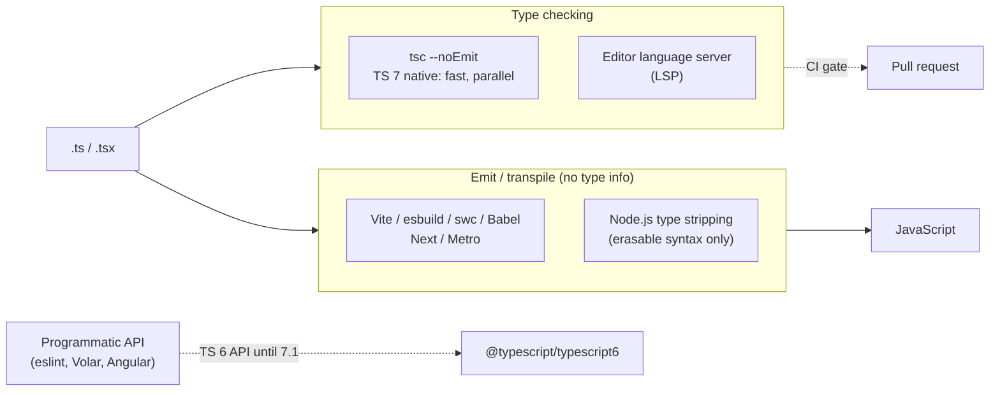
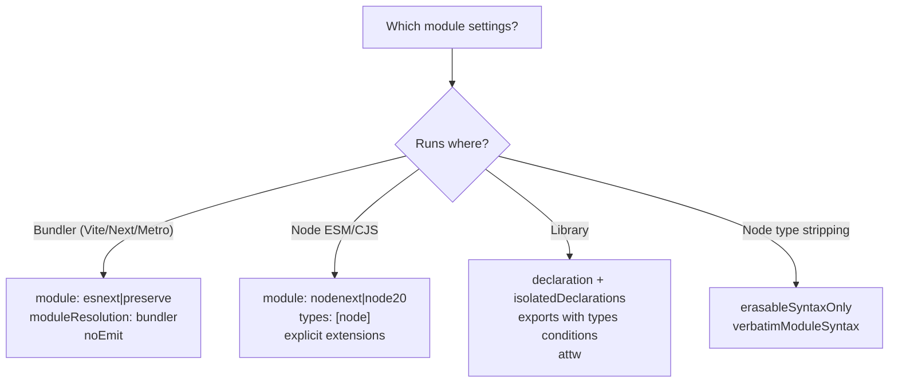

# TypeScript Configuration, Modules, Tooling & the 5 → 6 → 7 Migration — Interview Guide

> **Verified against the TypeScript team's official posts** (checked 2026-11-10): [5.8](https://devblogs.microsoft.com/typescript/announcing-typescript-5-8/), [5.9](https://devblogs.microsoft.com/typescript/announcing-typescript-5-9/), [6.0](https://devblogs.microsoft.com/typescript/announcing-typescript-6-0/), [7.0](https://devblogs.microsoft.com/typescript/announcing-typescript-7-0/). State of the world: **6.0 (Mar 2026) is the last release built on the JavaScript codebase; 7.0 (native Go port, ~8–12× faster full builds) shipped mid-2026; 7.1 is in beta** and is expected to bring the first programmatic API. Version-sensitive claims are tagged **[TS x.y]**.
> Prerequisites: [01](01-type-system-fundamentals.md), [02](02-generics-and-advanced-types.md), [03](03-narrowing-and-type-safety-patterns.md). Next: [05-typescript-with-react-and-apis.md](05-typescript-with-react-and-apis.md).

## Table of Contents

1. [Quick Summary (TL;DR)](#1-quick-summary-tldr)
2. [Checking vs Emitting: Who Does What](#2-checking-vs-emitting-who-does-what)
3. [`tsconfig.json` Essentials](#3-tsconfigjson-essentials)
4. [Recommended Configs by Project Type](#4-recommended-configs-by-project-type)
5. [Modules: ESM, CJS, Resolution, Interop](#5-modules-esm-cjs-resolution-interop)
6. [Declaration Files and Publishing Types](#6-declaration-files-and-publishing-types)
7. [Project References, Monorepos, Build Speed](#7-project-references-monorepos-build-speed)
8. [Linting, Formatting, Testing the Types](#8-linting-formatting-testing-the-types)
9. [Version Timeline: What Changed 5.0 → 7.x](#9-version-timeline-what-changed-50--7x)
10. [Migration Playbook: 5.x → 6.0 → 7.0](#10-migration-playbook-5x--60--70)
11. [Migrating JavaScript to TypeScript](#11-migrating-javascript-to-typescript)
12. [Common Mistakes and Pitfalls](#12-common-mistakes-and-pitfalls)
13. [Performance Considerations](#13-performance-considerations)
14. [Trade-offs and Alternatives](#14-trade-offs-and-alternatives)
15. [Interview Questions — Fundamentals](#15-interview-questions--fundamentals)
16. [Interview Questions — Senior Scenarios](#16-interview-questions--senior-scenarios)
17. [Cheat Sheet](#17-cheat-sheet)
18. [Key Terms Glossary](#18-key-terms-glossary)
19. [Further Reading](#19-further-reading)

---

## 1. Quick Summary (TL;DR)

- **Separate concerns:** *type-check* with `tsc --noEmit` (or the editor), *emit/transpile* with a bundler/transpiler (Vite/esbuild/swc/Babel/Next/Metro) or Node's type-stripping. Make sure every file is **independently transpilable** (`isolatedModules`, `verbatimModuleSyntax`).
- **Module settings must match your runtime:** bundled apps → `module: esnext|preserve` + `moduleResolution: bundler`; Node → `module: nodenext` (or the stable `node20` [TS 5.9]).
- **TS 6.0 changed defaults** [TS 6.0]: `strict: true`, `module: esnext`, `target` = current-year ES (`es2025`), `types: []`, `rootDir` = tsconfig directory, `noUncheckedSideEffectImports: true`, `libReplacement: false`.
- **TS 6.0 deprecated many legacy options** (errors unless `"ignoreDeprecations": "6.0"`) and **TS 7.0 removes them**: `target: es5`, `downlevelIteration`, `moduleResolution: node/node10/classic`, `module: amd/umd/systemjs/none`, `baseUrl`, `esModuleInterop/allowSyntheticDefaultImports: false`, `alwaysStrict: false`, `outFile`, legacy `module Foo {}` namespaces, import `asserts`.
- **TS 7.0 = native compiler:** `npm i -D typescript` now gives the Go-based `tsc`; multi-threaded type-checking (`--checkers`, default 4), parallel project builds (`--builders`), `--singleThreaded`, rebuilt `--watch`, LSP language server. **No stable programmatic API in 7.0** — tools such as `typescript-eslint`, Volar (Vue/Svelte/Astro/MDX) and Angular tooling still depend on the **TS 6 API**; run them side-by-side via **`@typescript/typescript6`** (`tsc6`) and an npm alias.
- Interview pattern: *"What would you set in tsconfig for X, and why?"* and *"How would you upgrade a big monorepo from 5.x to 7.x?"*



---

## 2. Checking vs Emitting: Who Does What

| Concern | Tool | Notes |
|---|---|---|
| Type checking | `tsc --noEmit`, editor LS, `vue-tsc`, `ngc` | Only `tsc`-family understands types |
| Transpile TS → JS | esbuild, swc, Babel (`@babel/preset-typescript`), `tsc`, Bun, Deno, Node type stripping | **Do not type-check** (except `tsc`) |
| Bundling | Vite/Rollup/Rolldown, webpack, Turbopack, Metro | Use `moduleResolution: bundler` |
| Declaration emit (`.d.ts`) | `tsc` (`declaration`), `tsup`/`tsdown` (via dts plugins), `isolatedDeclarations` + fast emitters | Libraries |
| Running TS directly | `tsx`, `ts-node` (legacy), Node ≥ 23.6 type stripping (**unflagged per the TS 5.8 post**), Bun, Deno | Syntax must be erasable under Node/stripping |
| Linting | ESLint + typescript-eslint, Biome, oxlint | Type-aware rules need the TS API |

### Why `isolatedModules` / `verbatimModuleSyntax` matter
Transpilers process **one file at a time** without type info. They cannot know whether `import { Foo } from "./x"` is a type (should be erased) or a value. `verbatimModuleSyntax` forces you to write **`import type`** / `import { type Foo }` so elision is syntactic and predictable. `isolatedModules` reports constructs that can't be transpiled per-file (e.g. `const enum` re-exports, ambiguous re-exports of types).

### Node type stripping and `erasableSyntaxOnly` **[TS 5.8]**
Node strips type annotations without TypeScript. Unsupported (runtime-semantic) syntax: `enum`, runtime `namespace`/`module`, **parameter properties**, `import =` aliases. `--erasableSyntaxOnly` makes `tsc` error on these; pair with `verbatimModuleSyntax`. Also remember Node needs **explicit file extensions in relative imports** (`./util.ts`) — TS 5.7's `rewriteRelativeImportExtensions` helps when emitting `.js`.

---

## 3. `tsconfig.json` Essentials

### Structure
```jsonc
{
  "extends": "./tsconfig.base.json",      // share config in monorepos
  "compilerOptions": { /* ... */ },
  "include": ["src"],                      // globs relative to the tsconfig
  "exclude": ["dist", "node_modules"],
  "references": [{ "path": "../shared" }], // project references
  "files": []                              // explicit list (rare)
}
```

### The option groups that matter in interviews

| Group | Options | Notes |
|---|---|---|
| **Language/Env** | `target`, `lib`, `jsx`, `types`, `moduleDetection` | `target` controls syntax downlevel and default `lib`; **`types: []` by default in 6.0** (list `"node"`, `"vitest/globals"`, etc.) |
| **Modules** | `module`, `moduleResolution`, `paths`, `resolveJsonModule`, `allowImportingTsExtensions`, `rewriteRelativeImportExtensions`, `verbatimModuleSyntax`, `isolatedModules`, `esModuleInterop` | `esModuleInterop` can't be `false` in 6.0+ |
| **Strictness** | `strict` (+ family), `noUncheckedIndexedAccess`, `exactOptionalPropertyTypes`, `noImplicitOverride`, `noImplicitReturns`, `noFallthroughCasesInSwitch`, `noPropertyAccessFromIndexSignature`, `noUncheckedSideEffectImports` | Many default on in 6.0/`tsc --init` |
| **Emit** | `outDir`, `rootDir`, `declaration`, `declarationMap`, `sourceMap`, `noEmit`, `emitDeclarationOnly`, `isolatedDeclarations` | `outFile` removed [6.0] |
| **Projects/perf** | `composite`, `incremental`, `tsBuildInfoFile`, `skipLibCheck`, `disableSourceOfProjectReferenceRedirect` | |
| **Interop** | `allowJs`, `checkJs`, `maxNodeModuleJsDepth` | JS→TS migration |

### `tsc --init` in 5.9+ (verified)
Minimal file with opinionated defaults: `module: "nodenext"`, `target: "esnext"`, `types: []`, `sourceMap`, `declaration`, `declarationMap`, **`noUncheckedIndexedAccess`**, **`exactOptionalPropertyTypes`**, `strict`, `jsx: "react-jsx"`, `verbatimModuleSyntax`, `isolatedModules`, `noUncheckedSideEffectImports`, `moduleDetection: "force"`, `skipLibCheck`.

### Path aliases (`paths`)
```jsonc
{ "compilerOptions": { "paths": { "@/*": ["./src/*"] } } }   // [TS 6.0] baseUrl is deprecated: put the prefix in the values
```
- `paths` is **type-resolution only**: it does not rewrite emitted imports. Your **bundler/runtime must be configured too** (Vite `resolve.alias`, webpack aliases, Node `imports`, tsconfig-paths).
- **[TS 6.0]** Node's **subpath imports** may now start with `#/` (`"imports": { "#/*": "./dist/*" }`), supported under `nodenext` and `bundler`. This is the runtime-native alternative to `paths` for Node packages.

---

## 4. Recommended Configs by Project Type

### 4.1 Bundled web app (Vite, Next.js, Remix, RN/Expo)
```jsonc
{
  "compilerOptions": {
    "target": "ES2023",
    "lib": ["ES2023", "DOM"],                 // [6.0] `dom` now includes dom.iterable & dom.asynciterable
    "module": "ESNext",                       // or "preserve" (keep import/require as authored)
    "moduleResolution": "bundler",
    "jsx": "react-jsx",
    "types": ["vite/client"],                 // list your globals explicitly
    "strict": true,
    "noUncheckedIndexedAccess": true,
    "exactOptionalPropertyTypes": true,
    "noImplicitOverride": true,
    "verbatimModuleSyntax": true,
    "isolatedModules": true,
    "moduleDetection": "force",
    "noEmit": true,                           // bundler emits; tsc only checks
    "skipLibCheck": true,
    "paths": { "@/*": ["./src/*"] }
  },
  "include": ["src"]
}
```
Framework notes: Next.js generates/maintains its own `tsconfig` plugin entries; React Native/Expo provide base configs (`@react-native/typescript-config`, `expo/tsconfig.base`) — extend them rather than copying.

### 4.2 Node.js service/CLI (ESM)
```jsonc
{
  "compilerOptions": {
    "module": "nodenext",                     // or "node20" [TS 5.9] for a stable Node 20 model
    "target": "ES2023",
    "types": ["node"],
    "rootDir": "./src",                       // [6.0] default is the tsconfig dir; set explicitly
    "outDir": "./dist",
    "strict": true,
    "noUncheckedIndexedAccess": true,
    "verbatimModuleSyntax": true,
    "isolatedModules": true,
    "sourceMap": true,
    "declaration": true,
    "skipLibCheck": true
  },
  "include": ["src"]
}
```
`package.json` needs `"type": "module"`; relative imports must include **extensions** (`./foo.js` for TS source — you write the *output* extension — or `./foo.ts` with `rewriteRelativeImportExtensions`/`allowImportingTsExtensions`).

### 4.3 Library
```jsonc
{
  "compilerOptions": {
    "module": "nodenext",
    "target": "ES2020",
    "declaration": true,
    "declarationMap": true,
    "isolatedDeclarations": true,             // enforce explicit exported types → fast parallel .d.ts emit
    "sourceMap": true,
    "strict": true,
    "verbatimModuleSyntax": true,
    "outDir": "dist",
    "rootDir": "src",
    "types": []
  }
}
```
Pair with `package.json` `exports` + `types` conditions (§6) and validate with **`@arethetypeswrong/cli` (attw)**.

### 4.4 Monorepo base + per-package configs
`tsconfig.base.json` (strictness, module settings) extended by each package; `tsconfig.json` at root with `references` and `files: []`; packages marked `composite: true`; build with `tsc -b`.

---

## 5. Modules: ESM, CJS, Resolution, Interop

### Settings matrix

| Runtime | `module` | `moduleResolution` | Extensions in relative imports |
|---|---|---|---|
| Bundler (Vite/webpack/Next/Metro) | `esnext` or `preserve` | `bundler` | Optional |
| Node ESM/CJS (modern) | `nodenext` (floating) or `node20` (stable model of Node 20; implies `target es2023`) | same as module | **Required** in ESM; TS follows `package.json` `type` and `exports` |
| Node 18 | `node18` [5.8] (no `require(esm)`, allows import assertions) | node18 | Required |
| Bun | `preserve` | `bundler` | Optional |
| Legacy CJS Node 10-style | ~~`commonjs` + `node10`~~ | **deprecated [6.0], removed [7.0]** → migrate to `nodenext` or `bundler` (6.0 also allows `bundler` with `module commonjs` as a migration step) | |

### Key behaviours
- **`require(esm)`** (Node 22+) is supported under `module: nodenext` [TS 5.8]; `node20` models Node 20 semantics.
- **`node20`/`nodenext` and `type`**: the **`package.json` `type` field** and file extensions (`.mts`, `.cts`) determine ESM vs CJS per file.
- **`exports` map** is honoured by `nodenext`/`bundler` resolution; `typesVersions` is legacy.
- **`esModuleInterop` / `allowSyntheticDefaultImports`** are always on in 6.0+: write `import express from "express"` (not `import * as express`).
- **`import type`** erased; **`export type { X } from`** for re-exports; **`verbatimModuleSyntax`** enforces.
- **Import attributes:** use `with { type: "json" }`; **`assert` is an error [6.0]**.
- **`import defer * as ns from "./feature.js"`** [TS 5.9] defers module *evaluation* until first property access; only namespace imports; works under `module: preserve|esnext`; **not downleveled** — your runtime/bundler must support it.
- **`resolveJsonModule`**, `allowArbitraryExtensions` (`.css.d.ts`), and **ambient module declarations** for assets: `declare module "*.svg" { const src: string; export default src }`.

### CJS ↔ ESM pitfalls
- ESM can `import` CJS (named imports may fail if CJS exports are dynamic).
- Dual packages risk the **dual package hazard** (two copies of state). Prefer ESM-only publishing if consumers are modern, or keep stateless dual builds.
- `__dirname` doesn't exist in ESM: use `import.meta.dirname` (Node 20.11+/21.2+) / `fileURLToPath(import.meta.url)`.

---

## 6. Declaration Files and Publishing Types

```json
{
  "name": "my-lib",
  "type": "module",
  "exports": {
    ".": {
      "import":  { "types": "./dist/index.d.ts",  "default": "./dist/index.js" },
      "require": { "types": "./dist/index.d.cts", "default": "./dist/index.cjs" }
    },
    "./package.json": "./package.json"
  },
  "files": ["dist"],
  "sideEffects": false
}
```
Rules of thumb:
- **`types` condition first** inside each condition branch; separate `.d.cts` for CJS consumers (a `.d.ts` is interpreted by the nearest package `type`).
- **`declaration` + `declarationMap`** for go-to-source. **[TS 5.5] `isolatedDeclarations`** requires explicit types on exports, enabling third-party tools to emit `.d.ts` per-file in parallel.
- Avoid leaking **inferred complex types**; annotate public API return types.
- **Peer vs dependencies:** if your public types reference `@types/react`, list it as `peerDependencies` (or depend on it) so consumers get matching types.
- Validate with **attw**, **publint**, and a consumer test matrix across `moduleResolution: node16/nodenext/bundler`.
- **DefinitelyTyped** (`@types/*`) for untyped libs; contributions versioned by major.
- **Declaration merging** to augment third-party types lives in `.d.ts` that is **part of `include`** (and is a module via `export {}` if using `declare global`).
- **TS 7:** declaration output is deterministic via **stable type ordering** (union member order no longer depends on declaration order). Diffing `.d.ts` between 6.x and 7.x may show benign reorderings unless you use `--stableTypeOrdering` on 6.0.

---

## 7. Project References, Monorepos, Build Speed

### Project references
```jsonc
// packages/shared/tsconfig.json
{ "extends": "../../tsconfig.base.json", "compilerOptions": { "composite": true, "outDir": "dist", "rootDir": "src" }, "include": ["src"] }

// packages/app/tsconfig.json
{ "extends": "../../tsconfig.base.json", "references": [{ "path": "../shared" }], "include": ["src"] }
```
- **`composite`** enforces `declaration`, `rootDir` and a complete `include`; **`tsc -b`** builds in dependency order with **incremental** `.tsbuildinfo` caching and skips up-to-date projects.
- Editors use project references to avoid loading everything in one program.
- **[TS 7]** `--builders N` builds multiple referenced projects in parallel; **`--checkers N`** (default 4) controls type-checker workers per project; effects **multiply** (e.g. `--checkers 4 --builders 4` → up to 16 checkers), so tune for CI RAM/CPU. `--singleThreaded` for debugging or externally orchestrated parallelism. Varying `--checkers` can rarely change order-dependent results — pin it across environments if you need identical output.

### Monorepo tools
Nx/Turborepo/pnpm workspaces: cache `tsc` outputs, run affected checks, enforce module boundaries with ESLint rules. Prefer **workspace package exports** (built or via TS `paths`/`customConditions` to source) consistently between dev and prod.

### Speed levers
`skipLibCheck: true`, correct `include/exclude`, **explicit `types`** (default empty in 6.0 — builds improved 20–50% for some projects per the TS team), `incremental`, project references, `isolatedDeclarations`, avoiding mega-unions/recursive types (file 02). **TS 7** gives a large baseline speedup (TS team data: 7.7×–11.9× faster full builds on large OSS repos; editor load for VS Code's codebase from ~17.5 s to <1.3 s to first error) — real-world CI reports include Slack's type-check dropping from ~7.5 min to ~1.25 min.

---

## 8. Linting, Formatting, Testing the Types

- **typescript-eslint (flat config)** with `recommendedTypeChecked`/`strictTypeChecked`, `projectService: true` for type-aware linting. It **needs the TypeScript programmatic API** → with TS 7 use the compatibility alias (§10).
- **Biome / oxlint** are fast, non-type-aware (or partially) linters; keep typescript-eslint (or the type-aware subset) where you need `no-floating-promises` etc.
- **Prettier/Biome** format only.
- **Type tests:** `expectTypeOf` (Vitest), `tsd`, `@ts-expect-error` suites; **`attw`**/**`publint`** for packages.
- **CI:** `tsc --noEmit` (or `tsc -b`) as a required check; separate `lint`, `test`, `build` jobs; cache `.tsbuildinfo` and `node_modules`.
- **Editor settings:** workspace TypeScript version pinned (`typescript.tsdk`) so editor == CI. With TS 7's VS Code extension/LSP you can toggle ("Disable/Enable TypeScript 7 Language Server").

---

## 9. Version Timeline: What Changed 5.0 → 7.x

| Version | Highlights relevant to interviews |
|---|---|
| 5.0 | Standard (TC39) decorators, `const` type parameters, `verbatimModuleSyntax`, `moduleResolution: bundler`, all enums become union enums |
| 5.2 | `using`/`await using` resource management |
| 5.4 | `NoInfer`, preserved narrowing in closures, `module: preserve` |
| 5.5 | Inferred type predicates, `isolatedDeclarations`, regex syntax checking |
| 5.6 | Stricter truthy/nullish checks, `strictBuiltinIteratorReturn` |
| 5.7 | `rewriteRelativeImportExtensions`, path rewriting for `.ts` imports |
| **5.8** | Granular checks of conditional **return** branches, `require(esm)` support in `nodenext`, `--module node18`, **`--erasableSyntaxOnly`**, `--libReplacement`, preserved computed property names in `.d.ts` |
| **5.9** | Minimal `tsc --init` (opinionated, strict), **`import defer`**, **`--module node20`**, expandable hovers, `ArrayBuffer`/`Buffer` typing changes, mapper-instantiation caching |
| **6.0** (Mar 2026) | Bridge release: **new defaults** (`strict`, `module esnext`, floating `target` es2025, `types: []`, `rootDir` = tsconfig dir, `noUncheckedSideEffectImports`, `libReplacement: false`), **deprecations** (see §10), `es2025` target/lib (`RegExp.escape`, `Promise.try`, Set/Iterator methods), **Temporal** types (`esnext`), Map/WeakMap **`getOrInsert`/`getOrInsertComputed`**, `dom` lib includes iterable parts, `#/` subpath imports, `bundler` + `commonjs` combo, `--stableTypeOrdering`, less context-sensitivity for `this`-less methods, `tsc file.ts` with a `tsconfig.json` is an error (`--ignoreConfig`) |
| **7.0** (mid-2026) | **Native (Go) compiler**: 8–12× faster full builds, shared-memory parallel parsing/checking/emit, new `--watch`, LSP language server, `--checkers/--builders/--singleThreaded`; applies 6.0 defaults, **hard-errors** on 6.0-deprecated options; **no programmatic API** in 7.0; Unicode code point–aware template literal inference; reworked JS/JSDoc analysis |
| **7.1** (beta, ~Oct 2026) | Per the team: import attributes in ambient modules and the **new programmatic API** (expected to unblock tools) — treat as in-flight and re-verify |

---

## 10. Migration Playbook: 5.x → 6.0 → 7.0

### Strategy
1. **Upgrade to 5.9 first** (clean build, fix lib changes: `ArrayBuffer`/`Buffer` typing, DOM types).
2. **Move to 6.0** — the *readiness check* for 7. Fix new defaults and deprecations (or temporarily set `"ignoreDeprecations": "6.0"` — but **7.0 will not honour deprecated options**).
3. Optionally run **`--stableTypeOrdering`** on 6.0 (up to ~25% slower) to make type ordering match 7 and compare `.d.ts`/inference differences.
4. **Adopt 7.0** for CLI type-checking (`tsc`) while keeping the 6.x API for tooling that needs it.
5. Roll out gradually: CI first (largest win), then editors, then remove the compat alias once your tools support the 7.x API (7.1).

### 6.0 — "Up-front adjustments"
| Symptom | Fix |
|---|---|
| Many "cannot find name `process`/`describe`" errors | Set **`"types": ["node", "jest"]`** (or `["*"]` to restore old behaviour — not recommended) |
| Output lands in `dist/src/...` | Set **`"rootDir": "./src"`** (default is now the tsconfig directory) |
| `strict` surprises | You were on `strict: false`: set explicitly or fix errors |
| `target: es5` / `downlevelIteration` | Raise target to ≥ ES2015 (preferably ES2020+), use a bundler/Babel for older browsers |
| `moduleResolution: node` / `classic` | `nodenext` for Node, `bundler` for bundlers/Bun (6.0 allows `bundler` + `module commonjs` as a stepping stone) |
| `module: amd/umd/systemjs/none` | Use ESM + bundler/import maps |
| `baseUrl` | Remove; prefix values in `paths` (`"@app/*": ["./src/app/*"]`). The experimental **`ts5to6`** tool automates `baseUrl`/`rootDir` changes |
| `esModuleInterop: false` / `allowSyntheticDefaultImports: false` | Always on; change `import * as express` → `import express` |
| `alwaysStrict: false` | All code is strict-mode JS; rename identifiers like `static`/`await` used as names |
| `outFile` | Use a bundler |
| `module Foo {}` | `namespace Foo {}` (ambient `declare module "x"` still fine) |
| `import x from "y" asserts {…}` / `import(…, { assert })` | `with { type: "json" }` |
| `/// <reference no-default-lib>` | Use `noLib`/`libReplacement` |
| `tsc foo.ts` in a folder with tsconfig | Error TS5112: use `--ignoreConfig` or `-p` |

### 7.0 — what's different
- `npm install -D typescript` provides the native `tsc` (`npx tsc`). Nightlies via `typescript@next` (previously `@typescript/native-preview`).
- **Hard errors** for everything deprecated in 6.0; `stableTypeOrdering` always on; defaults as in 6.0.
- **Side-by-side with 6.0:** install the compat package **`@typescript/typescript6`** which exposes **`tsc6`** and re-exports the **TS 6 API**. Because many tools `import "typescript"` via peer deps, use an alias:
```jsonc
{
  "devDependencies": {
    "typescript": "npm:@typescript/typescript6@^6.0.2",   // API for typescript-eslint, etc. (provides tsc6)
    "@typescript/native": "npm:typescript@^7.0.2"          // TS 7 provides `tsc`
  }
}
```
(Shown as in the official post; verify exact versions at install time.) Then `npx tsc` → 7.x, tooling → 6.x.
- **Embedded-language workflows** (Vue, Svelte, Astro, MDX, Angular templates) **cannot use the TS 7 language server yet** (no stable API; Volar etc. rely on 6.0). Use TS 7 `tsc` for fast CLI checks where possible and keep TS 6.0 in the editor ("Disable TypeScript 7 Language Server" in VS Code). Webpack loaders (ts-loader/fork-ts-checker) similarly need the API — expect to wait for 7.1 or keep them on 6.
- **JavaScript/JSDoc analysis reworked**: values can't be used as types (`typeof x`), `@enum` isn't special, `?` as a standalone type, `@class`, postfix `!`, Closure-style function types, etc. are no longer recognised; consult the team's `CHANGES.md` before migrating `checkJs` projects.
- **Template literal inference** now splits by Unicode code points.
- **Parallelism knobs:** `--checkers` (default 4), `--builders`, `--singleThreaded`. On small CI runners lower `--checkers`; on big boxes raise it (monitor memory).
- **Determinism:** pin `--checkers` if you diff outputs across machines.

### Verification checklist
- `tsc --noEmit` clean on 6.0 **without** `ignoreDeprecations`.
- Compare 6.0 `--stableTypeOrdering` vs 7.0 `.d.ts` outputs.
- Run unit/integration tests (some inference changes can surface as new errors; fix by adding explicit type arguments).
- Benchmark (cold/warm, CI) and record before/after.
- Update CI Docker images, editor docs, and `typescript.tsdk` settings.
- Keep a rollback (pin `typescript@6` and `tsc6`).

---

## 11. Migrating JavaScript to TypeScript

1. Add `tsconfig.json` with **`allowJs: true`, `checkJs: false`**, `noEmit: true`; ensure the build still works.
2. Rename leaf modules to `.ts`/`.tsx` gradually (utilities, models first); add types incrementally.
3. Turn on **`checkJs`** for selected files with `// @ts-check` or per-directory `tsconfig`.
4. Introduce **runtime schemas** at I/O boundaries; generate API types.
5. Raise strictness progressively: `noImplicitAny` → `strictNullChecks` → full `strict` → extra flags; use a **ratchet** (type-coverage, error budgets).
6. Replace `// @ts-ignore` with **`// @ts-expect-error`** (+ reason), ban via lint.
7. Use JSDoc types (`@type`, `@param`) as a stepping stone where renaming is risky (but note TS 7's reworked JS analysis).
8. Automate with `ts-migrate`/codemods; track progress dashboards.

---

## 12. Common Mistakes and Pitfalls

| Mistake | Impact | Fix |
|---|---|---|
| Mismatch `module`/`moduleResolution` vs runtime | "Works in editor, fails at runtime" | Use `nodenext`/`bundler` consciously |
| `paths` without bundler/runtime alias | Runtime "module not found" | Configure alias in tooling or use `#/` imports |
| Missing `types` in 6.0+ | Global names unresolved | Explicit `types` array |
| Forgetting `rootDir` after 6.0 | Wrong output structure | Set `rootDir` |
| Using `tsc` to emit and a bundler to emit differently | Divergent behaviour | One emit path; `noEmit` for tsc |
| Enums/namespaces/param-properties with type stripping | Runtime errors in Node | `erasableSyntaxOnly` |
| `skipLibCheck` hiding real `.d.ts` bugs in your own libs | Broken published types | Check your lib without it in CI |
| Relying on `include` defaults | Tests/config files unintentionally checked | Be explicit; separate `tsconfig.test.json` |
| Different TS in editor vs CI | Ghost errors | Pin `typescript.tsdk`, same lockfile |
| Treating TS 7 as a drop-in with all tooling | ESLint/Volar/Angular break (no API) | Compat alias, staged rollout |
| Leaving deprecated flags with `ignoreDeprecations` | Breaks on 7.0 | Remove before 7 |
| Dual-package state duplication | Subtle bugs | ESM-only or stateless dual |

---

## 13. Performance Considerations

- **Type-check time** scales with program size and type complexity. In TS 7 parallelism helps (`--checkers`), but memory also rises.
- **Slim the program:** restrict `include`, set `types`, avoid pulling in all of `node_modules/@types` (old default); use project references.
- **`skipLibCheck`** removes `.d.ts` re-checking.
- **Incremental builds** (`.tsbuildinfo`) with `tsc -b` and CI caching.
- **Declaration emit:** `isolatedDeclarations` lets other tools parallelise; annotate exports.
- **Watch mode:** TS 7 uses a rebuilt file watcher (Parcel-watcher-based Go port) — much lower CPU than polling.
- **Editor:** TS 7's language server is multi-threaded and (per the team) cuts failing LS commands >80% and crashes >60% versus 6.0.
- **Measure:** `tsc --extendedDiagnostics`, `--generateTrace`, `--listFiles`, `--explainFiles`.

---

## 14. Trade-offs and Alternatives

| Choice | Pros | Cons |
|---|---|---|
| `module: preserve` + bundler | Matches modern pipelines | Not for direct Node execution |
| `nodenext` | Accurate Node semantics | Needs extensions and `type` discipline |
| Project references | Fast incremental builds, enforce boundaries | Config overhead |
| Single big tsconfig | Simple | Slow editors/CI, no boundaries |
| TS 7 now | Huge speedups | Tooling API gaps until 7.1 |
| Stay on 6.0 | Full ecosystem compat | Misses speed; 7 deprecations still need fixing |
| JSDoc-in-JS | No build | Weaker ergonomics; changes in TS 7 JS analysis |
| Babel/swc emit | Fast | No type-check; need separate `tsc` |
| Bun/Deno/Node TS-native | Zero build | Erasable syntax only, limited features |

---

## 15. Interview Questions — Fundamentals

### Q1. What does `isolatedModules` do and why do bundlers need it?
Ensures each file can be transpiled independently without cross-file type information. It flags constructs that need type info (re-exporting types without `export type`, `const enum` across files) so Babel/swc/esbuild can safely strip types.

### Q2. Explain `module` vs `moduleResolution`.
`module` controls emitted module syntax (and what TS considers valid import/export forms); `moduleResolution` controls how import specifiers map to files/types. Common correct pairs: `nodenext/nodenext`, `esnext|preserve/bundler`.

### Q3. `bundler` vs `nodenext`?
`bundler` models bundler behaviour (extensionless relative imports, `exports` support); `nodenext` models Node's strict ESM/CJS rules (extensions required, `type`/`exports` conditions, ESM/CJS per file).

### Q4. What does `verbatimModuleSyntax` do?
Keeps imports/exports exactly as written; type-only imports must use `import type`; prevents accidental elision differences and CJS/ESM emit mismatches. Replaces `importsNotUsedAsValues`/`preserveValueImports`.

### Q5. Why can't `paths` alone make aliases work at runtime?
`paths` affects type resolution only; emit keeps the specifier. You must configure the bundler/runtime (or use Node `imports`/`#/` subpaths).

### Q6. What is `skipLibCheck` and the trade-off?
Skips type-checking all `.d.ts` files — faster builds and avoids third-party typing conflicts, but can hide errors in your own declaration files.

### Q7. What are declaration files and how do you publish them?
`.d.ts` describe types; emit with `declaration`; reference via `exports` `types` conditions; test with attw; keep `@types` deps correct.

### Q8. What changed with TypeScript 6.0 defaults?
`strict: true`, `module: esnext`, floating `target` (es2025), `types: []`, `rootDir` = tsconfig dir, `noUncheckedSideEffectImports: true`, `libReplacement: false`.

### Q9. What is TypeScript 7?
A native (Go) port of the compiler and language service: ~8–12× faster full builds, parallel checking, LSP-based editor support. Compatible with 6.0 type-checking semantics; removes options deprecated in 6.0; no programmatic API in 7.0 (planned for 7.1).

### Q10. What is `erasableSyntaxOnly`?
5.8 flag that errors on TS constructs that need code generation (enums, runtime namespaces, parameter properties, `import =`), so files can run via Node type stripping or other strip-only tools.

### Q11. `import type` vs `import { type X }` vs `export type`?
All erased; the inline form keeps value imports in the same statement; `export type { X } from` re-exports types without emitting.

### Q12. What is a project reference?
A `references` entry in tsconfig linking composite projects so `tsc -b` builds them incrementally in dependency order and the editor can resolve across projects using emitted declarations.

### Q13. What does `noEmit` do and when to use it?
Type-check only; use with bundlers/transpilers that handle emit.

### Q14. How does TS find types for a package?
`types`/`typings` field, `exports` `types` conditions, adjacent `.d.ts`, otherwise `@types/<pkg>` from `node_modules/@types`; `typeRoots`/`types` restrict global inclusion (and in 6.0 default to none).

### Q15. What are import attributes?
Metadata on imports (`import data from "./x.json" with { type: "json" }`) replacing the older `assert` form, which TS 6.0 now rejects.

---

## 16. Interview Questions — Senior Scenarios

### S1. "Upgrade a 300-package monorepo from TS 5.4 to 7.x with minimal disruption."
Phase 0: baseline (build times, error counts, tool inventory: typescript-eslint, vue-tsc/Volar/Angular, webpack loaders, codegen). Phase 1: 5.9 (fix lib/DOM/Buffer changes). Phase 2: 6.0 with explicit `types`, `rootDir`, remove `baseUrl`, replace `moduleResolution node`, flip off deprecated flags; run codemods/`ts5to6`; no `ignoreDeprecations`. Phase 3: compare `--stableTypeOrdering` outputs; add explicit type args for inference diffs. Phase 4: introduce TS 7 `tsc` in CI behind an alias (`@typescript/native`) while tools use `@typescript/typescript6`; tune `--checkers/--builders` for runners; cache builds. Phase 5: editors (VS Code extension), exclude Vue/Svelte/Angular packages until tooling support (7.1 API). Phase 6: remove compat shims when ecosystem ready; document rollback. Track metrics (CI minutes, p95 editor latency) to justify.

### S2. "Design the TS configuration strategy for a React web app, a Node API, a shared library and a React Native app in one repo."
Shared `tsconfig.base.json` with strictness; per-target configs: web/RN → `moduleResolution: bundler`, `noEmit`, `jsx`; Node → `nodenext`, `types:["node"]`, emit; library → `declaration`, `isolatedDeclarations`, `exports`; root `references` + `tsc -b`; path alias strategy consistent with bundlers (or workspace packages, avoiding `paths`); lint boundaries; CI matrix with attw for library; RN extends the RN base config; keep `types` explicit per project.

### S3. "Imports work in Vite but fail in Node (or vice-versa). Why?"
Different resolution assumptions: bundler tolerates extensionless/directory imports and `paths`; Node ESM requires extensions and honours `exports`. Align by using explicit extensions or `nodenext` for Node code, avoid unresolved aliases, test the production artifact in Node, and use `attw`/`publint` for libraries.

### S4. "Why would a team keep TypeScript 6.0 as the editor/ESLint compiler while using TS 7 `tsc` in CI?"
TS 7.0 has no stable programmatic API: typescript-eslint, Volar (Vue/Svelte/Astro/MDX), Angular templates and some loaders import the TS API. Running 6.0 for those and 7 for `tsc` captures most CI speed while avoiding tool breakage, until 7.1's API lands.

### S5. "How do you ensure type outputs don't change unexpectedly between compiler upgrades?"
Snapshot `.d.ts` of public packages; run API Extractor (`api-extractor`) diff in CI; use `--stableTypeOrdering` on 6.0 to anticipate 7's deterministic ordering; avoid inferred public types (explicit annotations, `isolatedDeclarations`); consumer-type tests.

### S6. "How do you debug 'excessive type instantiation depth' or 10-minute type-checks?"
`tsc --extendedDiagnostics`, `--generateTrace` → analyze with `@typescript/analyze-trace`/Perfetto; locate hot files/types; simplify conditional/mapped types, add explicit annotations, split projects, remove huge unions; upgrade to TS 7 for parallelism; adjust `--checkers` for the CI box.

### S7. "Is it safe to enable `verbatimModuleSyntax` in an existing codebase?"
It requires `import type` for type-only imports and prohibits some CJS-isms. Use ESLint `consistent-type-imports` autofix or codemod; fix `export =`/`import =` usage; confirm bundler config. Benefit: predictable emit across tsc/swc/esbuild/Babel and compatibility with type stripping.

---

## 17. Cheat Sheet



| Topic | Remember |
|---|---|
| 6.0 defaults | `strict`, `module esnext`, `target es2025`, `types []`, `rootDir .`, `libReplacement false` |
| 6.0 deprecations → 7 errors | es5, downlevelIteration, node10/classic, amd/umd/systemjs/none, baseUrl, esModuleInterop false, alwaysStrict false, outFile, `module` namespaces, `asserts` imports |
| TS 7 | Native, parallel (`--checkers`, `--builders`), no API until 7.1; use `@typescript/typescript6` for tools |
| Type stripping | No enums/namespaces/param-properties; `erasableSyntaxOnly` |
| `paths` | Types only; configure runtime aliases or `#/` imports |
| Libraries | `exports` + `types`, `isolatedDeclarations`, attw |

---

## 18. Key Terms Glossary

| Term | Definition |
|---|---|
| Type stripping | Removing type annotations without TypeScript (Node/Amaro/`ts-blank-space`) |
| Erasable syntax | TS syntax with no runtime semantics |
| Project reference | Link between composite TS projects for incremental builds |
| `.tsbuildinfo` | Incremental build state file |
| Declaration emit | Generating `.d.ts` from source |
| `isolatedDeclarations` | Requires explicit export types so `.d.ts` can be generated per-file |
| Native port (Project Corsa) | Go implementation of TypeScript (7.0+) |
| Stable type ordering | Deterministic internal ordering of types/symbols (always on in 7) |
| Compat package | `@typescript/typescript6` exposing TS 6 API and `tsc6` |
| Dual package hazard | Two module instances (ESM + CJS) of the same library in one app |

---

## 19. Further Reading

- [TSConfig reference](https://www.typescriptlang.org/tsconfig/) · [Modules reference](https://www.typescriptlang.org/docs/handbook/modules/reference.html) · [Project References](https://www.typescriptlang.org/docs/handbook/project-references.html)
- Release posts: [5.8](https://devblogs.microsoft.com/typescript/announcing-typescript-5-8/), [5.9](https://devblogs.microsoft.com/typescript/announcing-typescript-5-9/), [6.0](https://devblogs.microsoft.com/typescript/announcing-typescript-6-0/), [7.0](https://devblogs.microsoft.com/typescript/announcing-typescript-7-0/), [7.1 Beta](https://devblogs.microsoft.com/typescript/announcing-typescript-7-1-beta/)
- [Node.js: Running TypeScript natively](https://nodejs.org/api/typescript.html) · [Are the Types Wrong?](https://arethetypeswrong.github.io/) · [typescript-eslint](https://typescript-eslint.io/)
