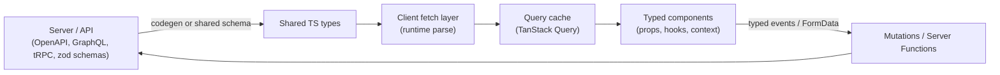
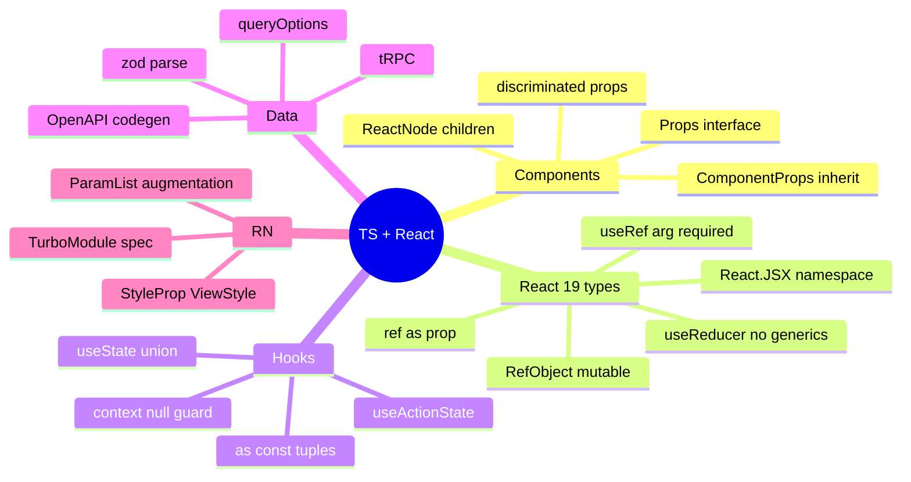

# TypeScript with React, React Native & API Layers — Interview Guide

> Verified against the React 19 upgrade guide's TypeScript section (`useRef` argument, mutable refs, `ReactElement` props default to `unknown`, `React.JSX` namespace, ref-callback cleanup typing, `useReducer` typing), the TypeScript 5.8–7.0 release posts, and the React Native docs conventions. Library API details (TanStack Query v5, Redux Toolkit 2, Zustand 5, React Navigation 7, tRPC, zod) are from those projects' documented APIs — confirm against the version you use.
> Prerequisites: files [01](01-type-system-fundamentals.md)–[04](04-tsconfig-modules-and-tooling.md). Companion: [../react/07-component-patterns-and-architecture.md](../react/07-component-patterns-and-architecture.md) (polymorphic components), [../react/06-state-management-and-data-fetching.md](../react/06-state-management-and-data-fetching.md).

## Table of Contents

1. [Quick Summary (TL;DR)](#1-quick-summary-tldr)
2. [Typing React Components](#2-typing-react-components)
3. [React 19 Type Changes You Must Know](#3-react-19-type-changes-you-must-know)
4. [Typing Hooks and Context](#4-typing-hooks-and-context)
5. [Events, Forms, Actions](#5-events-forms-actions)
6. [Generic and Polymorphic Components](#6-generic-and-polymorphic-components)
7. [Typing Data Fetching and API Clients](#7-typing-data-fetching-and-api-clients)
8. [Typing State Libraries](#8-typing-state-libraries)
9. [Routing and Search Params](#9-routing-and-search-params)
10. [React Native with TypeScript](#10-react-native-with-typescript)
11. [Node/Server Typing: Express, Next.js Handlers, ORMs](#11-nodeserver-typing-express-nextjs-handlers-orms)
12. [Module Augmentation and Ambient Types](#12-module-augmentation-and-ambient-types)
13. [Testing with Types](#13-testing-with-types)
14. [Common Mistakes and Pitfalls](#14-common-mistakes-and-pitfalls)
15. [Performance Considerations](#15-performance-considerations)
16. [Trade-offs and Alternatives](#16-trade-offs-and-alternatives)
17. [Interview Questions — Fundamentals](#17-interview-questions--fundamentals)
18. [Interview Questions — Senior Scenarios](#18-interview-questions--senior-scenarios)
19. [Cheat Sheet](#19-cheat-sheet)
20. [Key Terms Glossary](#20-key-terms-glossary)
21. [Further Reading](#21-further-reading)

---

## 1. Quick Summary (TL;DR)

- **Props are the contract:** type them with `interface`/`type`, inherit DOM props with `React.ComponentProps<"button">`, model variants with **discriminated unions**, and prefer **inference** for state/handlers.
- **React 19 types** changed several things: `useRef` **requires an argument**, all refs are mutable (`RefObject<T>`; `useRef<T>(null)` → `RefObject<T | null>`), `ref` is an ordinary prop (no `forwardRef`), ref callbacks can't implicitly return a value, the global `JSX` namespace moved to `React.JSX`, `ReactElement["props"]` defaults to `unknown`, and `useReducer` shouldn't be given explicit type arguments.
- **Type the boundaries, not the guts:** API responses, `FormData`, URL params, storage and env are `unknown` until validated (zod/valibot); then use inferred types (`z.infer`).
- **End-to-end type safety options:** OpenAPI/GraphQL **codegen**, **tRPC**, or **shared zod schemas** between client and server — pick one source of truth.
- **React Native:** typed navigation (`RootStackParamList`), `StyleSheet`/`ViewStyle`, Reanimated shared values, and **TurboModule/Fabric Codegen specs are TypeScript files** that generate native interfaces.
- **Tooling reality (TS 7):** use TS 7 `tsc` for fast checks, but ESLint/Volar/Angular tooling still needs the TS 6 API until 7.1 (see file 04).



---

## 2. Typing React Components

### Function components and props
```tsx
interface ButtonProps extends React.ComponentProps<"button"> {   // inherits all <button> props incl. ref in React 19
  variant?: "primary" | "ghost" | "danger";
  loading?: boolean;
}

export function Button({ variant = "primary", loading = false, children, disabled, ...rest }: ButtonProps) {
  return (
    <button data-variant={variant} disabled={disabled || loading} {...rest}>
      {loading ? "…" : children}
    </button>
  );
}
```
Guidelines:
- Annotate **props**, let **return type** be inferred (`JSX.Element`/`ReactNode`) — or `: React.JSX.Element` if you need a guarantee.
- `React.FC<Props>` is acceptable (no implicit `children` since React 18 types) but not necessary; it complicates generics and defaultProps-like patterns. Many teams prefer plain functions.
- **`children`**: `React.ReactNode` (anything renderable); `React.ReactElement` (exactly an element); function-as-children: `(state: S) => React.ReactNode`.
- **Default props**: ES default parameters (function-component `defaultProps` removed in React 19).
- **Optional vs required**: required by default; make defaults explicit.

### Props utilities
| Need | Type |
|---|---|
| Props of a component | `React.ComponentProps<typeof Button>` |
| Without `ref` | `React.ComponentPropsWithoutRef<"input">` |
| Style prop | `React.CSSProperties` |
| Children | `React.ReactNode` |
| Element type param | `React.ElementType` |
| Handler | `React.MouseEventHandler<HTMLButtonElement>` |
| Dispatch | `React.Dispatch<React.SetStateAction<T>>` |

### Discriminated props (mutually exclusive APIs)
```tsx
type LinkOrButton =
  | { href: string; onClick?: never; target?: "_blank" | "_self" }
  | { href?: never; onClick: () => void; target?: never };

function Action(props: LinkOrButton & { label: string }) {
  return "href" in props && props.href !== undefined
    ? <a href={props.href} target={props.target}>{props.label}</a>
    : <button onClick={props.onClick}>{props.label}</button>;
}
```

### Typing `style`, CSS variables and `data-*`
```tsx
<div style={{ "--accent": color } as React.CSSProperties} data-state={open ? "open" : "closed"} />
```
(Custom properties need a cast; prefer CSS classes or a typed helper.)

---

## 3. React 19 Type Changes You Must Know

From the official upgrade guide (TypeScript section):

| Change | Before | After (React 19 types) |
|---|---|---|
| `useRef` argument | `useRef<number>()` allowed | **Required**: `useRef<number \| undefined>(undefined)` |
| Ref objects | `MutableRefObject<T>` vs `RefObject<T>` (readonly `current`) | Single **`RefObject<T>`** (mutable `current`); `useRef<T>(null)` returns `RefObject<T \| null>` |
| Ref callback | `ref={(n) => (inst = n)}` | Must not return a value (cleanup functions are allowed): `ref={(n) => { inst = n; }}` |
| `ref` prop | `forwardRef` wrapper | Plain prop on function components |
| Global JSX namespace | `JSX.IntrinsicElements` | `React.JSX.*` — augment via `declare module "react" { namespace JSX { … } }` (module specifier depends on `jsx` setting: `react/jsx-runtime`, `react/jsx-dev-runtime`, or `react`) |
| `ReactElement["props"]` | `any` | **`unknown`** (use `ReactElement<Props>` or narrow) |
| `useReducer` generics | `useReducer<React.Reducer<S, A>>(reducer)` | **No type args**; annotate reducer params or `useReducer<State, [Action]>(…)` in edge cases |
| Removed types | e.g. `ReactChild`, `ReactFragment`, `ReactNodeArray`, `VFC`, `SFC` … | Use `ReactNode` etc. |

Run the official **`types-react-codemod`** (`npx types-react-codemod@latest preset-19 ./src`). Pair with `@types/react@^19` and `@types/react-dom@^19`.

```tsx
const inputRef = useRef<HTMLInputElement>(null);          // RefObject<HTMLInputElement | null>
const timerRef = useRef<number | undefined>(undefined);   // mutable instance field
useEffect(() => { inputRef.current?.focus(); }, []);

// React 19: ref as a prop
function Field({ ref, ...props }: React.ComponentProps<"input">) { return <input ref={ref} {...props} />; }
```

---

## 4. Typing Hooks and Context

### `useState`
```tsx
const [count, setCount] = useState(0);                         // number
const [user, setUser] = useState<User | null>(null);           // union must be explicit
const [items, setItems] = useState<Item[]>([]);                // empty collection needs a type
const [state, setState] = useState<AsyncState<User>>({ status: "idle" });
const [cfg] = useState(() => parseConfig(localStorage.getItem("cfg")));   // lazy initialiser
```

### `useReducer` with discriminated actions
```tsx
type State = { items: Item[]; filter: "all" | "done" };
type Action =
  | { type: "add"; item: Item }
  | { type: "remove"; id: string }
  | { type: "setFilter"; filter: State["filter"] };

function reducer(state: State, action: Action): State {
  switch (action.type) {
    case "add": return { ...state, items: [...state.items, action.item] };
    case "remove": return { ...state, items: state.items.filter((i) => i.id !== action.id) };
    case "setFilter": return { ...state, filter: action.filter };
    default: { const _never: never = action; return state; }
  }
}
const [state, dispatch] = useReducer(reducer, { items: [], filter: "all" });   // no explicit generics (React 19 types)
```

### Context with a safe consumer hook
```tsx
interface AuthContextValue { user: User; signOut: () => Promise<void> }
const AuthContext = createContext<AuthContextValue | null>(null);

export function useAuth() {
  const ctx = use(AuthContext);                         // or useContext(AuthContext)
  if (!ctx) throw new Error("useAuth must be used within <AuthProvider>");
  return ctx;                                           // narrowed to AuthContextValue
}
```
Avoid `createContext({} as Value)` — it hides missing providers.

### Custom hooks: return tuples with `as const`
```tsx
function useToggle(initial = false) {
  const [on, setOn] = useState(initial);
  const toggle = useCallback(() => setOn((v) => !v), []);
  return [on, toggle] as const;        // readonly [boolean, () => void] (not (boolean | (() => void))[])
}
```

### `useMemo` / `useCallback`
Inference works; annotate only when the initial value is ambiguous (`useMemo<Record<string, Item>>(() => ({}), [])`).

### React 19 hooks
```tsx
type FormState = { ok: boolean; errors?: Record<string, string> };
async function signup(prev: FormState, formData: FormData): Promise<FormState> { /* ... */ return { ok: true }; }

const [state, formAction, isPending] = useActionState(signup, { ok: false });   // state: FormState

const [optimisticItems, addOptimistic] = useOptimistic(
  items,
  (current: Item[], next: Item) => [...current, next]                              // reducer param types annotated
);

const { pending } = useFormStatus();    // from "react-dom"
const data = use(promise);              // use(Promise<T>) → T ; use(Context<T>) → T
```

---

## 5. Events, Forms, Actions

```tsx
function Search() {
  const [q, setQ] = useState("");
  const onChange = (e: React.ChangeEvent<HTMLInputElement>) => setQ(e.target.value);
  const onSubmit = (e: React.FormEvent<HTMLFormElement>) => { e.preventDefault(); /* ... */ };
  const onKeyDown = (e: React.KeyboardEvent<HTMLInputElement>) => { if (e.key === "Escape") setQ(""); };
  return <form onSubmit={onSubmit}><input value={q} onChange={onChange} onKeyDown={onKeyDown} /></form>;
}
```
- Prefer **inline handlers** (contextual typing infers the event type): `onChange={(e) => setQ(e.target.value)}`.
- `e.currentTarget` is typed as the element the handler is attached to; `e.target` is `EventTarget` (cast or narrow).
- **`FormData` values are `FormDataEntryValue | null`** (`string | File | null`) — parse them:

```tsx
const Schema = z.object({ title: z.string().min(1), tags: z.array(z.string()).default([]) });
async function createPost(prev: FormState, formData: FormData): Promise<FormState> {
  "use server";
  const parsed = Schema.safeParse({ title: formData.get("title"), tags: formData.getAll("tags") });
  if (!parsed.success) return { ok: false, errors: z.flattenError(parsed.error).fieldErrors as Record<string, string> };
  // parsed.data is typed
  return { ok: true };
}
```
(Adjust error flattening to your zod version.) Server Functions are public endpoints — validate **and** authorise (see [react/05](../react/05-server-components-and-server-functions.md)).

---

## 6. Generic and Polymorphic Components

```tsx
interface ListProps<T> {
  items: readonly T[];
  getKey: (item: T) => string;
  renderItem: (item: T, index: number) => React.ReactNode;
  empty?: React.ReactNode;
}
export function List<T>({ items, getKey, renderItem, empty }: ListProps<T>) {
  if (items.length === 0) return <>{empty ?? null}</>;
  return <ul>{items.map((it, i) => <li key={getKey(it)}>{renderItem(it, i)}</li>)}</ul>;
}
<List items={users} getKey={(u) => u.id} renderItem={(u) => u.name} />    // T inferred as User
```
- Generic components can't be `React.FC<...>` — use plain functions.
- **`as` prop / polymorphic** and **`asChild` slot** patterns: see [react/07 §7](../react/07-component-patterns-and-architecture.md#7-polymorphic-components-and-typing-patterns).
- **Select/Combobox** style APIs: constrain `T extends { id: string }` or accept `getKey`.
- **Table columns** typed by row: `ColumnDef<Row, unknown>[]` (TanStack Table); use `createColumnHelper<Row>()` for accessor inference.

---

## 7. Typing Data Fetching and API Clients

### TanStack Query v5
```tsx
import { queryOptions, useQuery, useQueryClient, useMutation } from "@tanstack/react-query";

export const todoQueries = {
  all: () => ["todos"] as const,
  detail: (id: string) =>
    queryOptions({
      queryKey: [...todoQueries.all(), "detail", id] as const,
      queryFn: ({ signal }) => fetchJson(`/api/todos/${id}`, TodoSchema, { signal }),   // returns Promise<Todo>
      staleTime: 30_000,
    }),
};

function TodoView({ id }: { id: string }) {
  const { data, error, isPending } = useQuery(todoQueries.detail(id));   // data: Todo | undefined
  const qc = useQueryClient();
  const cached = qc.getQueryData(todoQueries.detail(id).queryKey);       // Todo | undefined (key is tagged with the data type)
  // ...
}
```
- **`queryOptions`** centralises key + fetcher so `useQuery`, `prefetchQuery`, `getQueryData`, `setQueryData` share types.
- **Error type** defaults to `Error` in v5; register a global error type via module augmentation if you throw a custom class:
```ts
declare module "@tanstack/react-query" { interface Register { defaultError: ApiError } }
```
- `select` changes the returned data type; mutations: `useMutation<TData, TError, TVariables, TContext>` (rarely needs explicit generics if `mutationFn` is typed).

### Validated fetch helper (zod)
```ts
export class ApiError extends Error {
  readonly status: number;
  constructor(status: number, message: string) { super(message); this.name = "ApiError"; this.status = status; }
}

export async function fetchJson<S extends z.ZodType>(url: string, schema: S, init?: RequestInit): Promise<z.infer<S>> {
  const res = await fetch(url, init);
  if (!res.ok) throw new ApiError(res.status, await res.text());
  return schema.parse(await res.json());
}
```

### Sources of API types

| Approach | How | Pros | Cons |
|---|---|---|---|
| **OpenAPI codegen** | `openapi-typescript` (types), `orval`/`openapi-fetch` (client) | Accurate, no runtime cost | Needs maintained spec; no runtime validation |
| **GraphQL Codegen** | operation/fragment types + hooks | Strong, colocated | Build step, large generated files |
| **tRPC** | Share router type (`AppRouter`) | No codegen; great DX | TS monorepo coupling; not for public APIs |
| **zod schemas shared** | One schema → types + validation both sides | Runtime + static safety | Duplicate effort if backend isn't TS |
| **Hand-written types** | Manual | Simple | Drift |

```ts
// tRPC-style end-to-end typing (conceptual)
import type { AppRouter } from "../server/router";
const trpc = createTRPCClient<AppRouter>({ links: [httpBatchLink({ url: "/trpc" })] });
const user = await trpc.user.byId.query({ id: "u1" });   // fully typed input/output
```

### Pagination & errors
```ts
type Page<T> = { items: T[]; nextCursor: string | null };
type ApiResult<T> = { ok: true; data: T } | { ok: false; error: { code: "VALIDATION" | "AUTH" | "SERVER"; message: string } };
```

---

## 8. Typing State Libraries

### Redux Toolkit (2.x / react-redux 9.1+)
```ts
// store.ts
export const store = configureStore({ reducer: { todos: todosReducer, auth: authReducer } });
export type RootState = ReturnType<typeof store.getState>;
export type AppDispatch = typeof store.dispatch;

// hooks.ts — pre-typed hooks
export const useAppDispatch = useDispatch.withTypes<AppDispatch>();
export const useAppSelector = useSelector.withTypes<RootState>();
export const createAppAsyncThunk = createAsyncThunk.withTypes<{ state: RootState; rejectValue: ApiError }>();
```
Slices infer action types from `createSlice` reducers; `PayloadAction<T>` annotates payloads; `createEntityAdapter<T>()` types normalised state; RTK Query endpoints infer hooks (`builder.query<Result, Arg>`).

### Zustand 5
```ts
interface CartState { items: CartItem[]; add: (i: CartItem) => void; total: () => number }
export const useCart = create<CartState>()((set, get) => ({     // note the curried `create<T>()(...)` for correct inference with middleware
  items: [],
  add: (i) => set((s) => ({ items: [...s.items, i] })),
  total: () => get().items.reduce((n, i) => n + i.price * i.qty, 0),
}));
const count = useCart((s) => s.items.length);                    // selector return inferred
```
Selecting new object/array literals needs `useShallow` (v5) — a runtime/perf concern, not a typing one.

### Jotai / Valtio / XState
Atoms infer types from initial values/read functions; XState v5 uses `setup({ types: {...} })` for context/events/typed actors.

---

## 9. Routing and Search Params

- **React Router (v6.4+/v7)**: typed `loader`/`action` return inference via framework mode (typegen: `+types/route`), `useLoaderData<typeof loader>()` in data routers.
- **TanStack Router**: fully type-safe route tree, params and **validated search params** (`validateSearch` with zod) — compile errors for invalid links.
- **Next.js**: `Metadata`, route handler types, `searchParams`/`params` types per file convention; in recent versions request-bound props such as `params` can be promises — check your version's docs and type them accordingly.
- **Generic rule:** treat `URLSearchParams` as `unknown` — parse into a typed object with coercion/defaults.
```ts
const SearchSchema = z.object({ q: z.string().default(""), page: z.coerce.number().int().min(1).default(1), sort: z.enum(["new", "top"]).default("new") });
function useSearch() { const [sp] = useSearchParams(); return SearchSchema.parse(Object.fromEntries(sp)); }
```

---

## 10. React Native with TypeScript

### Setup
- RN and Expo templates are TypeScript-first; extend the provided base configs (`@react-native/typescript-config`, `expo/tsconfig.base`) instead of hand-rolling. Metro **transpiles** with Babel (no type-check) → run `tsc --noEmit` in CI.
- `moduleResolution: bundler`, `jsx: react-native` (or `react-jsx` per template), `noEmit: true`, `strict`.
- Platform-specific files (`Component.ios.tsx`/`.android.tsx`) need a shared type contract: export the same props type from a `.types.ts` or index file.

### Typed navigation (React Navigation)
```ts
export type RootStackParamList = {
  Home: undefined;
  Profile: { userId: string };
  Settings: { section?: "account" | "privacy" } | undefined;
};

declare global {
  namespace ReactNavigation {
    interface RootParamList extends RootStackParamList {}   // enables typed useNavigation() / Link everywhere
  }
}

type ProfileProps = NativeStackScreenProps<RootStackParamList, "Profile">;
function Profile({ route, navigation }: ProfileProps) {
  const { userId } = route.params;                          // string
  navigation.navigate("Settings", { section: "account" });  // checked
}
```
(React Navigation 7's *static configuration* API infers param types from the config; check the docs for your version.)

### Styles and components
```tsx
import { StyleSheet, View, Text, type ViewStyle, type StyleProp, type TextProps } from "react-native";

interface CardProps { style?: StyleProp<ViewStyle>; title: string }
const styles = StyleSheet.create({ card: { padding: 16, borderRadius: 8 } });   // keys inferred, values checked
export const Card = ({ style, title }: CardProps) => <View style={[styles.card, style]}><Text>{title}</Text></View>;
```
- **Reanimated**: `useSharedValue<number>(0)`, `useAnimatedStyle(() => ({ transform: [{ translateX: x.value }] }))` returns typed style objects.
- **Gesture Handler**, **FlashList/FlatList generics:** `FlatList<ItemT>` infers `renderItem` item type from `data`.

### TurboModules / Fabric Codegen specs are TypeScript
```ts
// NativeCalculator.ts — the *spec* that Codegen reads
import type { TurboModule } from "react-native";
import { TurboModuleRegistry } from "react-native";

export interface Spec extends TurboModule {
  multiply(a: number, b: number): number;            // synchronous
  getDeviceName(): Promise<string>;                  // async
  onChange(cb: (value: string) => void): void;       // callback
}
export default TurboModuleRegistry.getEnforcing<Spec>("NativeCalculator");
```
Codegen only supports a **restricted set of types** (primitives, `Object`, arrays, `Promise`, callbacks, limited unions/enums); using unsupported TS features (arbitrary generics, conditional types) in the spec fails the build. See the RN New Architecture notes in this repo: [react-native/03-native-integration.md](../react-native/03-native-integration.md#9-codegen--why-it-exists) and [Tier 2 Codegen Qs](../react-native/06-tire2-old-vs-new-architecture.md#18-what-is-codegen-in-react-native).

### Environment and secrets
Typed env via `expo-constants`/`react-native-config` + schema parsing; never ship secrets in the bundle (they are extractable).

---

## 11. Node/Server Typing: Express, Next.js Handlers, ORMs

### Express request augmentation
```ts
// types/express.d.ts
import "express";
declare module "express-serve-static-core" { interface Request { user?: { id: string; roles: string[] } } }
// ensure the file is included by tsconfig and is a module (has an import/export)
```
### Typed handlers with validation
```ts
function validate<S extends z.ZodType>(schema: S) {
  return (req: Request, _res: Response, next: NextFunction) => {
    const r = schema.safeParse(req.body);
    if (!r.success) return next(new AppError("VALIDATION", "Invalid body", { cause: r.error }));
    (req as Request & { body: z.infer<S> }).body = r.data;
    next();
  };
}
```
Frameworks with first-class type inference: **Fastify** (JSON Schema / type providers), **Hono** (typed routes + RPC client), **NestJS** (DTO classes + decorators; uses `experimentalDecorators`/metadata historically — watch compat with TS 5+ standard decorators), **tRPC**.

### ORM types
- **Prisma:** generates client types from schema (`Prisma.UserGetPayload<{ include: { posts: true } }>`).
- **Drizzle:** types inferred from schema (`typeof users.$inferSelect`).
- Map DB rows to **DTOs** before returning to clients (avoid leaking columns); validate inbound data separately.

### Env and config at boot
`Env.parse(process.env)` (see file 03); export a frozen typed config object.

---

## 12. Module Augmentation and Ambient Types

```ts
// vite-env.d.ts
interface ImportMetaEnv { readonly VITE_API_URL: string }
interface ImportMeta { readonly env: ImportMetaEnv }

// assets
declare module "*.svg" { const src: string; export default src }
declare module "*.module.css" { const classes: Record<string, string>; export default classes }

// window
declare global { interface Window { analytics?: { track(event: string, props?: object): void } } }
export {};

// styled-components / MUI / Tailwind-config theme augmentation
declare module "styled-components" { export interface DefaultTheme { colors: { bg: string; fg: string } } }
```
Make sure augmentation files are **included** by `tsconfig` and are modules (`export {}`) when using `declare global`. Under TS 6/7's `types: []` default, global ambient type packages (e.g. `vite/client`, `jest`, `node`) must be **listed in `types`**.

---

## 13. Testing with Types

```tsx
import { render, screen } from "@testing-library/react";
import userEvent from "@testing-library/user-event";
import { vi, expectTypeOf, test } from "vitest";

test("button calls handler", async () => {
  const onClick = vi.fn<(e: React.MouseEvent<HTMLButtonElement>) => void>();
  render(<Button onClick={onClick}>Save</Button>);
  await userEvent.click(screen.getByRole("button", { name: "Save" }));
  expect(onClick).toHaveBeenCalledOnce();
});

test("types", () => {
  expectTypeOf<React.ComponentProps<typeof Button>["variant"]>().toEqualTypeOf<"primary" | "ghost" | "danger" | undefined>();
});
```
- `vi.mocked(fn)` / `jest.mocked(fn)` for typed mocks.
- Prefer **fixtures built with factories** typed by the real DTOs (catch drift).
- Test types for public components/hooks with `// @ts-expect-error` negative cases.
- MSW handlers can be typed from OpenAPI types (e.g. `openapi-msw`) so mocks track the contract.

---

## 14. Common Mistakes and Pitfalls

| Mistake | Why it's bad | Fix |
|---|---|---|
| `useState<any>` / `useRef<any>` | Silent unsafety | Real types or `unknown` |
| `as` on `e.target` / API data | Runtime mismatch | Narrow or `currentTarget`; parse data |
| `createContext<T>({} as T)` | Missing provider undetected | `null` default + guard hook |
| Typing props with `any` children callbacks | Loses inference | Generic components |
| Using `React.FC` with generics | Doesn't work | Plain function |
| Passing explicit generics to `useReducer` (React 19) | Type errors/regressions | Annotate reducer parameters |
| `useRef()` without arg after upgrading to React 19 types | Compile error | `useRef<T \| undefined>(undefined)` or `(null)` |
| Implicit return in ref callback | Type error (cleanup semantics) | Use braces |
| Trusting `FormData.get()` as `string` | Could be `File`/`null` | Parse with schema |
| Duplicated API types by hand | Drift | Codegen/shared schemas |
| Not extending RN/Expo base tsconfig | Wrong JSX/module settings | Extend official base |
| Global augmentations not included in tsconfig | Types "disappear" | Add to `include`; make file a module |
| Ignoring `types: []` default (TS 6/7) | Missing globals (`describe`, `process`) | Add `"types": ["node", "vitest/globals", ...]` |
| Casting query data (`data as Todo`) | Hides `undefined` while loading | Use narrowing (`isPending`/`isSuccess`) |

---

## 15. Performance Considerations

- **Editor/CI time:** React + large unions in generated API types (GraphQL/OpenAPI) can be heavy; use **`import type`**, split generated files, avoid exporting giant mapped types, enable project references. TS 7 helps substantially.
- **Runtime:** zod parsing on large lists is CPU-bound; parse at the boundary once, keep results in the cache, consider lighter validators (valibot/arktype) or server-side validation only for trusted internal APIs.
- **Bundle:** avoid importing validators' entire API in client bundles unnecessarily; use tree-shakable libs; share schemas via a package.
- **Type-only imports** avoid accidental runtime imports (important for RSC `'use client'` graphs and server-only code leaking to the client).
- **Generated types:** keep codegen deterministic and commit or cache outputs; run in CI to detect schema drift.

---

## 16. Trade-offs and Alternatives

| Decision | Option A | Option B |
|---|---|---|
| API contract | OpenAPI codegen (language-agnostic) | tRPC (TS-only, best DX) |
| Runtime validation | zod (ecosystem) | valibot/arktype (size/perf) |
| Component typing | Plain function + props interface | `React.FC` |
| Props inheritance | `ComponentProps<"button">` | Hand-listed props |
| Server state | TanStack Query + `queryOptions` | RTK Query / framework loaders |
| Global state | RTK (typed hooks) | Zustand (curried create) |
| RN navigation | React Navigation `RootParamList` | Expo Router typed routes |
| Styling types | CSS Modules `.d.ts`/Tailwind | CSS-in-JS with theme augmentation |

---

## 17. Interview Questions — Fundamentals

### Q1. How do you type props and children?
Interface/type for props; `React.ReactNode` for children; `React.ComponentProps<"el">` to inherit DOM props; function-as-child typed explicitly.

### Q2. How do you type `useState` with null initial values?
`useState<User | null>(null)`; arrays need `useState<Item[]>([])`; complex states use discriminated unions.

### Q3. What changed with `useRef` types in React 19?
Requires an initial argument, refs are mutable `RefObject<T>`, `useRef<T>(null)` is `RefObject<T | null>`.

### Q4. How do you type context safely?
`createContext<T | null>(null)` and a custom hook that throws if null, returning `T`.

### Q5. How do you type event handlers?
`React.ChangeEvent<HTMLInputElement>`, `React.FormEvent<HTMLFormElement>`, `React.MouseEvent<HTMLButtonElement>`; or inline arrow functions so contextual typing infers.

### Q6. How do you type generic components?
Plain generic function `function List<T>(props: ListProps<T>)`; inference from `items`.

### Q7. How do you handle `FormData` typing?
Values are `FormDataEntryValue | null`; parse with a schema (zod) and use the inferred type.

### Q8. How do you share types between frontend and backend?
Monorepo shared package with zod schemas/types, OpenAPI/GraphQL codegen, or tRPC router type exports.

### Q9. What is `queryOptions` in TanStack Query v5?
A helper that bundles `queryKey` + `queryFn` (+ options) with full type inference so it can be reused by `useQuery`, `prefetchQuery`, `getQueryData`, etc.

### Q10. How do you type Redux hooks?
Create `useAppDispatch = useDispatch.withTypes<AppDispatch>()` and `useAppSelector = useSelector.withTypes<RootState>()`.

### Q11. How do you type navigation params in React Native?
Define `RootStackParamList`, augment `ReactNavigation.RootParamList`, and use `NativeStackScreenProps<RootStackParamList, "Route">`.

### Q12. What is a TurboModule spec?
A TypeScript interface extending `TurboModule` read by Codegen to generate native bindings; restricted to supported types.

### Q13. How do you augment Express's `Request` type?
Declaration merging via `declare module "express-serve-static-core"` in an included `.d.ts` module file.

### Q14. How do you type an `as` polymorphic component?
Generic `E extends React.ElementType` with `ComponentPropsWithoutRef<E>`; or use a slot/`asChild` approach.

### Q15. How do you type Zustand stores correctly?
Use curried `create<State>()(…)` so middleware and selectors infer properly.

---

## 18. Interview Questions — Senior Scenarios

### S1. "Design end-to-end type safety for a React + Node product with a mobile app too."
Define the contract once: **OpenAPI** (or tRPC if clients are all TS web) as the source of truth. Generate TS types for web/RN clients (`openapi-typescript`), plus **runtime validation** of critical responses with zod/valibot generated or derived from the spec; server validates inputs with the same schemas. Version the API; publish a typed client package; add contract tests (Pact/Schemathesis) to catch drift; CI regenerates types and fails on diffs; model errors as a discriminated union; unify IDs with branded types; keep DTOs separate from DB entities. Discuss tRPC trade-offs (TS-only, coupling) vs OpenAPI (polyglot, tooling) vs GraphQL (flexible queries, codegen heavy).

### S2. "Migrate a large React codebase to React 19 types."
Upgrade to `@types/react@19`; run `types-react-codemod preset-19`; fix `useRef` calls, ref callback returns, `JSX` namespace augmentations, `ReactElement` props usage, removed types, `useReducer` generics; replace `forwardRef` gradually; run `tsc` per package; enable `verbatimModuleSyntax` if not already; update tests (`act` from `react`); watch third-party libs with incompatible types (use resolutions/overrides and patch types if needed); measure error counts and ratchet.

### S3. "A form library's types are too slow/complex. What do you do?"
Profile with `--generateTrace`; reduce recursive `Path<T>` depth; use schema-first inference (zod) for field names rather than deep mapped types over huge models; split forms; annotate exported return types; consider libraries with simpler types; upgrade to TS 7 for parallel checking; keep deep types behind `type-fest`-style utilities tested in isolation.

### S4. "Explain how you'd type a design-system `Button` that renders as `button`, `a`, or a router `Link`."
`as` generic prop (`ElementType`) with `ComponentPropsWithoutRef<E>`; ensure mutually exclusive props (e.g., `href` only for `a`); forward `ref` as a prop (React 19); consider `asChild` (Slot) to avoid generics; test with `expectTypeOf` negative cases; document trade-offs (polymorphic generics slow down checking and produce noisy errors).

### S5. "Your RN app has runtime crashes from route params. How would typing fix it?"
Typed `RootStackParamList` + `RootParamList` augmentation ensures `navigate("Profile", { userId })` is checked and `route.params` typed; for deep links, parse incoming params with zod before navigating (links are untrusted input); handle optional params explicitly (`| undefined`); use linking config types; add tests for param parsing; avoid `as any` in navigation calls.

### S6. "Why can `typescript-eslint` break when you upgrade to TypeScript 7, and what do you do?"
TS 7.0 ships no stable programmatic API (planned for 7.1); typescript-eslint expects to import `typescript`. Alias `typescript` to `@typescript/typescript6` (which provides TS 6 API and `tsc6`) while using TS 7's `tsc` for fast type-checking; keep editor tooling on 6 for Vue/Svelte/Astro; re-evaluate when 7.1 lands.

### S7. "How do you type feature flags and remote config safely?"
Define a schema with defaults (`z.object({...}).default`), parse remote JSON, expose a typed accessor (`flag<K extends keyof Flags>(k: K): Flags[K]`), handle missing/invalid values by falling back to defaults, version the schema, log parse failures, and unit-test fallback behaviour.

---

## 19. Cheat Sheet



| Need | Snippet |
|---|---|
| Inherit DOM props | `interface P extends React.ComponentProps<"button">` |
| Safe context | `createContext<T \| null>(null)` + throwing hook |
| Typed tuple hook | `return [a, b] as const` |
| DOM ref | `useRef<HTMLInputElement>(null)` |
| Instance ref | `useRef<number \| undefined>(undefined)` |
| FormData | `schema.safeParse(Object.fromEntries(formData))` |
| Query reuse | `queryOptions({ queryKey, queryFn })` |
| Redux typed hooks | `useSelector.withTypes<RootState>()` |
| RN nav params | `declare global { namespace ReactNavigation { interface RootParamList extends RootStackParamList {} } }` |

---

## 20. Key Terms Glossary

| Term | Definition |
|---|---|
| `ComponentProps` | Utility type extracting a component's/element's props |
| Polymorphic component | Component whose rendered element type is a prop |
| `queryOptions` | TanStack Query helper bundling key/fn with types |
| Codegen | Generating types/clients from schemas (OpenAPI, GraphQL, RN specs) |
| TurboModule spec | TS interface describing a native module for Codegen |
| Module augmentation | Extending existing module types via `declare module` |
| Branded ID | Nominal-like ID type to prevent mixing |
| DTO | Data transfer object, the API-facing shape |
| Ambient declaration | `declare` types for externally provided values |
| End-to-end type safety | Shared types/schemas from server to UI |

---

## 21. Further Reading

- [React 19 Upgrade Guide — TypeScript changes](https://react.dev/blog/2024/04/25/react-19-upgrade-guide) · [React TypeScript docs](https://react.dev/learn/typescript)
- [TanStack Query — TypeScript](https://tanstack.com/query/latest/docs/framework/react/typescript) · [Redux Toolkit — TypeScript](https://redux-toolkit.js.org/usage/usage-with-typescript)
- [React Navigation — TypeScript](https://reactnavigation.org/docs/typescript/) · [React Native — TypeScript](https://reactnative.dev/docs/typescript) · React Native New Architecture docs (TurboModules/Codegen) on reactnative.dev
- [openapi-typescript](https://openapi-ts.dev/) · [tRPC](https://trpc.io/) · [zod](https://zod.dev/)
- This repo: [typescript/04-tsconfig-modules-and-tooling.md](04-tsconfig-modules-and-tooling.md) for TS 6/7 toolchain impacts.
