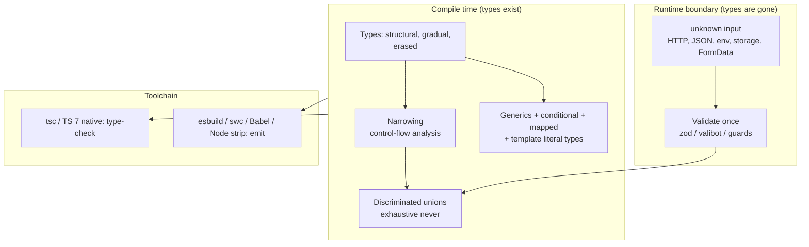
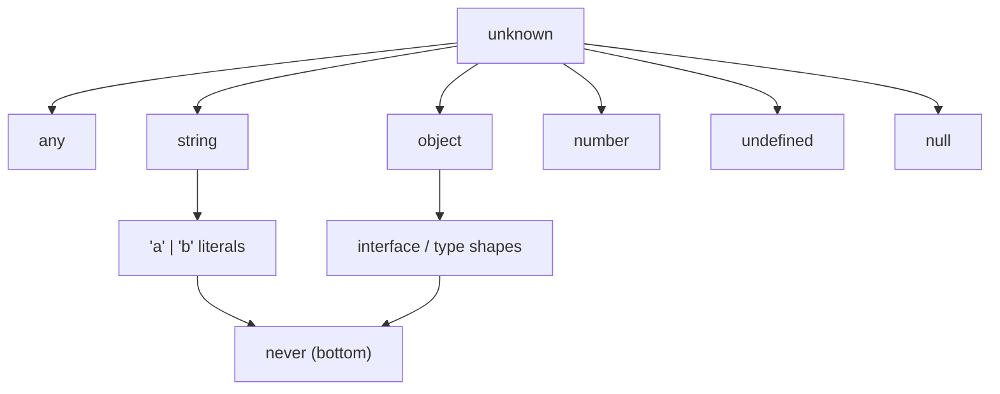
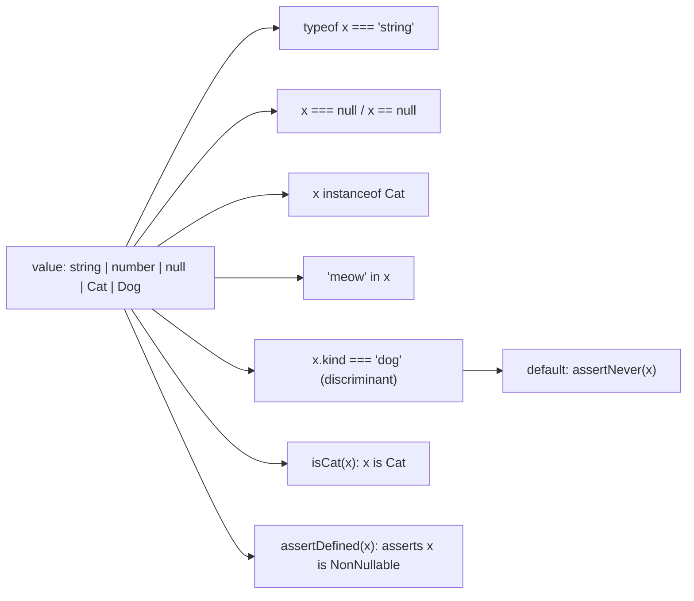
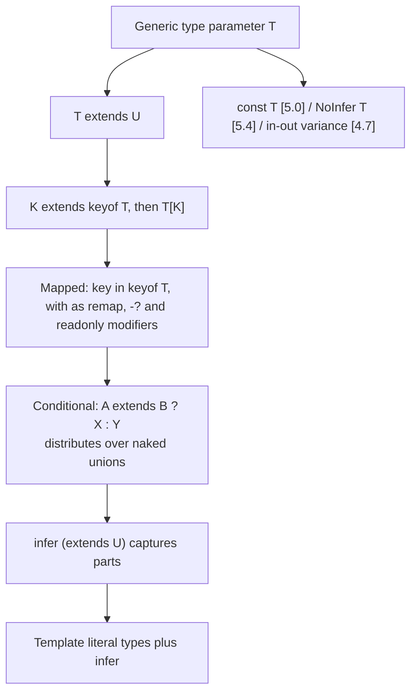
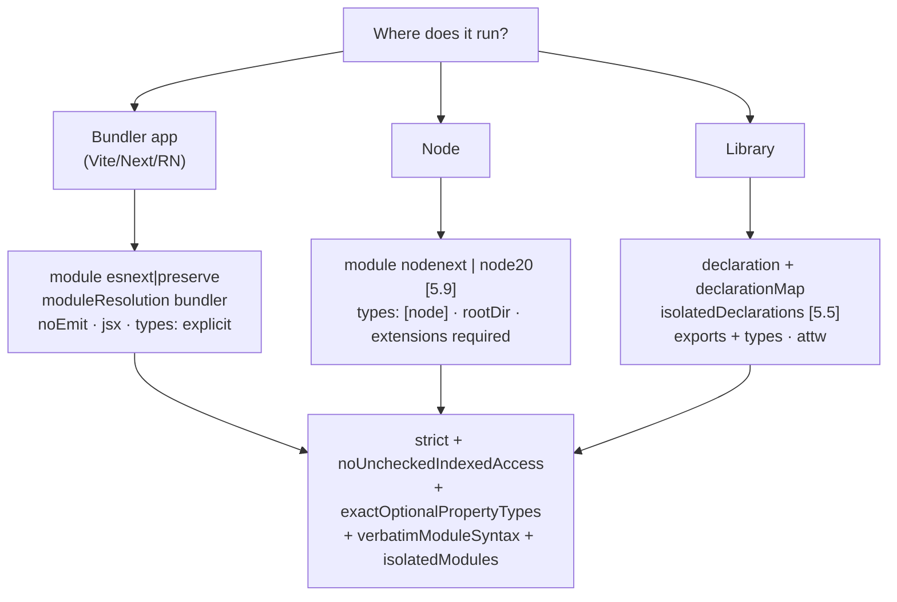
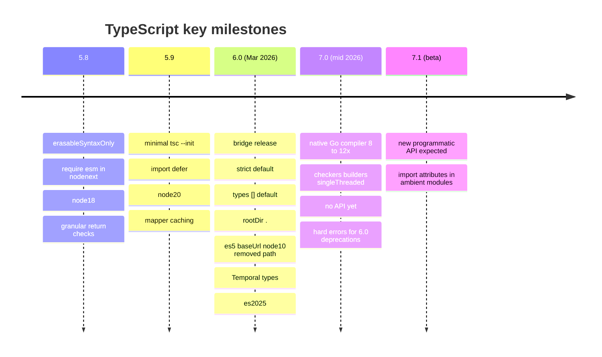

# TypeScript — Master Mental Model & Last-Minute Recall Map

> Read this the night before / an hour before the interview. It ties files 01–05 into one picture. It is **not** a substitute for reading them.
> Verified against the TypeScript team's release posts on 2026-11-10: **6.0** (last JS-based compiler), **7.0** (native Go port), **7.1 in beta**. Items marked **[x.y]** are version-sensitive.

## How to Use This Page

1. Skim the **one-page mental model** (§1).
2. Walk the **diagrams** (§2–§6) and explain each aloud in 60 seconds.
3. Drill the **mnemonics** and **rapid-fire** list (§7–§8).
4. Rehearse the **"say this" answers** (§9) and check the **red flags** (§10).

---

## 1. The One-Page Mental Model

**Five sentences to remember**
1. TypeScript is **structural, gradual and erased** — it gives *compile-time* safety only.
2. **Parse, don't cast:** everything from outside is `unknown` until validated.
3. **Model state with discriminated unions** and finish with `assertNever`.
4. **Strict mode + `noUncheckedIndexedAccess` + `exactOptionalPropertyTypes`** is the baseline; `strict` is **on by default since 6.0**.
5. **Toolchain:** type-check with `tsc` (TS 7 = ~10× faster), emit with a transpiler; match `module`/`moduleResolution` to the runtime; tools needing the API stay on **TS 6 (`@typescript/typescript6`)** until **7.1**.

---

## 2. Type Relationships at a Glance

- **Top:** `unknown` (safe). **Bottom:** `never`. **`any`** is both — it opts out.
- **Assignability:** union source → every member must fit; union target → one member fits; intersection target → all members fit.
- **Variance:** returns covariant; params contravariant (`strictFunctionTypes`); method shorthand bivariant; arrays covariant (unsound).

---

## 3. Narrowing Map

Gotchas: `typeof null === "object"` · truthiness drops `0`/`""` · `filter(Boolean)` doesn't narrow (use a predicate; **[5.5]** `x => x !== undefined` is inferred) · narrowing is optimistic across function calls · closures keep narrowing after the last assignment **[5.4]**.

---

## 4. Advanced Types Cheat Map

Tricks: `[T] extends [U]` stops distribution · `[T] extends [never]` detects never · `{ [K in keyof T]: T[K] } & {}` flattens · `(typeof arr)[number]` makes unions from `as const` arrays · tail-recursive conditional types allow deep recursion · avoid huge unions/cross-products.

---

## 5. tsconfig Decision Map

---

## 6. Version Map: 5.8 → 7.x

**6.0 defaults:** `strict`, `module esnext`, `target es2025` (floating), `types []`, `rootDir` = tsconfig dir, `noUncheckedSideEffectImports`, `libReplacement false`.
**6.0 → 7.0 removed:** `target es5`, `downlevelIteration`, `moduleResolution node10/classic`, `module amd/umd/systemjs/none`, `baseUrl`, `esModuleInterop:false`, `allowSyntheticDefaultImports:false`, `alwaysStrict:false`, `outFile`, `module Foo {}`, import `asserts`.
**7.0 reminders:** `npm i -D typescript` = native `tsc` · `--checkers` (default 4) · `--builders` · `--singleThreaded` · no API (eslint/Volar/Angular → `@typescript/typescript6`) · JS/JSDoc analysis reworked · Unicode code points in template literal inference.

---

## 7. Mnemonics

| Mnemonic | Expands to |
|---|---|
| **SANE** (type safety baseline) | **S**trict · **A**void `any`/`as` · **N**arrow with guards · **E**xhaustive switches |
| **PUV** (boundary rule) | **P**arse · **U**nknown first · **V**alidate once |
| **TUPLE-GAP** (3 holes) | `as` casts · index access · method bivariance (+ array covariance) |
| **MR-BEST** (module setup) | **M**odule + **R**esolution match runtime · **B**undler vs **N**ode · **E**xtensions · **S**tripping (`erasableSyntaxOnly`) · **T**ypes list |
| **GCDI** (advanced types) | **G**enerics → **C**onstraints → **D**istribution → **I**nfer |
| **7-STEPS** (TS 7 rollout) | 5.9 → 6.0 fix deprecations → stable ordering diff → 7 `tsc` in CI → keep 6 API for tools → tune checkers → drop shims at 7.1 |

---

## 8. Rapid-Fire Recall

| # | Question | Answer |
|---|---|---|
| 1 | `any` vs `unknown` vs `never`? | Off-switch vs safe top (must narrow) vs bottom (no values) |
| 2 | Structural typing consequence? | Shape decides compatibility → brand IDs if you need nominal behaviour |
| 3 | `type` vs `interface`? | Interfaces merge/extend well; types alias unions/mapped/conditional |
| 4 | Discriminated union benefit? | Narrowing + exhaustiveness; no impossible states |
| 5 | `satisfies` vs `as` vs annotation? | Check without widening vs override vs widen |
| 6 | Why avoid enums? | Runtime code, not erasable, poor tree-shaking → literal unions/`as const` |
| 7 | Distributive conditional? | Splits naked union params; `[T]` prevents; `never` → `never` |
| 8 | What does `infer` do? | Captures a type from a matched position |
| 9 | Mapped type modifiers? | `?`, `-?`, `readonly`, `-readonly`, `as` remap/filter |
| 10 | `const` type param / `NoInfer`? | Literal inference [5.0] / block inference from a position [5.4] |
| 11 | Inferred type predicates? | [5.5] `.filter(x => x !== undefined)` yields `T[]` |
| 12 | `noUncheckedIndexedAccess`? | Index access adds `undefined` |
| 13 | `exactOptionalPropertyTypes`? | `?` means absent, not `undefined` |
| 14 | `verbatimModuleSyntax`? | Explicit `import type`; predictable emit; needed for per-file transpilers |
| 15 | `isolatedModules`? | Each file safely transpilable alone |
| 16 | `erasableSyntaxOnly`? | [5.8] errors on enums/namespaces/param-props for type stripping |
| 17 | `paths` at runtime? | Types only → configure bundler/Node `imports` (`#/` allowed [6.0]) |
| 18 | `moduleResolution` for bundlers/Node? | `bundler` / `nodenext` (`node20` stable [5.9]) |
| 19 | 6.0 default surprises? | `types []`, `rootDir .`, `strict` on |
| 20 | Why does ESLint break with TS 7? | No API in 7.0 → alias `@typescript/typescript6` |
| 21 | React 19 `useRef`? | Argument required; `RefObject` mutable; `useRef<T>(null)` → `T \| null` |
| 22 | Type `FormData`? | `FormDataEntryValue \| null` → schema parse |
| 23 | Typed Redux hooks? | `useSelector.withTypes<RootState>()` |
| 24 | RN typed navigation? | `RootStackParamList` + `ReactNavigation.RootParamList` |
| 25 | TurboModule spec? | TS interface extending `TurboModule`, restricted types for Codegen |
| 26 | `catch (e)` type? | `unknown` under `strict` |
| 27 | `forEach(async …)` bug? | Promises dropped; lint `no-misused-promises` |
| 28 | `Object.keys` typed `string[]`? | Objects may have extra keys (structural) |
| 29 | Test types? | `expectTypeOf`, `tsd`, `@ts-expect-error`, attw |
| 30 | Compile-time slowness causes? | Deep recursion, giant unions, cross-product template literals, no `types` list |

---

## 9. "Say This" Model Answers (60-second scripts)

**"What makes TypeScript's type system special / its limits?"**
> It's structural and gradual, and types are erased, so it gives compile-time safety only. It's intentionally unsound in a few places—`any`, casts, array covariance, method bivariance, index access—so I turn on strict mode plus `noUncheckedIndexedAccess`, lint against unsafe `any`, and validate data at boundaries with schemas.

**"How do you model API state in React?"**
> A discriminated union keyed by `status`, narrowed with a switch that ends in `assertNever`, or the query library's union types. It makes impossible states unrepresentable, unlike three booleans.

**"How do you get end-to-end type safety?"**
> Pick one source of truth: OpenAPI or GraphQL schema with codegen, tRPC for TS-only stacks, or shared zod schemas. Validate at runtime at the boundary, infer types from schemas, brand IDs, and add contract tests so backend drift fails CI.

**"Explain a tsconfig for a Vite React app."**
> `moduleResolution: bundler`, `module: esnext` or `preserve`, `noEmit`, `jsx: react-jsx`, strict plus `noUncheckedIndexedAccess` and `exactOptionalPropertyTypes`, `verbatimModuleSyntax` and `isolatedModules` because the bundler transpiles per file, an explicit `types` list since TS 6 defaults it to empty, and `paths` mirrored in the bundler.

**"How would you upgrade a monorepo to TypeScript 7?"**
> Go through 5.9 and 6.0 first: set `types`, `rootDir`, remove `baseUrl`/`node10`/`es5`/legacy module formats without `ignoreDeprecations`. Compare outputs with `--stableTypeOrdering`. Then use the native `tsc` in CI for the speedup, keep the TS 6 API via `@typescript/typescript6` for ESLint and Vue/Angular tooling until 7.1, tune `--checkers` and `--builders` for the runners, and keep a rollback.

**"When do you use advanced types?"**
> To make an API safer for callers—router params, event maps, typed query keys—not for show. I keep recursion shallow, hide complexity behind documented utilities with type tests, and watch compile time with `--generateTrace`.

---

## 10. Red-Flag List (things that sink answers)

- "TypeScript checks types at runtime" or casting API data with `as`.
- Saying `any` and `unknown` are the same, or reaching for `any` as the default fix.
- Not knowing `strict` is a family and what `noUncheckedIndexedAccess` adds.
- Recommending enums by default; not knowing literal unions/`as const`.
- Confusing `paths` (type resolution) with runtime aliasing.
- Mixing up `module` and `moduleResolution`; using `node10` in 2026 projects.
- Not knowing TS 6/7 changes (`types []`, `rootDir`, removed options, native compiler, API gap).
- Writing unreadable type gymnastics with no tests and no performance awareness.
- Ignoring React 19 type changes (`useRef` args, refs, `React.JSX`).
- Not validating Server Function/route-handler inputs.

---

## 11. Last-Minute Checklist

- [ ] Can I explain structural typing, assignability and variance (and the unsound bits)?
- [ ] Can I implement `Pick`, `Omit`, `ReturnType`, `Awaited`, `UnionToIntersection` and explain distribution?
- [ ] Can I write a discriminated union with exhaustive switch and explain `satisfies`?
- [ ] Can I describe the boundary-validation pattern with zod and branded types?
- [ ] Can I produce tsconfigs for bundler app / Node / library and justify each flag?
- [ ] Can I explain 6.0 defaults, deprecations and the 7.0 native compiler + API gap?
- [ ] Can I type React components, context, reducers and React 19 hooks, and the 19 type changes?
- [ ] Can I describe typed navigation and TurboModule specs in RN?
- [ ] Do I have 2 stories (strict migration, type-safety bug caught, build-time win) ready?

---

## 12. Map to the Detailed Files

| File | Use it for |
|---|---|
| [01-type-system-fundamentals.md](01-type-system-fundamentals.md) | Structural typing, special types, unions, enums, classes, utility types, soundness holes |
| [02-generics-and-advanced-types.md](02-generics-and-advanced-types.md) | Generics, conditional/mapped/template types, recursion, challenges |
| [03-narrowing-and-type-safety-patterns.md](03-narrowing-and-type-safety-patterns.md) | Narrowing, guards, boundaries, error handling, strict flags, lint |
| [04-tsconfig-modules-and-tooling.md](04-tsconfig-modules-and-tooling.md) | tsconfig, modules, publishing types, project references, 5→6→7 migration |
| [05-typescript-with-react-and-apis.md](05-typescript-with-react-and-apis.md) | React/RN/Node typing, React 19 types, data layers |
| Related | [React recall map](../react/09-react-recall-map.md) · [JS advanced fundamentals](../js/03-advanced-fundamentals-and-coding.md) |
