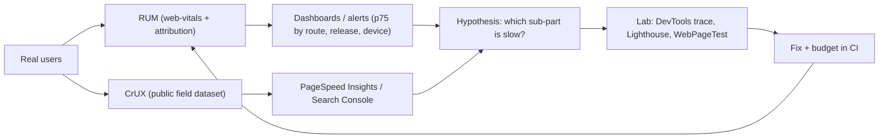
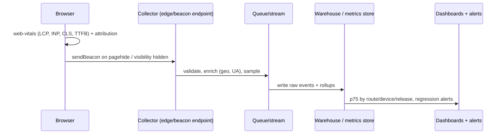
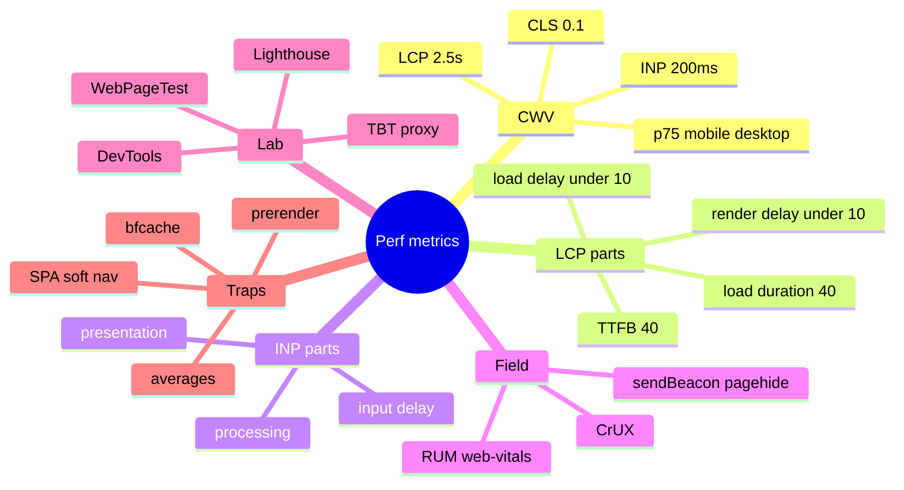

# Performance Metrics and Measurement (Core Web Vitals, Field vs Lab, RUM, Performance APIs)

> Verified against web.dev (Web Vitals, Optimize LCP, Optimize INP, bfcache; pages updated 2025-2026) and MDN (Speculation Rules). Thresholds for TTFB/FCP, the CLS session-window definition, the Long Animation Frames API and CrUX window details are from general knowledge and marked *(hedged)*. Related: [02 Critical rendering path and LCP](02-critical-rendering-path-and-loading-performance.md), [04 JavaScript, main thread and INP](04-javascript-main-thread-and-inp.md), [nextjs-and-rendering/07](../nextjs-and-rendering/07-performance-optimization.md), [react/08](../react/08-react-performance-optimization.md).

## Table of Contents

1. [Quick Summary (TL;DR)](#1-quick-summary-tldr)
2. [Why Measure: User-Centric Performance](#2-why-measure-user-centric-performance)
3. [Metric Taxonomy](#3-metric-taxonomy)
4. [Core Web Vitals in Depth](#4-core-web-vitals-in-depth)
5. [Supporting Metrics: TTFB, FCP, TBT](#5-supporting-metrics-ttfb-fcp-tbt)
6. [Field Data vs Lab Data](#6-field-data-vs-lab-data)
7. [Browser Performance APIs](#7-browser-performance-apis)
8. [Building RUM with `web-vitals`](#8-building-rum-with-web-vitals)
9. [Interpreting Distributions and Percentiles](#9-interpreting-distributions-and-percentiles)
10. [Navigation Types, bfcache, Prerender and SPAs](#10-navigation-types-bfcache-prerender-and-spas)
11. [Server-Side Visibility: `Server-Timing` and Tracing](#11-server-side-visibility-server-timing-and-tracing)
12. [Tooling Map](#12-tooling-map)
13. [SLOs, Dashboards and Alerting](#13-slos-dashboards-and-alerting)
14. [Common Measurement Pitfalls](#14-common-measurement-pitfalls)
15. [Interview Questions — Fundamentals](#15-interview-questions--fundamentals)
16. [Interview Questions — Senior Scenarios](#16-interview-questions--senior-scenarios)
17. [Cheat Sheet](#17-cheat-sheet)
18. [Key Terms Glossary](#18-key-terms-glossary)
19. [Further Reading](#19-further-reading)

---

## 1. Quick Summary (TL;DR)

- **You can't optimise what you don't measure, and lab numbers lie about real users.** Start from **field data** (RUM/CrUX), use **lab tools** to explain and to prevent regressions.
- **Core Web Vitals (stable):** **LCP ≤ 2.5 s** (loading), **INP ≤ 200 ms** (responsiveness), **CLS ≤ 0.1** (visual stability), judged at the **75th percentile** of page loads, segmented by mobile and desktop. A page "passes" only if all three meet the target. Poor thresholds: LCP > 4.0 s, INP > 500 ms, CLS > 0.25 *(CLS poor value hedged)*.
- **INP replaced FID** as a Core Web Vital in 2024. **Lighthouse can't measure INP** (no user input); use **TBT** as the lab proxy.
- **Diagnose with sub-parts:** LCP = TTFB + resource load delay + resource load duration + element render delay; INP = input delay + processing duration + presentation delay.
- **Instrument your own RUM** (`web-vitals` + attribution + `sendBeacon`), tagging route, release, device class, connection, navigation type. CrUX alone lacks per-pageview context.
- **Measurement is full of traps:** bfcache restores, prerendered pages, SPA soft navigations, sampling, outliers, A/B tests, third-party scripts, cold vs warm caches.



---

## 2. Why Measure: User-Centric Performance

- Classic metrics (`load`, `DOMContentLoaded`) don't reflect what users feel. **User-centric metrics** answer: *Is it happening? (FCP) Is it useful? (LCP) Is it usable? (INP) Is it delightful/stable? (CLS)*
- Performance affects **conversion, engagement, SEO ranking signals (CWV are surfaced in Google tools and Search Console)** and cost (bytes, compute). Quote business-impact studies only with sources (general knowledge: many vendors publish correlations between speed and conversion; treat as directional, not guaranteed).
- **Performance is a distribution, not a number.** A median of 1.8 s can hide a p95 of 9 s on low-end Android.

---

## 3. Metric Taxonomy

| Category | Metrics | Notes |
|---|---|---|
| **Loading** | TTFB, FCP, **LCP**, Speed Index (lab) | LCP is the CWV |
| **Interactivity** | **INP**, TBT (lab proxy), (FID retired) | INP observes all interactions over the visit |
| **Visual stability** | **CLS** | Layout shifts not caused by user input |
| **Resource/size** | Transfer size, JS bytes, request count, DOM size, image bytes | Leading indicators; set budgets |
| **Server** | Backend time, cache hit ratio, p95 latency | Drives TTFB |
| **Custom/business** | "Time to product visible", "search results shown", hydration done, route-change time (SPA) | Use **User Timing** (`performance.mark/measure`) |

**Lifecycle of a Core Web Vital** (web.dev): *experimental → pending (≥ 6 months) → stable*. Stable CWV change at most once a year with notice; stable metrics can still be retired (FID → INP).

---

## 4. Core Web Vitals in Depth

### LCP — Largest Contentful Paint
- Time from navigation start until the **largest image or text block in the viewport** is rendered. Target **≤ 2.5 s** at p75; poor > 4.0 s.
- **Four sub-parts** (web.dev; guideline proportions on a well-optimised page): **TTFB ≈ 40%**, **resource load delay < 10%**, **resource load duration ≈ 40%**, **element render delay < 10%**. They are relative guidelines, **not absolute budgets**. If the LCP element is text with a system font, delay and duration are 0.
- Optimising one sub-part may just **shift** time to another (e.g., smaller image, but the element is hidden until JS runs → render delay grows). Optimise **all** of them. See [02](02-critical-rendering-path-and-loading-performance.md).
- CrUX exposes LCP **sub-parts and resource types** (added Feb 2025 per web.dev).

### INP — Interaction to Next Paint
- Observes **all** qualifying interactions (click, tap, key press) over the page's lifetime and reports **the longest** (sometimes ignoring outliers on pages with many interactions). Target **≤ 200 ms**; poor > 500 ms.
- Latency = **input delay** (main thread busy before handlers can start) + **processing duration** (event callbacks) + **presentation delay** (until the next frame is painted).
- **Iframes have their own main thread**, but INP is reported at the **page level**, including slow interactions inside iframes.
- Lab: no INP in Lighthouse — use **TBT** and manual interaction traces. See [04](04-javascript-main-thread-and-inp.md).

### CLS — Cumulative Layout Shift
- Sum of **layout-shift scores** (impact fraction × distance fraction) for shifts **without recent user input**, reported as the **largest burst ("session window")** of shifts rather than the all-time total *(session-window details hedged: windows ≤ 5 s with ≤ 1 s gaps)*. Target **≤ 0.1**.
- Causes: images/embeds without dimensions, late-injected content, web-font swaps, ads, animations that change layout properties. See [05](05-rendering-layout-animation-and-cls.md).

### Passing rule
Tools treat a page as passing when **all three** meet targets at **p75**. Segment mobile vs desktop; do not average them.

---

## 5. Supporting Metrics: TTFB, FCP, TBT

| Metric | Meaning | Diagnostic use |
|---|---|---|
| **TTFB** | Navigation start → first byte of HTML | High TTFB makes 2.5 s LCP "challenging, or even impossible" (web.dev). Causes: redirects, CDN cache misses (e.g., unique query params), distance, slow origin/SSR |
| **FCP** | First text/image painted | Large **TTFB → FCP** gap = render-blocking assets or heavy client rendering; large **FCP → LCP** gap = LCP resource not discoverable early or other work in the way |
| **TBT** (lab) | Sum of blocking time of long tasks between FCP and TTI | Proxy for INP in Lighthouse |

Commonly cited "good" values *(hedged: web.dev guidance)*: **TTFB ≤ 0.8 s**, **FCP ≤ 1.8 s**. Treat TTFB/FCP as **diagnostics**, not goals in themselves.

---

## 6. Field Data vs Lab Data

| | **Field (RUM / CrUX)** | **Lab (Lighthouse, DevTools, WebPageTest)** |
|---|---|---|
| Source | Real users, real devices/networks | Controlled, throttled environment |
| Strength | True experience; captures all interactions; long tail | Reproducible, debuggable, runs pre-release, CI-friendly |
| Weakness | Needs traffic; noisy; limited context in CrUX | Not representative; can't measure INP (no user) |
| Use for | **Deciding whether you have a problem; prioritising; monitoring** | **Explaining why; testing fixes; catching regressions** |

Guidance from web.dev: **if CrUX and Lighthouse disagree, trust CrUX** (but ensure CrUX data is for your **URL**, not just the **origin**). Home pages are often the slowest (more cold visits). Use CrUX **origin** data to see site-wide issues and **URL** data for page-specific ones; PageSpeed Insights shows URL/origin × mobile/desktop.

**CrUX** (Chrome User Experience Report) aggregates anonymised data from opted-in Chrome users (a rolling ~28-day window *(hedged)*), powering PageSpeed Insights, DevTools "live metrics", and Search Console's CWV report. Public CrUX data **does not give per-pageview detail**, so **build your own RUM** for attribution. CWV measured with JS APIs **can differ** from CrUX (web.dev has a note on the differences).

---

## 7. Browser Performance APIs

All accessible through `PerformanceObserver` (use `buffered: true` to catch earlier entries).

| API / entry type | What it gives |
|---|---|
| **Navigation Timing** (`navigation`) | `responseStart` (TTFB), DNS/TCP/TLS, `domInteractive`, `type` (`navigate`, `reload`, `back_forward`, `prerender`), `activationStart` (prerender), `deliveryType` |
| **Resource Timing** (`resource`) | Per-resource timings, `transferSize`, `initiatorType`, `renderBlockingStatus`, `deliveryType` (`navigational-prefetch`) |
| **Paint Timing** (`paint`) | FP, FCP |
| **Largest Contentful Paint** (`largest-contentful-paint`) | LCP candidate: element, URL, size, `renderTime/loadTime` |
| **Layout Instability** (`layout-shift`) | Shift value, `hadRecentInput`, sources (nodes) |
| **Event Timing** (`event`, `first-input`) | Interaction durations (basis for INP): `processingStart`, `duration`, `interactionId` |
| **Long Tasks** (`longtask`) | Tasks > 50 ms (no attribution to script) |
| **Long Animation Frames** (`long-animation-frame`) *(Chromium-only; hedged)* | Frames > 50 ms with **script attribution** (source URL/function, forced layout, style/layout duration) — best data for INP/jank root-causing |
| **User Timing** | `performance.mark()` / `measure()` for custom spans |
| **Server Timing** | Backend metrics surfaced in `PerformanceResourceTiming.serverTiming` |
| **Element Timing** | Time specific annotated elements render (`elementtiming` attribute) |

```ts
// Minimal observers (use web-vitals in production)
new PerformanceObserver((list) => {
  const entries = list.getEntries();
  const last = entries[entries.length - 1] as PerformanceEntry & { element?: Element; url?: string };
  console.log('LCP candidate', last.startTime, last.url, last.element);
}).observe({ type: 'largest-contentful-paint', buffered: true });

new PerformanceObserver((list) => {
  for (const e of list.getEntries()) console.log('long-animation-frame', e.duration, (e as any).scripts);
}).observe({ type: 'long-animation-frame', buffered: true });   // feature-detect: PerformanceObserver.supportedEntryTypes
```

**Custom spans**
```ts
performance.mark('search:start');
const results = await search(q);
render(results);
requestAnimationFrame(() => {
  performance.mark('search:rendered');
  performance.measure('search', 'search:start', 'search:rendered');   // report with route + release
});
```

---

## 8. Building RUM with `web-vitals`

The Google `web-vitals` library wraps these APIs so numbers match how Google tools report them (including **bfcache restores** and subpart attribution).

```ts
import { onCLS, onINP, onLCP, onTTFB, onFCP, type Metric } from 'web-vitals/attribution';

const queue = new Set<Metric>();
function flush() {
  if (!queue.size) return;
  const body = JSON.stringify([...queue].map(m => ({
    name: m.name, value: m.value, rating: m.rating, id: m.id,
    delta: m.delta, navigationType: m.navigationType,
    attribution: m.attribution,                         // LCP element/url, INP target + subparts, CLS largest shift source
    route: location.pathname.replace(/\/\d+/g, '/:id'), // low-cardinality route
    release: __RELEASE__, dpr: devicePixelRatio,
    effectiveType: (navigator as any).connection?.effectiveType,
    deviceMemory: (navigator as any).deviceMemory,
  })));
  (navigator.sendBeacon && navigator.sendBeacon('/rum', body)) || fetch('/rum', { body, method: 'POST', keepalive: true });
  queue.clear();
}
for (const on of [onCLS, onINP, onLCP, onTTFB, onFCP]) on((m) => queue.add(m));
addEventListener('visibilitychange', () => document.visibilityState === 'hidden' && flush());
addEventListener('pagehide', flush);                  // metrics are finalised late (CLS/INP) -> flush when page is hidden
```

**RUM design checklist**
- **Report on `visibilitychange: hidden`/`pagehide`** (CLS and INP finalise late); use `sendBeacon`/`fetch keepalive`.
- **Dimensions:** route template (not raw URL), release/build, device class (memory/CPU cores/DPR), connection type, country/region, navigation type, A/B variant, logged-in state, cache state if known.
- **Attribution:** LCP element + resource URL + sub-part times; INP target selector + event type + subparts + (if available) LoAF scripts; CLS largest-shift source nodes. Keep payload small (selectors, not HTML).
- **Sampling:** e.g., 10–100% depending on traffic; sample **by session** consistently; always capture poor outliers' attribution.
- **Privacy:** no PII in URLs/selectors; honour consent where required; avoid fingerprinting-grade dimensions.
- **Storage/aggregation:** compute **percentiles from raw values or histograms** (never average p75s); keep daily rollups by route × device × release.



---

## 9. Interpreting Distributions and Percentiles

- **Use p75** for CWV targets; also look at **p50, p90, p95** and the **histogram** (good / needs improvement / poor shares). Improvement often shows first in the tail.
- **Never average percentiles** across segments; aggregate raw samples or histograms.
- **Segment**: mobile vs desktop, low-end vs high-end devices, connection, geography, new vs returning, route/template, release. A global p75 can mask one terrible template.
- **Sample size and noise**: compare week-over-week with confidence intervals; beware of **seasonality** and traffic mix shifts (marketing campaigns, new markets).
- **Regressions**: compare **before/after release** on the same segments; use **canary vs control** for causal attribution (A/B at deploy level).
- **Outliers**: tabs left in background, bots, headless browsers, extreme CPU throttling — filter bots, treat background-tab artefacts carefully (web-vitals ignores metrics when pages load in the background where relevant).
- **Statistical caution**: don't declare wins from p75 moves smaller than your noise floor; define "meaningful change" (e.g., 5%) per metric.

---

## 10. Navigation Types, bfcache, Prerender and SPAs

### bfcache (verified, web.dev updated Oct 2026)
- **Back/forward cache** restores an entire page snapshot (including JS heap) instantly; supported in all major browsers (Chrome 96+, Firefox, Safari). About **1 in 10 desktop and 1 in 5 mobile navigations** are back/forward.
- **Measurement effects:** restores are not new page loads → **fewer fast loads** in your dataset, skewing load metrics slower even though users are happier. Annotate metrics with **navigation type** (`navigate`, `reload`, `back_forward`, `prerender`); `web-vitals` supports bfcache restores (LCP = FCP = delta from `pageshow` to next paint; **reset INP and CLS to 0**). CrUX counts restores as separate visits and exposes navigation types.
- **Hit ratio:** measure via `pageshow` `event.persisted` vs `back_forward` navigations; 100% is not expected (browser restarts, tab duplication, memory eviction). The Chrome `NotRestoredReasons` API exposes why a page wasn't restored. Optimisation tips in [03](03-network-caching-and-delivery.md).

### Prerendered/prefetched pages (verified, MDN)
- **Speculation Rules** prerender activates a hidden page instantly. Detect with `document.prerendering`, `prerenderingchange` event, `PerformanceNavigationTiming.activationStart` (time between prerender start and activation; metrics should be measured from activation), and `deliveryType === 'navigational-prefetch'` for prefetches. Defer analytics/side effects until activation.

### Single-page apps
- Core Web Vitals are measured **per hard navigation** (page load). **Soft navigations** (client routing) aren't reported as new page loads by the standard metrics; Chrome has experimented with "soft navigation" heuristics *(hedged: experimental)*. Measure route transitions yourself: `performance.mark` at click → `measure` after content painted (rAF + paint), tagged by route; track INP (which still captures SPA interactions across route changes).

---

## 11. Server-Side Visibility: `Server-Timing` and Tracing

```http
Server-Timing: db;dur=53, cache;desc="hit", app;dur=47.2, edge;desc="MISS"
```
- Surfaced client-side in Resource/Navigation Timing (`serverTiming`), so RUM can break TTFB into **edge/cache/app/db** contributions. Don't leak secrets/PII; consider restricting with `Timing-Allow-Origin` for cross-origin resources.
- Combine with **distributed tracing** (trace IDs across edge → app → DB) and **synthetic probes** from multiple regions to separate "slow origin" from "slow network".
- Track **cache hit ratio**, **origin offload**, **p95 backend latency per route**, and **error rate** next to TTFB.

---

## 12. Tooling Map

| Tool | Type | Best for |
|---|---|---|
| **PageSpeed Insights** | Field (CrUX) + Lab (Lighthouse) | Quick URL/origin triage |
| **Search Console CWV report** | Field (CrUX) | Site-wide URL groups |
| **CrUX API / BigQuery / History API** | Field | Trends, competitor/benchmark, custom queries |
| **Chrome DevTools Performance panel** | Lab (+ field overlay) | Traces, LCP subparts insights, interaction analysis, layout shifts, CPU/network throttling, live metrics |
| **Lighthouse (CLI/CI)** | Lab | Budgets, regressions, audits |
| **WebPageTest** | Lab | Waterfalls, filmstrips, multi-location/device, connection profiles |
| **web-vitals + your RUM / commercial RUM** | Field | Attribution, segmentation, alerting |
| **Bundle analyzers** | Static | JS composition |
| **Tracing/APM** | Server | TTFB root causes |

---

## 13. SLOs, Dashboards and Alerting

- **SLO examples:** "p75 LCP ≤ 2.5 s on mobile for the 10 highest-traffic templates"; "p75 INP ≤ 200 ms on checkout"; "CLS ≤ 0.1 on PDP/PLP". Add **error budgets** (e.g., allow ≤ 5% of weeks to breach).
- **Dashboards:** per-route p75 trend + good/needs-improvement/poor stacked bars, by device; **release annotations**; LCP sub-part breakdown; top INP offenders (selectors/scripts); top CLS sources; bfcache hit ratio; third-party time by origin.
- **Alerts:** relative regression (e.g., +10% p75 vs 7-day baseline with minimum sample size) and absolute breach; route to owning team; include attribution in the alert.
- **Release gates:** canary RUM comparison; block rollout on regression; automated rollback for severe cases.
- **Business linkage:** join RUM sessions to conversion/engagement (carefully, privacy-safe) to prioritise.

---

## 14. Common Measurement Pitfalls

1. **Optimising Lighthouse score** instead of field p75.
2. **Using origin-level CrUX** to judge a specific page (or vice versa).
3. **Averaging** percentiles or using mean/median only.
4. **Ignoring device/network segmentation** (testing on a fast laptop on fibre).
5. **Not flushing on `pagehide`** → missing CLS/INP (finalised late).
6. **Raw URLs as dimensions** (cardinality explosion, PII leaks).
7. **Forgetting navigation types** (bfcache, prerender, reload) → skewed distributions.
8. **A/B tests/consent banners** changing LCP element/layout between variants unnoticed.
9. **Treating lab TBT as INP** (it's only a proxy).
10. **No release dimension** → can't tie regressions to deploys.
11. **Measuring warm cache only** (lab reruns) — cold visits dominate for new users.
12. **Ignoring third-party-induced regressions** (tag changes outside your deploy pipeline).
13. **Bot/synthetic traffic in RUM** distorting percentiles.
14. **Over-reading tiny changes** without confidence intervals.

---

## 15. Interview Questions — Fundamentals

### Q1. What are the Core Web Vitals and their thresholds?
LCP (loading) ≤ 2.5 s, INP (responsiveness) ≤ 200 ms, CLS (visual stability) ≤ 0.1, assessed at the 75th percentile of page loads, segmented by mobile/desktop; a page passes if all three do.

### Q2. Why p75 and not the average?
Averages hide the tail and are skewed by outliers; p75 captures a typical-but-not-best experience for most users and is the Google-defined target. You still look at p50/p90/p95 and histograms.

### Q3. Field vs lab data?
Field data (RUM/CrUX) shows real user experience across devices and networks and all interactions; lab data is controlled and reproducible for debugging and CI but unrepresentative. Use field to find problems, lab to diagnose and prevent regressions.

### Q4. Why can't Lighthouse measure INP?
It loads pages without real user interaction; INP needs actual interactions. TBT is the lab proxy.

### Q5. What changed from FID to INP?
FID measured only the delay of the first input; INP observes all interactions throughout the visit and includes processing and presentation time, becoming a Core Web Vital in 2024.

### Q6. Break LCP into sub-parts.
TTFB, resource load delay, resource load duration, element render delay (guideline ≈ 40% / <10% / ≈ 40% / <10%). Optimise all; improving one can merely shift time.

### Q7. Break INP into sub-parts.
Input delay, processing duration, presentation delay.

### Q8. How do you collect RUM?
`web-vitals` (attribution build) → batch → `sendBeacon` on `pagehide`/`visibilitychange` → collector → warehouse with dimensions (route, release, device, connection, navigation type).

### Q9. What does CLS measure and how is it reported?
Unexpected layout movement (impact × distance), reported as the largest burst/session window of shifts without recent input; target ≤ 0.1.

### Q10. How does bfcache affect measurements?
Restores aren't new loads, so fast loads disappear from datasets and distributions skew slower; annotate with navigation type, handle restores in metrics (web-vitals does), and track bfcache hit ratio.

---

## 16. Interview Questions — Senior Scenarios

### S1. "Lighthouse says 95 but our CrUX LCP p75 is 3.6 s on mobile. What now?"
Trust CrUX/RUM. Check URL vs origin data, mobile segment, LCP sub-parts and resource type from CrUX/RUM attribution. Likely suspects: TTFB on cold CDN/SSR, LCP image discovered late (client-rendered, lazy-loaded, CSS background), A/B or personalisation changing the LCP element, low-end device render delay, cache-cold visitors. Reproduce in DevTools with mobile CPU 4–6× throttling + slow 4G + cold cache, compare to field sub-parts, fix the largest sub-part first, validate with a canary and RUM.

### S2. "Design a RUM system for a high-traffic site."
Client: `web-vitals/attribution` + custom marks; low-cardinality dimensions; sample by session; flush on `pagehide`; compress. Edge collector: validation, bot filtering, enrichment, rate limiting. Pipeline: stream → warehouse (raw + histograms). Analysis: percentiles by route/device/release; LCP/INP/CLS sub-part breakdown; alerting on relative regressions with min sample size; release annotations; privacy (no PII, consent). Complement with CrUX for benchmarking and synthetic probes for TTFB/regional issues. Cost: sample, aggregate early, TTL raw data.

### S3. "INP is poor only on the checkout page. How do you find the cause?"
Segment RUM INP by route; look at attribution (target element, event type, subparts, LoAF scripts if available). If input delay dominates → main thread busy (third-party tags, hydration, long tasks at load/after fetch). If processing dominates → heavy handlers/state updates (React re-render storms, validation, address autocomplete). If presentation delay → large DOM/layout/paint costs. Reproduce with DevTools interaction trace; fix (yield, debounce, defer, memoise/virtualise, remove/ defer tags), verify via canary.

### S4. "After enabling bfcache, our page-load metrics got worse but conversion improved. Explain."
bfcache replaces the fastest repeat loads with instant restores that don't generate new page-load entries; the remaining dataset is slower. Segment by navigation type, track bfcache hit ratio, report restores as separate "navigations", rely on business metrics and user-centric CWV that account for restores.

### S5. "How would you establish a performance culture?"
Make metrics visible (dashboards per team), define SLOs tied to business outcomes, add CI budgets (bundle size, Lighthouse, interaction tests), require RUM review in launches, canary with auto-rollback, third-party governance, training on profiling, regular "performance weeks" for debt, and post-incident reviews for regressions. See [07](07-performance-debugging-budgets-and-culture.md).

---

## 17. Cheat Sheet



| Question | Answer |
|---|---|
| Which data decides priorities? | Field p75 per route/device |
| Which lab metric proxies INP? | TBT |
| When to flush RUM? | `pagehide` / `visibilitychange: hidden` |
| LCP slow, TTFB fine, load delay high? | Resource not discoverable / low priority |
| LCP slow, render delay high? | Blocking CSS/JS, hidden by JS, long tasks |
| INP slow, input delay high? | Main thread busy (startup/third parties) |

---

## 18. Key Terms Glossary

| Term | Definition |
|---|---|
| **CWV** | Core Web Vitals: LCP, INP, CLS |
| **CrUX** | Chrome User Experience Report (public field dataset) |
| **RUM** | Real user monitoring (your own field telemetry) |
| **p75** | 75th percentile |
| **TBT** | Total Blocking Time (lab proxy for INP) |
| **LoAF** | Long Animation Frames API (frame-level script attribution; Chromium) |
| **bfcache** | Back/forward cache restoring page snapshots |
| **Navigation type** | `navigate`, `reload`, `back_forward`, `prerender` |
| **Server-Timing** | Response header exposing backend timings to the client |
| **User Timing** | `performance.mark/measure` custom spans |

---

## 19. Further Reading

- [web.dev — Web Vitals](https://web.dev/articles/vitals) · [Optimize LCP](https://web.dev/articles/optimize-lcp) · [Optimize INP](https://web.dev/articles/optimize-inp) · [bfcache](https://web.dev/articles/bfcache)
- [web-vitals library](https://github.com/GoogleChrome/web-vitals) · [CrUX](https://developer.chrome.com/docs/crux)
- [MDN — Performance APIs](https://developer.mozilla.org/en-US/docs/Web/API/Performance_API) · [Speculation Rules API](https://developer.mozilla.org/en-US/docs/Web/API/Speculation_Rules_API)
- This repo: [nextjs-and-rendering/07](../nextjs-and-rendering/07-performance-optimization.md) · [react/08](../react/08-react-performance-optimization.md) · [system-design/01](../system-design/01-frontend-system-design-framework.md)
