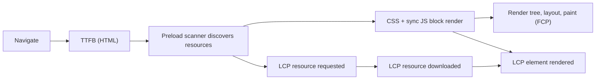
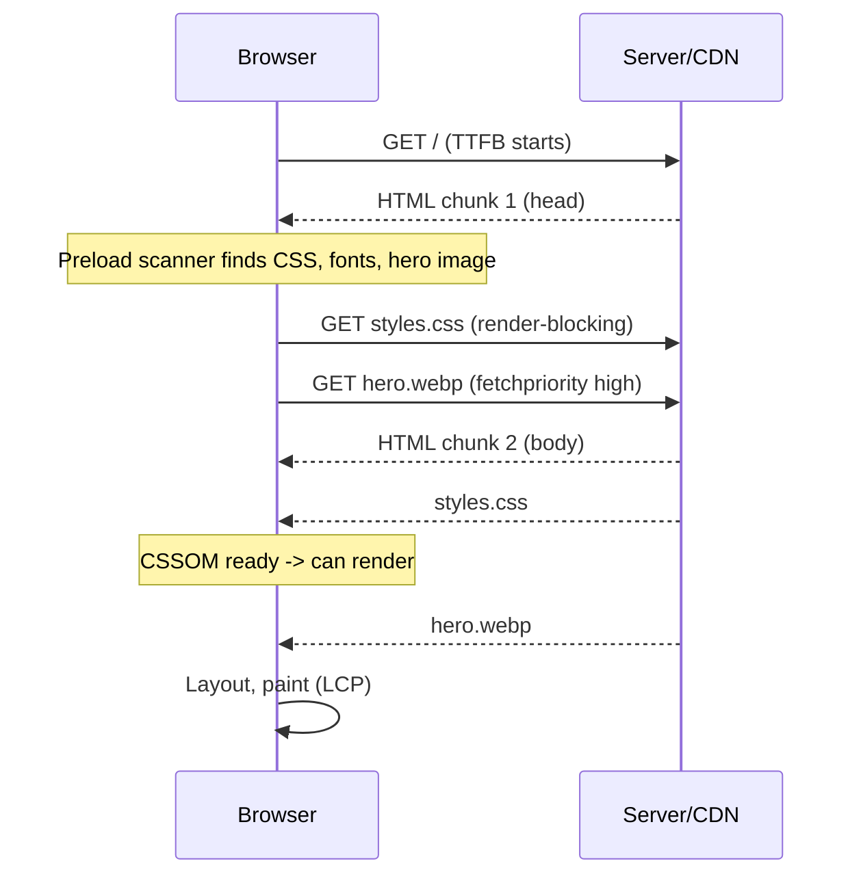
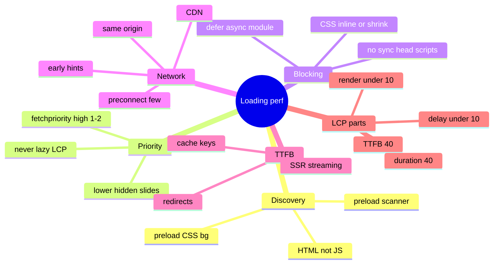

# Critical Rendering Path and Loading Performance (Preload Scanner, Render Blocking, Resource Hints, LCP Playbook)

> Verified against web.dev "Optimize LCP" (updated Mar 2025) for the LCP methodology, discovery, priority, render-blocking and TTFB guidance. HTML parsing/render-blocking mechanics, `Link`/Early Hints (103) support details, `blocking="render"` and module preload behaviours are general knowledge and marked *(hedged)*. Related: [01 Metrics](01-performance-metrics-and-measurement.md), [03 Network, caching and delivery](03-network-caching-and-delivery.md), [06 Images, fonts, media, third parties](06-images-fonts-media-and-third-parties.md), [nextjs-and-rendering/05](../nextjs-and-rendering/05-streaming-ppr-and-instant-navigation.md).

## Table of Contents

1. [Quick Summary (TL;DR)](#1-quick-summary-tldr)
2. [From URL to Pixels: The Pipeline](#2-from-url-to-pixels-the-pipeline)
3. [The Preload Scanner and Resource Discovery](#3-the-preload-scanner-and-resource-discovery)
4. [Render-Blocking CSS](#4-render-blocking-css)
5. [Parser-Blocking and Deferred JavaScript](#5-parser-blocking-and-deferred-javascript)
6. [Resource Priority and `fetchpriority`](#6-resource-priority-and-fetchpriority)
7. [Resource Hints: preload, preconnect, dns-prefetch, prefetch, modulepreload](#7-resource-hints-preload-preconnect-dns-prefetch-prefetch-modulepreload)
8. [Rendering Architecture: CSR, SSR, SSG, Streaming and Their Loading Profiles](#8-rendering-architecture-csr-ssr-ssg-streaming-and-their-loading-profiles)
9. [The LCP Playbook (Four Sub-Parts)](#9-the-lcp-playbook-four-sub-parts)
10. [Reducing TTFB](#10-reducing-ttfb)
11. [Loading Anti-Patterns](#11-loading-anti-patterns)
12. [Reading a Network Waterfall](#12-reading-a-network-waterfall)
13. [Case Study Walkthrough](#13-case-study-walkthrough)
14. [Interview Questions — Fundamentals](#14-interview-questions--fundamentals)
15. [Interview Questions — Senior Scenarios](#15-interview-questions--senior-scenarios)
16. [Cheat Sheet](#16-cheat-sheet)
17. [Key Terms Glossary](#17-key-terms-glossary)
18. [Further Reading](#18-further-reading)

---

## 1. Quick Summary (TL;DR)

- **Loading performance = getting the right bytes to the browser early and not blocking the first render.** Four levers map to LCP's sub-parts: **faster HTML (TTFB)**, **earlier discovery + higher priority of the LCP resource (load delay)**, **smaller/closer resource (load duration)**, **nothing blocking paint (render delay)**.
- Resources the **preload scanner** can see in the initial HTML start early. Resources hidden behind **JS (dynamic ``, `data-src`) or CSS (`background-image`)** are discovered late — preload them or put them in HTML.
- **CSS is render-blocking; synchronous scripts are parser-blocking.** Keep critical CSS small (or inline it), `defer`/`async`/`type="module"` scripts, never put sync scripts in `<head>`.
- **Priority matters:** `fetchpriority="high"` on **one or two** LCP images, `low` for hidden carousel slides; **never lazy-load the LCP image**.
- **Hosting critical resources on the same origin** avoids new connections; otherwise `preconnect` sparingly.
- **SSR/SSG** make the LCP resource discoverable and avoid JS-before-content, at the cost of server time (TTFB) — usually worth it.
- **Don't optimise blindly:** find the LCP element and its sub-part timings first ([01](01-performance-metrics-and-measurement.md)).



---

## 2. From URL to Pixels: The Pipeline

1. **Navigation:** redirects → DNS → TCP/QUIC → TLS → HTTP request. (`Navigation Timing`: `redirectStart…responseStart`.)
2. **Response:** first byte (**TTFB**) → HTML streams in. The parser builds the **DOM** incrementally (streaming parse).
3. **Discovery:** the **preload scanner** runs ahead of the main parser, finds `<link>`, `<script src>`, ``, etc., and starts fetches early.
4. **CSSOM:** stylesheets in `<head>` are **render-blocking** (browser won't paint until CSSOM is ready for content that follows).
5. **Scripts:** a classic `<script src>` without `async/defer` **blocks HTML parsing** until it's fetched and executed (and waits for pending stylesheets to finish).
6. **Render tree → Layout → Paint → Composite:** style + DOM → render tree; layout computes geometry; paint creates draw commands; compositing assembles layers (GPU).
7. **First Paint/FCP**, then **LCP** when the largest element is painted. Images **render on the main thread**, so long tasks delay even fully downloaded images (web.dev).



---

## 3. The Preload Scanner and Resource Discovery

From web.dev: the LCP resource must be **discoverable in the initial HTML response** by the preload scanner. Discoverable when:
- LCP element is an `` with `src`/`srcset` **in the HTML markup**.
- LCP uses a **CSS background image** *but it is preloaded* (`<link rel="preload">` or a `Link` header).
- LCP is **text needing a web font**, and the font is preloaded.

**Not discoverable** (browser must run JS/apply CSS first → wasted time):
- `` **added by JavaScript** (typical CSR).
- Lazy-loading libraries hiding `src`/`srcset` (`data-src`, `data-srcset`).
- **CSS `background-image`** without preload.

```html
<!-- Preload the LCP image referenced only from CSS; start with the stylesheet, high priority -->
<link rel="stylesheet" href="/styles.css">
<link rel="preload" fetchpriority="high" as="image" href="/hero.webp" type="image/webp">
```
Responsive preload: `<link rel="preload" as="image" imagesrcset="hero-640.webp 640w, hero-1280.webp 1280w" imagesizes="100vw">` *(hedged: attribute names stable in modern browsers)*.

**Rule of thumb (web.dev):** the LCP resource should **start loading at the same time as the first resource** the page loads. If it starts later, there's room to improve.

---

## 4. Render-Blocking CSS

- Stylesheets referenced in HTML **block rendering of everything after them**. If the stylesheet is **bigger/slower than the LCP resource**, the LCP element can't render even after its resource loads (**element render delay**).
- **Options (web.dev):**
  1. **Inline** the stylesheet — only if small (inlined CSS can't be cached across pages).
  2. **Reduce** it — remove unused CSS (DevTools Coverage), **defer non-critical CSS**, minify, compress (Brotli/gzip).
  3. Split by media: `<link rel="stylesheet" href="print.css" media="print">` (non-matching media is non-blocking) *(hedged)*.
- **Critical CSS strategy:** inline above-the-fold CSS (≈ 10–15 KB budget is a common heuristic *(hedged)*), load the rest asynchronously; automate in the build (framework/CSS tooling).
- **CSS-in-JS runtime cost:** runtime style injection delays render and can cause long tasks; prefer build-time extraction (CSS Modules/Tailwind/vanilla-extract) for critical paths.
- **`@import` chains** serialise requests — avoid; bundle instead.
- **Fonts referenced in CSS are discovered only after CSS loads** → preload critical fonts ([06](06-images-fonts-media-and-third-parties.md)).

---

## 5. Parser-Blocking and Deferred JavaScript

| Attribute | Download | Execution | Order | Use |
|---|---|---|---|---|
| *(none)* | Blocks parser | Immediately | In order | **Avoid** in `<head>` |
| `async` | Parallel | As soon as ready (may interrupt parsing) | Not guaranteed | Independent scripts (analytics) |
| `defer` | Parallel | After HTML parsed, before `DOMContentLoaded` | In order | App scripts needing DOM |
| `type="module"` | Parallel | Deferred by default | Dependency order | Modern bundles |
| Inline | – | Immediate | – | Tiny critical snippets only |

web.dev: *"It is almost never necessary to add synchronous scripts to the `<head>`"*; for code that must run early, **inline** it (small) so rendering isn't waiting on another request.

**Other JS-related render delays (web.dev):**
- LCP element **not yet in the DOM** (waiting for JS).
- Element **hidden by other code** (e.g., an A/B testing library deciding a variant — use server-side variant selection or anti-flicker patterns carefully).
- **Long tasks** on the main thread (large bundles parse/compile/execute) delaying paint — **break up long tasks** ([04](04-javascript-main-thread-and-inp.md)).

---

## 6. Resource Priority and `fetchpriority`

Browsers assign priorities (CSS/fonts high; sync scripts high; images lower unless in viewport per heuristics; async/defer scripts lower). Influence with:

```html
   <!-- LCP candidate -->
              <!-- hidden carousel slide -->
<link rel="preload" as="image" href="/hero.webp" fetchpriority="high">
```

Verified guidance (web.dev):
- Setting `fetchpriority="high"` on **more than one or two images makes it unhelpful.**
- **Never lazy-load the LCP image** — it waits for layout to confirm viewport intersection, adding load delay.
- Lowering the priority of early-in-HTML but non-visible images (carousel slides) frees bandwidth.
- Always **verify in DevTools** (Network → Priority column) and test; priority is a **hint**, not a command.
- **Network contention:** many high-priority resources compete; reduce total bytes, defer non-critical resources, avoid dozens of parallel third-party requests.
- On HTTP/2/3, priorities are signalled over multiplexed streams (browser-dependent; servers/CDNs may honour or ignore *(hedged)*).

---

## 7. Resource Hints: preload, preconnect, dns-prefetch, prefetch, modulepreload

| Hint | What it does | When | Caveats |
|---|---|---|---|
| `<link rel="preload" as="…">` | Fetch **now**, current page, high priority | LCP image in CSS, critical font, key script/chunk discovered late | Over-preloading steals bandwidth; must match `as`/`type`/`crossorigin` or it's fetched twice; unused preloads warn |
| `<link rel="preconnect" href="https://cdn…" crossorigin>` | DNS + TCP + TLS early | Critical third-party origins (image CDN, API) used soon | Each costs sockets/CPU; limit to ~2–4 origins; prefer same-origin hosting |
| `<link rel="dns-prefetch">` | DNS only | Fallback/cheap hint for less critical origins | Subsumed by preconnect where supported |
| `<link rel="prefetch">` | Fetch for **future navigation**, low priority, idle | Next-page resources | Not for current page; use **Speculation Rules** for documents ([03](03-network-caching-and-delivery.md)) |
| `<link rel="modulepreload">` | Fetch + parse module (and deps) early | Critical ES module graph *(hedged)* | Only for modules needed soon |
| `fetchpriority` | Re-prioritise within type | LCP image, hidden slides | Hint only |
| `103 Early Hints` + `Link` header | Server sends hints **before** the final response | Slow origin/SSR: let browser preload CSS/fonts/hero while server computes HTML | Support varies by browser/CDN; hedged — verify |
| `Link:` response header | Same as `<link>` in HTML, available before body | Preload without HTML changes | Same caveats |

```http
HTTP/1.1 103 Early Hints
Link: </styles.css>; rel=preload; as=style
Link: </hero.webp>; rel=preload; as=image; fetchpriority=high
Link: <https://cdn.example.com>; rel=preconnect
```
*(Early Hints can overlap network time with server think-time, directly reducing resource load delay on dynamic pages.)*

**Preload pitfalls:** fonts need `crossorigin` even same-origin; preload **only** resources used within a few seconds; don't preload everything "just in case"; check for duplicate fetches in the waterfall.

---

## 8. Rendering Architecture: CSR, SSR, SSG, Streaming and Their Loading Profiles

| Architecture | Loading profile | LCP implications |
|---|---|---|
| **CSR (SPA)** | Tiny HTML → JS bundle → data fetch → render | LCP resource often **undiscoverable** until JS runs; big **TTFB→FCP** gap; render delay from JS long tasks. Mitigate: preload data/LCP image, smaller bundles, route-level splitting, or move to SSR/SSG |
| **SSR** | HTML contains content/LCP resource | Good discovery; **TTFB** grows with server work → cache, stream, Early Hints |
| **SSG / prerender** | HTML from CDN | Best TTFB + discovery; staleness trade-off (ISR/on-demand revalidation) |
| **Streaming SSR** | Shell early, content as ready | Fast first bytes; ensure LCP element is in the early shell; no proxy buffering |
| **Islands/partial hydration** | HTML + little JS | Lower JS cost; good INP/LCP |
| **PPR (framework-level)** | Static shell + dynamic holes | See [nextjs-and-rendering/05](../nextjs-and-rendering/05-streaming-ppr-and-instant-navigation.md) |

web.dev's LCP guidance: SSR's two benefits are (1) image resources discoverable in HTML; (2) content doesn't wait on additional JS requests; the main downside is extra server processing time (TTFB). Prerendering/SSG is "generally a better choice for performance" when your architecture allows.

---

## 9. The LCP Playbook (Four Sub-Parts)

Diagnose with the sub-part breakdown (DevTools Insights, Lighthouse "LCP element", RUM attribution). Guidelines: **TTFB ≈ 40%, load delay < 10%, load duration ≈ 40%, render delay < 10%** (relative, not absolute).

### A. Eliminate resource load delay (target ≈ 0)
- Make the LCP resource **discoverable in HTML** (SSR/SSG, real ``, no JS injection, no `data-src`).
- If referenced only in CSS/JS → **preload** with `fetchpriority="high"`.
- Raise priority (`fetchpriority="high"`, never `loading="lazy"`); lower priority of competing images.
- Host on the **same origin** (or `preconnect`; or proxy the image CDN through your origin).

### B. Eliminate element render delay (target ≈ 0)
- **Inline or shrink render-blocking CSS**; no sync scripts in `<head>`.
- Ensure the element is **in the initial DOM** (SSR) and not hidden by A/B/consent scripts.
- **Break up long tasks**; defer non-critical JS; reduce bundle size.
- Avoid client-only rendering for the hero.

### C. Reduce resource load duration
- **Reduce size:** right-size images (`srcset/sizes`), modern formats (AVIF/WebP), compression; subset web fonts ([06](06-images-fonts-media-and-third-parties.md)).
- **Reduce distance:** CDN (image CDNs also optimise formats automatically); prefer same origin via proxying.
- **Reduce contention:** fewer parallel high-priority requests; defer third-parties.
- **Eliminate network:** long-lived caching (immutable), service worker caches, `font-display` other than `auto/block` so text isn't blocked on font download; small resources can be inlined (data URLs have caching/decoding trade-offs).
- Caution (web.dev): load duration is **rarely the biggest bottleneck**; check RUM before investing.

### D. Reduce TTFB
- See next section.

> **Order of attack (web.dev):** discovery/priority and render delay first (cheap, big wins), then size/distance, then TTFB (often least under your control but affects everything).

---

## 10. Reducing TTFB

| Cause | Fix |
|---|---|
| **Redirect chains** (marketing links, `http→https`, `www`, locale, trailing slash) | Collapse to one hop; use HSTS; canonical links; avoid redirecting on every request |
| **CDN cache miss** (unique query params from analytics; cookies varying cache; `Vary` explosion) | Normalise cache keys (strip tracking params), cache HTML where safe (static/ISR), `stale-while-revalidate` |
| **Distance** | CDN/edge, regional origins, replicate data, HTTP/3 |
| **Slow origin/SSR** | Cache data, parallelise fetches, stream HTML early, move slow parts behind Suspense/PPR, optimise DB queries, avoid cold starts |
| **TLS/connection setup** | Keep-alive, TLS 1.3, OCSP stapling, connection coalescing, preconnect for third-party origins |
| **Large HTML/inline payload before first flush** | Early flush `<head>`, stream |
| **Origin overload** | Autoscaling, rate limits, request coalescing at CDN |

Measure TTFB split by **cache hit vs miss**, **region**, **navigation type**, and **device/network** (RUM + `Server-Timing`). See [03](03-network-caching-and-delivery.md).

---

## 11. Loading Anti-Patterns

1. **Lazy-loading the LCP image** (`loading="lazy"` on hero).
2. **Client-rendered hero** (image/text appears only after JS + API).
3. **Hero as CSS `background-image` without preload.**
4. **`data-src` lazy-loader library** applied to above-the-fold images.
5. **Synchronous third-party script in `<head>`** (tag managers, A/B tools).
6. **Giant CSS bundle** blocking render (framework + component libs unused).
7. **Preloading too much** (every font weight, every image) → contention.
8. **Multiple `preconnect`s** to many origins.
9. **Web fonts blocking text** (`font-display: block`/default behaviour without preload/subsetting).
10. **Hiding content until JS init** (anti-flicker snippets with long timeouts).
11. **Chained dependency waterfalls** (HTML → CSS → `@import` → font; HTML → JS → fetch config → fetch data → render).
12. **Un-sized images/iframes** (also CLS).
13. **Redirect on the critical path** (geo/locale redirect after load).
14. **Ignoring cache headers** (re-downloading static assets).

---

## 12. Reading a Network Waterfall

Check, in order:
1. **TTFB bar** of the document — long? (server/redirects/connection).
2. **When does the LCP resource start** relative to the **first resource** (target ≈ same time)?
3. **Is the LCP resource discovered late?** (starts after a CSS/JS finishes) → discovery problem.
4. **Priority column** (DevTools): LCP image `High`? Competing images `High`?
5. **Blocking resources** (render-blocking CSS/sync scripts: DevTools marks "Render blocking").
6. **Connection setup** (DNS/TLS) on third-party origins before critical resources.
7. **Long main-thread tasks** between "resource finished" and "LCP painted" → render delay.
8. **Caching:** `Size` shows `(memory cache)`/`(disk cache)`/`304` vs full transfer on repeat view.
9. **Compression and sizes**: images > viewport needs; uncompressed text.

DevTools Performance panel's **LCP breakdown insight** gives sub-part times directly; WebPageTest filmstrip shows what users see over time.

---

## 13. Case Study Walkthrough

**Symptom:** PDP mobile LCP p75 = 4.1 s (RUM). TTFB p75 = 0.9 s. LCP element = hero ``.

| Step | Observation | Action |
|---|---|---|
| 1. Sub-parts | TTFB 22%, load delay **38%**, load duration 18%, render delay **22%** | Discovery and render delay dominate |
| 2. Why late? | Image injected by a client component after hydration; waterfall shows hero requested after main JS (≈ 1.6 s) | Render hero in SSR HTML with real ``, `fetchpriority="high"`, no lazy |
| 3. Render delay | Sync A/B script in `<head>` + 200 KB render-blocking CSS | Move variant choice to server/edge; `defer` script; inline critical CSS (~12 KB) and defer the rest |
| 4. Size | Hero is 1.2 MB JPEG at 3000px | AVIF/WebP, `srcset` widths (640–1600), quality tuning via image CDN |
| 5. TTFB | HTML not cached; SSR waits on slow recommendations API | Cache shared content, stream shell, move recs to Suspense hole; send Early Hints |
| 6. Verify | Lab (4× CPU, slow 4G, cold cache) then canary RUM | LCP p75 2.3 s; INP/CLS unchanged |

---

## 14. Interview Questions — Fundamentals

### Q1. What is the critical rendering path?
The sequence from receiving HTML to first paint: parse HTML → DOM; fetch/parse CSS → CSSOM (render-blocking); execute blocking scripts; combine into render tree; layout; paint; composite.

### Q2. What does the preload scanner do?
It scans the HTML ahead of the main parser to discover and start fetching resources (CSS, scripts, images, fonts via preload) early, even when the parser is blocked. Resources injected by JS or referenced only in CSS aren't visible to it.

### Q3. `async` vs `defer` vs module scripts?
`async`: fetch in parallel, run when ready (unordered); `defer`: fetch in parallel, run after parsing in order; `type="module"`: deferred by default with dependency ordering. Avoid sync scripts in `<head>`.

### Q4. Why is CSS render-blocking and how do you mitigate it?
The browser avoids painting unstyled content, so it waits for CSSOM. Reduce (remove unused, split, minify, compress), inline small critical CSS, defer non-critical CSS.

### Q5. When use `preload` vs `preconnect` vs `prefetch`?
`preload` for current-page critical resources discovered late; `preconnect` to establish connections to critical third-party origins; `prefetch` (or Speculation Rules) for future navigations.

### Q6. What does `fetchpriority` do and what are its limits?
Hints relative priority (`high`/`low`/`auto`). Use on one or two LCP candidates and to deprioritise hidden images; it's a hint, and too many highs defeats it.

### Q7. Why shouldn't you lazy-load the LCP image?
Lazy loading waits until layout confirms it's in the viewport, adding resource load delay.

### Q8. Name causes of high TTFB.
Redirects, CDN cache misses (unique query params), distance, slow origin/SSR, connection setup, cold starts.

### Q9. How does SSR help LCP and what's the cost?
Content/images are in the initial HTML (discoverable) and don't require JS first; the cost is server time (TTFB) — mitigated by caching/streaming/SSG.

### Q10. What are the LCP sub-parts?
TTFB, resource load delay, resource load duration, element render delay.

---

## 15. Interview Questions — Senior Scenarios

### S1. "Our SPA's LCP is 5 s on mobile. How do you fix it without a rewrite?"
Measure sub-parts: likely large load delay and render delay (JS-then-data waterfall). Short term: preload the LCP image/API response (`<link rel=preload>` or inline initial data), cut bundle size (route splitting, remove unused libs), defer non-critical JS, inline critical CSS, avoid hiding content until JS init, cache API responses at the edge. Medium term: pre-render/SSR the shell and hero for key routes (framework or edge rendering), stream data, hydrate selectively. Validate with RUM per route and CI budgets.

### S2. "We added a CDN for images and LCP got worse."
Possible: new origin → DNS/TLS/connection cost on the critical path (fix: same-origin proxy/`preconnect`), cold CDN cache, wrong cache keys, format negotiation misses (`Accept` not forwarded), redirects between origin and CDN, lower priority from third-party origin, CORS/preload mismatch causing duplicate fetches. Compare waterfalls before/after; keep critical images same-origin via CDN proxying.

### S3. "A/B testing tool causes flicker and slow LCP."
Client-side anti-flicker hides the page until the script loads/decides (render delay). Move assignment to the edge/server (cookie-based bucketing) and render the right variant in HTML; if client-side is unavoidable, load the SDK inline/async with a strict timeout (≤ a few hundred ms), keep variants small, avoid hiding the LCP container, and measure LCP by variant.

### S4. "Preloading made things slower. Why?"
Over-preloading competes for bandwidth with truly critical resources; wrong `as`/`type`/`crossorigin` causes double downloads; preloaded resources used late waste bytes; priority inversion (preloads at high priority delaying CSS/LCP). Audit waterfall/priorities, keep preloads to LCP image/critical font/chunk, and remove those the page doesn't use quickly.

### S5. "How would you reduce TTFB for a personalised SSR page?"
Split shared vs personalised: cache the shared shell/content (CDN/`stale-while-revalidate`), stream early, render personalised parts behind Suspense or via edge includes, parallelise data fetching, cache user-agnostic API calls, tune DB queries/indexes, add Early Hints to start loading CSS/hero during server work, keep connections warm, deploy regionally near data, and monitor TTFB by cache hit/miss and region.

---

## 16. Cheat Sheet



| Symptom | Likely cause | Fix |
|---|---|---|
| Hero starts late | Not discoverable | SSR/real ``; preload |
| Image loaded, still not painted | Render-blocking CSS/JS, long task | Inline/shrink CSS; defer JS; split tasks |
| Slow download | Big/far image | AVIF/WebP, `srcset`, CDN |
| High TTFB | Redirect/cache miss/origin | Cache keys, CDN, stream, optimise origin |
| Good lab, bad field | Device/network/cold cache | Throttle, RUM attribution |

---

## 17. Key Terms Glossary

| Term | Definition |
|---|---|
| **Preload scanner** | Secondary parser that discovers resources early |
| **Render-blocking** | Resource that delays first paint (CSS, sync scripts) |
| **Parser-blocking** | Resource that halts HTML parsing (sync scripts) |
| **Critical CSS** | CSS needed for above-the-fold render |
| **Early Hints (103)** | Interim response with `Link` hints before the final response |
| **`fetchpriority`** | Attribute hinting relative fetch priority |
| **Preconnect** | Early DNS+TCP+TLS to an origin |
| **Resource load delay** | Time between TTFB and LCP resource request start |
| **Element render delay** | Time between LCP resource loaded and element painted |
| **Network contention** | Competing downloads reduce each other's bandwidth |

---

## 18. Further Reading

- [web.dev — Optimize Largest Contentful Paint](https://web.dev/articles/optimize-lcp) · [Preload scanner](https://web.dev/articles/preload-scanner) · [Fetch Priority](https://web.dev/articles/fetch-priority) · [Optimize TTFB](https://web.dev/articles/optimize-ttfb)
- [MDN — Critical rendering path](https://developer.mozilla.org/en-US/docs/Web/Performance/Guides/Critical_rendering_path) · [rel=preload](https://developer.mozilla.org/en-US/docs/Web/HTML/Attributes/rel/preload)
- This repo: [01 Metrics](01-performance-metrics-and-measurement.md) · [03 Delivery](03-network-caching-and-delivery.md) · [nextjs-and-rendering/01](../nextjs-and-rendering/01-rendering-strategies-and-hydration.md)
