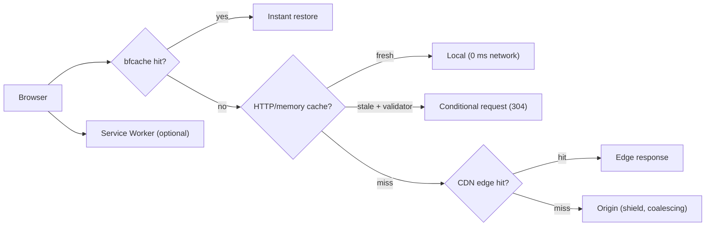
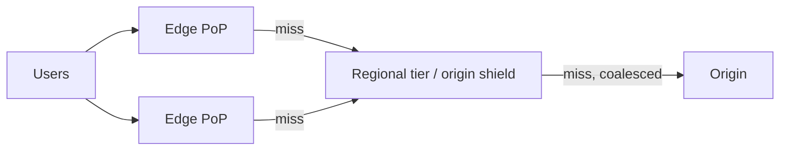
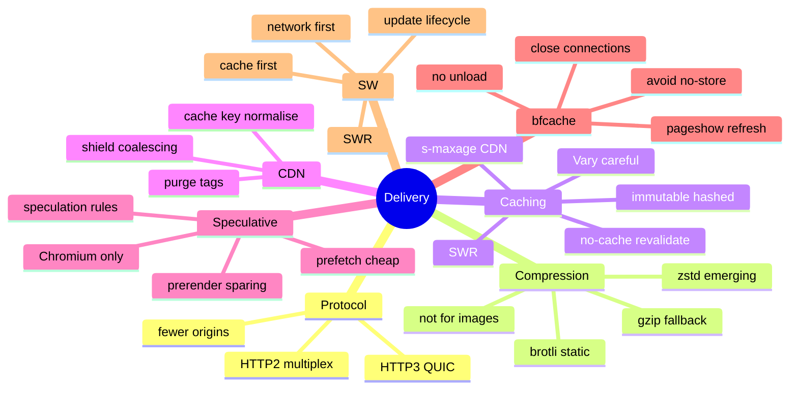

# Network, Caching and Delivery (HTTP/2-3, Compression, HTTP Caching, CDN, Service Workers, Speculative Loading, bfcache)

> Verified against MDN "Speculation Rules API" (modified Sep 2026) and web.dev "bfcache" (updated Oct 2026). HTTP protocol, compression codecs, `Cache-Control` semantics, CDN behaviour, Service Worker strategies, `Save-Data` and HTTP/2 Server Push removal are well-established general knowledge — marked *(hedged)* where version/support details change. Related: [02 Critical rendering path](02-critical-rendering-path-and-loading-performance.md), [04 JavaScript and INP](04-javascript-main-thread-and-inp.md), [nextjs-and-rendering/03 caching](../nextjs-and-rendering/03-caching-and-revalidation.md), [system-design/01 caching layers](../system-design/01-frontend-system-design-framework.md).

## Table of Contents

1. [Quick Summary (TL;DR)](#1-quick-summary-tldr)
2. [Protocols: HTTP/1.1, HTTP/2, HTTP/3](#2-protocols-http11-http2-http3)
3. [Connection Setup and Reuse](#3-connection-setup-and-reuse)
4. [Compression](#4-compression)
5. [HTTP Caching Deep Dive](#5-http-caching-deep-dive)
6. [Caching Strategy by Asset Type](#6-caching-strategy-by-asset-type)
7. [CDN Architecture and Cache Keys](#7-cdn-architecture-and-cache-keys)
8. [Service Workers and the Cache API](#8-service-workers-and-the-cache-api)
9. [Speculative Loading: Speculation Rules and Prefetch](#9-speculative-loading-speculation-rules-and-prefetch)
10. [Back/Forward Cache (bfcache)](#10-backforward-cache-bfcache)
11. [API and Data Transfer Performance](#11-api-and-data-transfer-performance)
12. [Adaptive Loading and Reduced Data](#12-adaptive-loading-and-reduced-data)
13. [Debugging Delivery Problems](#13-debugging-delivery-problems)
14. [Pitfalls](#14-pitfalls)
15. [Interview Questions — Fundamentals](#15-interview-questions--fundamentals)
16. [Interview Questions — Senior Scenarios](#16-interview-questions--senior-scenarios)
17. [Cheat Sheet](#17-cheat-sheet)
18. [Key Terms Glossary](#18-key-terms-glossary)
19. [Further Reading](#19-further-reading)

---

## 1. Quick Summary (TL;DR)

- **Fastest request = no request.** Use **long-lived, fingerprinted (`immutable`) caching** for static assets, **revalidation** (`no-cache` + ETag, or `stale-while-revalidate`) for HTML and APIs, and a **CDN** to shorten distance and offload the origin.
- **Compress text** (Brotli > gzip; zstd where supported), **never compress already-compressed formats** (JPEG/AVIF/WebP/MP4/WOFF2).
- **HTTP/2 multiplexing** removed the need for domain sharding/spriting; **HTTP/3 (QUIC)** removes TCP head-of-line blocking and speeds connection setup. Fewer origins → fewer connections.
- **Speculative loading:** **Speculation Rules** (`prefetch`/`prerender`) make future navigations near-instant in supporting browsers (Chromium; **not Safari**; Firefox only in Nightly for some keys per MDN); **bfcache** makes back/forward navigations instant in **all major browsers** if you avoid blockers (`unload`, `Cache-Control: no-store`, open connections).
- **Service Workers** add programmable caching/offline but add complexity (update lifecycle, stale bundles, cache poisoning).
- **Measure delivery with RUM by cache state, region and protocol**; verify headers in DevTools; watch CDN hit ratio and origin offload.



---

## 2. Protocols: HTTP/1.1, HTTP/2, HTTP/3

| | HTTP/1.1 | HTTP/2 | HTTP/3 |
|---|---|---|---|
| Transport | TCP | TCP | **QUIC (UDP)** |
| Multiplexing | No (≈ 6 connections/origin) | **Yes** (streams on one connection) | Yes (independent streams) |
| Head-of-line blocking | Per connection (request) | **TCP-level** HOL on packet loss | **Eliminated at transport** per stream |
| Header compression | None | HPACK | QPACK |
| Handshake | TCP + TLS (2–3 RTT, less with TLS 1.3) | Same | QUIC+TLS 1.3 in **1 RTT** (0-RTT resumption possible; replay caveats) |
| Notes | Domain sharding helped | **Sharding/spriting/concatenation less needed**; Server Push effectively dead *(hedged: removed from Chrome)* | Better on lossy/mobile networks, connection migration |

**Implications for frontend engineers**
- Prefer **fewer origins**; each new origin costs DNS + connection + TLS. HTTP/2 **connection coalescing** may reuse connections across hostnames sharing a certificate/IP.
- Bundling strategy shifted: **many small files** are OK on HTTP/2/3, but **too many** (hundreds) still cost; aim for sensible chunking (see [04](04-javascript-main-thread-and-inp.md)).
- **Prioritisation** is browser-driven (+ `fetchpriority`); server/CDN support varies *(hedged)*.
- **SSE** limits: on HTTP/1.1 only 6 connections per browser+domain; ~100 concurrent streams on HTTP/2 (see [system-design/04](../system-design/04-chat-and-real-time-messaging.md)).
- Enable **HTTP/3** at the CDN if available and measure (fallback to HTTP/2 is automatic via Alt-Svc).

---

## 3. Connection Setup and Reuse

- **Costs per new origin:** DNS lookup → TCP/QUIC handshake → TLS → first byte. On mobile RTTs (100–300 ms) these add up.
- **Mitigations:** same-origin hosting for critical resources (proxy third-party assets), `preconnect` (limit to a few), keep-alive, TLS 1.3, session resumption, OCSP stapling, HTTP/3, edge termination close to users.
- **`dns-prefetch`/`preconnect`** hints ([02](02-critical-rendering-path-and-loading-performance.md#7-resource-hints-preload-preconnect-dns-prefetch-prefetch-modulepreload)).
- **Cookies/headers overhead:** large cookies on every request to the same origin inflate requests (HPACK helps). Serve static assets from a **cookieless** path/domain *only if* it doesn't create extra connection cost; usually same-origin with minimal cookies is fine under HTTP/2/3.
- **Redirects:** each is a full round trip — eliminate chains (`http→https`, `non-www→www`, trailing slash, locale).

---

## 4. Compression

| Codec | Typical gain | Notes |
|---|---|---|
| **gzip** | baseline | Universal; fast |
| **Brotli (br)** | ~15–25% smaller than gzip for text *(hedged)* | HTTPS only in browsers; **pre-compress static assets at max level** (11), use moderate level (4–5) for dynamic responses (CPU trade-off) |
| **zstd** | Comparable to Brotli, faster compression | Supported in recent Chromium (`Content-Encoding: zstd`) *(hedged)* — check browser support/CDN |
| **Compression dictionaries** *(hedged: emerging)* | Large savings on versioned assets | Chrome-led; shared-dictionary transport |

Rules:
- Compress **text** (HTML, CSS, JS, JSON, SVG, WASM where beneficial). **Do not** re-compress already-compressed binaries (JPEG, PNG-optimised, AVIF/WebP, MP4, WOFF2).
- Send `Vary: Accept-Encoding`; ensure the **CDN** caches per-encoding variants.
- **Streaming + compression:** make sure the compressor flushes chunks (don't buffer streaming SSR HTML — see [nextjs-and-rendering/05](../nextjs-and-rendering/05-streaming-ppr-and-instant-navigation.md)).
- **Minify** JS/CSS/HTML; strip comments, source maps from production bundles (serve source maps privately).
- Verify with DevTools: `Content-Encoding`, transfer vs resource size.

---

## 5. HTTP Caching Deep Dive

### Request flow
1. **Fresh?** (`max-age`/`Expires` not exceeded) → serve from cache (no network).
2. **Stale with validator** (`ETag`/`Last-Modified`) → **conditional request** (`If-None-Match`/`If-Modified-Since`) → `304 Not Modified` (small) or `200` with new body.
3. **Miss** → full fetch.

### Key `Cache-Control` directives
| Directive | Meaning |
|---|---|
| `max-age=<s>` | Fresh for N seconds (private + shared caches) |
| `s-maxage=<s>` | Overrides `max-age` for **shared caches (CDN)** |
| `public` / `private` | Shared caches may / may not store (private = browser only; for user-specific responses) |
| **`no-cache`** | Cacheable **but must revalidate** before each use (not "don't cache") |
| **`no-store`** | Do not store at all (sensitive data); **can block bfcache eligibility** historically |
| `must-revalidate` | Once stale, must not be used without successful revalidation |
| `immutable` | Don't revalidate during freshness lifetime (fingerprinted assets) |
| `stale-while-revalidate=<s>` | Serve stale while refreshing in background |
| `stale-if-error=<s>` | Serve stale if origin errors |

```http
# Fingerprinted static asset (app.4f9c1e.js)
Cache-Control: public, max-age=31536000, immutable

# HTML document: always revalidate, CDN may cache briefly with SWR
Cache-Control: public, max-age=0, s-maxage=60, stale-while-revalidate=300
ETag: "a1b2c3"

# User-specific API response
Cache-Control: private, no-cache
Vary: Cookie, Accept-Encoding
```

### Validators
- **ETag** (strong/weak) and **Last-Modified**; make ETags stable across servers (avoid inode-based ETags in multi-server setups).
- Return **304** with minimal headers; ensure the CDN passes `If-None-Match`.

### `Vary`
- Cache key extends with listed request headers (`Accept-Encoding`, `Accept` for image format negotiation, `Accept-Language`, `Cookie`). **`Vary: Cookie` effectively disables shared caching** for personalised pages; avoid on cacheable HTML.

### Heuristic caching
- Without explicit freshness, browsers may heuristically cache based on `Last-Modified` (≈10% of age) *(hedged)*. **Always set explicit headers.**

### Cache busting
- **Fingerprint filenames** (content hash) for static assets; never rely on query strings for busting with some CDNs (some ignore query strings in cache keys).
- HTML must reference new hashed filenames → HTML should **not** be cached long-term; deploy assets **before** HTML; keep old assets available during rollout (version skew).

### Memory/disk caches and reload behaviour
- Normal navigation uses cache per headers; **reload** triggers revalidation; **hard reload** bypasses cache. DevTools "Disable cache" distorts measurements.

---

## 6. Caching Strategy by Asset Type

| Asset | Strategy |
|---|---|
| **Hashed JS/CSS/fonts/images** | `public, max-age=31536000, immutable` |
| **Unhashed static assets** (logo.png) | Short `max-age` + ETag, or hash them |
| **HTML (static/ISR)** | `s-maxage` + `stale-while-revalidate`; purge on publish; `max-age=0` for browsers |
| **HTML (personalised)** | `private, no-cache` (or `no-store` if sensitive; mind bfcache); separate cacheable shell from personalised data |
| **API: public/shared** | `s-maxage` + SWR; ETag; consistent cache keys |
| **API: private** | `private, max-age=N` or `no-cache` + ETag |
| **Images (CDN-transformed)** | Long TTL; vary by format/size via URL or `Accept`; include params in cache key |
| **Fonts** | Long TTL, `crossorigin` + CORS headers, WOFF2 |
| **Service worker script** | `no-cache` (so updates are detected) |
| **Sourcemaps** | Private or not served publicly |

---

## 7. CDN Architecture and Cache Keys



- **Edge caching** shortens RTT; **tiered caching/origin shield** reduces origin load; **request coalescing** collapses simultaneous misses into one origin request.
- **Cache key normalisation**: strip tracking params (`utm_*`, `gclid`), sort query params, ignore irrelevant cookies/headers, vary only on what changes the response (web.dev: unique URL params used for analytics can make cache unusable → TTFB hit).
- **Purging/invalidation:** by URL, tag/surrogate key, or soft-purge (serve stale while refreshing). Plan for **instant publish** vs **eventual consistency**.
- **Image CDNs:** on-the-fly resizing/format negotiation reduce bytes; ensure **format variants** are cached separately and `Accept` is part of the key or encoded in the URL.
- **Edge compute** (workers): personalisation/AB bucketing/redirects at the edge keeps HTML cacheable; watch cold starts and CPU limits.
- **Observability:** hit ratio (by status/route), origin offload, p95 latency by region, bypass reasons, 5xx at edge vs origin.
- **Security:** don't cache `Set-Cookie` responses accidentally; honour `private`; protect against **cache poisoning** (unkeyed headers) and **web cache deception** (path-confusion on authenticated pages).

---

## 8. Service Workers and the Cache API

**What they enable:** programmable network proxy in the browser — offline support, precaching shells/assets, custom caching strategies, background sync/push (where supported).

### Strategies
| Strategy | Behaviour | Use |
|---|---|---|
| **Cache-first** | Serve from cache, fall back to network | Versioned static assets, fonts |
| **Network-first** | Network, fall back to cache | HTML/API where freshness matters (with timeout) |
| **Stale-while-revalidate** | Serve cache, refresh in background | Avatars, non-critical API, feeds |
| **Network-only / Cache-only** | – | Specific cases |

```js
// Minimal SWR for same-origin GET API responses
self.addEventListener('fetch', (event) => {
  const req = event.request;
  if (req.method !== 'GET' || !new URL(req.url).pathname.startsWith('/api/public/')) return;
  event.respondWith((async () => {
    const cache = await caches.open('api-v1');
    const cached = await cache.match(req);
    const network = fetch(req).then((res) => { if (res.ok) cache.put(req, res.clone()); return res; }).catch(() => cached);
    return cached || network;
  })());
});
```

### Performance caveats
- **Service worker startup cost** on navigations (boot the SW before fetch handling; use **navigation preload** to parallelise network *(hedged)*).
- **Update lifecycle:** new SW installs then waits; `skipWaiting`/`clients.claim` can cause mismatched assets; show "update available" UX; never cache the SW script aggressively.
- **Stale bundles/versions:** pair precache manifests (Workbox) with content hashing; delete old caches on activate.
- **Storage quotas** and eviction; iOS limitations; privacy (don't cache authenticated responses globally).
- **Debugging difficulty:** DevTools Application tab; "Update on reload"; bypass for network.
- **bfcache interaction:** SWs themselves don't block bfcache, but pages with certain in-flight requests may.

---

## 9. Speculative Loading: Speculation Rules and Prefetch

**Verified (MDN, modified Sep 2026):** The **Speculation Rules API** improves performance of **future navigations** by prefetching or prerendering documents. It targets **document URLs** and fits **multi-page apps** more than SPAs. It is **experimental / not Baseline**: Chrome/Edge (prefetch 110, prerender 105/109, `eagerness`/`where` 121), **Safari: not supported (disabled in 26.2)**, **Firefox: preview in Nightly only for some keys**.

```html
<script type="speculationrules">
{
  "prerender": [{
    "where": { "and": [
      { "href_matches": "/products/*" },
      { "not": { "selector_matches": ".no-prerender" } }
    ]},
    "eagerness": "moderate"
  }],
  "prefetch": [{ "urls": ["/cart", "/checkout"], "referrer_policy": "no-referrer" }]
}
</script>
```

| | **Prefetch** | **Prerender** |
|---|---|---|
| Downloads | Document response body only (no subresources) | Document + all subresources + runs JS in a hidden tab |
| Storage | Per-document in-memory cache; Chrome caches ~5 min | Hidden page; activated on navigation |
| Cost | Low | High (≈ an `<iframe>`'s worth of resources) |
| Use | Broad (many likely links) | Sparing (very likely next page) |
| Scope | Same-site and (limited) cross-site (no cookies for destination) | Same-origin by default; same-site cross-origin needs `Supports-Loading-Mode: credentialed-prerender`; no cross-site |

**Important behaviours/safety (MDN):**
- Requests carry **`Sec-Purpose: prefetch`** / **`prefetch;prerender`**; servers can log, vary, or block (non-2xx prevents; 204/205 prevent prerender).
- **Unsafe URLs:** logout, language switch, add-to-cart, OTP sign-in, counters/allowance consumption, ad conversion tracking → exclude via `not` rules or defer side effects server-side.
- **Server-rendered varying state** (stale content, signed-out view after login in another tab, empty cart) → refresh on activation (BroadcastChannel/fetch/WebSocket), or clear via **`Clear-Site-Data: "prefetchCache"|"prerenderCache"`**.
- **Analytics/side effects:** check `document.prerendering`, listen to **`prerenderingchange`**, use `activationStart` for timing; many APIs are deferred until activation; cross-origin iframes load after activation; `alert/confirm/prompt` no-op; downloads delayed.
- **CSP:** inline speculation rules need `'inline-speculation-rules'` (or nonce/hash) in `script-src`.
- **Browser settings** (Data Saver/Battery Saver, memory pressure) can suppress speculation; it's a **progressive enhancement**.
- Feature detect: `HTMLScriptElement.supports?.('speculationrules')`; fall back to `<link rel="prefetch">` (resources only, not for cross-site navigations).
- **Frameworks:** Next.js `<Link>` prefetching is a *framework-level* RSC prefetch (different mechanism; see [nextjs-and-rendering/05](../nextjs-and-rendering/05-streaming-ppr-and-instant-navigation.md)); some platforms/plugins can emit Speculation Rules.

**Heuristics:** use `eagerness: "moderate"` (hover/pointer-down triggers) for balanced cost; `immediate` only for few, high-probability links; measure **hit rate** (prerender activations vs wasted), CPU/memory, and server cost.

---

## 10. Back/Forward Cache (bfcache)

**Verified (web.dev, updated Oct 2026):**
- bfcache keeps a **snapshot of the whole page (including JS heap)** in memory and restores it on back/forward, making navigation **essentially instant** without network. Supported by **all major browsers** (Chrome 96+, Firefox, Safari). About **1 in 10 desktop** and **1 in 5 mobile** navigations are back/forward.
- It's **not the HTTP cache**; pages are **paused** (timers/promises) and **resumed**. iframes aren't separately eligible; SPA soft navigations aren't covered (but returning *to* an SPA benefits).
- **Observe:** `pageshow` (`event.persisted`), `pagehide` (`persisted` means "might"), `freeze`/`resume` (Chromium Page Lifecycle).

**Make pages eligible**
| Do | Don't |
|---|---|
| Use **`pagehide`** for cleanup | **Never use `unload`** (blocks bfcache in Firefox; deprecated in Chrome; unreliable). Consider `Permissions-Policy: unload=()` (Chromium) |
| Add `beforeunload` **only while unsaved changes exist** | Unconditional `beforeunload` |
| Prefer `Cache-Control: no-cache`/`max-age=0` for freshness | `Cache-Control: no-store` on page documents (historically blocks; Chrome working to relax) — reserve for truly sensitive pages |
| Use `rel="noopener"` (default in modern browsers) | Keep `window.opener` references |
| **Close** IndexedDB connections, in-flight fetch/XHR, WebSockets/WebRTC on `pagehide`/`freeze`, reopen on `pageshow`/`resume` (Chrome 149 and Safari don't block on open WebSockets; others do) | Leave connections/locks open |
| On restore, **refresh stale/sensitive state** (`pageshow` + `persisted`): re-validate auth (logout!), cart, ads | Assume a fresh load |

**Test & measure:** DevTools → **Application → Back-forward Cache → Run Test** (lists actionable reasons); Lighthouse 10+ bfcache audit; **`NotRestoredReasons` API**; measure hit ratio via navigation type + `pageshow`; CrUX includes navigation types. Restores skew load metrics (see [01 §10](01-performance-metrics-and-measurement.md#10-navigation-types-bfcache-prerender-and-spas)).

```js
addEventListener('pagehide', (e) => { if (e.persisted) { socket?.close(); db?.close(); } });
addEventListener('pageshow', (e) => {
  if (e.persisted) { reconnect(); revalidateSession().then(ok => !ok && location.reload()); }
});
```

---

## 11. API and Data Transfer Performance

- **Reduce round trips:** batch/aggregate endpoints (BFF), GraphQL with persisted queries, avoid N+1 client-side waterfalls, parallelise independent calls, request only needed fields.
- **Pagination/streaming:** cursor pagination, streamed JSON/NDJSON, server-sent events for push; avoid shipping huge payloads (also parse cost on the main thread).
- **Payload efficiency:** compress (Brotli/gzip), consider binary formats (protobuf/MessagePack) for large/hot paths *(trade-off: debuggability)*, drop unused fields, avoid duplicated data.
- **Caching:** HTTP caching for GETs (`ETag`, `s-maxage`, SWR), client caches (TanStack Query/SWR) with stale times, de-dupe in-flight requests, `AbortController` for stale searches.
- **Prefetch data** for likely next views (on hover/idle); avoid prefetching sensitive or side-effect endpoints.
- **Timeouts/retries/backoff** to keep tail latency bounded; circuit breakers on the BFF.
- **Idempotency & optimistic UI** to hide latency (see [system-design/01](../system-design/01-frontend-system-design-framework.md)).
- **CORS preflights** add a round trip for non-simple requests: reduce with `Access-Control-Max-Age`, same-origin APIs, or simple requests.
- **Third-party APIs/tags**: each adds connections and tail risk — proxy/batch server-side where possible.

---

## 12. Adaptive Loading and Reduced Data

- Respect **`prefers-reduced-data`** *(hedged: limited support)* and the **`Save-Data` client hint/header** *(hedged: Chromium)*: serve lighter images, skip autoplay video, reduce prefetching. Speculation Rules are already suppressed in Data Saver/Battery Saver modes per MDN.
- **Network Information API** (`navigator.connection.effectiveType`) is Chromium-only *(hedged)* — use for RUM segmentation and progressive enhancement, not for core logic.
- **Device capability** (`navigator.deviceMemory`, `hardwareConcurrency`) to tune expensive features (e.g., disable heavy animations/WebGL on low-end) — treat as hints.
- **Client Hints** (`Sec-CH-DPR`, `Sec-CH-Width`, `Sec-CH-Viewport-Width`) can help servers pick image sizes *(hedged: Chromium; requires opt-in via `Accept-CH`; adds `Vary`)*.

---

## 13. Debugging Delivery Problems

| Symptom | Checks |
|---|---|
| Static assets re-download every visit | `Cache-Control`, `ETag`, `Vary`, CDN stripping headers, query-string cache busting, "Disable cache" left on |
| High TTFB for HTML | CDN `MISS` vs `HIT` header, cache key fragmentation (unique params), cookies/`Vary: Cookie`, origin latency (`Server-Timing`), redirects |
| Users see old version after deploy | HTML cached too long, SW cache, missing purge, assets not retained (skew), `immutable` on non-hashed files |
| 304s taking long | Origin slow on conditional requests; CDN not revalidating at edge |
| Compression missing | `Accept-Encoding` stripped by proxy; `Content-Encoding` absent; type not in compress list |
| HTTP/3 not used | Alt-Svc/UDP blocked by corporate networks; fallback to HTTP/2 (expected for some users) |
| bfcache not working | DevTools bfcache test; `unload`, `no-store`, open connections, `window.opener` |
| Speculation not activating | CSP, unsupported browser, rules mismatch, server blocks `Sec-Purpose`, browser heuristics |
| Mixed results by region | CDN PoP issues, routing; compare RUM by country/ASN |

Tools: DevTools Network (Size, Time, Priority, Protocol columns, headers), `curl -I`/`curl -w` timing, WebPageTest, CDN logs, `Server-Timing`, RUM by cache state.

---

## 14. Pitfalls

1. **`immutable` on non-fingerprinted URLs** (users stuck on old files).
2. **Long-caching HTML** with hashed asset references that get purged.
3. **`no-store` everywhere** (kills bfcache and caching).
4. **`Vary: Cookie`/`Vary: *` on cacheable pages.**
5. **Tracking params** fragmenting CDN cache keys.
6. **Compressing images/video** or double-compressing.
7. **Domain sharding on HTTP/2/3** (extra connections, no benefit).
8. **Over-preconnecting/prefetching** (wasted bandwidth, data costs).
9. **Service Worker caching HTML aggressively** without update strategy.
10. **Speculation rules without exclusions** (logout/cart URLs; analytics firing on prerender).
11. **Ignoring `Sec-Purpose`** in server logic and analytics.
12. **Unload handlers from third-party scripts** silently killing bfcache.
13. **Not testing with cold cache** and real networks.
14. **Different cache semantics between browser and CDN** (`max-age` vs `s-maxage`) misunderstood.

---

## 15. Interview Questions — Fundamentals

### Q1. `no-cache` vs `no-store`?
`no-cache` allows storing but requires revalidation before reuse; `no-store` forbids storing (sensitive data) and can make pages ineligible for bfcache.

### Q2. How do you cache static assets safely and update them?
Fingerprint filenames and serve `public, max-age=31536000, immutable`; HTML references new hashes and is revalidated/short-lived; deploy assets before HTML and keep old assets available during rollout.

### Q3. What do ETag and 304 do?
ETag is a validator; a conditional request with `If-None-Match` returns `304 Not Modified` (no body) if unchanged, saving bandwidth while still costing a round trip.

### Q4. HTTP/2 vs HTTP/3?
HTTP/2 multiplexes over one TCP connection (TCP head-of-line blocking on loss); HTTP/3 uses QUIC (UDP) with independent streams, faster handshakes (1-RTT, 0-RTT resumption) and better behaviour on lossy/mobile networks.

### Q5. Brotli vs gzip?
Brotli compresses text smaller than gzip (HTTPS only); precompress static assets at high levels; use moderate levels for dynamic responses; always `Vary: Accept-Encoding`.

### Q6. What is bfcache and what blocks it?
A memory snapshot of the page restored on back/forward. Blockers: `unload` listeners, `Cache-Control: no-store` on the page, `window.opener`, open IndexedDB/in-flight requests, open WebSockets/WebRTC in some browsers.

### Q7. Prefetch vs prerender (Speculation Rules)?
Prefetch downloads only the document body; prerender fully renders the page in a hidden tab (subresources + JS) for near-instant activation, at higher cost and with more safety concerns.

### Q8. Why is `s-maxage` useful?
It sets freshness for shared caches (CDN) separately from the browser `max-age`, letting you cache at the edge while keeping browsers revalidating.

### Q9. How do Service Worker caching strategies differ?
Cache-first (fast, may be stale), network-first (fresh, slower/offline fallback), stale-while-revalidate (fast + background refresh).

### Q10. How do you reduce connection overhead?
Same-origin hosting, fewer origins, preconnect for critical ones, keep-alive, TLS 1.3, HTTP/3, avoid redirects.

---

## 16. Interview Questions — Senior Scenarios

### S1. "After a deploy, some users get blank pages with 404 for JS chunks."
Version skew: cached HTML references hashed chunks that the new deploy removed (or the old HTML points to deleted files). Fix: keep previous assets for a retention window (or immutable object store), deploy assets before HTML, avoid long HTML caching, add chunk-load error handling (reload once), consider `deploymentId`-style skew protection (framework feature), purge strategically, and monitor 404s on static paths.

### S2. "CDN hit ratio is 40% for HTML. Marketing adds `?utm_*` and `?fbclid`."
Normalise cache keys: strip tracking params at the CDN/edge, keep only params that affect content; set `s-maxage` + SWR; avoid `Vary: Cookie`; separate personalised fragments; collapse duplicate URLs with canonicals; measure hit ratio by route and bypass reasons; use request coalescing/origin shield.

### S3. "Design caching for a news site with breaking news and heavy traffic."
HTML cached at the edge with short `s-maxage` + `stale-while-revalidate`, **tag/surrogate-key purge** on publish; static assets immutable; images through an image CDN with long TTL; API endpoints with ETags; origin shield + coalescing; SWR to protect origin during spikes; bfcache-friendly pages (no `unload`, no `no-store`); Speculation Rules `prefetch` for article links with exclusions; monitor TTFB by hit/miss and freshness SLA.

### S4. "We want near-instant navigation between product pages."
Combine: static/cached HTML at edge; Speculation Rules with `eagerness: moderate` for product links (exclude cart/logout), prerender only the top candidate; make pages prerender-safe (defer analytics via `prerenderingchange`, avoid side effects, refresh user-specific state on activation); fallback to `<link rel=prefetch>`/framework prefetch for Safari; measure activation rate, wasted prerenders, server cost and LCP from `activationStart`.

### S5. "Offline support is requested; how do you keep it from causing stale-app bugs?"
Use a Service Worker with versioned precache (Workbox), content-hashed assets, network-first for HTML with a timeout fallback to cached shell, SWR for non-critical API data, explicit update flow (notify + refresh), cache cleanup on activate, no caching of authenticated/sensitive responses without scoping, kill-switch SW, testing across update scenarios, and telemetry on SW version distribution.

---

## 17. Cheat Sheet



| Need | Header/Technique |
|---|---|
| Fingerprinted asset | `public, max-age=31536000, immutable` |
| HTML at CDN | `s-maxage=60, stale-while-revalidate=300` |
| User-specific response | `private, no-cache` (+`Vary` if needed) |
| Sensitive page | `no-store` (accept bfcache loss) |
| Faster next navigation | Speculation Rules (Chromium) |
| Faster back/forward | bfcache eligibility |

---

## 18. Key Terms Glossary

| Term | Definition |
|---|---|
| **QUIC/HTTP/3** | UDP-based transport with independent streams |
| **HOL blocking** | One lost packet/request stalls others in order |
| **ETag / 304** | Validator / "not modified" response |
| **`stale-while-revalidate`** | Serve stale while refreshing in background |
| **Cache key** | URL + varied headers identifying a cache entry |
| **Origin shield** | Intermediate CDN tier protecting the origin |
| **Speculation Rules** | JSON rules to prefetch/prerender future navigations |
| **bfcache** | Back/forward cache page snapshot |
| **Service Worker** | Programmable network proxy with Cache API |
| **Version skew** | Client/server asset version mismatch |

---

## 19. Further Reading

- [MDN — Speculation Rules API](https://developer.mozilla.org/en-US/docs/Web/API/Speculation_Rules_API) · [web.dev — bfcache](https://web.dev/articles/bfcache)
- [MDN — HTTP caching](https://developer.mozilla.org/en-US/docs/Web/HTTP/Guides/Caching) · [web.dev — HTTP cache](https://web.dev/articles/http-cache) · [Content delivery networks](https://web.dev/articles/content-delivery-networks)
- [web.dev — Optimize TTFB](https://web.dev/articles/optimize-ttfb)
- This repo: [02 Critical rendering path](02-critical-rendering-path-and-loading-performance.md) · [nextjs-and-rendering/03](../nextjs-and-rendering/03-caching-and-revalidation.md) · [nextjs-and-rendering/08](../nextjs-and-rendering/08-deployment-runtimes-and-operations.md)
