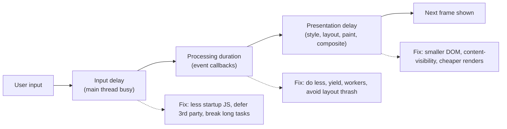
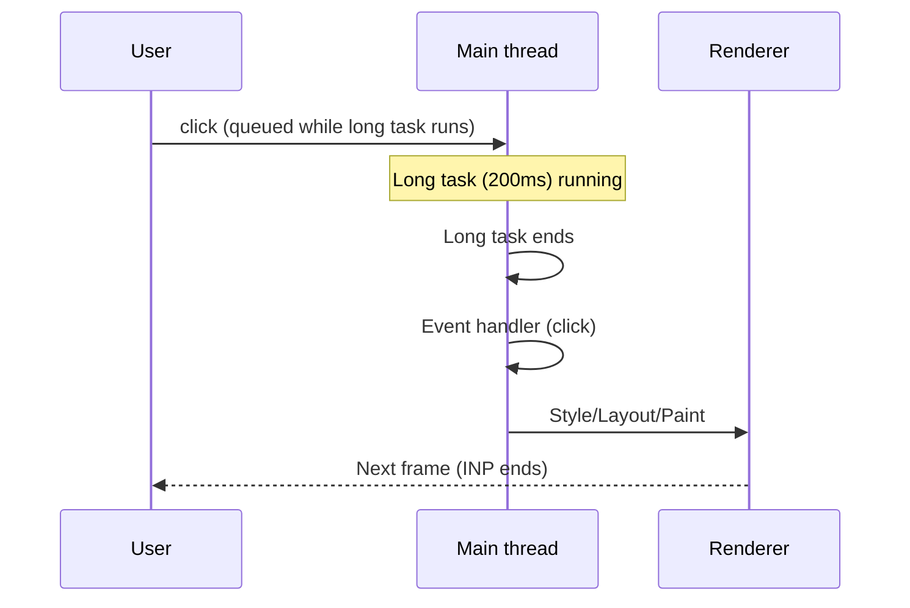
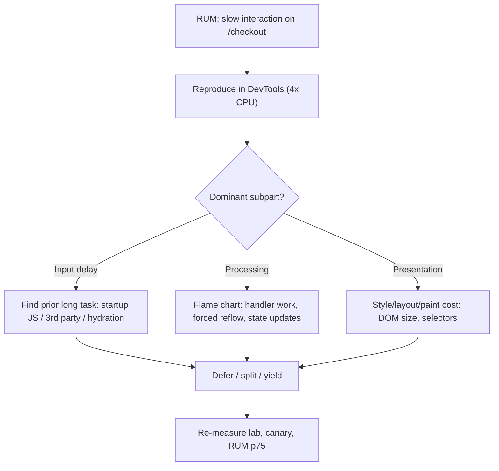
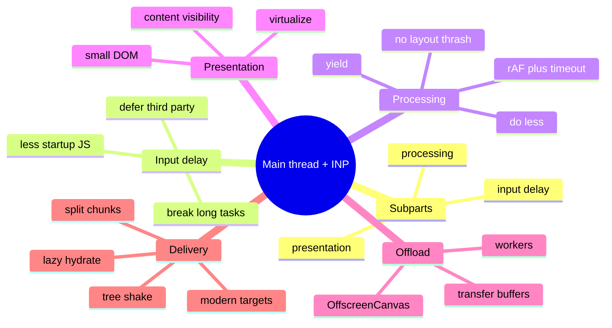

# JavaScript, the Main Thread and INP (Long Tasks, Yielding, Workers, Bundles, Interaction Latency)

> Verified against web.dev "Optimize INP" (updated Sep 2025) and my earlier-verified `scheduler.yield()` support (Chrome/Edge 129, Firefox 142, **no Safari**). `isInputPending`, `scheduler.postTask`, `requestIdleCallback` availability, Long Animation Frames, V8 parse/compile details and OffscreenCanvas specifics are general knowledge — marked *(hedged)*. Related: [01 Metrics](01-performance-metrics-and-measurement.md), [05 Rendering, layout, animation and CLS](05-rendering-layout-animation-and-cls.md), [06 Third parties](06-images-fonts-media-and-third-parties.md), [react/08 React performance](../react/08-react-performance-optimization.md), [nextjs-and-rendering/07](../nextjs-and-rendering/07-performance-optimization.md).

## Table of Contents

1. [Quick Summary (TL;DR)](#1-quick-summary-tldr)
2. [The Main Thread and the Event Loop](#2-the-main-thread-and-the-event-loop)
3. [Anatomy of an Interaction (INP)](#3-anatomy-of-an-interaction-inp)
4. [Input Delay: Startup and Background Work](#4-input-delay-startup-and-background-work)
5. [Processing Duration: Event Callbacks](#5-processing-duration-event-callbacks)
6. [Yielding and Scheduling Patterns](#6-yielding-and-scheduling-patterns)
7. [Presentation Delay: Rendering After the Handler](#7-presentation-delay-rendering-after-the-handler)
8. [Offloading Work: Web Workers and Friends](#8-offloading-work-web-workers-and-friends)
9. [JavaScript Delivery: Bundles, Parse/Compile Cost, Splitting](#9-javascript-delivery-bundles-parsecompile-cost-splitting)
10. [Hydration and Framework Costs](#10-hydration-and-framework-costs)
11. [Event Handling Best Practices](#11-event-handling-best-practices)
12. [Data Structures, Algorithms and Memory in the UI](#12-data-structures-algorithms-and-memory-in-the-ui)
13. [Diagnosing a Slow Interaction: Workflow](#13-diagnosing-a-slow-interaction-workflow)
14. [Pitfalls](#14-pitfalls)
15. [Interview Questions — Fundamentals](#15-interview-questions--fundamentals)
16. [Interview Questions — Senior Scenarios](#16-interview-questions--senior-scenarios)
17. [Cheat Sheet](#17-cheat-sheet)
18. [Key Terms Glossary](#18-key-terms-glossary)
19. [Further Reading](#19-further-reading)

---

## 1. Quick Summary (TL;DR)

- The **main thread** runs JavaScript, style, layout, paint prep and input handling **one task at a time**. Tasks > **50 ms** are **long tasks**; they delay input handling and rendering, driving **INP** (target **≤ 200 ms**, poor > 500 ms) and also LCP's render delay.
- INP = **input delay + processing duration + presentation delay**. Each has different fixes:
  - **Input delay** → reduce main-thread contention (startup JS, third parties, timers, overlapping work).
  - **Processing duration** → do less in handlers; **yield**; defer non-urgent work; avoid layout thrashing.
  - **Presentation delay** → smaller DOM, `content-visibility`, cheaper rendering; avoid large client-side HTML rendering.
- **Ship less JS** (parse/compile/execute is real CPU on mid/low-end phones), **split** it, **defer** non-critical work, and **offload** heavy computation to **Web Workers**.
- **Yield on purpose:** run render-critical work first, defer the rest (`requestAnimationFrame` + `setTimeout`, `scheduler.yield()` where available, `setTimeout` fallback).
- **Field first:** use RUM INP attribution (target, event type, subparts) then reproduce in DevTools; don't trust Lighthouse alone (TBT is a proxy).



---

## 2. The Main Thread and the Event Loop

- Single main thread per browsing context (**each `<iframe>` has its own**, but INP is reported at page level and constrained devices share CPU).
- **Event loop:** pick a task (script, event, timer, message) → run to completion → run microtasks (Promise callbacks) → **render opportunity** (rAF callbacks → style → layout → paint) → repeat. Rendering can only happen **between tasks**, so a long task postpones the next frame.
- **Microtasks run before rendering** and can starve it if chained endlessly (`await`/`.then` loops don't yield to rendering).
- **Task sources:** user input, timers (`setTimeout`), network callbacks, `postMessage`, `MessageChannel`, `requestAnimationFrame` (render phase), `requestIdleCallback` (idle phase; **not in Safari** *(hedged)*).
- **Long tasks** (> 50 ms) block both input and paint. In lab, **TBT** sums `duration − 50 ms` for long tasks between FCP and TTI.



---

## 3. Anatomy of an Interaction (INP)

(From web.dev) An interaction has three subparts; INP counts the full latency of the **slowest** qualifying interaction (click, tap, key press) observed over the visit (outliers may be ignored on pages with many interactions).

1. **Input delay:** from user input until event callbacks **start**. Caused by script evaluation/long tasks, timers, fetch handlers, or overlapping interactions.
2. **Processing duration:** time for event callbacks (`pointerdown`, `pointerup`, `click`, `keydown` …) to run to completion. Subparts are best measured **across all event entries in the same frame** (what `web-vitals` does).
3. **Presentation delay:** from end of callbacks until the browser **paints the next frame** showing the result.

Measure with RUM attribution ([01](01-performance-metrics-and-measurement.md)): *which element, which event type, which subpart, during or after load*.

---

## 4. Input Delay: Startup and Background Work

**Why startup is the worst time:** the page may *look* ready (rendered) but is still loading; users can interact while the main thread is busy with **script evaluation** — *parse → compile to bytecode → execute* — which turns large bundles into long tasks (web.dev).

**Reduce input delay**
1. **Ship less JavaScript** at startup: route/component code splitting, remove dead code/polyfills, replace heavy libs, avoid shipping server-only logic (RSC/islands).
2. **Defer non-critical work** until idle/after first interaction: analytics init, A/B SDKs, chat widgets, below-the-fold widgets (lazy-load on visibility/interaction).
3. **Third parties:** load with `async`/`defer`, after load, via facades; limit tag managers; audit per-script main-thread time ([06](06-images-fonts-media-and-third-parties.md)).
4. **Break up long tasks** during page load (chunk initialisation; yield between modules).
5. **Avoid timers/polling storms**: coalesce `setInterval`, pause when hidden (`visibilitychange`), use `IntersectionObserver` instead of scroll polling.
6. **Prevent overlapping interactions** from piling up: debounce rapid-fire inputs, cancel stale work (`AbortController`), don't kick off heavy work on every keystroke.
7. **Streaming HTML** helps: the browser yields automatically while parsing streamed chunks, whereas **client-rendering large HTML via JS doesn't yield until parse + render complete** (web.dev).

---

## 5. Processing Duration: Event Callbacks

**Principle (web.dev):** do **as little work as possible** in callbacks. If it's still heavy:

1. **Yield to the main thread often** — break work into separate tasks so other interactions/rendering can run.
2. **Yield to allow rendering sooner** — run only what's needed for the **next visual update**, defer everything else.
3. **Avoid layout thrashing** — interleaving style writes and layout reads forces synchronous layout.

```js
// Pattern from web.dev: update UI immediately, defer the rest until after the next frame
textBox.addEventListener('input', (inputEvent) => {
  updateTextBox(inputEvent);                         // render-critical work only
  requestAnimationFrame(() => {
    setTimeout(() => {                               // runs after the frame is presented
      const text = textBox.textContent;
      updateWordCount(text);
      checkSpelling(text);
      saveChanges(text);
    }, 0);
  });
});
```

**Heavy-handler checklist**
- Is the work needed *before the next paint*? If not → defer.
- Can it be **batched** (one DOM write phase), **memoised**, **debounced/throttled**, or **cancelled** when superseded?
- Is it **O(n²)** over a big list/DOM? Index data once (Map/Set), avoid repeated `querySelectorAll`/array scans.
- Does it **read layout** (`offsetWidth`, `getBoundingClientRect`, `scrollTop`, `getComputedStyle`) after writing styles? Batch reads before writes.
- Does it trigger a **huge React/Vue render** (global state change)? Localise state, use transitions/deferred values ([react/03](../react/03-concurrent-react-suspense-and-transitions.md)).

---

## 6. Yielding and Scheduling Patterns

| Technique | How | Notes |
|---|---|---|
| **`setTimeout(fn, 0)`** | New task | Universal; clamped (≥ ~4 ms when nested ≥5 levels) and loses priority to other queued tasks (goes to the back of the queue) |
| **`scheduler.yield()`** | `await scheduler.yield()` | **Chrome/Edge 129, Firefox 142; not Safari/iOS** → feature-detect, fallback to `setTimeout`. Continuation keeps priority (runs before other queued tasks of same priority) |
| **`scheduler.postTask(fn, {priority})`** *(hedged: Chromium)* | Prioritised tasks (`user-blocking`/`user-visible`/`background`) | Can be polyfilled |
| **`requestAnimationFrame`** | Before next paint | For visual updates; combine with `setTimeout` to run *after* paint |
| **`MessageChannel`** | `postMessage` task | Lower clamping than `setTimeout`; used by schedulers (React) |
| **`requestIdleCallback`** | Run in idle periods | Not in Safari *(hedged)*; for truly non-urgent work; use timeout |
| **`navigator.scheduling.isInputPending()`** *(hedged: Chromium)* | Check if input waiting | Niche |

```ts
const yieldToMain = (): Promise<void> =>
  // @ts-expect-error scheduler is not in all lib.dom versions
  globalThis.scheduler?.yield ? scheduler.yield() : new Promise((r) => setTimeout(r, 0));

export async function processInChunks<T>(items: T[], work: (item: T) => void, budgetMs = 8) {
  let deadline = performance.now() + budgetMs;
  for (const item of items) {
    work(item);
    if (performance.now() >= deadline) {          // keep each slice well below 50 ms
      await yieldToMain();
      deadline = performance.now() + budgetMs;
    }
  }
}
```

**Guidelines**
- Yield **between logical units**, not every iteration (overhead). Time-slice with a budget (≈ 5–16 ms).
- **Yield immediately after a UI-updating step** so rendering can run (web.dev).
- Avoid chains of resolved Promises in hot loops — they never reach a render opportunity.
- `scheduler.yield()` preserves continuation priority — good for sequencing; polyfill for Safari.

---

## 7. Presentation Delay: Rendering After the Handler

From web.dev: the time from callbacks finishing to the next frame being painted. Reduce by lowering **rendering work**:

1. **Minimise DOM size** — large DOMs make style/layout/paint scale up (non-linearly). Techniques: flatten markup, **virtualise long lists**, **additive rendering** (grow the DOM during interactions instead of rendering everything initially), pagination.
2. **`content-visibility: auto`** to lazily render off-screen sections (add `contain-intrinsic-size`). Baseline "newly available" (Sep 2025), stays in the accessibility tree.
3. **Avoid expensive style invalidations:** broad selectors on huge DOMs, toggling classes on `<body>`/root for local changes, frequently changing CSS custom properties at high levels (invalidates many descendants).
4. **Avoid forced synchronous layout** (see §11/[05](05-rendering-layout-animation-and-cls.md)).
5. **Be careful with client-rendered HTML:** rendering a large HTML string via JS blocks until parsed and rendered (web.dev); render smaller chunks or use server rendering/streaming.
6. **Use compositor-friendly updates** (`transform`, `opacity`) for motion ([05](05-rendering-layout-animation-and-cls.md)).
7. **Defer non-visible updates** (offscreen widgets, hidden tabs) — don't update UI that isn't shown.

---

## 8. Offloading Work: Web Workers and Friends

| Tool | Use | Notes |
|---|---|---|
| **Dedicated Web Worker** | CPU-heavy logic: parsing big JSON/CSV, search indexing, diffing, crypto, image processing, markdown/syntax highlighting | No DOM access; communicate by `postMessage` (structured clone); use **Transferable** objects (ArrayBuffer) to avoid copies |
| **Shared Worker / SW** | Cross-tab coordination/caching | Different lifecycle |
| **OffscreenCanvas** *(hedged: wide but check support)* | Render canvas/WebGL in a worker | Smooth charts/games; keeps main thread free |
| **WASM** | Compute-heavy kernels | Compile/instantiate cost; still needs a worker to avoid blocking |
| **Worklets** (`AudioWorklet`, Paint/Animation worklets) | Specialised off-main-thread tasks | Limited support for some |
| **Comlink** (library) | RPC-style wrapper for workers | Ergonomics |
| **Partytown-style third-party isolation** *(hedged)* | Run tag scripts in a worker | Compatibility limits; test carefully |

```ts
// worker.ts
self.onmessage = (e: MessageEvent<{ rows: Row[]; q: string }>) => {
  const { rows, q } = e.data;
  const result = rows.filter((r) => r.name.toLowerCase().includes(q));   // heavy compute off-main
  (self as any).postMessage(result);
};

// main.ts
const worker = new Worker(new URL('./worker.ts', import.meta.url), { type: 'module' });
function search(rows: Row[], q: string) {
  return new Promise<Row[]>((resolve) => {
    worker.onmessage = (e) => resolve(e.data);
    worker.postMessage({ rows, q });                // consider caching rows in the worker to avoid re-cloning every call
  });
}
```
**Trade-offs:** serialization/clone cost for large data (use transfer or keep data in the worker), startup cost (spawn lazily; keep a pool), debugging complexity, bundler config, and **latency for tiny tasks** (not worth it under ~a few ms). Cancel obsolete requests (version tokens).

---

## 9. JavaScript Delivery: Bundles, Parse/Compile Cost, Splitting

- **Cost model:** download (network) + **decompress** + **parse/compile** + **execute**. JS is more expensive byte-for-byte than images because of CPU work (especially on low-end Android) *(widely cited by the Chrome team; hedged for exact ratios)*.
- **Budgets:** set per-route budgets (e.g., initial JS in the low hundreds of KB gzipped for content pages — team-specific), track **main-thread time** (script evaluation) not just bytes.
- **Strategies**
  1. **Route-based + component-based code splitting** (`import()`), load on interaction/visibility.
  2. **Tree shaking:** ESM, `sideEffects` flags, avoid barrel files that defeat it, import specific functions.
  3. **Dedupe dependencies** (multiple versions of libs), avoid heavy utility libs (moment/lodash whole), prefer native APIs (`Intl`, `structuredClone`, `fetch`).
  4. **Modern output:** target modern browsers (avoid unnecessary transpilation/polyfills); differential serving.
  5. **Server Components/islands/partial hydration** to avoid shipping JS for static UI.
  6. **Preload/prefetch chunks wisely** (`modulepreload` for critical graph; prefetch likely next chunks on idle/hover).
  7. **Cache hashed chunks long-term**; keep chunk graph stable to maximise cache hits across deploys (avoid hash churn from unrelated changes).
  8. **Avoid duplicating code between vendor/app chunks;** use shared chunks thoughtfully (granularity vs requests).
  9. **Lazy hydrate** non-critical components (on visible/idle/interaction).
- **Analyse:** bundle analyzers, `coverage` in DevTools (unused bytes), Lighthouse "Reduce unused JavaScript", **Performance panel** script evaluation timelines, `source-map-explorer`.
- **Compression:** Brotli at CDN ([03](03-network-caching-and-delivery.md)).
- **Dynamic import on interaction**
```ts
button.addEventListener('click', async () => {
  const { openEditor } = await import('./editor');     // fetch + parse only when needed
  openEditor();
}, { once: true });
```
- **Prefetch on intent** (hover/focus/idle) to hide the latency of lazy loading: `link.addEventListener('pointerenter', () => import('./editor'), { once: true })`.

---

## 10. Hydration and Framework Costs

- **Hydration** re-executes component code in the browser to attach handlers: cost ~ proportional to client component tree size; large trees = long tasks at startup, high input delay.
- **Mitigations:** Server Components (no hydration for server-only UI), **selective hydration** via Suspense boundaries, **lazy/island hydration**, moving `'use client'` to leaves, avoiding giant serialised props, deferring non-critical client features, **resumability** (Qwik-style) as an architectural option *(hedged)*.
- **State management:** a global store update re-rendering a large tree on every keystroke → localise state, selectors, derived state, `useDeferredValue`/transitions, virtualisation, React Compiler ([react/08](../react/08-react-performance-optimization.md), [nextjs-and-rendering/07](../nextjs-and-rendering/07-performance-optimization.md)).
- **Framework runtime overhead:** measure with Profiler/Performance panel; consider lighter frameworks for content-heavy pages; avoid CSS-in-JS runtime in hot paths.
- **Route transitions** in SPAs: show immediate feedback; keep transitions interruptible; avoid blocking render on data.

---

## 11. Event Handling Best Practices

- **Event delegation:** one listener on a container instead of thousands (cheaper to attach, faster DOM updates).
- **Passive listeners** for `touchstart`/`wheel`/`scroll` (`{ passive: true }`) so the browser doesn't wait for `preventDefault()`.
- **Debounce vs throttle:** debounce input-driven network/expensive work (150–300 ms); throttle scroll/resize/pointermove (or use `requestAnimationFrame` coalescing). Don't debounce the **visual feedback** itself.
- **Prefer `IntersectionObserver`/`ResizeObserver`/`MutationObserver`** over scroll/resize polling and layout reads.
- **Batch DOM writes**; use `DocumentFragment`/template cloning; avoid `innerHTML` in loops; avoid alternating reads/writes:

```js
// ❌ layout thrashing: write → read → write → read
for (const el of els) { el.style.width = el.parentElement.offsetWidth / 2 + 'px'; }

// ✅ read phase then write phase
const widths = els.map((el) => el.parentElement.offsetWidth);
els.forEach((el, i) => { el.style.width = widths[i] / 2 + 'px'; });
```
- **`pointerdown` vs `click`:** acting on `pointerdown`/`touchstart` can feel faster but costs correctness/accessibility; keep `click` semantics for activation unless you have a strong reason.
- **Avoid heavy synchronous `JSON.parse`/`structuredClone`/`localStorage` access** on hot paths; `localStorage` is synchronous and can block.
- **Cancel stale work** (`AbortController`, request tokens); ignore results from superseded interactions.
- **Optimistic UI** to give immediate feedback while async work continues (keeps perceived latency low, but INP only counts until the next paint — ensure the paint occurs quickly).
- **Accessibility reminder:** don't remove focus indication or break keyboard handling for performance hacks.

---

## 12. Data Structures, Algorithms and Memory in the UI

- Complexity matters at UI scale: replace **O(n²)** filtering/sorting with indexing (Map/Set), memoised selectors, incremental updates, **virtual scrolling** for 1k+ rows ([system-design/02](../system-design/02-news-feed-and-infinite-scroll.md)).
- **Avoid giant JSON in the main thread** (parse in worker/stream), prefer pagination/streams.
- **Memory pressure → GC pauses → jank**: avoid creating huge short-lived arrays/objects in hot paths; reuse buffers; detach listeners; avoid retained closures in long-lived objects (leaks in SPAs — see [05](05-rendering-layout-animation-and-cls.md) memory section).
- **Search/typeahead:** debounce + abort + client-side cache/trie ([system-design/03](../system-design/03-autocomplete-and-typeahead-search.md)).
- **Date/Intl formatters:** cache `Intl.*Format` instances (construction is expensive).
- **Regex hazards:** catastrophic backtracking on user input can freeze the main thread — validate/limit input and use safe patterns.

---

## 13. Diagnosing a Slow Interaction: Workflow

1. **Field:** find the slow interaction via RUM INP attribution (element selector, event type, route, load vs post-load, subparts, LoAF scripts if collected). Segment by device/route/release.
2. **Reproduce in DevTools Performance** with **CPU throttling (4–6×)** and mobile network; start recording, perform the interaction, stop. (Also interact **during load** since the main thread is busiest then.)
3. **Locate the interaction** in the trace (Interactions track): read **input delay / processing / presentation** breakdown.
4. **Input delay high?** Look at long tasks *before* the event: script evaluation, timers, third-party tasks, hydration.
5. **Processing high?** Flame chart under the event handler: which functions dominate; look for forced reflow warnings (purple "Layout" with red triangle), JSON parsing, state updates triggering large renders.
6. **Presentation high?** Look at Recalculate Style/Layout/Paint after the handler; large DOM, expensive selectors, big paint areas.
7. **Fix → re-trace → verify** the subpart improved; run an automated interaction test if possible.
8. **Ship behind a canary**, compare field INP p75 for that route; watch for new slow interactions ("whack-a-mole" — web.dev: INP improvement is iterative and persistence pays).



---

## 14. Pitfalls

1. **Optimising TBT/Lighthouse** instead of field INP.
2. **Yielding everywhere** (overhead) or **never** (long tasks).
3. **Debouncing visual feedback** (makes the UI feel laggy and INP worse).
4. **Doing analytics/network in the click handler synchronously** (use `sendBeacon`/defer).
5. **Layout thrashing** inside loops/animation handlers.
6. **Giant React renders** from global state on each keystroke.
7. **Third-party tags** executing heavy tasks right after load.
8. **Moving tiny tasks to workers** (message overhead > benefit) or cloning huge payloads repeatedly.
9. **Assuming Promises yield** to rendering (they don't).
10. **Polyfilling everything** / shipping legacy bundles to modern browsers.
11. **Barrel imports** pulling entire libraries.
12. **Not testing on low-end devices/throttling.**
13. **Ignoring iframes** (their main threads and scripts affect INP).
14. **Memory leaks** causing GC jank over long sessions.

---

## 15. Interview Questions — Fundamentals

### Q1. What is a long task and why does it matter?
A main-thread task running longer than 50 ms. It blocks input handling and rendering, increasing input delay/INP and delaying paint (LCP render delay); lab TBT sums the blocking portions.

### Q2. Explain the three parts of INP.
Input delay (waiting for the main thread), processing duration (event callbacks), presentation delay (rendering and painting the next frame).

### Q3. How do you yield to the main thread?
Break work into separate tasks using `setTimeout`, `scheduler.yield()` (Chrome/Edge 129, Firefox 142; not Safari — feature-detect), `MessageChannel`, or rAF+setTimeout patterns; time-slice loops.

### Q4. Why `requestAnimationFrame` + `setTimeout`?
rAF runs before the next paint, and the `setTimeout` inside it runs after the frame is presented, so only render-critical code delays the frame and the rest is deferred.

### Q5. What is layout thrashing?
Alternating DOM/style writes and layout-reading properties in the same task, forcing synchronous layout repeatedly; fix by batching reads then writes.

### Q6. When use Web Workers?
For CPU-heavy, DOM-free work (parsing, indexing, compression, image processing); use transferables, avoid for tiny tasks, and manage lifecycle/cancellation.

### Q7. How does code splitting help interactivity?
Less JavaScript to parse/execute at startup reduces long tasks and input delay; load features on demand.

### Q8. Debounce vs throttle?
Debounce delays until activity pauses (search input); throttle limits rate (scroll/resize). Neither should delay immediate visual feedback.

### Q9. What increases presentation delay?
Large DOM, expensive style/layout/paint, big client-rendered HTML, forced layouts; fix with smaller DOM, virtualisation, `content-visibility`, cheaper updates.

### Q10. Why is hydration a performance concern?
It re-executes component code to attach interactivity; large client trees create long tasks and input delay; reduce with Server Components/selective or lazy hydration.

---

## 16. Interview Questions — Senior Scenarios

### S1. "Typing in our search box feels laggy (INP 450 ms)."
Check subparts. Likely processing: every keystroke runs filtering over a big list + triggers a large render. Fixes: render-critical (input value) immediately, defer filtering via transition/`useDeferredValue` or rAF+timeout; debounce network, abort stale requests; index/memoise data, virtualise results; move filtering to a worker if >10 ms; avoid layout thrash for result highlighting. Verify with 4× CPU trace and RUM INP for that route.

### S2. "INP is fine on desktop but terrible on low-end Android right after page load."
High input delay during startup: heavy bundles + hydration + tag scripts occupying the main thread. Reduce JS (splitting, remove polyfills, Server Components), lazy-hydrate non-critical widgets, delay third parties until idle/after first interaction, break hydration/initialisation into chunks, preload less, use facades, and prioritise above-the-fold interactivity. Test with 6× throttling and measure "interaction during load" scenarios.

### S3. "A third-party tag manager hurts INP but marketing needs it."
Quantify (per-script main-thread time, LoAF scripts, INP by variant). Options: load after `load`/idle, consolidate tags, server-side tagging, use `async` and facades, isolate in worker/iframe where supported, set a performance budget with ownership, review tags quarterly, and add RUM alerts when tag changes cause regressions.

### S4. "Our dashboard re-renders everything on each websocket message."
Batch/coalesce messages (rAF or 100–250 ms), update normalised state with selectors so only affected widgets render, memoise heavy children, use transitions for non-urgent updates, virtualise tables, offload aggregation to a worker, and drop frames gracefully (latest-value wins) instead of queueing unbounded work.

### S5. "Explain how you'd decide between a worker, yielding, or reducing work."
First **reduce** (algorithmic/data improvements, caching, defer). If still > ~10–16 ms and DOM-free → **worker** (if data transfer cost is acceptable). If it must touch the DOM → **chunk + yield** with prioritisation (render-critical first), maybe `content-visibility`/virtualisation. Validate with profiling and field INP; avoid workers for tiny tasks.

---

## 17. Cheat Sheet



| Symptom | Likely subpart | First fix |
|---|---|---|
| Click delayed after load | Input delay | Reduce startup JS/tags |
| Handler takes 300 ms | Processing | Defer/yield/worker |
| UI updates late after handler | Presentation | Reduce DOM/rendering work |
| Typing jank | Processing + presentation | Defer non-urgent updates; virtualise |

---

## 18. Key Terms Glossary

| Term | Definition |
|---|---|
| **Long task** | Main-thread task > 50 ms |
| **TBT** | Lab proxy summing blocking time of long tasks |
| **Input delay** | Wait before callbacks start |
| **Yielding** | Ending the current task so others/rendering can run |
| **`scheduler.yield()`** | Yield API preserving continuation priority (Chrome/Edge 129, Firefox 142) |
| **Layout thrashing** | Repeated forced synchronous layouts |
| **Web Worker** | Background thread without DOM |
| **Transferable** | Object moved (not copied) to a worker |
| **Hydration** | Attaching client behaviour to server HTML |
| **Code splitting** | Loading code in chunks on demand |

---

## 19. Further Reading

- [web.dev — Optimize INP](https://web.dev/articles/optimize-inp) · [Optimize long tasks](https://web.dev/articles/optimize-long-tasks) · [Script evaluation and long tasks](https://web.dev/articles/script-evaluation-and-long-tasks)
- [MDN — Scheduler.yield()](https://developer.mozilla.org/en-US/docs/Web/API/Scheduler/yield) · [Web Workers API](https://developer.mozilla.org/en-US/docs/Web/API/Web_Workers_API)
- This repo: [01 Metrics](01-performance-metrics-and-measurement.md) · [react/03](../react/03-concurrent-react-suspense-and-transitions.md) · [react/08](../react/08-react-performance-optimization.md) · [js/03 event loop and async](../js/03-advanced-fundamentals-and-coding.md)
