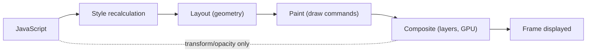
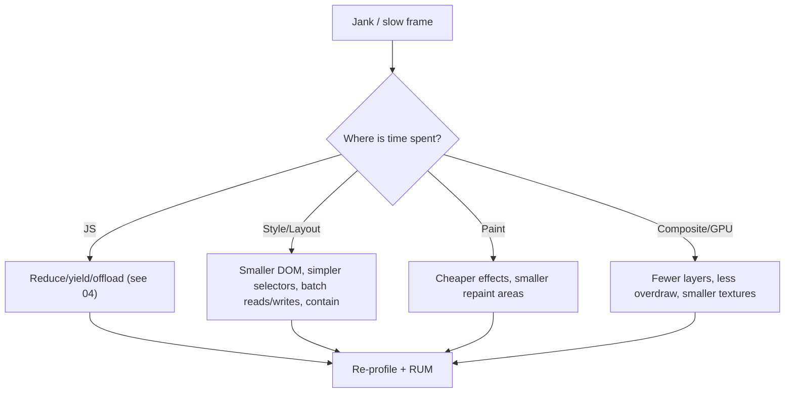
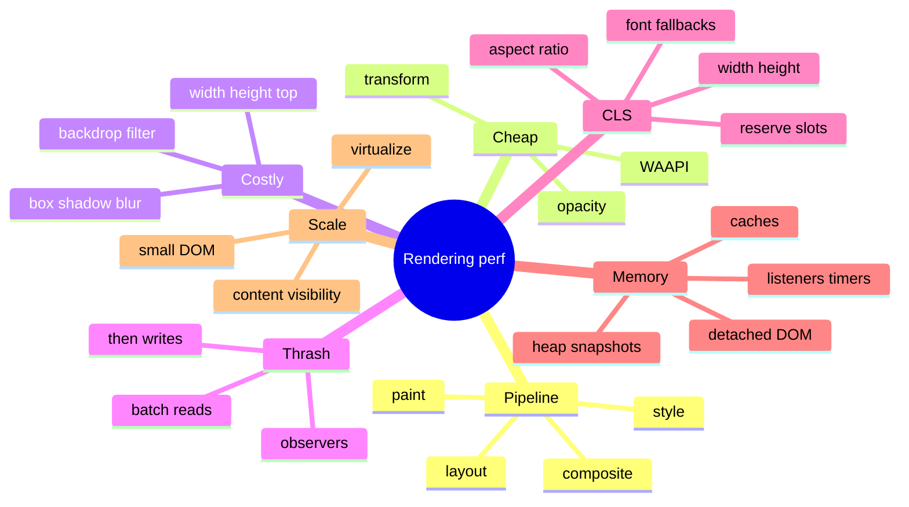

# Rendering, Layout, Animation, CLS and Memory (Browser Rendering Pipeline, Jank, Layout Stability, Leaks)

> Core Web Vitals thresholds were verified in [01](01-performance-metrics-and-measurement.md) (web.dev). `content-visibility: auto` status (Baseline "newly available", Sep 2025; needs `contain-intrinsic-size`; stays in the accessibility tree/find-in-page) and image decoded-memory sizing (`width × height × 4` bytes) come from earlier verification in this handbook. The rendering pipeline, CSS property costs, scroll-driven animations, View Transitions, `will-change`, `contain`, heap-snapshot workflows, `performance.measureUserAgentSpecificMemory` and CLS session-window details are general knowledge — marked *(hedged)* where support/specifics vary. Related: [04 JavaScript and INP](04-javascript-main-thread-and-inp.md), [06 Images, fonts, media, third parties](06-images-fonts-media-and-third-parties.md), [system-design/02 feed virtualisation](../system-design/02-news-feed-and-infinite-scroll.md).

## Table of Contents

1. [Quick Summary (TL;DR)](#1-quick-summary-tldr)
2. [The Rendering Pipeline](#2-the-rendering-pipeline)
3. [CSS Property Cost: Layout, Paint, Composite](#3-css-property-cost-layout-paint-composite)
4. [Forced Reflow and Layout Thrashing](#4-forced-reflow-and-layout-thrashing)
5. [Animation Performance](#5-animation-performance)
6. [Scrolling Performance](#6-scrolling-performance)
7. [Large Lists and DOM Scale](#7-large-lists-and-dom-scale)
8. [Cumulative Layout Shift (CLS) in Depth](#8-cumulative-layout-shift-cls-in-depth)
9. [Memory: Leaks, GC and Long Sessions](#9-memory-leaks-gc-and-long-sessions)
10. [GPU, Layers and Paint Costs](#10-gpu-layers-and-paint-costs)
11. [Profiling Workflow](#11-profiling-workflow)
12. [Pitfalls](#12-pitfalls)
13. [Interview Questions — Fundamentals](#13-interview-questions--fundamentals)
14. [Interview Questions — Senior Scenarios](#14-interview-questions--senior-scenarios)
15. [Cheat Sheet](#15-cheat-sheet)
16. [Key Terms Glossary](#16-key-terms-glossary)
17. [Further Reading](#17-further-reading)

---

## 1. Quick Summary (TL;DR)

- To hit **60 fps** you have **~16.7 ms per frame** (less after browser overhead). A frame runs **JS → style → layout → paint → composite**; skipping stages = cheaper frames.
- **Animate `transform` and `opacity`** (compositor-friendly); avoid animating layout properties (`width`, `height`, `top`, `margin`) and expensive paint properties (large `box-shadow`/`filter`/`backdrop-filter`).
- **Forced synchronous layout** (reading layout after writing styles) is the classic jank source: **batch reads, then writes**.
- **CLS ≤ 0.1:** reserve space (image/embed dimensions, `aspect-ratio`), size skeletons like final content, avoid inserting content above existing content, handle web-font swaps (metric-compatible fallbacks), animate with transforms.
- **Large DOMs hurt everything** (style/layout/INP): virtualise lists, use `content-visibility: auto`, paginate/additively render.
- **Memory leaks** (detached DOM, forgotten listeners/timers/subscriptions, unbounded caches) cause GC pauses, jank and OOM crashes in long sessions — find with Chrome's Memory tools and fix lifecycles.
- **Profile, don't guess:** Performance panel (frames, layout, paint), Layers/Rendering tools (paint flashing, layout shift regions), Memory panel (heap snapshots, allocation sampling).



---

## 2. The Rendering Pipeline

1. **Style:** match selectors → computed styles (cost grows with DOM size and selector complexity).
2. **Layout (reflow):** compute geometry (position/size). Changes cascade (a child's size can alter siblings/ancestors).
3. **Paint:** record draw ops per layer (text, borders, backgrounds, shadows).
4. **Raster:** convert paint records to pixels (often on GPU raster threads).
5. **Composite:** assemble layers (transform/opacity/scroll offset) on the **compositor thread** — can run even if the main thread is busy (for compositor-only changes like transform animations and scrolling).

**Why it matters:** a change that only affects compositing (e.g., `transform`) can skip style/layout/paint and animate smoothly during main-thread jank; a change to `width` triggers layout → paint → composite on the main thread.

**Frame budget:** at 60 Hz ≈ 16.7 ms; at 120 Hz ≈ 8.3 ms. Input handling + JS + rendering must fit; otherwise frames drop (jank). INP's **presentation delay** is the time to the next frame after handlers ([04](04-javascript-main-thread-and-inp.md)).

---

## 3. CSS Property Cost: Layout, Paint, Composite

| Triggers | Examples (general guidance) | Cost |
|---|---|---|
| **Layout + paint + composite** | `width`, `height`, `padding`, `margin`, `top/left` (positioned), `font-size`, `display`, `flex/grid` properties, content changes | Highest |
| **Paint + composite** | `color`, `background`, `border-color`, `box-shadow`, `border-radius`, `outline`, `visibility` | Medium |
| **Composite only** | `transform`, `opacity` (when promoted to its own layer), `filter` on composited layers (varies) *(hedged)* | Lowest |

Practical rules:
- **Move with `transform: translate()`**, scale with `transform: scale()`, fade with `opacity`.
- **Avoid animating** `box-shadow`, `filter: blur()` on large areas, `backdrop-filter` (expensive paints).
- **Avoid layout-affecting properties in animations/scroll handlers**; if unavoidable, constrain with **`contain: layout paint`** or `content-visibility` so changes don't ripple *(hedged: verify support/semantics)*.
- **Selector complexity:** deep descendant selectors and universal selectors cost more on huge DOMs; prefer class-based selectors (CSS Modules/atomic CSS).
- **`position: fixed/sticky`** are generally fine, but large fixed elements with expensive paint (blurred backgrounds) hurt scrolling.
- **Fonts and text:** text layout is expensive for huge strings; `text-rendering`/`font-feature` tweaks have costs; limit very long single text blocks.
- Use https://csstriggers.com-style knowledge as a reference *(hedged: engine-specific)*.

---

## 4. Forced Reflow and Layout Thrashing

**Forced synchronous layout:** reading a layout-dependent value after the DOM/styles changed forces the browser to compute layout immediately (instead of at the next frame). Doing this repeatedly in a loop is **layout thrashing** (web.dev: it appears in DevTools as red-triangle "Recalculate Style/Layout" entries).

**Common layout-reading APIs:** `offsetWidth/Height/Top/Left`, `clientWidth/Height`, `scrollTop/Height`, `getBoundingClientRect()`, `getComputedStyle()` (some properties), `innerText`, `focus()`, `scrollIntoView()`, `window.innerWidth/Height` *(hedged: list is not exhaustive)*.

```js
// ❌ Thrash: interleaved read/write
cards.forEach((c) => {
  const h = c.offsetHeight;          // read -> forces layout if styles dirty
  c.style.height = h + 10 + 'px';    // write -> invalidates layout
});

// ✅ Batch reads, then writes (or use requestAnimationFrame for the write phase)
const heights = cards.map((c) => c.offsetHeight);
requestAnimationFrame(() => cards.forEach((c, i) => (c.style.height = heights[i] + 10 + 'px')));
```
Other fixes: use **ResizeObserver/IntersectionObserver** (async, no forced layout) instead of measuring in scroll handlers; cache measurements; use **CSS** (flex/grid/`aspect-ratio`) instead of JS measurement; libraries (FastDOM-style scheduling) *(hedged)*; in React, measure in `useLayoutEffect` sparingly and batch; avoid reading layout in render.

---

## 5. Animation Performance

| Technique | Thread | Use |
|---|---|---|
| **CSS transitions/animations on `transform`/`opacity`** | Compositor (can be off main thread) | Default choice for UI motion |
| **Web Animations API (WAAPI)** | Compositor for eligible properties | Programmatic control with CSS-like performance |
| **JS + `requestAnimationFrame`** | Main thread | Physics, scroll-linked effects, canvas; keep each frame's work small |
| **Scroll-driven animations (CSS)** *(hedged: Chromium-first; check support)* | Compositor/main depending | Parallax/progress without scroll listeners |
| **View Transitions API** *(hedged: same-document widely supported in Chromium/Safari; cross-document newer)* | Browser-managed snapshots | Page/route transitions; also integrates with React `ViewTransition` ([react/04](../react/04-react-19-and-beyond.md)) |
| **Canvas/WebGL/OffscreenCanvas** | Main or worker | Heavy visuals/charts ([system-design/05](../system-design/05-analytics-dashboard.md)) |

**Guidelines**
- **`will-change: transform`** (or `transform: translateZ(0)` hacks) promotes to a layer: use **sparingly and temporarily** (layers consume GPU memory; too many = slower). Remove after animation ends.
- **Respect `prefers-reduced-motion`**: disable/shorten non-essential animation.
- **Don't animate during heavy work**; keep main thread free (animations on the compositor survive but visuals tied to JS don't).
- **Avoid layout animations**; for expanding panels use techniques like animating `grid-template-rows` (0fr → 1fr) *(hedged: broadly supported recently)*, `transform: scaleY` with care, or FLIP (First-Last-Invert-Play) to animate layout changes using transforms.
- **Throttle JS-driven animation to `requestAnimationFrame`**; use `performance.now()` deltas for time-based motion; pause when hidden (`document.hidden`/`visibilitychange`).
- **Lottie/GIFs/video**: prefer video/WebP/AVIF or CSS for simple motion; GIF is heavy.
- **Layout shift from animations:** use transforms so animated elements don't count as layout shifts.

```css
.panel { transform: translateY(8px); opacity: 0; transition: transform 200ms ease, opacity 200ms ease; }
.panel[data-open="true"] { transform: none; opacity: 1; }
@media (prefers-reduced-motion: reduce) { .panel { transition: none; } }
```

---

## 6. Scrolling Performance

- **Passive event listeners** for `wheel`/`touchstart`/`touchmove`/`scroll` so scrolling isn't blocked waiting for `preventDefault()`.
- **Avoid scroll handlers that read/write layout**; use `IntersectionObserver` (lazy loading, sticky headers, infinite scroll triggers), `position: sticky`, CSS `scroll-snap`, and CSS `overscroll-behavior`.
- **Keep paint cheap under scrolling content**: avoid large fixed/sticky elements with expensive effects (blur/shadow), reduce overdraw, avoid huge images in scrolling lists without proper sizing/decoding (`decoding="async"`).
- **Virtualise** long lists (render window + overscan); measure variable heights carefully and restore scroll anchors ([system-design/02](../system-design/02-news-feed-and-infinite-scroll.md)).
- **`content-visibility: auto`** to skip rendering off-screen sections (Baseline newly available Sep 2025): pair with `contain-intrinsic-size` (or `auto <size>` to remember) to avoid scrollbar jumps; avoid APIs that force layout of skipped subtrees.
- **Smooth scrolling libraries** that hijack scroll can hurt accessibility and performance; prefer native.
- **Mobile browser UI changes** (address bar show/hide) and `100vh` → use `dvh/svh/lvh` units *(hedged: modern support)*.

---

## 7. Large Lists and DOM Scale

- Rendering cost (style/layout/paint) **grows with DOM size**, hurting load and INP's presentation delay (web.dev). Practical heuristics: investigate when DOM > ~1,500 nodes *(Lighthouse "avoid an excessive DOM size" thresholds are commonly cited around 800/1,400 nodes — hedged)*, or depth > ~32.
- **Options:** virtualisation (TanStack Virtual/react-window), pagination, **additive rendering** (append as needed), **`content-visibility`**, lazy rendering tabs/accordions, flatten wrapper-div soup, avoid per-cell heavy components in tables, use CSS grid/flex instead of nested tables.
- **Trade-offs:** virtualisation breaks native find-in-page, needs a11y (`aria-rowcount`, `aria-setsize/posinset`), and complex measuring; `content-visibility` keeps content searchable and accessible but still holds DOM memory.
- **Update strategies:** keyed updates, immutable data for cheap diffing, avoid re-rendering entire lists on small changes, batch updates (rAF), coalesce streaming data.

---

## 8. Cumulative Layout Shift (CLS) in Depth

**Definition:** layout shift score = **impact fraction × distance fraction** for visible elements that move **without a recent user interaction**. CLS reports the **largest burst (session window)** of shifts *(session-window specifics hedged: ≤ 5 s windows separated by ≥ 1 s gaps)*. **Good ≤ 0.1** (p75). Shifts within ~500 ms of user input are excluded (`hadRecentInput`).

### Top causes and fixes

| Cause | Fix |
|---|---|
| **Images/video/iframes without dimensions** | Set `width`/`height` attributes (browser derives aspect ratio) or CSS `aspect-ratio`; with `next/image` give dimensions/`fill` + sized container |
| **Ads/embeds/widgets injected late** | Reserve slot with `min-height`/`aspect-ratio`; collapse placeholders carefully; avoid inserting above-the-fold content after load |
| **Web fonts swapping** (FOUT) | Preload critical fonts, `font-display: swap/optional`, **metric-adjusted fallbacks** (`size-adjust`, `ascent-override`; frameworks like `next/font` automate), subset fonts ([06](06-images-fonts-media-and-third-parties.md)) |
| **Dynamic content above existing content** (banners, cookie notices, "related" bars) | Reserve space; overlay (fixed/sticky bottom) instead of pushing content; insert **below** the viewport; user-initiated expansions are exempt |
| **Skeletons/fallbacks mismatched** | Match final dimensions (row counts, heights); use `min-height`; keep streaming order stable |
| **Late CSS/layout changes** | Inline critical CSS; avoid FOUC/relayout from late stylesheets |
| **Client-side-only layout decisions** (`window.innerWidth` → mobile/desktop) | Use CSS media/container queries; render identical first pass |
| **Animations using layout properties** | Use `transform`/`opacity` |
| **Lazy-loaded images without placeholders** | Reserve space with ratio; blur/solid placeholder |
| **bfcache/back navigation scroll restoration issues** | Preserve scroll; avoid content that changes size on restore |

```html

<div class="ad-slot" style="min-height:250px"></div>
```
```css
.video-wrap { aspect-ratio: 16 / 9; width: 100%; }
.skeleton-row { height: 56px; } /* equals real row height */
```

### Debugging CLS
- **DevTools → Rendering → Layout Shift Regions** (blue flashes); Performance panel **Layout Shifts** track with sources; Lighthouse "avoid large layout shifts".
- **`layout-shift` PerformanceObserver entries** expose `sources` (nodes, previous/current rects) — collect via RUM attribution (`web-vitals/attribution` gives the largest shift source) ([01](01-performance-metrics-and-measurement.md)).
- Test with **slow network/CPU**, empty cache, different viewport sizes, with consent banners/ads enabled and with A/B variants.
- Remember **SPA route changes**: CLS in the standard metric covers the page's lifetime; shifts after soft navigations count unless within the exclusion rules; verify with real flows.

---

## 9. Memory: Leaks, GC and Long Sessions

**Why it matters:** SPAs live for hours; leaks grow heap → more GC (jank), swapping on low-memory devices, tab crashes. Memory also determines **bfcache eligibility and size** and mobile OS tab eviction.

### Common leak sources
| Source | Example | Fix |
|---|---|---|
| **Event listeners** never removed | `window.addEventListener('resize', fn)` in a component w/o cleanup | Remove in cleanup/`AbortController` signal option (`{ signal }`) |
| **Timers/intervals/animation frames** | `setInterval` not cleared; recurring rAF after unmount | Clear on unmount/visibility change |
| **Detached DOM nodes** | Node removed from DOM but referenced in a variable/cache/closure | Null references; use `WeakRef`/`WeakMap` for node-keyed caches |
| **Closures capturing large objects** | Callback retains big arrays | Narrow captured scope; clean up subscriptions |
| **Unbounded caches/state** | Memo caches, query caches without GC, log arrays | LRU/size caps; TTL; `gcTime` in query libs |
| **Subscriptions** | WebSocket/Observable/store subscriptions not unsubscribed | Cleanup functions; unsubscribe on teardown |
| **Observers** | `MutationObserver`/`ResizeObserver`/`IntersectionObserver` not disconnected | `disconnect()` |
| **Global singletons/third-party widgets** | Map instances, charts not destroyed | Call `destroy()/dispose()` |
| **Image/canvas/WebGL memory** | Large bitmaps/textures retained | Dispose textures; limit canvas sizes; revoke object URLs (`URL.revokeObjectURL`) |
| **Large decoded images** | A 4000×3000 image decodes to ≈ `w × h × 4` bytes (~48 MB) even if displayed small | Serve right-sized images; avoid decoding off-screen huge images |

```ts
// Cleanup with AbortController: one signal removes many listeners
const ac = new AbortController();
window.addEventListener('resize', onResize, { signal: ac.signal });
document.addEventListener('visibilitychange', onVis, { signal: ac.signal });
// teardown
ac.abort();
```

### Diagnosing leaks
1. **Chrome DevTools → Memory**: take **heap snapshots** before/after repeating an action (open/close modal 10×); compare, look for growing **"Detached"** DOM nodes and retained sizes; use **retainers** to find what holds objects.
2. **Allocation instrumentation/sampling** to find hot allocation sites.
3. **Performance panel (Memory checkbox)** to watch JS heap/nodes/listeners growth over time.
4. **Task Manager** (Chrome) for per-tab memory.
5. **`performance.measureUserAgentSpecificMemory()`** for field memory estimates *(hedged: requires cross-origin isolation, Chromium)*; otherwise sample `performance.memory` (non-standard, Chromium) in lab.
6. Reproduce with **long-running soak tests** (Playwright script performing flows for N iterations, assert heap growth bounds).

### GC and performance
- Allocation-heavy code (short-lived objects in hot loops, large arrays per frame) triggers frequent **minor GCs**; large retained heaps cause **major GC** pauses → dropped frames/INP spikes.
- Mitigate: **reuse buffers/objects** (pools), avoid per-frame allocations in animations/canvas, **stream/paginate** big data, process in workers, prefer typed arrays for numeric data.
- **Memory & React:** unmounting components must clean effects; avoid storing huge derived data in state; use selectors; cap lists; virtualise.

---

## 10. GPU, Layers and Paint Costs

- **Layers:** the browser promotes elements to compositor layers (for `transform` animations, `will-change`, video, canvas, fixed elements, overlapping content). Each layer consumes **GPU memory**; **layer explosion** (hundreds of promoted elements) hurts performance.
- **Overdraw:** many overlapping translucent layers cause redundant pixel work (use opaque backgrounds where possible; avoid full-screen overlays that never hide).
- **Expensive paints:** large blurs/shadows, `backdrop-filter`, SVG filters, huge border-radius clipping, gradients over large areas, text with heavy effects; animating them multiplies cost.
- **Paint flashing** (DevTools Rendering) shows repaint regions; **Layers panel** shows layer counts/memory reasons.
- **High-DPI screens:** more pixels (DPR 3 → 9× pixels vs DPR 1): scale effects and image sizes thoughtfully.
- **Mobile GPUs** are weaker: test on real devices; avoid heavy effects on scroll.
- **WebGL/canvas:** manage context loss, limit resolution (`devicePixelRatio` cap), use `OffscreenCanvas` in workers where supported *(hedged)*.

---

## 11. Profiling Workflow

1. **Reproduce with throttling** (CPU 4–6×, mobile viewport).
2. **Performance panel:** record interaction/scroll/animation; inspect **Frames** (dropped frames), **Main** (Recalculate Style, Layout, Paint, long tasks), **Layout Shifts**, **GPU/Compositor**.
3. **Rendering tab:** Paint flashing, Layout Shift Regions, Layer borders, FPS meter, Core Web Vitals overlay.
4. **Identify the stage**: JS heavy? → [04]; Style/Layout heavy? → DOM size/selectors/forced reflow; Paint heavy? → effects/large areas; Composite/GPU? → layers/overdraw/texture upload.
5. **Fix and re-measure**; compare traces; verify with RUM (INP/CLS) after release.
6. **Add regression guards**: Lighthouse CI layout-shift assertions, Playwright visual comparisons, perf budgets for DOM nodes, soak tests for memory.



---

## 12. Pitfalls

1. **Animating layout properties** (width/height/top/left) or heavy paints (blur/shadow).
2. **Layout thrashing** in loops/scroll handlers.
3. **Overusing `will-change`/forced layers** → GPU memory pressure.
4. **Ignoring `prefers-reduced-motion`.**
5. **Un-sized images/embeds/ads** → CLS.
6. **Skeletons that don't match final layout.**
7. **Inserting banners at the top after load.**
8. **Huge DOM** (thousands of nodes) with no virtualisation/containment.
9. **Memory leaks** from listeners/timers/subscriptions/detached nodes.
10. **Not testing on low-end devices** (GPU/CPU/RAM).
11. **`100vh` mobile issues** causing resize jumps; use dynamic viewport units.
12. **Scroll handlers doing layout reads.**
13. **Large full-screen blur/backdrop-filter overlays.**
14. **Measuring only fast desktops** and missing jank/leaks on real devices.

---

## 13. Interview Questions — Fundamentals

### Q1. Describe the browser rendering pipeline.
JS → style recalculation → layout → paint → raster → composite. Compositor-only changes (transform/opacity) can skip layout and paint.

### Q2. Which CSS properties are cheapest to animate and why?
`transform` and `opacity`, because they can be handled by the compositor without relayout/repaint (when promoted to a layer).

### Q3. What is layout thrashing and how do you avoid it?
Interleaving DOM/style writes with layout-reading properties, forcing synchronous reflows repeatedly. Batch reads before writes, use observers/CSS, schedule writes in rAF.

### Q4. How do you prevent CLS?
Reserve space (dimensions/`aspect-ratio`), size skeletons like final content, avoid inserting content above existing content, handle font swaps with metric-compatible fallbacks, animate with transforms.

### Q5. What is `will-change` and when to use it?
A hint that a property will change so the browser can prepare (e.g., layer promotion); use sparingly and remove after use to avoid GPU memory/overhead.

### Q6. What is `content-visibility: auto`?
Skips rendering work for off-screen content until it nears the viewport (needs `contain-intrinsic-size`), reducing initial render and interaction costs while keeping content accessible/searchable.

### Q7. What are typical memory leak sources in SPAs?
Uncleared listeners/timers/subscriptions/observers, detached DOM nodes held by references, unbounded caches, closures capturing large objects, undisposed third-party widgets/canvas.

### Q8. How do you find a memory leak?
Heap snapshots/comparison in DevTools Memory (look for detached nodes and growing retained size), the Performance panel's memory counters, allocation sampling, and soak tests repeating actions.

### Q9. What is the frame budget?
≈ 16.7 ms at 60 Hz (8.3 ms at 120 Hz) for all work including JS and rendering.

### Q10. Why can large DOMs hurt interaction performance?
Style/layout/paint cost scales with DOM size, increasing presentation delay and initial render time; mitigate with virtualisation, `content-visibility`, and smaller trees.

---

## 14. Interview Questions — Senior Scenarios

### S1. "Our product listing janks when scrolling on mid-range phones."
Profile scrolling: check for scroll handlers (layout reads), large images decoded at full size, many layers (`will-change` everywhere), blur/shadow effects on cards, huge DOM without virtualisation. Fixes: passive listeners, IntersectionObserver for lazy loading, right-sized images with `decoding="async"`, reduce effects/overdraw, virtualise or `content-visibility: auto` with intrinsic sizes, avoid layout-affecting hover effects, and verify with CPU-throttled traces and real devices.

### S2. "CLS is 0.28 on article pages."
Use RUM attribution + DevTools: likely culprits are late ad/embeds, images without dimensions, font swaps, and a top banner. Reserve ad slots by size, set image dimensions/aspect ratio, preload fonts + metric-adjusted fallbacks, render banners as overlays or below the fold, ensure skeleton parity, test with ads enabled and slow networks; validate CLS p75 post-release and add Lighthouse CI/visual checks.

### S3. "The SPA gets slower after 30 minutes of use and sometimes crashes on mobile."
Suspect memory leaks: take heap snapshots after repeated navigations; find detached DOM and growing retained objects; check listeners, timers, subscriptions, caches, charts/maps instances; add cleanup (AbortController signals, teardown functions), cap caches (LRU/TTL), dispose canvas/WebGL, cancel in-flight work on route change; add soak tests with heap-growth assertions; monitor field crashes/OOM and long-session performance.

### S4. "Design an animation system for a complex dashboard without jank."
Use CSS/WAAPI for UI transitions on transform/opacity; FLIP for layout changes; rAF-driven canvas for charts with `OffscreenCanvas`/worker where possible; throttle data updates (coalesce to frames); virtualise tables; pause animations when hidden/offscreen; respect reduced motion; limit layers; profile on low-end devices; define frame-time budgets in CI via performance tests.

### S5. "A designer wants a frosted-glass blur header that sticks while scrolling."
Evaluate cost: `backdrop-filter` over large scrolling content repaints heavily on weaker GPUs. Options: use it on a small header only, limit blur radius, provide a solid-colour fallback via `@supports`/reduced-motion/data-saver heuristics, test on real devices, measure frame time/INP on scroll, and be ready to drop the effect on low-end devices.

---

## 15. Cheat Sheet



| Symptom | Check | Fix |
|---|---|---|
| Janky animation | Layout/paint in trace | Switch to transform/opacity; reduce effects |
| Scroll jank | Scroll handlers, large paints, DOM size | Passive/observers; virtualise; cheaper effects |
| CLS spikes | Layout Shift Regions, sources | Reserve space; font metrics; overlay banners |
| Growing memory | Heap snapshot diff | Cleanup listeners/timers; cap caches |
| Slow after interaction | Style/layout cost | Smaller DOM; avoid forced reflow |

---

## 16. Key Terms Glossary

| Term | Definition |
|---|---|
| **Reflow/layout** | Computing element geometry |
| **Repaint** | Redrawing pixels of changed elements |
| **Compositing** | Assembling layers on the compositor thread/GPU |
| **Forced reflow** | Layout computed synchronously due to a layout read |
| **FLIP** | First-Last-Invert-Play animation technique using transforms |
| **Layout shift** | Unexpected movement of visible elements |
| **`aspect-ratio`** | CSS property reserving space by ratio |
| **Detached DOM node** | Node removed from the document but still referenced |
| **GC pause** | Main-thread stall during garbage collection |
| **Overdraw** | Painting the same pixels multiple times |

---

## 17. Further Reading

- [web.dev — Optimize INP (layout thrashing, DOM size, content-visibility)](https://web.dev/articles/optimize-inp) · [Optimize CLS](https://web.dev/articles/optimize-cls) · [content-visibility](https://web.dev/articles/content-visibility)
- [MDN — Animation performance and frame rate](https://developer.mozilla.org/en-US/docs/Web/Performance/Guides/Animation_performance_and_frame_rate) · [CSS `contain`](https://developer.mozilla.org/en-US/docs/Web/CSS/contain)
- [Chrome DevTools — Memory panel](https://developer.chrome.com/docs/devtools/memory-problems) · [Performance panel](https://developer.chrome.com/docs/devtools/performance)
- This repo: [04 JavaScript and INP](04-javascript-main-thread-and-inp.md) · [system-design/02](../system-design/02-news-feed-and-infinite-scroll.md) · [react/08](../react/08-react-performance-optimization.md)
