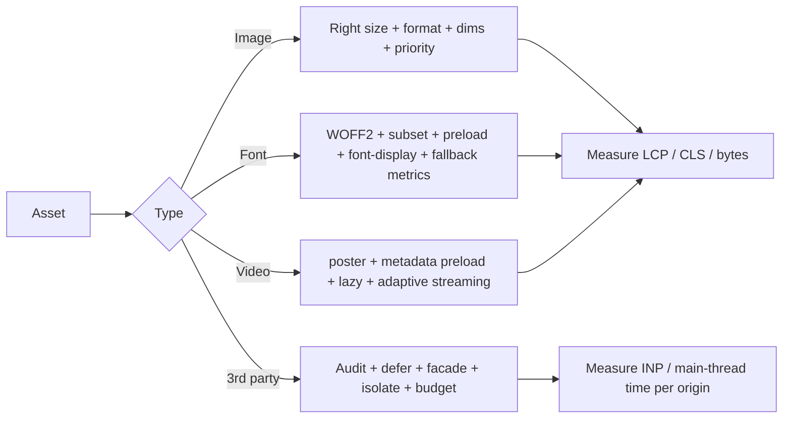
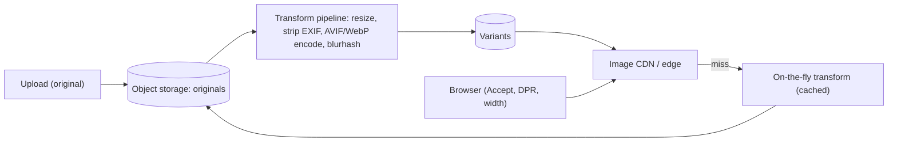
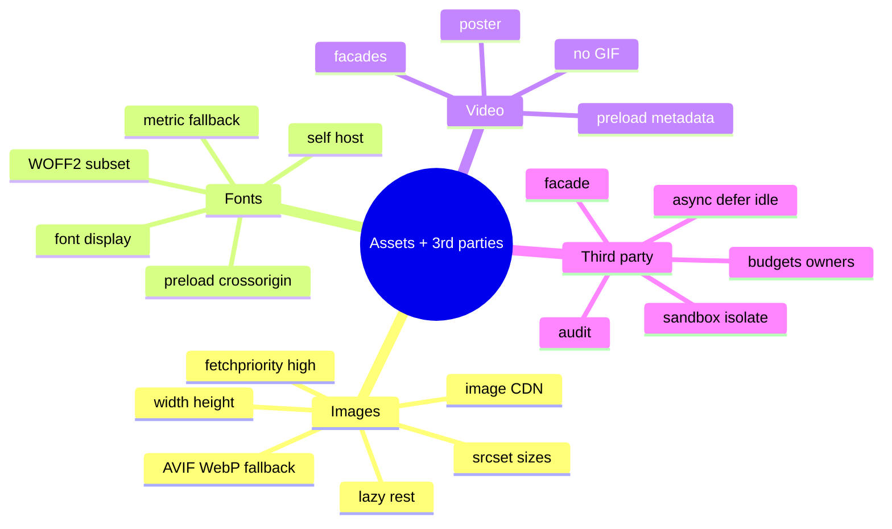

# Images, Fonts, Media and Third-Party Scripts (Formats, Responsive Delivery, Font Loading, Video, Tag Governance)

> Format/priority support facts were verified earlier in this handbook against MDN/web.dev (AVIF: Chrome 85, Edge 121, Firefox 93, Safari 16.1, no progressive rendering → use `<picture>` fallback; JPEG XL support is very recent and needs fallbacks; `fetchpriority`: Chrome 102, Safari 17.2, Firefox 132 — a hint, not a directive; Chrome gives the first few large images Medium priority; `content-visibility`/decoded-memory notes). LCP/image priority guidance is from web.dev "Optimize LCP" (Mar 2025). Font-loading mechanics, third-party facades/worker isolation, cache partitioning and video optimisation details are general knowledge — marked *(hedged)*. Related: [02 Critical rendering path](02-critical-rendering-path-and-loading-performance.md), [05 Rendering and CLS](05-rendering-layout-animation-and-cls.md), [system-design/07 image gallery](../system-design/07-image-gallery-and-media-heavy-ui.md), [nextjs-and-rendering/07](../nextjs-and-rendering/07-performance-optimization.md).

## Table of Contents

1. [Quick Summary (TL;DR)](#1-quick-summary-tldr)
2. [Images: Formats and Compression](#2-images-formats-and-compression)
3. [Responsive Images: `srcset`, `sizes`, `<picture>`](#3-responsive-images-srcset-sizes-picture)
4. [Image Loading Behaviour: Lazy, Priority, Decoding, Placeholders](#4-image-loading-behaviour-lazy-priority-decoding-placeholders)
5. [Image Delivery Architecture (CDN, Upload Pipeline)](#5-image-delivery-architecture-cdn-upload-pipeline)
6. [Web Fonts](#6-web-fonts)
7. [Icons, SVG and CSS Backgrounds](#7-icons-svg-and-css-backgrounds)
8. [Video and Animated Media](#8-video-and-animated-media)
9. [Third-Party Scripts and Embeds](#9-third-party-scripts-and-embeds)
10. [Consent Banners, A/B Testing, Ads: Special Cases](#10-consent-banners-ab-testing-ads-special-cases)
11. [Budgets and Governance](#11-budgets-and-governance)
12. [Pitfalls](#12-pitfalls)
13. [Interview Questions — Fundamentals](#13-interview-questions--fundamentals)
14. [Interview Questions — Senior Scenarios](#14-interview-questions--senior-scenarios)
15. [Cheat Sheet](#15-cheat-sheet)
16. [Key Terms Glossary](#16-key-terms-glossary)
17. [Further Reading](#17-further-reading)

---

## 1. Quick Summary (TL;DR)

- **Images and fonts are the usual LCP resources; third-party scripts are the usual INP/LCP regressors.** These three areas typically hold the biggest wins after architecture.
- **Images:** right size (`srcset/sizes`), modern format (**AVIF/WebP** with fallback), correct dimensions (CLS), **never lazy-load the LCP image**, `fetchpriority="high"` on one or two, lazy-load the rest, cache long, use an **image CDN**.
- **Fonts:** **WOFF2**, subset, limit weights/families, **preload** the critical one (with `crossorigin`), choose `font-display` (swap/optional), use **metric-adjusted fallbacks** to avoid CLS, self-host.
- **Video:** don't autoplay large video unless needed; `preload="metadata"`, poster images, adaptive streaming for long videos, replace GIFs with video/animated WebP/AVIF; lazy-load below the fold.
- **Third parties:** each script is a **cost centre** — audit, load late (`async`/`defer`/idle), use **facades** for heavy embeds, sandbox/isolate where possible, govern via budgets and ownership.
- **Always measure** the impact: LCP element/resource, bytes, main-thread time per origin, CLS sources.



---

## 2. Images: Formats and Compression

| Format | Strengths | Notes (verified/hedged) |
|---|---|---|
| **JPEG** | Universal photos | Use progressive, mozjpeg-style optimisation |
| **PNG** | Lossless, transparency | Large for photos; prefer WebP/AVIF lossless where suitable |
| **WebP** | ~25–35% smaller than JPEG at similar quality *(hedged)*; lossy+lossless+alpha+animation | Broad support |
| **AVIF** | Often smallest, HDR/wide gamut | Chrome 85, Edge 121, Firefox 93, Safari 16.1; **no progressive rendering**; slower to encode (≈50% longer than WebP per Next.js docs; ~20% smaller) → pre-encode; always provide fallback |
| **JPEG XL** | Excellent compression, progressive, lossless JPEG recompression | Support only recently arriving across browsers (verify at deploy time); needs `<picture>` fallback |
| **SVG** | Vector icons/illustrations | Optimise (SVGO), sanitise user SVG, sprite or inline |
| **GIF** | Legacy animation | **Avoid**: huge; use video/animated WebP/AVIF |

**Compression guidance**
- Quality 60–80 often visually lossless for photos; use **perceptual metrics** (SSIM/Butteraugli/DSSIM) in the pipeline *(hedged)*.
- **Strip metadata** (EXIF) except what's needed (also privacy: GPS).
- **Don't upscale**; match **display size × DPR** (cap DPR at ~2–3).
- **Lossless only when needed** (UI screenshots with text, pixel art).
- **Don't compress already-compressed** formats again at the HTTP layer (see [03](03-network-caching-and-delivery.md)).
- **Decoded memory** ≈ `width × height × 4` bytes regardless of file size (a 4000×3000 image ≈ 48 MB decoded) → right-size images, especially in lists/carousels.

---

## 3. Responsive Images: `srcset`, `sizes`, `<picture>`

```html
<!-- Resolution switching: browser picks based on layout width (sizes) × DPR -->


<!-- Format switching + art direction -->
<picture>
  <source type="image/avif" srcset="/img/hero.avif">
  <source type="image/webp" srcset="/img/hero.webp">
  <source media="(max-width: 600px)" srcset="/img/hero-crop.jpg">
  
</picture>
```
- **`sizes` is required for good results** with `w` descriptors; if omitted the browser assumes `100vw` → oversized downloads.
- Use **`x` descriptors** (`1x, 2x`) for fixed-size images (logos/avatars).
- **Width/height attributes** (or CSS `aspect-ratio`) → browser computes aspect ratio before load (CLS).
- **Art direction** via `<picture media>`; **format negotiation** via `type` (client picks first supported) or server `Accept` header (CDN must vary cache by `Accept`).
- Generate a **sensible ladder** of widths (e.g., 320, 480, 640, 800, 1024, 1280, 1600, 2048) — too many variants dilute cache hits/storage.
- Framework helpers (`next/image`, Nuxt Image, Angular `NgOptimizedImage`) automate `srcset/sizes`, lazy loading and dimensions — still verify output ([nextjs-and-rendering/07](../nextjs-and-rendering/07-performance-optimization.md)).

---

## 4. Image Loading Behaviour: Lazy, Priority, Decoding, Placeholders

### Lazy loading
- `loading="lazy"` defers images until near the viewport (browser-defined threshold). **Never on the LCP image** (web.dev). For images that are "close enough", lazy-loading may add little.
- Use `loading="lazy"` also for below-the-fold `<iframe>`s. Don't lazy-load images in the first viewport.
- **JS lazy-loaders** (`data-src`) hide images from the preload scanner — avoid for LCP candidates; native lazy is enough for most.

### Priority
- **`fetchpriority="high"`** on the LCP `` (one or two images max); **`low`** on hidden carousel slides and off-screen early-in-HTML images. It's a **hint**, supported in Chrome 102+, Safari 17.2+, Firefox 132+ (verified earlier). Browsers also apply heuristics (Chrome may mark the first few large images Medium priority).
- For CSS background LCP images: **`<link rel="preload" as="image" fetchpriority="high">`** is still needed.

### Decoding
- `decoding="async"` lets the browser decode off the critical path (default behaviour varies); `img.decode()` can pre-decode before showing (lightboxes/carousels).
- Large images decode on CPU/GPU and can cause jank when they enter the viewport → pre-decode, use right-sized assets.

### Placeholders
- **Dominant colour / low-quality image placeholder (LQIP)/blurhash/ThumbHash** to avoid blank boxes (perceived performance); keep placeholder tiny (≤ ~1–2 KB, inline data URL) *(hedged)*; fade-in via opacity (not layout).
- Placeholders do **not** improve LCP unless the placeholder itself is the LCP element (careful: LCP is the *largest* painted element; the final image replaces it).

### Cache
- Hashed or versioned image URLs → `public, max-age=31536000, immutable`; transformed images keyed by params + format.

---

## 5. Image Delivery Architecture (CDN, Upload Pipeline)



- **Pre-generate** the common variants at upload (fast, predictable) *plus* on-demand transforms for long-tail sizes (cached at the edge).
- **Same-origin hosting** of critical images (proxy the image CDN under your domain) avoids extra DNS/TLS/connection cost on the LCP path (web.dev).
- **Cache keys** must include width/quality/format; if negotiating by `Accept`, the CDN must **vary on `Accept`** (otherwise AVIF may be served to unsupporting clients).
- **Limits & security:** allow-list sources, max dimensions/pixels, rate limits (resizing is CPU-heavy), SSRF protections for remote fetchers, sanitise SVG, strip metadata.
- **Cost control:** long TTLs, limit variant explosion, store AVIF/WebP only for hot images (lazy generation).
- **Monitoring:** image bytes per page (RUM Resource Timing), cache hit ratio, p95 transform time, CLS from images, LCP resource type breakdown (CrUX now exposes LCP resource types/sub-parts — [01](01-performance-metrics-and-measurement.md)).

---

## 6. Web Fonts

### Formats and size
- Use **WOFF2** (Brotli-compressed, universal support). Drop TTF/EOT/WOFF.
- **Subset** to needed scripts/glyphs (`unicode-range`, tools like `glyphhanger`/`pyftsubset`); split by script (latin/cyrillic) so only needed files download.
- **Variable fonts** can replace several static weights (one file) — watch file size; subset axes.
- Limit **families/weights** (each is a request and bytes); consider system font stacks for body text.

### Loading and `font-display`
| Value | Behaviour | Use |
|---|---|---|
| `auto`/`block` | Invisible text up to ~3 s, then swap | Avoid for body text (FOIT) |
| `swap` | Show fallback immediately, swap when loaded | Common default; may cause shift if metrics differ |
| `fallback` | Short block (~100 ms), short swap window (~3 s) | Balanced |
| `optional` | Very short block; use font only if already available (cache/preloaded) else keep fallback | Best for CLS/perf on non-critical fonts; no late swap |

web.dev: values other than `auto`/`block` mean **text is always visible during load and LCP isn't blocked on the font download**.

```css
@font-face {
  font-family: "Inter";
  src: url("/fonts/inter-latin-var.woff2") format("woff2");
  font-weight: 100 900;
  font-display: swap;
  unicode-range: U+0000-00FF, U+0131, U+0152-0153;   /* latin subset */
}
/* Metric-adjusted fallback to minimise layout shift on swap */
@font-face {
  font-family: "Inter Fallback";
  src: local("Arial");
  size-adjust: 107%;
  ascent-override: 90%;
  descent-override: 22%;
  line-gap-override: 0%;
}
body { font-family: "Inter", "Inter Fallback", system-ui, sans-serif; }
```

```html
<!-- Preload the critical font (needs crossorigin even if same-origin) -->
<link rel="preload" href="/fonts/inter-latin-var.woff2" as="font" type="font/woff2" crossorigin>
```

### Strategy
- **Self-host** fonts (same origin → no extra connection; HTTP/2/3 multiplexing; long cache). Third-party font CDNs no longer share cache across sites in modern browsers (cache partitioning *(hedged)*), so the "shared cache" benefit mostly disappeared.
- **Preload only 1–2 critical fonts** (above-the-fold body/heading); others load on demand.
- **Avoid FOIT/FOUT shifts**: metric-compatible fallback (`size-adjust`, `ascent-override` etc.; frameworks like `next/font` generate this), `font-display: optional` for decorative fonts.
- **Icon fonts** → replace with inline SVG/sprites (smaller, accessible, no FOIT).
- **Font loading API** (`document.fonts.load`, `.ready`) to coordinate rendering sparingly *(hedged)*.
- **Variable/colour fonts and emoji** can be large; test on low-end devices.

---

## 7. Icons, SVG and CSS Backgrounds

- **Inline SVG** for critical icons (no request; styleable; accessible with `role`/`<title>`), or an **SVG sprite** with `<use>`; avoid huge SVGs with excessive paths (DOM/paint cost); optimise with **SVGO**.
- **CSS `background-image` LCP**: not discoverable by the preload scanner → preload or use ``; also can't use `srcset` (use `image-set()`).
- **Data URIs**: eliminate a request for tiny assets, but they aren't cacheable separately, add parse/decode cost, and bloat CSS/HTML (web.dev caveat); limit to very small assets.
- **Sprites** are unnecessary for raster images over HTTP/2/3; keep small sprites only for many tiny icons.
- **Decorative images** → `alt=""`; consider CSS or inline SVG.

---

## 8. Video and Animated Media

- **Avoid GIF**; use `<video autoplay muted loop playsinline>` with MP4 (H.264) + WebM/AV1 sources *(hedged codecs)*, or animated WebP/AVIF for short loops.
- **Poster images**: `poster` attribute (and treat the poster as the LCP candidate; optimise it like a hero image). `preload="none"` or `"metadata"` for non-critical videos; don't preload full video.
- **Autoplay policies** require `muted` (and `playsinline` on iOS); respect `prefers-reduced-motion` and data-saver conditions.
- **Long-form video:** adaptive streaming (HLS/DASH via MSE) with multiple bitrates, CDN, chunked segments, start at a conservative bitrate then ramp.
- **Lazy-load** off-screen videos (IntersectionObserver); pause when not visible; limit concurrent players; free memory on unmount.
- **Embeds (YouTube/Vimeo):** use a **facade** (static thumbnail + play button) and load the iframe on interaction, or `loading="lazy"` for below the fold; `youtube-nocookie.com` domain for privacy *(hedged)*.
- **Lottie** animations can be heavy; prefer CSS/SVG/video when simple; lazy-load the player.
- **Audio/Media metadata** and captions/transcripts for accessibility (WebVTT; also keyboard-accessible controls).

---

## 9. Third-Party Scripts and Embeds

**Why they hurt:** extra connections (DNS/TLS), bytes, **main-thread execution** (INP/LCP render delay), **layout shifts** (ads/widgets), privacy/security risk, outside your deploy control, and failure modes (SPOF if loaded synchronously).

### Audit
1. **Inventory** every third-party origin (DevTools Network "3rd-party" filter, Lighthouse "Reduce the impact of third-party code", WebPageTest "domains").
2. For each: **purpose/owner**, **bytes**, **main-thread time**, **requests**, **LCP/CLS/INP impact** (lab by blocking the domain; field by A/B or RUM tagging), **privacy/consent needs**, **alternatives**.
3. Remove unused/legacy tags; consolidate duplicates (multiple analytics/pixels).

### Loading strategies
| Strategy | How | Trade-off |
|---|---|---|
| **`async`/`defer`** | Don't block parsing | Still executes on main thread soon |
| **Load after `load`/idle** | Inject script in `requestIdleCallback`/after `load` | Delays data capture; fine for most analytics |
| **Load on interaction/visibility** | Chat widgets, social buttons | Added latency when needed → use facades |
| **Facades** | Lightweight placeholder replaced on click/hover (YouTube, maps, chat) | Extra dev work; big savings |
| **Server-side tagging / first-party proxying** | Move work off the client; reduce third-party connections | Infra and governance needed |
| **iframes with `sandbox`/`loading="lazy"`** | Isolate execution/DOM | Limits functionality; cross-origin iframes have own main thread (but INP is page-level) |
| **Worker isolation (Partytown-style)** *(hedged)* | Run tag scripts in a worker | Compatibility limits (sync DOM APIs proxied) |
| **Preconnect (sparingly)** | Speed up critical third-party origins | Over-use wastes sockets |
| **Self-host** (where licence permits) | Cache control, same origin | Updates/maintenance; ToS |

```js
// Load a tag after the page is idle, with a timeout fallback
function loadLater(src) {
  const inject = () => { const s = document.createElement('script'); s.src = src; s.async = true; document.head.append(s); };
  (window.requestIdleCallback || ((cb) => setTimeout(cb, 2000)))(inject, { timeout: 4000 });   // rIC not in Safari
}
if (document.readyState === 'complete') loadLater('/vendor/tag.js'); else addEventListener('load', () => loadLater('/vendor/tag.js'));
```

### Safety
- **CSP** allow-lists, **SRI** (`integrity`) for static third-party files, `sandbox` iframes, **Permissions-Policy** to deny unneeded APIs, `rel="noopener"`; don't let tags read forms/PII; monitor for supply-chain changes (tag content changes outside your deploys).
- **Resilience:** third-party outage shouldn't block your page: never load sync in `<head>`, set timeouts, handle failures, use `async`.
- **Prerender/bfcache interaction:** third parties registering `unload` handlers kill bfcache; use `pagehide`; defer tags during prerender ([03](03-network-caching-and-delivery.md)).

---

## 10. Consent Banners, A/B Testing, Ads: Special Cases

- **Consent banners (CMPs):** often render late and push content (CLS) or block interaction; implement as **fixed overlays at the bottom** or reserved space, load the CMP early but lightweight, avoid blocking main thread; ensure it doesn't become the LCP element unintentionally; gate other tags behind consent.
- **A/B testing:** client-side anti-flicker snippets hide the page (render delay) — prefer **server/edge assignment**, inline minimal bucketing, short timeouts; make sure variants don't change the LCP element/resource unpredictably; measure by variant.
- **Ads:** reserve slot sizes, lazy-load below the fold, limit ad count/refresh, collapse unfilled slots without shifting visible content (or keep reserved space), isolate in iframes, use `fetchpriority/low`/idle loading; avoid ad scripts competing with LCP.
- **Chat/support widgets:** load on idle or on click; keep their iframe off the critical path.
- **Social embeds:** use static previews/links.
- **Tag managers:** a single sync-free container is OK, but governance is crucial: review changes, restrict who can add tags, performance budgets for container size, audit regularly.

---

## 11. Budgets and Governance

- **Budgets (per page type):** total image bytes, LCP image bytes, font bytes (e.g., ≤ 100 KB total *(team-specific)*), number of font files (≤ 2–3 critical), third-party count/bytes/main-thread time, total requests.
- **CI checks:** Lighthouse CI/PageSpeed assertions (LCP element resource, `uses-responsive-images`, `uses-optimized-images`, `font-display`, `third-party-summary`), size-limit/bundle checks, image lint (max dimensions/size), CLS checks.
- **Ownership:** each third-party has a business owner and a performance owner; **quarterly review**; **kill switches** for tags; staged rollout of new tags with RUM comparison.
- **Contracts/SLAs** for vendors (performance, uptime); vendor-supplied "lightweight" snippets.
- **Developer experience:** shared `Image`/`Video`/`Embed` components that enforce dimensions, priority, lazy-loading rules, and facade patterns; lint rules against raw `` without `width/height/alt`, `loading="lazy"` on above-the-fold, `unload` listeners.

---

## 12. Pitfalls

1. **Lazy-loading the LCP image** or using JS lazy-loaders above the fold.
2. **Missing `sizes`** with `srcset` w-descriptors (oversized images).
3. **AVIF without fallback** (or CDN caching AVIF for non-AVIF clients).
4. **Images without dimensions** (CLS).
5. **Serving 4000px originals** to mobile.
6. **GIFs** for animation.
7. **Too many font families/weights; no subsetting; no preload for critical font.**
8. **`font-display: block`/default** for body text (FOIT); swap without fallback metrics (CLS).
9. **`preload` without `crossorigin` for fonts** (downloaded twice).
10. **Autoplay video above the fold** with large `preload`.
11. **Sync third-party scripts in `<head>`.**
12. **Tag manager free-for-all** (no governance).
13. **Consent/ad banners shifting layout.**
14. **No monitoring of third-party performance regressions** (tags change outside your deploys).
15. **Placeholders mistaken for LCP improvement** (or placeholder becomes LCP).

---

## 13. Interview Questions — Fundamentals

### Q1. How do `srcset` and `sizes` work together?
`srcset` lists candidate files with widths (`w`); `sizes` tells the browser the layout width the image will occupy at different viewport conditions; the browser picks the best candidate for width × DPR.

### Q2. Why not lazy-load the LCP image?
It delays the request until layout confirms the image is near/in the viewport, adding resource load delay; use `fetchpriority="high"` and normal eager loading instead.

### Q3. AVIF vs WebP vs JPEG?
AVIF usually compresses best but is slower to encode and lacks progressive rendering; WebP is broadly supported and good; JPEG is the universal fallback. Serve via `<picture>` or `Accept`-based negotiation.

### Q4. How do you avoid layout shift from images?
Provide `width`/`height` or CSS `aspect-ratio`; reserve space for lazy-loaded/placeholder images.

### Q5. Explain `font-display` values.
`block`/`auto`: invisible text then swap; `swap`: immediate fallback then swap; `fallback`: short block with limited swap window; `optional`: only use if available quickly, else keep fallback — values other than auto/block avoid blocking LCP on font download.

### Q6. How do you reduce font-related CLS?
Preload critical fonts, use `swap/optional`, metric-adjusted fallback fonts (`size-adjust`, `ascent-override`), subset fonts, limit weights.

### Q7. What is a facade?
A lightweight placeholder (thumbnail/button) that loads the heavy third-party embed only on interaction.

### Q8. How do you handle third-party script performance?
Audit and measure, remove unneeded, load async/defer or on idle/interaction, use facades, isolate in iframes/workers where possible, govern with budgets/ownership.

### Q9. Why can image decode size matter?
Decoded bitmaps take `w×h×4` bytes irrespective of file size; huge images in lists/carousels consume memory and CPU, causing jank/OOM.

### Q10. When would you use `preconnect`?
For a few critical third-party origins whose resources are needed early (e.g., image CDN/API/font CDN) and can't be proxied same-origin; avoid overuse.

---

## 14. Interview Questions — Senior Scenarios

### S1. "Hero image LCP is 3.8 s on 4G; images are 1.5 MB JPEGs from a third-party CDN."
Sub-part analysis: likely load duration + connection cost. Right-size with `srcset/sizes`, AVIF/WebP via `<picture>`, quality tuning, `fetchpriority="high"`, ensure the `` is in HTML (not JS-injected), proxy the CDN through the main origin (or `preconnect`), long cache TTL, CDN close to users; verify in RUM LCP sub-parts and bytes; set CI budget for hero bytes.

### S2. "Fonts cause both slow text rendering and CLS."
Self-host WOFF2 subsets, preload the 1–2 critical fonts (`crossorigin`), choose `swap` (or `optional` for non-critical), add metric-adjusted fallbacks, reduce weights/families (variable font), verify no FOIT, confirm CLS source via Layout Shift Regions and RUM attribution; ensure `Cache-Control: immutable`.

### S3. "Marketing added five tags; INP and LCP regressed."
Measure per-origin main-thread time (DevTools bottom-up by origin, LoAF scripts if available) and block-test each domain in lab; remove duplicates; load remaining after idle/interaction; server-side tagging for pixels; set tag budgets and approval workflow; add RUM alerts on regression; require vendors' performance info; consider isolating heavy tags in iframes/workers.

### S4. "Design the image pipeline for a UGC product with millions of uploads."
Direct-to-storage resumable uploads; async processing queue: validate type/size, strip EXIF, normalise orientation, generate a ladder of WebP/AVIF variants + blurhash, virus scan; CDN with image transforms for long-tail sizes and Accept negotiation; same-origin delivery; immutable URLs per variant; moderation hooks; cost controls (lazy variant generation, lifecycle rules); monitoring (bytes/page, transform latency, cache hit); security (SSRF, SVG sanitisation, pixel limits). See [system-design/07](../system-design/07-image-gallery-and-media-heavy-ui.md).

### S5. "Product wants autoplaying hero video with sound-free loop on the homepage."
Use a compressed MP4/WebM with muted autoplay/`playsinline`, poster as LCP candidate (optimised, preloaded), `preload="metadata"`, small bitrate for mobile (or image fallback on data-saver/low-end), pause when off-screen/hidden, respect reduced motion, avoid blocking main thread, host on CDN, and measure LCP (poster vs first frame), bytes, INP and battery impact.

---

## 15. Cheat Sheet



| Need | Do |
|---|---|
| Hero fast | `` in HTML + `fetchpriority="high"` + right size/format |
| No layout shift | Dimensions/`aspect-ratio`; metric-adjusted font fallback |
| Smaller fonts | WOFF2 + subset + variable + fewer weights |
| Heavy embed | Facade + load on interaction |
| Tag governance | Inventory, budgets, owners, kill switches |

---

## 16. Key Terms Glossary

| Term | Definition |
|---|---|
| **`srcset`/`sizes`** | Responsive image candidate list and layout-width hint |
| **LQIP/blurhash** | Low-quality image placeholder techniques |
| **FOIT/FOUT** | Flash of invisible/unstyled text |
| **`font-display`** | Controls font block/swap behaviour |
| **`size-adjust`** | `@font-face` descriptor to align fallback metrics |
| **Facade** | Lightweight stand-in for a heavy embed |
| **SRI** | Subresource Integrity (hash-verified third-party files) |
| **Image CDN** | Service transforming/serving optimised images at the edge |
| **Decoded size** | In-memory bitmap size (`w×h×4`) |
| **Partitioned cache** | Browser cache keyed by top-level site, limiting cross-site sharing |

---

## 17. Further Reading

- [web.dev — Optimize LCP](https://web.dev/articles/optimize-lcp) · [Fetch Priority](https://web.dev/articles/fetch-priority) · [Optimize CLS](https://web.dev/articles/optimize-cls) · [Font best practices](https://web.dev/articles/font-best-practices) · [Third-party JavaScript](https://web.dev/articles/optimizing-content-efficiency-loading-third-party-javascript)
- [MDN — Responsive images](https://developer.mozilla.org/en-US/docs/Web/HTML/Guides/Responsive_images) · [font-display](https://developer.mozilla.org/en-US/docs/Web/CSS/@font-face/font-display)
- This repo: [system-design/07](../system-design/07-image-gallery-and-media-heavy-ui.md) · [nextjs-and-rendering/07](../nextjs-and-rendering/07-performance-optimization.md) · [02 Critical rendering path](02-critical-rendering-path-and-loading-performance.md)
