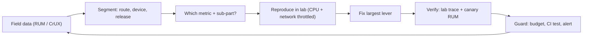
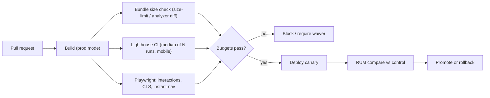
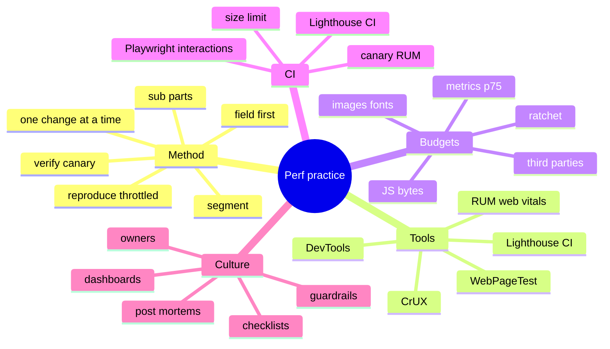

# Performance Debugging, Budgets and Culture (Methodology, Tooling, Scenarios, CI, Governance)

> Methodology builds on the verified guidance in [01](01-performance-metrics-and-measurement.md) (web.dev: field data first, LCP/INP sub-parts, CrUX vs Lighthouse), [02](02-critical-rendering-path-and-loading-performance.md) and [04](04-javascript-main-thread-and-inp.md) (web.dev optimisation guides) and [03](03-network-caching-and-delivery.md) (MDN/web.dev for speculative loading and bfcache). Tool features (DevTools panels, Lighthouse CI, WebPageTest options), CI configuration and organisational practices are general knowledge — hedged where product behaviour changes frequently. Related: [nextjs-and-rendering/07](../nextjs-and-rendering/07-performance-optimization.md), [react/08](../react/08-react-performance-optimization.md), [system-design/01 framework](../system-design/01-frontend-system-design-framework.md).

## Table of Contents

1. [Quick Summary (TL;DR)](#1-quick-summary-tldr)
2. [A Systematic Debugging Methodology](#2-a-systematic-debugging-methodology)
3. [Choosing the Right Tool](#3-choosing-the-right-tool)
4. [Chrome DevTools Playbook](#4-chrome-devtools-playbook)
5. [Realistic Lab Conditions](#5-realistic-lab-conditions)
6. [Symptom → Cause → Fix Catalogue](#6-symptom--cause--fix-catalogue)
7. [Scenario Walkthroughs](#7-scenario-walkthroughs)
8. [Performance Budgets](#8-performance-budgets)
9. [Automation in CI/CD](#9-automation-in-cicd)
10. [Monitoring, Alerting and Regression Triage](#10-monitoring-alerting-and-regression-triage)
11. [Release Safety: Canary, Flags, Rollback](#11-release-safety-canary-flags-rollback)
12. [Performance Culture and Governance](#12-performance-culture-and-governance)
13. [Prioritisation and the Business Case](#13-prioritisation-and-the-business-case)
14. [How to Answer "Optimize This Slow Page" in an Interview](#14-how-to-answer-optimize-this-slow-page-in-an-interview)
15. [Pitfalls](#15-pitfalls)
16. [Interview Questions — Fundamentals](#16-interview-questions--fundamentals)
17. [Interview Questions — Senior Scenarios](#17-interview-questions--senior-scenarios)
18. [Cheat Sheet](#18-cheat-sheet)
19. [Key Terms Glossary](#19-key-terms-glossary)
20. [Further Reading](#20-further-reading)

---

## 1. Quick Summary (TL;DR)

- **Method beats tricks:** *Measure (field) → segment → hypothesise (which sub-part?) → reproduce (lab, throttled) → fix the biggest lever → verify (lab + canary RUM) → guard (budget/test).*
- **Use the right data for the question:** field/RUM tells *whether and where*; lab/DevTools tells *why*; synthetic monitoring tells *when it regressed*; budgets/CI tell *before it ships*.
- **Most wins come from a short list:** discovery/priority of the LCP resource, render-blocking CSS/JS, bundle size and long tasks, third-party scripts, image/font weight, caching/CDN/TTFB, layout reservations (CLS), DOM size.
- **Budgets and automation prevent regressions** (bundle size, Lighthouse assertions, interaction tests); **culture** (ownership, review checklists, canaries) sustains improvements.
- **Interview answers should be structured, quantified and trade-off-aware.** Start with "what do we measure?", then sub-part breakdown, then prioritised actions and verification.



---

## 2. A Systematic Debugging Methodology

1. **Define the problem in user terms and numbers.** "LCP p75 on mobile /product pages is 3.9 s (target 2.5 s), regressed +0.8 s since release 2026.11.03."
2. **Segment.** Route/template, device class, connection, region, new vs returning, navigation type, release, A/B variant. Often the problem lives in one segment.
3. **Locate the sub-part.** LCP: TTFB vs load delay vs load duration vs render delay. INP: input delay vs processing vs presentation. CLS: which element shifted and why. Use RUM attribution or DevTools insights.
4. **Hypothesise and rank by (impact × confidence ÷ effort).**
5. **Reproduce under realistic conditions** (see §5). If you can't reproduce, improve RUM attribution first.
6. **Change one thing at a time** (or use A/B/canary) so you know what helped.
7. **Verify** in lab *and* field; watch for **time-shifting** (optimising one sub-part moves time to another — web.dev).
8. **Guard** with a budget/assertion/test and a dashboard annotation.
9. **Document** findings (runbook, post-mortem) and share patterns.

**Anti-method:** random micro-optimisations, optimising the Lighthouse score only, assuming desktop results generalise, "fixing" without a baseline.

---

## 3. Choosing the Right Tool

| Question | Tool |
|---|---|
| Do real users have a problem? Where? | RUM (web-vitals), CrUX (PageSpeed Insights, Search Console, CrUX API/BigQuery) |
| What sub-part is slow? | RUM attribution, DevTools Performance Insights, Lighthouse diagnostics |
| Why is the network slow? | DevTools Network, WebPageTest waterfall, `curl -w`, CDN logs, `Server-Timing` |
| Why is the main thread busy? | DevTools Performance (flame chart, long tasks, LoAF *(hedged)*), bottom-up by origin |
| What's in my bundle? | Bundle analyzer, source-map-explorer, DevTools Coverage |
| What shifts? | DevTools Layout Shift Regions, Performance "Layout Shifts" track, `layout-shift` sources |
| Memory leak? | DevTools Memory (heap snapshots, allocation sampling), Performance memory counters |
| Will this PR regress? | Lighthouse CI, size-limit, Playwright perf/interaction tests, trace diffs |
| When did it regress? | Synthetic monitoring + RUM trends with release annotations |
| Is bfcache working? | DevTools Application → Back-forward Cache, `NotRestoredReasons`, hit-ratio RUM |
| Speculative loading working? | DevTools Application → Speculative loads *(hedged)*, `Sec-Purpose` logs, `deliveryType` |

---

## 4. Chrome DevTools Playbook

### Performance panel
- Record with **CPU throttling (4–6×)** + **Network throttling** + **disable cache** for cold-load tests; enable **Screenshots** for filmstrip; use **Web Vitals / Live metrics** overlay (shows local LCP/INP/CLS vs CrUX).
- **Insights** sidebar: LCP breakdown, render-blocking requests, layout shifts, long main-thread tasks, third-party summary *(feature names evolve — hedged)*.
- Tracks: **Frames**, **Interactions** (INP breakdown per interaction), **Main** (flame chart), **Network**, **Layout Shifts**, **Timings** (LCP/FCP markers).
- Look for: long tasks (red corner), **Recalculate Style/Layout** with red triangles (forced reflow), big **Evaluate Script** blocks, **Parse HTML**, **Hydrate** (framework), **GC** events.
- **Bottom-Up / Group by Domain/Origin**: attribute CPU to first/third parties.

### Network panel
- Columns: **Priority, Protocol, Size/Transferred, Time, Waterfall, Initiator**. Filter **3rd-party**, **Blocking**. Check `Cache-Control`, `Content-Encoding`, `Vary`, `Server-Timing`.
- Disable cache + throttle for first-visit; test **repeat visit** separately.

### Lighthouse
- Use for **diagnostics and CI assertions**, not as the truth; run on mobile preset; multiple runs (median); note it can't measure INP (use TBT).

### Coverage
- Find unused JS/CSS per route (record on load and after interactions).

### Rendering tab
- **Paint flashing**, **Layout Shift Regions**, **Layer borders**, **FPS meter**, **Core Web Vitals** overlay, **Emulate CSS media features** (reduced motion, prefers-color-scheme).

### Memory panel
- **Heap snapshot** comparison; **Allocation sampling**; **Detached elements** search.

### Application panel
- **Service workers**, **Cache storage**, **Back-forward Cache** test, **Storage** quotas.

### Sensors/Devices
- Device emulation is not a substitute for real devices: validate on a **low-end Android** (and an older iPhone) with remote debugging.

---

## 5. Realistic Lab Conditions

- **CPU:** 4× slowdown ≈ mid-tier mobile; 6× for low-end *(rough heuristics; calibrate with a real device — Lighthouse's "CPU/Memory Power" indicator)*.
- **Network:** "Slow 4G"/Fast 3G presets (RTT ≈ 150–400 ms, ~1.6 Mbps) *(typical Lighthouse mobile profile)*. Combine with latency to origin for your user base.
- **Cache state:** test **cold** (first visit) and **warm** (repeat), plus **bfcache** restore.
- **Variants:** logged-in vs anonymous, consent states, A/B variants, large carts/data volumes, ads enabled.
- **Variance:** run ≥ 5 times; use median; avoid noisy CI neighbours (dedicated runners).
- **Devices:** maintain a small real-device lab (low/mid/high Android, iOS) or a device cloud.
- **Locations:** WebPageTest/synthetic from regions where users are.

---

## 6. Symptom → Cause → Fix Catalogue

| Symptom | Likely causes | First checks | Fixes |
|---|---|---|---|
| **LCP high, TTFB high** | Redirects, CDN miss, slow SSR, distance | `Server-Timing`, cache status, redirect chain | Cache/CDN keys, stream, Early Hints, regionalise, reduce redirects |
| **LCP high, load delay high** | Late discovery, low priority, lazy-loaded LCP, CSS bg | Waterfall: LCP request start vs first resource | HTML ``, preload, `fetchpriority`, no lazy |
| **LCP high, load duration high** | Big image/font, far origin, contention | Resource size/transfer, priority | AVIF/WebP, `srcset`, CDN, fewer concurrent requests |
| **LCP high, render delay high** | Blocking CSS/JS, hidden by JS (A/B), long tasks | "Render blocking" flags, main-thread tasks | Inline/shrink CSS, defer JS, server variant, split tasks |
| **INP high, input delay high** | Startup JS/hydration, 3rd parties | Long tasks before events | Split, defer, lazy hydrate, idle 3rd parties |
| **INP high, processing high** | Heavy handlers, big renders | Flame chart under handler | Defer/yield, memoise, localise state, worker |
| **INP high, presentation high** | Large DOM, expensive layout/paint | Style/Layout/Paint after handler | Virtualise, `content-visibility`, simplify CSS |
| **CLS high** | No dimensions, ads, fonts, injected banners | Layout Shift Regions, `layout-shift` sources | Reserve space, font metrics, overlay banners |
| **TBT high** | Large bundles/third parties | Long tasks list | Reduce/split/defer JS |
| **Jank on scroll** | Scroll handlers, paint costs, DOM size | Frames + paint flashing | Passive/observers, cheaper effects, virtualise |
| **Slow after long use** | Memory leaks, unbounded caches | Heap snapshots | Cleanup, caps, disposal |
| **Good lab, bad field** | Device/network mix, cold cache, 3rd parties, A/B | Segment RUM | Test with throttling; segment fixes |
| **Regression after deploy** | Bundle growth, new tag, config change | Release diff, bundle diff, tag changes | Revert/fix; add budget |
| **Back button slow** | bfcache blocked | bfcache test | Remove `unload`/`no-store`, close connections |
| **Repeat visits slow** | Caching headers wrong, SW stale | Cache headers, SW | Fingerprint + immutable; fix SW update flow |

---

## 7. Scenario Walkthroughs

### Scenario A — "Homepage LCP is 4.5 s on mobile only"
1. RUM: mobile p75 LCP 4.5 s; desktop 2.0 s; LCP element = hero image; sub-parts: load delay 1.4 s, load duration 1.6 s, render delay 0.3 s, TTFB 1.2 s.
2. Waterfall: hero requested after main JS because it's injected by a carousel script; hero is 1.2 MB desktop-sized JPEG; HTML is uncached (TTFB 1.2 s mobile).
3. Fixes: SSR the first slide as a real `` with `fetchpriority="high"`, `srcset/sizes`, AVIF/WebP; remaining slides lazy + `low`; cache HTML at CDN (`s-maxage` + SWR); proxy image CDN same-origin.
4. Verify: lab (4× CPU, slow 4G) then canary; RUM mobile p75 → 2.4 s.

### Scenario B — "Checkout button feels laggy (INP 520 ms)"
1. RUM INP attribution: click on `#place-order`, processing duration 380 ms.
2. Trace: handler runs synchronous validation + builds a large payload + triggers re-render of the entire cart tree + sends analytics synchronously.
3. Fixes: render-critical state (disabled/spinner) first; yield; move analytics to `sendBeacon` after paint; memoise cart components/use selectors; validation incremental; optimistic UI.
4. Verify: INP p75 for route → 180 ms; add Playwright interaction timing guard.

### Scenario C — "Shifts when the cookie banner and ad load (CLS 0.31)"
1. RUM CLS attribution: `.cmp-banner` pushes content; `.ad-slot` expands from 0 to 250 px.
2. Fixes: banner → fixed overlay (bottom); ad slot `min-height: 250px`; fonts preloaded with metric fallback; images with dimensions.
3. Verify: Layout Shift Regions clean; CLS p75 → 0.05.

### Scenario D — "Bundle grew 40% in a month; INP worsened on low-end Android"
1. Bundle diff in CI history shows a charting library imported into the root layout and moment locales; polyfills for legacy browsers.
2. Fixes: lazy-load charts per route, switch to lighter date handling (`Intl`/date-fns tree-shaken), target modern browsers, remove barrel imports; add size-limit per route.
3. Verify: JS bytes −35%, long tasks −50% on startup, INP improved; budget enforced.

### Scenario E — "SPA slows after 30 minutes; mobile tab crashes"
1. Heap snapshots: detached DOM growing; listeners from closed modals; websocket subscription duplicates; unbounded query cache.
2. Fixes: AbortController cleanup; unsubscribe on unmount; cap caches (`gcTime`/LRU); dispose map instance; soak test in CI.
3. Verify: flat heap across 100 navigations; crash rate down.

### Scenario F — "Back button reloads page slowly after we added a chat widget"
1. bfcache test fails: `unload` listener from the widget and open WebSocket.
2. Fixes: replace with `pagehide`; close/reopen connection on `pagehide/pageshow`; vendor update; lazy-load widget on interaction.
3. Verify: bfcache hit ratio rises; back-nav LCP ≈ 0.

---

## 8. Performance Budgets

**Types**
| Budget | Example | Why |
|---|---|---|
| **Metric (outcome)** | p75 LCP ≤ 2.5 s, INP ≤ 200 ms, CLS ≤ 0.1 (per route class, mobile) | Aligns with user experience and search signals |
| **Quantity (leading indicators)** | JS ≤ X KB gzip per route, CSS ≤ Y KB, hero image ≤ Z KB, fonts ≤ 100 KB, ≤ N requests, DOM nodes ≤ M | Catch problems at PR time |
| **Timing (lab)** | Lighthouse LCP/TBT thresholds; "interaction ≤ 100 ms" tests | Deterministic gating |
| **Third-party** | ≤ N origins; ≤ X ms main-thread; no sync tags | Governance |
| **Server** | p95 TTFB ≤ 800 ms for cacheable HTML *(team-specific)* | Backend contribution |

**Setting values:** start from current p75 and competitors/targets; **ratchet** (never allow regressions; tighten over time); separate budgets for **template types**; tie to SLOs ([01](01-performance-metrics-and-measurement.md)).
**Enforcement levels:** warn → block on regression thresholds → block on absolute budgets; allow **exceptions with owner + expiry**.

---

## 9. Automation in CI/CD



**Lighthouse CI assertions (illustrative)**
```json
{
  "ci": {
    "collect": { "numberOfRuns": 5, "url": ["http://localhost:3000/", "http://localhost:3000/product/123"], "settings": { "preset": "desktop" } },
    "assert": {
      "assertions": {
        "largest-contentful-paint": ["error", { "maxNumericValue": 2500 }],
        "cumulative-layout-shift": ["error", { "maxNumericValue": 0.1 }],
        "total-blocking-time": ["warn", { "maxNumericValue": 200 }],
        "uses-responsive-images": "warn",
        "unused-javascript": ["warn", { "maxNumericValue": 150000 }]
      }
    }
  }
}
```
(Use the **mobile** form factor for mobile-first products; thresholds are examples.)

```yaml
# .github/workflows/perf.yml — illustrative; adapt runner labels/registry to your organisation
name: perf
on: [pull_request]
jobs:
  perf:
    runs-on: bby-ubuntu                         # org-standard runner; use ubuntu-latest outside the org
    steps:
      - uses: actions/checkout@v4
      - uses: actions/setup-node@v4
        with: { node-version: 22, cache: npm }
      - run: npm config set registry https://artifactory.tools.bestbuy.com/artifactory/api/npm/npm-virtual   # org npm mirror
      - run: npm ci && npm run build
      - run: npx size-limit
      - run: npx @lhci/cli autorun
```
(Prefer the org's approved credentials action, e.g. `bby-corp/tplat-gha-configure-github-credentials`, for any cloud access instead of static secrets.)

**Playwright performance checks**
```ts
import { test, expect } from '@playwright/test';

test('typing in search stays responsive', async ({ page }) => {
  await page.goto('/search');
  const duration = await page.evaluate(async () => {
    const input = document.querySelector<HTMLInputElement>('#q')!;
    const t0 = performance.now();
    input.value = 'running shoes';
    input.dispatchEvent(new Event('input', { bubbles: true }));
    await new Promise((r) => requestAnimationFrame(() => setTimeout(r)));   // after next frame
    return performance.now() - t0;
  });
  expect(duration).toBeLessThan(150);
});
```
**Tips:** run on **dedicated, consistent runners**; use **medians**; compare against **baseline from main** with tolerance; store artifacts (traces, Lighthouse reports); fail on **relative** regressions (e.g., +10%) to reduce flakiness; keep CI tests few and meaningful.

---

## 10. Monitoring, Alerting and Regression Triage

**Dashboards:** CWV p75 by route/device/release; LCP sub-part stacked bars; INP top interactions; CLS top sources; JS bytes; third-party time by origin; CDN hit ratio/TTFB; bfcache hit ratio; error rates; business KPIs (conversion) alongside.

**Alerts:** relative regression (e.g., +10% p75 week-over-week with min sample size) and absolute breach; route to owning team; include **top attribution** in the alert.

**Regression triage playbook**
1. **Confirm** (sample size, bots, seasonality, measurement changes such as bfcache/prerender).
2. **Pinpoint**: which route/segment/metric/sub-part; compare **release annotations**; check **third-party/tag changes**, A/B launches, infra/CDN changes, data growth.
3. **Bisect**: canary vs control, feature-flag toggles, deploy diffs, bundle diffs.
4. **Mitigate**: rollback/flag off/disable tag; then fix forward.
5. **Prevent**: add budget/test/alert; write a short post-mortem.

---

## 11. Release Safety: Canary, Flags, Rollback

- **Canary** (1–10%) with RUM comparison vs control on **the same segments**; automated checks (LCP/INP/CLS/error rate) with minimum sample sizes; auto-rollback thresholds.
- **Feature flags** for heavy features (editor, maps, video), enabling gradual rollout and quick kill.
- **Dark launches** for backend/CDN changes; compare TTFB distribution.
- **Asset safety:** retain previous hashed assets (skew), deploy assets before HTML.
- **Third-party changes** outside your pipeline: monitor tag-manager container changes; require approvals; synthetic checks post-change.
- **Rollback readiness:** one-click revert; cold cache impact planned.

---

## 12. Performance Culture and Governance

| Practice | Description |
|---|---|
| **Ownership** | Each route/template/third-party has an owner; "performance champions" in squads |
| **Definition of Done** | New features include perf considerations: bundle impact, images, third parties, RUM instrumentation |
| **Review checklist** | See below |
| **Visibility** | Shared dashboards, weekly review, release annotations, leaderboards by team (carefully, non-punitive) |
| **Education** | Brown-bags on DevTools, LCP/INP workflows; shared runbooks; pairing on traces |
| **Guardrails** | Lint rules (no `unload`, `` needs dimensions, no sync scripts), shared components with safe defaults |
| **Incentives** | Tie to business metrics; celebrate wins; make perf work visible in planning |
| **Vendor management** | Performance requirements in contracts; review quarterly |
| **Tech debt budget** | Time allotted per quarter for perf debt (bundle cleanup, image audits) |
| **Incident process** | Perf regressions treated like incidents (severity by CWV impact/revenue) |

**PR review checklist**
- Does it add JS (size, hydration, startup work)? Can it be lazy/server-side?
- New dependency? Size, tree-shakeable, alternatives, maintenance.
- Images: dimensions, `sizes`, format, lazy vs priority, LCP candidate?
- Fonts: new family/weight? preload/fallback metrics?
- Third party: owner, budget, loading strategy, consent?
- Layout: reserved space, skeleton parity, banners/ads?
- Interactions: heavy handlers, state updates, long lists (virtualise?), debouncing, cancellation?
- Network: caching headers, waterfalls, redundant requests, prefetch safety?
- Memory: listeners/timers/subscriptions cleaned? caches bounded?
- Tests/budgets updated? RUM events/marks added?

---

## 13. Prioritisation and the Business Case

- **Quantify** impact with your own data: segment sessions by LCP/INP bucket and compare conversion, bounce, revenue/session (correlation ≠ causation; use experiments where possible). Public case studies are directional only.
- **Impact × confidence ÷ effort** matrix; prefer **platform-level fixes** (shared components, CDN rules, build config) over page-by-page work.
- **Quick wins:** fix LCP discovery/priority, add dimensions, defer third parties, enable compression/caching, remove unused JS/CSS, right-size images.
- **Strategic investments:** SSR/SSG/PPR migration, design-system performance, image pipeline, edge caching, RUM maturity, bundle architecture (islands/Server Components).
- **Communicate** in business terms ("reducing mobile LCP by 1 s should lift conversion by ~X% based on our experiment") and by user impact (low-end devices, emerging markets).

---

## 14. How to Answer "Optimize This Slow Page" in an Interview

A structure that signals seniority:

1. **Clarify & measure:** "Which metric/segment? Do we have RUM/CrUX? What's the target?" (CWV p75, mobile first.)
2. **Break down:** LCP sub-parts / INP subparts / CLS sources — get data before proposing fixes.
3. **Prioritise by sub-part:**
   - *Loading:* TTFB (cache/CDN/SSR/redirects) → discovery/priority (HTML ``, preload, `fetchpriority`, no lazy) → render-blocking (CSS/JS) → size (formats, `srcset`, fonts) → third parties.
   - *Interactivity:* startup JS/hydration, long tasks, third parties, handler work (yield/defer/worker), DOM size.
   - *Stability:* dimensions, reserved slots, fonts, banners.
4. **Call out trade-offs:** SSR's TTFB vs discoverability, AVIF encode cost/fallbacks, preload over-use, worker overhead, speculation rules' waste and side effects, virtualisation vs find-in-page/a11y.
5. **Verification:** lab trace under throttling, canary + RUM comparison, regression guards (budgets, CI).
6. **Governance:** ownership, budgets, third-party review, release practices.

> **Say-this script:** "I'd start from field data to see which metric and segment is failing, break it into sub-parts to find the dominant cost, fix discovery/priority and render-blocking first because they're cheap and big, then size and TTFB, verify with a throttled trace and a canary, and add budgets so it doesn't regress."

---

## 15. Pitfalls

1. **Lab-only optimisation** (Lighthouse 100, field poor).
2. **Fixing symptoms without sub-part data.**
3. **No baseline/control** for experiments.
4. **Testing only on fast devices/networks/warm caches.**
5. **Ignoring third-party/tag changes** as regression causes.
6. **Flaky perf CI** (noisy runners, single runs) leading to ignored failures.
7. **Budgets without ownership or ratchets.**
8. **One-time "performance sprint"** with no guardrails.
9. **Optimising averages** instead of p75/p95.
10. **Premature micro-optimisation** (memoising everything) vs structural wins.
11. **Ignoring accessibility/UX trade-offs** (virtualisation, lazy loading, reduced motion).
12. **Not annotating releases** on dashboards (can't correlate).
13. **Treating performance as only a frontend problem** (backend/CDN/data).
14. **Declaring victory from lab data** without RUM verification.

---

## 16. Interview Questions — Fundamentals

### Q1. How do you approach debugging a slow page?
Start from field data/segments, identify the failing metric and sub-part, reproduce in lab with throttling, fix the largest lever, verify in lab and canary RUM, then add budgets/tests to prevent regressions.

### Q2. What tools do you use and for what?
RUM/CrUX for real-user truth; DevTools Performance/Network for root cause; Lighthouse/WebPageTest for diagnostics and CI; bundle analyzers for JS; Memory panel for leaks; bfcache panel for back/forward.

### Q3. What's a performance budget?
A limit on metrics or resources (e.g., p75 LCP ≤ 2.5 s, JS ≤ X KB per route, ≤ N third parties) enforced in CI and monitored in production, ratcheted over time.

### Q4. Why throttle CPU and network in testing?
Developer machines are far faster than typical user devices; throttling approximates mid/low-end mobile conditions so issues surface.

### Q5. How do you prevent performance regressions?
Budgets and CI checks (size-limit, Lighthouse CI, interaction tests), canary releases with RUM comparison, alerts, code review checklists, shared components with safe defaults, third-party governance.

### Q6. What do you do when lab and field disagree?
Trust field data; check segment (device/network/geography), cache state, A/B variants, third parties, and navigation types; adjust lab conditions to match the field segment.

### Q7. How do you triage a sudden regression?
Confirm the data, segment, check release/tag/CDN changes, bisect via canary/flags, mitigate (rollback/disable), fix forward, add guard + post-mortem.

### Q8. How do you prioritise performance work?
Impact on users/business × confidence ÷ effort; start with cheap, high-leverage fixes (LCP discovery, render-blocking, images, third parties), then structural investments.

### Q9. How do you make performance part of the culture?
Ownership, dashboards, DoD criteria, review checklists, guardrails/lint, education, incentives, performance incidents, and regular third-party audits.

### Q10. What's wrong with optimising for Lighthouse score?
It's a lab simulation of one load with synthetic conditions; it misses real-user variance and interactions (no INP), so you can "win" the score while users still suffer.

---

## 17. Interview Questions — Senior Scenarios

### S1. "You join a team with no performance monitoring. What do you do in the first 90 days?"
**30 days:** baseline via CrUX/PageSpeed Insights; ship `web-vitals` RUM with attribution to a collector; define key templates and SLOs; inventory third parties; DevTools audit of top pages; pick quick wins. **60 days:** dashboards and alerts; CI budgets (bundle size, Lighthouse CI); fix top LCP/CLS offenders; third-party governance; add release annotations. **90 days:** canary + RUM gating; performance review checklist; shared components (Image, Font, Embed); roadmap for structural work (SSR/edge caching/image pipeline) with business-case estimates; training sessions.

### S2. "Performance work keeps regressing every quarter. Why and how to stop it?"
Likely missing guardrails/ownership: no budgets or CI gates, tags added unmanaged, new dependencies unchecked, no canary comparisons. Fix with ratcheted budgets, ownership by route, PR checklists/lint, automated bundle diff comments, third-party approval workflow, RUM alerts, post-mortems, and default-safe components; make perf part of DoD and planning.

### S3. "The CEO asks how much faster pages should be to justify a 6-month SSR migration."
Use your RUM data: segment by LCP buckets and correlate with conversion/engagement; run an experiment/prototype on a high-traffic route (SSR/SSG + caching) comparing LCP/INP and business metrics; estimate impact on SEO/conversion; include costs (infra, complexity, hosting), risks (TTFB, caching complexity), and phased rollout (route by route, PPR/ISR). Provide ranges and decision criteria rather than a single promise.

### S4. "How would you build a performance regression gate that engineers don't hate?"
Make it fast (< 10 min), stable (dedicated runners, medians, tolerances), actionable (clear diffs: bundle treemap deltas, trace artifacts, specific failing metric), scoped (key routes), and fair (waivers with expiry, auto-comment on PRs with guidance). Start with warnings, then block on regressions beyond noise; invest in tooling that helps fix issues, not just report them.

### S5. "Explain how you'd investigate a regression that only appears in RUM for Android on 3G in one country."
Segment by country/ASN/device/connection; compare TTFB/LCP sub-parts; check CDN PoP performance and routing for that region (CDN logs, synthetic probes from the region), HTTP/3 vs HTTP/2 fallbacks, third-party endpoints with poor regional performance, image CDN variants, compression/Accept-Encoding stripping by carriers/proxies, and data-saver modes; reproduce via WebPageTest from that region with throttled device; mitigate via CDN config/regional origin/third-party removal; add regional alerts.

---

## 18. Cheat Sheet



| Step | Output |
|---|---|
| Measure | p75 by route/device/release |
| Break down | Sub-part dominant cost |
| Fix | Largest lever first |
| Verify | Lab trace + canary RUM |
| Guard | Budget + CI + alert |

---

## 19. Key Terms Glossary

| Term | Definition |
|---|---|
| **RUM** | Real user monitoring |
| **CrUX** | Chrome User Experience Report |
| **Performance budget** | Enforced limit on metrics/resources |
| **Ratchet** | Budget that tightens and never loosens |
| **Canary** | Gradual rollout compared against control |
| **Synthetic monitoring** | Scheduled lab tests from fixed locations |
| **Soak test** | Long-running test for leaks/degradation |
| **LHCI** | Lighthouse CI |
| **Regression** | Metric worsening after a change |
| **Waiver** | Time-boxed exception to a budget |

---

## 20. Further Reading

- [web.dev — Optimize LCP](https://web.dev/articles/optimize-lcp) · [Optimize INP](https://web.dev/articles/optimize-inp) · [Web Vitals](https://web.dev/articles/vitals)
- [Chrome DevTools — Performance](https://developer.chrome.com/docs/devtools/performance) · [Lighthouse CI](https://github.com/GoogleChrome/lighthouse-ci) · [WebPageTest docs](https://docs.webpagetest.org/)
- This repo: [01 Metrics](01-performance-metrics-and-measurement.md) · [nextjs-and-rendering/08](../nextjs-and-rendering/08-deployment-runtimes-and-operations.md) · [react-native/16 CI/CD](../react-native/16-tire12-github-actions-cicd.md)
