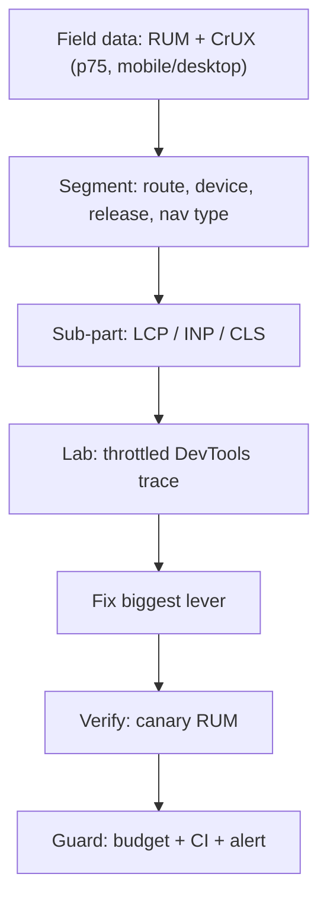
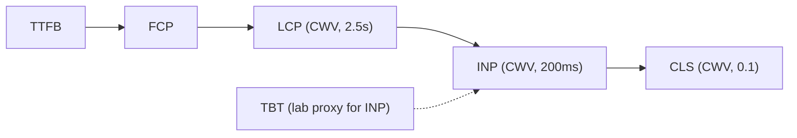
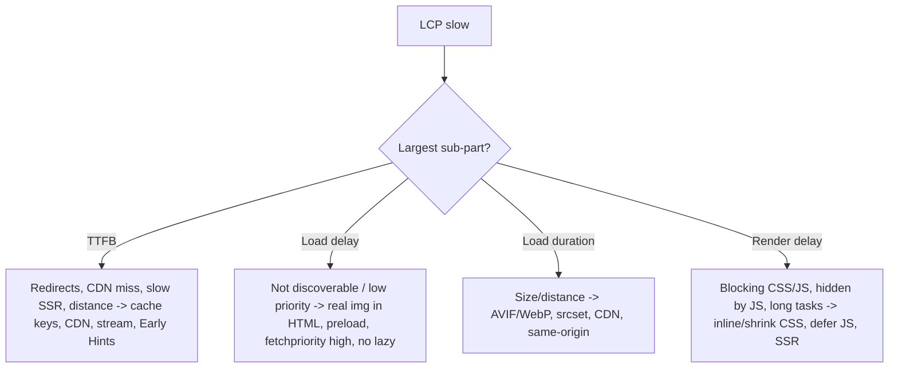
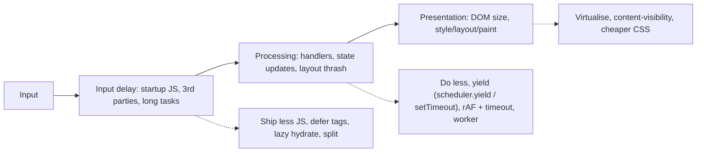
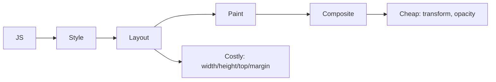
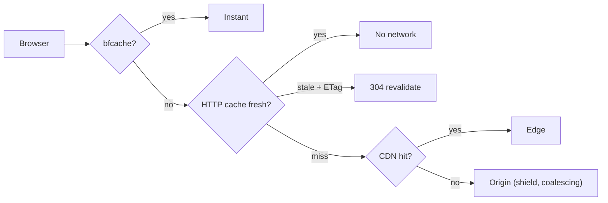

# Web Performance — Recall Map (Last-Minute Read)

> One-page mental model for the whole `web-performance/` folder. Verified numbers (CWV thresholds, LCP/INP sub-parts, bfcache and Speculation Rules facts) come from web.dev and MDN pages checked 2026-11-12; items marked *(hedged)* in the full files are general knowledge. Open the full file only for topics where you're weak.
> Full docs: [01 Metrics](01-performance-metrics-and-measurement.md) · [02 Critical rendering path and loading](02-critical-rendering-path-and-loading-performance.md) · [03 Network, caching, delivery](03-network-caching-and-delivery.md) · [04 JavaScript, main thread, INP](04-javascript-main-thread-and-inp.md) · [05 Rendering, animation, CLS, memory](05-rendering-layout-animation-and-cls.md) · [06 Images, fonts, media, third parties](06-images-fonts-media-and-third-parties.md) · [07 Debugging, budgets, culture](07-performance-debugging-budgets-and-culture.md)

## Table of Contents

1. [The 60-Second Mental Model](#1-the-60-second-mental-model)
2. [Metrics Map](#2-metrics-map)
3. [Loading Map (LCP)](#3-loading-map-lcp)
4. [Interactivity Map (INP)](#4-interactivity-map-inp)
5. [Stability and Rendering Map (CLS, jank, memory)](#5-stability-and-rendering-map-cls-jank-memory)
6. [Delivery Map (network and caching)](#6-delivery-map-network-and-caching)
7. [Decision Tables](#7-decision-tables)
8. [Numbers and Defaults to Remember](#8-numbers-and-defaults-to-remember)
9. [Mnemonics](#9-mnemonics)
10. [Rapid-Fire Q&A](#10-rapid-fire-qa)
11. [Say-This Scripts](#11-say-this-scripts)
12. [Red Flags and Green Flags](#12-red-flags-and-green-flags)
13. [Final 10-Minute Checklist](#13-final-10-minute-checklist)

---

## 1. The 60-Second Mental Model

> **Measure real users (p75), break the failing metric into sub-parts, fix the biggest sub-part first, verify in lab and canary, then guard with budgets.**

**Five questions that unlock any performance discussion**
1. **Which metric and segment is failing** at p75 (field)?
2. **Which sub-part** dominates (TTFB / load delay / load duration / render delay; input delay / processing / presentation)?
3. **What is the LCP element**, is it **discoverable in HTML**, is it **high priority**, is it **blocked**?
4. **What is on the main thread** at startup and during interactions (JS, hydration, third parties)?
5. **What can be cached, deferred, or not shipped at all?**

---

## 2. Metrics Map

| Metric | Measures | Good (p75) | Poor | Key levers |
|---|---|---|---|---|
| **LCP** | Largest content painted | ≤ 2.5 s | > 4.0 s | Discovery, priority, blocking, size, TTFB |
| **INP** | Interaction latency (longest observed) | ≤ 200 ms | > 500 ms | Long tasks, handlers, DOM/render cost |
| **CLS** | Layout stability | ≤ 0.1 | > 0.25 *(hedged)* | Dimensions, reserved space, fonts |
| TTFB *(diagnostic)* | First byte | ≤ ~0.8 s *(hedged)* | – | CDN, redirects, SSR |
| FCP *(diagnostic)* | First paint of content | ≤ ~1.8 s *(hedged)* | – | Blocking resources |
| TBT *(lab)* | Blocking time of long tasks | – | – | Reduce/split JS |

**Sub-parts**
- **LCP** = TTFB (~40%) + resource load delay (<10%) + resource load duration (~40%) + element render delay (<10%) — guidelines, optimise all.
- **INP** = input delay + processing duration + presentation delay.

---

## 3. Loading Map (LCP)

**Rules:** preload scanner sees HTML only · no sync scripts in head · CSS blocks render · `fetchpriority="high"` on 1–2 images · never lazy-load LCP · same-origin critical assets · fonts: WOFF2 + preload (crossorigin) + `font-display` · SSR/SSG for discoverability (mind TTFB) · hints: preload (current page), preconnect (few), prefetch/Speculation Rules (next page).

---

## 4. Interactivity Map (INP)

**Yield patterns:** `await scheduler.yield()` (Chrome/Edge 129, Firefox 142; **not Safari** → fallback `setTimeout`) · rAF + `setTimeout` to run render-critical work first · time-slice loops (~5–16 ms budget) · workers for CPU-heavy DOM-free work (transferables).

---

## 5. Stability and Rendering Map (CLS, jank, memory)

- **CLS fixes:** `width`/`height` or `aspect-ratio` · reserve ad/embed slots · skeleton parity · banners as overlays · font metric-adjusted fallbacks · animate with transforms.
- **Jank:** batch DOM reads then writes (no forced reflow) · passive listeners · `will-change` sparingly · virtualise · `content-visibility: auto` + `contain-intrinsic-size` · respect `prefers-reduced-motion`.
- **Memory:** clean listeners/timers/subscriptions/observers (AbortController signal) · cap caches · avoid detached DOM · dispose canvas/WebGL · heap snapshots to find leaks · decoded image ≈ `w × h × 4` bytes.

---

## 6. Delivery Map (network and caching)

| Asset | `Cache-Control` |
|---|---|
| Fingerprinted JS/CSS/fonts/images | `public, max-age=31536000, immutable` |
| HTML at CDN | `s-maxage=…, stale-while-revalidate=…` (browser `max-age=0`) |
| Personalised HTML/API | `private, no-cache` (+ validators) |
| Sensitive | `no-store` (costs bfcache eligibility historically) |
| Service Worker script | `no-cache` |

**Protocols:** HTTP/2 multiplexing (no sharding/spriting) · HTTP/3 (QUIC) removes TCP HOL blocking · Brotli (static max level, dynamic moderate) · don't compress images/video · normalise CDN cache keys (strip tracking params) · avoid `Vary: Cookie` on cacheable HTML.

**Speculative loading:** Speculation Rules `prefetch` (document only; low cost) vs `prerender` (full hidden render; sparing; same-origin) — Chromium only (Safari no; Firefox Nightly partial) · exclude unsafe URLs · defer analytics via `prerenderingchange` · `Sec-Purpose` header.
**bfcache:** all major browsers · never `unload` · avoid `no-store` · close connections on `pagehide` · refresh stale state on `pageshow` (`persisted`) · test in DevTools.

---

## 7. Decision Tables

**Which hint?**

| Need | Use |
|---|---|
| Current-page critical resource discovered late | `preload` (+ `fetchpriority`) |
| Early connection to a critical third-party origin | `preconnect` (few) |
| Next-page document | Speculation Rules (`prefetch`/`prerender`), fallback `<link rel=prefetch>` |
| Server is slow, want early fetches | `103 Early Hints` / `Link` header *(hedged support)* |
| Lower priority of hidden images | `fetchpriority="low"` + lazy |

**Which script loading?**

| Script | Use |
|---|---|
| App bundle | `type="module"`/`defer` |
| Independent analytics | `async` (or idle-loaded) |
| Heavy widget | Facade + load on interaction |
| Tiny critical | Inline |

**Where to fix?**

| Symptom | Layer |
|---|---|
| High TTFB | Backend/CDN/caching |
| Late LCP request | HTML/markup/priority |
| Long tasks | JS bundle/hydration/third parties |
| Layout shifts | Markup/CSS/fonts/ads |
| Slow after long use | Memory lifecycle |

---

## 8. Numbers and Defaults to Remember

| Topic | Value |
|---|---|
| CWV targets (p75) | LCP ≤ **2.5 s** · INP ≤ **200 ms** · CLS ≤ **0.1** |
| Poor thresholds | LCP > 4.0 s · INP > 500 ms · CLS > 0.25 *(hedged)* |
| LCP sub-part guideline | TTFB ~40% · load delay < 10% · load duration ~40% · render delay < 10% |
| Long task | > 50 ms |
| Frame budget | ~16.7 ms (60 Hz), ~8.3 ms (120 Hz) |
| `fetchpriority="high"` | 1–2 images only |
| `scheduler.yield()` | Chrome/Edge 129, Firefox 142, no Safari |
| bfcache usage | ~1 in 10 desktop, ~1 in 5 mobile navigations are back/forward |
| Speculation Rules | Chrome/Edge (prefetch 110, prerender 105/109, eagerness/where 121); Safari no; Firefox Nightly partial |
| Prefetch cache (Chrome) | ~5 minutes |
| Decoded image memory | `width × height × 4` bytes |
| SSE on HTTP/1.1 | 6 connections/origin (HTTP/2 ≈ 100 streams) |
| Static asset caching | 1 year + `immutable` (fingerprinted) |

---

## 9. Mnemonics

- **"DPBS-T" (LCP order):** **D**iscover (in HTML) · **P**rioritise (`fetchpriority`) · **B**lock less (CSS/JS) · **S**ize (format/`srcset`) · **T**TFB (CDN/cache/SSR).
- **"I-P-P" (INP):** **I**nput delay · **P**rocessing · **P**resentation → "less JS at load, less work in handlers, less DOM to render".
- **"RAFT" (CLS):** **R**eserve space · **A**spect ratio/dimensions · **F**ont fallbacks · **T**ransform animations.
- **"MAP-G" (method):** **M**easure field · **A**ttribute sub-part · **P**rioritise lever · **G**uard with budgets.
- **Hints "P-P-P":** **P**reload (now) · **P**reconnect (soon) · **P**refetch (next).
- **Cache cheat:** *"Hash it, immutable it; HTML revalidates; private for people."*
- **Third parties "AFDI":** **A**udit · **F**acade · **D**efer · **I**solate.

---

## 10. Rapid-Fire Q&A

- **What are the Core Web Vitals?** LCP (loading), INP (responsiveness), CLS (stability); p75 targets 2.5 s / 200 ms / 0.1.
- **Why p75?** Captures most users' typical experience while resisting outliers; it's the CWV pass criterion.
- **Why can't Lighthouse measure INP?** No real interactions; TBT is the lab proxy.
- **Field vs lab?** Field decides priorities; lab explains causes and gates CI.
- **LCP sub-parts?** TTFB, resource load delay, resource load duration, element render delay.
- **INP sub-parts?** Input delay, processing duration, presentation delay.
- **Why not lazy-load the LCP image?** Adds load delay; use `fetchpriority="high"`.
- **Preload scanner limitation?** Can't see JS-injected images, `data-src`, or CSS backgrounds.
- **`async` vs `defer`?** Async runs ASAP unordered; defer runs after parse in order; modules are deferred.
- **Why is CSS render-blocking?** To avoid flash of unstyled content; shrink/inline/defer.
- **`preload` pitfalls?** Over-preloading; wrong `as`/`crossorigin` (double fetch); unused preloads.
- **What does `immutable` do?** Skips revalidation during freshness; use only on fingerprinted URLs.
- **`no-cache` vs `no-store`?** Revalidate before reuse vs never store (and may block bfcache).
- **`s-maxage`?** Freshness for shared caches (CDN) separate from browser `max-age`.
- **HTTP/3 benefit?** QUIC: no TCP head-of-line blocking, faster handshakes, better on lossy networks.
- **Brotli vs gzip?** Brotli smaller for text; precompress static at high level.
- **Speculation Rules vs `<link rel=prefetch>`?** Document-level prefetch/prerender with richer rules; Chromium-only; prerender runs the page in a hidden tab.
- **What blocks bfcache?** `unload`, page-level `no-store`, `window.opener`, open IndexedDB/in-flight requests/connections (WebSockets in some browsers).
- **What is layout thrashing?** Interleaved style writes and layout reads forcing synchronous reflow.
- **Cheapest properties to animate?** `transform`, `opacity`.
- **`content-visibility: auto`?** Skips off-screen rendering; pair with `contain-intrinsic-size`.
- **How to yield?** `scheduler.yield()` (feature-detect), `setTimeout`, rAF + `setTimeout`.
- **When use a worker?** CPU-heavy, DOM-free work above a few ms; use transferables.
- **Font CLS fix?** Metric-adjusted fallback (`size-adjust`, overrides) + preload + `swap`/`optional`.
- **Image CLS fix?** `width`/`height` or `aspect-ratio`.
- **Third-party plan?** Audit, defer/idle, facade, isolate, budget, ownership.
- **Memory leak sources?** Listeners, timers, subscriptions, observers, detached DOM, caches, widgets.
- **How to avoid regressions?** Budgets in CI, canary + RUM compare, alerts, review checklists, ownership.
- **Why can bfcache make load metrics look worse?** Fast repeat loads vanish from the dataset; annotate by navigation type.

---

## 11. Say-This Scripts

**Opening (any perf question):** "I'd start from field data — which metric, segment and sub-part is failing at p75 — before changing anything."

**LCP answer:** "I'd identify the LCP element and break LCP into TTFB, load delay, load duration and render delay. Typically I fix discovery and priority first — real `` in HTML, `fetchpriority="high"`, no lazy-loading — then render-blocking CSS/JS, then image size/format, and finally TTFB through caching/CDN/streaming."

**INP answer:** "I'd use RUM attribution to find the interaction, decide whether input delay, processing or presentation dominates, and then reduce startup JS and third parties, break up handlers with yielding, move heavy work to a worker, and reduce DOM/rendering cost. I'd verify with a throttled trace and the field p75."

**CLS answer:** "I'd find the shifting elements via Layout Shift Regions and RUM attribution, then reserve space with dimensions or aspect-ratio, size skeletons like final content, use overlays for banners, and metric-compatible font fallbacks."

**Caching answer:** "Fingerprinted assets get one-year immutable caching; HTML is revalidated or cached at the CDN with `s-maxage` and stale-while-revalidate; personalised responses are private; I normalise CDN cache keys and keep pages bfcache-eligible."

**Governance answer:** "I'd add RUM dashboards and alerts, CI budgets for bundle size and Lighthouse assertions, canary releases with RUM comparison, a third-party approval process, and ownership per route so performance doesn't regress."

---

## 12. Red Flags and Green Flags

| Red flags | Green flags |
|---|---|
| "Run Lighthouse and fix whatever it says" | Field-first, sub-part analysis |
| Lazy-loading everything including hero | `fetchpriority` on LCP, lazy for the rest |
| Preloading/prefetching everything | Selective hints with measurement |
| Sync third-party scripts in `<head>` | Async/idle/facades + budgets |
| `no-store` on all pages | Targeted `no-store`; bfcache-aware |
| `immutable` on non-hashed files | Fingerprinting + immutable |
| Animating `width/height/top` | Transform/opacity, FLIP |
| Ignoring memory in SPAs | Cleanup discipline + soak tests |
| No budgets/ownership | Ratcheted budgets, owners, canaries |
| Averages and single Lighthouse runs | p75, medians, multiple runs, segmentation |
| Claims without numbers | Quantified before/after with RUM |

---

## 13. Final 10-Minute Checklist

- [ ] Can I state CWV targets, p75 meaning, and the sub-parts of LCP and INP?
- [ ] Can I explain preload scanner discovery, render-blocking CSS, `defer`/`async`, and `fetchpriority` rules?
- [ ] Can I design caching headers for assets, HTML, APIs and sensitive pages, and explain `s-maxage`, `immutable`, `no-cache`/`no-store`?
- [ ] Can I explain HTTP/2 vs HTTP/3, Brotli, CDN cache keys and version skew?
- [ ] Can I describe bfcache blockers and Speculation Rules (prefetch vs prerender, support, safety)?
- [ ] Can I name three ways to yield and when to use a worker?
- [ ] Can I list the CLS causes and fixes (dimensions, slots, fonts, banners, transforms)?
- [ ] Can I describe how to find memory leaks and common sources?
- [ ] Can I outline the budget → CI → canary → RUM loop and a PR review checklist?
- [ ] Can I answer "optimize this slow page" in 2 minutes with structure and trade-offs?

Related recall maps: [Next.js](../nextjs-and-rendering/09-nextjs-recall-map.md) · [React](../react/09-react-recall-map.md) · [System Design](../system-design/09-system-design-recall-map.md) · [TypeScript](../typescript/06-typescript-recall-map.md)
