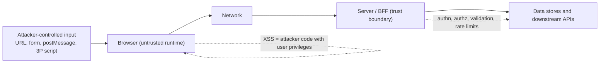
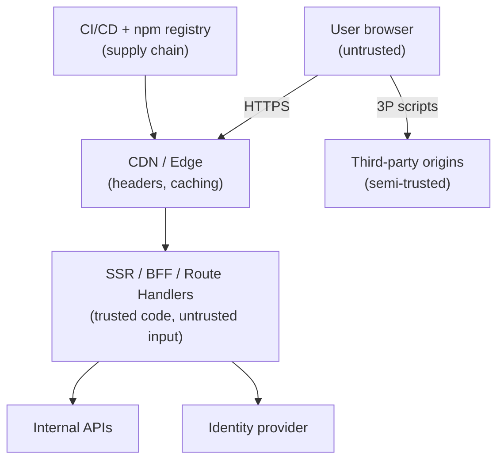
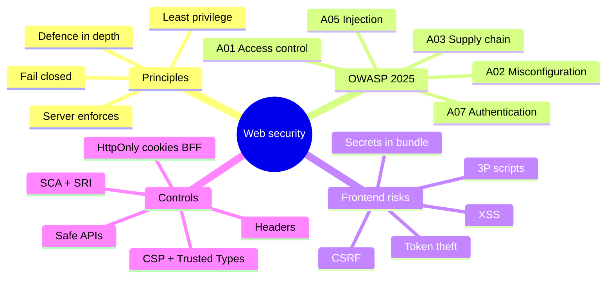

# Frontend Threat Model and OWASP Top 10 (2025)

> Verification note: the **OWASP Top 10:2025** category list was checked against top10.owasp.org/2025 (Nov 2026). Verified elsewhere in this folder: CSP, cookie and OAuth-for-browsers facts (MDN, IETF RFC 10017). Everything else in this file (threat-modelling method, trust boundaries, frontend mappings of each OWASP category, secure SDLC practices) is general engineering knowledge and the mapping to frontend work is **editorial judgement**, not OWASP's wording. Browser-mechanics background lives in [browser-internals/06 Browser security model](../browser-internals/06-browser-security-model.md); this folder goes deeper on *application-level* security.

## Table of Contents

1. [Quick Summary (TL;DR)](#1-quick-summary-tldr)
2. [Why the Frontend Is Untrusted Territory](#2-why-the-frontend-is-untrusted-territory)
3. [Assets, Attackers and Trust Boundaries](#3-assets-attackers-and-trust-boundaries)
4. [Threat Modelling a Frontend Feature](#4-threat-modelling-a-frontend-feature)
5. [OWASP Top 10:2025 Mapped to Frontend Work](#5-owasp-top-102025-mapped-to-frontend-work)
6. [Security Principles for Frontend Engineers](#6-security-principles-for-frontend-engineers)
7. [What Must Never Live in the Client](#7-what-must-never-live-in-the-client)
8. [Client-Side Validation, Authorization and "Hidden" UI](#8-client-side-validation-authorization-and-hidden-ui)
9. [Security in the Delivery Lifecycle](#9-security-in-the-delivery-lifecycle)
10. [Pitfalls](#10-pitfalls)
11. [Interview Questions — Fundamentals](#11-interview-questions--fundamentals)
12. [Interview Questions — Senior Scenarios](#12-interview-questions--senior-scenarios)
13. [Cheat Sheet](#13-cheat-sheet)
14. [Key Terms Glossary](#14-key-terms-glossary)
15. [Further Reading](#15-further-reading)

---

## 1. Quick Summary (TL;DR)

- **The browser is attacker-controlled.** Anything shipped to or computed in the client can be read, modified, replayed or bypassed. Security decisions must be **enforced on the server**; the client only improves UX and adds defence in depth.
- **OWASP Top 10:2025:** A01 Broken Access Control, A02 Security Misconfiguration, A03 Software Supply Chain Failures, A04 Cryptographic Failures, A05 Injection, A06 Insecure Design, A07 Authentication Failures, A08 Software or Data Integrity Failures, A09 Security Logging and Alerting Failures, A10 Mishandling of Exceptional Conditions.
- **Frontend-owned risk areas:** XSS/injection (A05), misconfigured headers/CORS/CSP (A02), dependency and third-party-script risk (A03/A08), token and session handling (A07), leaking data in bundles/logs/URLs (A04/A09), and error handling that leaks or fails open (A10).
- **Threat model first, tools second:** identify assets (sessions, PII, payments), actors (anonymous attacker, malicious user, compromised dependency, malicious extension), entry points (inputs, URLs, `postMessage`, third-party scripts) and **trust boundaries**.
- **Defence in depth:** output encoding + safe APIs → CSP/Trusted Types → HttpOnly/SameSite cookies or a BFF → server-side authz → monitoring. Assume each layer can fail.
- **Interview framing:** "Where is the trust boundary? What can an attacker control? What is the blast radius if this layer fails? How would we detect it?"



---

## 2. Why the Frontend Is Untrusted Territory

| Fact | Consequence |
|---|---|
| Users (and attackers) control their browser, devtools, extensions and network proxy | Any client check can be skipped; any request can be forged with `curl` |
| JavaScript bundles are public | No secrets, no "hidden" endpoints, no security by obscurity |
| Same-origin script has the **same privileges as your own code** | XSS = full account takeover capability while the page is open ([RFC 10017 §5](https://datatracker.ietf.org/doc/rfc10017/) calls this out explicitly) |
| Third-party scripts run with first-party authority | Every tag is a supply-chain dependency |
| Browser security features (SOP, CORS, CSP, cookies flags) protect **users from sites**, not servers from clients | CORS does not protect your API from non-browser clients |

**Mental model:** the client is a *presentation and convenience layer*. The **server (or BFF) is the policy enforcement point**.

---

## 3. Assets, Attackers and Trust Boundaries

### Typical frontend assets
- **Session credentials:** cookies, access/refresh tokens, CSRF tokens, WebAuthn credentials.
- **User data:** PII, messages, payment details, health data.
- **User capabilities:** the ability to act as the user (transfer money, change email).
- **Integrity of the UI:** what the user sees and clicks (phishing, clickjacking, defacement).
- **Business logic and revenue:** pricing, coupons, rate-limited actions.
- **Reputation and availability.**

### Attacker types
| Attacker | Capabilities | Typical attacks |
|---|---|---|
| Anonymous internet attacker | Send requests, craft links/pages | Reflected XSS, CSRF, phishing, credential stuffing |
| Authenticated malicious user | Valid account, manipulates requests | IDOR/BOLA, privilege escalation, stored XSS |
| Malicious website | Lures victim to visit | CSRF, clickjacking, `window.opener`, XS-Leaks |
| Compromised third party | Runs script in your origin | Skimming, token theft, redirect to phishing |
| Malicious dependency/maintainer | Code in your build | Credential theft, backdoor, crypto mining |
| Malicious browser extension / malware | Reads page and storage | Token/cookie theft (hard to defend) |
| Insider / compromised CI | Changes pipeline/artifacts | Supply-chain poisoning |

### Trust boundaries in a typical SPA/Next.js app

Each arrow is a place to ask: **who can influence this data, how is it validated, and what happens if it is malicious?**

---

## 4. Threat Modelling a Frontend Feature

A lightweight process that fits a design review:

1. **Describe the feature and data flow** (draw it): inputs, rendering sinks, storage, network calls.
2. **List assets and actors** (section 3).
3. **Enumerate entry points:** query params, `location.hash`, form fields, uploaded files, `postMessage`, WebSocket/SSE messages, deep links, third-party widgets, cookies, `localStorage`.
4. **Apply STRIDE-style prompts** *(general method)*: **S**poofing (who is this?), **T**ampering (can data change in transit/storage?), **R**epudiation (audit trail?), **I**nformation disclosure (what leaks?), **D**enial of service (expensive inputs?), **E**levation of privilege (can a user do more than allowed?).
5. **Rank by likelihood × impact** and choose mitigations at the cheapest effective layer.
6. **Decide detection and response:** logs, alerts, CSP reports, rollback, kill switches.
7. **Write down residual risk** and who accepted it.

### Worked example: "Rich-text comment box with @mentions and image uploads"
| Entry point | Threat | Mitigation |
|---|---|---|
| Comment HTML/Markdown | Stored XSS | Sanitise on output with allow-list (DOMPurify / Sanitizer API), restrict URL schemes, CSP, Trusted Types ([02](02-xss-trusted-types-and-sanitization.md)) |
| Mention autocomplete | IDOR/enumeration of users | Server-side authz and rate limits |
| Image upload | SVG with script, huge files, polyglots | Validate type server-side, re-encode, serve from separate origin with `nosniff`, size limits ([08](08-secure-frontend-patterns-and-vulnerability-catalogue.md)) |
| Link previews | SSRF via server fetch | Allow-list/deny private ranges, timeouts ([08](08-secure-frontend-patterns-and-vulnerability-catalogue.md)) |
| Notification links | Open redirect / `javascript:` URL | Validate URL scheme and host |
| Edit/delete actions | CSRF, broken access control | SameSite + token, server-side ownership check ([04](04-cookies-sessions-and-csrf.md)) |
| Moderation | Audit gaps | Log actor, action, target ([§9](#9-security-in-the-delivery-lifecycle)) |

---

## 5. OWASP Top 10:2025 Mapped to Frontend Work

| # | Category (OWASP 2025) | What it means for frontend engineers | Where in this folder |
|---|---|---|---|
| **A01** | Broken Access Control | UI hiding ≠ authorisation; IDOR via IDs in URLs; missing checks in Server Actions/route handlers; CORS misconfig; forced browsing | [05](05-authentication-and-authorization-in-the-frontend.md), [08](08-secure-frontend-patterns-and-vulnerability-catalogue.md) |
| **A02** | Security Misconfiguration | Missing/loose headers, permissive CORS, debug endpoints/source maps, default configs, verbose errors | [03](03-content-security-policy-in-depth.md), [06](06-security-headers-cors-and-transport.md) |
| **A03** | Software Supply Chain Failures | npm dependencies, build tools, CI, CDNs, third-party tags | [07](07-supply-chain-and-third-party-script-security.md) |
| **A04** | Cryptographic Failures | Sensitive data over HTTP, tokens in URLs, weak client-side "encryption", secrets in bundles | [06](06-security-headers-cors-and-transport.md), [§7](#7-what-must-never-live-in-the-client) |
| **A05** | Injection | XSS (HTML/JS injection), URL/CSS injection, prototype pollution, template/SQL injection reaching the backend | [02](02-xss-trusted-types-and-sanitization.md), [08](08-secure-frontend-patterns-and-vulnerability-catalogue.md) |
| **A06** | Insecure Design | Missing threat model, no rate limits/abuse cases, business-logic flaws, flows that trust the client | [§4](#4-threat-modelling-a-frontend-feature), [08](08-secure-frontend-patterns-and-vulnerability-catalogue.md) |
| **A07** | Authentication Failures | Weak session handling, token storage, missing MFA, credential stuffing, session fixation | [04](04-cookies-sessions-and-csrf.md), [05](05-authentication-and-authorization-in-the-frontend.md) |
| **A08** | Software or Data Integrity Failures | Unsigned/unverified scripts (SRI), insecure CI/CD, untrusted deserialization, auto-updating plugins | [07](07-supply-chain-and-third-party-script-security.md) |
| **A09** | Security Logging and Alerting Failures | No audit trail, no CSP/error reporting, logging PII/tokens | [§9](#9-security-in-the-delivery-lifecycle), [08](08-secure-frontend-patterns-and-vulnerability-catalogue.md) |
| **A10** | Mishandling of Exceptional Conditions | Failing open on errors, leaking stack traces, unhandled promise rejections that skip auth checks, inconsistent error states | [08](08-secure-frontend-patterns-and-vulnerability-catalogue.md) |

> Interview tip: do not just recite the list — pick two or three that match the role (e.g., for a React/Next role: A01 server-action authorisation, A03 npm/CI, A05 XSS) and describe concrete mitigations and trade-offs.

---

## 6. Security Principles for Frontend Engineers

1. **Never trust the client; validate and authorise on the server.**
2. **Defence in depth:** assume XSS can happen (so protect tokens and restrict script execution) *and* prevent XSS (so you never rely on CSP alone).
3. **Least privilege:** minimal OAuth scopes, short-lived tokens, narrow CORS, narrow CSP, narrow iframe `sandbox`/`allow`, tight Permissions-Policy.
4. **Secure by default:** frameworks' safe defaults (JSX escaping, auto-escaping templates) — flag every escape hatch (`dangerouslySetInnerHTML`, `innerHTML`, `v-html`, `bypassSecurityTrust*`).
5. **Fail closed:** on error, deny; avoid "if the auth check throws, continue".
6. **Minimise attack surface:** fewer third-party scripts, fewer endpoints, fewer parsers, fewer permissions.
7. **Separation of origins:** user-generated content and untrusted apps on separate origins (RFC 10017 also recommends one application per origin).
8. **Make the secure path the easy path:** shared components (`<SafeHtml/>`, `<ExternalLink/>`), lint rules, typed URL helpers, a central API client that adds headers/CSRF tokens.
9. **Observability:** log security events, collect CSP/Reporting API reports, alert on anomalies.
10. **Plan for failure:** key rotation, token revocation, kill switches, incident runbooks.

---

## 7. What Must Never Live in the Client

| Don't ship / store | Why | Alternative |
|---|---|---|
| API secrets, private keys, DB credentials, client secrets | Bundles are public (`NEXT_PUBLIC_*`/`VITE_*` are inlined at build) | Server-side only; BFF/proxy; secret manager |
| Long-lived bearer tokens in `localStorage` | Readable by any XSS ([05](05-authentication-and-authorization-in-the-frontend.md)) | HttpOnly cookie session / BFF |
| Authorisation logic as the only check (feature flags, role checks) | Trivially bypassed | Server-side enforcement; UI flags are cosmetic |
| PII in URLs (query/fragment) | Logged, cached, leaked via `Referer`, browser history | POST body/headers; `Referrer-Policy` |
| Sensitive data in analytics/session replay/error reports | Third-party exposure | Redaction, allow-lists, masking inputs |
| Source maps in production publicly accessible *(trade-off)* | Reveals logic and comments (not a vulnerability per se, but aids attackers) | Upload to error tracker only, restrict access |
| Business rules requiring secrecy (price calculation, entitlement) | Reverse-engineerable | Compute on the server |
| Sensitive data in `localStorage`/IndexedDB without need | Persisted on disk, XSS-readable ([browser-internals/05](../browser-internals/05-browser-storage-and-caching-apis.md)) | Keep server-side; short-lived memory |

---

## 8. Client-Side Validation, Authorization and "Hidden" UI

- **Client-side validation = UX only.** Always duplicate on the server (schema validation, e.g., Zod/Valibot on the server too; shared schemas are fine as long as the server executes them).
- **UI authorisation (hiding buttons/routes) = UX only.** Route guards in React Router/Next layouts prevent confusing navigation, not data access. Every API/Server Action/route handler must authorise independently ("page-level checks do not cover actions" — see [nextjs-and-rendering/06](../nextjs-and-rendering/06-proxy-auth-and-security.md)).
- **IDs are not secrets:** `GET /orders/123` must verify that order 123 belongs to the caller (prevents IDOR/BOLA). Use unguessable IDs as defence in depth, never as the control.
- **Feature flags:** gating by client-side flag does not protect the endpoint.
- **Rate limits and abuse controls** belong at the edge/server; client-side debouncing is not protection.
- **Do not leak via errors:** return generic messages; log details server-side; avoid distinguishing "user not found" vs "wrong password" (account enumeration).

```ts
// Anti-pattern: authorisation in the UI only
{user.role === 'admin' && <DeleteButton onClick={() => api.delete(`/users/${id}`)} />}

// Pattern: UI hint + server enforcement
// server: if (!(await can(session.user, 'users:delete', targetUser))) return 403
```

---

## 9. Security in the Delivery Lifecycle

| Stage | Practice |
|---|---|
| Design | Threat model, abuse cases, data classification, choose auth architecture (BFF vs SPA tokens) |
| Code | Lint rules (`react/no-danger`, `no-eval`, `eslint-plugin-security` *(hedged)*), typed URL/HTML helpers, secure code review checklist |
| Build | Lockfile + `npm ci`, SCA (Dependabot/Renovate/`npm audit`), secret scanning, SAST (CodeQL/Semgrep *(hedged)*), SBOM ([07](07-supply-chain-and-third-party-script-security.md)) |
| Test | Unit tests for sanitisers/URL validators, E2E for auth flows, DAST/ZAP *(hedged)*, header tests in CI, fuzzing for parsers |
| Release | Staged rollout, CSP in report-only first ([03](03-content-security-policy-in-depth.md)), feature kill switches |
| Run | CSP/Reporting API, WAF/rate limits, anomaly alerts, audit logs, dependency alerts |
| Respond | Incident runbook: contain (revoke tokens, rotate keys, disable feature), eradicate, communicate, post-mortem |
| Culture | Security champions, threat-model reviews, bug bounty/disclosure policy (`/.well-known/security.txt` *(hedged: RFC 9116)*) |

### Minimal CI header/security check (organisation defaults applied)
```yaml
name: security-checks
on: [pull_request]
permissions:
  contents: read
jobs:
  audit:
    runs-on: bby-ubuntu
    steps:
      - uses: actions/checkout@v4
      - uses: actions/setup-node@v4
        with:
          node-version: 22
          registry-url: https://artifactory.tools.bestbuy.com/artifactory/api/npm/npm-virtual
      - run: npm ci --ignore-scripts
      - run: npm audit --audit-level=high
```
*(Pin third-party actions to commit SHAs and use `bby-corp/tplat-gha-configure-github-credentials` for GIAM credentials when the job needs cloud/registry access — see [07](07-supply-chain-and-third-party-script-security.md).)*

---

## 10. Pitfalls

1. **"We have CORS/CSP so we're safe"** — each mitigates a narrow class; neither replaces server-side authz/validation.
2. **Treating UI checks as authorisation.**
3. **Security reviewed only at the end** — design flaws (A06) can't be patched by headers.
4. **Secrets in `NEXT_PUBLIC_`/`VITE_` env variables or mobile bundles.**
5. **Over-trusting framework escaping** while using escape hatches.
6. **Ignoring third-party scripts** as "marketing's problem".
7. **Logging tokens/PII** in client logs, analytics or error reports.
8. **No detection:** CSP report endpoint missing, no alerts on auth anomalies.
9. **Security theatre in the client:** client-side "encryption", obfuscation or anti-debugging presented as protection.
10. **Failing open on errors** (A10) — e.g., treating a failed permission fetch as "allowed".

---

## 11. Interview Questions — Fundamentals

### Q1. Why can't you rely on frontend validation for security?
The attacker controls the client and can send arbitrary requests; client validation improves UX only. The server must validate and authorise every request.

### Q2. Name the OWASP Top 10:2025 categories most relevant to a React/Next.js developer.
Broken Access Control (A01), Security Misconfiguration (A02), Software Supply Chain Failures (A03), Injection (A05 — XSS), Authentication Failures (A07), plus Logging/Alerting (A09) for detection.

### Q3. What is a trust boundary?
A line across which data or control passes between components with different trust levels (browser → server, server → third-party API); validation and authentication must happen at the boundary.

### Q4. Why is XSS considered so severe?
Injected script runs with the page's origin and user's privileges: it can read DOM and non-HttpOnly storage, call APIs as the user, and run new auth flows — "the malicious JavaScript has the same privileges as the legitimate application code".

### Q5. What is defence in depth, with a frontend example?
Layered controls so one failure isn't fatal: output encoding prevents XSS; CSP limits script execution if encoding fails; HttpOnly cookies/BFF prevent token theft; server authz limits damage; monitoring detects.

### Q6. What belongs in environment variables exposed to the client?
Only non-secret configuration (public API URL, public keys). Anything prefixed for client exposure is inlined into the bundle.

### Q7. What is IDOR/BOLA?
Accessing another user's object by changing an identifier because the server only checks authentication, not ownership/permission.

### Q8. What does "fail closed" mean?
When a security check errors or is unavailable, deny access (or degrade safely) rather than allow.

---

## 12. Interview Questions — Senior Scenarios

### S1. "Design the security approach for a new customer-facing SPA handling personal data."
Start with a threat model; prefer a **BFF** with HttpOnly `__Host-` session cookie (RFC 10017 recommends BFF for sensitive/personal-data apps — [05](05-authentication-and-authorization-in-the-frontend.md)); strict nonce-based CSP + Trusted Types ([02](02-xss-trusted-types-and-sanitization.md), [03](03-content-security-policy-in-depth.md)); CSRF defences ([04](04-cookies-sessions-and-csrf.md)); security headers and HSTS ([06](06-security-headers-cors-and-transport.md)); dependency governance and SRI/self-hosting for third-party scripts ([07](07-supply-chain-and-third-party-script-security.md)); server-side authz on every endpoint; logging/alerting and an incident runbook.

### S2. "A pen test reports 'sensitive data exposed in JavaScript bundle'. What do you do?"
Identify what leaked (secret vs public config); **rotate** any real secret immediately; remove from client by moving the call to the server/BFF; add secret scanning to CI and pre-commit; review build env (`NEXT_PUBLIC_*`); check git history and source maps; add a runbook.

### S3. "Product wants to hide admin features in the UI only because 'normal users never see them'."
Explain that obscurity isn't a control; require server-side permission checks per endpoint/Server Action with tests (including negative tests); the UI should reflect permissions returned by the server, not enforce them.

### S4. "How do you prioritise security work on a team with limited time?"
Risk-rank by exposure × impact: auth/session and access control first, XSS sinks and CSP second, dependency/CI hygiene third; automate cheap wins (lint, SCA, headers tests), threat-model high-risk features, track residual risk and measure (CSP violations, vulnerable dependency age, time-to-patch).

### S5. "Explain how you'd review a PR that adds `dangerouslySetInnerHTML`."
Ask where the HTML originates and who controls it; require a sanitiser with an allow-list (and tests) or a safe component; check CSP/Trusted Types compatibility; confirm output context and URL handling; prefer structured data (Markdown → AST → components) over raw HTML.

---

## 13. Cheat Sheet



| Question | Answer |
|---|---|
| Where do I enforce authz? | Server/BFF per request |
| What does the client protect? | UX, defence in depth |
| Biggest frontend injection risk? | XSS |
| Where do tokens go? | Not in JS-readable storage if avoidable |
| How to ship a CSP safely? | Report-only → enforce, nonce/hash-based |

---

## 14. Key Terms Glossary

| Term | Definition |
|---|---|
| **Trust boundary** | Interface between components with different trust levels |
| **STRIDE** | Spoofing, Tampering, Repudiation, Information disclosure, DoS, Elevation of privilege |
| **IDOR / BOLA** | Object-level authorisation failure |
| **Defence in depth** | Multiple independent security layers |
| **BFF** | Backend for Frontend; server component that holds tokens and proxies API calls |
| **SCA / SAST / DAST** | Dependency / static / dynamic analysis |
| **Blast radius** | Impact scope if a control fails |

---

## 15. Further Reading

- [OWASP Top 10:2025](https://top10.owasp.org/2025) · [OWASP Cheat Sheet Series](https://cheatsheetseries.owasp.org/)
- [IETF RFC 10017 — OAuth 2.0 for Browser-Based Applications (BCP 212)](https://datatracker.ietf.org/doc/rfc10017/)
- [MDN — Web security](https://developer.mozilla.org/en-US/docs/Web/Security)
- This repo: [browser-internals/06 Browser security model](../browser-internals/06-browser-security-model.md) · [nextjs-and-rendering/06 Proxy, auth and security](../nextjs-and-rendering/06-proxy-auth-and-security.md) · [next: 02 XSS](02-xss-trusted-types-and-sanitization.md)
