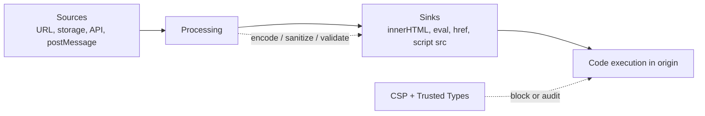
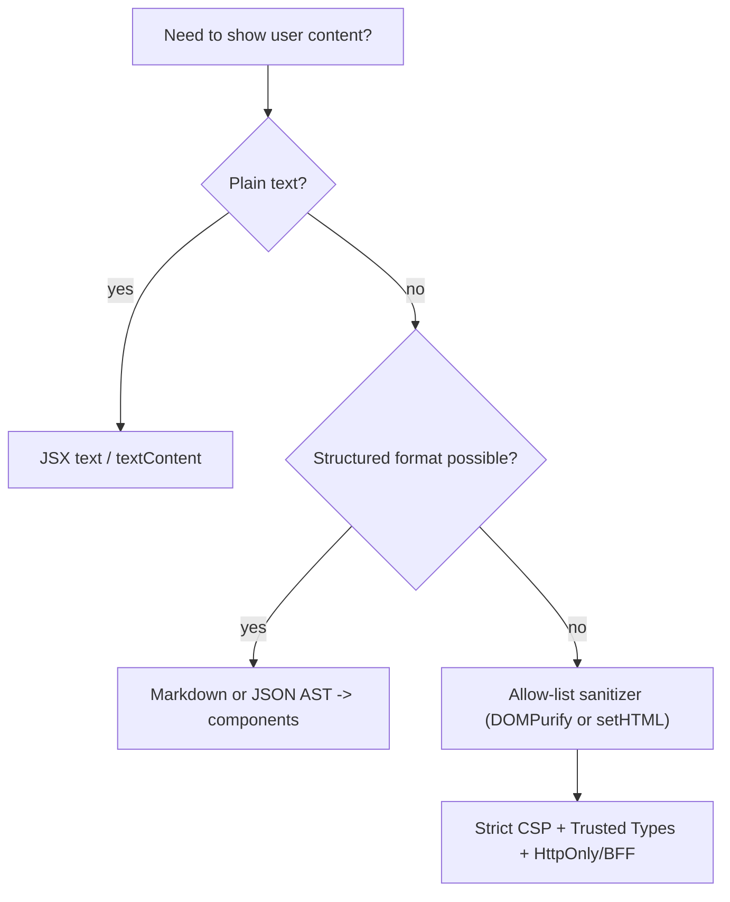

# XSS, Trusted Types and HTML Sanitization

> Verification note: verified against MDN — **CSP** (Mar 2026; Trusted Types directives `require-trusted-types-for 'script'` and `trusted-types`, `trusted-types-eval`) and the **HTML Sanitizer API** (Nov 2026: not Baseline — Chrome/Edge 146, Firefox 148, no Safari; `setHTML()` safe vs `setHTMLUnsafe()`). Also verified: IETF RFC 10017 §5 on what malicious JavaScript can do. Not re-verified and marked *(hedged)*: React/Vue/Angular escape-hatch details, mutation-XSS specifics, Trusted Types browser-support matrix, DOMPurify configuration names, lint plugin names. Cross-origin/browser background: [browser-internals/06 §6](../browser-internals/06-browser-security-model.md#6-cross-site-scripting-xss-and-its-defences).

## Table of Contents

1. [Quick Summary (TL;DR)](#1-quick-summary-tldr)
2. [What XSS Is and Why It Is the Frontend's Top Risk](#2-what-xss-is-and-why-it-is-the-frontends-top-risk)
3. [Types: Reflected, Stored, DOM-Based](#3-types-reflected-stored-dom-based)
4. [Sources, Sinks and Contexts](#4-sources-sinks-and-contexts)
5. [Framework Defaults and Escape Hatches](#5-framework-defaults-and-escape-hatches)
6. [Safe Rendering of Rich Content (Markdown, HTML, SVG)](#6-safe-rendering-of-rich-content-markdown-html-svg)
7. [Sanitization: DOMPurify and the Sanitizer API](#7-sanitization-dompurify-and-the-sanitizer-api)
8. [Trusted Types](#8-trusted-types)
9. [URLs, Attributes and CSS Injection](#9-urls-attributes-and-css-injection)
10. [Serializing Data into HTML (SSR State Injection)](#10-serializing-data-into-html-ssr-state-injection)
11. [Impact: What an XSS Attacker Can Do](#11-impact-what-an-xss-attacker-can-do)
12. [Detection, Testing and Tooling](#12-detection-testing-and-tooling)
13. [Pitfalls](#13-pitfalls)
14. [Interview Questions — Fundamentals](#14-interview-questions--fundamentals)
15. [Interview Questions — Senior Scenarios](#15-interview-questions--senior-scenarios)
16. [Cheat Sheet](#16-cheat-sheet)
17. [Key Terms Glossary](#17-key-terms-glossary)
18. [Further Reading](#18-further-reading)

---

## 1. Quick Summary (TL;DR)

- **XSS = attacker-controlled data interpreted as code in your origin.** The fix is always: *treat data as data* (context-aware output encoding, safe DOM APIs), then add layers.
- **Layers, in order:** (1) safe-by-default rendering (JSX text nodes, `textContent`), (2) sanitise any HTML you must render (allow-list), (3) validate/normalise URLs, (4) **strict CSP** (nonce/hash + `object-src 'none'` + `base-uri 'none'`), (5) **Trusted Types** to make sinks auditable, (6) HttpOnly cookies / BFF to limit blast radius.
- **React escapes text and attribute values by default**; XSS enters through escape hatches: `dangerouslySetInnerHTML`, `href`/`src` with `javascript:` URLs, raw HTML from Markdown, SSR state serialisation, direct DOM (`ref.innerHTML`), and third-party widgets *(hedged details)*.
- **Sanitizer API** (`element.setHTML()`) is the platform-native, XSS-safe `innerHTML` replacement but **not Baseline** (no Safari as of MDN Nov 2026) — use DOMPurify where Safari support matters.
- **Never sanitise on input and trust it forever**: sanitise/encode at the **output** for the specific context.
- **CSP is a backstop, not the fix.** MDN: "Setting a CSP is not an alternative to sanitizing input."



---

## 2. What XSS Is and Why It Is the Frontend's Top Risk

Per MDN's CSP guide, XSS lets an attacker run code in the context of the target website; that code can **access or modify page content, read or write storage, and make authenticated requests as the user**. RFC 10017 stresses that malicious JavaScript "has the same privileges as the legitimate application code" and goes beyond simple token theft (section 11).

Why SPAs are especially exposed:
- Rendering happens in the client with many dynamic sinks.
- Tokens often live in JS-readable storage.
- Large dependency trees and third-party scripts share the origin.
- Client-side routers parse URLs and hashes into state that ends up in the DOM.

---

## 3. Types: Reflected, Stored, DOM-Based

| Type | Where the payload travels | Example | Primary fix |
|---|---|---|---|
| **Reflected** | Request → server response HTML | `/search?q=<script>…` rendered unescaped by SSR | Context-aware encoding in templates; framework auto-escape |
| **Stored** | Persisted data → rendered later for other users | Comment/profile bio with HTML | Encode on output; sanitise HTML allow-list; CSP |
| **DOM-based** | Source → client JS → sink without touching server response | `el.innerHTML = location.hash.slice(1)` | Safe sinks (`textContent`), validate, Trusted Types |
| **Mutation XSS (mXSS)** *(hedged)* | Sanitiser output re-parsed differently by the browser | Namespace/parsing quirks that turn safe-looking HTML into script after serialise → parse | Keep sanitiser libraries current; sanitise at the sink with the same parser (Sanitizer API) |
| **Self-XSS** | Victim pastes attacker script | Social engineering | Education, console warnings |
| **Blind XSS** | Fires in an admin/support tool | Payload stored in a support ticket | Treat internal tools as hostile-input renderers too |

---

## 4. Sources, Sinks and Contexts

### Sources (attacker-influenced)
`location.search/hash/pathname`, `document.referrer`, `window.name`, `postMessage` data, cookies/`localStorage` (can be tainted), API responses containing user-generated content, WebSocket/SSE messages, file names, `FileReader` results, third-party widget callbacks.

### Sinks (execute or interpret strings)
| Sink class | Examples | Safer alternative |
|---|---|---|
| HTML parsing | `innerHTML`, `outerHTML`, `insertAdjacentHTML`, `document.write`, `DOMParser` + insertion, `dangerouslySetInnerHTML`, `v-html` | `textContent`, DOM construction, `setHTML()`, sanitiser |
| Script execution | `eval`, `new Function`, `setTimeout("string")`, `script.text/src`, `import()` with user path | Avoid; use data + functions |
| URL navigation/loads | `location = x`, `a.href`, `iframe.src`, `form.action`, `window.open` with `javascript:` | Validate scheme/host allow-list |
| Style | `style` attribute/`<style>` from user, `element.style.cssText` | Allow-listed class names/tokens |
| Event handlers | `setAttribute('onclick', …)`, inline handlers in sanitised HTML | Remove handlers; CSP blocks inline |
| Templates | Server-side templating raw output (triple-brace or the safe filter) *(hedged)* | Auto-escaped output |

### Output contexts require different encoding
| Context | Example | Correct handling |
|---|---|---|
| HTML text | `<p>${x}</p>` | HTML-escape `< > & " '` |
| HTML attribute | `<input value="${x}">` | Quote attributes + attribute-encode |
| URL attribute | `<a href="${x}">` | Validate scheme (`https:`, `mailto:`) then encode |
| JavaScript string | `<script>var a="${x}"</script>` | Avoid; pass data via JSON in `data-*`/`<script type="application/json">` (escaped) |
| CSS | `style="color:${x}"` | Allow-list values; never concatenate user input |
| Event handler attribute | `onclick="f('${x}')"` | Never; use `addEventListener` |

**Rule:** encoding is *context-specific*; HTML-escaping alone does not make a value safe in a JavaScript or URL context.

---

## 5. Framework Defaults and Escape Hatches

### React *(hedged — behaviours from React docs/knowledge; re-check react.dev for current wording)*
- JSX `{value}` in text and attribute positions is **escaped**; values are rendered as strings, not parsed as HTML.
- **Escape hatches that reintroduce XSS:**
  ```jsx
  <div dangerouslySetInnerHTML={{ __html: userHtml }} />   // raw HTML sink
  <a href={userUrl}>link</a>                                // javascript: URL risk
  <iframe src={userUrl} />                                  // javascript:/data: or attacker page
  ref.current.innerHTML = userHtml;                         // direct DOM sink
  React.createElement(userControlledType, props)            // element type injection
  <Component {...userControlledProps} />                    // prop spreading (dangerouslySetInnerHTML, href…)
  ```
- **`javascript:` URLs:** React logs warnings for `javascript:` URLs in some versions *(hedged)* — don't rely on it; validate URLs yourself.
- **Server Components/SSR:** output is escaped the same way; injection arises when you hand-build HTML or serialise state into `<script>` ([§10](#10-serializing-data-into-html-ssr-state-injection)).
- **Third-party UI libraries** (markdown renderers, rich-text editors, charts, tooltips) may use innerHTML internally — audit configuration (HTML allowed? sanitiser configured?).

### Vue / Angular / Svelte *(hedged)*
| Framework | Default | Escape hatches |
|---|---|---|
| Vue | Template interpolation escapes | `v-html`, render functions with `innerHTML` props, dynamic `:is`/`href` |
| Angular | Built-in sanitisation for HTML/URL/style contexts | `bypassSecurityTrustHtml/Url/Script/Style/ResourceUrl`, `[innerHTML]` with bypass |
| Svelte | Text interpolation escapes | `{@html …}` |

### Lint rules *(hedged package names)*
`react/no-danger`, `react/jsx-no-script-url`, `no-eval`, `no-implied-eval`, `no-new-func`, `eslint-plugin-no-unsanitized`, `eslint-plugin-security`. Ban escape hatches except via an approved wrapper component, and require code-owner review for changes to it.

---

## 6. Safe Rendering of Rich Content (Markdown, HTML, SVG)

### Prefer structure over strings
1. **Markdown → AST → React components** (e.g., `react-markdown` renders without raw HTML by default *(hedged)*) so you control which elements exist.
2. Disable raw HTML in Markdown unless you truly need it; if you do, run an allow-list sanitiser **after** conversion.
3. Rich text editors store structured JSON (e.g., ProseMirror/Lexical/Tiptap documents) rather than HTML; render via components.

### If you must render HTML
```tsx
import DOMPurify from 'dompurify';

const clean = DOMPurify.sanitize(html, {
  ALLOWED_TAGS: ['p', 'b', 'i', 'em', 'strong', 'a', 'ul', 'ol', 'li', 'code', 'pre', 'blockquote'],
  ALLOWED_ATTR: ['href', 'title'],
  ALLOWED_URI_REGEXP: /^(?:https?|mailto):/i,    // explicit scheme allow-list (hedged option name)
});
return <div dangerouslySetInnerHTML={{ __html: clean }} />;
```
- Sanitise **close to the sink** (and server-side as well if the content is shared), keep the library updated.
- Add `rel="noopener noreferrer"` and `target` handling for links post-sanitisation.
- Don't re-serialise/modify sanitiser output with string operations (mXSS risk).

### SVG and other active formats
- **Inline SVG from users is HTML-equivalent**: can contain `<script>`, event handlers, `<foreignObject>`, `xlink:href` to `javascript:`.
- Serve user-uploaded SVG as an image (`` blocks script execution) from a **separate, cookieless origin** with `X-Content-Type-Options: nosniff`, or sanitise server-side / rasterise.
- PDF/HTML uploads served from the main origin are XSS vectors; use `Content-Disposition: attachment` and a sandbox domain ([08](08-secure-frontend-patterns-and-vulnerability-catalogue.md)).

---

## 7. Sanitization: DOMPurify and the Sanitizer API

### HTML Sanitizer API (verified, MDN Nov 2026)
```js
// XSS-safe: always removes script/iframe/object/embed/frame/use and event-handler attributes
target.setHTML(untrustedString);                       // default sanitizer, drop-in for innerHTML
target.setHTML(untrustedString, { sanitizer: new Sanitizer({ elements: ['p', 'b', 'a'] }) });

// XSS-unsafe: only as safe as the sanitizer you pass; works with Trusted Types
target.setHTMLUnsafe(untrustedString, { sanitizer });
```
Key facts:
- **Safe methods:** `Element.setHTML()`, `ShadowRoot.setHTML()`, `Document.parseHTML()`; **unsafe:** `setHTMLUnsafe()`, `parseHTMLUnsafe()`.
- Safe methods apply an **XSS-safe baseline** even if your custom sanitizer would allow unsafe entities; the **default configuration** additionally strips comments and `data-*` attributes and other spoofing/clickjacking-prone items.
- **Allow configurations** (list what you permit) are safer than **remove configurations** (list what you block); you cannot mix `elements` and `removeElements`.
- The safe methods don't use Trusted Types (they always filter); unsafe ones can be gated by Trusted Types policies.
- **Support:** Chrome/Edge 146, Firefox 148, **no Safari / iOS WebViews** → *not Baseline*. Feature-detect (`'setHTML' in Element.prototype`) and fall back to DOMPurify.

### DOMPurify (library)
- Mature, widely used allow-list sanitiser, supports `RETURN_TRUSTED_TYPE` *(hedged)* and hooks. MDN notes libraries "may be useful with unsafe HTML methods and Trusted Types".
- Keep it updated; sanitiser bypasses historically came from parser differentials (mXSS).

### Decision guide
| Scenario | Choice |
|---|---|
| Plain text | `textContent` / JSX text |
| Limited formatting, broad browser support | Markdown → components, or DOMPurify allow-list |
| Chromium/Firefox-only internal tool | `setHTML()` |
| Need to allow some unsafe HTML for a trusted publisher | Strict allow-list + review + CSP; avoid if possible |
| Content from other users, high risk | Structured format; separate origin; sandboxed iframe |

---

## 8. Trusted Types

**Problem:** injection sinks accept *strings*, so any string anywhere can become code. **Trusted Types** makes the browser require special typed objects (`TrustedHTML`, `TrustedScript`, `TrustedScriptURL`) at sinks, created only by **policies** you define and audit.

```http
Content-Security-Policy: require-trusted-types-for 'script'; trusted-types app-sanitizer dompurify
```
```js
const policy = trustedTypes.createPolicy('app-sanitizer', {
  createHTML: (input) => DOMPurify.sanitize(input),       // single audited choke point
});
el.innerHTML = policy.createHTML(untrustedString);         // OK
el.innerHTML = untrustedString;                            // throws TypeError (enforced)
```
Verified from MDN (CSP guide):
- `require-trusted-types-for 'script'` makes the browser accept only trusted types at injection sinks; assigning a plain string throws.
- The **`trusted-types` directive** lists acceptable policy names so attacker-created policies are blocked.
- **`trusted-types-eval`** keyword allows `eval()`-like APIs only when Trusted Types are supported and enabled (unlike `unsafe-eval`, it keeps them blocked in browsers without support).
- The purpose is auditability: security review concentrates on the few policy functions.

Rollout *(general practice)*:
1. Add `Content-Security-Policy-Report-Only: require-trusted-types-for 'script'; report-to csp` and collect violations.
2. Fix sinks (replace `innerHTML` with `textContent`/components; wrap necessary ones in a policy).
3. Provide a **default policy** only as a temporary migration aid (it can hide problems).
4. Enforce, keep violation reports flowing.
5. Check third-party code (widgets, analytics) — they may need their own policy names (`trusted-types` allow-list) or replacement.

Browser support: Chromium-based support is long-standing; Firefox/Safari support has been **newer/evolving** *(hedged — check MDN compatibility before enforcing without fallbacks)*. React 19.3 added Trusted Types-related support *(from earlier research in this handbook — see [react/04](../react/04-react-19-and-beyond.md))*. In unsupported browsers Trusted Types enforcement is simply ignored, so it is **defence in depth**, not a replacement for sanitising.

---

## 9. URLs, Attributes and CSS Injection

```ts
// URL allow-list helper used by every <a href> /  / redirect
export function safeUrl(input: string, allowed = ['https:', 'mailto:']): string | null {
  try {
    const u = new URL(input, window.location.origin);        // resolves relative URLs
    return allowed.includes(u.protocol) ? u.toString() : null;
  } catch { return null; }
}
```
- Block `javascript:`, `data:` (for navigation/frames), `vbscript:`; check **after** parsing/normalising (`java\tscript:` tricks are resolved by the URL parser).
- For **redirects**, prefer allow-listing hosts/paths, not just schemes ([08](08-secure-frontend-patterns-and-vulnerability-catalogue.md)).
- **`target="_blank"`**: modern browsers imply `noopener` *(hedged)*, but include `rel="noopener noreferrer"` for external links for clarity/older engines.
- **Attribute injection:** unquoted attributes and string-built HTML (`<div class=${x}>`) let attackers add event handlers; always use framework bindings.
- **CSS injection** can exfiltrate data via attribute selectors and `url()` requests, or restyle for clickjacking; constrain with CSP `style-src`/`img-src`/`font-src`, avoid user-supplied CSS, map user choices to class names.
- **Dangling markup injection:** unclosed attributes can swallow following HTML (including tokens/CSRF values) into requests; mitigated by encoding, CSP `form-action`/`img-src`, and modern browser protections *(hedged)*.
- **DOM clobbering:** user-controlled `id`/`name` can overwrite globals (`window.config`); avoid relying on globals; sanitisers should strip `id`/`name` where relevant ([08](08-secure-frontend-patterns-and-vulnerability-catalogue.md)).

---

## 10. Serializing Data into HTML (SSR State Injection)

A classic framework-level XSS: embedding server data in a script tag.

```html
<!-- DANGEROUS: </script> in a string closes the tag; U+2028/2029 historically broke JS strings -->
<script>window.__STATE__ = ${JSON.stringify(state)}</script>
```
Safer options:
1. **Escape `<`, `>`, `&`, `\u2028`, `\u2029`** when serialising JSON for inline scripts (e.g., replace `<` with `\u003c`) — libraries such as `serialize-javascript` exist *(hedged; keep updated — they have had CVEs)*.
2. Use `<script type="application/json" id="__DATA__">` with escaped content and parse with `JSON.parse(textContent)` (data, not code; also CSP-friendly).
3. Let the framework do it (Next.js/RSC payloads, Remix, Nuxt escape their own state) — do **not** hand-roll in custom `_document`/layouts.
4. With nonce-based CSP, inline JSON scripts of non-JS types don't execute and don't need nonces; inline JS state scripts do.

---

## 11. Impact: What an XSS Attacker Can Do

RFC 10017 §5 enumerates scenarios (relevant to any SPA):
1. **Single-execution token theft** — read tokens from storage and exfiltrate.
2. **Persistent token theft** — continuously exfiltrate the latest tokens (defeats short lifetimes and rotation).
3. **Acquisition of new tokens** — hidden iframe runs a silent authorization-code flow and obtains independent tokens.
4. **Proxying requests via the user's browser** — act as the user in-session; "cannot be stopped by application-level measures" other than preventing XSS.

Plus: keylogging/form hijack (credentials, payment), DOM defacement and phishing overlays, redirects, crypto-mining, malicious extensions install prompts, lateral movement to same-origin apps, CSRF-token reading, abusing WebAuthn prompts, reading `localStorage`/IndexedDB/cache.

**Consequences for architecture:** keep session credentials out of JS (HttpOnly cookie/BFF — [05](05-authentication-and-authorization-in-the-frontend.md)), sandbox untrusted content on separate origins, and reduce what an in-origin attacker can do (short-lived tokens, step-up auth for sensitive actions, server-side limits).

---

## 12. Detection, Testing and Tooling

| Technique | Notes |
|---|---|
| Code review of sinks | Search for dangerouslySetInnerHTML, innerHTML, eval, v-html, bypassSecurityTrust |
| ESLint / Semgrep / CodeQL | Taint-tracking rules *(hedged)* |
| Unit tests for sanitiser/URL helpers | Include known payloads: ``, `javascript:`, SVG, nested/malformed tags |
| DAST / Burp / ZAP *(hedged)* | Reflected/stored/DOM checks |
| Browser devtools | Trusted Types violations, CSP violations in console |
| CSP/Trusted Types **report-only** in prod | Surfaces real sinks and third-party scripts |
| Bug bounty / pen test | Test admin/support tools (blind XSS) |
| Fuzzing | Markdown/HTML parsers, URL handling |

```ts
// Example regression test for a sanitiser wrapper (Vitest/Jest)
const payloads = [
  '',
  '<svg><script>alert(1)</script></svg>',
  '<a href="javascript:alert(1)">x</a>',
  '<math><mtext><table><mglyph><style>',
];
test.each(payloads)('sanitises %s', (p) => {
  const out = sanitize(p);
  expect(out).not.toMatch(/onerror|<script|javascript:/i);
});
```

---

## 13. Pitfalls

1. **"React escapes everything"** — until you use `dangerouslySetInnerHTML`, `href={userInput}`, or serialise state unsafely.
2. **Sanitising on input only**, then rendering in a different context later.
3. **Blacklist/regex sanitisers** instead of allow-list parsers.
4. **Modifying sanitised HTML** with string ops (re-introduces mXSS).
5. **Allowing `style`, `class`, `id`, `name`, `data-*` freely** (CSS injection, DOM clobbering, framework gadget attributes).
6. **Rendering Markdown with raw HTML enabled.**
7. **Trusting URLs from APIs/query params** in `href`/`src`/`window.open`.
8. **CSP with `'unsafe-inline'`/`'unsafe-eval'`** while believing XSS is mitigated.
9. **User-uploaded SVG/HTML served from the main origin.**
10. **Admin/support dashboards** rendering untrusted data without protection (blind XSS).
11. **Third-party widgets** with their own innerHTML sinks.
12. **Forgetting non-browser renderers:** email HTML, PDF generators, Electron/WebViews (XSS may become RCE).

---

## 14. Interview Questions — Fundamentals

### Q1. What is XSS and what are its types?
Injection of attacker-controlled data that the browser executes as script in the victim's origin; reflected (via request), stored (persisted), and DOM-based (client-side source → sink).

### Q2. How does React protect against XSS, and where does it not?
JSX escapes values rendered as text/attributes; it doesn't protect `dangerouslySetInnerHTML`, `javascript:` URLs in `href`/`src`, direct DOM manipulation, unsafe SSR state serialisation, or vulnerable third-party libraries.

### Q3. Why is output encoding context-dependent?
HTML text, attributes, URLs, JavaScript and CSS have different parsing rules; encoding for one doesn't make data safe in another.

### Q4. What is a sink? Give examples.
An API that interprets strings as code/markup: `innerHTML`, `eval`, `document.write`, `setAttribute('on…')`, `script.src`, navigation to `javascript:` URLs.

### Q5. How does CSP help, and what are its limits?
It restricts which scripts can run (nonces/hashes), blocking injected inline scripts and untrusted sources; it doesn't fix the injection, doesn't stop attacks using already-allowed scripts or DOM manipulation without script execution, and relies on correct deployment.

### Q6. What are Trusted Types?
A browser mechanism (via CSP) requiring typed objects produced by named policies for injection sinks, so raw strings can't reach `innerHTML`/`eval`; it centralises sanitisation for audit.

### Q7. `setHTML()` vs `setHTMLUnsafe()`?
`setHTML()` always strips XSS-unsafe content even with a custom sanitiser; `setHTMLUnsafe()` only applies the sanitiser you pass (or none) and works with Trusted Types.

### Q8. Why not just blacklist `<script>` tags?
Script execution has many vectors (event handlers, SVG, `javascript:` URLs, mXSS); allow-list parsing is required.

### Q9. How do you safely embed JSON in an HTML page?
Escape `<` and line separators, or use a non-executing `<script type="application/json">` and parse it; prefer framework-provided serialisation.

---

## 15. Interview Questions — Senior Scenarios

### S1. "We must let customers paste HTML for product descriptions."
Prefer a structured editor or Markdown subset; otherwise sanitise server-side and client-side with an allow-list (tags/attrs/URL schemes), strip `style`/`id`/`name`/`data-*` as needed, render on a cookieless origin or in a sandboxed iframe if the risk is high, enforce strict CSP + Trusted Types, add regression tests with mXSS payloads, and monitor CSP reports.

### S2. "A stored XSS is found in production. Walk through the response."
Contain (disable the vulnerable feature or sanitise at output; purge/neutralise stored payloads), assess exposure (logs, who viewed it, were sessions/tokens at risk), invalidate sessions/rotate tokens if needed, fix root cause (sink + encoding), add tests/lint/CSP, search for similar sinks, notify per policy, post-mortem on why CSP/Trusted Types/review didn't prevent it.

### S3. "Roll out a strict CSP and Trusted Types on a legacy app with inline scripts and analytics tags."
Inventory sinks and scripts using report-only; move inline scripts to files or nonced/hashed ones; refactor inline event handlers; adopt `strict-dynamic` for tag-manager chains with nonce propagation; add Trusted Types in report-only, wrap legacy `innerHTML` with a policy backed by DOMPurify, then enforce gradually per route/subdomain ([03](03-content-security-policy-in-depth.md)).

### S4. "Is `dangerouslySetInnerHTML` ever acceptable?"
Yes, for trusted, sanitised content through a single reviewed wrapper (allow-list sanitiser, tests, CSP/TT), never with raw user input; it should be linted and visible in code review.

### S5. "Our Markdown renderer allows raw HTML for a blog. What can go wrong?"
Authors (or compromised accounts) can embed scripts, forms, iframes; mXSS via sanitiser bypass; SVG payloads; link `javascript:`. Mitigate with raw HTML disabled or sanitised allow-list, URL validation, CSP, separate origin for user content, and treat editors as potential attackers.

---

## 16. Cheat Sheet



| Sink / Task | Do |
|---|---|
| Insert text | `textContent` / JSX |
| Insert HTML | Sanitise (allow-list) at sink; `setHTML` where supported |
| Links | `safeUrl()` + `rel="noopener noreferrer"` |
| Inline state | Escape JSON or framework serialisation |
| Backstop | Nonce/hash CSP, Trusted Types, report-only first |

---

## 17. Key Terms Glossary

| Term | Definition |
|---|---|
| **Source / Sink** | Attacker-influenced input / API that interprets strings as code |
| **Output encoding** | Escaping data for a specific output context |
| **Sanitisation** | Removing dangerous markup using an allow-list |
| **mXSS** | Mutation XSS via parser/serialiser differences |
| **Trusted Types** | Typed-object requirement for DOM injection sinks |
| **Sanitizer API** | Native sanitiser: `setHTML()`/`Sanitizer` |
| **DOM clobbering** | Overwriting globals via named elements |
| **Blind XSS** | Payload executes in a back-office view |

---

## 18. Further Reading

- [MDN — Content Security Policy guide](https://developer.mozilla.org/en-US/docs/Web/HTTP/Guides/CSP) · [HTML Sanitizer API](https://developer.mozilla.org/en-US/docs/Web/API/HTML_Sanitizer_API) · [Trusted Types API](https://developer.mozilla.org/en-US/docs/Web/API/Trusted_Types_API)
- [OWASP XSS Prevention Cheat Sheet](https://cheatsheetseries.owasp.org/cheatsheets/Cross_Site_Scripting_Prevention_Cheat_Sheet.html) · [DOM based XSS Prevention Cheat Sheet](https://cheatsheetseries.owasp.org/cheatsheets/DOM_based_XSS_Prevention_Cheat_Sheet.html)
- This repo: [03 CSP in depth](03-content-security-policy-in-depth.md) · [05 Auth in the frontend](05-authentication-and-authorization-in-the-frontend.md) · [react/05 Server Components](../react/05-server-components-and-server-functions.md)
