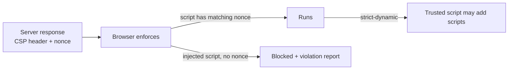
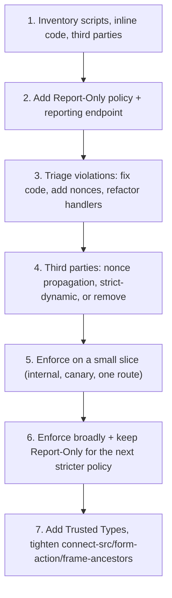
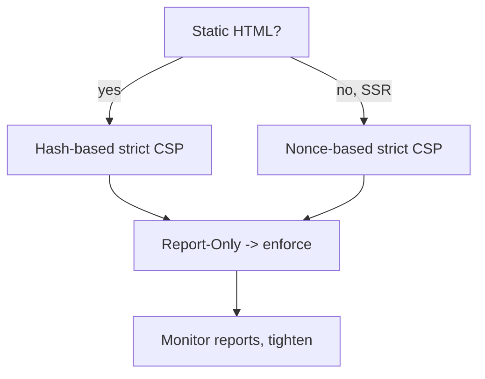

# Content Security Policy in Depth

> Verification note: directive semantics, nonce/hash rules, `strict-dynamic`, `frame-ancestors`, `upgrade-insecure-requests`, Trusted Types directives, `report-to`/`Reporting-Endpoints` and report-only behaviour were verified against MDN's CSP guide (last modified Mar 2026). IETF RFC 10017 (Aug 2026) also recommends nonce/hash-based CSP. Not re-verified and marked *(hedged)*: framework-specific nonce plumbing (Next.js, Vite, Angular), CSP Level 3 niceties (`'unsafe-hashes'`, `script-src-elem`), known allow-list bypass gadgets, Safari/Firefox edge cases, CSP + service worker interactions. Overview-level coverage also exists in [browser-internals/06 §7](../browser-internals/06-browser-security-model.md#7-content-security-policy-csp).

## Table of Contents

1. [Quick Summary (TL;DR)](#1-quick-summary-tldr)
2. [How CSP Works](#2-how-csp-works)
3. [Directive Reference](#3-directive-reference)
4. [Strict CSP: Nonces, Hashes and strict-dynamic](#4-strict-csp-nonces-hashes-and-strict-dynamic)
5. [Why Allow-List CSPs Fail](#5-why-allow-list-csps-fail)
6. [Rollout Strategy: Report-Only to Enforce](#6-rollout-strategy-report-only-to-enforce)
7. [Reporting and Monitoring](#7-reporting-and-monitoring)
8. [CSP in React, Next.js and SPAs](#8-csp-in-react-nextjs-and-spas)
9. [Styles, Third-Party Tags and Other Hard Cases](#9-styles-third-party-tags-and-other-hard-cases)
10. [Beyond Scripts: Framing, Forms, Connections, HTTPS](#10-beyond-scripts-framing-forms-connections-https)
11. [Common Bypasses and Misconfigurations](#11-common-bypasses-and-misconfigurations)
12. [Pitfalls](#12-pitfalls)
13. [Interview Questions — Fundamentals](#13-interview-questions--fundamentals)
14. [Interview Questions — Senior Scenarios](#14-interview-questions--senior-scenarios)
15. [Cheat Sheet](#15-cheat-sheet)
16. [Key Terms Glossary](#16-key-terms-glossary)
17. [Further Reading](#17-further-reading)

---

## 1. Quick Summary (TL;DR)

- **CSP** is a response-header policy that restricts what a document may load or execute. Its main job: **mitigate XSS** (and add clickjacking and HTTPS-upgrade controls). It is **defence in depth**: MDN — "Setting a CSP is not an alternative to sanitizing input."
- **Recommended pattern ("strict CSP"):**
  ```http
  Content-Security-Policy:
    script-src 'nonce-{RANDOM}' 'strict-dynamic';
    object-src 'none';
    base-uri 'none';
  ```
  (MDN's strict CSP baseline is `script-src 'nonce-{RANDOM}'` or a hash, `object-src 'none'`, `base-uri 'none'`; `'strict-dynamic'` is the optional keyword that lets trusted scripts load further scripts.)
- **Nonces** must be unique and unpredictable **per response**, injected by server-side templating — static HTML can't use nonces; use **hashes** for static/CSR pages (external scripts also need `integrity`).
- **If a directive contains a nonce or hash, `'unsafe-inline'` is ignored by browsers**; `'unsafe-eval'` still works (so avoid it).
- **Host allow-lists** (`script-src cdn.example.com`) are hard to maintain and frequently bypassable — prefer nonce/hash + `strict-dynamic`.
- **Deploy via report-only first** (`Content-Security-Policy-Report-Only`), collect `report-to` data, then enforce. A policy set in `<meta>` supports fewer features (and report-only isn't allowed in `<meta>`).
- **Set CSP on all responses**, not just the main document (MDN).



---

## 2. How CSP Works

- Delivered as the **`Content-Security-Policy`** HTTP header (preferred), or limited **`<meta http-equiv>`**. MDN: meta is handy for static client-rendered SPAs, but "does not support all CSP features" and **report-only cannot be delivered in `<meta>`**.
- A policy is a **semicolon-separated list of directives**; each directive = name + source list: `default-src 'self'; img-src 'self' example.com`.
- **Fetch directives** control resource loads per type; `default-src` is the fallback for those not listed.
- When a source list has multiple expressions, a resource is allowed if **any** matches; the keyword **`'none'`** can't be combined with others.
- **Multiple policies** (several headers) are all enforced (intersection); the report-only header is evaluated separately and doesn't block.
- **Inheritance caveat:** documents loaded from `about:blank`/`blob:`/`data:` inherit the creator's policy in many cases *(hedged)*; workers have their own CSP considerations.

---

## 3. Directive Reference

### Fetch directives (what can load)
| Directive | Controls | Notes |
|---|---|---|
| `default-src` | Fallback for other fetch directives | Setting `default-src` or `script-src` blocks inline JS, `javascript:` URLs, `eval` unless relaxed (MDN) |
| `script-src` (`-elem`, `-attr`) | JavaScript | Nonce/hash/`strict-dynamic` live here |
| `style-src` | CSS | Inline styles blocked unless nonce/hash/`unsafe-inline` |
| `img-src`, `font-src`, `media-src` | Resources | `data:`/`blob:` need explicit allowance |
| `connect-src` | `fetch`, XHR, WebSocket, EventSource, beacon | Limits **data exfiltration** destinations |
| `frame-src` / `child-src` | Frames the page embeds | |
| `worker-src` | Workers/service workers | |
| `object-src` | `<object>`, `<embed>` | Set to `'none'` |
| `manifest-src`, `prefetch-src` *(hedged)* | Misc | |

### Document directives
| Directive | Controls |
|---|---|
| `base-uri` | Allowed `<base href>` — set `'none'` (prevents base-tag hijack of relative script URLs) |
| `sandbox` | Applies iframe-like sandboxing to the document itself |

### Navigation directives
| Directive | Controls |
|---|---|
| `form-action` | Where forms may submit (limits credential exfiltration via injected forms); does not fall back to `default-src` *(hedged)* |
| `frame-ancestors` | **Who may embed me** — clickjacking defence; `'none'` unless embeddable; schemes/hosts/`'self'` only; replaces `X-Frame-Options` (MDN); **not available via `<meta>`** *(hedged)* and does not fall back to `default-src` |

### Other
| Directive | Purpose |
|---|---|
| `upgrade-insecure-requests` | Auto-upgrades HTTP subresource loads, same-origin links, iframe navigations, and form submissions to HTTPS; cross-origin top-level navigations are **not** upgraded; **not a substitute for HSTS** (MDN) |
| `require-trusted-types-for 'script'` | Enforce Trusted Types at injection sinks |
| `trusted-types <policy names>` | Allowed policy names (`'none'`, `'allow-duplicates'` options) |
| `report-to <endpoint>` | Reporting API endpoint (declared in `Reporting-Endpoints`) |
| `report-uri` | Legacy reporting; deprecated but declare both until `report-to` is universal (MDN) |

### Source expressions
| Expression | Meaning |
|---|---|
| `'self'` | Same origin |
| `https:` / `wss:` | Scheme source |
| `*.example.org` / `cdn.example.com/path/` | Host sources (allow-list) |
| `'nonce-<value>'` | Per-response nonce on `<script>`/`<style>` only |
| `'sha256-…'`, `'sha384-…'`, `'sha512-…'` | Hash of inline content (or external with `integrity`) |
| `'strict-dynamic'` | Trust propagates to scripts loaded by trusted scripts; host/scheme allow-lists and `'self'` ignored in supporting browsers *(hedged on the ignore detail)* |
| `'unsafe-inline'` | Allow inline JS/CSS/handlers — avoid (ignored when nonce/hash present) |
| `'unsafe-eval'` | Allow `eval`/`Function`/string timers — avoid; use `'trusted-types-eval'` if unavoidable |
| `'unsafe-hashes'` *(hedged)* | Allow specific inline event handlers by hash |
| `'wasm-unsafe-eval'` *(hedged)* | Allow WebAssembly compilation without allowing `eval` |
| `'report-sample'` | Include a code sample in reports |

---

## 4. Strict CSP: Nonces, Hashes and strict-dynamic

### Nonce-based (dynamic pages/SSR)
```js
// Express-style (from MDN's example pattern)
app.get('/', (req, res) => {
  const nonce = crypto.randomUUID();                       // fresh, unpredictable, per response
  res.setHeader('Content-Security-Policy',
    `script-src 'nonce-${nonce}' 'strict-dynamic'; object-src 'none'; base-uri 'none'`);
  res.send(render(nonce));                                  // template adds nonce="${nonce}" to intended scripts only
});
```
MDN rules:
- New nonce **for every response**; not guessable (use a CSPRNG; 128 bits of entropy is the usual guidance *(hedged number)*).
- Use the same nonce for all legitimate `<script>` tags in that document; works for inline and external scripts.
- **Template the nonce into your own tags only** — do not blindly add it to every `<script>` in the output, or you'd bless attacker-injected scripts.
- Nonces apply only to elements that have a `nonce` attribute (`<script>`, `<style>`).
- **Caching consequence:** a nonce changes every response, so the HTML can't be cached at a CDN as a static file — plan for dynamic rendering or use hashes.

### Hash-based (static/CSR pages)
```http
Content-Security-Policy: script-src 'sha256-<base64-of-inline-script>' 'sha256-<hash-of-main.js>'; object-src 'none'; base-uri 'none'
```
```html
<script src="./main.js" integrity="sha256-<hash-of-main.js>"></script>
```
- Hash algorithms: SHA-256/384/512, base64 with prefix.
- External scripts must also carry the **`integrity`** attribute (MDN).
- CSP and content can both be static (good for Vite/CRA-style bundles) but you must regenerate hashes on every build — automate in the build (plugins exist *(hedged)*).

### `'strict-dynamic'`
- A script with a valid nonce/hash is allowed to **load further scripts** (dynamic `createElement('script')`) without those carrying nonces; this makes tag managers and bundlers' dynamic chunk loading workable.
- **Trade-off (MDN):** less secure — if trusted scripts build `<script>` elements from attacker-influenced data, CSP won't protect.
- Typical production policy *(hedged detail)*:
  ```http
  script-src 'nonce-{RANDOM}' 'strict-dynamic' https: 'unsafe-inline';
  ```
  The `https:` and `'unsafe-inline'` are **fallbacks for old browsers**; modern browsers ignore them when a nonce/`strict-dynamic` is present.

### Refactoring requirements
Strict CSP forces removal of inline event handlers (`onclick=`), `javascript:` URLs and `eval`-style code; use `addEventListener`, normal links/buttons, and avoid dynamic-code libraries (some templating/chart/GraphQL tooling used `new Function` — configure CSP-safe modes).

---

## 5. Why Allow-List CSPs Fail

MDN notes (citing the "CSP Is Dead, Long Live CSP!" research) that **allow-list CSPs are hard to get right and often whitelist unsafe domains**, and are hard to maintain — one example: integrating Google Analytics demanded **187 Google domains** on the allow-list.

Typical bypass classes *(general knowledge, hedged)*:
- **JSONP endpoints** or open callbacks on an allowed host → attacker-controlled script content from a "trusted" origin.
- **Hosting platforms/CDNs** that serve arbitrary user files (e.g., npm CDNs, object storage, `*.github.io`-style hosts) allow-listed by wildcard.
- **Framework gadgets** hosted on allowed CDNs (old template libraries that evaluate expressions).
- **Open redirects** on an allowed origin (with paths allow-listed, some browsers ignore path after redirect).
- **Missing `base-uri`/`object-src`**, letting `<base>` or plugins subvert loads.
- **`'unsafe-inline'`/`'unsafe-eval'`** nullifying the policy.

Conclusion: use **nonce/hash + `strict-dynamic`**, keep host lists minimal, and review policies with Google's [CSP Evaluator](https://csp-evaluator.withgoogle.com/) (listed by MDN).

---

## 6. Rollout Strategy: Report-Only to Enforce


Details:
- MDN: use `Content-Security-Policy-Report-Only` to test; **both headers can coexist** — enforce today's policy while report-only tests the next.
- Run report-only long enough to cover seasonal pages, rarely used routes, error pages and A/B variants.
- **Noise sources:** browser extensions injecting scripts, ad blockers, translation tools, corporate proxies — filter by `blockedURL` schemes (`chrome-extension:`, `moz-extension:`) and `sample`.
- Use **feature flags / per-route policies** to roll back quickly; CSP errors can break checkout flows — test critical journeys (payments, SSO, embeds) in staging with enforcement.
- Add **E2E tests** that assert the CSP header is present and that the app loads without violations in CI.

---

## 7. Reporting and Monitoring

Modern reporting (verified, MDN):
```http
Reporting-Endpoints: csp-endpoint="https://reports.example.com/csp"
Content-Security-Policy: default-src 'self'; script-src 'nonce-{RANDOM}' 'strict-dynamic'; report-to csp-endpoint
```
- Browser POSTs JSON with **`Content-Type: application/reports+json`**; each report has `type: "csp-violation"` and a `body` with `blockedURL`, `effectiveDirective` (e.g., `script-src-elem`), `documentURL`, `sourceFile`, `lineNumber`, `disposition` (`enforce`/`report`), `sample`, `statusCode`, `originalPolicy`.
- **`report-uri`** (legacy; `application/csp-report`) is **deprecated** but MDN advises declaring both until `report-to` is supported everywhere.
- Pipeline: collector (own endpoint or SaaS) → dedupe by (directive, blocked URL, source) → alert on **new** high-signal violations (inline script, unknown host) → dashboards for trend; sample/rate-limit at the edge because volume can be large.
- Security value: unexpected `script-src` violations on production can be the **first signal of an XSS attempt or a compromised third party**.
- In-page listener for debugging: `document.addEventListener('securitypolicyviolation', e => …)`.

---

## 8. CSP in React, Next.js and SPAs

*(Framework details are hedged — check current docs: nextjs.org CSP guide, Vite/Angular docs.)*

### Next.js (App Router)
- Typical approach: generate a nonce in the request-time layer (`proxy.ts`/middleware), set `Content-Security-Policy` on the request/response, and let Next apply the nonce to its own scripts; use `headers()`/`nonce` in custom `<Script nonce={…}>`.
- **Nonces require dynamic rendering** of pages (a static/cached shell can't carry a per-request nonce) — this interacts with static generation, ISR and **Cache Components/PPR**; evaluate the performance trade-off ([nextjs-and-rendering/05](../nextjs-and-rendering/05-streaming-ppr-and-instant-navigation.md), [06](../nextjs-and-rendering/06-proxy-auth-and-security.md)). If static output is essential, consider hash-based/`'strict-dynamic'` strategies or edge-injected nonces *(hedged)*.
- Exclude prefetch requests/static assets from nonce logic via the proxy matcher (proxy without a `matcher` runs on every request — see nextjs notes).
- `next.config` `headers()` can set static, non-nonce headers (HSTS, `X-Content-Type-Options`, `frame-ancestors`).

### Vite / CRA-style SPAs
- Prefer **hash-based** CSP generated at build time (inline bootstrap hashed, bundles with `integrity`) or serve through a BFF/edge worker that injects nonces into `index.html`.
- Dev servers (HMR, `eval`-based source maps) need relaxed policies in dev only — keep dev and prod policies separate.

### React specifics
- Avoid libraries requiring `eval`/`new Function` at runtime; check bundler devtool settings (`eval-source-map`) for production builds.
- Inline `<style>` injection by CSS-in-JS: configure a nonce (e.g., emotion/styled-components provide nonce options *(hedged)*) or prefer build-time CSS extraction.
- Trusted Types: provide a policy for sinks you can't remove ([02 §8](02-xss-trusted-types-and-sanitization.md#8-trusted-types)).

---

## 9. Styles, Third-Party Tags and Other Hard Cases

| Case | Guidance |
|---|---|
| **Inline styles** (`style=""`, CSS-in-JS runtime) | `style-src 'unsafe-inline'` is a common, lower-risk compromise than for scripts (CSS injection can exfiltrate data though — [02 §9](02-xss-trusted-types-and-sanitization.md#9-urls-attributes-and-css-injection)); better: nonces for `<style>`, extracted CSS, `style-src-attr` distinctions *(hedged)* |
| **Google Tag Manager / analytics** | Nonce the GTM bootstrap + `strict-dynamic`; govern who can publish tags (a GTM editor can run arbitrary script — treat as production code access) ([07](07-supply-chain-and-third-party-script-security.md)) |
| **Payment iframes / SSO** | Allow in `frame-src`/`form-action`/`connect-src` narrowly; confirm vendor-published CSP requirements |
| **Micro-frontends** | One policy per document; module federation/remote loaders need nonce propagation; separate origins for untrusted remotes |
| **Service workers** | Have their own CSP (from the worker script response) *(hedged)* |
| **`data:` / `blob:` URLs** | Restrict to `img-src`/`media-src` where needed; avoid in `script-src` |
| **WebAssembly** | May need `'wasm-unsafe-eval'` *(hedged)* |
| **User-generated content origin** | Serve from a separate origin with its own strict CSP (`sandbox`, `default-src 'none'`) |

---

## 10. Beyond Scripts: Framing, Forms, Connections, HTTPS

Reasonable baseline for an application *(adapt per app)*:
```http
Content-Security-Policy:
  default-src 'self';
  script-src 'nonce-{RANDOM}' 'strict-dynamic';
  style-src 'self' 'nonce-{RANDOM}';
  img-src 'self' data: https://images.example-cdn.com;
  font-src 'self';
  connect-src 'self' https://api.example.com https://reports.example.com;
  frame-src https://payments.example.com;
  form-action 'self';
  frame-ancestors 'none';
  base-uri 'none';
  object-src 'none';
  upgrade-insecure-requests;
  report-to csp-endpoint
```
- **`connect-src`**: limits where injected script can send stolen data — a strong complementary control (but attackers can still exfiltrate via navigation, images, DNS; not complete).
- **`form-action`**: blocks injected forms posting credentials elsewhere.
- **`frame-ancestors 'none'`**: clickjacking defence; replaces `X-Frame-Options` (MDN); use specific origins if embedding is a product feature.
- **`upgrade-insecure-requests`** helps migrations from HTTP; combine with **HSTS** (not a substitute — MDN) ([06](06-security-headers-cors-and-transport.md)).

---

## 11. Common Bypasses and Misconfigurations

| Mistake | Effect |
|---|---|
| `script-src 'unsafe-inline'` (no nonce/hash) | Inline XSS works |
| `'unsafe-eval'` | `eval`-based gadgets work (still honoured alongside nonces) |
| `script-src https:` / `*` / `data:` | Any HTTPS host (or data URL) can supply script |
| Allow-listing JSONP/CDN hosts | Script gadgets on trusted hosts |
| Missing `object-src 'none'` and `base-uri` | Plugin/`<base>` hijacks |
| Nonce reuse/caching HTML with a fixed nonce | Attacker can learn and reuse nonce |
| Nonce reflected from a URL parameter or predictable (timestamp) | Attackers supply/guess |
| Adding the nonce to **all** script tags including injected ones | Blesses injected scripts |
| CSP only on HTML, not on error/redirect/API responses | Gaps on other documents |
| `<meta>` CSP lacking `frame-ancestors`/report-only | Features silently unavailable |
| Nonce + HTML mutation by CDN/edge that strips/changes it | Breaks scripts or leaks nonce |
| Policy not tested with extensions/third-party flows | Production outages and ignored reports |

---

## 12. Pitfalls

1. **Treating CSP as the XSS fix** rather than a backstop.
2. **Never leaving report-only**, or enforcing without testing critical flows.
3. **No reporting pipeline** → CSP gives neither protection insight nor detection.
4. **Static caching of nonce-bearing HTML.**
5. **`'unsafe-inline'` kept "temporarily" forever** (with nonce present it is ignored — don't rely on it for old-browser fallbacks you don't understand).
6. **Allow-listing whole CDNs.**
7. **Ignoring `frame-ancestors`, `form-action`, `base-uri`.**
8. **Different policies in dev and prod** that hide breakage until release.
9. **Third-party tag managers with unrestricted editors.**
10. **Not versioning the policy** (store it in code, review changes like code).

---

## 13. Interview Questions — Fundamentals

### Q1. What problem does CSP solve?
It lets a site restrict which resources can load and which scripts can execute, mitigating XSS (and clickjacking/mixed content with specific directives).

### Q2. Nonce vs hash?
A nonce is a per-response random token on allowed `<script>/<style>` elements (needs server templating, so dynamic HTML); a hash is a digest of exact script content (static-friendly, but must be recomputed whenever content changes; external scripts also need `integrity`).

### Q3. What does `'strict-dynamic'` do and what is the trade-off?
Scripts allowed by nonce/hash may load further scripts without their own nonces; easier with tag managers and bundlers, but if trusted scripts create script elements from attacker-controlled data, CSP won't protect.

### Q4. Why is `'unsafe-inline'` bad and what happens when a nonce is also present?
It allows inline script (the most common XSS vector); browsers ignore `'unsafe-inline'` in a directive that contains a nonce or hash (so you can use it as a legacy fallback).

### Q5. How do you deploy CSP safely?
Report-only first with `report-to`, triage violations, enforce progressively, keep a report-only candidate for the next tightening.

### Q6. `frame-ancestors` vs `X-Frame-Options`?
`frame-ancestors` is the CSP-based, more flexible replacement controlling who may embed the page.

### Q7. What does `upgrade-insecure-requests` do, and why isn't it HSTS?
It upgrades HTTP subresources/links/forms to HTTPS for that document but doesn't upgrade cross-origin top-level navigations or persist across visits like HSTS.

### Q8. Can CSP be set in a `<meta>` tag?
Yes with limitations — not all directives (e.g., `frame-ancestors`) and no report-only; the header is preferred.

### Q9. Which directive limits where injected script can send data?
`connect-src` (plus `form-action`, `img-src` etc.) narrows exfiltration paths.

---

## 14. Interview Questions — Senior Scenarios

### S1. "Our CSP is `script-src 'self' https://cdn.vendor.com 'unsafe-inline'`. Is it effective?"
No: `'unsafe-inline'` permits inline XSS, and a vendor CDN (possibly with JSONP/hosted gadgets) widens the attack surface. Migrate to nonce/hash + `strict-dynamic`, `object-src 'none'`, `base-uri 'none'`, remove inline handlers, use report-only to find breakage, and evaluate with CSP Evaluator.

### S2. "Next.js app is statically generated on a CDN; security wants nonce-based CSP."
Per-request nonces conflict with fully static HTML. Options: render dynamically (cost: TTFB/caching), edge/worker nonce injection into cached HTML *(hedged)*, hash-based CSP generated at build, or partial approaches (dynamic for authenticated/high-risk routes, static + hashes for marketing pages). Measure performance impact ([web-performance/03](../web-performance/03-network-caching-and-delivery.md)) and validate with report-only.

### S3. "CSP reports flood us with `chrome-extension://` and random inline violations."
Filter extension schemes and known noise, group by directive + blocked URL + source file, ignore `disposition: report` from experiments after review, set alert thresholds on novel violations from production pages, use `'report-sample'` for triage, and sample reports at the edge.

### S4. "Marketing needs to add tags without engineering releases. How do you keep CSP?"
Route tags through a governed tag manager loaded with a nonce + `strict-dynamic`, restrict who can publish (SSO, approvals, audit log), restrict `connect-src`/`frame-src` to approved vendors, monitor CSP reports for unapproved destinations, review tag changes like code, and consider server-side tagging to reduce client scripts ([07](07-supply-chain-and-third-party-script-security.md)).

### S5. "Explain what a strict CSP cannot stop."
Attacks using already-trusted scripts (gadgets, `strict-dynamic` abuse), HTML/CSS injection without script, data exfiltration via allowed channels, server-side issues (CSRF, authz), malicious browser extensions, compromised trusted first-party scripts/dependencies, and clickjacking unless `frame-ancestors` is set.

---

## 15. Cheat Sheet

| Goal | Directive |
|---|---|
| Stop injected inline script | `script-src 'nonce-…'` or hash (no `'unsafe-inline'`) |
| Let trusted loaders add scripts | `'strict-dynamic'` |
| Kill plugins / base hijack | `object-src 'none'; base-uri 'none'` |
| Limit exfiltration | `connect-src`, `form-action`, `img-src` |
| Anti-clickjacking | `frame-ancestors 'none'` |
| HTTPS migration | `upgrade-insecure-requests` + HSTS |
| Trusted Types | `require-trusted-types-for 'script'; trusted-types policyA` |
| Rollout | `Content-Security-Policy-Report-Only` + `report-to` |



---

## 16. Key Terms Glossary

| Term | Definition |
|---|---|
| **CSP** | Policy header restricting resource loading/execution |
| **Nonce** | Per-response random value authorising specific elements |
| **Hash source** | Digest authorising exact inline/external content |
| **strict-dynamic** | Propagates trust from nonced/hashed scripts to the scripts they load |
| **Report-Only** | Non-enforcing policy that sends violation reports |
| **Reporting API** | `Reporting-Endpoints` + `report-to` JSON delivery |
| **Allow-list CSP** | Host-based policy (fragile) |
| **Trusted Types** | Typed sinks enforced via CSP |

---

## 17. Further Reading

- [MDN — Content Security Policy (CSP) guide](https://developer.mozilla.org/en-US/docs/Web/HTTP/Guides/CSP) · [CSP errors and warnings](https://developer.mozilla.org/en-US/docs/Web/HTTP/Guides/CSP/Errors)
- [web.dev — Mitigate XSS with a strict CSP](https://web.dev/articles/strict-csp) · [OWASP CSP Cheat Sheet](https://cheatsheetseries.owasp.org/cheatsheets/Content_Security_Policy_Cheat_Sheet.html) · [CSP Evaluator](https://csp-evaluator.withgoogle.com/)
- This repo: [02 XSS and Trusted Types](02-xss-trusted-types-and-sanitization.md) · [06 Headers and transport](06-security-headers-cors-and-transport.md) · [nextjs-and-rendering/06 Proxy, auth and security](../nextjs-and-rendering/06-proxy-auth-and-security.md)
