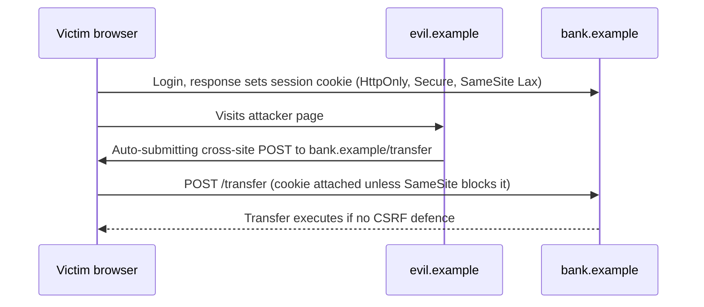
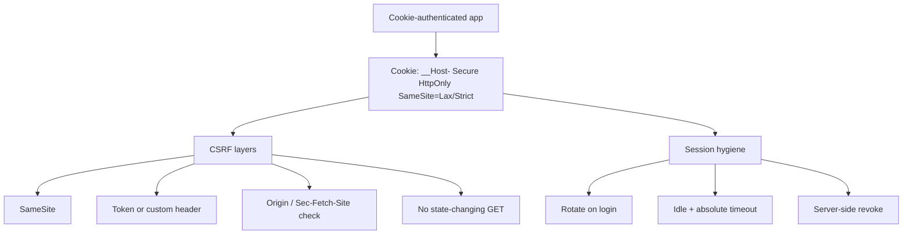

# Cookies, Sessions and CSRF

> Verification note: cookie attribute semantics (`Secure`, `HttpOnly`, `SameSite` default of `Lax`, `SameSite=None` requires `Secure`, `Domain`/`Path` scope, `Max-Age` precedence, session regeneration on login, `Clear-Site-Data: "cookies"`, the four prefixes `__Secure-`, `__Host-`, `__Http-`, `__Host-Http-`) were verified against MDN "Using HTTP cookies" (Sep 2026). BFF cookie guidance and CSRF-defence options (SameSite limits, custom header + CORS, double-submit) come from IETF RFC 10017 (Aug 2026). Server-Action Origin checking comes from the Next.js docs researched earlier. Not re-verified and marked *(hedged)*: browser-specific SameSite edge cases (e.g., Lax-allowing-unsafe), CHIPS/`Partitioned`, Storage Access API, FedCM, third-party-cookie deprecation status, `Sec-Fetch-*` support details, framework CSRF libraries. Browser-level overview: [browser-internals/06 §5](../browser-internals/06-browser-security-model.md#5-cookies-and-cross-site-requests-samesite-csrf) and [browser-internals/05 §3](../browser-internals/05-browser-storage-and-caching-apis.md#3-cookies-in-depth).

## Table of Contents

1. [Quick Summary (TL;DR)](#1-quick-summary-tldr)
2. [Session Management Models](#2-session-management-models)
3. [Secure Cookie Attributes](#3-secure-cookie-attributes)
4. [Session Lifecycle: Login, Fixation, Timeouts, Logout](#4-session-lifecycle-login-fixation-timeouts-logout)
5. [CSRF: How It Works](#5-csrf-how-it-works)
6. [CSRF Defences](#6-csrf-defences)
7. [SameSite in Practice and Its Limits](#7-samesite-in-practice-and-its-limits)
8. [CSRF in SPAs, APIs, Server Actions and WebSockets](#8-csrf-in-spas-apis-server-actions-and-websockets)
9. [Third-Party Cookies and Their Replacements](#9-third-party-cookies-and-their-replacements)
10. [Cookies vs Tokens in Storage](#10-cookies-vs-tokens-in-storage)
11. [Pitfalls](#11-pitfalls)
12. [Interview Questions — Fundamentals](#12-interview-questions--fundamentals)
13. [Interview Questions — Senior Scenarios](#13-interview-questions--senior-scenarios)
14. [Cheat Sheet](#14-cheat-sheet)
15. [Key Terms Glossary](#15-key-terms-glossary)
16. [Further Reading](#16-further-reading)

---

## 1. Quick Summary (TL;DR)

- **Cookie-based sessions are the default recommendation for first-party web apps:** an opaque (or encrypted) session identifier in an **`HttpOnly; Secure; SameSite`** cookie, preferably with the **`__Host-`** prefix.
- **Cookies are ambient authority:** the browser attaches them automatically, which is exactly what makes **CSRF** possible. HttpOnly protects against *reading* the cookie via XSS, **not** against attacker JS making requests that carry it.
- **SameSite:** MDN — if no attribute is set, the cookie is treated as **`Lax`** by default. `Strict` = only same-site requests; `Lax` = also top-level navigations from other sites; `None` = always sent but **requires `Secure`**.
- **SameSite alone is not a complete CSRF defence** (same-site subdomain takeover, `Lax` navigations, legacy browsers). Layer it with **CSRF tokens**, a **custom request header** (forces CORS preflight), **Origin/Fetch-Metadata checks**, and **no state-changing GET**.
- **Regenerate the session identifier on login/privilege change** to prevent session fixation (MDN).
- **JWT vs server session** is a *lifecycle and revocation* question, not a "stateless = better" one; storing JWTs in `localStorage` makes XSS token theft trivial ([05](05-authentication-and-authorization-in-the-frontend.md)).



---

## 2. Session Management Models

| Model | How it works | Strengths | Weaknesses |
|---|---|---|---|
| **Server-side session (opaque ID cookie)** | Cookie holds a random ID; server stores state (Redis/DB) | Instant revocation, small cookie, no data exposure | Needs shared store; sticky/replicated sessions at scale (RFC 10017 notes scalability downsides) |
| **Signed/encrypted client-side session (cookie holds the session)** | Server signs/encrypts a payload into the cookie | No server store | Hard to revoke; cookie size (~4 KB per MDN); key rotation |
| **JWT access token in JS storage (SPA)** | JS attaches `Authorization: Bearer …` | No CSRF (not ambient) | XSS steals token; revocation/rotation complexity ([05](05-authentication-and-authorization-in-the-frontend.md)) |
| **BFF session cookie → server-held tokens** | Cookie maps to access/refresh tokens stored server-side | Tokens never reach the browser; RFC 10017's top recommendation | Requires BFF; must defend CSRF |

Guidance: for a browser app whose API shares the site, a **server session cookie or BFF** is simpler and safer than home-grown token handling. MDN's note: consider "an opaque identifier that the server looks up rather than storing sensitive information directly in cookies".

---

## 3. Secure Cookie Attributes

```http
Set-Cookie: __Host-Http-session=3f9a…; Secure; HttpOnly; Path=/; SameSite=Lax; Max-Age=3600
```

| Attribute | Verified behaviour (MDN) | Security guidance |
|---|---|---|
| **`Secure`** | Sent only over HTTPS (localhost exception exists but isn't supported by Safari); insecure sites can't set `Secure` cookies | Always for session cookies |
| **`HttpOnly`** | Not accessible via `document.cookie` (or the Cookie Store API); only sent to the server | Always for session/auth cookies; mitigates **cookie theft** via XSS, not request forgery from XSS |
| **`SameSite`** | `Strict` / `Lax` / `None`; **unset ⇒ treated as `Lax`**; `None` requires `Secure` | Prefer `Lax` for general sessions, `Strict` for high-risk apps (banking, admin), `None` only for genuine cross-site embeds |
| **`Domain`** | If set, cookie goes to that domain **and subdomains**; if omitted, host-only | **Omit** to avoid sharing with subdomains (reduces subdomain-takeover/fixation risk) |
| **`Path`** | Limits where the cookie is sent; **not a security boundary** (MDN) | Use `/` with `__Host-` |
| **`Max-Age` / `Expires`** | `Max-Age` takes precedence and is less error-prone; session cookies (no expiry) may persist with session restore | Short lifetimes for sensitive sessions; absolute + idle timeouts server-side |
| **Prefixes** | `__Secure-` (Secure, set from HTTPS); `__Host-` (Secure, **no `Domain`, `Path=/`**, host-only); `__Http-` (Secure + HttpOnly); `__Host-Http-` (both sets of rules) | Use **`__Host-`** (or `__Host-Http-` where supported) for session cookies; server must check the **full name including prefix** |
| **Size/count** | ~4 KB per cookie, limited count per domain | Don't store data in cookies (they're sent on every request) |

RFC 10017's BFF cookie requirements: **Secure MUST, HttpOnly MUST, SameSite=Strict SHOULD, Path=/ SHOULD, no Domain SHOULD, `__Host-Http-` prefix SHOULD**; for client-side sessions that contain tokens, **encrypt the cookie contents** so tokens aren't plaintext on disk.

### Example (Express-style)
```js
res.cookie('__Host-session', sessionId, {
  httpOnly: true, secure: true, sameSite: 'lax', path: '/', maxAge: 60 * 60 * 1000,
});   // note: no 'domain'
```

---

## 4. Session Lifecycle: Login, Fixation, Timeouts, Logout

1. **Login:** verify credentials (rate limit, MFA), then **issue a new session ID** (MDN: "regenerate and resend session cookies … whenever a user authenticates" to prevent **session fixation**). Never accept a session ID from the URL.
2. **Privilege change / step-up (MFA, password change):** rotate the ID again.
3. **Timeouts:** **idle** timeout (e.g., 15–30 min for sensitive apps) and **absolute** timeout (e.g., 8–24 h) *(typical values; set per risk)*; sliding renewal with caution.
4. **Logout:** invalidate the server-side session; expire the cookie (`Max-Age=0` with the same name/path/domain); optionally send **`Clear-Site-Data: "cookies"`** (clears all cookies of the registrable domain and subdomains — verified; use deliberately); also clear client caches/state; **close the bfcache hole** by refreshing/clearing sensitive state on `pageshow` with `persisted` ([web-performance/03](../web-performance/03-network-caching-and-delivery.md)).
5. **Revocation:** password change/compromise → invalidate all sessions; device/session list for users.
6. **Concurrency:** multi-tab logout via `BroadcastChannel`/`storage` events; handle 401 globally in the API client.
7. **Cookie replay & theft detection:** bind sessions to coarse device signals (careful with privacy/false positives), alert on impossible travel, use re-auth for sensitive actions *(hedged)*.
8. **Remember-me:** separate long-lived token with rotation and device binding, not a longer session cookie.

---

## 5. CSRF: How It Works

**Cross-Site Request Forgery**: a malicious site causes the victim's browser to send an authenticated request to the target because the browser **automatically attaches cookies** (and other ambient credentials like HTTP auth or client certs).

Preconditions: (1) a state-changing action, (2) authenticated via ambient credentials, (3) the attacker can predict/forge all required parameters.

Common vectors:
- Auto-submitting `<form method=POST>` (cross-site) — no JS needed, **no CORS preflight**, response not readable (which doesn't matter for the attacker).
- `` for state-changing **GET**.
- `fetch(..., { mode: 'no-cors', credentials: 'include' })` for CORS-safelisted requests (simple POST with `text/plain`, form-encoded or multipart bodies).
- **Login CSRF:** forcing the victim into the attacker's account.
- **Subdomain/same-site attackers** (XSS or takeover on `blog.example.com`) bypass SameSite.

> **CORS is not a CSRF defence.** CORS controls *reading* responses; "simple" requests are sent regardless. RFC 10017 explains why CORS can only help if requests are forced to be preflighted (custom header).

---

## 6. CSRF Defences

| Defence | How | Notes |
|---|---|---|
| **SameSite cookies** | `Lax` (default) blocks cross-site POST/fetch cookie attachment; `Strict` blocks all cross-site | First line of defence; not sufficient alone ([§7](#7-samesite-in-practice-and-its-limits)) |
| **Synchroniser token** | Random per-session (or per-request) token embedded in the page/form; server compares with session | Strong; needs server state or signed tokens |
| **Double-submit cookie (signed)** | Token in a cookie + same value in a header/body; server verifies match (HMAC-bound to session) | RFC 10017: effective if done for all state-changing requests; frameworks often provide it |
| **Custom request header** (`X-Requested-With`/`My-Static-Header: 1`) | Cross-origin requests with custom headers require **CORS preflight**, which attackers' origins fail | RFC 10017's recommended lightweight BFF defence; **every** state-changing endpoint must require it |
| **`Origin`/`Referer` verification** | Reject unsafe-method requests whose `Origin` isn't your origin allow-list | Needs care with proxies, `null` origins, privacy stripping of `Referer` |
| **Fetch Metadata** (`Sec-Fetch-Site`, `Sec-Fetch-Mode`, `Sec-Fetch-Dest`) | Resource-isolation policy: reject `Sec-Fetch-Site: cross-site` for state-changing/API requests | Modern browsers send them *(hedged support)*; fall back for older clients |
| **Method discipline** | State changes only via POST/PUT/PATCH/DELETE; never GET | Foundational |
| **Content-Type enforcement** | Require `application/json` and reject `text/plain`/form types for JSON APIs | Forces preflight for cross-origin JSON; don't rely on it alone |
| **Re-authentication / step-up** | Password/MFA for sensitive actions | Defence for high-risk operations |
| **User interaction checks** | CAPTCHA/confirmations | Last resort UX |

**Token handling rules:** unpredictable (CSPRNG), tied to session, **not in URLs** (leak via `Referer`/logs), not in cookies *without* the double-submit binding, regenerated on login, validated on **every** unsafe request, and compared in constant time.

```ts
// SPA client: attach CSRF header centrally
const api = axios.create({ baseURL: '/api', withCredentials: true });
api.interceptors.request.use((cfg) => {
  cfg.headers['X-CSRF-Token'] = getCsrfTokenFromMeta();   // from server-rendered meta or /csrf endpoint
  return cfg;
});
```
```ts
// Server (Node): reject cross-site unsafe requests using Fetch Metadata + Origin (defence in depth)
function csrfGuard(req, res, next) {
  const unsafe = !['GET', 'HEAD', 'OPTIONS'].includes(req.method);
  if (!unsafe) return next();
  const site = req.get('Sec-Fetch-Site');                 // 'same-origin' | 'same-site' | 'cross-site' | 'none'
  if (site && site !== 'same-origin' && site !== 'none') return res.sendStatus(403);
  const origin = req.get('Origin');
  if (origin && !ALLOWED_ORIGINS.has(origin)) return res.sendStatus(403);
  next();
}
```

---

## 7. SameSite in Practice and Its Limits

| Value | Sent on | Use for |
|---|---|---|
| `Strict` | Only requests initiated from the same site | Sensitive admin/bank sessions; downside: first navigation from an external link arrives unauthenticated (UX) |
| `Lax` | Same-site requests + **top-level cross-site navigations using safe methods** (links) | Default for general sessions |
| `None; Secure` | All requests including cross-site subrequests | Embedded widgets, cross-site SSO iframes, payment flows |

Limits and gotchas:
- **Same-site ≠ same-origin.** `a.example.com` and `b.example.com` are same-site: a compromised/taken-over subdomain can send authenticated requests to your app (RFC 10017 §6.1.3.3.1 uses exactly this example). Defend with tokens/custom headers and clean DNS (no dangling records).
- **Schemeful same-site:** `http://` vs `https://` are different sites for SameSite purposes *(hedged)*.
- **Lax allows top-level GET navigations** — state-changing GETs remain vulnerable.
- **Lax+POST grace period** in some Chromium versions for cookies without explicit SameSite *(hedged — historical 2-minute exception)*; set `SameSite` **explicitly** to avoid relying on defaults.
- **Browsers differ** on defaults and third-party cookie handling; explicit attributes are safer.
- SameSite does not stop attackers who can make requests **from your origin** (XSS).

---

## 8. CSRF in SPAs, APIs, Server Actions and WebSockets

- **Token-in-header APIs (no cookies):** not CSRF-prone because the browser doesn't attach `Authorization` automatically — but XSS can steal tokens ([05](05-authentication-and-authorization-in-the-frontend.md)).
- **Cookie-authenticated JSON APIs:** require a custom header or CSRF token, validate `Origin`, and don't accept form-encoded bodies unless needed.
- **BFF:** RFC 10017 says the BFF **MUST implement a proper CSRF defence** (SameSite=Strict + custom header with strict CORS or double-submit), and **MUST allow-list outbound destinations** to avoid becoming an open proxy for the user's token.
- **Next.js Server Actions** (from nextjs.org docs researched earlier): POST-only; built-in **`Origin` vs `Host`/`X-Forwarded-Host` comparison**; `serverActions.allowedOrigins` for proxies; but **still authenticate and authorise inside every action** (they're public endpoints) ([nextjs-and-rendering/06](../nextjs-and-rendering/06-proxy-auth-and-security.md)).
- **GraphQL over GET/forms:** ensure mutations can't be sent as simple requests (require `application/json` + custom header; disable GET mutations).
- **WebSockets:** the handshake carries cookies and isn't subject to SOP/CORS → **Cross-Site WebSocket Hijacking**; check the `Origin` header on upgrade and/or require a token in the first message ([system-design/04](../system-design/04-chat-and-real-time-messaging.md)).
- **File downloads/uploads via forms:** multipart forms are "simple" requests → need tokens.
- **Mobile/React Native:** typically token-based; CSRF is mostly a browser concern *(hedged)*.

---

## 9. Third-Party Cookies and Their Replacements

MDN: browser vendors "have all started to block third-party cookies by default, or at least made plans to go in that direction"; widgets and cross-site SSO/analytics relying on them break. *(Current per-browser status changes — hedged; verify on MDN's "Third-party cookies" page.)*

Replacements and design guidance *(hedged)*:
| Need | Option |
|---|---|
| Embedded widget needs per-embedding state | **CHIPS** (`Partitioned` attribute) partitions cookies per top-level site |
| Embedded iframe needs first-party cookies | **Storage Access API** (`document.requestStorageAccess()`) with user gesture |
| Federated login | **FedCM**, redirect-based flows, popup flows with `postMessage` |
| Cross-site tracking/ads | Privacy-preserving APIs (Topics/Attribution) — out of scope |
| SSO across your own domains | Same registrable domain, shared auth domain, or redirect-based SSO; token exchange via BFF |
| Silent token renewal via hidden iframe | Increasingly unreliable → use refresh tokens with rotation or BFF ([05](05-authentication-and-authorization-in-the-frontend.md); RFC 10017 notes third-party cookie blocking makes refresh tokens more attractive) |

---

## 10. Cookies vs Tokens in Storage

| Aspect | HttpOnly cookie session | Bearer token in `localStorage` | Bearer token in memory |
|---|---|---|---|
| Readable by XSS? | No (but XSS can still make requests) | **Yes** | Yes (if attacker reaches the variable/closure; prototype poisoning risk per RFC 10017) |
| CSRF risk | **Yes** → needs defences | No | No |
| Survives reload | Yes | Yes | No (needs refresh flow) |
| Revocation | Server-side easy | Hard (short TTL + refresh rotation) | Same |
| Cross-origin API calls | Requires CORS credentials config | Simple | Simple |
| Recommendation | **Preferred for first-party web** | Avoid for sensitive apps | Acceptable when combined with refresh-in-worker/BFF ([05](05-authentication-and-authorization-in-the-frontend.md)) |

RFC 10017 §8.1 also warns: **storing tokens in JS-readable cookies is NOT RECOMMENDED** — the browser then sends them on every request to your domain.

---

## 11. Pitfalls

1. **Relying on SameSite alone** (subdomain attacks, GET mutations).
2. **State-changing GET endpoints.**
3. **CSRF protection only on some routes**; forgotten file-upload/GraphQL/legacy endpoints.
4. **`Access-Control-Allow-Origin: *` with credentials or reflecting any Origin** (turns CSRF into data theft — [06](06-security-headers-cors-and-transport.md)).
5. **Cookies with `Domain=example.com`** unnecessarily shared across all subdomains.
6. **Session ID not rotated on login** (fixation).
7. **Tokens in URLs** (`?token=`) — logs, `Referer`, history.
8. **Long-lived session cookies with no server-side invalidation.**
9. **Assuming HttpOnly defeats XSS** — it prevents theft of the cookie, not in-session abuse.
10. **Not checking the cookie name with prefix** on the server (MDN notes UAs don't strip prefixes).
11. **Using `SameSite=None` "to make it work"** without understanding why (opens CSRF surface).
12. **CSRF token leakage** via `Referer`, logs, cacheable pages or reflected error pages.

---

## 12. Interview Questions — Fundamentals

### Q1. What does each of `Secure`, `HttpOnly` and `SameSite` do?
`Secure`: HTTPS-only transport. `HttpOnly`: not readable by JavaScript. `SameSite`: controls whether the cookie is sent on cross-site requests (`Strict`, `Lax`, `None`; unset behaves as `Lax`).

### Q2. What is CSRF and why does it work?
A cross-site page triggers a state-changing request and the browser automatically attaches the victim's cookies; the server can't distinguish it from a legitimate request without extra proof.

### Q3. Why isn't CORS a CSRF defence?
CORS governs whether scripts can read cross-origin responses; simple requests (forms, `no-cors` fetch) are sent anyway.

### Q4. What are `__Host-` cookies?
Cookies that must be `Secure`, have no `Domain` attribute and `Path=/`, so they're host-only and can't be overwritten by subdomains; the server must check the full name.

### Q5. What is session fixation and how do you prevent it?
An attacker sets or knows the victim's session ID before login; prevent by issuing a new session ID on authentication and never accepting IDs from URLs.

### Q6. When is `SameSite=None` appropriate?
When the cookie genuinely needs to be sent in cross-site contexts (third-party embeds, cross-site SSO), always with `Secure`, and ideally partitioned.

### Q7. What does `HttpOnly` not protect against?
An XSS attacker making authenticated requests from the page, or reading data from API responses.

### Q8. What is the double-submit cookie pattern?
The server sets a token cookie and requires the same token in a header/body; because attackers on other origins can't read your cookie or set your header, a match proves same-site origin — preferably signed/bound to the session.

---

## 13. Interview Questions — Senior Scenarios

### S1. "Migrating from localStorage JWT to cookies: what new risks appear?"
CSRF (ambient credentials): add SameSite, CSRF token/custom header, Origin checks; CORS credentials configuration; cookie scoping (`__Host-`); session invalidation strategy; logout/bfcache; keep XSS defences since in-session abuse remains ([05](05-authentication-and-authorization-in-the-frontend.md)).

### S2. "A subdomain `blog.example.com` runs WordPress; the main app is `app.example.com`. Risk?"
Same-site subdomain compromise can bypass SameSite and set/overwrite cookies scoped to the parent domain (cookie tossing/fixation). Use host-only `__Host-` cookies, CSRF tokens bound to the session, strict CORS, separate registrable domains for untrusted/third-party content, WAF/hardening, and monitor DNS for dangling records (subdomain takeover).

### S3. "Design session management for a banking SPA."
BFF with `__Host-Http-` session cookie (`SameSite=Strict`), server-side session store with idle/absolute timeouts, MFA and step-up for sensitive actions, CSRF custom header + Origin/Fetch Metadata checks, strict CSP, rotation on login, device/session management UI, full logout + `Clear-Site-Data`, bfcache handling, audit logging and anomaly detection.

### S4. "Third-party cookie blocking broke our embedded widget's login. Options?"
Evaluate CHIPS for partitioned state, Storage Access API for first-party storage in frames, redirect/popup-based auth with token handoff via `postMessage` (origin-checked), moving the widget to the customer's first-party domain via a proxy/subdomain, or server-to-server integration; test in Safari/Firefox/Chrome privacy modes.

### S5. "How do you test CSRF defences?"
Automated tests that replay state-changing requests without the token/header, with a wrong `Origin`, with `Sec-Fetch-Site: cross-site`, as form-encoded vs JSON; manual PoC HTML pages on a different site; scan for state-changing GETs; include GraphQL, upload and WebSocket endpoints in the checklist.

---

## 14. Cheat Sheet



| Setting | Recommended |
|---|---|
| Cookie name | `__Host-` (or `__Host-Http-`) prefix |
| Flags | `Secure; HttpOnly; Path=/; SameSite=Lax` (Strict if feasible) |
| Domain | Omit |
| CSRF | Token/custom header + Origin/Fetch-Metadata |
| Logout | Server invalidate + cookie expire + `Clear-Site-Data` as needed |

---

## 15. Key Terms Glossary

| Term | Definition |
|---|---|
| **Ambient authority** | Credentials the browser attaches automatically (cookies) |
| **CSRF** | Forged authenticated requests from another site |
| **Session fixation** | Attacker-chosen session ID reused after login |
| **SameSite** | Cookie attribute controlling cross-site sending |
| **Cookie prefix** | Name-based enforcement of cookie attributes |
| **Double-submit** | Token in cookie and request, compared server-side |
| **CHIPS** | Partitioned third-party cookies *(hedged)* |
| **Fetch Metadata** | `Sec-Fetch-*` request context headers |

---

## 16. Further Reading

- [MDN — Using HTTP cookies](https://developer.mozilla.org/en-US/docs/Web/HTTP/Guides/Cookies) · [Set-Cookie reference](https://developer.mozilla.org/en-US/docs/Web/HTTP/Reference/Headers/Set-Cookie) · [Third-party cookies](https://developer.mozilla.org/en-US/docs/Web/Privacy/Guides/Third-party_cookies)
- [IETF RFC 10017 (OAuth 2.0 for Browser-Based Applications)](https://datatracker.ietf.org/doc/rfc10017/) §6.1.3 · [OWASP CSRF Prevention Cheat Sheet](https://cheatsheetseries.owasp.org/cheatsheets/Cross-Site_Request_Forgery_Prevention_Cheat_Sheet.html) · [OWASP Session Management Cheat Sheet](https://cheatsheetseries.owasp.org/cheatsheets/Session_Management_Cheat_Sheet.html)
- This repo: [05 Auth in the frontend](05-authentication-and-authorization-in-the-frontend.md) · [06 Headers, CORS and transport](06-security-headers-cors-and-transport.md) · [browser-internals/06 Browser security model](../browser-internals/06-browser-security-model.md)
